# API Reference

<cite>
**Referenced Files in This Document**
- [README.md](file://README.md)
- [dllexport.h](file://DllHsBaSlicer/dllexport.h)
- [pipeline_types.h](file://pipelinetypes/pipeline_types.h)
- [fdm_pipeline.h](file://DllHsBaSlicer/fdm_pipeline.h)
- [sla_pipeline.h](file://DllHsBaSlicer/sla_pipeline.h)
- [sls_pipeline.h](file://DllHsBaSlicer/sls_pipeline.h)
- [lom_pipeline.h](file://DllHsBaSlicer/lom_pipeline.h)
- [tdp_pipeline.h](file://DllHsBaSlicer/tdp_pipeline.h)
- [waam_pipeline.h](file://DllHsBaSlicer/waam_pipeline.h)
- [custom_pipeline.h](file://DllHsBaSlicer/custom_pipeline.h)
- [fdm_pipeline.proto](file://proto/fdm_pipeline.proto)
- [sla_pipeline.proto](file://proto/sla_pipeline.proto)
- [sls_pipeline.proto](file://proto/sls_pipeline.proto)
- [lom_pipeline.proto](file://proto/lom_pipeline.proto)
- [tdp_pipeline.proto](file://proto/tdp_pipeline.proto)
- [waam_pipeline.proto](file://proto/waam_pipeline.proto)
</cite>

## Table of Contents
1. [Introduction](#introduction)
2. [Project Structure](#project-structure)
3. [Core Components](#core-components)
4. [Architecture Overview](#architecture-overview)
5. [Detailed Component Analysis](#detailed-component-analysis)
6. [Dependency Analysis](#dependency-analysis)
7. [Performance Considerations](#performance-considerations)
8. [Troubleshooting Guide](#troubleshooting-guide)
9. [Conclusion](#conclusion)
10. [Appendices](#appendices)

## Introduction
This document is the comprehensive API reference for HsBaSlicer, focusing on:
- The C ABI exported by DllHsBaSlicer for FDM, SLA, SLS, LOM, TDP (3DP), WAAM, and fully custom Lua-driven pipelines.
- The LibHsBaSlicer C++ library architecture and its core slicing, mesh processing, path generation, support generation, and utility modules.
- Protocol buffer definitions used for cross-language communication.
- Error handling patterns, usage examples, versioning guidance, deprecation policy, and migration notes.

HsBaSlicer is a modular, cross-platform C++ framework for 3D-printing slicers intended for research and production-level pipelines. It exposes both a C ABI shared library and a C++ static/shared library target, with installable CMake configuration and proto-generated bindings.

**Section sources**
- [README.md:21-38](file://README.md#L21-L38)
- [README.md:100-124](file://README.md#L100-L124)

## Project Structure
The repository organizes APIs into clear layers:
- DllHsBaSlicer: C ABI entry points for each pipeline type.
- pipelinetypes: C-compatible structs, enums, and default initializers for all pipeline configurations and results.
- LibHsBaSlicer: Core C++ slicing capabilities (preprocess, slice, support, fill, floor, path generation, transfer).
- proto: Protobuf messages mirroring pipeline configs/results for multi-language clients.

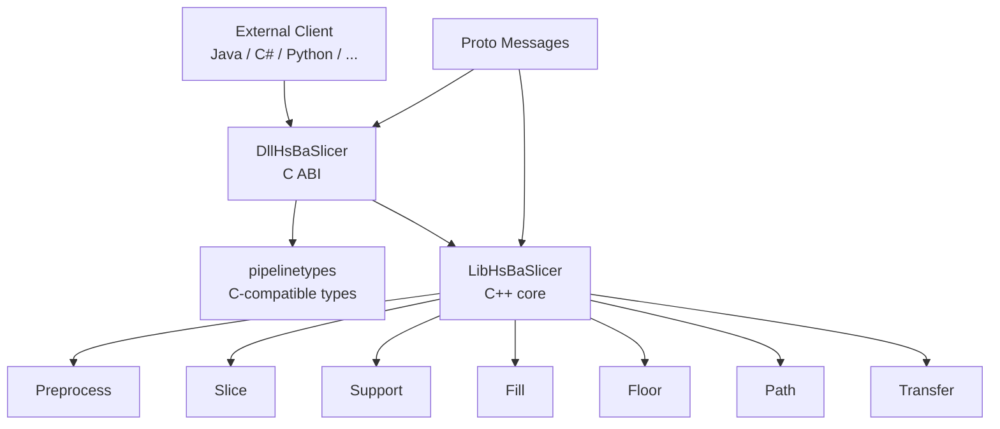

**Diagram sources**
- [README.md:126-150](file://README.md#L126-L150)
- [fdm_pipeline.h:9-10](file://DllHsBaSlicer/fdm_pipeline.h#L9-L10)
- [pipeline_types.h:5-12](file://pipelinetypes/pipeline_types.h#L5-L12)

**Section sources**
- [README.md:126-150](file://README.md#L126-L150)

## Core Components
This section documents the C ABI endpoints exposed by DllHsBaSlicer. Each pipeline provides:
- A default config creator.
- A synchronous run function.
- An asynchronous run function.
- A result-free function.

All functions are annotated with HSBA_SLICER_API for symbol export/import.

**Diagram sources**
- [fdm_pipeline.h:17-61](file://DllHsBaSlicer/fdm_pipeline.h#L17-L61)
- [sla_pipeline.h:17-56](file://DllHsBaSlicer/sla_pipeline.h#L17-L56)
- [sls_pipeline.h:17-56](file://DllHsBaSlicer/sls_pipeline.h#L17-L56)
- [lom_pipeline.h:17-56](file://DllHsBaSlicer/lom_pipeline.h#L17-L56)
- [tdp_pipeline.h:17-56](file://DllHsBaSlicer/tdp_pipeline.h#L17-L56)
- [waam_pipeline.h:17-57](file://DllHsBaSlicer/waam_pipeline.h#L17-L57)
- [custom_pipeline.h:17-62](file://DllHsBaSlicer/custom_pipeline.h#L17-L62)

**Section sources**
- [dllexport.h:1-23](file://DllHsBaSlicer/dllexport.h#L1-L23)
- [fdm_pipeline.h:17-61](file://DllHsBaSlicer/fdm_pipeline.h#L17-L61)
- [sla_pipeline.h:17-56](file://DllHsBaSlicer/sla_pipeline.h#L17-L56)
- [sls_pipeline.h:17-56](file://DllHsBaSlicer/sls_pipeline.h#L17-L56)
- [lom_pipeline.h:17-56](file://DllHsBaSlicer/lom_pipeline.h#L17-L56)
- [tdp_pipeline.h:17-56](file://DllHsBaSlicer/tdp_pipeline.h#L17-L56)
- [waam_pipeline.h:17-57](file://DllHsBaSlicer/waam_pipeline.h#L17-L57)
- [custom_pipeline.h:17-62](file://DllHsBaSlicer/custom_pipeline.h#L17-L62)

## Architecture Overview
Each pipeline follows a consistent flow:
- Preprocess model loading.
- Slice geometry into layers.
- Optional support generation.
- Optional fill or floor generation.
- Export to target format (G-code, layer images zip, robot program, or Lua-defined output).

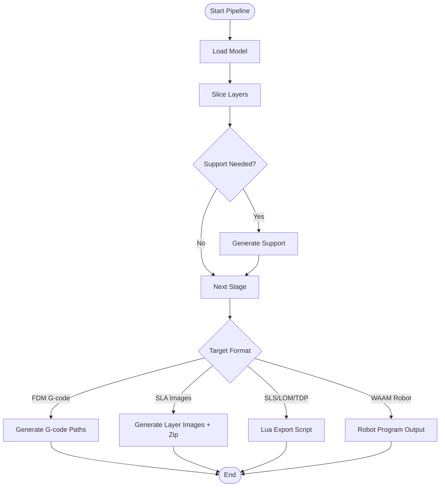

**Diagram sources**
- [fdm_pipeline.h:23-35](file://DllHsBaSlicer/fdm_pipeline.h#L23-L35)
- [sla_pipeline.h:23-34](file://DllHsBaSlicer/sla_pipeline.h#L23-L34)
- [sls_pipeline.h:23-34](file://DllHsBaSlicer/sls_pipeline.h#L23-L34)
- [lom_pipeline.h:23-36](file://DllHsBaSlicer/lom_pipeline.h#L23-L36)
- [tdp_pipeline.h:23-36](file://DllHsBaSlicer/tdp_pipeline.h#L23-L36)
- [waam_pipeline.h:23-37](file://DllHsBaSlicer/waam_pipeline.h#L23-L37)

**Section sources**
- [fdm_pipeline.h:23-35](file://DllHsBaSlicer/fdm_pipeline.h#L23-L35)
- [sla_pipeline.h:23-34](file://DllHsBaSlicer/sla_pipeline.h#L23-L34)
- [sls_pipeline.h:23-34](file://DllHsBaSlicer/sls_pipeline.h#L23-L34)
- [lom_pipeline.h:23-36](file://DllHsBaSlicer/lom_pipeline.h#L23-L36)
- [tdp_pipeline.h:23-36](file://DllHsBaSlicer/tdp_pipeline.h#L23-L36)
- [waam_pipeline.h:23-37](file://DllHsBaSlicer/waam_pipeline.h#L23-L37)

## Detailed Component Analysis

### FDM Pipeline API (DllHsBaSlicer)
- Default config: HsBaCreateDefaultConfig returns HsBaFdmPipelineConfig_t with defaults.
- Sync run: HsBaRunFdmPipeline executes Preprocess -> Slice -> Support -> Fill -> Path Generation.
- Async run: HsBaRunFdmPipelineAsync uses coroutines; completion delivered via HsBaResultCallback.
- Result free: HsBaFreePipelineResult releases gcode_content and error_message.

Key configuration fields include model_name/model_path, layer_height/first_layer_height, fill parameters, support parameters, path/print settings, firmware selection, nozzle/filament specs, temperatures, retraction, optional Lua scripts for support/infill, and output_path.

Result fields include success, total_layers, gcode_content, error_message, elapsed_seconds.

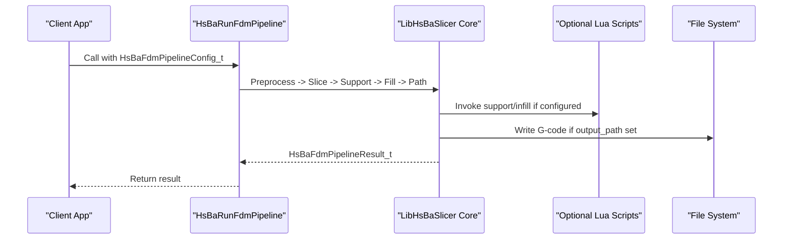

**Diagram sources**
- [fdm_pipeline.h:23-61](file://DllHsBaSlicer/fdm_pipeline.h#L23-L61)
- [pipeline_types.h:53-127](file://pipelinetypes/pipeline_types.h#L53-L127)

**Section sources**
- [fdm_pipeline.h:17-61](file://DllHsBaSlicer/fdm_pipeline.h#L17-L61)
- [pipeline_types.h:53-127](file://pipelinetypes/pipeline_types.h#L53-L127)

### SLA Pipeline API (DllHsBaSlicer)
- Default config: HsBaCreateDefaultSlaConfig returns HsBaSlaPipelineConfig_t with defaults.
- Sync run: HsBaRunSlaPipeline executes Preprocess -> Slice -> Floor -> Support -> Export (zip).
- Async run: HsBaRunSlaPipelineAsync completes via HsBaSlaResultCallback.
- Result free: HsBaFreeSlaPipelineResult releases export_path and error_message.

Configuration includes model inputs, slice settings, exposure/lift/retract parameters, floor/raft options, support parameters, Lua customization for support/floor/export, image format/size, and output_path.

Result fields include success, total_layers, export_path, error_message, elapsed_seconds.

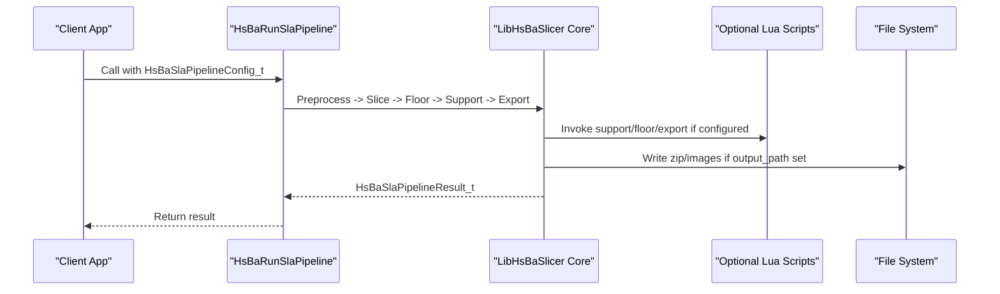

**Diagram sources**
- [sla_pipeline.h:17-56](file://DllHsBaSlicer/sla_pipeline.h#L17-L56)
- [pipeline_types.h:165-232](file://pipelinetypes/pipeline_types.h#L165-L232)

**Section sources**
- [sla_pipeline.h:17-56](file://DllHsBaSlicer/sla_pipeline.h#L17-L56)
- [pipeline_types.h:165-232](file://pipelinetypes/pipeline_types.h#L165-L232)

### SLS Pipeline API (DllHsBaSlicer)
- Default config: HsBaCreateDefaultSlsConfig returns HsBaSlsPipelineConfig_t with defaults.
- Sync run: HsBaRunSlsPipeline executes Preprocess -> Slice -> Export (Lua script required).
- Async run: HsBaRunSlsPipelineAsync completes via HsBaSlsResultCallback.
- Result free: HsBaFreeSlsPipelineResult releases export_path and error_message.

Configuration includes model inputs, slice settings, laser/power/scan/hatch/bed temperature, required export_lua_script/export_lua_func, and output_path.

Result fields include success, total_layers, export_path, error_message, elapsed_seconds.

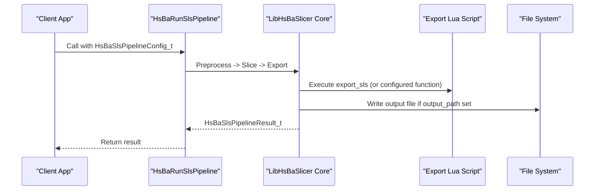

**Diagram sources**
- [sls_pipeline.h:17-56](file://DllHsBaSlicer/sls_pipeline.h#L17-L56)
- [pipeline_types.h:251-297](file://pipelinetypes/pipeline_types.h#L251-L297)

**Section sources**
- [sls_pipeline.h:17-56](file://DllHsBaSlicer/sls_pipeline.h#L17-L56)
- [pipeline_types.h:251-297](file://pipelinetypes/pipeline_types.h#L251-L297)

### LOM Pipeline API (DllHsBaSlicer)
- Default config: HsBaCreateDefaultLomConfig returns HsBaLomPipelineConfig_t with defaults.
- Sync run: HsBaRunLomPipeline executes Preprocess -> Slice -> Export (Lua script required).
- Async run: HsBaRunLomPipelineAsync completes via HsBaLomResultCallback.
- Result free: HsBaFreeLomPipelineResult releases export_path and error_message.

Configuration includes model inputs, sheet thickness/first layer, cut speed/margin/power, bond temperature/pressure/time, seal_contour, cut_mode, required export_lua_script/export_lua_func, and output_path.

Result fields include success, total_layers, export_path, error_message, elapsed_seconds.

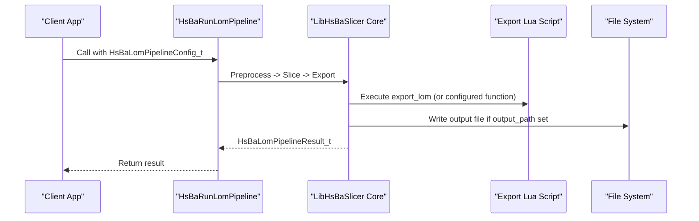

**Diagram sources**
- [lom_pipeline.h:17-56](file://DllHsBaSlicer/lom_pipeline.h#L17-L56)
- [pipeline_types.h:416-448](file://pipelinetypes/pipeline_types.h#L416-L448)

**Section sources**
- [lom_pipeline.h:17-56](file://DllHsBaSlicer/lom_pipeline.h#L17-L56)
- [pipeline_types.h:416-448](file://pipelinetypes/pipeline_types.h#L416-L448)

### TDP (3DP) Pipeline API (DllHsBaSlicer)
- Default config: HsBaCreateDefaultTdpConfig returns HsBaTdpPipelineConfig_t with defaults.
- Sync run: HsBaRunTdpPipeline executes Preprocess -> Slice -> Export (Lua script required).
- Async run: HsBaRunTdpPipelineAsync completes via HsBaTdpResultCallback.
- Result free: HsBaFreeTdpPipelineResult releases export_path and error_message.

Configuration includes model inputs, slice settings, head_count, drop_spacing, binder_saturation, ink_curing_time, bed_temperature, binder_mode, required export_lua_script/export_lua_func, output_path, and spiral_mode.

Result fields include success, total_layers, export_path, error_message, elapsed_seconds.

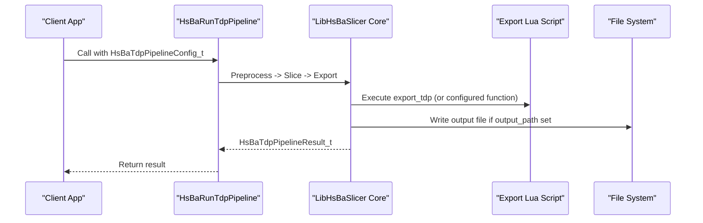

**Diagram sources**
- [tdp_pipeline.h:17-56](file://DllHsBaSlicer/tdp_pipeline.h#L17-L56)
- [pipeline_types.h:477-508](file://pipelinetypes/pipeline_types.h#L477-L508)

**Section sources**
- [tdp_pipeline.h:17-56](file://DllHsBaSlicer/tdp_pipeline.h#L17-L56)
- [pipeline_types.h:477-508](file://pipelinetypes/pipeline_types.h#L477-L508)

### WAAM Pipeline API (DllHsBaSlicer)
- Default config: HsBaCreateDefaultWaamConfig returns HsBaWaamPipelineConfig_t with defaults.
- Sync run: HsBaRunWaamPipeline executes Preprocess -> Slice -> Robot path export.
- Async run: HsBaRunWaamPipelineAsync completes via HsBaWaamResultCallback.
- Result free: HsBaFreeWaamPipelineResult releases output_path and error_message.

Configuration includes model inputs, bead/layer height, travel speed, wire feed speed, arc current/voltage, gas flow rate, material, welding process, protection method, shielding gas, interpass temperature, robot_type, optional path_lua_script/path_lua_func, output_path, and spiral_mode.

Result fields include success, total_layers, output_path, error_message, elapsed_seconds.

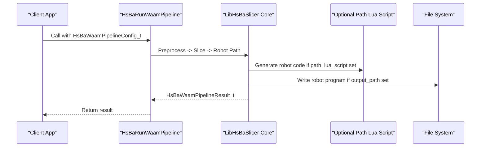

**Diagram sources**
- [waam_pipeline.h:17-57](file://DllHsBaSlicer/waam_pipeline.h#L17-L57)
- [pipeline_types.h:573-612](file://pipelinetypes/pipeline_types.h#L573-L612)

**Section sources**
- [waam_pipeline.h:17-57](file://DllHsBaSlicer/waam_pipeline.h#L17-L57)
- [pipeline_types.h:573-612](file://pipelinetypes/pipeline_types.h#L573-L612)

### Custom Lua Pipeline API (DllHsBaSlicer)
- Default config: HsBaCreateDefaultCustomConfig returns HsBaCustomPipelineConfig_t with defaults.
- Sync run: HsBaRunCustomPipeline executes a fully Lua-driven workflow defined by pipeline_lua_script or pipeline_lua_source, exposing the global HsBa table with slicing building blocks.
- Async run: HsBaRunCustomPipelineAsync completes via HsBaCustomResultCallback.
- Result free: HsBaFreeCustomPipelineResult releases output_path, result_string, and error_message.

Configuration includes pipeline_lua_script/pipeline_lua_source, entry_func, config_json, optional model_name/model_path, and output_path.

Result fields include success, total_layers, output_path, result_string, error_message, elapsed_seconds.

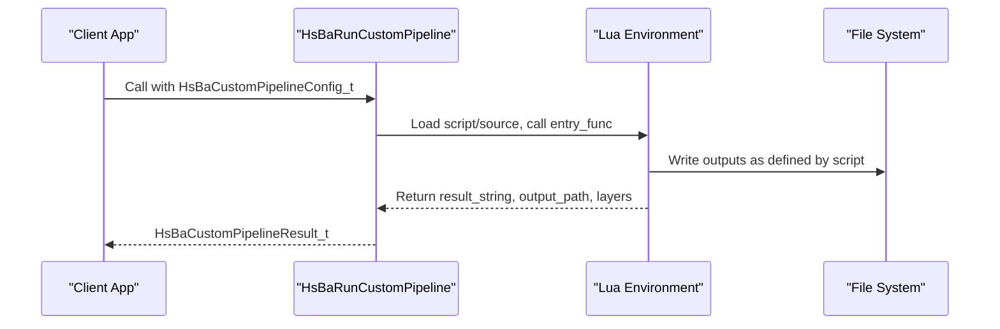

**Diagram sources**
- [custom_pipeline.h:17-62](file://DllHsBaSlicer/custom_pipeline.h#L17-L62)
- [pipeline_types.h:680-719](file://pipelinetypes/pipeline_types.h#L680-L719)

**Section sources**
- [custom_pipeline.h:17-62](file://DllHsBaSlicer/custom_pipeline.h#L17-L62)
- [pipeline_types.h:680-719](file://pipelinetypes/pipeline_types.h#L680-L719)

## Dependency Analysis
The C ABI depends on:
- dllexport.h for symbol visibility.
- pipelinetypes/pipeline_types.h for POD config/result types and default initializers.
- LibHsBaSlicer core modules for actual processing.

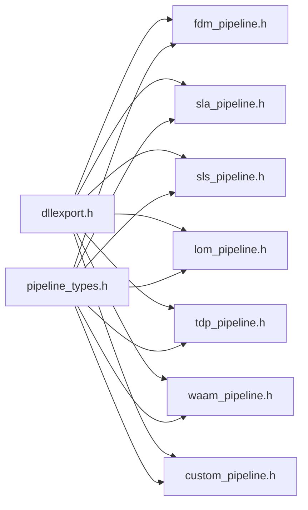

**Diagram sources**
- [dllexport.h:1-23](file://DllHsBaSlicer/dllexport.h#L1-L23)
- [pipeline_types.h:5-12](file://pipelinetypes/pipeline_types.h#L5-L12)
- [fdm_pipeline.h:9-10](file://DllHsBaSlicer/fdm_pipeline.h#L9-L10)
- [sla_pipeline.h:9-10](file://DllHsBaSlicer/sla_pipeline.h#L9-L10)
- [sls_pipeline.h:9-10](file://DllHsBaSlicer/sls_pipeline.h#L9-L10)
- [lom_pipeline.h:9-10](file://DllHsBaSlicer/lom_pipeline.h#L9-L10)
- [tdp_pipeline.h:9-10](file://DllHsBaSlicer/tdp_pipeline.h#L9-L10)
- [waam_pipeline.h:9-10](file://DllHsBaSlicer/waam_pipeline.h#L9-L10)
- [custom_pipeline.h:9-10](file://DllHsBaSlicer/custom_pipeline.h#L9-L10)

**Section sources**
- [dllexport.h:1-23](file://DllHsBaSlicer/dllexport.h#L1-L23)
- [pipeline_types.h:5-12](file://pipelinetypes/pipeline_types.h#L5-L12)

## Performance Considerations
- Use async APIs when integrating with UI threads to avoid blocking.
- Prefer setting output_path to write directly to disk instead of holding large strings in memory.
- For FDM, enabling spiral_mode reduces per-layer infill/support computation at the cost of continuous outer-wall deposition.
- For SLA, selecting PNG vs JPEG affects output size and processing time.
- For SLM/SLS/LOM/TDP/WAAM, tuning hatch spacing, scan speed, and bed temperature impacts throughput and quality.

[No sources needed since this section provides general guidance]

## Troubleshooting Guide
Common issues and resolutions:
- Missing export_lua_script for SLS/LOM/TDP: Ensure the required Lua export script is provided; otherwise the pipeline cannot produce output.
- Null callbacks: Progress callbacks can be NULL; result callbacks must not be NULL for async runs.
- Memory leaks: Always call the corresponding HsBaFree*PipelineResult function after using results.
- Invalid paths: Validate model_path and output_path before calling pipeline functions.
- Lua errors: Check error_message in results; inspect Lua script paths and function names.

Error handling pattern:
- Check result.success.
- If false, read error_message and log it.
- Free allocated strings using the appropriate HsBaFree* function.

**Section sources**
- [fdm_pipeline.h:53-61](file://DllHsBaSlicer/fdm_pipeline.h#L53-L61)
- [sla_pipeline.h:49-56](file://DllHsBaSlicer/sla_pipeline.h#L49-L56)
- [sls_pipeline.h:49-56](file://DllHsBaSlicer/sls_pipeline.h#L49-L56)
- [lom_pipeline.h:52-56](file://DllHsBaSlicer/lom_pipeline.h#L52-L56)
- [tdp_pipeline.h:52-56](file://DllHsBaSlicer/tdp_pipeline.h#L52-L56)
- [waam_pipeline.h:53-57](file://DllHsBaSlicer/waam_pipeline.h#L53-L57)
- [custom_pipeline.h:57-62](file://DllHsBaSlicer/custom_pipeline.h#L57-L62)

## Conclusion
HsBaSlicer provides a robust, extensible set of slicing pipelines through a stable C ABI and a rich C++ library. Clients should prefer async APIs for responsiveness, configure pipelines via the provided default creators, and leverage Lua scripting for customization. Proper error handling and resource cleanup are essential for reliable integration.

[No sources needed since this section summarizes without analyzing specific files]

## Appendices

### Protocol Buffer Definitions
Cross-language clients may use the following proto messages to construct pipeline configurations and parse results:
- FDM: msg_fdm_pipeline_config, msg_fdm_pipe_result
- SLA: sla_pipe_config, sla_pipe_result
- SLS: sls_pipe_config, sls_pipe_result
- LOM: lom_pipe_config, lom_pipe_result
- TDP: tdp_pipe_config, tdp_pipe_result
- WAAM: waam_pipe_config, waam_pipe_result

These messages mirror the C ABI structs and enums, enabling serialization across languages.

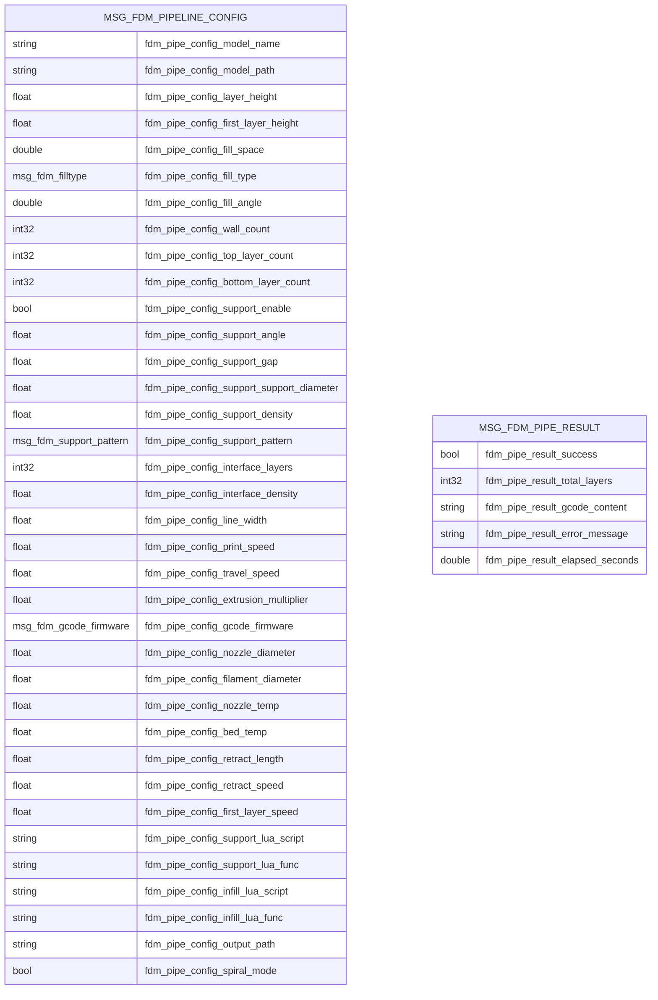

**Diagram sources**
- [fdm_pipeline.proto:26-81](file://proto/fdm_pipeline.proto#L26-L81)

**Section sources**
- [fdm_pipeline.proto:1-81](file://proto/fdm_pipeline.proto#L1-L81)
- [sla_pipeline.proto:1-67](file://proto/sla_pipeline.proto#L1-L67)
- [sls_pipeline.proto:1-33](file://proto/sls_pipeline.proto#L1-L33)
- [lom_pipeline.proto:1-46](file://proto/lom_pipeline.proto#L1-L46)
- [tdp_pipeline.proto:1-47](file://proto/tdp_pipeline.proto#L1-L47)
- [waam_pipeline.proto:1-89](file://proto/waam_pipeline.proto#L1-L89)

### Versioning, Deprecation Policy, and Migration Notes
- Version information is available via installed headers and runtime queries as described in the README.
- When upgrading:
  - Compare struct layouts and enum values between versions.
  - Update proto definitions if field numbers change.
  - Review deprecations in header comments and README installation/export sections.
- Migration steps:
  - Replace deprecated config fields with new ones.
  - Adjust Lua script interfaces if pipeline stages changed.
  - Rebuild dependent applications against updated headers and libraries.

**Section sources**
- [README.md:100-124](file://README.md#L100-L124)