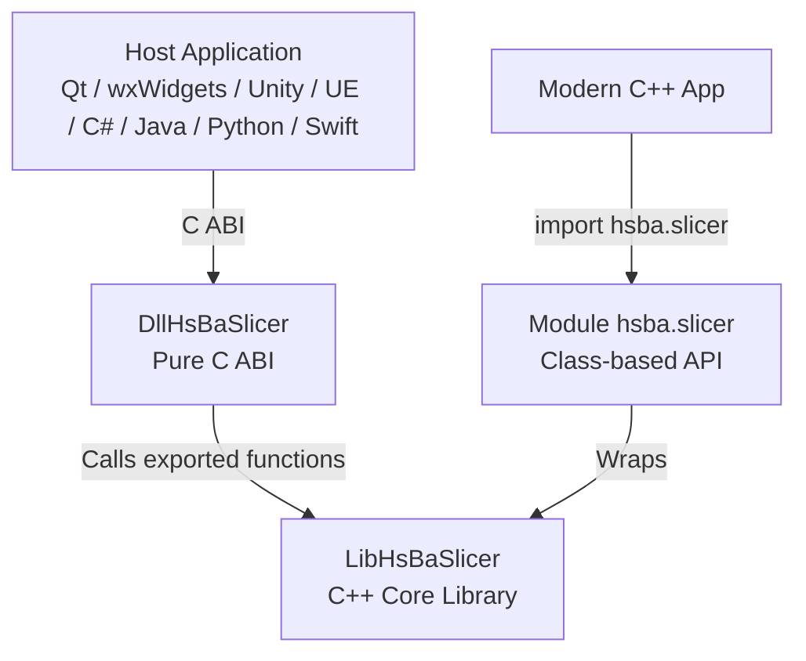
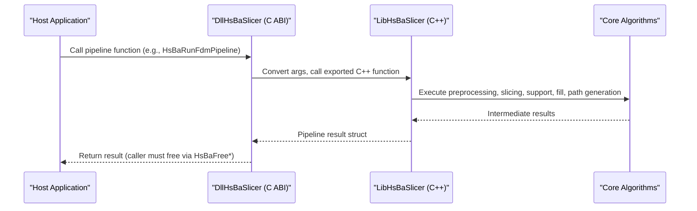
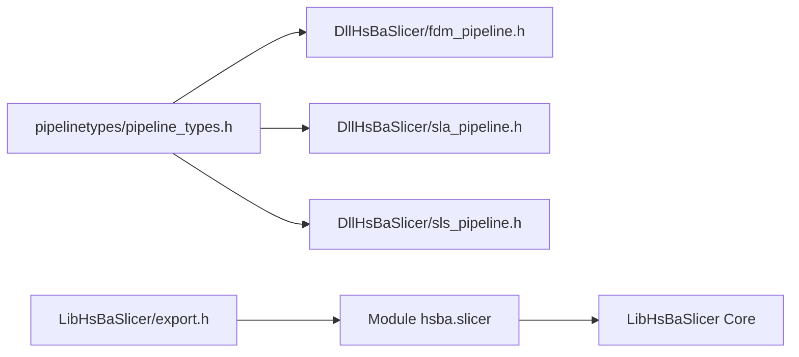

# API Reference

<cite>
**Referenced Files in This Document**
- [README.md](file://README.md)
- [dllexport.h](file://DllHsBaSlicer/dllexport.h)
- [initialize.h](file://DllHsBaSlicer/initialize.h)
- [version_info.h](file://DllHsBaSlicer/version_info.h)
- [fdm_pipeline.h](file://DllHsBaSlicer/fdm_pipeline.h)
- [sla_pipeline.h](file://DllHsBaSlicer/sla_pipeline.h)
- [sls_pipeline.h](file://DllHsBaSlicer/sls_pipeline.h)
- [export.h](file://LibHsBaSlicer/export.h)
- [hsba_slicer.cppm](file://ModuleHsBaSlicer/hsba_slicer.cppm)
- [pipeline_types.h](file://pipelinetypes/pipeline_types.h)
</cite>

## Table of Contents
1. [Introduction](#introduction)
2. [Project Structure](#project-structure)
3. [Core Components](#core-components)
4. [Architecture Overview](#architecture-overview)
5. [Detailed Component Analysis](#detailed-component-analysis)
6. [Dependency Analysis](#dependency-analysis)
7. [Performance Considerations](#performance-considerations)
8. [Troubleshooting Guide](#troubleshooting-guide)
9. [Conclusion](#conclusion)
10. [Appendices](#appendices)

## Introduction
This document provides a comprehensive API reference for HsBaSlicer across three integration surfaces:
- C ABI exposed by DllHsBaSlicer (for cross-language and cross-platform use).
- C++ library API provided by LibHsBaSlicer (class-based, modern C++ usage).
- C++20 module interface hsba.slicer (single-file module with class wrappers around LibHsBaSlicer).

It also documents memory ownership patterns, thread-safety considerations, error handling, and version compatibility guidance based on the repository’s headers and documentation.

## Project Structure
HsBaSlicer exposes multiple build targets and installation layouts. The primary public interfaces relevant to this API reference are:
- DllHsBaSlicer: shared/static library exporting a pure C ABI.
- LibHsBaSlicer: C++ static/shared library exposing core slicing functionality.
- ModuleHsBaSlicer: C++20 module hsba.slicer providing a class-based wrapper over LibHsBaSlicer.

**Diagram sources**
- [README.md:104-124](file://README.md#L104-L124)
- [README.md:126-151](file://README.md#L126-L151)

**Section sources**
- [README.md:104-124](file://README.md#L104-L124)
- [README.md:126-151](file://README.md#L126-L151)

## Core Components
This section summarizes the three main API surfaces and their responsibilities.

- DllHsBaSlicer (C ABI):
  - Provides platform-independent entry points for pipeline configuration, execution (sync/async), and result cleanup.
  - Uses HSBA_SLICER_API macro for symbol export/import.
  - Includes initialization, version query, and per-pipeline headers (FDM, SLA, SLS, etc.).

- LibHsBaSlicer (C++ API):
  - Exposes core slicing capabilities: preprocess, slice, support, fill, path generation, floor generation, file transfer, parameter store, and Lua extensions.
  - Uses HSBA_SLICER_LIB_API macro for symbol export/import.

- ModuleHsBaSlicer (C++20 module hsba.slicer):
  - Single-file module that re-exports types and wraps LibHsBaSlicer free functions into classes like Model, FdmPipeline, SlaPipeline, SlsPipeline, SlmPipeline, LomPipeline, TdpPipeline, WaamPipeline, FileTransferPipeline, ParamStorePipeline, CustomLuaPipeline.
  - Provides default config factories, utility conversions, and event/callback registration helpers.

**Section sources**
- [dllexport.h:1-22](file://DllHsBaSlicer/dllexport.h#L1-L22)
- [export.h:1-22](file://LibHsBaSlicer/export.h#L1-L22)
- [hsba_slicer.cppm:1-63](file://ModuleHsBaSlicer/hsba_slicer.cppm#L1-L63)
- [hsba_slicer.cppm:67-146](file://ModuleHsBaSlicer/hsba_slicer.cppm#L67-L146)

## Architecture Overview
The system architecture separates concerns between a stable C ABI boundary and a rich C++ core.

**Diagram sources**
- [fdm_pipeline.h:17-61](file://DllHsBaSlicer/fdm_pipeline.h#L17-L61)
- [sla_pipeline.h:17-56](file://DllHsBaSlicer/sla_pipeline.h#L17-L56)
- [sls_pipeline.h:17-56](file://DllHsBaSlicer/sls_pipeline.h#L17-L56)

## Detailed Component Analysis

### DllHsBaSlicer C ABI
This section documents the C ABI surface for common operations and pipelines.

#### Initialization and Versioning
- initialize(): One-time initialization; safe to call at load time; repeated calls have no additional effect.
- HsBaGetVersionJson(): Returns dynamically allocated UTF-8 JSON string; caller must free via HsBaFreeVersionString().
- HsBaGetVersionXml(): Returns dynamically allocated UTF-8 XML string; caller must free via HsBaFreeVersionString().
- HsBaFreeVersionString(): Frees strings returned by version query functions.

Memory management:
- All strings returned by version APIs are heap-allocated by the library and must be freed by the caller using HsBaFreeVersionString().

Thread safety:
- initialize() is idempotent and intended for one-time setup; ensure it is called before invoking other APIs.

Error handling:
- No explicit error codes in these functions; errors are typically indicated via exceptions or callback mechanisms in pipeline functions.

**Section sources**
- [initialize.h:11-19](file://DllHsBaSlicer/initialize.h#L11-L19)
- [version_info.h:16-41](file://DllHsBaSlicer/version_info.h#L16-L41)

#### Export Macro
- HSBA_SLICER_API: Cross-platform macro for exporting/importing symbols in the shared library. On Windows, uses dllexport/dllimport; on non-Windows platforms, defaults to empty.

Usage:
- All public C ABI functions are annotated with HSBA_SLICER_API.

**Section sources**
- [dllexport.h:9-20](file://DllHsBaSlicer/dllexport.h#L9-L20)

#### FDM Pipeline (Fused Deposition Modeling)
Functions:
- HsBaCreateDefaultConfig(): Creates default FDM pipeline configuration.
- HsBaRunFdmPipeline(config, callback, user_data): Synchronous full pipeline run; blocks until completion.
- HsBaRunFdmPipelineAsync(config, callback, user_data, result_callback, result_user_data): Asynchronous non-blocking run; result delivered via callback.
- HsBaFreePipelineResult(result): Frees memory in the returned result struct (gcode_content, error_message).

Parameters:
- config: Pointer to HsBaFdmPipelineConfig_t.
- callback: Optional progress callback; can be NULL.
- user_data: Optional user data passed to callbacks; can be NULL.
- result_callback: Completion callback receiving result; must not be NULL for async.

Return values:
- Sync: Returns HsBaFdmPipelineResult_t; caller must free via HsBaFreePipelineResult().
- Async: Returns task handle (reserved for future cancellation); result delivered asynchronously.

Validation rules:
- For async, result_callback must not be NULL.
- Config fields should be validated by the caller prior to invocation (e.g., non-null pointers where required).

Error handling:
- Errors during pipeline execution are reported through result structures or callbacks; callers should check success flags and error messages.

Memory ownership:
- Result structs contain heap-allocated strings; callers must free them using HsBaFreePipelineResult().

Thread safety:
- Async execution uses coroutines internally; callbacks may be invoked from worker threads; ensure callback implementations are thread-safe.

**Section sources**
- [fdm_pipeline.h:17-61](file://DllHsBaSlicer/fdm_pipeline.h#L17-L61)

#### SLA Pipeline (Stereolithography)
Functions:
- HsBaCreateDefaultSlaConfig(): Creates default SLA pipeline configuration.
- HsBaRunSlaPipeline(config, callback, user_data): Synchronous full pipeline run.
- HsBaRunSlaPipelineAsync(config, callback, user_data, result_callback, result_user_data): Asynchronous non-blocking run.
- HsBaFreeSlaPipelineResult(result): Frees memory in the returned SLA result struct.

Parameters and return values follow the same pattern as FDM pipeline.

Validation rules:
- For async, result_callback must not be NULL.
- Config fields should be validated by the caller.

Error handling:
- Errors are reported through result structures or callbacks.

Memory ownership:
- Result structs contain heap-allocated strings; callers must free them using HsBaFreeSlaPipelineResult().

Thread safety:
- Callbacks may be invoked from worker threads; ensure thread safety.

**Section sources**
- [sla_pipeline.h:17-56](file://DllHsBaSlicer/sla_pipeline.h#L17-L56)

#### SLS Pipeline (Selective Laser Sintering)
Functions:
- HsBaCreateDefaultSlsConfig(): Creates default SLS pipeline configuration.
- HsBaRunSlsPipeline(config, callback, user_data): Synchronous full pipeline run; requires export_lua_script to be set.
- HsBaRunSlsPipelineAsync(config, callback, user_data, result_callback, result_user_data): Asynchronous non-blocking run.
- HsBaFreeSlsPipelineResult(result): Frees memory in the returned SLS result struct.

Parameters and return values follow the same pattern as FDM/SLA pipelines.

Validation rules:
- For sync/async, export_lua_script must not be NULL.
- For async, result_callback must not be NULL.

Error handling:
- Errors are reported through result structures or callbacks.

Memory ownership:
- Result structs contain heap-allocated strings; callers must free them using HsBaFreeSlsPipelineResult().

Thread safety:
- Callbacks may be invoked from worker threads; ensure thread safety.

**Section sources**
- [sls_pipeline.h:17-56](file://DllHsBaSlicer/sls_pipeline.h#L17-L56)

### LibHsBaSlicer C++ API
LibHsBaSlicer exposes the core slicing functionality through C++ classes and free functions. The header layout includes modules for Preprocess, Slice, Support, Fill, Path, Floor, Transfer, ParamStore, and Extends (Lua integration).

Key aspects:
- Export macro: HSBA_SLICER_LIB_API marks exported symbols.
- Modules:
  - Preprocess: Model loading and transformation.
  - Slice: Mesh slicing into layers.
  - Support: FDM/SLA support generation.
  - Fill: Polygon filling algorithms.
  - Path: G-code and robot path generation.
  - Floor: SLA floor/raft generation.
  - Transfer: File transfer utilities.
  - ParamStore: Parameter persistence (SQLite/MySQL/PostgreSQL).
  - Extends: Lua integration and custom function registration.

Usage patterns:
- Consumers include appropriate headers under LibHsBaSlicer/ and link against LibHsBaSlicer.
- Classes and functions are designed for RAII and exception-based error handling.

**Section sources**
- [export.h:1-22](file://LibHsBaSlicer/export.h#L1-L22)
- [README.md:126-151](file://README.md#L126-L151)

### C++20 Module Interface hsba.slicer
The module hsba.slicer provides a modern C++ interface wrapping LibHsBaSlicer. It defines:
- Exception type: SlicerError.
- Type aliases: Point2, Polygon, Polygons, Point2D, PolygonD, PolygonsD.
- Re-exported pipeline config/result types from pipelinetypes/pipeline_types.h.
- Default config factories: defaultFdmConfig(), defaultSlaConfig(), defaultSlsConfig(), defaultFileTransferConfig(), defaultCustomConfig(), defaultSlmConfig(), defaultLomConfig(), defaultTdpConfig(), defaultWaamConfig().
- Model class: RAII wrapper for model lifecycle (load, transform, slice, raw access).
- Pipeline classes: FdmPipeline, SlaPipeline, SlsPipeline, SlmPipeline, LomPipeline, TdpPipeline, WaamPipeline, FileTransferPipeline, ParamStorePipeline, CustomLuaPipeline.
- Utilities: toDouble(), toInt(), versionJson(), versionXml().
- Event/callback registration: add2DFunction(), add3DFunction(), addFileFunction(), addEventCallback(), addZipperEventCallback(), addDBEventCallback().

Design principles:
- RAII for resource management (Model, pipeline instances).
- Exceptions for error propagation (SlicerError).
- Lambda-friendly callbacks for progress and events.
- Minimal coupling to LibHsBaSlicer internals; consumers interact with high-level classes.

Example usage patterns:
- Create a Model instance with a file path.
- Configure a pipeline (e.g., FdmPipeline) with default or custom config.
- Run the pipeline and obtain results (e.g., G-code string, layer counts).
- Handle exceptions and optional output saving.

**Section sources**
- [hsba_slicer.cppm:67-146](file://ModuleHsBaSlicer/hsba_slicer.cppm#L67-L146)
- [hsba_slicer.cppm:148-540](file://ModuleHsBaSlicer/hsba_slicer.cppm#L148-L540)
- [hsba_slicer.cppm:542-800](file://ModuleHsBaSlicer/hsba_slicer.cppm#L542-L800)

## Dependency Analysis
The dependencies between components are structured to maintain clear boundaries:
- DllHsBaSlicer depends only on LibHsBaSlicer’s exported functions.
- Module hsba.slicer depends on LibHsBaSlicer headers and re-exports types for convenience.
- Pipelinetypes provide shared config/result structures used across all surfaces.

**Diagram sources**
- [fdm_pipeline.h:9-10](file://DllHsBaSlicer/fdm_pipeline.h#L9-L10)
- [sla_pipeline.h:9-10](file://DllHsBaSlicer/sla_pipeline.h#L9-L10)
- [sls_pipeline.h:9-10](file://DllHsBaSlicer/sls_pipeline.h#L9-L10)
- [export.h:1-22](file://LibHsBaSlicer/export.h#L1-L22)
- [hsba_slicer.cppm:48-62](file://ModuleHsBaSlicer/hsba_slicer.cppm#L48-L62)

**Section sources**
- [fdm_pipeline.h:9-10](file://DllHsBaSlicer/fdm_pipeline.h#L9-L10)
- [sla_pipeline.h:9-10](file://DllHsBaSlicer/sla_pipeline.h#L9-L10)
- [sls_pipeline.h:9-10](file://DllHsBaSlicer/sls_pipeline.h#L9-L10)
- [export.h:1-22](file://LibHsBaSlicer/export.h#L1-L22)
- [hsba_slicer.cppm:48-62](file://ModuleHsBaSlicer/hsba_slicer.cppm#L48-L62)

## Performance Considerations
- Use asynchronous pipeline functions (HsBaRun*Async) for UI responsiveness in host applications.
- Avoid excessive copying of large polygon sets; prefer references where possible in C++ code.
- Leverage RAII in C++ to manage resources efficiently and avoid leaks.
- Batch operations where possible (e.g., pre-reserve vectors for layer collections).
- Monitor memory usage when processing large models; consider streaming or chunking if necessary.

[No sources needed since this section provides general guidance]

## Troubleshooting Guide
Common issues and resolutions:
- Memory leaks: Ensure all returned strings from version APIs and result structs from pipeline functions are freed using the corresponding HsBaFree* functions.
- Null callbacks: For async pipeline functions, always provide a non-null result_callback.
- Invalid configurations: Validate config fields (e.g., export_lua_script for SLS) before calling pipeline functions.
- Thread safety: Implement thread-safe callbacks for progress and events; avoid sharing mutable state without synchronization.
- Initialization order: Call initialize() once at application startup before invoking other APIs.

**Section sources**
- [version_info.h:16-41](file://DllHsBaSlicer/version_info.h#L16-L41)
- [fdm_pipeline.h:37-61](file://DllHsBaSlicer/fdm_pipeline.h#L37-L61)
- [sla_pipeline.h:36-56](file://DllHsBaSlicer/sla_pipeline.h#L36-L56)
- [sls_pipeline.h:36-56](file://DllHsBaSlicer/sls_pipeline.h#L36-L56)

## Conclusion
HsBaSlicer provides a robust, multi-layered API surface suitable for diverse integration scenarios:
- DllHsBaSlicer offers a stable C ABI for cross-language and cross-platform use.
- LibHsBaSlicer delivers a rich C++ API for advanced users.
- Module hsba.slicer enables modern C++20 integration with class-based abstractions.

Adhering to the documented memory management, thread safety, and validation guidelines ensures reliable and efficient usage across all surfaces.

[No sources needed since this section summarizes without analyzing specific files]

## Appendices

### Function Reference Tables

#### DllHsBaSlicer C ABI Functions

| Function | Parameters | Return Value | Validation Rules | Error Handling | Memory Ownership |
|----------|------------|--------------|------------------|----------------|------------------|
| initialize() | None | void | Call once at startup | Idempotent; no side effects on repeated calls | N/A |
| HsBaGetVersionJson() | None | char* (UTF-8 JSON) | None | N/A | Caller must free via HsBaFreeVersionString() |
| HsBaGetVersionXml() | None | char* (UTF-8 XML) | None | N/A | Caller must free via HsBaFreeVersionString() |
| HsBaFreeVersionString(str) | str: char* | void | str must be from version APIs | N/A | Frees provided string |
| HsBaCreateDefaultConfig() | None | HsBaFdmPipelineConfig_t | None | N/A | Stack-allocated; no manual free |
| HsBaRunFdmPipeline(config, callback, user_data) | config: pointer to config callback: optional progress callback user_data: optional user data | HsBaFdmPipelineResult_t | config must be valid; callback/user_data can be NULL | Errors via result struct fields | Caller must free via HsBaFreePipelineResult() |
| HsBaRunFdmPipelineAsync(config, callback, user_data, result_callback, result_user_data) | Same as sync + result_callback, result_user_data | void (task handle reserved) | result_callback must not be NULL | Errors via result_callback | N/A |
| HsBaFreePipelineResult(result) | result: pointer to result | void | result must be from HsBaRunFdmPipeline | N/A | Frees internal allocations |
| HsBaCreateDefaultSlaConfig() | None | HsBaSlaPipelineConfig_t | None | N/A | Stack-allocated; no manual free |
| HsBaRunSlaPipeline(config, callback, user_data) | Same as FDM sync | HsBaSlaPipelineResult_t | config must be valid | Errors via result struct fields | Caller must free via HsBaFreeSlaPipelineResult() |
| HsBaRunSlaPipelineAsync(...) | Same as FDM async | void | result_callback must not be NULL | Errors via result_callback | N/A |
| HsBaFreeSlaPipelineResult(result) | result: pointer to result | void | result must be from SLA pipeline | N/A | Frees internal allocations |
| HsBaCreateDefaultSlsConfig() | None | HsBaSlsPipelineConfig_t | None | N/A | Stack-allocated; no manual free |
| HsBaRunSlsPipeline(config, callback, user_data) | Same as FDM sync | HsBaSlsPipelineResult_t | export_lua_script must not be NULL | Errors via result struct fields | Caller must free via HsBaFreeSlsPipelineResult() |
| HsBaRunSlsPipelineAsync(...) | Same as FDM async | void | result_callback must not be NULL | Errors via result_callback | N/A |
| HsBaFreeSlsPipelineResult(result) | result: pointer to result | void | result must be from SLS pipeline | N/A | Frees internal allocations |

**Section sources**
- [initialize.h:11-19](file://DllHsBaSlicer/initialize.h#L11-L19)
- [version_info.h:16-41](file://DllHsBaSlicer/version_info.h#L16-L41)
- [fdm_pipeline.h:17-61](file://DllHsBaSlicer/fdm_pipeline.h#L17-L61)
- [sla_pipeline.h:17-56](file://DllHsBaSlicer/sla_pipeline.h#L17-L56)
- [sls_pipeline.h:17-56](file://DllHsBaSlicer/sls_pipeline.h#L17-L56)

### Data Structures and Enums

#### Pipeline Types (from pipelinetypes/pipeline_types.h)
- HsBaFdmPipelineConfig_t: Configuration for FDM pipeline (layer height, support settings, fill mode, etc.).
- HsBaFdmPipelineResult_t: Result for FDM pipeline (G-code content, total layers, error message).
- HsBaSlaPipelineConfig_t: Configuration for SLA pipeline (floor settings, export options).
- HsBaSlaPipelineResult_t: Result for SLA pipeline (package status, total layers, error message).
- HsBaSlsPipelineConfig_t: Configuration for SLS pipeline (export Lua script, parameters).
- HsBaSlsPipelineResult_t: Result for SLS pipeline (output paths, total layers, error message).
- HsBaProgressCallback: Progress callback signature (percentage, message, user_data).
- HsBaResultCallback: Result callback signature (result, user_data).

Note: Exact field definitions are in pipelinetypes/pipeline_types.h; consult that header for complete details.

**Section sources**
- [pipeline_types.h](file://pipelinetypes/pipeline_types.h)

### Protocol Specifications
- Inter-process communication: Not explicitly defined in the analyzed headers; DllHsBaSlicer is designed for direct function calls from host applications.
- Data serialization formats:
  - Version info: JSON and XML strings returned by HsBaGetVersionJson() and HsBaGetVersionXml().
  - Pipeline results: Structs containing strings (e.g., G-code, error messages) and numeric fields (e.g., total_layers).
- Version compatibility:
  - Use HsBaGetVersionJson()/HsBaGetVersionXml() to query runtime version information.
  - Ensure host application versions align with library versions to avoid ABI mismatches.

**Section sources**
- [version_info.h:16-41](file://DllHsBaSlicer/version_info.h#L16-L41)

### Memory Management Guidelines
- Strings returned by version APIs must be freed using HsBaFreeVersionString().
- Result structs from pipeline functions must be freed using the corresponding HsBaFree* function.
- Avoid manual deletion of internal library-owned objects; rely on provided free functions.

**Section sources**
- [version_info.h:16-41](file://DllHsBaSlicer/version_info.h#L16-L41)
- [fdm_pipeline.h:53-61](file://DllHsBaSlicer/fdm_pipeline.h#L53-L61)
- [sla_pipeline.h:49-56](file://DllHsBaSlicer/sla_pipeline.h#L49-L56)
- [sls_pipeline.h:49-56](file://DllHsBaSlicer/sls_pipeline.h#L49-L56)

### Thread Safety Considerations
- initialize() is idempotent and safe for one-time setup.
- Callbacks (progress, result) may be invoked from worker threads; implement thread-safe handlers.
- Avoid sharing mutable state across callbacks without proper synchronization.

**Section sources**
- [initialize.h:11-19](file://DllHsBaSlicer/initialize.h#L11-L19)
- [fdm_pipeline.h:37-51](file://DllHsBaSlicer/fdm_pipeline.h#L37-L51)
- [sla_pipeline.h:36-47](file://DllHsBaSlicer/sla_pipeline.h#L36-L47)
- [sls_pipeline.h:36-47](file://DllHsBaSlicer/sls_pipeline.h#L36-L47)