# API Reference / API参考文档

<cite>
**Referenced Files in This Document**   
- [pipeline_types.h](file://pipelinetypes/pipeline_types.h)
- [fdm_pipeline.h](file://DllHsBaSlicer/fdm_pipeline.h)
- [sla_pipeline.h](file://DllHsBaSlicer/sla_pipeline.h)
- [sls_pipeline.h](file://DllHsBaSlicer/sls_pipeline.h)
- [slm_pipeline.h](file://DllHsBaSlicer/slm_pipeline.h)
- [lom_pipeline.h](file://DllHsBaSlicer/lom_pipeline.h)
- [tdp_pipeline.h](file://DllHsBaSlicer/tdp_pipeline.h)
- [waam_pipeline.h](file://DllHsBaSlicer/waam_pipeline.h)
- [file_transfer_pipeline.h](file://DllHsBaSlicer/file_transfer_pipeline.h)
- [custom_pipeline.h](file://DllHsBaSlicer/custom_pipeline.h)
- [initialize.h](file://DllHsBaSlicer/initialize.h)
- [version_info.h](file://DllHsBaSlicer/version_info.h)
- [lua_register.h](file://DllHsBaSlicer/lua_register.h)
- [export.h](file://LibHsBaSlicer/export.h)
- [hsba_slicer.cppm](file://ModuleHsBaSlicer/hsba_slicer.cppm)
</cite>

## Table of Contents
1. [Introduction](#introduction)
2. [Project Structure](#project-structure)
3. [Core Components](#core-components)
4. [Architecture Overview](#architecture-overview)
5. [Detailed Component Analysis](#detailed-component-analysis)
6. [Dependency Analysis](#dependency-analysis)
7. [Performance Considerations](#performance-considerations)
8. [Troubleshooting Guide](#troubleshooting-guide)
9. [Conclusion](#conclusion)
10. [Appendices](#appendices)

## Introduction
This document provides a comprehensive API reference for HsBaSlicer across four integration levels:
- C ABI (DllHsBaSlicer): Stable, cross-language interface for pipeline execution, result handling, callbacks, and versioning.
- C++ Library API (LibHsBaSlicer): High-level C++ classes, RAII model management, utility functions, and exception-based error handling.
- Lua Extension API: Function registration mechanisms, type binding interfaces, memory ownership rules, and object lifecycle.
- C++20 Module API (ModuleHsBaSlicer): Modern native module with namespace organization, compile-time optimizations, and idiomatic C++ wrappers.

The goal is to help integrators choose the right surface area, understand ownership and threading semantics, and migrate safely between versions.

## Project Structure
HsBaSlicer exposes multiple integration points:
- DllHsBaSlicer: C ABI headers per pipeline plus initialization, versioning, and Lua registration.
- LibHsBaSlicer: C++ library export macros and internal modules used by higher layers.
- ModuleHsBaSlicer: C++20 module providing `import hsba.slicer;` with class-based APIs.
- pipelinetypes: Standalone C-compatible configuration and result types shared across all layers.

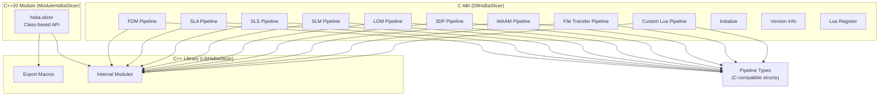

**Diagram sources**
- [fdm_pipeline.h:1-68](file://DllHsBaSlicer/fdm_pipeline.h#L1-L68)
- [sla_pipeline.h:1-63](file://DllHsBaSlicer/sla_pipeline.h#L1-L63)
- [sls_pipeline.h:1-63](file://DllHsBaSlicer/sls_pipeline.h#L1-L63)
- [slm_pipeline.h:1-63](file://DllHsBaSlicer/slm_pipeline.h#L1-L63)
- [lom_pipeline.h:1-63](file://DllHsBaSlicer/lom_pipeline.h#L1-L63)
- [tdp_pipeline.h:1-63](file://DllHsBaSlicer/tdp_pipeline.h#L1-L63)
- [waam_pipeline.h:1-64](file://DllHsBaSlicer/waam_pipeline.h#L1-L64)
- [file_transfer_pipeline.h:1-67](file://DllHsBaSlicer/file_transfer_pipeline.h#L1-L67)
- [custom_pipeline.h:1-69](file://DllHsBaSlicer/custom_pipeline.h#L1-L69)
- [initialize.h:1-22](file://DllHsBaSlicer/initialize.h#L1-L22)
- [version_info.h:1-48](file://DllHsBaSlicer/version_info.h#L1-L48)
- [lua_register.h:1-38](file://DllHsBaSlicer/lua_register.h#L1-L38)
- [export.h:1-22](file://LibHsBaSlicer/export.h#L1-L22)
- [hsba_slicer.cppm:1-120](file://ModuleHsBaSlicer/hsba_slicer.cppm#L1-L120)

**Section sources**
- [pipeline_types.h:1-12](file://pipelinetypes/pipeline_types.h#L1-L12)
- [fdm_pipeline.h:1-68](file://DllHsBaSlicer/fdm_pipeline.h#L1-L68)
- [sla_pipeline.h:1-63](file://DllHsBaSlicer/sla_pipeline.h#L1-L63)
- [sls_pipeline.h:1-63](file://DllHsBaSlicer/sls_pipeline.h#L1-L63)
- [slm_pipeline.h:1-63](file://DllHsBaSlicer/slm_pipeline.h#L1-L63)
- [lom_pipeline.h:1-63](file://DllHsBaSlicer/lom_pipeline.h#L1-L63)
- [tdp_pipeline.h:1-63](file://DllHsBaSlicer/tdp_pipeline.h#L1-L63)
- [waam_pipeline.h:1-64](file://DllHsBaSlicer/waam_pipeline.h#L1-L64)
- [file_transfer_pipeline.h:1-67](file://DllHsBaSlicer/file_transfer_pipeline.h#L1-L67)
- [custom_pipeline.h:1-69](file://DllHsBaSlicer/custom_pipeline.h#L1-L69)
- [initialize.h:1-22](file://DllHsBaSlicer/initialize.h#L1-L22)
- [version_info.h:1-48](file://DllHsBaSlicer/version_info.h#L1-L48)
- [lua_register.h:1-38](file://DllHsBaSlicer/lua_register.h#L1-L38)
- [export.h:1-22](file://LibHsBaSlicer/export.h#L1-L22)
- [hsba_slicer.cppm:1-120](file://ModuleHsBaSlicer/hsba_slicer.cppm#L1-L120)

## Core Components
This section summarizes the public surfaces at each integration level.

- C ABI (DllHsBaSlicer)
  - Per-pipeline headers provide default config creation, synchronous run, asynchronous run, and result freeing.
  - Common types are defined in a standalone header without DLL dependencies.
  - Initialization, version queries, and Lua function/event registration are exposed as C entry points.

- C++ Library API (LibHsBaSlicer)
  - Export macro defines platform-specific symbol visibility.
  - Internal modules implement slicing, support, fill, path generation, floor, transfer, and Lua extensions.

- C++20 Module API (ModuleHsBaSlicer)
  - Single-file module exports `HsBa::Slicer` namespace with RAII Model and pipeline classes.
  - Re-exports C-compatible types and provides idiomatic C++ wrappers.

- Lua Extension API
  - External functions can be registered into the Lua runtime for 2D/3D/file stages and events.
  - Custom pipelines allow full workflow definition in Lua using the global `HsBa` table.

**Section sources**
- [pipeline_types.h:1-12](file://pipelinetypes/pipeline_types.h#L1-L12)
- [export.h:1-22](file://LibHsBaSlicer/export.h#L1-L22)
- [hsba_slicer.cppm:64-120](file://ModuleHsBaSlicer/hsba_slicer.cppm#L64-L120)
- [lua_register.h:1-38](file://DllHsBaSlicer/lua_register.h#L1-L38)
- [custom_pipeline.h:1-69](file://DllHsBaSlicer/custom_pipeline.h#L1-L69)

## Architecture Overview
The system composes several pipeline stages:
- Preprocess: Load and validate models.
- Slice: Generate layer contours.
- Support/Fill/Floor: Geometry processing.
- Path Generation/Export: G-code, robot programs, or packaging.
- File Transfer: Remote file delivery.
- Custom Lua Pipeline: User-defined orchestration over building blocks.

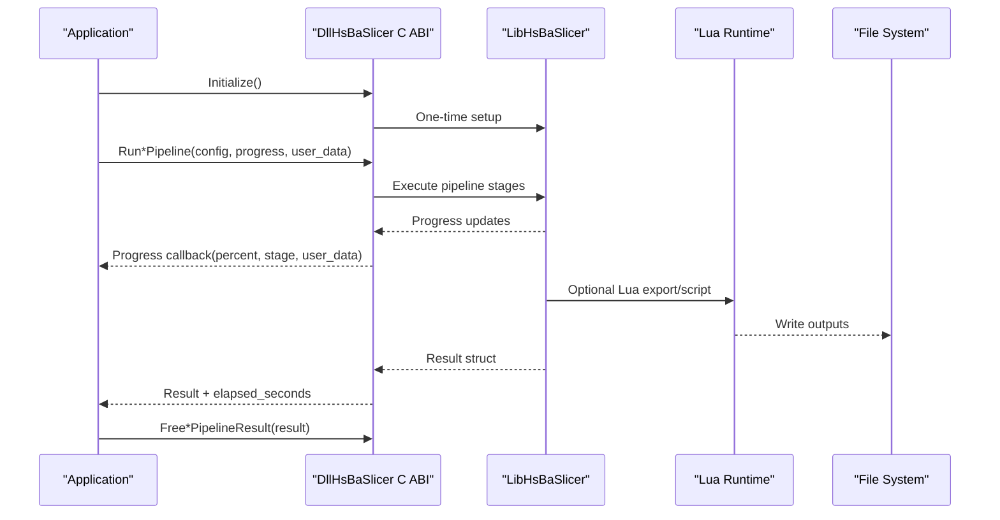

**Diagram sources**
- [initialize.h:1-22](file://DllHsBaSlicer/initialize.h#L1-L22)
- [fdm_pipeline.h:17-61](file://DllHsBaSlicer/fdm_pipeline.h#L17-L61)
- [sla_pipeline.h:17-56](file://DllHsBaSlicer/sla_pipeline.h#L17-L56)
- [custom_pipeline.h:17-62](file://DllHsBaSlicer/custom_pipeline.h#L17-L62)
- [pipeline_types.h:130-141](file://pipelinetypes/pipeline_types.h#L130-L141)

## Detailed Component Analysis

### C ABI: FDM Pipeline
- Default config: Creates a fully initialized FDM configuration.
- Sync run: Executes Preprocess -> Slice -> Support -> Fill -> Path Generation.
- Async run: Non-blocking execution via coroutines; completion delivered through a result callback.
- Result free: Releases allocated strings inside the result.

Key responsibilities:
- Configuration fields include slice parameters, fill mode, support pattern, path settings, firmware target, and optional Lua scripts for support/infill.
- Result contains success flag, total layers, UTF-8 G-code content, error message, and elapsed time.

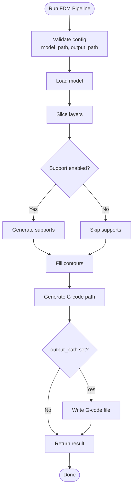

**Diagram sources**
- [fdm_pipeline.h:23-61](file://DllHsBaSlicer/fdm_pipeline.h#L23-L61)
- [pipeline_types.h:53-127](file://pipelinetypes/pipeline_types.h#L53-L127)

**Section sources**
- [fdm_pipeline.h:17-61](file://DllHsBaSlicer/fdm_pipeline.h#L17-L61)
- [pipeline_types.h:23-127](file://pipelinetypes/pipeline_types.h#L23-L127)

### C ABI: SLA Pipeline
- Default config: Initializes SLA-specific exposure, floor/raft, support, and image export options.
- Sync run: Executes Preprocess -> Slice -> Floor -> Support -> Export (zip).
- Async run: Non-blocking execution with SLA-specific callbacks.
- Result free: Frees exported zip path and error message.

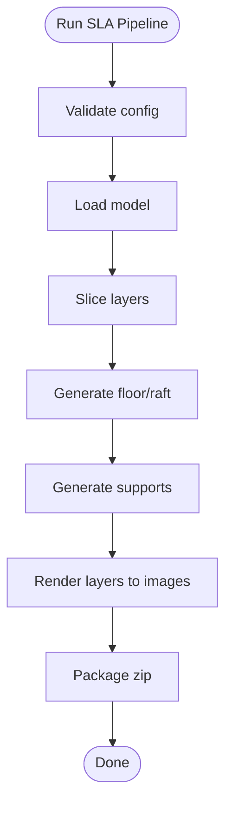

**Diagram sources**
- [sla_pipeline.h:17-56](file://DllHsBaSlicer/sla_pipeline.h#L17-L56)
- [pipeline_types.h:145-232](file://pipelinetypes/pipeline_types.h#L145-L232)

**Section sources**
- [sla_pipeline.h:17-56](file://DllHsBaSlicer/sla_pipeline.h#L17-L56)
- [pipeline_types.h:145-232](file://pipelinetypes/pipeline_types.h#L145-L232)

### C ABI: SLS Pipeline
- Default config: Initializes laser, hatch, bed temperature, and requires an export Lua script.
- Sync run: Executes Preprocess -> Slice -> Export (Lua script produces zip + database).
- Async run: Non-blocking execution with SLS-specific callbacks.
- Result free: Frees exported path and error message.

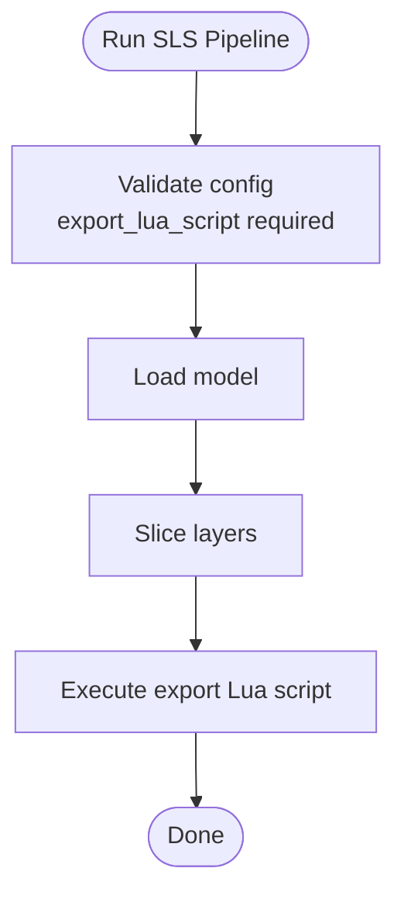

**Diagram sources**
- [sls_pipeline.h:17-56](file://DllHsBaSlicer/sls_pipeline.h#L17-L56)
- [pipeline_types.h:247-297](file://pipelinetypes/pipeline_types.h#L247-L297)

**Section sources**
- [sls_pipeline.h:17-56](file://DllHsBaSlicer/sls_pipeline.h#L17-L56)
- [pipeline_types.h:247-297](file://pipelinetypes/pipeline_types.h#L247-L297)

### C ABI: SLM Pipeline
- Mirrors SLS flow with metal-specific parameters (material, energy source, shielding gas).
- Requires export Lua script; results freed via dedicated function.

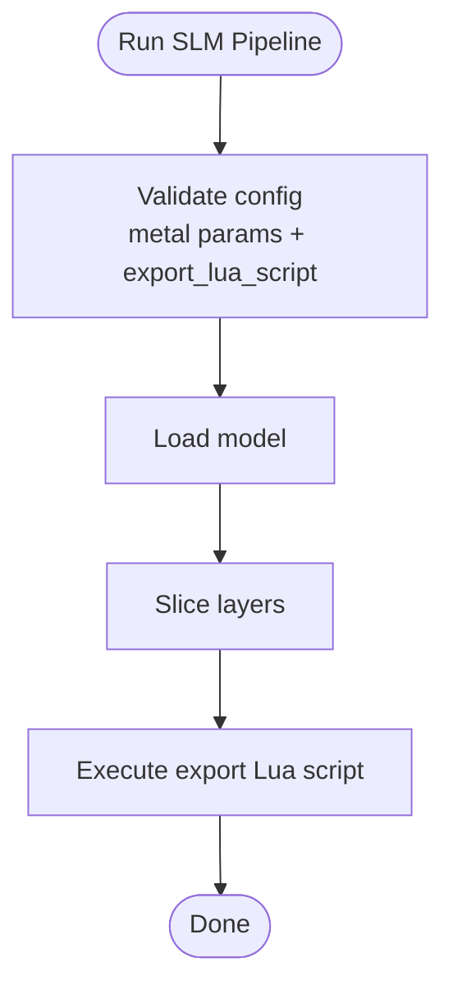

**Diagram sources**
- [slm_pipeline.h:17-56](file://DllHsBaSlicer/slm_pipeline.h#L17-L56)
- [pipeline_types.h:312-388](file://pipelinetypes/pipeline_types.h#L312-L388)

**Section sources**
- [slm_pipeline.h:17-56](file://DllHsBaSlicer/slm_pipeline.h#L17-L56)
- [pipeline_types.h:312-388](file://pipelinetypes/pipeline_types.h#L312-L388)

### C ABI: LOM Pipeline
- Laminated sheet manufacturing; slices per sheet thickness and passes contour outlines plus cut/bond parameters to Lua export.
- Requires export Lua script; results freed via dedicated function.

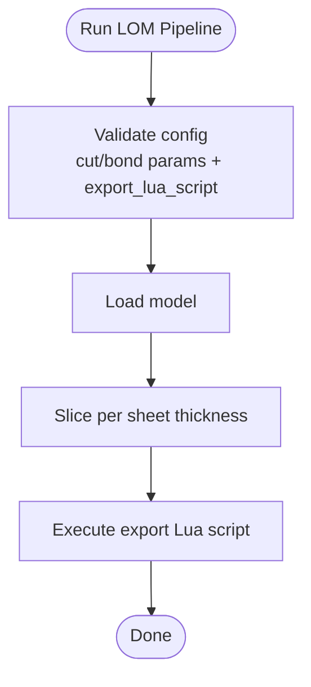

**Diagram sources**
- [lom_pipeline.h:17-56](file://DllHsBaSlicer/lom_pipeline.h#L17-L56)
- [pipeline_types.h:403-448](file://pipelinetypes/pipeline_types.h#L403-L448)

**Section sources**
- [lom_pipeline.h:17-56](file://DllHsBaSlicer/lom_pipeline.h#L17-L56)
- [pipeline_types.h:403-448](file://pipelinetypes/pipeline_types.h#L403-L448)

### C ABI: 3DP Pipeline
- Binder jetting process; slices per layer and hands binder-jet outlines plus head/curing parameters to Lua export.
- Requires export Lua script; results freed via dedicated function.

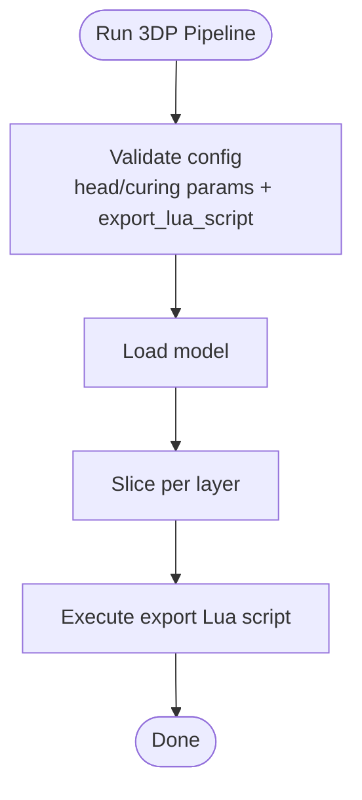

**Diagram sources**
- [tdp_pipeline.h:17-56](file://DllHsBaSlicer/tdp_pipeline.h#L17-L56)
- [pipeline_types.h:463-508](file://pipelinetypes/pipeline_types.h#L463-L508)

**Section sources**
- [tdp_pipeline.h:17-56](file://DllHsBaSlicer/tdp_pipeline.h#L17-L56)
- [pipeline_types.h:463-508](file://pipelinetypes/pipeline_types.h#L463-L508)

### C ABI: WAAM Pipeline
- Wire arc additive manufacturing; deposits metal bead-by-bead along per-layer contours.
- Output is a robot language program (ABB/KUKA/FANUC), not a layer zip.
- Supports optional custom robot-code generator via Lua.

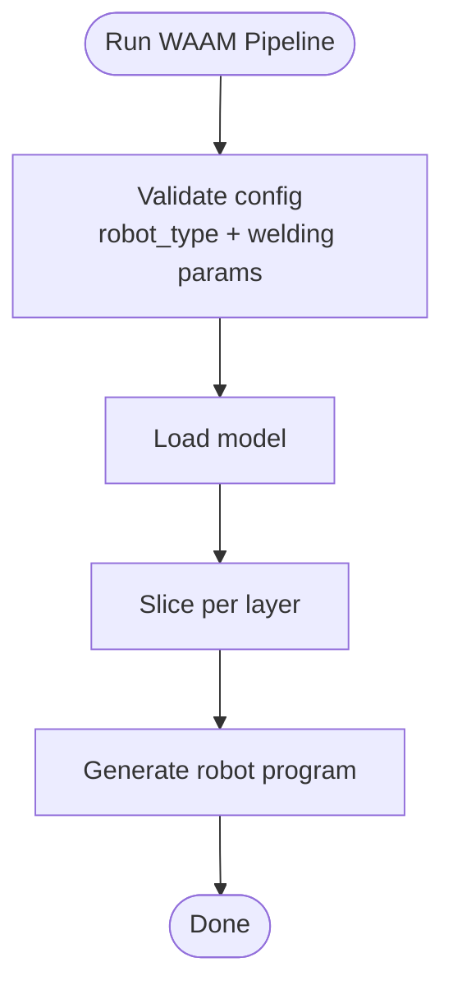

**Diagram sources**
- [waam_pipeline.h:17-57](file://DllHsBaSlicer/waam_pipeline.h#L17-L57)
- [pipeline_types.h:523-612](file://pipelinetypes/pipeline_types.h#L523-L612)

**Section sources**
- [waam_pipeline.h:17-57](file://DllHsBaSlicer/waam_pipeline.h#L17-L57)
- [pipeline_types.h:523-612](file://pipelinetypes/pipeline_types.h#L523-L612)

### C ABI: File Transfer Pipeline
- Uses a connection pool to send files to a remote service.
- Pipeline stages: Validate -> Connect -> Transfer Files.
- Results include counts of transferred files and elapsed time.

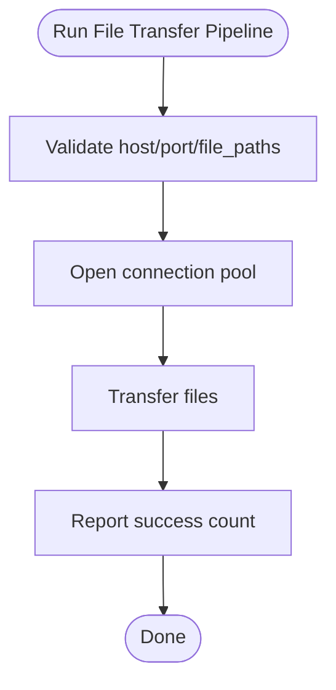

**Diagram sources**
- [file_transfer_pipeline.h:17-60](file://DllHsBaSlicer/file_transfer_pipeline.h#L17-L60)
- [pipeline_types.h:627-674](file://pipelinetypes/pipeline_types.h#L627-L674)

**Section sources**
- [file_transfer_pipeline.h:17-60](file://DllHsBaSlicer/file_transfer_pipeline.h#L17-L60)
- [pipeline_types.h:627-674](file://pipelinetypes/pipeline_types.h#L627-L674)

### C ABI: Custom Lua Pipeline
- Fully Lua-driven workflow where the entry function orchestrates all stages using the global `HsBa` table.
- Exposes model loading, slicing, support, fill, floor, G-code path output, and SLA/SLS packaging.
- Progress driven by Lua’s `HsBa.progress()` calls.

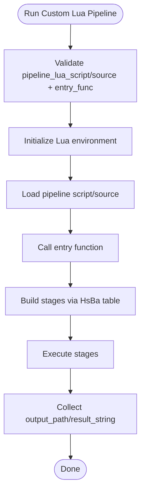

**Diagram sources**
- [custom_pipeline.h:17-62](file://DllHsBaSlicer/custom_pipeline.h#L17-L62)
- [pipeline_types.h:676-732](file://pipelinetypes/pipeline_types.h#L676-L732)

**Section sources**
- [custom_pipeline.h:17-62](file://DllHsBaSlicer/custom_pipeline.h#L17-L62)
- [pipeline_types.h:676-732](file://pipelinetypes/pipeline_types.h#L676-L732)

### C ABI: Initialization and Versioning
- initialize(): One-time setup that registers Lua functions, pipelines, and runtime state. Safe to call repeatedly.
- Version info: JSON/XML string accessors with a common free function.

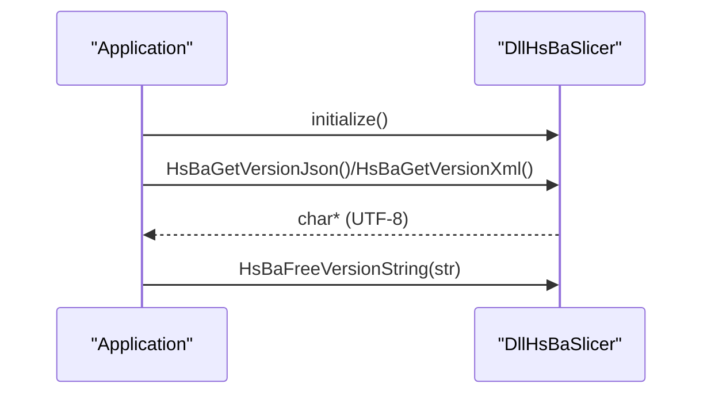

**Diagram sources**
- [initialize.h:14-19](file://DllHsBaSlicer/initialize.h#L14-L19)
- [version_info.h:16-41](file://DllHsBaSlicer/version_info.h#L16-L41)

**Section sources**
- [initialize.h:14-19](file://DllHsBaSlicer/initialize.h#L14-L19)
- [version_info.h:16-41](file://DllHsBaSlicer/version_info.h#L16-L41)

### C ABI: Lua Registration
- Register external Lua functions for 2D/3D/file stages and event callbacks by name.
- Enables extension of built-in stages with custom logic.

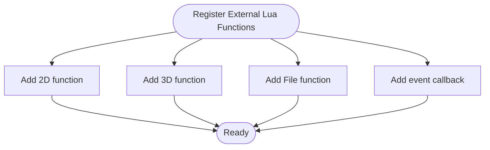

**Diagram sources**
- [lua_register.h:13-31](file://DllHsBaSlicer/lua_register.h#L13-L31)

**Section sources**
- [lua_register.h:13-31](file://DllHsBaSlicer/lua_register.h#L13-L31)

### C++ Library API: Export Macro
- HSBA_SLICER_LIB_API controls symbol visibility on Windows and is empty on other platforms.

**Section sources**
- [export.h:9-20](file://LibHsBaSlicer/export.h#L9-L20)

### C++20 Module API: Namespace and Classes
- Module `hsba.slicer` exports `HsBa::Slicer`.
- Provides RAII Model and pipeline classes: FdmPipeline, SlaPipeline, SlsPipeline, SlmPipeline, LomPipeline, TdpPipeline, WaamPipeline, FileTransferPipeline, ParamStorePipeline, CustomLuaPipeline.
- Re-exports C-compatible types and adds C++ utilities (e.g., polygon conversions).

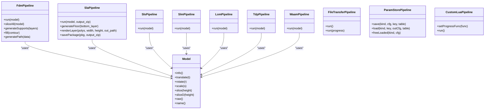

**Diagram sources**
- [hsba_slicer.cppm:129-540](file://ModuleHsBaSlicer/hsba_slicer.cppm#L129-L540)

**Section sources**
- [hsba_slicer.cppm:64-120](file://ModuleHsBaSlicer/hsba_slicer.cppm#L64-L120)
- [hsba_slicer.cppm:129-540](file://ModuleHsBaSlicer/hsba_slicer.cppm#L129-L540)

## Dependency Analysis
- C ABI depends on:
  - pipelinetypes for shared C-compatible structs/enums.
  - DllHsBaSlicer implementation for pipeline orchestration and Lua integration.
- C++20 module depends on:
  - LibHsBaSlicer export macros and internal modules.
  - Third-party libraries (Clipper2, Eigen, Lua).
- Lua extension points depend on:
  - Registered functions and event callbacks.

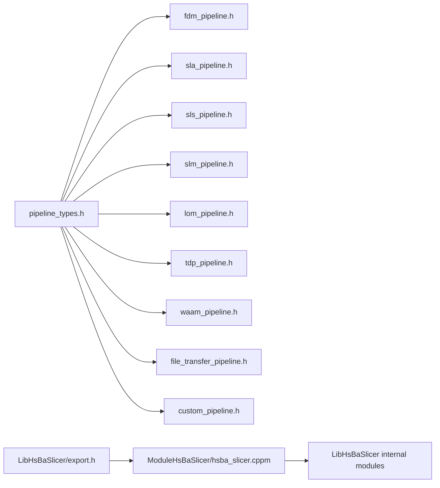

**Diagram sources**
- [pipeline_types.h:1-12](file://pipelinetypes/pipeline_types.h#L1-L12)
- [fdm_pipeline.h:1-68](file://DllHsBaSlicer/fdm_pipeline.h#L1-L68)
- [sla_pipeline.h:1-63](file://DllHsBaSlicer/sla_pipeline.h#L1-L63)
- [sls_pipeline.h:1-63](file://DllHsBaSlicer/sls_pipeline.h#L1-L63)
- [slm_pipeline.h:1-63](file://DllHsBaSlicer/slm_pipeline.h#L1-L63)
- [lom_pipeline.h:1-63](file://DllHsBaSlicer/lom_pipeline.h#L1-L63)
- [tdp_pipeline.h:1-63](file://DllHsBaSlicer/tdp_pipeline.h#L1-L63)
- [waam_pipeline.h:1-64](file://DllHsBaSlicer/waam_pipeline.h#L1-L64)
- [file_transfer_pipeline.h:1-67](file://DllHsBaSlicer/file_transfer_pipeline.h#L1-L67)
- [custom_pipeline.h:1-69](file://DllHsBaSlicer/custom_pipeline.h#L1-L69)
- [export.h:1-22](file://LibHsBaSlicer/export.h#L1-L22)
- [hsba_slicer.cppm:1-120](file://ModuleHsBaSlicer/hsba_slicer.cppm#L1-L120)

**Section sources**
- [pipeline_types.h:1-12](file://pipelinetypes/pipeline_types.h#L1-L12)
- [export.h:1-22](file://LibHsBaSlicer/export.h#L1-L22)
- [hsba_slicer.cppm:1-120](file://ModuleHsBaSlicer/hsba_slicer.cppm#L1-L120)

## Performance Considerations
- Asynchronous pipelines use C++20 coroutines internally to avoid blocking the caller thread.
- Parallelism:
  - File transfer uses a connection pool to parallelize transfers.
  - Other pipelines may leverage internal thread pools for heavy geometry operations.
- Memory:
  - All C ABI result strings are heap-allocated and must be freed by the caller.
  - C++ RAII Model manages model lifecycle automatically.
- I/O:
  - Large G-code or zip outputs should be written to disk rather than kept in memory when possible.
- Threading:
  - Callbacks may be invoked from worker threads; ensure thread-safety in user code.
  - Avoid long-running work in progress callbacks to prevent pipeline stalls.

[No sources needed since this section provides general guidance]

## Troubleshooting Guide
Common issues and resolutions:
- Missing initialization:
  - Ensure initialize() is called before any pipeline operations.
- Invalid configuration:
  - Verify required fields such as model_path, export_lua_script, host/port/file_paths.
- Memory leaks:
  - Always call the corresponding Free*PipelineResult function for C ABI results.
  - For ParamStorePipeline load(), call freeLoaded() to release heap strings.
- Lua errors:
  - Check export_lua_script paths and function names; verify HsBa table availability.
- Version mismatch:
  - Query version info and compare with application expectations.

**Section sources**
- [initialize.h:14-19](file://DllHsBaSlicer/initialize.h#L14-L19)
- [version_info.h:16-41](file://DllHsBaSlicer/version_info.h#L16-L41)
- [custom_pipeline.h:17-62](file://DllHsBaSlicer/custom_pipeline.h#L17-L62)
- [hsba_slicer.cppm:420-445](file://ModuleHsBaSlicer/hsba_slicer.cppm#L420-L445)

## Conclusion
HsBaSlicer offers a layered API strategy:
- Use the C ABI for stable, cross-language integration with explicit memory management and callbacks.
- Prefer the C++20 module for modern, RAII-based workflows with strong typing and exceptions.
- Extend behavior via Lua registration and custom pipelines for flexible, script-driven processes.
Adopt the recommended patterns for initialization, resource cleanup, and threading to ensure robust performance and maintainability.

[No sources needed since this section summarizes without analyzing specific files]

## Appendices

### API Surface Summary Table
- C ABI
  - FDM: CreateDefaultConfig, RunFdmPipeline, RunFdmPipelineAsync, FreePipelineResult
  - SLA: CreateDefaultSlaConfig, RunSlaPipeline, RunSlaPipelineAsync, FreeSlaPipelineResult
  - SLS: CreateDefaultSlsConfig, RunSlsPipeline, RunSlsPipelineAsync, FreeSlsPipelineResult
  - SLM: CreateDefaultSlmConfig, RunSlmPipeline, RunSlmPipelineAsync, FreeSlmPipelineResult
  - LOM: CreateDefaultLomConfig, RunLomPipeline, RunLomPipelineAsync, FreeLomPipelineResult
  - 3DP: CreateDefaultTdpConfig, RunTdpPipeline, RunTdpPipelineAsync, FreeTdpPipelineResult
  - WAAM: CreateDefaultWaamConfig, RunWaamPipeline, RunWaamPipelineAsync, FreeWaamPipelineResult
  - File Transfer: CreateDefaultFileTransferConfig, RunFileTransferPipeline, RunFileTransferPipelineAsync, FreeFileTransferPipelineResult
  - Custom Lua: CreateDefaultCustomConfig, RunCustomPipeline, RunCustomPipelineAsync, FreeCustomPipelineResult
  - Utilities: initialize, HsBaGetVersionJson, HsBaGetVersionXml, HsBaFreeVersionString
  - Lua Registration: HsBaAdd2DFunction, HsBaAdd3DFunction, HsBaAddFileFunction, HsBaAddEventCallback

- C++20 Module
  - Namespaces: HsBa::Slicer
  - Classes: Model, FdmPipeline, SlaPipeline, SlsPipeline, SlmPipeline, LomPipeline, TdpPipeline, WaamPipeline, FileTransferPipeline, ParamStorePipeline, CustomLuaPipeline
  - Utilities: add2DFunction, add3DFunction, addFileFunction, addEventCallback, addZipperEventCallback, addDBEventCallback, versionJson, versionXml, toDouble, toInt

**Section sources**
- [fdm_pipeline.h:17-61](file://DllHsBaSlicer/fdm_pipeline.h#L17-L61)
- [sla_pipeline.h:17-56](file://DllHsBaSlicer/sla_pipeline.h#L17-L56)
- [sls_pipeline.h:17-56](file://DllHsBaSlicer/sls_pipeline.h#L17-L56)
- [slm_pipeline.h:17-56](file://DllHsBaSlicer/slm_pipeline.h#L17-L56)
- [lom_pipeline.h:17-56](file://DllHsBaSlicer/lom_pipeline.h#L17-L56)
- [tdp_pipeline.h:17-56](file://DllHsBaSlicer/tdp_pipeline.h#L17-L56)
- [waam_pipeline.h:17-57](file://DllHsBaSlicer/waam_pipeline.h#L17-L57)
- [file_transfer_pipeline.h:17-60](file://DllHsBaSlicer/file_transfer_pipeline.h#L17-L60)
- [custom_pipeline.h:17-62](file://DllHsBaSlicer/custom_pipeline.h#L17-L62)
- [initialize.h:14-19](file://DllHsBaSlicer/initialize.h#L14-L19)
- [version_info.h:16-41](file://DllHsBaSlicer/version_info.h#L16-L41)
- [lua_register.h:21-31](file://DllHsBaSlicer/lua_register.h#L21-L31)
- [hsba_slicer.cppm:129-540](file://ModuleHsBaSlicer/hsba_slicer.cppm#L129-L540)