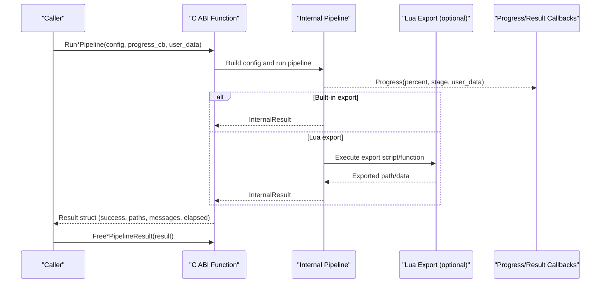
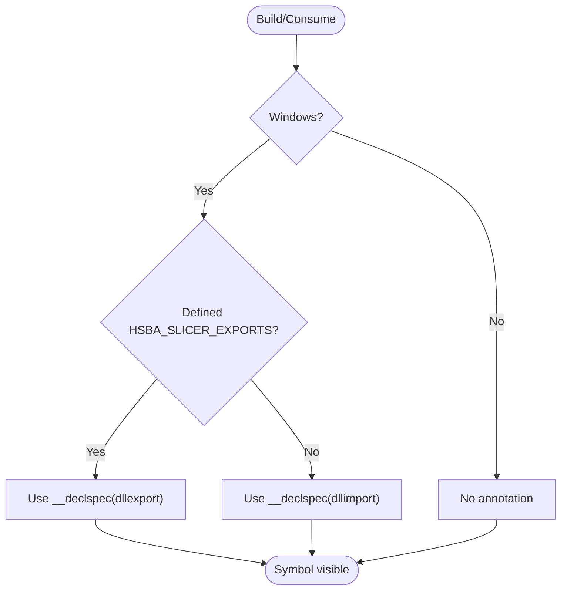
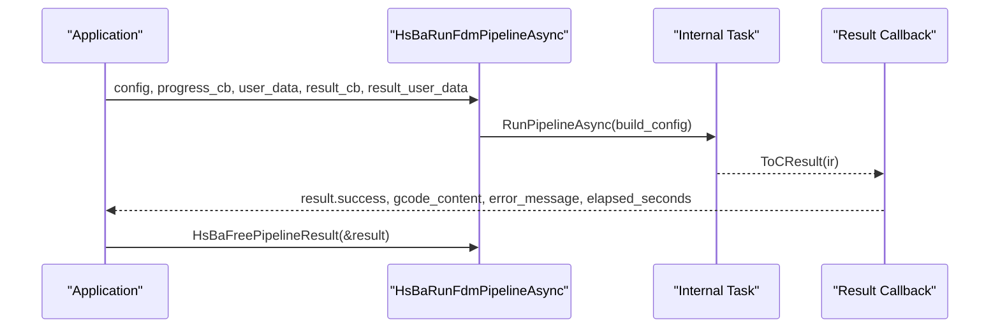
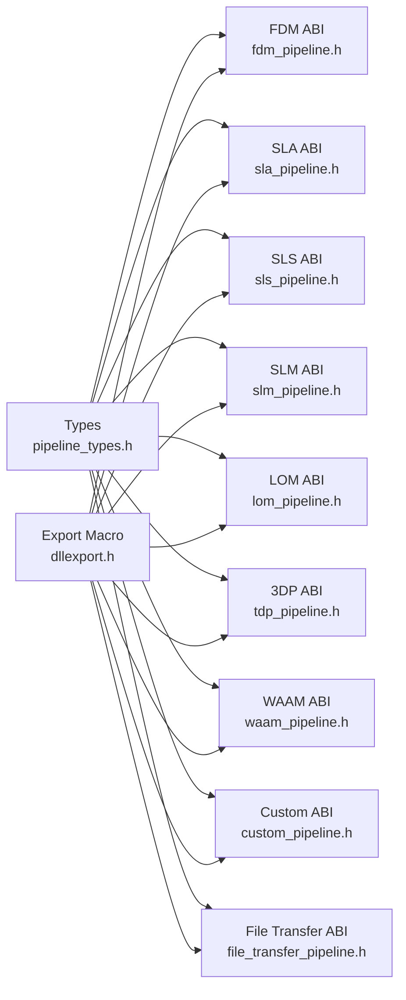
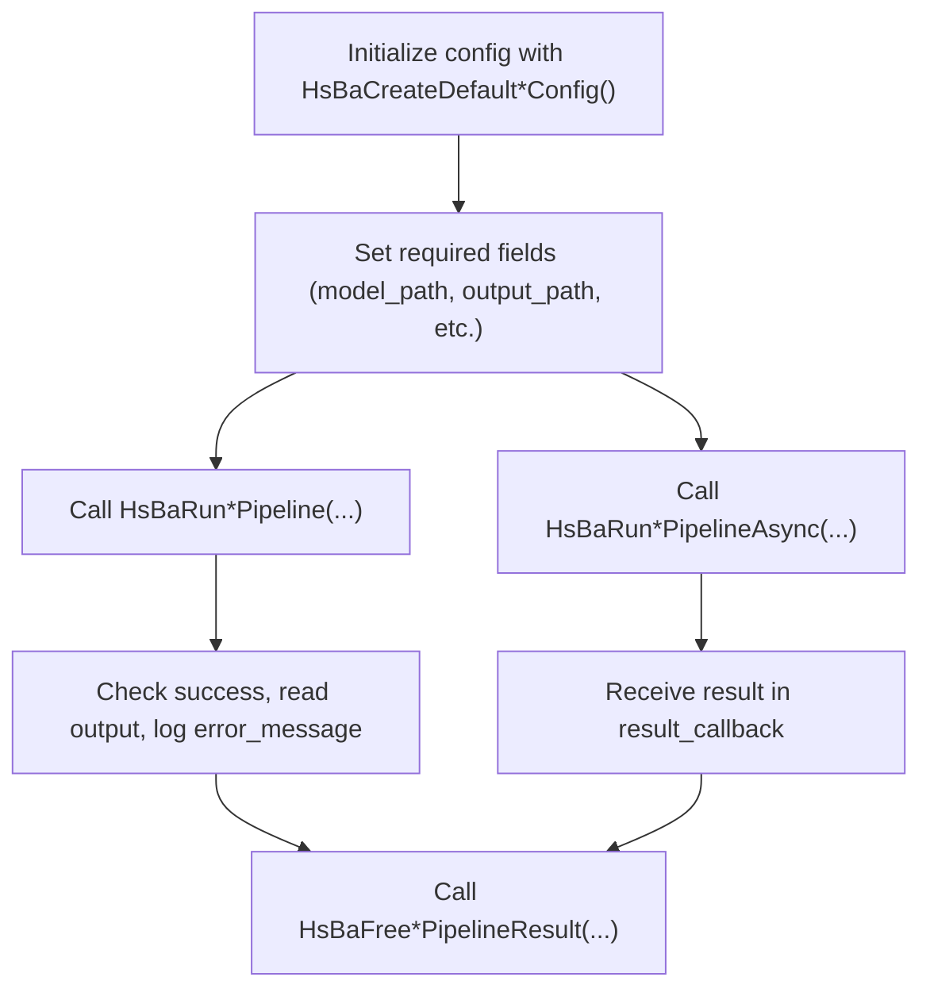

# C ABI Interface / C接口

<cite>
**Referenced Files in This Document**   
- [dllexport.h](file://DllHsBaSlicer/dllexport.h)
- [pipeline_types.h](file://pipelinetypes/pipeline_types.h)
- [fdm_pipeline.h](file://DllHsBaSlicer/fdm_pipeline.h)
- [fdm_pipeline.cpp](file://DllHsBaSlicer/fdm_pipeline.cpp)
- [sla_pipeline.h](file://DllHsBaSlicer/sla_pipeline.h)
- [sls_pipeline.h](file://DllHsBaSlicer/sls_pipeline.h)
- [slm_pipeline.h](file://DllHsBaSlicer/slm_pipeline.h)
- [lom_pipeline.h](file://DllHsBaSlicer/lom_pipeline.h)
- [tdp_pipeline.h](file://DllHsBaSlicer/tdp_pipeline.h)
- [waam_pipeline.h](file://DllHsBaSlicer/waam_pipeline.h)
- [custom_pipeline.h](file://DllHsBaSlicer/custom_pipeline.h)
- [file_transfer_pipeline.h](file://DllHsBaSlicer/file_transfer_pipeline.h)
</cite>

## Table of Contents
1. [Introduction](#introduction)
2. [Project Structure](#project-structure)
3. [Core Components](#core-components)
4. [Architecture Overview](#architecture-overview)
5. [Detailed Component Analysis](#detailed-component-analysis)
6. [Dependency Analysis](#dependency-analysis)
7. [Performance Considerations](#performance-considerations)
8. [Troubleshooting Guide](#troubleshooting-guide)
9. [Conclusion](#conclusion)
10. [Appendices](#appendices)

## Introduction
This document describes the stable C ABI surface exposed by HsBaSlicer for external integration. It focuses on:
- The HSBA_SLICER_API export/import macro and its platform behavior.
- All exported pipeline functions, including synchronous and asynchronous variants.
- Configuration structures, result structures, callback signatures, and memory ownership rules.
- Error handling patterns through result structs and error messages.
- Thread safety considerations and recommended usage patterns.
- Integration guidance for different programming languages.

The ABI is defined in a standalone header without DLL visibility macros so that downstream modules can reference the types without linking the shared library. The actual exported symbols are declared in per-pipeline headers under DllHsBaSlicer.

## Project Structure
The C ABI is split into two layers:
- Type layer: `pipelinetypes/pipeline_types.h` defines all configuration and result structs, enums, and default initializers. It does not depend on the shared library.
- Export layer: `DllHsBaSlicer/*_pipeline.h` declare the exported C functions using `HSBA_SLICER_API`. Implementations live in corresponding `.cpp` files.

```mermaid
graph TB
Types["Type Layer<br/>pipelinetypes/pipeline_types.h"]
FDM["FDM ABI<br/>DllHsBaSlicer/fdm_pipeline.h"]
SLA["SLA ABI<br/>DllHsBaSlicer/sla_pipeline.h"]
SLS["SLS ABI<br/>DllHsBaSlicer/sls_pipeline.h"]
SLM["SLM ABI<br/>DllHsBaSlicer/slm_pipeline.h"]
LOM["LOM ABI<br/>DllHsBaSlicer/lom_pipeline.h"]
TDP["3DP ABI<br/>DllHsBaSlicer/tdp_pipeline.h"]
WAAM["WAAM ABI<br/>DllHsBaSlicer/waam_pipeline.h"]
Custom["Custom Lua ABI<br/>DllHsBaSlicer/custom_pipeline.h"]
FileXfer["File Transfer ABI<br/>DllHsBaSlicer/file_transfer_pipeline.h"]
Macro["Export Macro<br/>DllHsBaSlicer/dllexport.h"]
Macro --> FDM
Macro --> SLA
Macro --> SLS
Macro --> SLM
Macro --> LOM
Macro --> TDP
Macro --> WAAM
Macro --> Custom
Macro --> FileXfer
Types --> FDM
Types --> SLA
Types --> SLS
Types --> SLM
Types --> LOM
Types --> TDP
Types --> WAAM
Types --> Custom
Types --> FileXfer
```

**Diagram sources**
- [pipeline_types.h:1-12](file://pipelinetypes/pipeline_types.h#L1-L12)
- [dllexport.h:1-23](file://DllHsBaSlicer/dllexport.h#L1-L23)
- [fdm_pipeline.h:1-68](file://DllHsBaSlicer/fdm_pipeline.h#L1-L68)
- [sla_pipeline.h:1-63](file://DllHsBaSlicer/sla_pipeline.h#L1-L63)
- [sls_pipeline.h:1-63](file://DllHsBaSlicer/sls_pipeline.h#L1-L63)
- [slm_pipeline.h:1-63](file://DllHsBaSlicer/slm_pipeline.h#L1-L63)
- [lom_pipeline.h:1-63](file://DllHsBaSlicer/lom_pipeline.h#L1-L63)
- [tdp_pipeline.h:1-63](file://DllHsBaSlicer/tdp_pipeline.h#L1-L63)
- [waam_pipeline.h:1-64](file://DllHsBaSlicer/waam_pipeline.h#L1-L64)
- [custom_pipeline.h:1-69](file://DllHsBaSlicer/custom_pipeline.h#L1-L69)
- [file_transfer_pipeline.h:1-67](file://DllHsBaSlicer/file_transfer_pipeline.h#L1-L67)

**Section sources**
- [pipeline_types.h:1-12](file://pipelinetypes/pipeline_types.h#L1-L12)
- [dllexport.h:1-23](file://DllHsBaSlicer/dllexport.h#L1-L23)

## Core Components
This section summarizes the core ABI components:
- Export macro: `HSBA_SLICER_API` controls symbol visibility across platforms.
- Pipeline families: FDM, SLA, SLS, SLM, LOM, 3DP (TDP), WAAM, custom Lua-driven pipeline, and file transfer.
- Common pattern per family:
  - Default config initializer: `HsBaCreateDefault*Config()`
  - Synchronous run: `HsBaRun*Pipeline(config, progress_callback, user_data)`
  - Asynchronous run: `HsBaRun*PipelineAsync(...)` with completion callback
  - Result free: `HsBaFree*PipelineResult(result)`

Key responsibilities:
- Callers own strings returned inside result structs and must use the matching free function.
- Progress callbacks may be NULL; they are optional.
- Asynchronous APIs require a non-NULL result callback to receive the final result.

**Section sources**
- [fdm_pipeline.h:17-61](file://DllHsBaSlicer/fdm_pipeline.h#L17-L61)
- [sla_pipeline.h:17-56](file://DllHsBaSlicer/sla_pipeline.h#L17-L56)
- [sls_pipeline.h:17-56](file://DllHsBaSlicer/sls_pipeline.h#L17-L56)
- [slm_pipeline.h:17-56](file://DllHsBaSlicer/slm_pipeline.h#L17-L56)
- [lom_pipeline.h:17-56](file://DllHsBaSlicer/lom_pipeline.h#L17-L56)
- [tdp_pipeline.h:17-56](file://DllHsBaSlicer/tdp_pipeline.h#L17-L56)
- [waam_pipeline.h:17-57](file://DllHsBaSlicer/waam_pipeline.h#L17-L57)
- [custom_pipeline.h:17-62](file://DllHsBaSlicer/custom_pipeline.h#L17-L62)
- [file_transfer_pipeline.h:17-60](file://DllHsBaSlicer/file_transfer_pipeline.h#L17-L60)

## Architecture Overview
The C ABI is a thin, stable boundary over internal C++ pipelines. Each pipeline follows a consistent flow:
- Preprocess model
- Slice geometry
- Generate support/floor/path as applicable
- Export via built-in logic or Lua script
- Return structured results with timing and status

**Diagram sources**
- [fdm_pipeline.h:23-35](file://DllHsBaSlicer/fdm_pipeline.h#L23-L35)
- [custom_pipeline.h:23-40](file://DllHsBaSlicer/custom_pipeline.h#L23-L40)
- [file_transfer_pipeline.h:23-35](file://DllHsBaSlicer/file_transfer_pipeline.h#L23-L35)

## Detailed Component Analysis

### Export Macro HSBA_SLICER_API
- Purpose: Mark exported symbols for the HsBaSlicer shared library C ABI.
- Windows: Uses `__declspec(dllexport)` when building the library (`HSBA_SLICER_EXPORTS`) and `__declspec(dllimport)` when consuming it.
- Non-Windows: No annotation required.

**Diagram sources**
- [dllexport.h:9-20](file://DllHsBaSlicer/dllexport.h#L9-L20)

**Section sources**
- [dllexport.h:1-23](file://DllHsBaSlicer/dllexport.h#L1-L23)

### FDM Pipeline API
- Config: `HsBaFdmPipelineConfig_t`
- Results: `HsBaFdmPipelineResult_t`
- Callbacks:
  - `HsBaProgressCallback(percent, stage, user_data)`
  - `HsBaResultCallback(result, user_data)`
- Functions:
  - `HsBaCreateDefaultConfig()`
  - `HsBaRunFdmPipeline(config, callback, user_data)`
  - `HsBaRunFdmPipelineAsync(config, callback, user_data, result_callback, result_user_data)`
  - `HsBaFreePipelineResult(result)`

Memory management:
- `gcode_content` and `error_message` in `HsBaFdmPipelineResult_t` are UTF-8 strings allocated by the library; callers must call `HsBaFreePipelineResult`.

Thread safety:
- Async execution uses coroutines internally; the implementation heap-allocates the internal config to keep it valid during coroutine execution.

**Diagram sources**
- [fdm_pipeline.h:37-61](file://DllHsBaSlicer/fdm_pipeline.h#L37-L61)
- [fdm_pipeline.cpp:469-496](file://DllHsBaSlicer/fdm_pipeline.cpp#L469-L496)

**Section sources**
- [pipeline_types.h:23-140](file://pipelinetypes/pipeline_types.h#L23-L140)
- [fdm_pipeline.h:17-61](file://DllHsBaSlicer/fdm_pipeline.h#L17-L61)
- [fdm_pipeline.cpp:464-496](file://DllHsBaSlicer/fdm_pipeline.cpp#L464-L496)

### SLA Pipeline API
- Config: `HsBaSlaPipelineConfig_t`
- Results: `HsBaSlaPipelineResult_t`
- Callbacks:
  - `HsBaSlaProgressCallback(percent, stage, user_data)`
  - `HsBaSlaResultCallback(result, user_data)`
- Functions:
  - `HsBaCreateDefaultSlaConfig()`
  - `HsBaRunSlaPipeline(config, callback, user_data)`
  - `HsBaRunSlaPipelineAsync(config, callback, user_data, result_callback, result_user_data)`
  - `HsBaFreeSlaPipelineResult(result)`

Notes:
- Output is typically a zip containing layer images and metadata.
- Image format and dimensions are configurable.

**Section sources**
- [pipeline_types.h:145-245](file://pipelinetypes/pipeline_types.h#L145-L245)
- [sla_pipeline.h:17-56](file://DllHsBaSlicer/sla_pipeline.h#L17-L56)

### SLS Pipeline API
- Config: `HsBaSlsPipelineConfig_t`
- Results: `HsBaSlsPipelineResult_t`
- Callbacks:
  - `HsBaSlsProgressCallback(percent, stage, user_data)`
  - `HsBaSlsResultCallback(result, user_data)`
- Functions:
  - `HsBaCreateDefaultSlsConfig()`
  - `HsBaRunSlsPipeline(config, callback, user_data)`
  - `HsBaRunSlsPipelineAsync(config, callback, user_data, result_callback, result_user_data)`
  - `HsBaFreeSlsPipelineResult(result)`

Notes:
- Requires an export Lua script; no standard output format.

**Section sources**
- [pipeline_types.h:247-310](file://pipelinetypes/pipeline_types.h#L247-L310)
- [sls_pipeline.h:17-56](file://DllHsBaSlicer/sls_pipeline.h#L17-L56)

### SLM Pipeline API
- Config: `HsBaSlmPipelineConfig_t`
- Results: `HsBaSlmPipelineResult_t`
- Callbacks:
  - `HsBaSlmProgressCallback(percent, stage, user_data)`
  - `HsBaSlmResultCallback(result, user_data)`
- Functions:
  - `HsBaCreateDefaultSlmConfig()`
  - `HsBaRunSlmPipeline(config, callback, user_data)`
  - `HsBaRunSlmPipelineAsync(config, callback, user_data, result_callback, result_user_data)`
  - `HsBaFreeSlmPipelineResult(result)`

Notes:
- Mirrors SLS flow; metal-specific parameters are included in the config JSON passed to the export script.

**Section sources**
- [pipeline_types.h:312-401](file://pipelinetypes/pipeline_types.h#L312-L401)
- [slm_pipeline.h:17-56](file://DllHsBaSlicer/slm_pipeline.h#L17-L56)

### LOM Pipeline API
- Config: `HsBaLomPipelineConfig_t`
- Results: `HsBaLomPipelineResult_t`
- Callbacks:
  - `HsBaLomProgressCallback(percent, stage, user_data)`
  - `HsBaLomResultCallback(result, user_data)`
- Functions:
  - `HsBaCreateDefaultLomConfig()`
  - `HsBaRunLomPipeline(config, callback, user_data)`
  - `HsBaRunLomPipelineAsync(config, callback, user_data, result_callback, result_user_data)`
  - `HsBaFreeLomPipelineResult(result)`

Notes:
- Slices per sheet thickness; contour outlines plus cut/bond parameters are handed to the Lua export script.

**Section sources**
- [pipeline_types.h:403-461](file://pipelinetypes/pipeline_types.h#L403-L461)
- [lom_pipeline.h:17-56](file://DllHsBaSlicer/lom_pipeline.h#L17-L56)

### 3DP (TDP) Pipeline API
- Config: `HsBaTdpPipelineConfig_t`
- Results: `HsBaTdpPipelineResult_t`
- Callbacks:
  - `HsBaTdpProgressCallback(percent, stage, user_data)`
  - `HsBaTdpResultCallback(result, user_data)`
- Functions:
  - `HsBaCreateDefaultTdpConfig()`
  - `HsBaRunTdpPipeline(config, callback, user_data)`
  - `HsBaRunTdpPipelineAsync(config, callback, user_data, result_callback, result_user_data)`
  - `HsBaFreeTdpPipelineResult(result)`

Notes:
- Binder jetting process; outlines and head/curing parameters are passed to the Lua export script.

**Section sources**
- [pipeline_types.h:463-521](file://pipelinetypes/pipeline_types.h#L463-L521)
- [tdp_pipeline.h:17-56](file://DllHsBaSlicer/tdp_pipeline.h#L17-L56)

### WAAM Pipeline API
- Config: `HsBaWaamPipelineConfig_t`
- Results: `HsBaWaamPipelineResult_t`
- Callbacks:
  - `HsBaWaamProgressCallback(percent, stage, user_data)`
  - `HsBaWaamResultCallback(result, user_data)`
- Functions:
  - `HsBaCreateDefaultWaamConfig()`
  - `HsBaRunWaamPipeline(config, callback, user_data)`
  - `HsBaRunWaamPipelineAsync(config, callback, user_data, result_callback, result_user_data)`
  - `HsBaFreeWaamPipelineResult(result)`

Notes:
- Output is a robot language program (ABB/KUKA/FANUC), not a layer zip.

**Section sources**
- [pipeline_types.h:523-625](file://pipelinetypes/pipeline_types.h#L523-L625)
- [waam_pipeline.h:17-57](file://DllHsBaSlicer/waam_pipeline.h#L17-L57)

### Custom Lua Pipeline API
- Config: `HsBaCustomPipelineConfig_t`
- Results: `HsBaCustomPipelineResult_t`
- Callbacks:
  - `HsBaCustomProgressCallback(percent, stage, user_data)`
  - `HsBaCustomResultCallback(result, user_data)`
- Functions:
  - `HsBaCreateDefaultCustomConfig()`
  - `HsBaRunCustomPipeline(config, callback, user_data)`
  - `HsBaRunCustomPipelineAsync(config, callback, user_data, result_callback, result_user_data)`
  - `HsBaFreeCustomPipelineResult(result)`

Notes:
- Entire workflow is defined by the Lua entry function (default "run_pipeline").
- The Lua environment exposes pipeline building blocks through the global `HsBa` table.

**Section sources**
- [pipeline_types.h:676-732](file://pipelinetypes/pipeline_types.h#L676-L732)
- [custom_pipeline.h:17-62](file://DllHsBaSlicer/custom_pipeline.h#L17-L62)

### File Transfer Pipeline API
- Config: `HsBaFileTransferPipelineConfig_t`
- Results: `HsBaFileTransferPipelineResult_t`
- Callbacks:
  - `HsBaFileTransferProgressCallback(percent, stage, user_data)`
  - `HsBaFileTransferResultCallback(result, user_data)`
- Functions:
  - `HsBaCreateDefaultFileTransferConfig()`
  - `HsBaRunFileTransferPipeline(config, callback, user_data)`
  - `HsBaRunFileTransferPipelineAsync(config, callback, user_data, result_callback, result_user_data)`
  - `HsBaFreeFileTransferPipelineResult(result)`

Notes:
- Uses a connection pool to send files to a remote service.

**Section sources**
- [pipeline_types.h:627-674](file://pipelinetypes/pipeline_types.h#L627-L674)
- [file_transfer_pipeline.h:17-60](file://DllHsBaSlicer/file_transfer_pipeline.h#L17-L60)

## Dependency Analysis
- Type definitions are independent of the shared library to allow downstream modules to reference them without linking.
- All exported functions are declared in per-pipeline headers and decorated with `HSBA_SLICER_API`.
- The FDM async implementation demonstrates how internal configs are managed safely across coroutine boundaries.

**Diagram sources**
- [pipeline_types.h:1-12](file://pipelinetypes/pipeline_types.h#L1-L12)
- [dllexport.h:1-23](file://DllHsBaSlicer/dllexport.h#L1-L23)
- [fdm_pipeline.h:1-68](file://DllHsBaSlicer/fdm_pipeline.h#L1-L68)
- [sla_pipeline.h:1-63](file://DllHsBaSlicer/sla_pipeline.h#L1-L63)
- [sls_pipeline.h:1-63](file://DllHsBaSlicer/sls_pipeline.h#L1-L63)
- [slm_pipeline.h:1-63](file://DllHsBaSlicer/slm_pipeline.h#L1-L63)
- [lom_pipeline.h:1-63](file://DllHsBaSlicer/lom_pipeline.h#L1-L63)
- [tdp_pipeline.h:1-63](file://DllHsBaSlicer/tdp_pipeline.h#L1-L63)
- [waam_pipeline.h:1-64](file://DllHsBaSlicer/waam_pipeline.h#L1-L64)
- [custom_pipeline.h:1-69](file://DllHsBaSlicer/custom_pipeline.h#L1-L69)
- [file_transfer_pipeline.h:1-67](file://DllHsBaSlicer/file_transfer_pipeline.h#L1-L67)

**Section sources**
- [pipeline_types.h:1-12](file://pipelinetypes/pipeline_types.h#L1-L12)
- [dllexport.h:1-23](file://DllHsBaSlicer/dllexport.h#L1-L23)

## Performance Considerations
- Use asynchronous APIs for long-running operations to avoid blocking the caller thread.
- Provide progress callbacks to update UI or logging without polling.
- Avoid frequent small allocations in progress callbacks; reuse buffers where possible.
- For batch file transfers, tune the connection pool size according to network conditions.

[No sources needed since this section provides general guidance]

## Troubleshooting Guide
Common issues and resolutions:
- Memory leaks: Always call the matching `HsBaFree*PipelineResult` after processing the result.
- Invalid pointers: Ensure config pointers are valid for the duration of synchronous calls; for async calls, ensure the config remains valid until the result callback completes.
- Missing Lua scripts: SLS/SLM/LOM/3DP/custom pipelines require export Lua scripts; verify paths and function names.
- Empty outputs: Check `result.success`, `total_layers`, and `error_message` fields.
- Platform symbol resolution: On Windows, ensure the consumer links against the correct DLL and that `HSBA_SLICER_EXPORTS` is defined only when building the library.

Error handling patterns:
- Success flag: `success` indicates overall outcome.
- Error message: `error_message` contains UTF-8 diagnostic text when available.
- Timing: `elapsed_seconds` helps diagnose performance regressions.

**Section sources**
- [pipeline_types.h:115-140](file://pipelinetypes/pipeline_types.h#L115-L140)
- [pipeline_types.h:220-245](file://pipelinetypes/pipeline_types.h#L220-L245)
- [pipeline_types.h:285-310](file://pipelinetypes/pipeline_types.h#L285-L310)
- [pipeline_types.h:378-401](file://pipelinetypes/pipeline_types.h#L378-L401)
- [pipeline_types.h:438-461](file://pipelinetypes/pipeline_types.h#L438-L461)
- [pipeline_types.h:498-521](file://pipelinetypes/pipeline_types.h#L498-L521)
- [pipeline_types.h:602-625](file://pipelinetypes/pipeline_types.h#L602-L625)
- [pipeline_types.h:706-732](file://pipelinetypes/pipeline_types.h#L706-L732)
- [pipeline_types.h:649-674](file://pipelinetypes/pipeline_types.h#L649-L674)
- [fdm_pipeline.cpp:488-496](file://DllHsBaSlicer/fdm_pipeline.cpp#L488-L496)

## Conclusion
The HsBaSlicer C ABI provides a consistent, cross-platform interface for slicing and exporting models across multiple manufacturing technologies. By following the documented initialization, execution, and cleanup patterns, integrators can reliably embed HsBaSlicer functionality in applications written in C, C++, or other languages that can interoperate with C ABIs.

[No sources needed since this section summarizes without analyzing specific files]

## Appendices

### A. Stable ABI Guarantees and Versioning Strategy
- Stability guarantees:
  - Struct layouts and function signatures in the C ABI are intended to remain stable across releases.
  - New fields should be appended to existing structs rather than inserted in the middle to preserve binary compatibility.
- Versioning strategy:
  - Prefer additive changes to the ABI.
  - Deprecate old fields/functions gradually before removal.
  - Maintain separate headers for type definitions and exports to decouple consumers from the shared library.

[No sources needed since this section provides general guidance]

### B. Compatibility Matrix Across Platforms
- Windows:
  - Library build defines `HSBA_SLICER_EXPORTS`; consumers import symbols via `HSBA_SLICER_API`.
- Linux/macOS:
  - Symbols are exported with default visibility; no decoration required.
- Android/iOS:
  - Same ABI principles apply; ensure proper linking and symbol visibility settings for the target platform.

**Section sources**
- [dllexport.h:9-20](file://DllHsBaSlicer/dllexport.h#L9-L20)

### C. Integration Patterns for Different Programming Languages
- C/C++:
  - Include the relevant pipeline header and link against the shared library.
  - Initialize configs with default initializers, set required fields, and call run functions.
- Python (ctypes):
  - Load the shared library, define function prototypes matching the C ABI, and pass null-terminated UTF-8 strings for string fields.
- C#:
  - Use P/Invoke with `[DllImport]` and marshal `char*` to/from `string` with appropriate encoding.
- Java (JNI):
  - Expose native methods that wrap the C ABI; manage string lifetimes carefully.
- Rust:
  - Define `extern "C"` bindings and handle owned strings via safe wrappers.

[No sources needed since this section provides general guidance]

### D. Example Usage Flow (Conceptual)

[No sources needed since this diagram shows conceptual workflow, not actual code structure]