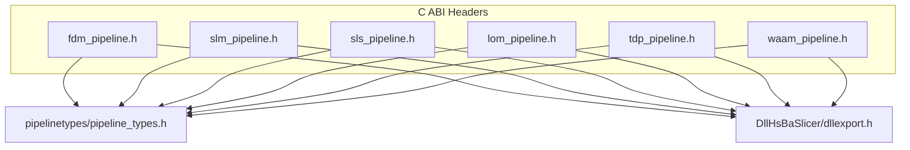
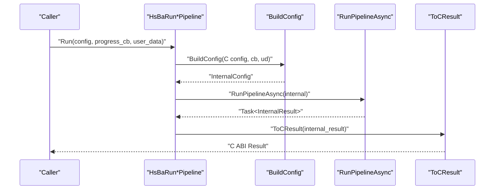
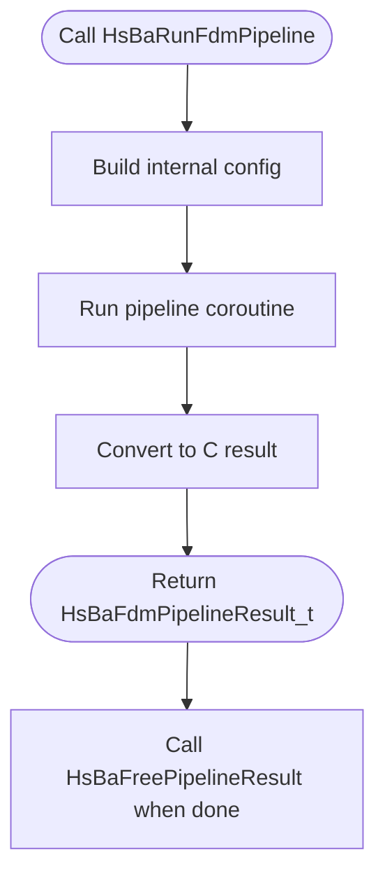
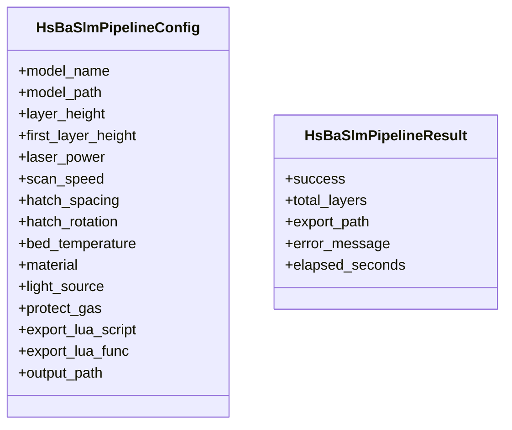
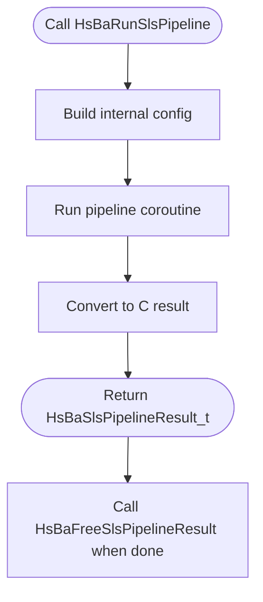
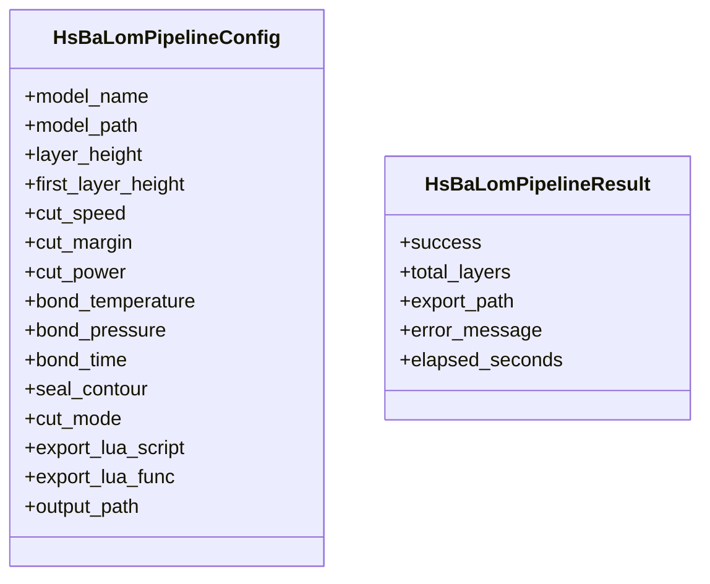
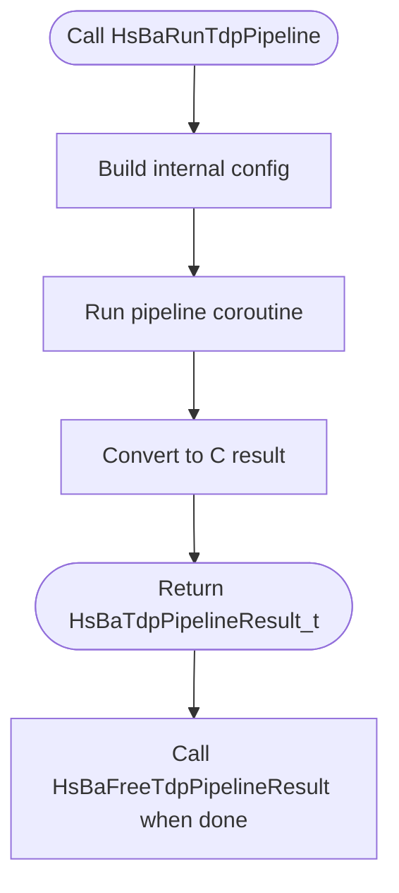
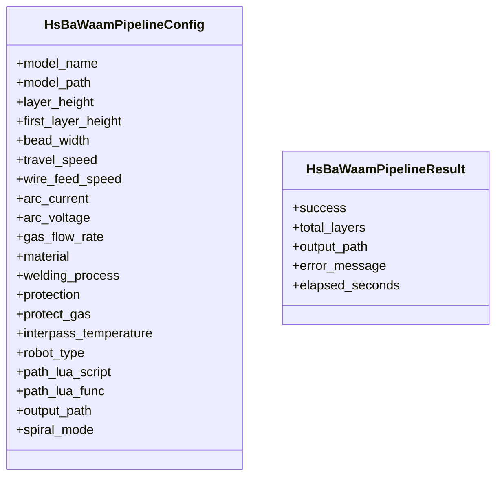
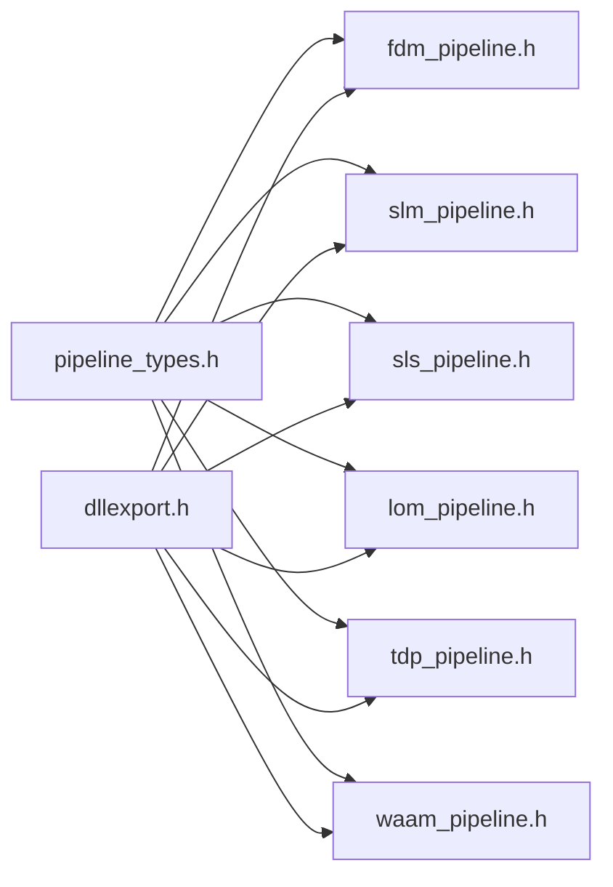

# C ABI Interface

<cite>
**Referenced Files in This Document**
- [dllexport.h](file://DllHsBaSlicer/dllexport.h)
- [pipeline_types.h](file://pipelinetypes/pipeline_types.h)
- [fdm_pipeline.h](file://DllHsBaSlicer/fdm_pipeline.h)
- [fdm_pipeline.cpp](file://DllHsBaSlicer/fdm_pipeline.cpp)
- [slm_pipeline.h](file://DllHsBaSlicer/slm_pipeline.h)
- [slm_pipeline.cpp](file://DllHsBaSlicer/slm_pipeline.cpp)
- [sls_pipeline.h](file://DllHsBaSlicer/sls_pipeline.h)
- [sls_pipeline.cpp](file://DllHsBaSlicer/sls_pipeline.cpp)
- [lom_pipeline.h](file://DllHsBaSlicer/lom_pipeline.h)
- [lom_pipeline.cpp](file://DllHsBaSlicer/lom_pipeline.cpp)
- [tdp_pipeline.h](file://DllHsBaSlicer/tdp_pipeline.h)
- [tdp_pipeline.cpp](file://DllHsBaSlicer/tdp_pipeline.cpp)
- [waam_pipeline.h](file://DllHsBaSlicer/waam_pipeline.h)
- [waam_pipeline.cpp](file://DllHsBaSlicer/waam_pipeline.cpp)
</cite>

## Table of Contents
1. [Introduction](#introduction)
2. [Project Structure](#project-structure)
3. [Core Components](#core-components)
4. [Architecture Overview](#architecture-overview)
5. [Detailed Component Analysis](#detailed-component-analysis)
6. [Dependency Analysis](#dependency-analysis)
7. [Performance Considerations](#performance-considerations)
8. [Troubleshooting Guide](#troubleshooting-guide)
9. [Conclusion](#conclusion)
10. [Appendices](#appendices)

## Introduction
This document describes the C ABI exposed by DllHsBaSlicer for running slicing and export pipelines across multiple manufacturing technologies. It documents the exported functions HsBaRunFdmPipeline, HsBaRunSlmPipeline, HsBaRunSlsPipeline, HsBaRunLomPipeline, HsBaRunTdpPipeline, and HsBaRunWaamPipeline, including their signatures, parameters, return values, error handling, memory ownership, thread-safety considerations, and resource cleanup procedures. It also explains HSBA_SLICER_API macro usage and platform-specific behavior, and provides guidance for integrating from Java, Python, and C#.

## Project Structure
The C ABI is defined in per-pipeline headers under DllHsBaSlicer and shared C-compatible types are declared in pipelinetypes/pipeline_types.h. Each pipeline header declares:
- A default configuration creator
- A synchronous run function
- An asynchronous run function
- A result-free function

**Diagram sources**
- [fdm_pipeline.h:1-68](file://DllHsBaSlicer/fdm_pipeline.h#L1-L68)
- [slm_pipeline.h:1-63](file://DllHsBaSlicer/slm_pipeline.h#L1-L63)
- [sls_pipeline.h:1-63](file://DllHsBaSlicer/sls_pipeline.h#L1-L63)
- [lom_pipeline.h:1-63](file://DllHsBaSlicer/lom_pipeline.h#L1-L63)
- [tdp_pipeline.h:1-63](file://DllHsBaSlicer/tdp_pipeline.h#L1-L63)
- [waam_pipeline.h:1-64](file://DllHsBaSlicer/waam_pipeline.h#L1-L64)
- [pipeline_types.h:1-12](file://pipelinetypes/pipeline_types.h#L1-L12)
- [dllexport.h:1-23](file://DllHsBaSlicer/dllexport.h#L1-L23)

**Section sources**
- [dllexport.h:1-23](file://DllHsBaSlicer/dllexport.h#L1-L23)
- [pipeline_types.h:1-12](file://pipelinetypes/pipeline_types.h#L1-L12)

## Core Components
- Pipeline configuration structs define model inputs, process parameters, Lua script hooks, and output paths.
- Pipeline result structs contain success flags, layer counts, output paths or content, error messages, and elapsed time.
- Progress callbacks report percentage and stage text; result callbacks deliver completed results asynchronously.
- Free functions release memory owned by the library.

Key responsibilities:
- Create default configs via dedicated creators (e.g., HsBaCreateDefaultConfig).
- Run pipelines synchronously or asynchronously.
- Free results to avoid leaks.

**Section sources**
- [pipeline_types.h:23-140](file://pipelinetypes/pipeline_types.h#L23-L140)
- [pipeline_types.h:146-245](file://pipelinetypes/pipeline_types.h#L146-L245)
- [pipeline_types.h:251-310](file://pipelinetypes/pipeline_types.h#L251-L310)
- [pipeline_types.h:319-401](file://pipelinetypes/pipeline_types.h#L319-L401)
- [pipeline_types.h:417-461](file://pipelinetypes/pipeline_types.h#L417-L461)
- [pipeline_types.h:477-521](file://pipelinetypes/pipeline_types.h#L477-L521)
- [pipeline_types.h:573-625](file://pipelinetypes/pipeline_types.h#L573-L625)

## Architecture Overview
Each pipeline follows a consistent pattern:
- Build an internal config from the C ABI config.
- Execute a coroutine-based pipeline that performs preprocessing, slicing, support/fill/export steps.
- Convert internal results to C ABI results with allocated strings.
- Provide async variants that schedule work and invoke completion callbacks.

**Diagram sources**
- [fdm_pipeline.cpp:445-452](file://DllHsBaSlicer/fdm_pipeline.cpp#L445-L452)
- [fdm_pipeline.cpp:454-471](file://DllHsBaSlicer/fdm_pipeline.cpp#L454-L471)

**Section sources**
- [fdm_pipeline.cpp:438-480](file://DllHsBaSlicer/fdm_pipeline.cpp#L438-L480)

## Detailed Component Analysis

### HSBA_SLICER_API Macro and Platform Behavior
- On Windows:
  - When building the DLL (HSBA_SLICER_EXPORTS defined), HSBA_SLICER_API expands to __declspec(dllexport).
  - When consuming the DLL, it expands to __declspec(dllimport).
- On non-Windows platforms:
  - HSBA_SLICER_API is empty; default visibility applies.

Usage: All exported C ABI functions are annotated with HSBA_SLICER_API and wrapped in extern "C" blocks to ensure stable symbol names.

**Section sources**
- [dllexport.h:9-20](file://DllHsBaSlicer/dllexport.h#L9-L20)

### FDM Pipeline (Fused Deposition Modeling)
- Functions:
  - HsBaCreateDefaultConfig: returns default HsBaFdmPipelineConfig_t.
  - HsBaRunFdmPipeline: synchronous execution returning HsBaFdmPipelineResult_t.
  - HsBaRunFdmPipelineAsync: asynchronous execution invoking HsBaResultCallback on completion.
  - HsBaFreePipelineResult: frees gcode_content and error_message.
- Config fields include model path/name, slice settings, fill/support/path parameters, G-code firmware options, optional Lua scripts for support/infill, and output path.
- Result fields include success flag, total layers, UTF-8 gcode_content, UTF-8 error_message, and elapsed_seconds.

**Diagram sources**
- [fdm_pipeline.cpp:445-452](file://DllHsBaSlicer/fdm_pipeline.cpp#L445-L452)
- [fdm_pipeline.cpp:473-479](file://DllHsBaSlicer/fdm_pipeline.cpp#L473-L479)

**Section sources**
- [fdm_pipeline.h:17-61](file://DllHsBaSlicer/fdm_pipeline.h#L17-L61)
- [pipeline_types.h:23-140](file://pipelinetypes/pipeline_types.h#L23-L140)
- [fdm_pipeline.cpp:440-479](file://DllHsBaSlicer/fdm_pipeline.cpp#L440-L479)

### SLM Pipeline (Selective Laser Melting)
- Functions:
  - HsBaCreateDefaultSlmConfig: returns default HsBaSlmPipelineConfig_t.
  - HsBaRunSlmPipeline: synchronous execution returning HsBaSlmPipelineResult_t.
  - HsBaRunSlmPipelineAsync: asynchronous execution invoking HsBaSlmResultCallback.
  - HsBaFreeSlmPipelineResult: frees export_path and error_message.
- Config includes model info, slice parameters, laser/power/scanning parameters, bed temperature, material/light/gas enums, required export_lua_script/export_lua_func, and output path.
- Result includes success flag, total layers, UTF-8 export_path, UTF-8 error_message, and elapsed_seconds.

**Diagram sources**
- [pipeline_types.h:319-401](file://pipelinetypes/pipeline_types.h#L319-L401)

**Section sources**
- [slm_pipeline.h:17-56](file://DllHsBaSlicer/slm_pipeline.h#L17-L56)
- [pipeline_types.h:319-401](file://pipelinetypes/pipeline_types.h#L319-L401)
- [slm_pipeline.cpp:193-200](file://DllHsBaSlicer/slm_pipeline.cpp#L193-L200)

### SLS Pipeline (Selective Laser Sintering)
- Functions:
  - HsBaCreateDefaultSlsConfig: returns default HsBaSlsPipelineConfig_t.
  - HsBaRunSlsPipeline: synchronous execution returning HsBaSlsPipelineResult_t.
  - HsBaRunSlsPipelineAsync: asynchronous execution invoking HsBaSlsResultCallback.
  - HsBaFreeSlsPipelineResult: frees export_path and error_message.
- Config includes model info, slice parameters, laser/scanning parameters, bed temperature, required export_lua_script/export_lua_func, and output path.
- Result includes success flag, total layers, UTF-8 export_path, UTF-8 error_message, and elapsed_seconds.

**Diagram sources**
- [sls_pipeline.cpp:162-174](file://DllHsBaSlicer/sls_pipeline.cpp#L162-L174)

**Section sources**
- [sls_pipeline.h:17-56](file://DllHsBaSlicer/sls_pipeline.h#L17-L56)
- [pipeline_types.h:251-310](file://pipelinetypes/pipeline_types.h#L251-L310)
- [sls_pipeline.cpp:142-174](file://DllHsBaSlicer/sls_pipeline.cpp#L142-L174)

### LOM Pipeline (Laminated Object Manufacturing)
- Functions:
  - HsBaCreateDefaultLomConfig: returns default HsBaLomPipelineConfig_t.
  - HsBaRunLomPipeline: synchronous execution returning HsBaLomPipelineResult_t.
  - HsBaRunLomPipelineAsync: asynchronous execution invoking HsBaLomResultCallback.
  - HsBaFreeLomPipelineResult: frees export_path and error_message.
- Config includes model info, sheet thickness, cut/bond parameters, cutting mode, required export_lua_script/export_lua_func, and output path.
- Result includes success flag, total layers, UTF-8 export_path, UTF-8 error_message, and elapsed_seconds.

**Diagram sources**
- [pipeline_types.h:417-461](file://pipelinetypes/pipeline_types.h#L417-L461)

**Section sources**
- [lom_pipeline.h:17-56](file://DllHsBaSlicer/lom_pipeline.h#L17-L56)
- [pipeline_types.h:417-461](file://pipelinetypes/pipeline_types.h#L417-L461)
- [lom_pipeline.cpp:150-185](file://DllHsBaSlicer/lom_pipeline.cpp#L150-L185)

### TDP Pipeline (Binder Jetting / 3DP)
- Functions:
  - HsBaCreateDefaultTdpConfig: returns default HsBaTdpPipelineConfig_t.
  - HsBaRunTdpPipeline: synchronous execution returning HsBaTdpPipelineResult_t.
  - HsBaRunTdpPipelineAsync: asynchronous execution invoking HsBaTdpResultCallback.
  - HsBaFreeTdpPipelineResult: frees export_path and error_message.
- Config includes model info, slice parameters, binder head/drop/saturation/curing parameters, bed temperature, binder mode, required export_lua_script/export_lua_func, spiral_mode, and output path.
- Result includes success flag, total layers, UTF-8 export_path, UTF-8 error_message, and elapsed_seconds.

**Diagram sources**
- [tdp_pipeline.cpp:183-195](file://DllHsBaSlicer/tdp_pipeline.cpp#L183-L195)

**Section sources**
- [tdp_pipeline.h:17-56](file://DllHsBaSlicer/tdp_pipeline.h#L17-L56)
- [pipeline_types.h:477-521](file://pipelinetypes/pipeline_types.h#L477-L521)
- [tdp_pipeline.cpp:161-195](file://DllHsBaSlicer/tdp_pipeline.cpp#L161-L195)

### WAAM Pipeline (Wire Arc Additive Manufacturing)
- Functions:
  - HsBaCreateDefaultWaamConfig: returns default HsBaWaamPipelineConfig_t.
  - HsBaRunWaamPipeline: synchronous execution returning HsBaWaamPipelineResult_t.
  - HsBaRunWaamPipelineAsync: asynchronous execution invoking HsBaWaamResultCallback.
  - HsBaFreeWaamPipelineResult: frees output_path and error_message.
- Config includes model info, bead/layer height, travel/wire/electrical parameters, gas flow, material/process/protection/gas enums, interpass temperature, robot controller type, optional path_lua_script/path_lua_func, spiral_mode, and output path.
- Result includes success flag, total layers, UTF-8 output_path (robot program), UTF-8 error_message, and elapsed_seconds.

**Diagram sources**
- [pipeline_types.h:573-625](file://pipelinetypes/pipeline_types.h#L573-L625)

**Section sources**
- [waam_pipeline.h:17-57](file://DllHsBaSlicer/waam_pipeline.h#L17-L57)
- [pipeline_types.h:573-625](file://pipelinetypes/pipeline_types.h#L573-L625)
- [waam_pipeline.cpp:126-166](file://DllHsBaSlicer/waam_pipeline.cpp#L126-L166)

## Dependency Analysis
- All pipeline headers depend on:
  - dllexport.h for HSBA_SLICER_API.
  - pipelinetypes/pipeline_types.h for C ABI struct and callback definitions.
- Implementations depend on internal pipeline modules (preprocess, slice, export) and coroutines.

**Diagram sources**
- [pipeline_types.h:1-12](file://pipelinetypes/pipeline_types.h#L1-L12)
- [dllexport.h:1-23](file://DllHsBaSlicer/dllexport.h#L1-L23)
- [fdm_pipeline.h:1-10](file://DllHsBaSlicer/fdm_pipeline.h#L1-L10)
- [slm_pipeline.h:1-10](file://DllHsBaSlicer/slm_pipeline.h#L1-L10)
- [sls_pipeline.h:1-10](file://DllHsBaSlicer/sls_pipeline.h#L1-L10)
- [lom_pipeline.h:1-10](file://DllHsBaSlicer/lom_pipeline.h#L1-L10)
- [tdp_pipeline.h:1-10](file://DllHsBaSlicer/tdp_pipeline.h#L1-L10)
- [waam_pipeline.h:1-10](file://DllHsBaSlicer/waam_pipeline.h#L1-L10)

**Section sources**
- [pipeline_types.h:1-12](file://pipelinetypes/pipeline_types.h#L1-L12)
- [dllexport.h:1-23](file://DllHsBaSlicer/dllexport.h#L1-L23)

## Performance Considerations
- Synchronous calls block until the pipeline completes; prefer asynchronous APIs for UI responsiveness.
- Progress callbacks are invoked during processing; keep them lightweight to avoid blocking the pipeline.
- Coroutines are used internally; avoid heavy work inside callbacks.
- For large models, expect longer preprocessing and slicing times; consider preloading models if supported by your integration.

[No sources needed since this section provides general guidance]

## Troubleshooting Guide
Common issues and resolutions:
- Null pointers in config:
  - Ensure model_name/model_path are set appropriately.
  - For SLS/SLM/LOM/TDP, export_lua_script must not be NULL.
- Memory leaks:
  - Always call the corresponding free function after using the result (e.g., HsBaFreePipelineResult, HsBaFreeSlsPipelineResult, etc.).
- Error messages:
  - Check error_message in results; it is UTF-8 encoded and must be freed by the caller.
- Callback safety:
  - Progress/result callbacks may be invoked from background threads; ensure thread-safe access to shared state.

**Section sources**
- [fdm_pipeline.cpp:473-479](file://DllHsBaSlicer/fdm_pipeline.cpp#L473-L479)
- [slm_pipeline.h:52-56](file://DllHsBaSlicer/slm_pipeline.h#L52-L56)
- [sls_pipeline.h:49-56](file://DllHsBaSlicer/sls_pipeline.h#L49-L56)
- [lom_pipeline.h:52-56](file://DllHsBaSlicer/lom_pipeline.h#L52-L56)
- [tdp_pipeline.h:52-56](file://DllHsBaSlicer/tdp_pipeline.h#L52-L56)
- [waam_pipeline.h:53-57](file://DllHsBaSlicer/waam_pipeline.h#L53-L57)

## Conclusion
The DllHsBaSlicer C ABI provides a consistent interface for running slicing and export pipelines across FDM, SLA/SLS/SLM/LOM/TDP, and WAAM workflows. Use the default config creators, configure parameters, and call either synchronous or asynchronous run functions. Always free returned results to prevent memory leaks, and implement lightweight progress callbacks for responsive applications.

[No sources needed since this section summarizes without analyzing specific files]

## Appendices

### Memory Management Guidelines
- Ownership:
  - The library allocates string fields in result structs (e.g., gcode_content, export_path, output_path, error_message).
  - Call the matching free function to release these allocations.
- String encoding:
  - All returned strings are UTF-8.
- Asynchronous results:
  - Result callbacks receive a copy of the result struct; still free it after use.

**Section sources**
- [pipeline_types.h:115-140](file://pipelinetypes/pipeline_types.h#L115-L140)
- [pipeline_types.h:220-245](file://pipelinetypes/pipeline_types.h#L220-L245)
- [pipeline_types.h:285-310](file://pipelinetypes/pipeline_types.h#L285-L310)
- [pipeline_types.h:378-401](file://pipelinetypes/pipeline_types.h#L378-L401)
- [pipeline_types.h:438-461](file://pipelinetypes/pipeline_types.h#L438-L461)
- [pipeline_types.h:498-521](file://pipelinetypes/pipeline_types.h#L498-L521)
- [pipeline_types.h:602-625](file://pipelinetypes/pipeline_types.h#L602-L625)
- [fdm_pipeline.cpp:473-479](file://DllHsBaSlicer/fdm_pipeline.cpp#L473-L479)

### Thread Safety Considerations
- Progress callbacks:
  - May be called from worker threads; protect shared data with appropriate synchronization.
- Result callbacks:
  - Delivered after pipeline completion; still treat as potentially off-main-thread unless you marshal to your UI thread.
- Reentrancy:
  - Avoid calling back into the same pipeline from within callbacks to prevent recursion.

**Section sources**
- [fdm_pipeline.cpp:454-471](file://DllHsBaSlicer/fdm_pipeline.cpp#L454-L471)

### Resource Cleanup Procedures
- After each successful or failed run:
  - Read success flag and any error_message.
  - Copy or process output data (gcode_content, export_path, output_path) as needed.
  - Call the corresponding free function immediately after you no longer need the result.

**Section sources**
- [fdm_pipeline.cpp:473-479](file://DllHsBaSlicer/fdm_pipeline.cpp#L473-L479)
- [slm_pipeline.h:52-56](file://DllHsBaSlicer/slm_pipeline.h#L52-L56)
- [sls_pipeline.h:49-56](file://DllHsBaSlicer/sls_pipeline.h#L49-L56)
- [lom_pipeline.h:52-56](file://DllHsBaSlicer/lom_pipeline.h#L52-L56)
- [tdp_pipeline.h:52-56](file://DllHsBaSlicer/tdp_pipeline.h#L52-L56)
- [waam_pipeline.h:53-57](file://DllHsBaSlicer/waam_pipeline.h#L53-L57)

### Integration Examples

#### Calling from C/C++
- Include the relevant pipeline header.
- Initialize config via the default creator.
- Set required fields (model_path, export_lua_script where applicable).
- Call the synchronous or asynchronous run function.
- Handle result.success and error_message.
- Free the result.

**Section sources**
- [fdm_pipeline.h:21-61](file://DllHsBaSlicer/fdm_pipeline.h#L21-L61)
- [slm_pipeline.h:21-56](file://DllHsBaSlicer/slm_pipeline.h#L21-L56)
- [sls_pipeline.h:21-56](file://DllHsBaSlicer/sls_pipeline.h#L21-L56)
- [lom_pipeline.h:21-56](file://DllHsBaSlicer/lom_pipeline.h#L21-L56)
- [tdp_pipeline.h:21-56](file://DllHsBaSlicer/tdp_pipeline.h#L21-L56)
- [waam_pipeline.h:21-57](file://DllHsBaSlicer/waam_pipeline.h#L21-L57)

#### Calling from Java (JNA/JNI)
- Map HSBA_SLICER_API functions to native methods.
- Represent char* as direct byte buffers or Strings with explicit UTF-8 encoding.
- For callbacks, map function pointers to Java interfaces and marshal data safely.
- Ensure to call the free functions to release native memory.

[No sources needed since this section provides general guidance]

#### Calling from Python (ctypes)
- Load the shared library and set restype/argtypes for each function.
- Use ctypes.c_char_p for UTF-8 strings.
- Define callback prototypes for progress and result callbacks.
- Call free functions to release memory.

[No sources needed since this section provides general guidance]

#### Calling from C# (P/Invoke)
- Declare DllImport for each function with CharSet.Ansi and CallingConvention.Cdecl.
- Marshal char* to System.String with Encoding.UTF8.
- Define delegate types for callbacks and pass them to async run functions.
- Invoke free functions to release native resources.

[No sources needed since this section provides general guidance]