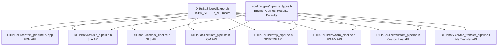
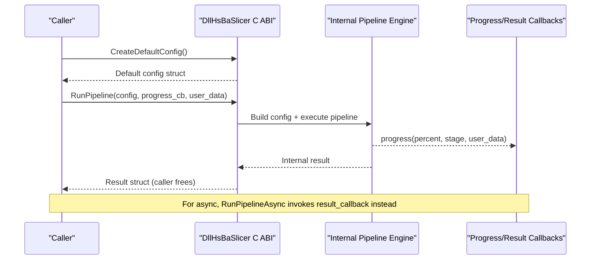
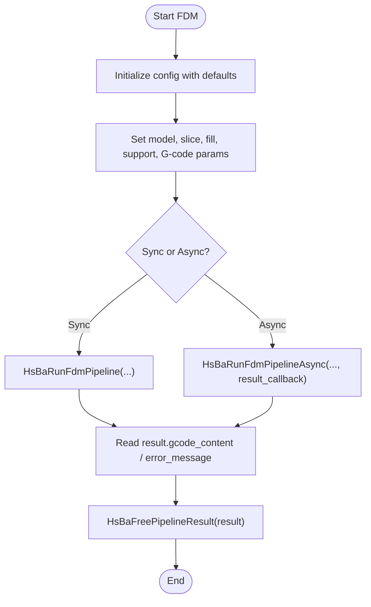
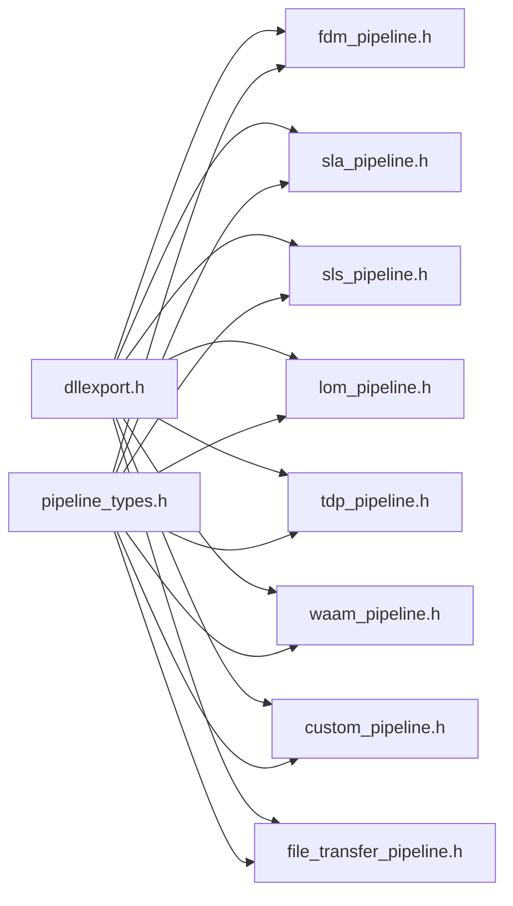

# C ABI Reference

<cite>
**Referenced Files in This Document**
- [dllexport.h](file://DllHsBaSlicer/dllexport.h)
- [pipeline_types.h](file://pipelinetypes/pipeline_types.h)
- [fdm_pipeline.h](file://DllHsBaSlicer/fdm_pipeline.h)
- [fdm_pipeline.cpp](file://DllHsBaSlicer/fdm_pipeline.cpp)
- [sla_pipeline.h](file://DllHsBaSlicer/sla_pipeline.h)
- [sls_pipeline.h](file://DllHsBaSlicer/sls_pipeline.h)
- [lom_pipeline.h](file://DllHsBaSlicer/lom_pipeline.h)
- [tdp_pipeline.h](file://DllHsBaSlicer/tdp_pipeline.h)
- [waam_pipeline.h](file://DllHsBaSlicer/waam_pipeline.h)
- [custom_pipeline.h](file://DllHsBaSlicer/custom_pipeline.h)
- [file_transfer_pipeline.h](file://DllHsBaSlicer/file_transfer_pipeline.h)
</cite>

## Table of Contents
1. [Introduction](#introduction)
2. [Project Structure](#project-structure)
3. [Core Components](#core-components)
4. [Architecture Overview](#architecture-overview)
5. [Detailed Component Analysis](#detailed-component-analysis)
6. [Dependency Analysis](#dependency-analysis)
7. [Performance Considerations](#performance-considerations)
8. [Troubleshooting Guide](#troubleshooting-guide)
9. [Conclusion](#conclusion)
10. [Appendices](#appendices)

## Introduction
This document is the authoritative C ABI reference for HsBaSlicer’s DllHsBaSlicer shared library. It documents all C-compatible functions, configuration structures, result structures, and callback types exposed by the library. The ABI supports multiple additive manufacturing pipelines: FDM, SLA, SLS, LOM, 3DP (TDP), WAAM, file transfer, and fully Lua-driven custom pipelines.

Key characteristics:
- All public symbols use the HSBA_SLICER_API export/import macro.
- Configuration structs are POD-like and initialized via dedicated default-creator functions.
- Pipeline run functions return results by value; callers must free allocated strings using the matching free function.
- Progress callbacks report percentage and stage text; result callbacks deliver final outcomes asynchronously.
- Async APIs use C++20 coroutines internally and invoke completion callbacks when finished.

## Project Structure
The C ABI surface is split into a central type header and per-pipeline headers:
- Type definitions, enums, config/result structs, and inline defaults live in pipelinetypes/pipeline_types.h.
- Per-pipeline C ABI entry points live under DllHsBaSlicer/*.h.
- Windows DLL import/export behavior is defined in DllHsBaSlicer/dllexport.h.

**Diagram sources**
- [dllexport.h:1-23](file://DllHsBaSlicer/dllexport.h#L1-L23)
- [pipeline_types.h:1-1049](file://pipelinetypes/pipeline_types.h#L1-L1049)
- [fdm_pipeline.h:1-68](file://DllHsBaSlicer/fdm_pipeline.h#L1-L68)
- [fdm_pipeline.cpp:469-496](file://DllHsBaSlicer/fdm_pipeline.cpp#L469-L496)
- [sla_pipeline.h:1-63](file://DllHsBaSlicer/sla_pipeline.h#L1-L63)
- [sls_pipeline.h:1-63](file://DllHsBaSlicer/sls_pipeline.h#L1-L63)
- [lom_pipeline.h:1-63](file://DllHsBaSlicer/lom_pipeline.h#L1-L63)
- [tdp_pipeline.h:1-63](file://DllHsBaSlicer/tdp_pipeline.h#L1-L63)
- [waam_pipeline.h:1-64](file://DllHsBaSlicer/waam_pipeline.h#L1-L64)
- [custom_pipeline.h:1-69](file://DllHsBaSlicer/custom_pipeline.h#L1-L69)
- [file_transfer_pipeline.h:1-67](file://DllHsBaSlicer/file_transfer_pipeline.h#L1-L67)

**Section sources**
- [dllexport.h:1-23](file://DllHsBaSlicer/dllexport.h#L1-L23)
- [pipeline_types.h:1-1049](file://pipelinetypes/pipeline_types.h#L1-L1049)
- [fdm_pipeline.h:1-68](file://DllHsBaSlicer/fdm_pipeline.h#L1-L68)
- [sla_pipeline.h:1-63](file://DllHsBaSlicer/sla_pipeline.h#L1-L63)
- [sls_pipeline.h:1-63](file://DllHsBaSlicer/sls_pipeline.h#L1-L63)
- [lom_pipeline.h:1-63](file://DllHsBaSlicer/lom_pipeline.h#L1-L63)
- [tdp_pipeline.h:1-63](file://DllHsBaSlicer/tdp_pipeline.h#L1-L63)
- [waam_pipeline.h:1-64](file://DllHsBaSlicer/waam_pipeline.h#L1-L64)
- [custom_pipeline.h:1-69](file://DllHsBaSlicer/custom_pipeline.h#L1-L69)
- [file_transfer_pipeline.h:1-67](file://DllHsBaSlicer/file_transfer_pipeline.h#L1-L67)

## Core Components
This section summarizes the common ABI patterns used across all pipeline modules.

- Export macro: HSBA_SLICER_API marks exported/imported symbols on Windows and is empty on other platforms.
- Configuration structs: Each pipeline has a dedicated config struct with string fields (UTF-8 paths or JSON) and numeric parameters. Use the provided default creator to initialize safely.
- Result structs: Returned by value from synchronous run functions; contain success flags, layer counts, output paths or content, error messages, and elapsed time. Callers must free allocated strings using the matching free function.
- Callbacks:
  - Progress callbacks receive percent (0–100), stage description (UTF-8), and user_data.
  - Result callbacks receive a result struct and user_data after async completion.
- Memory ownership:
  - Configs are caller-owned; pass pointers to run functions.
  - Result strings are owned by the library until freed by the caller via the matching free function.
- Thread safety:
  - Progress callbacks may be invoked from internal worker threads; avoid blocking operations and UI calls without proper synchronization.
  - Do not mutate a config while it is being processed by an async call.

**Section sources**
- [dllexport.h:1-23](file://DllHsBaSlicer/dllexport.h#L1-L23)
- [pipeline_types.h:13-141](file://pipelinetypes/pipeline_types.h#L13-L141)
- [pipeline_types.h:142-246](file://pipelinetypes/pipeline_types.h#L142-L246)
- [pipeline_types.h:247-311](file://pipelinetypes/pipeline_types.h#L247-L311)
- [pipeline_types.h:312-402](file://pipelinetypes/pipeline_types.h#L312-L402)
- [pipeline_types.h:403-462](file://pipelinetypes/pipeline_types.h#L403-L462)
- [pipeline_types.h:463-522](file://pipelinetypes/pipeline_types.h#L463-L522)
- [pipeline_types.h:523-626](file://pipelinetypes/pipeline_types.h#L523-L626)
- [pipeline_types.h:627-733](file://pipelinetypes/pipeline_types.h#L627-L733)
- [pipeline_types.h:734-983](file://pipelinetypes/pipeline_types.h#L734-L983)

## Architecture Overview
The C ABI exposes a uniform pattern per pipeline:
- CreateDefaultConfig() returns a zero-initialized/default-filled config.
- RunPipeline(config, progress_callback, user_data) runs synchronously and returns a result.
- RunPipelineAsync(config, progress_callback, user_data, result_callback, result_user_data) starts work and invokes result_callback upon completion.
- FreePipelineResult(result) releases memory owned by the result.

**Diagram sources**
- [fdm_pipeline.h:17-61](file://DllHsBaSlicer/fdm_pipeline.h#L17-L61)
- [fdm_pipeline.cpp:469-496](file://DllHsBaSlicer/fdm_pipeline.cpp#L469-L496)

## Detailed Component Analysis

### FDM Pipeline API
Functions:
- HsBaCreateDefaultConfig(): Returns HsBaFdmPipelineConfig_t with default values.
- HsBaRunFdmPipeline(const HsBaFdmPipelineConfig_t*, HsBaProgressCallback, void*): Runs preprocess -> slice -> support -> fill -> path generation synchronously. Returns HsBaFdmPipelineResult_t.
- HsBaRunFdmPipelineAsync(const HsBaFdmPipelineConfig_t*, HsBaProgressCallback, void*, HsBaResultCallback, void*): Non-blocking execution; invokes HsBaResultCallback with the final result.
- HsBaFreePipelineResult(HsBaFdmPipelineResult_t*): Frees gcode_content and error_message.

Configuration highlights:
- Model inputs: model_name, model_path.
- Slice settings: layer_height, first_layer_height.
- Fill: fill_spacing, fill_mode, fill_angle, wall_count, top/bottom layer counts, infill_density.
- Support: enable_support, overhang_angle, support_gap, support_diameter, support_density, support_pattern, interface_layers, interface_density.
- Path/G-code: line_width, print_speed, travel_speed, extrusion_multiplier, spiral_mode, gcode_firmware, nozzle_diameter, filament_diameter, nozzle_temp, bed_temp, retract_length, retract_speed, first_layer_speed.
- Lua customization: support_lua_script, support_lua_func, infill_lua_script, infill_lua_func.
- Output: output_path.

Result structure:
- success, total_layers, gcode_content (UTF-8), error_message (UTF-8), elapsed_seconds.

Callbacks:
- HsBaProgressCallback(percent, stage, user_data).
- HsBaResultCallback(result, user_data).

Memory management:
- Caller owns the config pointer.
- Caller must call HsBaFreePipelineResult to release result strings.

Usage example outline:
- Initialize config via HsBaCreateDefaultConfig().
- Set model_path, output_path, and relevant parameters.
- Optionally set progress callback for UI updates.
- Call HsBaRunFdmPipeline() or HsBaRunFdmPipelineAsync().
- On success, read gcode_content or output_path; then call HsBaFreePipelineResult().

**Diagram sources**
- [fdm_pipeline.h:17-61](file://DllHsBaSlicer/fdm_pipeline.h#L17-L61)
- [fdm_pipeline.cpp:469-496](file://DllHsBaSlicer/fdm_pipeline.cpp#L469-L496)
- [pipeline_types.h:23-141](file://pipelinetypes/pipeline_types.h#L23-L141)

**Section sources**
- [fdm_pipeline.h:17-61](file://DllHsBaSlicer/fdm_pipeline.h#L17-L61)
- [fdm_pipeline.cpp:469-496](file://DllHsBaSlicer/fdm_pipeline.cpp#L469-L496)
- [pipeline_types.h:23-141](file://pipelinetypes/pipeline_types.h#L23-L141)

### SLA Pipeline API
Functions:
- HsBaCreateDefaultSlaConfig(): Returns HsBaSlaPipelineConfig_t with defaults.
- HsBaRunSlaPipeline(const HsBaSlaPipelineConfig_t*, HsBaSlaProgressCallback, void*): Runs preprocess -> slice -> floor -> support -> export synchronously. Returns HsBaSlaPipelineResult_t.
- HsBaRunSlaPipelineAsync(...): Asynchronous variant returning result via HsBaSlaResultCallback.
- HsBaFreeSlaPipelineResult(HsBaSlaPipelineResult_t*): Frees export_path and error_message.

Configuration highlights:
- Model inputs: model_name, model_path.
- Slice: layer_height, first_layer_height.
- Exposure: bottom_exposure_time, normal_exposure_time, bottom_lift_distance, lift_distance, lift_speed, retract_speed.
- Floor/raft: floor_raft_offset, floor_border_width, floor_fill_spacing, floor_fill_angle, floor_border_count, floor_use_convex_hull.
- Support: enable_support, overhang_angle, support_gap, support_diameter, support_density, support_pattern.
- Lua customization: support_lua_script/func, floor_lua_script/func, export_lua_script/func.
- Output: output_path, image_type, image_width, image_height.

Result structure:
- success, total_layers, export_path (UTF-8), error_message (UTF-8), elapsed_seconds.

Callbacks:
- HsBaSlaProgressCallback(percent, stage, user_data).
- HsBaSlaResultCallback(result, user_data).

Memory management:
- Caller must call HsBaFreeSlaPipelineResult to release result strings.

**Section sources**
- [sla_pipeline.h:17-56](file://DllHsBaSlicer/sla_pipeline.h#L17-L56)
- [pipeline_types.h:142-246](file://pipelinetypes/pipeline_types.h#L142-L246)

### SLS Pipeline API
Functions:
- HsBaCreateDefaultSlsConfig(): Returns HsBaSlsPipelineConfig_t with defaults.
- HsBaRunSlsPipeline(const HsBaSlsPipelineConfig_t*, HsBaSlsProgressCallback, void*): Runs preprocess -> slice -> export synchronously. Requires export_lua_script. Returns HsBaSlsPipelineResult_t.
- HsBaRunSlsPipelineAsync(...): Asynchronous variant returning result via HsBaSlsResultCallback.
- HsBaFreeSlsPipelineResult(HsBaSlsPipelineResult_t*): Frees export_path and error_message.

Configuration highlights:
- Model inputs: model_name, model_path.
- Slice: layer_height, first_layer_height.
- Laser: laser_power, scan_speed, hatch_spacing, hatch_rotation, bed_temperature.
- Lua export: export_lua_script (required), export_lua_func.
- Output: output_path.

Result structure:
- success, total_layers, export_path (UTF-8), error_message (UTF-8), elapsed_seconds.

Callbacks:
- HsBaSlsProgressCallback(percent, stage, user_data).
- HsBaSlsResultCallback(result, user_data).

Memory management:
- Caller must call HsBaFreeSlsPipelineResult to release result strings.

**Section sources**
- [sls_pipeline.h:17-56](file://DllHsBaSlicer/sls_pipeline.h#L17-L56)
- [pipeline_types.h:247-311](file://pipelinetypes/pipeline_types.h#L247-L311)

### LOM Pipeline API
Functions:
- HsBaCreateDefaultLomConfig(): Returns HsBaLomPipelineConfig_t with defaults.
- HsBaRunLomPipeline(const HsBaLomPipelineConfig_t*, HsBaLomProgressCallback, void*): Runs preprocess -> slice -> export synchronously. Requires export_lua_script. Returns HsBaLomPipelineResult_t.
- HsBaRunLomPipelineAsync(...): Asynchronous variant returning result via HsBaLomResultCallback.
- HsBaFreeLomPipelineResult(HsBaLomPipelineResult_t*): Frees export_path and error_message.

Configuration highlights:
- Model inputs: model_name, model_path.
- Slice: layer_height, first_layer_height.
- Cutting: cut_speed, cut_margin, cut_power, cut_mode.
- Bonding: bond_temperature, bond_pressure, bond_time, seal_contour.
- Lua export: export_lua_script (required), export_lua_func.
- Output: output_path.

Result structure:
- success, total_layers, export_path (UTF-8), error_message (UTF-8), elapsed_seconds.

Callbacks:
- HsBaLomProgressCallback(percent, stage, user_data).
- HsBaLomResultCallback(result, user_data).

Memory management:
- Caller must call HsBaFreeLomPipelineResult to release result strings.

**Section sources**
- [lom_pipeline.h:17-56](file://DllHsBaSlicer/lom_pipeline.h#L17-L56)
- [pipeline_types.h:403-462](file://pipelinetypes/pipeline_types.h#L403-L462)

### 3DP (TDP) Pipeline API
Functions:
- HsBaCreateDefaultTdpConfig(): Returns HsBaTdpPipelineConfig_t with defaults.
- HsBaRunTdpPipeline(const HsBaTdpPipelineConfig_t*, HsBaTdpProgressCallback, void*): Runs preprocess -> slice -> export synchronously. Requires export_lua_script. Returns HsBaTdpPipelineResult_t.
- HsBaRunTdpPipelineAsync(...): Asynchronous variant returning result via HsBaTdpResultCallback.
- HsBaFreeTdpPipelineResult(HsBaTdpPipelineResult_t*): Frees export_path and error_message.

Configuration highlights:
- Model inputs: model_name, model_path.
- Slice: layer_height, first_layer_height.
- Head/binder: head_count, drop_spacing, binder_saturation, ink_curing_time, bed_temperature, binder_mode.
- Lua export: export_lua_script (required), export_lua_func.
- Output: output_path, spiral_mode.

Result structure:
- success, total_layers, export_path (UTF-8), error_message (UTF-8), elapsed_seconds.

Callbacks:
- HsBaTdpProgressCallback(percent, stage, user_data).
- HsBaTdpResultCallback(result, user_data).

Memory management:
- Caller must call HsBaFreeTdpPipelineResult to release result strings.

**Section sources**
- [tdp_pipeline.h:17-56](file://DllHsBaSlicer/tdp_pipeline.h#L17-L56)
- [pipeline_types.h:463-522](file://pipelinetypes/pipeline_types.h#L463-L522)

### WAAM Pipeline API
Functions:
- HsBaCreateDefaultWaamConfig(): Returns HsBaWaamPipelineConfig_t with defaults.
- HsBaRunWaamPipeline(const HsBaWaamPipelineConfig_t*, HsBaWaamProgressCallback, void*): Runs preprocess -> slice -> robot path export synchronously. Returns HsBaWaamPipelineResult_t.
- HsBaRunWaamPipelineAsync(...): Asynchronous variant returning result via HsBaWaamResultCallback.
- HsBaFreeWaamPipelineResult(HsBaWaamPipelineResult_t*): Frees output_path and error_message.

Configuration highlights:
- Model inputs: model_name, model_path.
- Deposition: layer_height, first_layer_height, bead_width, travel_speed, wire_feed_speed, arc_current, arc_voltage, gas_flow_rate.
- Material/process: material, welding_process, protection, protect_gas, interpass_temperature.
- Robot target: robot_type.
- Optional Lua path generator: path_lua_script, path_lua_func.
- Output: output_path, spiral_mode.

Result structure:
- success, total_layers, output_path (UTF-8), error_message (UTF-8), elapsed_seconds.

Callbacks:
- HsBaWaamProgressCallback(percent, stage, user_data).
- HsBaWaamResultCallback(result, user_data).

Memory management:
- Caller must call HsBaFreeWaamPipelineResult to release result strings.

**Section sources**
- [waam_pipeline.h:17-57](file://DllHsBaSlicer/waam_pipeline.h#L17-L57)
- [pipeline_types.h:523-626](file://pipelinetypes/pipeline_types.h#L523-L626)

### Custom Lua Pipeline API
Functions:
- HsBaCreateDefaultCustomConfig(): Returns HsBaCustomPipelineConfig_t with defaults.
- HsBaRunCustomPipeline(const HsBaCustomPipelineConfig_t*, HsBaCustomProgressCallback, void*): Executes a fully Lua-defined workflow. Requires pipeline_lua_script or pipeline_lua_source. Returns HsBaCustomPipelineResult_t.
- HsBaRunCustomPipelineAsync(...): Asynchronous variant returning result via HsBaCustomResultCallback.
- HsBaFreeCustomPipelineResult(HsBaCustomPipelineResult_t*): Frees output_path, result_string, and error_message.

Configuration highlights:
- Lua pipeline definition: pipeline_lua_script or pipeline_lua_source, entry_func, config_json.
- Optional model info: model_name, model_path.
- Output: output_path.

Result structure:
- success, total_layers, output_path (UTF-8), result_string (UTF-8), error_message (UTF-8), elapsed_seconds.

Callbacks:
- HsBaCustomProgressCallback(percent, stage, user_data).
- HsBaCustomResultCallback(result, user_data).

Memory management:
- Caller must call HsBaFreeCustomPipelineResult to release result strings.

**Section sources**
- [custom_pipeline.h:17-62](file://DllHsBaSlicer/custom_pipeline.h#L17-L62)
- [pipeline_types.h:676-733](file://pipelinetypes/pipeline_types.h#L676-L733)

### File Transfer Pipeline API
Functions:
- HsBaCreateDefaultFileTransferConfig(): Returns HsBaFileTransferPipelineConfig_t with defaults.
- HsBaRunFileTransferPipeline(const HsBaFileTransferPipelineConfig_t*, HsBaFileTransferProgressCallback, void*): Validates, connects, and transfers files synchronously. Returns HsBaFileTransferPipelineResult_t.
- HsBaRunFileTransferPipelineAsync(...): Asynchronous variant returning result via HsBaFileTransferResultCallback.
- HsBaFreeFileTransferPipelineResult(HsBaFileTransferPipelineResult_t*): Frees error_message.

Configuration highlights:
- Connection: host, port, pool_size.
- Files: file_paths (array), file_count.

Result structure:
- success, files_transferred, total_files, error_message (UTF-8), elapsed_seconds.

Callbacks:
- HsBaFileTransferProgressCallback(percent, stage, user_data).
- HsBaFileTransferResultCallback(result, user_data).

Memory management:
- Caller must call HsBaFreeFileTransferPipelineResult to release error_message.

**Section sources**
- [file_transfer_pipeline.h:17-60](file://DllHsBaSlicer/file_transfer_pipeline.h#L17-L60)
- [pipeline_types.h:627-675](file://pipelinetypes/pipeline_types.h#L627-L675)

## Dependency Analysis
All pipeline headers depend on:
- dllexport.h for symbol visibility.
- pipelinetypes/pipeline_types.h for config/result types and inline defaults.

**Diagram sources**
- [dllexport.h:1-23](file://DllHsBaSlicer/dllexport.h#L1-L23)
- [pipeline_types.h:1-1049](file://pipelinetypes/pipeline_types.h#L1-L1049)
- [fdm_pipeline.h:1-68](file://DllHsBaSlicer/fdm_pipeline.h#L1-L68)
- [sla_pipeline.h:1-63](file://DllHsBaSlicer/sla_pipeline.h#L1-L63)
- [sls_pipeline.h:1-63](file://DllHsBaSlicer/sls_pipeline.h#L1-L63)
- [lom_pipeline.h:1-63](file://DllHsBaSlicer/lom_pipeline.h#L1-L63)
- [tdp_pipeline.h:1-63](file://DllHsBaSlicer/tdp_pipeline.h#L1-L63)
- [waam_pipeline.h:1-64](file://DllHsBaSlicer/waam_pipeline.h#L1-L64)
- [custom_pipeline.h:1-69](file://DllHsBaSlicer/custom_pipeline.h#L1-L69)
- [file_transfer_pipeline.h:1-67](file://DllHsBaSlicer/file_transfer_pipeline.h#L1-L67)

**Section sources**
- [dllexport.h:1-23](file://DllHsBaSlicer/dllexport.h#L1-L23)
- [pipeline_types.h:1-1049](file://pipelinetypes/pipeline_types.h#L1-L1049)
- [fdm_pipeline.h:1-68](file://DllHsBaSlicer/fdm_pipeline.h#L1-L68)
- [sla_pipeline.h:1-63](file://DllHsBaSlicer/sla_pipeline.h#L1-L63)
- [sls_pipeline.h:1-63](file://DllHsBaSlicer/sls_pipeline.h#L1-L63)
- [lom_pipeline.h:1-63](file://DllHsBaSlicer/lom_pipeline.h#L1-L63)
- [tdp_pipeline.h:1-63](file://DllHsBaSlicer/tdp_pipeline.h#L1-L63)
- [waam_pipeline.h:1-64](file://DllHsBaSlicer/waam_pipeline.h#L1-L64)
- [custom_pipeline.h:1-69](file://DllHsBaSlicer/custom_pipeline.h#L1-L69)
- [file_transfer_pipeline.h:1-67](file://DllHsBaSlicer/file_transfer_pipeline.h#L1-L67)

## Performance Considerations
- Prefer async APIs for long-running pipelines to keep UI responsive.
- Avoid heavy computations inside progress callbacks; they may be called frequently.
- Reuse configs where possible, but do not share mutable configs across concurrent async calls.
- For large models, tune layer height, fill density, and support settings to balance quality and runtime.
- For SLA/SLS/LOM/TDP/WAAM, ensure Lua export scripts are optimized; they can dominate processing time.

[No sources needed since this section provides general guidance]

## Troubleshooting Guide
Common issues and resolutions:
- Missing export symbols: Ensure the consumer links against the built DllHsBaSlicer and defines HSBA_SLICER_EXPORTS only when building the library itself.
- Null result strings: Check result.success before reading output fields; if false, inspect error_message.
- Memory leaks: Always call the matching FreePipelineResult function for each pipeline after consuming the result.
- Invalid Lua scripts: For SLS/LOM/TDP/Custom pipelines, verify that export_lua_script or pipeline_lua_script exists and contains the required entry function.
- Platform calling conventions: On Windows, HSBA_SLICER_API resolves to __declspec(dllexport)/__declspec(dllimport); on non-Windows platforms, it is empty.

**Section sources**
- [dllexport.h:1-23](file://DllHsBaSlicer/dllexport.h#L1-L23)
- [fdm_pipeline.cpp:488-496](file://DllHsBaSlicer/fdm_pipeline.cpp#L488-L496)

## Conclusion
The DllHsBaSlicer C ABI provides a consistent, cross-platform interface to HsBaSlicer’s slicing and export pipelines. By following the documented configuration, callback, and memory management rules, integrators can reliably embed FDM, SLA, SLS, LOM, 3DP, WAAM, file transfer, and custom Lua workflows into applications written in C, C++, Java, C#, Python, or any language capable of consuming C ABIs.

[No sources needed since this section summarizes without analyzing specific files]

## Appendices

### A. Function Index by Pipeline
- FDM: HsBaCreateDefaultConfig, HsBaRunFdmPipeline, HsBaRunFdmPipelineAsync, HsBaFreePipelineResult
- SLA: HsBaCreateDefaultSlaConfig, HsBaRunSlaPipeline, HsBaRunSlaPipelineAsync, HsBaFreeSlaPipelineResult
- SLS: HsBaCreateDefaultSlsConfig, HsBaRunSlsPipeline, HsBaRunSlsPipelineAsync, HsBaFreeSlsPipelineResult
- LOM: HsBaCreateDefaultLomConfig, HsBaRunLomPipeline, HsBaRunLomPipelineAsync, HsBaFreeLomPipelineResult
- 3DP/TDP: HsBaCreateDefaultTdpConfig, HsBaRunTdpPipeline, HsBaRunTdpPipelineAsync, HsBaFreeTdpPipelineResult
- WAAM: HsBaCreateDefaultWaamConfig, HsBaRunWaamPipeline, HsBaRunWaamPipelineAsync, HsBaFreeWaamPipelineResult
- Custom: HsBaCreateDefaultCustomConfig, HsBaRunCustomPipeline, HsBaRunCustomPipelineAsync, HsBaFreeCustomPipelineResult
- File Transfer: HsBaCreateDefaultFileTransferConfig, HsBaRunFileTransferPipeline, HsBaRunFileTransferPipelineAsync, HsBaFreeFileTransferPipelineResult

**Section sources**
- [fdm_pipeline.h:17-61](file://DllHsBaSlicer/fdm_pipeline.h#L17-L61)
- [sla_pipeline.h:17-56](file://DllHsBaSlicer/sla_pipeline.h#L17-L56)
- [sls_pipeline.h:17-56](file://DllHsBaSlicer/sls_pipeline.h#L17-L56)
- [lom_pipeline.h:17-56](file://DllHsBaSlicer/lom_pipeline.h#L17-L56)
- [tdp_pipeline.h:17-56](file://DllHsBaSlicer/tdp_pipeline.h#L17-L56)
- [waam_pipeline.h:17-57](file://DllHsBaSlicer/waam_pipeline.h#L17-L57)
- [custom_pipeline.h:17-62](file://DllHsBaSlicer/custom_pipeline.h#L17-L62)
- [file_transfer_pipeline.h:17-60](file://DllHsBaSlicer/file_transfer_pipeline.h#L17-L60)

### B. Callback Signatures Summary
- HsBaProgressCallback(int percent, const char* stage, void* user_data)
- HsBaResultCallback(HsBaFdmPipelineResult_t result, void* user_data)
- HsBaSlaProgressCallback/HsBaSlaResultCallback
- HsBaSlsProgressCallback/HsBaSlsResultCallback
- HsBaLomProgressCallback/HsBaLomResultCallback
- HsBaTdpProgressCallback/HsBaTdpResultCallback
- HsBaWaamProgressCallback/HsBaWaamResultCallback
- HsBaFileTransferProgressCallback/HsBaFileTransferResultCallback
- HsBaCustomProgressCallback/HsBaCustomResultCallback

**Section sources**
- [pipeline_types.h:130-141](file://pipelinetypes/pipeline_types.h#L130-L141)
- [pipeline_types.h:234-246](file://pipelinetypes/pipeline_types.h#L234-L246)
- [pipeline_types.h:299-311](file://pipelinetypes/pipeline_types.h#L299-L311)
- [pipeline_types.h:390-402](file://pipelinetypes/pipeline_types.h#L390-L402)
- [pipeline_types.h:450-462](file://pipelinetypes/pipeline_types.h#L450-L462)
- [pipeline_types.h:510-522](file://pipelinetypes/pipeline_types.h#L510-L522)
- [pipeline_types.h:614-626](file://pipelinetypes/pipeline_types.h#L614-L626)
- [pipeline_types.h:663-675](file://pipelinetypes/pipeline_types.h#L663-L675)
- [pipeline_types.h:721-733](file://pipelinetypes/pipeline_types.h#L721-L733)

### C. Platform Calling Conventions
- Windows: HSBA_SLICER_API expands to __declspec(dllexport) when building the DLL and __declspec(dllimport) when consuming it.
- Non-Windows: HSBA_SLICER_API is empty; default visibility applies.

**Section sources**
- [dllexport.h:9-20](file://DllHsBaSlicer/dllexport.h#L9-L20)