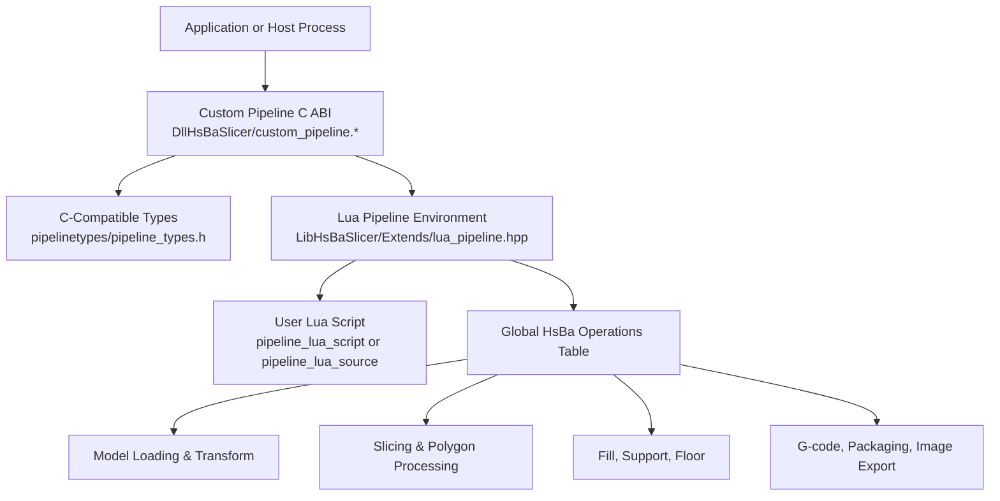
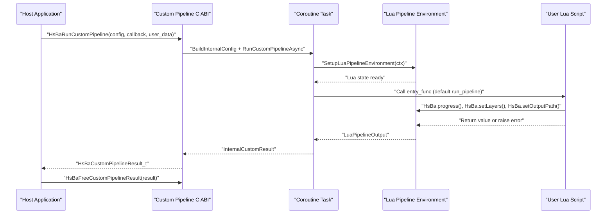
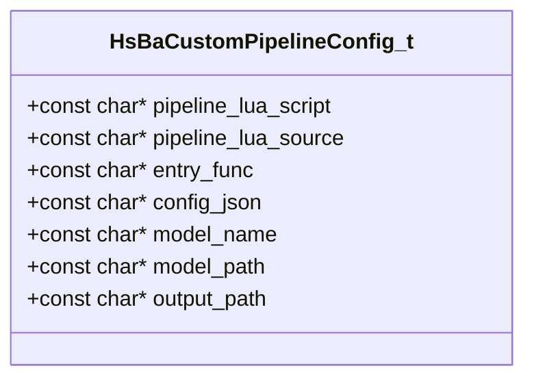
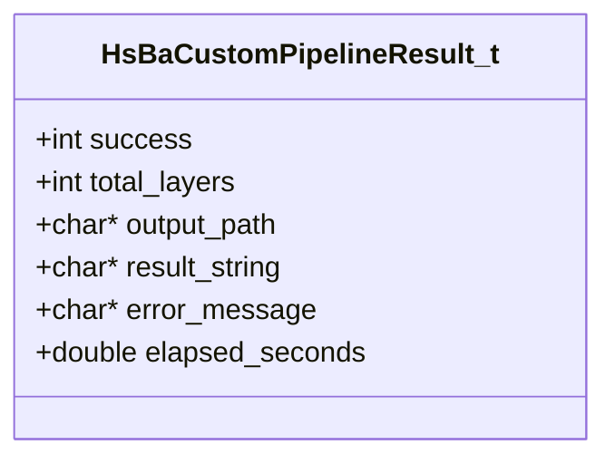
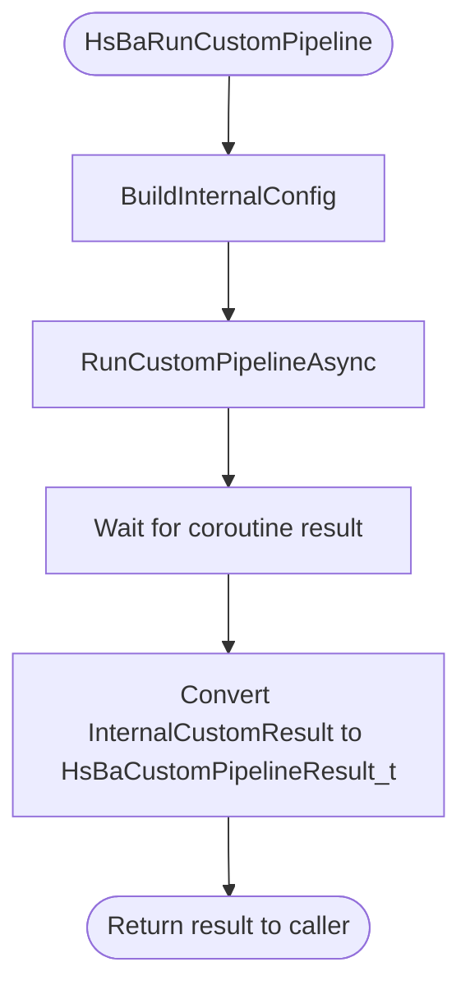
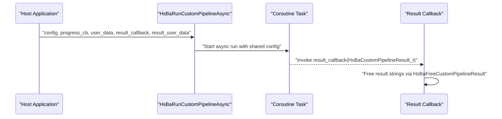
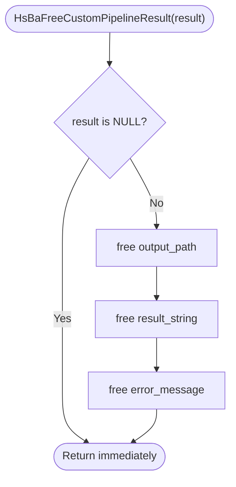
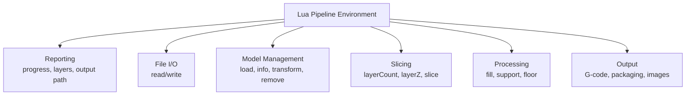
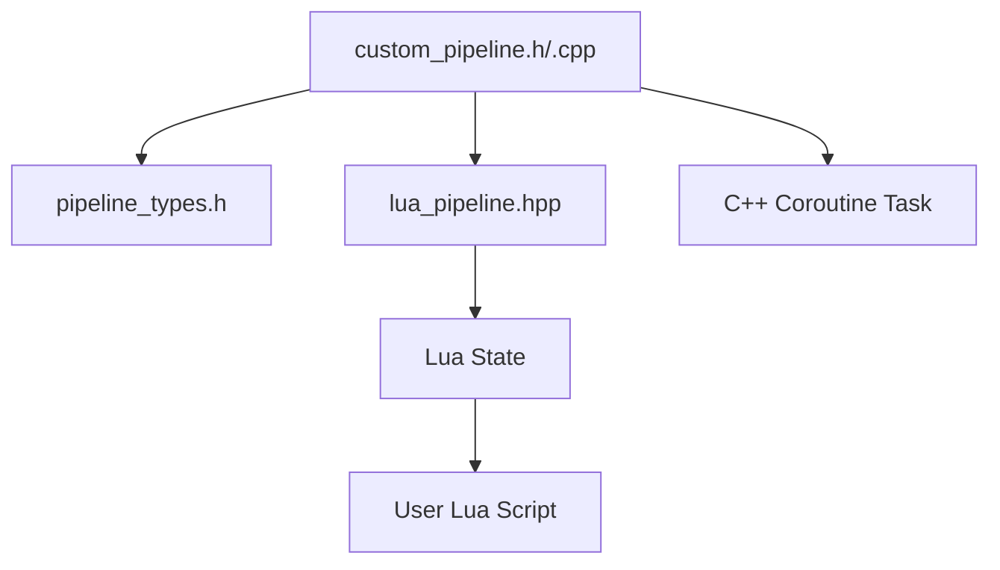
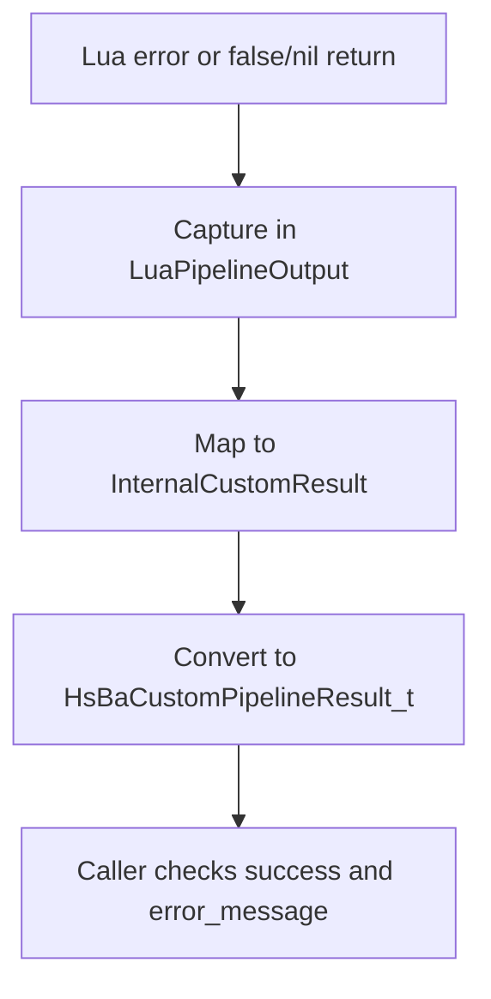

# Custom Pipeline API

<cite>
**Referenced Files in This Document**   
- [custom_pipeline.h](file://DllHsBaSlicer/custom_pipeline.h)
- [custom_pipeline.cpp](file://DllHsBaSlicer/custom_pipeline.cpp)
- [pipeline_types.h](file://pipelinetypes/pipeline_types.h)
- [lua_pipeline.hpp](file://LibHsBaSlicer/Extends/lua_pipeline.hpp)
- [README.md](file://docs/en/DllHsBaSlicer/README.md)
- [lua_pipeline_api.md](file://docs/en/lua_pipeline_api.md)
</cite>

## Table of Contents
1. [Introduction](#introduction)
2. [Project Structure](#project-structure)
3. [Core Components](#core-components)
4. [Architecture Overview](#architecture-overview)
5. [Detailed Component Analysis](#detailed-component-analysis)
6. [Dependency Analysis](#dependency-analysis)
7. [Performance Considerations](#performance-considerations)
8. [Troubleshooting Guide](#troubleshooting-guide)
9. [Conclusion](#conclusion)
10. [Appendices](#appendices)

## Introduction
This document describes the Custom Pipeline C ABI that lets users define fully custom slicing and manufacturing workflows through Lua scripts. Instead of following a fixed C++ stage order, the custom pipeline delegates the entire workflow to a Lua entry function. The C++ side provides:

- A C-compatible configuration structure for script selection, model metadata, output path, and free-form JSON configuration.
- Synchronous and asynchronous execution functions.
- A result structure with ownership semantics and a dedicated memory-freeing function.
- Progress callbacks driven by the Lua script.

The API is intended for third-party algorithm integration, domain-specific slicing pipelines, and reusable manufacturing processes where the stage sequence, data transformation, and export format are not covered by the built-in FDM/SLA/SLS/SLM/LOM/TDP/WAAM pipelines.

## Project Structure
The Custom Pipeline API is implemented as part of the DllHsBaSlicer shared library and relies on LibHsBaSlicer’s Lua pipeline environment.

**Diagram sources**
- [custom_pipeline.h:17-62](file://DllHsBaSlicer/custom_pipeline.h#L17-L62)
- [custom_pipeline.cpp:117-212](file://DllHsBaSlicer/custom_pipeline.cpp#L117-L212)
- [pipeline_types.h:676-732](file://pipelinetypes/pipeline_types.h#L676-L732)
- [lua_pipeline.hpp:19-83](file://LibHsBaSlicer/Extends/lua_pipeline.hpp#L19-L83)

**Section sources**
- [custom_pipeline.h:1-68](file://DllHsBaSlicer/custom_pipeline.h#L1-L68)
- [custom_pipeline.cpp:1-212](file://DllHsBaSlicer/custom_pipeline.cpp#L1-L212)
- [pipeline_types.h:676-732](file://pipelinetypes/pipeline_types.h#L676-L732)
- [lua_pipeline.hpp:1-88](file://LibHsBaSlicer/Extends/lua_pipeline.hpp#L1-L88)

## Core Components
The Custom Pipeline API exposes four primary C ABI entry points and two core structures:

| API / Structure | Purpose | Ownership / Lifecycle Notes |
|---|---|---|
| `HsBaCreateDefaultCustomConfig()` | Returns a default-initialized `HsBaCustomPipelineConfig_t` with all string fields set to NULL. | Caller owns the returned struct; strings remain NULL unless assigned. |
| `HsBaRunCustomPipeline(config, callback, user_data)` | Runs the Lua-driven pipeline synchronously. | Returns a `HsBaCustomPipelineResult_t`; caller must call `HsBaFreeCustomPipelineResult`. |
| `HsBaRunCustomPipelineAsync(config, callback, user_data, result_callback, result_user_data)` | Starts non-blocking execution and invokes `result_callback` when complete. | Result strings are heap-allocated; the caller-provided `result_callback` is responsible for freeing them via `HsBaFreeCustomPipelineResult`. |
| `HsBaFreeCustomPipelineResult(result)` | Frees heap-allocated string fields inside a custom pipeline result. | Safe to call with NULL; after calling, the result should not be dereferenced. |
| `HsBaCustomPipelineConfig_t` | Defines the Lua script, entry function, JSON configuration, model metadata, and default output path. | All string pointers may be NULL; at least one of `pipeline_lua_script` or `pipeline_lua_source` must be set for successful execution. |
| `HsBaCustomPipelineResult_t` | Reports success, layer count, output path, result string, error message, and elapsed time. | String fields are owned by the caller and must be freed using `HsBaFreeCustomPipelineResult`. |

**Section sources**
- [custom_pipeline.h:17-62](file://DllHsBaSlicer/custom_pipeline.h#L17-L62)
- [pipeline_types.h:676-732](file://pipelinetypes/pipeline_types.h#L676-L732)
- [custom_pipeline.cpp:171-212](file://DllHsBaSlicer/custom_pipeline.cpp#L171-L212)

## Architecture Overview
The custom pipeline architecture separates C ABI concerns from the Lua-driven workflow:

1. **Configuration phase**: The host fills `HsBaCustomPipelineConfig_t`, optionally using `HsBaCreateDefaultCustomConfig()`.
2. **Execution phase**: The C ABI converts the config into an internal C++ representation and runs the Lua pipeline either synchronously or asynchronously.
3. **Lua environment phase**: A fresh Lua state is created, standard libraries are loaded, common types are installed, and the global `HsBa` operations table is exposed.
4. **Script phase**: The Lua entry function orchestrates model loading, slicing, processing, and export. It reports progress, layer count, and output path through the `HsBa` table.
5. **Result phase**: Success, failure, timing, and exported artifacts are converted back into a C-compatible result structure.

**Diagram sources**
- [custom_pipeline.cpp:117-212](file://DllHsBaSlicer/custom_pipeline.cpp#L117-L212)
- [lua_pipeline.hpp:53-83](file://LibHsBaSlicer/Extends/lua_pipeline.hpp#L53-L83)

**Section sources**
- [custom_pipeline.cpp:117-212](file://DllHsBaSlicer/custom_pipeline.cpp#L117-L212)
- [lua_pipeline.hpp:19-83](file://LibHsBaSlicer/Extends/lua_pipeline.hpp#L19-L83)

## Detailed Component Analysis

### Configuration Structure: `HsBaCustomPipelineConfig_t`
The configuration structure defines how the custom pipeline locates and executes the Lua workflow.

| Field | Type | Required | Default Behavior | Description |
|---|---|---|---|---|
| `pipeline_lua_script` | `const char*` | Optional, but at least this or `pipeline_lua_source` must be set | NULL | Path to the Lua script file defining the custom workflow. |
| `pipeline_lua_source` | `const char*` | Optional, but at least this or `pipeline_lua_script` must be set | NULL | Inline Lua source executed before the script file. |
| `entry_func` | `const char*` | Optional | `"run_pipeline"` | Name of the Lua function invoked by the pipeline. |
| `config_json` | `const char*` | Optional | NULL | Free-form JSON passed to the Lua environment as `pipeline_config`. |
| `model_name` | `const char*` | Optional | NULL | Model name exposed to Lua as `model_name`. |
| `model_path` | `const char*` | Optional | NULL | Model file path exposed to Lua as `model_path`. |
| `output_path` | `const char*` | Optional | NULL | Default output path exposed to Lua as `output_path`. |

The default initializer sets all string fields to NULL, so callers must explicitly provide at least one script source and configure any required model or output paths.

**Diagram sources**
- [pipeline_types.h:689-704](file://pipelinetypes/pipeline_types.h#L689-L704)

**Section sources**
- [pipeline_types.h:676-704](file://pipelinetypes/pipeline_types.h#L676-L704)
- [pipeline_types.h:968-983](file://pipelinetypes/pipeline_types.h#L968-L983)

### Result Structure: `HsBaCustomPipelineResult_t`
The result structure carries the outcome of the Lua-driven pipeline.

| Field | Type | Meaning | Ownership |
|---|---|---|---|
| `success` | `int` | 1 for success, 0 for failure. | Caller-owned scalar. |
| `total_layers` | `int` | Layer count reported by the Lua script via `HsBa.setLayers()`. | Caller-owned scalar. |
| `output_path` | `char*` | Output path reported by the Lua script via `HsBa.setOutputPath()`. | Caller must free through `HsBaFreeCustomPipelineResult`. |
| `result_string` | `char*` | Return value of the Lua entry function if it returns a string. | Caller must free through `HsBaFreeCustomPipelineResult`. |
| `error_message` | `char*` | Error message on failure. | Caller must free through `HsBaFreeCustomPipelineResult`. |
| `elapsed_seconds` | `double` | Wall-clock time spent executing the pipeline. | Caller-owned scalar. |

**Diagram sources**
- [pipeline_types.h:706-719](file://pipelinetypes/pipeline_types.h#L706-L719)

**Section sources**
- [pipeline_types.h:706-732](file://pipelinetypes/pipeline_types.h#L706-L732)

### Function: `HsBaCreateDefaultCustomConfig()`
This function returns a default-initialized custom pipeline configuration. It is useful when the host wants to start from a known baseline and then override only the necessary fields.

- Returns: `HsBaCustomPipelineConfig_t`
- Default values: all string pointers are NULL.
- Typical usage: initialize the struct, then set `pipeline_lua_script` or `pipeline_lua_source`, plus optional model and output metadata.

**Section sources**
- [custom_pipeline.h:17-21](file://DllHsBaSlicer/custom_pipeline.h#L17-L21)
- [custom_pipeline.cpp:171-174](file://DllHsBaSlicer/custom_pipeline.cpp#L171-L174)
- [pipeline_types.h:968-983](file://pipelinetypes/pipeline_types.h#L968-L983)

### Function: `HsBaRunCustomPipeline()`
This function runs the custom pipeline synchronously. Internally, it builds an internal configuration, starts the coroutine-based async runner, waits for completion, and converts the internal result into a C-compatible result.

Key behaviors:
- Requires at least one of `pipeline_lua_script` or `pipeline_lua_source`.
- Uses the provided progress callback if present.
- Returns a result that must be freed with `HsBaFreeCustomPipelineResult`.

**Diagram sources**
- [custom_pipeline.cpp:176-183](file://DllHsBaSlicer/custom_pipeline.cpp#L176-L183)

**Section sources**
- [custom_pipeline.h:23-40](file://DllHsBaSlicer/custom_pipeline.h#L23-L40)
- [custom_pipeline.cpp:176-183](file://DllHsBaSlicer/custom_pipeline.cpp#L176-L183)

### Function: `HsBaRunCustomPipelineAsync()`
This function starts non-blocking execution. It shares the internal configuration across the coroutine lifecycle and invokes the provided result callback when the pipeline completes.

Important ownership rule:
- The `result_callback` receives a `HsBaCustomPipelineResult_t` whose string fields are heap-allocated.
- The documentation comment indicates that the result callback is responsible for freeing those strings, typically by calling `HsBaFreeCustomPipelineResult`.

**Diagram sources**
- [custom_pipeline.cpp:185-201](file://DllHsBaSlicer/custom_pipeline.cpp#L185-L201)

**Section sources**
- [custom_pipeline.h:42-55](file://DllHsBaSlicer/custom_pipeline.h#L42-L55)
- [custom_pipeline.cpp:185-201](file://DllHsBaSlicer/custom_pipeline.cpp#L185-L201)

### Function: `HsBaFreeCustomPipelineResult()`
This function frees the heap-allocated string fields inside a custom pipeline result. It safely handles NULL pointers and clears each field after freeing.

Usage rules:
- Call after consuming `success`, `total_layers`, `elapsed_seconds`, and copying any needed string content.
- Do not use the result after freeing it.
- For async results, the result callback is expected to perform this cleanup.

**Diagram sources**
- [custom_pipeline.cpp:203-212](file://DllHsBaSlicer/custom_pipeline.cpp#L203-L212)

**Section sources**
- [custom_pipeline.h:57-62](file://DllHsBaSlicer/custom_pipeline.h#L57-L62)
- [custom_pipeline.cpp:203-212](file://DllHsBaSlicer/custom_pipeline.cpp#L203-L212)

### Lua Pipeline Environment and `HsBa` Operations
The custom pipeline does not expose a C++ stage registration API. Instead, it creates a Lua environment where the user script controls the workflow. The environment exposes:

- Reporting: `HsBa.progress(percent[, stage])`, `HsBa.setLayers(n)`, `HsBa.setOutputPath(path)`.
- File I/O: `HsBa.readFile(path)`, `HsBa.writeFile(path, content)`.
- Model management: `HsBa.loadModel(name, path)`, `HsBa.modelInfo(name)`, `HsBa.translateModel`, `HsBa.rotateModel`, `HsBa.scaleModel`, `HsBa.removeModel`, `HsBa.modelNames()`.
- Slicing: `HsBa.layerCount`, `HsBa.layerZ`, `HsBa.slice`, `HsBa.sliceUnsafe`, coordinate conversion helpers.
- Processing: `HsBa.fill`, `HsBa.fdmSupport`, `HsBa.slaSupport`, `HsBa.floor`.
- Output: `HsBa.toGcode`, `HsBa.saveSlsPackage`, `HsBa.saveWaamPackage`, `HsBa.saveSlaPackage`, `HsBa.renderImage`.

The entry function can return a string; that string becomes `result_string`. Returning false, nil, or raising a Lua error marks the pipeline as failed and populates `error_message`.

**Diagram sources**
- [lua_pipeline.hpp:53-83](file://LibHsBaSlicer/Extends/lua_pipeline.hpp#L53-L83)
- [README.md:486-501](file://docs/en/DllHsBaSlicer/README.md#L486-L501)
- [lua_pipeline_api.md:67-132](file://docs/en/lua_pipeline_api.md#L67-L132)

**Section sources**
- [lua_pipeline.hpp:19-83](file://LibHsBaSlicer/Extends/lua_pipeline.hpp#L19-L83)
- [README.md:486-501](file://docs/en/DllHsBaSlicer/README.md#L486-L501)
- [lua_pipeline_api.md:67-132](file://docs/en/lua_pipeline_api.md#L67-L132)

## Dependency Analysis
The Custom Pipeline C ABI depends on several layers:

- **C ABI layer**: `custom_pipeline.h` and `custom_pipeline.cpp` expose stable C functions.
- **Type layer**: `pipeline_types.h` defines C-compatible structs and enums used by all pipeline APIs.
- **Lua environment layer**: `lua_pipeline.hpp` defines the context and output types and provides `SetupLuaPipelineEnvironment` and `RunLuaPipeline`.
- **Execution layer**: The implementation uses C++ coroutines for async execution and wraps Lua errors into structured results.

**Diagram sources**
- [custom_pipeline.h:9-10](file://DllHsBaSlicer/custom_pipeline.h#L9-L10)
- [custom_pipeline.cpp:14-16](file://DllHsBaSlicer/custom_pipeline.cpp#L14-L16)
- [lua_pipeline.hpp:13-83](file://LibHsBaSlicer/Extends/lua_pipeline.hpp#L13-L83)

**Section sources**
- [custom_pipeline.h:9-10](file://DllHsBaSlicer/custom_pipeline.h#L9-L10)
- [custom_pipeline.cpp:14-16](file://DllHsBaSlicer/custom_pipeline.cpp#L14-L16)
- [pipeline_types.h:5-12](file://pipelinetypes/pipeline_types.h#L5-L12)
- [lua_pipeline.hpp:1-88](file://LibHsBaSlicer/Extends/lua_pipeline.hpp#L1-L88)

## Performance Considerations
- Prefer asynchronous execution for long-running pipelines to avoid blocking the host thread. Use `HsBaRunCustomPipelineAsync` and process results in the result callback.
- Keep Lua scripts focused. Heavy computation should be delegated to optimized C/C++ libraries exposed through the available Lua bindings rather than pure Lua loops.
- Reuse models where possible. The Lua environment supports model pooling through `loadModel` and related operations.
- Avoid excessive file I/O inside tight loops. Batch writes and prefer writing final outputs rather than many intermediate files.
- Use `HsBa.progress` to report meaningful stages. This helps both UI feedback and debugging without adding significant overhead.
- Validate inputs early in the Lua script to fail fast and reduce wasted computation.

[No sources needed since this section provides general guidance]

## Troubleshooting Guide
Common issues and their likely causes:

| Symptom | Likely Cause | Resolution |
|---|---|---|
| Pipeline fails immediately with an error about missing script | Neither `pipeline_lua_script` nor `pipeline_lua_source` was set. | Set at least one script source in `HsBaCustomPipelineConfig_t`. |
| Lua error appears in `error_message` | The entry function raised an error or returned false/nil. | Inspect `error_message`, validate the Lua script, and check `HsBa` operation arguments. |
| `output_path` or `result_string` is NULL | The Lua script did not call `HsBa.setOutputPath` or did not return a string. | Add explicit reporting calls in the Lua script. |
| Memory leak after async result | The result callback did not free the result strings. | Call `HsBaFreeCustomPipelineResult` in the result callback. |
| Progress callback not invoked | The Lua script did not call `HsBa.progress`, or the C callback pointer was NULL. | Add progress reporting in the Lua script and verify the C callback is provided. |
| Wrong entry function called | `entry_func` was set incorrectly or defaults to `run_pipeline`. | Ensure the Lua script exports the expected function name. |

Error propagation flow:

**Diagram sources**
- [custom_pipeline.cpp:117-163](file://DllHsBaSlicer/custom_pipeline.cpp#L117-L163)

**Section sources**
- [custom_pipeline.cpp:117-163](file://DllHsBaSlicer/custom_pipeline.cpp#L117-L163)
- [custom_pipeline.cpp:203-212](file://DllHsBaSlicer/custom_pipeline.cpp#L203-L212)

## Conclusion
The Custom Pipeline C ABI provides a stable, C-compatible interface for running fully Lua-defined slicing and manufacturing workflows. It abstracts away the Lua environment setup, model and polygon processing tools, and result ownership while giving users full control over stage ordering, data transformation, and output formats. For robust integrations:

- Always initialize configurations with the default initializer.
- Provide at least one Lua script source.
- Report progress, layer count, and output path from Lua.
- Handle async results carefully and free memory as documented.
- Treat `error_message` and `success` as the primary failure indicators.

[No sources needed since this section summarizes without analyzing specific files]

## Appendices

### Appendix A: Recommended Usage Patterns

#### Defining a Custom Manufacturing Process
1. Create a default config with `HsBaCreateDefaultCustomConfig()`.
2. Set `pipeline_lua_script` or `pipeline_lua_source`.
3. Optionally set `model_name`, `model_path`, and `output_path`.
4. Optionally pass `config_json` for domain-specific parameters.
5. Call `HsBaRunCustomPipeline` for synchronous execution or `HsBaRunCustomPipelineAsync` for non-blocking execution.
6. In the Lua script, load the model, slice it, generate fill/support/floor, and export the desired output.
7. Report progress and final output through `HsBa.progress`, `HsBa.setLayers`, and `HsBa.setOutputPath`.
8. Free the result with `HsBaFreeCustomPipelineResult`.

#### Integrating Third-Party Algorithms
- Implement the algorithm as a Lua function or C/C++ extension exposed to Lua.
- Use `HsBa.readFile` and `HsBa.writeFile` for input/output.
- Use `HsBa.modelInfo` and slicing APIs to convert CAD/mesh data into polygons.
- Apply the third-party algorithm to polygons or per-layer data.
- Write results back through the same file or packaging APIs.

#### Creating Domain-Specific Slicing Workflows
- Use `config_json` to encode domain parameters such as material settings, machine profiles, or post-processing options.
- Compose multiple `HsBa` operations in the Lua entry function to build a custom stage graph.
- Use `HsBa.saveSlaPackage`, `HsBa.saveSlsPackage`, or `HsBa.saveWaamPackage` for standardized packaging when appropriate.
- Fall back to raw G-code generation with `HsBa.toGcode` for custom CNC or robot workflows.

**Section sources**
- [custom_pipeline.h:17-62](file://DllHsBaSlicer/custom_pipeline.h#L17-L62)
- [lua_pipeline_api.md:67-132](file://docs/en/lua_pipeline_api.md#L67-L132)
- [README.md:486-501](file://docs/en/DllHsBaSlicer/README.md#L486-L501)