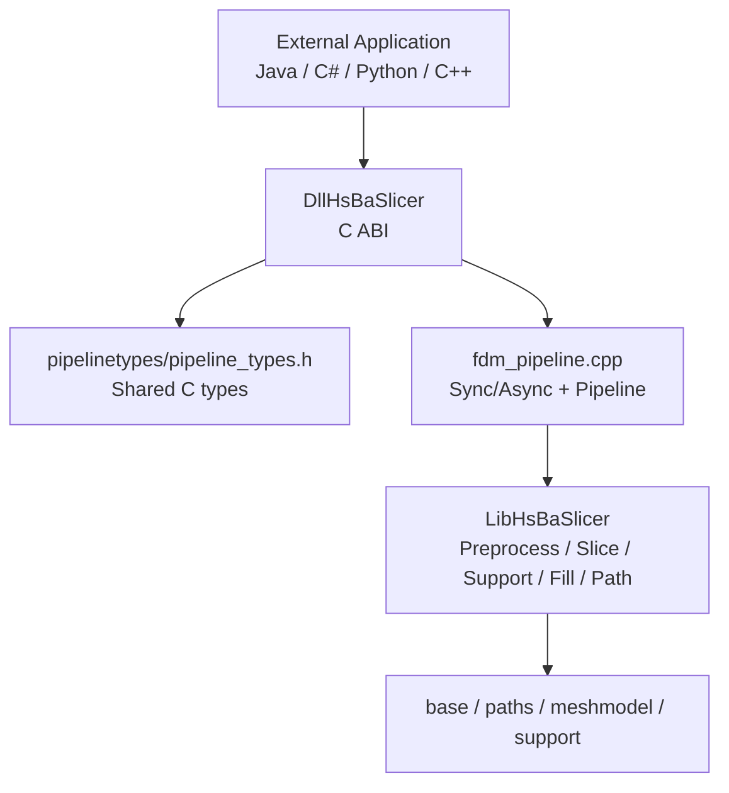
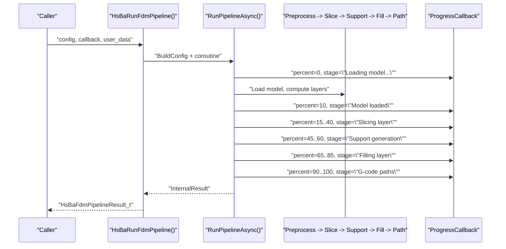
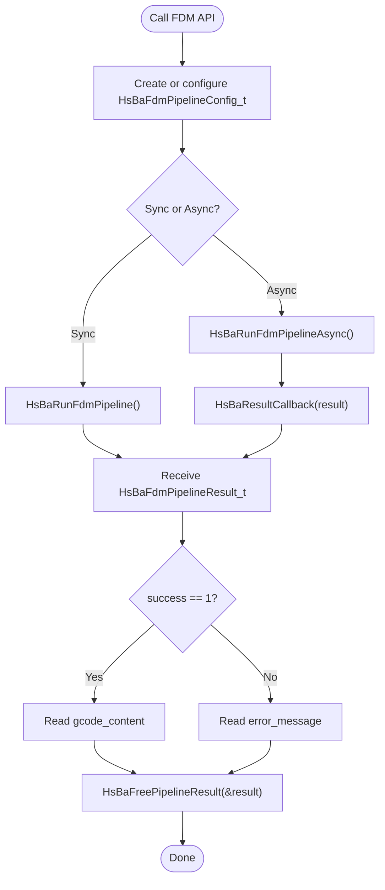
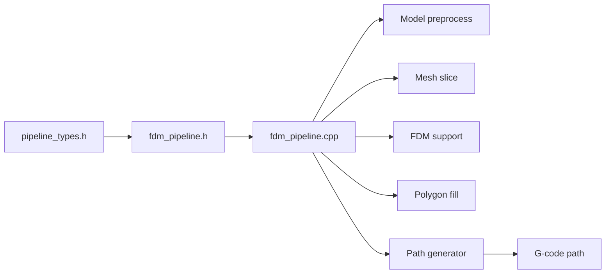

# FDM Pipeline API

<cite>
**Referenced Files in This Document**
- [fdm_pipeline.h](file://DllHsBaSlicer/fdm_pipeline.h)
- [fdm_pipeline.cpp](file://DllHsBaSlicer/fdm_pipeline.cpp)
- [pipeline_types.h](file://pipelinetypes/pipeline_types.h)
- [README.md](file://README.md)
</cite>

## Table of Contents
1. [Introduction](#introduction)
2. [Project Structure](#project-structure)
3. [Core Components](#core-components)
4. [Architecture Overview](#architecture-overview)
5. [Detailed Component Analysis](#detailed-component-analysis)
6. [Dependency Analysis](#dependency-analysis)
7. [Performance Considerations](#performance-considerations)
8. [Troubleshooting Guide](#troubleshooting-guide)
9. [Conclusion](#conclusion)
10. [Appendices](#appendices)

## Introduction
This document describes the Fused Deposition Modeling (FDM) pipeline C ABI exposed by HsBaSlicer. It focuses on:
- Creating default FDM configuration through `HsBaCreateDefaultConfig()`.
- Running the full FDM slicing pipeline synchronously with `HsBaRunFdmPipeline()`.
- Running it asynchronously with `HsBaRunFdmPipelineAsync()` and callbacks.
- Releasing allocated result memory with `HsBaFreePipelineResult()`.
- The `HsBaFdmPipelineConfig_t` structure, its fields, data types, and defaults.
- Callback signatures for progress and completion.
- Error handling, thread safety, memory ownership, performance tips, and integration patterns.

The FDM pipeline performs preprocessing, slicing, support generation, infill generation, and G-code path generation. It can use built-in algorithms or Lua scripts for support and infill.

**Section sources**
- [README.md:21-38](file://README.md#L21-L38)
- [fdm_pipeline.h:1-68](file://DllHsBaSlicer/fdm_pipeline.h#L1-L68)

## Project Structure
The FDM C ABI is exported from the shared library target `DllHsBaSlicer`, which provides a stable C interface for external languages such as Java, C#, Python, and others. The public header for FDM is `fdm_pipeline.h`, while the implementation lives in `fdm_pipeline.cpp`. Shared C-compatible type definitions are in `pipelinetypes/pipeline_types.h`.

**Diagram sources**
- [README.md:104-124](file://README.md#L104-L124)
- [fdm_pipeline.h:1-68](file://DllHsBaSlicer/fdm_pipeline.h#L1-L68)
- [pipeline_types.h:5-140](file://pipelinetypes/pipeline_types.h#L5-L140)

**Section sources**
- [README.md:104-151](file://README.md#L104-L151)
- [fdm_pipeline.h:1-68](file://DllHsBaSlicer/fdm_pipeline.h#L1-L68)

## Core Components
The FDM C ABI exposes four primary entry points:
- `HsBaCreateDefaultConfig()`: Returns a fully initialized default FDM configuration.
- `HsBaRunFdmPipeline()`: Runs the pipeline synchronously; blocks until completion.
- `HsBaRunFdmPipelineAsync()`: Starts asynchronous execution and invokes a result callback when done.
- `HsBaFreePipelineResult()`: Frees memory owned by the returned result structure.

These functions operate on:
- `HsBaFdmPipelineConfig_t`: Configuration describing model input, slicing, fill, support, path, printer settings, Lua customization, and output.
- `HsBaFdmPipelineResult_t`: Result containing success status, layer count, G-code content, error message, and elapsed time.

Key callback types:
- `HsBaProgressCallback(percent, stage, user_data)`
- `HsBaResultCallback(result, user_data)`

**Section sources**
- [fdm_pipeline.h:17-61](file://DllHsBaSlicer/fdm_pipeline.h#L17-L61)
- [pipeline_types.h:53-140](file://pipelinetypes/pipeline_types.h#L53-L140)

## Architecture Overview
At runtime, the C ABI translates the C configuration into internal C++ structures, then executes a staged pipeline using coroutines and parallel helpers. Progress is reported via the provided callback. On success, UTF-8 G-code content is returned to the caller; on failure, an error message is provided.

**Diagram sources**
- [fdm_pipeline.cpp:219-447](file://DllHsBaSlicer/fdm_pipeline.cpp#L219-L447)
- [fdm_pipeline.cpp:460-467](file://DllHsBaSlicer/fdm_pipeline.cpp#L460-L467)

**Section sources**
- [fdm_pipeline.cpp:219-447](file://DllHsBaSlicer/fdm_pipeline.cpp#L219-L447)

## Detailed Component Analysis

### HsBaCreateDefaultConfig()
Purpose:
- Create a default FDM configuration without requiring manual initialization.

Behavior:
- Delegates to the inline default initializer defined in the shared types header.
- All string pointers are set to null unless explicitly assigned later.
- Numeric and enum fields are initialized to documented defaults.

Typical usage pattern:
- Call `HsBaCreateDefaultConfig()`.
- Override only the fields you need (for example, `model_path`, `layer_height`, `output_path`).
- Pass the config to `HsBaRunFdmPipeline()` or `HsBaRunFdmPipelineAsync()`.

Important notes:
- The function returns a value-type struct; no explicit free is needed for the struct itself.
- If you assign your own strings to `model_name`, `model_path`, `support_lua_script`, `infill_lua_script`, or `output_path`, ensure those strings remain valid for the duration of the pipeline call.

**Section sources**
- [fdm_pipeline.h:17-21](file://DllHsBaSlicer/fdm_pipeline.h#L17-L21)
- [pipeline_types.h:738-783](file://pipelinetypes/pipeline_types.h#L738-L783)

### HsBaRunFdmPipeline()
Purpose:
- Execute the complete FDM pipeline synchronously.

Execution flow:
- Build internal configuration from the C config.
- Start the coroutine-based pipeline.
- Block until the coroutine completes.
- Convert internal result to the C result structure.

Pipeline stages:
1. Preprocess: Load model and compute bounding box and layer count.
2. Slicing: Generate per-layer outlines in parallel.
3. Support: Generate supports unless disabled or spiral mode is enabled.
4. Infill: Generate fills either in parallel (built-in) or serially (Lua).
5. Path generation: Produce G-code either as a continuous spiral or per-layer paths.

Return value:
- A `HsBaFdmPipelineResult_t` instance.
- You must call `HsBaFreePipelineResult()` after reading the result.

Error handling:
- If model loading fails, invalid height is detected, or path generation fails, `success` will be false and `error_message` will contain a description.
- Exceptions from lower-level components are translated into a runtime error and captured.

Thread safety:
- The synchronous call blocks the calling thread.
- Internal parallelism uses helper utilities; callers should not mutate the same config object concurrently across multiple calls.

**Section sources**
- [fdm_pipeline.h:23-35](file://DllHsBaSlicer/fdm_pipeline.h#L23-L35)
- [fdm_pipeline.cpp:460-467](file://DllHsBaSlicer/fdm_pipeline.cpp#L460-L467)
- [fdm_pipeline.cpp:219-447](file://DllHsBaSlicer/fdm_pipeline.cpp#L219-L447)

### HsBaRunFdmPipelineAsync()
Purpose:
- Run the FDM pipeline asynchronously without blocking the caller.

Parameters:
- `config`: Pointer to the FDM configuration.
- `callback`: Optional progress callback.
- `user_data`: Optional pointer passed to the progress callback.
- `result_callback`: Required callback invoked when the pipeline finishes.
- `result_user_data`: Optional pointer passed to the result callback.

Behavior:
- The configuration is copied into an internal structure that remains alive during coroutine execution.
- The pipeline runs asynchronously and invokes `result_callback` exactly once upon completion.
- The result passed to `result_callback` is heap-allocated; the caller owns the memory and must call `HsBaFreePipelineResult()` on it.

Callback guarantees:
- Progress callbacks may be invoked multiple times during processing.
- The result callback is invoked after all stages complete, whether successful or failed.

Cancellation:
- The current ABI does not expose cancellation; the handle field is reserved for future features.

**Section sources**
- [fdm_pipeline.h:37-51](file://DllHsBaSlicer/fdm_pipeline.h#L37-L51)
- [fdm_pipeline.cpp:469-486](file://DllHsBaSlicer/fdm_pipeline.cpp#L469-L486)

### HsBaFreePipelineResult()
Purpose:
- Release memory allocated inside the FDM pipeline result.

Fields freed:
- `gcode_content`: UTF-8 G-code text.
- `error_message`: UTF-8 error text.

Rules:
- Always call this function after consuming the result.
- Calling it with a null pointer is safe and has no effect.
- After freeing, do not access the freed fields.

Memory ownership summary:
- The library allocates `gcode_content` and `error_message`.
- The caller owns these strings after receiving the result and must free them via `HsBaFreePipelineResult()`.
- The caller does not own the `HsBaFdmPipelineResult_t` struct itself; it is returned by value.

**Section sources**
- [fdm_pipeline.h:53-61](file://DllHsBaSlicer/fdm_pipeline.h#L53-L61)
- [fdm_pipeline.cpp:488-496](file://DllHsBaSlicer/fdm_pipeline.cpp#L488-L496)

### HsBaFdmPipelineConfig_t
This structure defines all FDM pipeline parameters. Below is a reference table of fields, types, and defaults.

| Field | Type | Meaning | Default Value |
|---|---|---|---|
| `model_name` | `const char*` | Model name used by the model manager | NULL |
| `model_path` | `const char*` | Path to the model file | NULL |
| `layer_height` | `float` | Layer height in millimeters | 0.2 |
| `first_layer_height` | `float` | First layer height in millimeters | 0.25 |
| `fill_spacing` | `double` | Base fill line spacing in millimeters | 0.4 |
| `fill_mode` | `HsBaFillMode_t` | Fill algorithm selection | `HSBA_FILL_ZIGZAG` |
| `fill_angle` | `double` | Fill angle in degrees | 45.0 |
| `wall_count` | `int` | Number of wall perimeters | 3 |
| `top_layer_count` | `int` | Number of top solid layers | 3 |
| `bottom_layer_count` | `int` | Number of bottom solid layers | 3 |
| `infill_density` | `double` | Infill density from 0 to 1 | 0.2 |
| `enable_support` | `int` | Enable support generation | 1 |
| `overhang_angle` | `float` | Overhang detection threshold in degrees | 45.0 |
| `support_gap` | `float` | Gap between support and model in millimeters | 0.5 |
| `support_diameter` | `float` | Support column diameter in millimeters | 2.0 |
| `support_density` | `float` | Support fill density from 0 to 1 | 0.3 |
| `support_pattern` | `HsBaSupportPattern_t` | Support pattern selection | `HSBA_SUPPORT_PLANE` |
| `interface_layers` | `int` | Number of interface layers | 2 |
| `interface_density` | `float` | Interface layer density from 0 to 1 | 0.5 |
| `line_width` | `float` | Extrusion line width in millimeters | 0.4 |
| `print_speed` | `float` | Print speed in millimeters per second | 50.0 |
| `travel_speed` | `float` | Travel speed in millimeters per second | 100.0 |
| `extrusion_multiplier` | `double` | Extrusion multiplier | 1.0 |
| `spiral_mode` | `int` | Vase/spiral outer-wall mode | 0 |
| `gcode_firmware` | `HsBaGCodeFirmware_t` | Target G-code firmware | `HSBA_GCODE_MARLIN` |
| `nozzle_diameter` | `float` | Nozzle diameter in millimeters | 0.4 |
| `filament_diameter` | `float` | Filament diameter in millimeters | 1.75 |
| `nozzle_temp` | `float` | Nozzle temperature in Celsius | 200.0 |
| `bed_temp` | `float` | Bed temperature in Celsius | 60.0 |
| `retract_length` | `float` | Retraction length in millimeters | 1.0 |
| `retract_speed` | `float` | Retraction speed in millimeters per second | 40.0 |
| `first_layer_speed` | `float` | First layer speed in millimeters per second | 20.0 |
| `support_lua_script` | `const char*` | Custom support Lua script path | NULL |
| `support_lua_func` | `const char*` | Custom support Lua function name | NULL |
| `infill_lua_script` | `const char*` | Custom infill Lua script path | NULL |
| `infill_lua_func` | `const char*` | Custom infill Lua function name | NULL |
| `output_path` | `const char*` | Output G-code file path | NULL |

Notes:
- When `spiral_mode` is enabled, support and infill are skipped, and the outer wall is generated as a continuous rising path.
- When `infill_density` is between 0 and 1, middle-layer fill spacing is adjusted based on density.
- Lua scripts are optional; if NULL, built-in algorithms are used.

**Section sources**
- [pipeline_types.h:53-113](file://pipelinetypes/pipeline_types.h#L53-L113)
- [pipeline_types.h:738-783](file://pipelinetypes/pipeline_types.h#L738-L783)

### HsBaFdmPipelineResult_t
This structure holds the outcome of an FDM pipeline run.

| Field | Type | Meaning | Ownership |
|---|---|---|---|
| `success` | `int` | Success flag: 0 for failure, 1 for success | Read-only |
| `total_layers` | `int` | Total number of layers computed | Read-only |
| `gcode_content` | `char*` | UTF-8 G-code content | Caller must free via `HsBaFreePipelineResult()` |
| `error_message` | `char*` | UTF-8 error message | Caller must free via `HsBaFreePipelineResult()` |
| `elapsed_seconds` | `double` | Elapsed time in seconds | Read-only |

Usage rules:
- Check `success` before reading `gcode_content`.
- If `success` is false, inspect `error_message`.
- Always call `HsBaFreePipelineResult()` after use.

**Section sources**
- [pipeline_types.h:115-127](file://pipelinetypes/pipeline_types.h#L115-L127)
- [fdm_pipeline.cpp:488-496](file://DllHsBaSlicer/fdm_pipeline.cpp#L488-L496)

### Callback Mechanism

#### HsBaProgressCallback
Signature concept:
- `percent`: Integer percentage from 0 to 100.
- `stage`: UTF-8 human-readable stage description.
- `user_data`: Caller-provided pointer passed unchanged.

When it is called:
- During synchronous execution, the callback is invoked from the calling thread.
- During asynchronous execution, progress updates may be delivered according to internal scheduling; the result callback is invoked after completion.

Best practices:
- Keep the callback fast.
- Avoid heavy work or blocking operations.
- Use `user_data` to pass UI state, logging context, or task identifiers.

**Section sources**
- [pipeline_types.h:129-135](file://pipelinetypes/pipeline_types.h#L129-L135)
- [fdm_pipeline.cpp:134-140](file://DllHsBaSlicer/fdm_pipeline.cpp#L134-L140)

#### HsBaResultCallback
Signature concept:
- `result`: A copy of `HsBaFdmPipelineResult_t` returned by the pipeline.
- `user_data`: Caller-provided pointer passed unchanged.

Ownership:
- The `result` object is heap-allocated by the library.
- The caller must call `HsBaFreePipelineResult(&result)` after processing.

Reliability:
- The result callback is invoked exactly once per async invocation.
- It is invoked even when the pipeline fails; check `result.success`.

**Section sources**
- [pipeline_types.h:137-140](file://pipelinetypes/pipeline_types.h#L137-L140)
- [fdm_pipeline.cpp:477-485](file://DllHsBaSlicer/fdm_pipeline.cpp#L477-L485)

### Usage Examples

#### Synchronous Pattern
Recommended steps:
1. Create a default configuration with `HsBaCreateDefaultConfig()`.
2. Set required fields such as `model_path` and optionally `output_path`.
3. Call `HsBaRunFdmPipeline()`.
4. Inspect `result.success`.
5. If successful, read `result.gcode_content`.
6. If failed, read `result.error_message`.
7. Call `HsBaFreePipelineResult(&result)`.

Example outline:
- Initialize config.
- Configure model and printing parameters.
- Run pipeline synchronously.
- Handle success or error.
- Free result.

**Section sources**
- [fdm_pipeline.h:17-35](file://DllHsBaSlicer/fdm_pipeline.h#L17-L35)
- [fdm_pipeline.cpp:460-467](file://DllHsBaSlicer/fdm_pipeline.cpp#L460-L467)

#### Asynchronous Pattern
Recommended steps:
1. Create a default configuration with `HsBaCreateDefaultConfig()`.
2. Set required fields.
3. Implement `HsBaProgressCallback` to update progress UI or logs.
4. Implement `HsBaResultCallback` to process the final result.
5. Call `HsBaRunFdmPipelineAsync()` with both callbacks.
6. In the result callback, check `result.success`.
7. Process `result.gcode_content` or `result.error_message`.
8. Call `HsBaFreePipelineResult(&result)`.

Example outline:
- Initialize config.
- Define progress handler.
- Define result handler.
- Start async pipeline.
- Clean up result in the result handler.

**Section sources**
- [fdm_pipeline.h:37-51](file://DllHsBaSlicer/fdm_pipeline.h#L37-L51)
- [fdm_pipeline.cpp:469-486](file://DllHsBaSlicer/fdm_pipeline.cpp#L469-L486)

### Error Handling
Common error conditions:
- Model loading failure.
- Invalid model height resulting in zero or negative layer count.
- Failure to generate spiral G-code path.
- Failure to generate standard G-code path.

Error reporting:
- On failure, `success` is 0.
- `error_message` contains a UTF-8 description.
- Lower-level exceptions are wrapped into a runtime error and converted into a readable message.

Recommendations:
- Always check `success` before accessing `gcode_content`.
- Log or display `error_message` for diagnostics.
- For async usage, ensure the result callback handles both success and failure paths.

**Section sources**
- [fdm_pipeline.cpp:231-255](file://DllHsBaSlicer/fdm_pipeline.cpp#L231-L255)
- [fdm_pipeline.cpp:398-432](file://DllHsBaSlicer/fdm_pipeline.cpp#L398-L432)
- [fdm_pipeline.cpp:437-441](file://DllHsBaSlicer/fdm_pipeline.cpp#L437-L441)

### Thread Safety and Memory Ownership
Thread safety:
- The C ABI is designed so that each call receives its own configuration and produces its own result.
- Do not share mutable configuration objects across concurrent calls without synchronization.
- Progress callbacks should avoid blocking or long-running work.

Memory ownership:
- `HsBaFdmPipelineConfig_t` is a value type returned by `HsBaCreateDefaultConfig()`.
- `HsBaFdmPipelineResult_t` is also returned by value.
- The library allocates `gcode_content` and `error_message`; the caller must free them via `HsBaFreePipelineResult()`.
- In async mode, the result passed to `HsBaResultCallback` is heap-allocated and must be freed by the caller.

Lifecycle diagram:

**Diagram sources**
- [fdm_pipeline.h:17-61](file://DllHsBaSlicer/fdm_pipeline.h#L17-L61)
- [fdm_pipeline.cpp:455-496](file://DllHsBaSlicer/fdm_pipeline.cpp#L455-L496)

**Section sources**
- [fdm_pipeline.cpp:455-496](file://DllHsBaSlicer/fdm_pipeline.cpp#L455-L496)

## Dependency Analysis
The FDM C ABI depends on:
- Shared C-compatible types in `pipeline_types.h`.
- Internal C++ pipeline logic in `fdm_pipeline.cpp`.
- Library modules for preprocessing, slicing, support, fill, and path generation.

**Diagram sources**
- [fdm_pipeline.h:1-68](file://DllHsBaSlicer/fdm_pipeline.h#L1-L68)
- [fdm_pipeline.cpp:17-26](file://DllHsBaSlicer/fdm_pipeline.cpp#L17-L26)

**Section sources**
- [fdm_pipeline.cpp:17-26](file://DllHsBaSlicer/fdm_pipeline.cpp#L17-L26)

## Performance Considerations
- Prefer synchronous calls when running one job at a time; they have simpler lifecycle management.
- Use asynchronous calls when integrating with event loops or UI threads to avoid blocking.
- Parallel slicing and filling improve throughput; avoid unnecessary Lua customizations if maximum performance is required.
- Spiral mode skips support and infill, reducing computation but changing output semantics.
- Tune `layer_height`, `fill_spacing`, and `wall_count` to balance quality and speed.
- Keep progress callbacks lightweight to avoid slowing down the pipeline.

[No sources needed since this section provides general guidance]

## Troubleshooting Guide
Common issues and resolutions:
- Model not found or cannot be loaded:
  - Verify `model_path` and model availability.
  - Check `error_message` for details.
- Zero or invalid layer count:
  - Ensure the model has positive height.
  - Validate `layer_height` and `first_layer_height`.
- G-code generation failure:
  - Inspect `error_message`.
  - Confirm printer and path configuration values are reasonable.
- Memory leaks:
  - Ensure `HsBaFreePipelineResult()` is called for every result.
  - In async mode, free the result inside the result callback.
- Slow performance:
  - Reduce layer count by increasing layer height.
  - Disable support if not needed.
  - Avoid Lua custom fill/support unless necessary.

**Section sources**
- [fdm_pipeline.cpp:231-255](file://DllHsBaSlicer/fdm_pipeline.cpp#L231-L255)
- [fdm_pipeline.cpp:398-432](file://DllHsBaSlicer/fdm_pipeline.cpp#L398-L432)
- [fdm_pipeline.cpp:488-496](file://DllHsBaSlicer/fdm_pipeline.cpp#L488-L496)

## Conclusion
The FDM pipeline C ABI provides a clear, stable interface for building G-code from 3D models. Use `HsBaCreateDefaultConfig()` to initialize configuration, choose synchronous or asynchronous execution depending on your application model, and always release results with `HsBaFreePipelineResult()`. For best results, keep callbacks efficient, validate inputs, and tune slicing and path parameters for your target printer and material.

[No sources needed since this section summarizes without analyzing specific files]

## Appendices

### Enumerations Used by FDM

| Enum | Values | Meaning |
|---|---|---|
| `HsBaFillMode_t` | `HSBA_FILL_LINE`, `HSBA_FILL_SIMPLE_ZIGZAG`, `HSBA_FILL_ZIGZAG` | Fill algorithm selection |
| `HsBaSupportPattern_t` | `HSBA_SUPPORT_PLANE`, `HSBA_SUPPORT_TREE`, `HSBA_SUPPORT_HONEYCOMB` | Support pattern selection |
| `HsBaGCodeFirmware_t` | `HSBA_GCODE_MARLIN`, `HSBA_GCODE_REPRAP`, `HSBA_GCODE_KLIPPER` | Target G-code firmware |

**Section sources**
- [pipeline_types.h:23-51](file://pipelinetypes/pipeline_types.h#L23-L51)

### Integration Patterns by Language

- C/C++:
  - Include `fdm_pipeline.h`.
  - Link against `DllHsBaSlicer`.
  - Manage lifetime manually with `HsBaFreePipelineResult()`.

- Java:
  - Use JNI to load the shared library.
  - Map C strings to Java strings carefully.
  - Ensure native memory is released after copying to managed memory.

- C#:
  - Use P/Invoke to declare the C functions.
  - Marshal `const char*` and `char*` appropriately.
  - Free native strings via the provided free function.

- Python:
  - Use ctypes or cffi to load the shared library.
  - Convert UTF-8 bytes to Python strings.
  - Call the free function to avoid native memory leaks.

[No sources needed since this section provides general guidance]