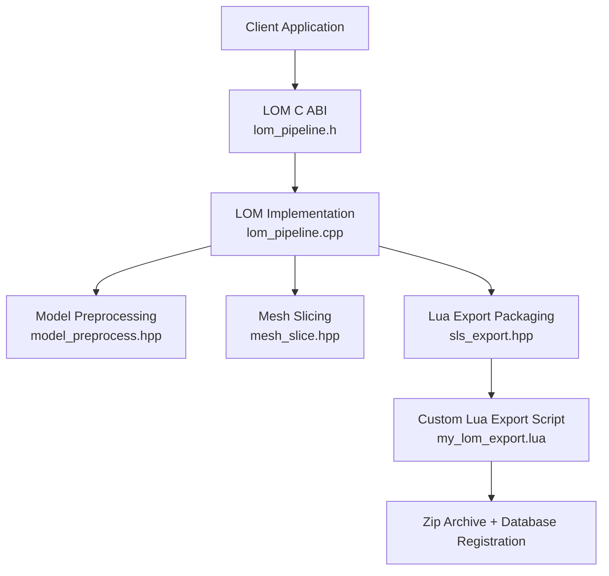
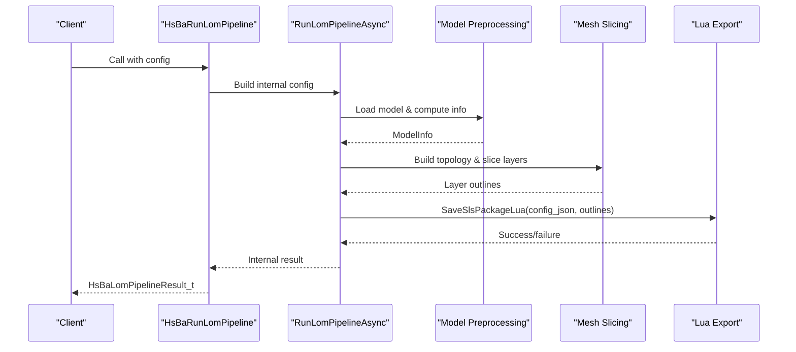
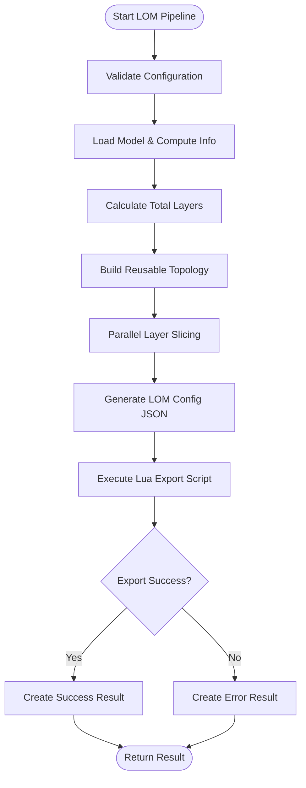
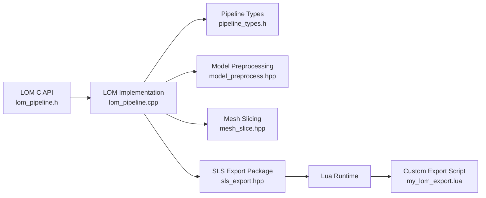

# LOM Pipeline API

<cite>
**Referenced Files in This Document**   
- [lom_pipeline.h](file://DllHsBaSlicer/lom_pipeline.h)
- [lom_pipeline.cpp](file://DllHsBaSlicer/lom_pipeline.cpp)
- [pipeline_types.h](file://pipelinetypes/pipeline_types.h)
- [sls_export.hpp](file://LibHsBaSlicer/Path/sls_export.hpp)
- [model_preprocess.hpp](file://LibHsBaSlicer/Preprocess/model_preprocess.hpp)
- [mesh_slice.hpp](file://LibHsBaSlicer/Slice/mesh_slice.hpp)
- [main.cpp](file://samples/LOM/main.cpp)
- [my_lom_export.lua](file://samples/LOM/scripts/my_lom_export.lua)
- [README.md](file://docs/en/DllHsBaSlicer/README.md)
- [lom_pipeline.proto](file://proto/lom_pipeline.proto)
</cite>

## Table of Contents
1. [Introduction](#introduction)
2. [Project Structure](#project-structure)
3. [Core Components](#core-components)
4. [Architecture Overview](#architecture-overview)
5. [Detailed Component Analysis](#detailed-component-analysis)
6. [Dependency Analysis](#dependency-analysis)
7. [Performance Considerations](#performance-considerations)
8. [Troubleshooting Guide](#troubleshooting-guide)
9. [Conclusion](#conclusion)
10. [Appendices](#appendices)

## Introduction
This document provides comprehensive API documentation for the LOM (Laminated Object Manufacturing) pipeline C ABI. It covers:
- The exported functions `HsBaCreateDefaultLomConfig()`, `HsBaRunLomPipeline()`, `HsBaRunLomPipelineAsync()`, and `HsBaFreeLomPipelineResult()`.
- The `HsBaLomPipelineConfig_t` structure, including sheet thickness, laser cutting parameters, contour offset, sealing, cut mode, bonding parameters, and Lua export configuration.
- The LOM workflow: model preprocessing, per-sheet slicing, contour generation, and Lua-driven packaging.
- Practical usage examples from the repository samples.
- LOM-specific considerations such as material-related parameterization, cutting tool compensation via contour margin, and post-processing through the Lua export script.

The LOM pipeline is a sheet-bonding process: each layer corresponds to a physical sheet thickness, contours are generated per sheet, and cut/bond parameters are passed to a Lua export script that produces the final output package.

## Project Structure
The LOM pipeline is implemented as part of the DllHsBaSlicer shared library and uses LibHsBaSlicer components for model loading, mesh slicing, and Lua-driven export packaging.



**Diagram sources**
- [lom_pipeline.h:1-63](file://DllHsBaSlicer/lom_pipeline.h#L1-L63)
- [lom_pipeline.cpp:193-305](file://DllHsBaSlicer/lom_pipeline.cpp#L193-L305)
- [model_preprocess.hpp:22-82](file://LibHsBaSlicer/Preprocess/model_preprocess.hpp#L22-L82)
- [mesh_slice.hpp:79-103](file://LibHsBaSlicer/Slice/mesh_slice.hpp#L79-L103)
- [sls_export.hpp:17-56](file://LibHsBaSlicer/Path/sls_export.hpp#L17-L56)
- [my_lom_export.lua:10-57](file://samples/LOM/scripts/my_lom_export.lua#L10-L57)

**Section sources**
- [lom_pipeline.h:1-63](file://DllHsBaSlicer/lom_pipeline.h#L1-L63)
- [lom_pipeline.cpp:1-354](file://DllHsBaSlicer/lom_pipeline.cpp#L1-L354)
- [pipeline_types.h:403-461](file://pipelinetypes/pipeline_types.h#L403-L461)

## Core Components
The LOM C ABI exposes four primary entry points:

| Function | Purpose | Return Type | Notes |
|---|---|---|---|
| `HsBaCreateDefaultLomConfig()` | Creates a default `HsBaLomPipelineConfig_t` with built-in defaults | `HsBaLomPipelineConfig_t` | String fields are NULL; numeric fields use documented defaults |
| `HsBaRunLomPipeline()` | Runs the full LOM pipeline synchronously | `HsBaLomPipelineResult_t` | Blocks until completion; caller must free result strings |
| `HsBaRunLomPipelineAsync()` | Runs the full LOM pipeline asynchronously | `void` | Invokes a result callback when complete; caller frees result strings |
| `HsBaFreeLomPipelineResult()` | Frees memory allocated in a LOM pipeline result | `void` | Must be called after using `export_path` or `error_message` |

The LOM pipeline performs three main stages:
1. **Preprocessing**: Loads the model and computes bounding box/volume.
2. **Slicing**: Builds a reusable topology and slices each sheet layer into closed polygon outlines.
3. **Export**: Packages layer contours and LOM configuration JSON into an archive via a Lua export script.

**Section sources**
- [lom_pipeline.h:17-56](file://DllHsBaSlicer/lom_pipeline.h#L17-L56)
- [lom_pipeline.cpp:313-353](file://DllHsBaSlicer/lom_pipeline.cpp#L313-L353)
- [pipeline_types.h:403-461](file://pipelinetypes/pipeline_types.h#L403-L461)

## Architecture Overview
The LOM pipeline architecture maps directly to the source implementation:



**Diagram sources**
- [lom_pipeline.cpp:193-305](file://DllHsBaSlicer/lom_pipeline.cpp#L193-L305)
- [model_preprocess.hpp:40-82](file://LibHsBaSlicer/Preprocess/model_preprocess.hpp#L40-L82)
- [mesh_slice.hpp:79-103](file://LibHsBaSlicer/Slice/mesh_slice.hpp#L79-L103)
- [sls_export.hpp:35-56](file://LibHsBaSlicer/Path/sls_export.hpp#L35-L56)

## Detailed Component Analysis

### Configuration Structure: `HsBaLomPipelineConfig_t`
The LOM configuration structure contains all parameters needed for sheet lamination, contour cutting, and layer bonding.

| Field | Type | Default | Description |
|---|---|---:|---|
| `model_name` | `const char*` | NULL | Unique model identifier |
| `model_path` | `const char*` | NULL | Path to model file (STL/OBJ/STEP/IGES) |
| `layer_height` | `float` | 0.2 | Sheet thickness in millimeters |
| `first_layer_height` | `float` | 0.2 | First sheet thickness in millimeters |
| `cut_speed` | `float` | 300.0 | Laser cut speed in mm/s |
| `cut_margin` | `float` | 0.5 | Contour offset in mm (tool compensation) |
| `cut_power` | `float` | 0.8 | Laser cut power normalized [0,1] |
| `bond_temperature` | `float` | 150.0 | Bonding temperature in °C |
| `bond_pressure` | `float` | 1.0 | Bonding pressure in MPa |
| `bond_time` | `float` | 5.0 | Bonding time per layer in seconds |
| `seal_contour` | `int` | 1 | Seal part edge (0=false, 1=true) |
| `cut_mode` | `HsBaLomCutMode_t` | `HSBA_LOM_CUT_CONTOUR` | Cutting mode: contour or halftone |
| `export_lua_script` | `const char*` | NULL | Required Lua export script path |
| `export_lua_func` | `const char*` | NULL | Lua function name (defaults to "export_lom") |
| `output_path` | `const char*` | NULL | Output file path (can be NULL) |

#### Cut Mode Enumeration
| Value | Meaning | Use Case |
|---|---|---|
| `HSBA_LOM_CUT_CONTOUR` | Contour cutting | Standard part outline cutting |
| `HSBA_LOM_CUT_HALFTONE` | Halftone cutting | Pocket/hatch-style cutting for complex geometries |

#### Result Structure: `HsBaLomPipelineResult_t`
| Field | Type | Description |
|---|---|---|
| `success` | `int` | Success flag (0=false, 1=true) |
| `total_layers` | `int` | Total number of sheet layers processed |
| `export_path` | `char*` | Path to exported result (UTF-8, caller must free) |
| `error_message` | `char*` | Error message (UTF-8, caller must free) |
| `elapsed_seconds` | `double` | Total pipeline execution time in seconds |

**Section sources**
- [pipeline_types.h:403-461](file://pipelinetypes/pipeline_types.h#L403-L461)
- [pipeline_types.h:874-897](file://pipelinetypes/pipeline_types.h#L874-L897)
- [lom_pipeline.h:17-56](file://DllHsBaSlicer/lom_pipeline.h#L17-L56)

### API Functions

#### `HsBaCreateDefaultLomConfig()`
Creates a default LOM configuration with sensible built-in values. All string fields are initialized to NULL, requiring the caller to set required fields like `model_path`, `export_lua_script`, and optionally `output_path`.

**Usage Pattern:**
```c
HsBaLomPipelineConfig_t cfg = HsBaCreateDefaultLomConfig();
cfg.model_name = "my_model";
cfg.model_path = "models/model.stl";
cfg.export_lua_script = "scripts/my_lom_export.lua";
// ... customize other parameters ...
```

**Section sources**
- [lom_pipeline.h:17-21](file://DllHsBaSlicer/lom_pipeline.h#L17-L21)
- [lom_pipeline.cpp:313-316](file://DllHsBaSlicer/lom_pipeline.cpp#L313-L316)
- [pipeline_types.h:874-897](file://pipelinetypes/pipeline_types.h#L874-L897)

#### `HsBaRunLomPipeline()`
Runs the complete LOM pipeline synchronously. The function blocks until the pipeline completes, then returns a result structure containing success status, layer count, export path, error message, and elapsed time.

**Workflow:**
1. Validates input configuration
2. Loads model and computes geometry information
3. Calculates total layer count based on model height and sheet thickness
4. Performs parallel slicing of all layers
5. Executes Lua export script with generated configuration JSON
6. Returns result to caller

**Error Handling:**
- Invalid model height returns failure with "Invalid model height" message
- Missing Lua export script returns failure with descriptive error
- Lua script execution failures are captured and reported

**Section sources**
- [lom_pipeline.h:23-37](file://DllHsBaSlicer/lom_pipeline.h#L23-L37)
- [lom_pipeline.cpp:318-325](file://DllHsBaSlicer/lom_pipeline.cpp#L318-L325)
- [lom_pipeline.cpp:193-305](file://DllHsBaSlicer/lom_pipeline.cpp#L193-L305)

#### `HsBaRunLomPipelineAsync()`
Runs the LOM pipeline asynchronously without blocking the calling thread. A result callback is invoked when the pipeline completes, receiving the same result structure as the synchronous version.

**Callback Pattern:**
```c
void OnLomComplete(HsBaLomPipelineResult_t result, void* user_data) {
    if (result.success) {
        // Process successful result
        HsBaFreeLomPipelineResult(&result);
    } else {
        // Handle error
        HsBaFreeLomPipelineResult(&result);
    }
}
```

**Important Memory Management:**
The result callback receives a result structure where `export_path` and `error_message` are heap-allocated strings that must be freed by the caller using `HsBaFreeLomPipelineResult()`.

**Section sources**
- [lom_pipeline.h:39-50](file://DllHsBaSlicer/lom_pipeline.h#L39-L50)
- [lom_pipeline.cpp:327-343](file://DllHsBaSlicer/lom_pipeline.cpp#L327-L343)

#### `HsBaFreeLomPipelineResult()`
Frees the memory allocated for `export_path` and `error_message` fields in a LOM pipeline result. This function must be called for every result returned by the LOM pipeline APIs.

**Memory Safety:**
- Safe to call with NULL pointer (no-op)
- Frees only the dynamically allocated string fields
- Does not affect other result fields

**Section sources**
- [lom_pipeline.h:52-56](file://DllHsBaSlicer/lom_pipeline.h#L52-L56)
- [lom_pipeline.cpp:345-353](file://DllHsBaSlicer/lom_pipeline.cpp#L345-L353)

### LOM Workflow Implementation



**Diagram sources**
- [lom_pipeline.cpp:193-305](file://DllHsBaSlicer/lom_pipeline.cpp#L193-L305)

**Section sources**
- [lom_pipeline.cpp:96-153](file://DllHsBaSlicer/lom_pipeline.cpp#L96-L153)
- [lom_pipeline.cpp:231-291](file://DllHsBaSlicer/lom_pipeline.cpp#L231-L291)

## Dependency Analysis
The LOM pipeline has clear dependency relationships between components:



**Diagram sources**
- [lom_pipeline.h:1-63](file://DllHsBaSlicer/lom_pipeline.h#L1-L63)
- [lom_pipeline.cpp:5-23](file://DllHsBaSlicer/lom_pipeline.cpp#L5-L23)
- [pipeline_types.h:403-461](file://pipelinetypes/pipeline_types.h#L403-L461)

**Section sources**
- [lom_pipeline.cpp:5-23](file://DllHsBaSlicer/lom_pipeline.cpp#L5-L23)
- [sls_export.hpp:1-61](file://LibHsBaSlicer/Path/sls_export.hpp#L1-L61)

## Performance Considerations
The LOM pipeline includes several performance optimizations:

1. **Parallel Slicing**: Layer slicing operations are executed in parallel using `ParallelForLayers`, significantly reducing total processing time for models with many layers.

2. **Reusable Topology**: The slicing topology is built once and reused across all layers, avoiding repeated O(n) topology reconstruction for each layer.

3. **Efficient Memory Management**: The implementation uses RAII patterns and smart pointers to manage memory efficiently, with explicit cleanup for C ABI compatibility.

4. **Progress Reporting**: Built-in progress callbacks allow UI updates without blocking the pipeline execution.

**Section sources**
- [lom_pipeline.cpp:235-250](file://DllHsBaSlicer/lom_pipeline.cpp#L235-L250)
- [mesh_slice.hpp:79-103](file://LibHsBaSlicer/Slice/mesh_slice.hpp#L79-L103)

## Troubleshooting Guide

### Common Issues and Solutions

| Issue | Symptom | Solution |
|---|---|---|
| Missing Lua export script | Error: "LOM export requires a Lua export script" | Set `export_lua_script` to a valid Lua script path |
| Invalid model file | Error: "Failed to load model" | Verify `model_path` exists and contains valid geometry |
| Zero-height model | Error: "Invalid model height" | Ensure model has positive Z-axis extent |
| Memory leaks | Crash or memory growth | Always call `HsBaFreeLomPipelineResult()` |
| Lua script errors | Export fails with Lua error message | Check Lua script syntax and available libraries |

### Debugging Tips
1. **Enable Progress Callbacks**: Use the progress callback to monitor pipeline stages and identify where failures occur.
2. **Validate Configuration**: Print configuration values before running the pipeline to ensure correct parameter setup.
3. **Test Lua Scripts Independently**: Verify Lua export scripts work correctly outside the pipeline context.
4. **Check File Permissions**: Ensure write permissions for output directories.

**Section sources**
- [lom_pipeline.cpp:256-291](file://DllHsBaSlicer/lom_pipeline.cpp#L256-L291)
- [lom_pipeline.cpp:295-299](file://DllHsBaSlicer/lom_pipeline.cpp#L295-L299)

## Conclusion
The LOM pipeline C ABI provides a comprehensive interface for laminated object manufacturing workflows. It combines efficient geometric processing with flexible Lua-driven customization, making it suitable for various sheet-based manufacturing processes. The API design emphasizes safety through explicit memory management, comprehensive error reporting, and clear separation between core processing logic and customizable export behavior.

Key strengths include:
- Clean C ABI with straightforward memory management
- Flexible configuration supporting various materials and processes
- Efficient parallel processing for large models
- Extensible Lua scripting system for custom export formats
- Comprehensive error handling and progress reporting

## Appendices

### Usage Examples

#### Basic LOM Pipeline Usage
```c
// Example from samples/LOM/main.cpp
HsBaLomPipelineConfig_t cfg = HsBaCreateDefaultLomConfig();
cfg.model_name = "stanford_bunny";
cfg.model_path = "models/stanford_bunny.stl";
cfg.export_lua_script = "scripts/my_lom_export.lua";
cfg.export_lua_func = "export_lom";
cfg.output_path = "output/lom_basic_output.zip";

HsBaLomPipelineResult_t result = HsBaRunLomPipeline(&cfg, OnProgress, nullptr);
if (result.success) {
    printf("LOM slicing OK! Layers: %d, Time: %.2fs\n", 
           result.total_layers, result.elapsed_seconds);
}
HsBaFreeLomPipelineResult(&result);
```

#### Custom Parameters Configuration
```c
// Example from samples/LOM/main.cpp
HsBaLomPipelineConfig_t cfg = HsBaCreateDefaultLomConfig();
cfg.layer_height = 0.25f;
cfg.cut_speed = 250.0f;
cfg.cut_margin = 0.8f;
cfg.cut_power = 0.9f;
cfg.bond_temperature = 160.0f;
cfg.bond_pressure = 1.5f;
cfg.bond_time = 6.0f;
```

#### Asynchronous Pipeline Usage
```c
// Example from samples/LOM/main.cpp
void OnLomPipelineComplete(HsBaLomPipelineResult_t result, void* user_data) {
    if (result.success) {
        printf("[Async] LOM done! Layers: %d\n", result.total_layers);
    }
    HsBaFreeLomPipelineResult(&result);
}

HsBaRunLomPipelineAsync(&cfg, OnProgress, nullptr, OnLomPipelineComplete, &done_flag);
```

**Section sources**
- [main.cpp:55-82](file://samples/LOM/main.cpp#L55-L82)
- [main.cpp:87-130](file://samples/LOM/main.cpp#L87-L130)
- [main.cpp:135-175](file://samples/LOM/main.cpp#L135-L175)

### LOM-Specific Considerations

#### Material-Specific Parameters
While the current API doesn't include explicit material type fields, the configuration supports material-specific parameterization through:
- **Sheet thickness** (`layer_height`, `first_layer_height`): Controls material consumption and resolution
- **Bonding parameters** (`bond_temperature`, `bond_pressure`, `bond_time`): Critical for different adhesive materials
- **Cutting parameters** (`cut_speed`, `cut_power`, `cut_margin`): Optimized for paper, plastic, or composite sheets

#### Cutting Tool Compensation
The `cut_margin` field provides contour offset compensation for:
- Laser kerf width compensation
- Blade thickness compensation  
- Material deformation during cutting
- Precision requirements for tight tolerances

#### Post-Processing Requirements
The Lua export script handles post-processing tasks:
- **Archive creation**: Combines layer data and configuration into zip files
- **Database registration**: Optional metadata storage for production tracking
- **Custom formatting**: Adapts output for specific manufacturing equipment
- **Quality control**: Can generate inspection reports or validation data

**Section sources**
- [my_lom_export.lua:10-57](file://samples/LOM/scripts/my_lom_export.lua#L10-L57)
- [README.md:257-285](file://docs/en/DllHsBaSlicer/README.md#L257-L285)
- [lom_pipeline.proto:1-45](file://proto/lom_pipeline.proto#L1-L45)