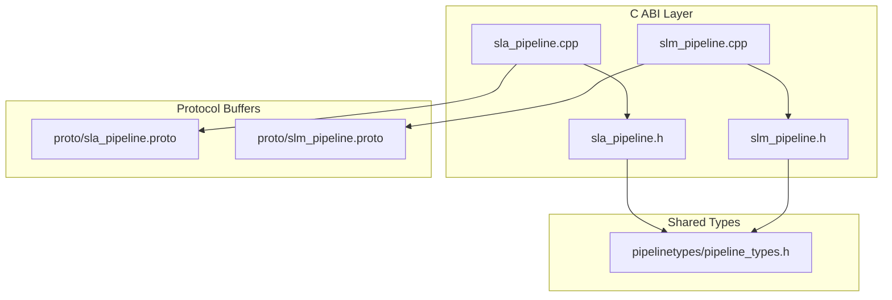
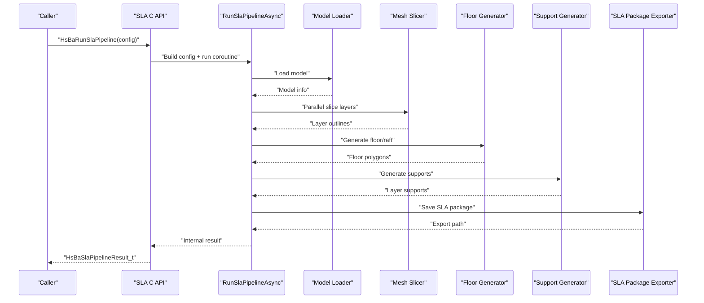
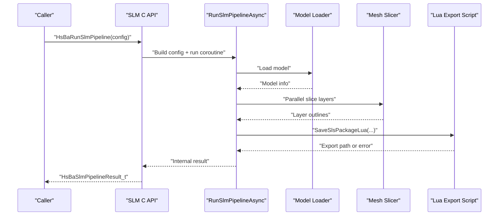
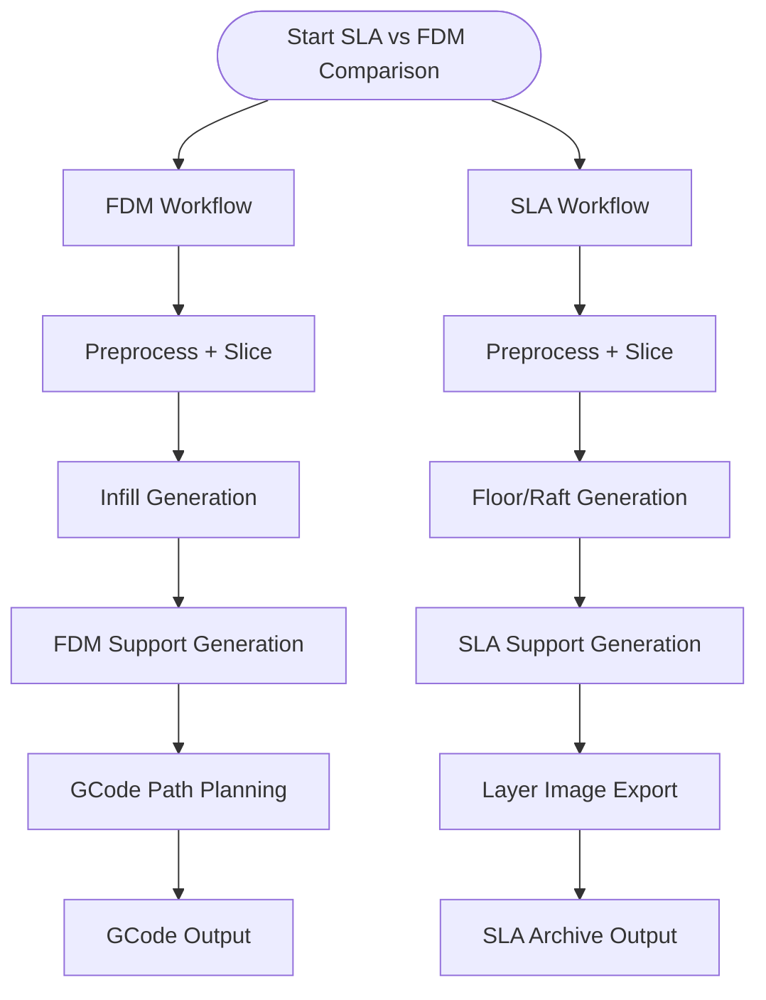
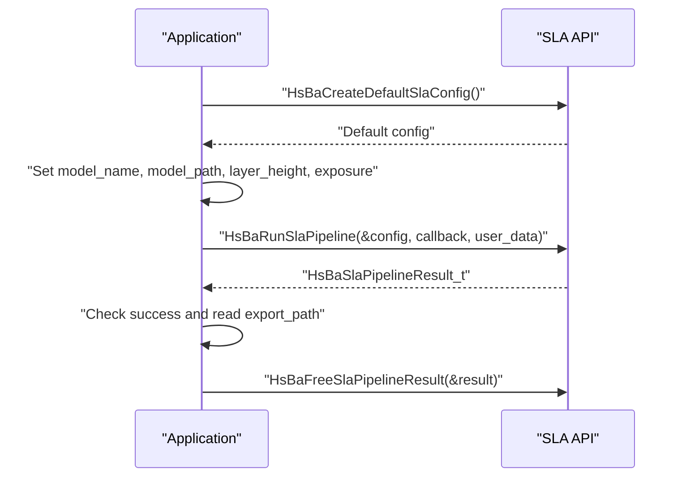
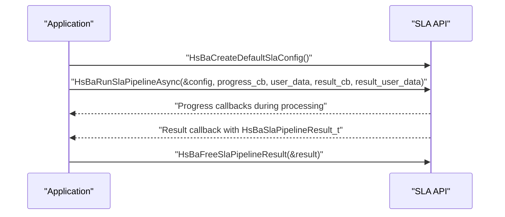
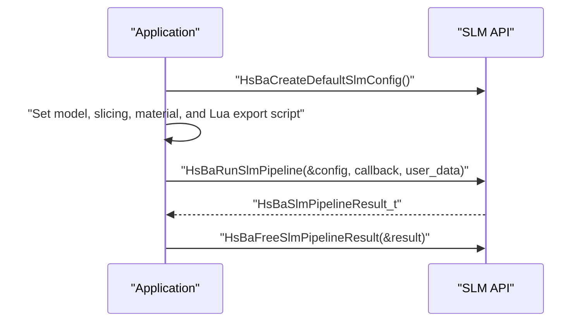
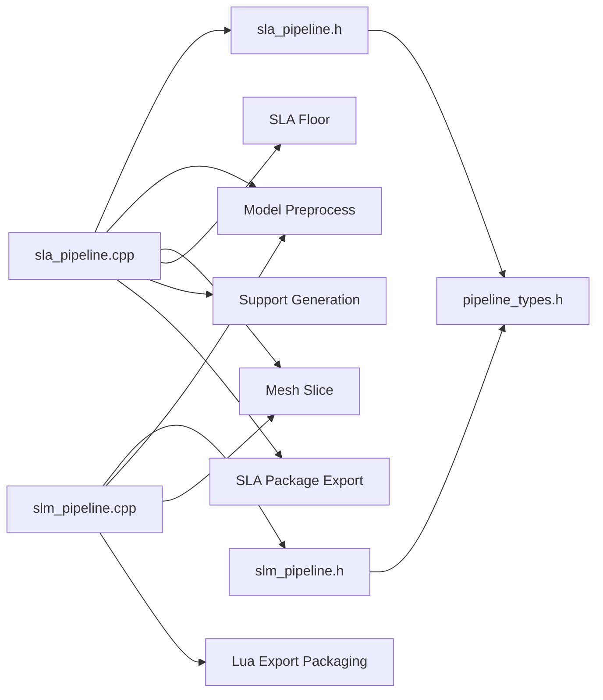

# SLA Pipeline API

<cite>
**Referenced Files in This Document**   
- [sla_pipeline.h](file://DllHsBaSlicer/sla_pipeline.h)
- [sla_pipeline.cpp](file://DllHsBaSlicer/sla_pipeline.cpp)
- [slm_pipeline.h](file://DllHsBaSlicer/slm_pipeline.h)
- [slm_pipeline.cpp](file://DllHsBaSlicer/slm_pipeline.cpp)
- [pipeline_types.h](file://pipelinetypes/pipeline_types.h)
- [sla_pipeline.proto](file://proto/sla_pipeline.proto)
- [slm_pipeline.proto](file://proto/slm_pipeline.proto)
</cite>

## Table of Contents
1. [Introduction](#introduction)
2. [Project Structure](#project-structure)
3. [Core Components](#core-components)
4. [Architecture Overview](#architecture-overview)
5. [Detailed Component Analysis](#detailed-component-analysis)
6. [Dependency Analysis](#dependency-analysis)
7. [Performance Considerations](#performance-considerations)
8. [Troubleshooting Guide](#troubleshooting-guide)
9. [Conclusion](#conclusion)
10. [Appendices](#appendices)

## Introduction
This document provides comprehensive API documentation for the Stereolithography (SLA) and Selective Laser Melting (SLM) pipeline C ABI exposed by HsBaSlicer. It focuses on:

- The SLA pipeline functions: `HsBaCreateDefaultSlaConfig()`, `HsBaRunSlaPipeline()`, `HsBaRunSlaPipelineAsync()`, and `HsBaFreeSlaPipelineResult()`.
- The SLM pipeline functions requested in the objective: `HsBaCreateDefaultSlmConfig()`, `HsBaRunSlmPipeline()`, `HsBaRunSlmPipelineAsync()`, and `HsBaFreeSlmPipelineResult()`.
- The SLA-specific configuration structure `HsBaSlaPipelineConfig_t`, including layer thickness, exposure settings, floor/raft generation, support options, image export format, and Lua customization hooks.
- The conceptual differences between SLA and FDM workflows, especially regarding floor generation, support structures, resin exposure/lift/retract behavior, and layer image output.
- Usage examples, error handling patterns, performance characteristics, and integration guidance for SLA printers and resins.

The SLA pipeline is a full slicing workflow that converts a 3D model into per-layer images plus optional floor and support data, packaged into an export archive. The SLM pipeline follows a similar preprocessing and slicing flow but targets metal powder-bed processes and requires a Lua export script.

## Project Structure
The SLA and SLM C ABI lives under the DllHsBaSlicer module, with shared type definitions in pipelinetypes and protocol buffer definitions used for internal serialization.

**Diagram sources**
- [sla_pipeline.h:1-63](file://DllHsBaSlicer/sla_pipeline.h#L1-L63)
- [slm_pipeline.h:1-63](file://DllHsBaSlicer/slm_pipeline.h#L1-L63)
- [sla_pipeline.cpp:1-532](file://DllHsBaSlicer/sla_pipeline.cpp#L1-L532)
- [slm_pipeline.cpp:1-397](file://DllHsBaSlicer/slm_pipeline.cpp#L1-L397)
- [pipeline_types.h:142-245](file://pipelinetypes/pipeline_types.h#L142-L245)
- [sla_pipeline.proto:1-67](file://proto/sla_pipeline.proto#L1-L67)
- [slm_pipeline.proto:1-65](file://proto/slm_pipeline.proto#L1-L65)

**Section sources**
- [sla_pipeline.h:1-63](file://DllHsBaSlicer/sla_pipeline.h#L1-L63)
- [slm_pipeline.h:1-63](file://DllHsBaSlicer/slm_pipeline.h#L1-L63)
- [pipeline_types.h:142-245](file://pipelinetypes/pipeline_types.h#L142-L245)

## Core Components
The SLA and SLM pipelines expose a small, focused set of C-compatible entry points:

| Function | Module | Purpose |
|---|---|---|
| `HsBaCreateDefaultSlaConfig()` | SLA | Returns a default `HsBaSlaPipelineConfig_t` with documented defaults. |
| `HsBaRunSlaPipeline()` | SLA | Runs the full SLA pipeline synchronously. |
| `HsBaRunSlaPipelineAsync()` | SLA | Runs the full SLA pipeline asynchronously and invokes a result callback. |
| `HsBaFreeSlaPipelineResult()` | SLA | Frees memory owned by `HsBaSlaPipelineResult_t`. |
| `HsBaCreateDefaultSlmConfig()` | SLM | Returns a default `HsBaSlmPipelineConfig_t` with documented defaults. |
| `HsBaRunSlmPipeline()` | SLM | Runs the full SLM pipeline synchronously. |
| `HsBaRunSlmPipelineAsync()` | SLM | Runs the full SLM pipeline asynchronously and invokes a result callback. |
| `HsBaFreeSlmPipelineResult()` | SLM | Frees memory owned by `HsBaSlmPipelineResult_t`. |

Key responsibilities:

- **Configuration creation**: Default values are provided so callers can start from a known baseline and override only what they need.
- **Synchronous execution**: The caller blocks until the pipeline completes.
- **Asynchronous execution**: The caller receives progress callbacks during processing and a final result callback when complete.
- **Memory ownership**: Result strings (`export_path`, `error_message`) are heap-allocated by the library; the caller must free them using the corresponding `HsBaFree*PipelineResult()` function.

**Section sources**
- [sla_pipeline.h:17-56](file://DllHsBaSlicer/sla_pipeline.h#L17-L56)
- [slm_pipeline.h:17-56](file://DllHsBaSlicer/slm_pipeline.h#L17-L56)
- [sla_pipeline.cpp:491-531](file://DllHsBaSlicer/sla_pipeline.cpp#L491-L531)
- [slm_pipeline.cpp:356-396](file://DllHsBaSlicer/slm_pipeline.cpp#L356-L396)

## Architecture Overview
Both pipelines follow a staged architecture:

1. **Preprocess**: Load or retrieve the model and compute bounding box information.
2. **Slice**: Build slice topology once and generate per-layer outlines in parallel.
3. **Process stage**:
   - SLA: Generate floor/raft, then supports, then package layers, floor, and supports into an SLA export archive.
   - SLM: Skip floor/support generation and delegate packaging to a required Lua export script.
4. **Export**: Write the final output file or archive path into the result.

**Diagram sources**
- [sla_pipeline.cpp:299-483](file://DllHsBaSlicer/sla_pipeline.cpp#L299-L483)
- [sla_pipeline.cpp:496-503](file://DllHsBaSlicer/sla_pipeline.cpp#L496-L503)

For SLM, the sequence is similar through slicing, but the export stage requires a Lua script:

**Diagram sources**
- [slm_pipeline.cpp:236-348](file://DllHsBaSlicer/slm_pipeline.cpp#L236-L348)
- [slm_pipeline.cpp:361-368](file://DllHsBaSlicer/slm_pipeline.cpp#L361-L368)

## Detailed Component Analysis

### SLA Configuration Structure: `HsBaSlaPipelineConfig_t`
`HsBaSlaPipelineConfig_t` is the central configuration object for the SLA pipeline. It covers model input, slicing parameters, exposure and lift/retract behavior, floor/raft generation, support generation, Lua customization, and image export options.

| Category | Field | Type / Enum | Meaning |
|---|---|---|---|
| Model | `model_name` | `const char*` | Logical model name. |
| Model | `model_path` | `const char*` | Path to the model file. |
| Slicing | `layer_height` | `float` | Normal layer height in millimeters. |
| Slicing | `first_layer_height` | `float` | First layer height in millimeters. |
| Exposure | `bottom_exposure_time` | `float` | Bottom layer exposure time in seconds. |
| Exposure | `normal_exposure_time` | `float` | Normal layer exposure time in seconds. |
| Lift/Retract | `bottom_lift_distance` | `float` | Bottom layer lift distance in millimeters. |
| Lift/Retract | `lift_distance` | `float` | Normal layer lift distance in millimeters. |
| Lift/Retract | `lift_speed` | `float` | Lift speed in millimeters per second. |
| Lift/Retract | `retract_speed` | `float` | Retract speed in millimeters per second. |
| Floor/Raft | `floor_raft_offset` | `float` | Raft outward offset from footprint in millimeters. |
| Floor/Raft | `floor_border_width` | `float` | Floor border ring width in millimeters. |
| Floor/Raft | `floor_fill_spacing` | `float` | Floor fill line spacing in millimeters. |
| Floor/Raft | `floor_fill_angle` | `float` | Floor fill angle in degrees. |
| Floor/Raft | `floor_border_count` | `int` | Number of floor border loops. |
| Floor/Raft | `floor_use_convex_hull` | `int` | Whether to use convex hull for floor. |
| Support | `enable_support` | `int` | Enable or disable support generation. |
| Support | `overhang_angle` | `float` | Overhang angle threshold in degrees. |
| Support | `support_gap` | `float` | Gap between support and model in millimeters. |
| Support | `support_diameter` | `float` | Support column diameter in millimeters. |
| Support | `support_density` | `float` | Support fill density in range `[0,1]`. |
| Support | `support_pattern` | `HsBaSlaSupportPattern_t` | SLA support pattern enum. |
| Lua Customization | `support_lua_script` | `const char*` | Optional custom support Lua script path. |
| Lua Customization | `support_lua_func` | `const char*` | Optional custom support Lua function name. |
| Lua Customization | `floor_lua_script` | `const char*` | Optional custom floor Lua script path. |
| Lua Customization | `floor_lua_func` | `const char*` | Optional custom floor Lua function name. |
| Lua Customization | `export_lua_script` | `const char*` | Optional custom export Lua script path. |
| Lua Customization | `export_lua_func` | `const char*` | Optional custom export Lua function name. |
| Output | `output_path` | `const char*` | Optional output zip file path. |
| Output | `image_type` | `HsBaSlaImageType_t` | Layer image format: PNG, JPEG, or SVG. |
| Output | `image_width` | `int` | Image width in pixels; zero means auto. |
| Output | `image_height` | `int` | Image height in pixels; zero means auto. |

#### SLA-Specific Enums

| Enum | Values | Meaning |
|---|---|---|
| `HsBaSlaSupportPattern_t` | `HSBA_SLA_SUPPORT_SACRIFICIAL`, `HSBA_SLA_SUPPORT_CONE` | Sacrificial thin-column support vs cone-shaped support. |
| `HsBaSlaImageType_t` | `HSBA_SLA_IMAGE_PNG`, `HSBA_SLA_IMAGE_JPG`, `HSBA_SLA_IMAGE_SVG` | PNG lossless, JPEG smaller size, SVG vector. |

#### Default Values
The default SLA configuration initializes string fields to null and sets reasonable defaults for layer heights, exposure times, lift distances, floor geometry, support parameters, and PNG image output. These defaults are defined inline in the shared types header and exposed via `HsBaCreateDefaultSlaConfig()`.

**Section sources**
- [pipeline_types.h:146-218](file://pipelinetypes/pipeline_types.h#L146-L218)
- [pipeline_types.h:785-825](file://pipelinetypes/pipeline_types.h#L785-L825)
- [sla_pipeline.h:17-21](file://DllHsBaSlicer/sla_pipeline.h#L17-L21)

### SLA Result Structure: `HsBaSlaPipelineResult_t`
The SLA result contains:

| Field | Type | Meaning |
|---|---|---|
| `success` | `int` | Success flag; non-zero indicates success. |
| `total_layers` | `int` | Total number of generated layers. |
| `export_path` | `char*` | UTF-8 path to the exported SLA archive; caller must free. |
| `error_message` | `char*` | UTF-8 error message if failed; caller must free. |
| `elapsed_seconds` | `double` | Elapsed processing time in seconds. |

The synchronous API returns this struct directly. The asynchronous API passes it to the result callback. In both cases, the caller owns the allocated strings and must call `HsBaFreeSlaPipelineResult()`.

**Section sources**
- [pipeline_types.h:220-232](file://pipelinetypes/pipeline_types.h#L220-L232)
- [sla_pipeline.cpp:284-296](file://DllHsBaSlicer/sla_pipeline.cpp#L284-L296)
- [sla_pipeline.cpp:523-531](file://DllHsBaSlicer/sla_pipeline.cpp#L523-L531)

### SLA Pipeline Functions

#### `HsBaCreateDefaultSlaConfig()`
Returns a fully initialized `HsBaSlaPipelineConfig_t` with default values. Callers should use this as a starting point rather than manually zero-initializing the struct.

**Section sources**
- [sla_pipeline.h:17-21](file://DllHsBaSlicer/sla_pipeline.h#L17-L21)
- [sla_pipeline.cpp:491-494](file://DllHsBaSlicer/sla_pipeline.cpp#L491-L494)
- [pipeline_types.h:785-825](file://pipelinetypes/pipeline_types.h#L785-L825)

#### `HsBaRunSlaPipeline()`
Runs the full SLA pipeline synchronously:

1. Build internal configuration from the C struct.
2. Execute the coroutine-based pipeline.
3. Convert the internal result to the C ABI result.
4. Return the result to the caller.

The pipeline stages are:

- Preprocess: load model and compute layer count.
- Slice: build topology and slice layers in parallel.
- Floor: generate raft/floor using built-in logic or a custom Lua script.
- Support: generate supports using built-in logic or a custom Lua script.
- Export: package layers, floor, and supports into an SLA archive.

**Section sources**
- [sla_pipeline.h:23-34](file://DllHsBaSlicer/sla_pipeline.h#L23-L34)
- [sla_pipeline.cpp:496-503](file://DllHsBaSlicer/sla_pipeline.cpp#L496-L503)
- [sla_pipeline.cpp:299-483](file://DllHsBaSlicer/sla_pipeline.cpp#L299-L483)

#### `HsBaRunSlaPipelineAsync()`
Runs the SLA pipeline asynchronously. It:

- Copies the configuration into a shared internal object.
- Starts the coroutine task.
- Registers a continuation that converts the internal result to the C result.
- Invokes the user-provided result callback with the result and user data.

Progress callbacks may be invoked during processing if provided.

**Section sources**
- [sla_pipeline.h:36-47](file://DllHsBaSlicer/sla_pipeline.h#L36-L47)
- [sla_pipeline.cpp:505-521](file://DllHsBaSlicer/sla_pipeline.cpp#L505-L521)

#### `HsBaFreeSlaPipelineResult()`
Frees the `export_path` and `error_message` strings allocated by the SLA pipeline result. It safely handles null pointers and clears the pointers after freeing.

**Section sources**
- [sla_pipeline.h:49-56](file://DllHsBaSlicer/sla_pipeline.h#L49-L56)
- [sla_pipeline.cpp:523-531](file://DllHsBaSlicer/sla_pipeline.cpp#L523-L531)

### SLM Configuration Structure: `HsBaSlmPipelineConfig_t`
Although the objective mentions SLA, it also references SLM functions. `HsBaSlmPipelineConfig_t` is the SLM configuration structure. It mirrors the SLS flow but adds metal-specific parameters.

| Category | Field | Type | Meaning |
|---|---|---|---|
| Model | `model_name` | `const char*` | Model name. |
| Model | `model_path` | `const char*` | Model file path. |
| Slicing | `layer_height` | `float` | Layer height in millimeters. |
| Slicing | `first_layer_height` | `float` | First layer height in millimeters. |
| Energy Source | `laser_power` | `float` | Energy source power in watts. |
| Energy Source | `scan_speed` | `float` | Scan speed in millimeters per second. |
| Hatch | `hatch_spacing` | `float` | Hatch spacing in millimeters. |
| Hatch | `hatch_rotation` | `float` | Hatch rotation angle in degrees. |
| Bed | `bed_temperature` | `float` | Build platform temperature in Celsius. |
| Material | `material` | `HsBaSlmMaterial_t` | Metal powder material. |
| Light Source | `light_source` | `HsBaSlmLight_t` | Laser or electron-beam energy source. |
| Gas | `protect_gas` | `HsBaMetalProtectGas_t` | Shielding gas type. |
| Lua Export | `export_lua_script` | `const char*` | Required Lua export script path. |
| Lua Export | `export_lua_func` | `const char*` | Lua export function name. |
| Output | `output_path` | `const char*` | Optional output file path. |

#### SLM-Specific Enums

| Enum | Values | Meaning |
|---|---|---|
| `HsBaSlmMaterial_t` | `HSBA_SLM_MATERIAL_IRON`, `HSBA_SLM_MATERIAL_ALUMINUM`, `HSBA_SLM_MATERIAL_TITANIUM`, `HSBA_SLM_MATERIAL_UNKNOWN` | Metal powder material. |
| `HsBaSlmLight_t` | `HSBA_SLM_LIGHT_LASER`, `HSBA_SLM_LIGHT_EBEAM`, `HSBA_SLM_LIGHT_UNKNOWN` | Energy source type. |
| `HsBaMetalProtectGas_t` | `HSBA_METAL_GAS_ARGON`, `HSBA_METAL_GAS_HELIUM`, `HSBA_METAL_GAS_N2`, `HSBA_METAL_GAS_CO2`, `HSBA_METAL_GAS_UNKNOWN` | Shared metal shielding gas enum. |

**Section sources**
- [pipeline_types.h:312-376](file://pipelinetypes/pipeline_types.h#L312-L376)
- [pipeline_types.h:849-872](file://pipelinetypes/pipeline_types.h#L849-L872)
- [slm_pipeline.h:17-21](file://DllHsBaSlicer/slm_pipeline.h#L17-L21)

### SLM Pipeline Functions

#### `HsBaCreateDefaultSlmConfig()`
Returns a default `HsBaSlmPipelineConfig_t`. Defaults include titanium material, laser light source, argon shielding gas, and typical metal slicing parameters.

**Section sources**
- [slm_pipeline.h:17-21](file://DllHsBaSlicer/slm_pipeline.h#L17-L21)
- [slm_pipeline.cpp:356-359](file://DllHsBaSlicer/slm_pipeline.cpp#L356-L359)
- [pipeline_types.h:849-872](file://pipelinetypes/pipeline_types.h#L849-L872)

#### `HsBaRunSlmPipeline()`
Runs the SLM pipeline synchronously. It loads the model, slices layers in parallel, builds a process JSON containing metal parameters, and delegates export to a required Lua script.

**Section sources**
- [slm_pipeline.h:23-37](file://DllHsBaSlicer/slm_pipeline.h#L23-L37)
- [slm_pipeline.cpp:361-368](file://DllHsBaSlicer/slm_pipeline.cpp#L361-L368)
- [slm_pipeline.cpp:236-348](file://DllHsBaSlicer/slm_pipeline.cpp#L236-L348)

#### `HsBaRunSlmPipelineAsync()`
Runs the SLM pipeline asynchronously. It shares the configuration across the coroutine and invokes the result callback with the converted C result.

**Section sources**
- [slm_pipeline.h:39-50](file://DllHsBaSlicer/slm_pipeline.h#L39-L50)
- [slm_pipeline.cpp:370-386](file://DllHsBaSlicer/slm_pipeline.cpp#L370-L386)

#### `HsBaFreeSlmPipelineResult()`
Frees the `export_path` and `error_message` strings allocated by the SLM pipeline result.

**Section sources**
- [slm_pipeline.h:52-56](file://DllHsBaSlicer/slm_pipeline.h#L52-L56)
- [slm_pipeline.cpp:388-396](file://DllHsBaSlicer/slm_pipeline.cpp#L388-L396)

### SLA Workflow Differences from FDM
The SLA pipeline differs from FDM in several important ways:

| Aspect | FDM | SLA |
|---|---|---|
| Primary output | G-code toolpaths for extrusion | Per-layer images plus optional floor and support data |
| Floor/raft | Optional infill and wall generation | Explicit floor/raft generation with configurable offset, borders, fill spacing, and convex hull option |
| Support | FDM support patterns such as plane, tree, honeycomb | SLA support patterns such as sacrificial columns and cones |
| Material interaction | Filament extrusion, nozzle temperature, bed temperature | Resin exposure time, bottom exposure, lift/retract distances and speeds |
| Layer generation | Toolpath planning and G-code emission | Mesh slicing into 2D outlines, rasterized to images |
| Export format | Usually G-code text | Usually a zip archive containing layer images, floor, and support data |
| Lua customization | Support and infill scripts | Support, floor, and export scripts |

[No sources needed since this diagram shows conceptual workflow, not actual code structure]

**Section sources**
- [pipeline_types.h:53-127](file://pipelinetypes/pipeline_types.h#L53-L127)
- [pipeline_types.h:146-232](file://pipelinetypes/pipeline_types.h#L146-L232)
- [sla_pipeline.cpp:310-471](file://DllHsBaSlicer/sla_pipeline.cpp#L310-L471)

### SLA-Specific Workflow Details

#### Floor Generation
SLA floor generation creates a raft-like base beneath the model. It uses:

- Footprint from the first layer outline.
- Configurable raft offset, border width, fill spacing, fill angle, border loop count, and convex hull option.
- Optional Lua script replacement via `floor_lua_script` and `floor_lua_func`.

If no custom floor script is provided, the built-in floor generator is used.

**Section sources**
- [sla_pipeline.cpp:360-384](file://DllHsBaSlicer/sla_pipeline.cpp#L360-L384)
- [pipeline_types.h:188-195](file://pipelinetypes/pipeline_types.h#L188-L195)

#### Support Generation
SLA supports are generated per layer and can be enabled or disabled. Supported options include overhang angle, gap, diameter, density, and pattern. A custom Lua script can replace the built-in support generator.

**Section sources**
- [sla_pipeline.cpp:386-425](file://DllHsBaSlicer/sla_pipeline.cpp#L386-L425)
- [pipeline_types.h:196-203](file://pipelinetypes/pipeline_types.h#L196-L203)

#### Exposure and Lift Behavior
SLA exposure and lift parameters are passed into the exported configuration JSON. They include bottom exposure time, normal exposure time, bottom lift distance, lift distance, lift speed, and retract speed. These values are intended for downstream SLA printer software or resins that consume the SLA package metadata.

**Section sources**
- [sla_pipeline.cpp:181-242](file://DllHsBaSlicer/sla_pipeline.cpp#L181-L242)
- [pipeline_types.h:180-187](file://pipelinetypes/pipeline_types.h#L180-L187)

#### Layer Image Export
SLA layer images can be exported as PNG, JPEG, or SVG. PNG is the default. Image dimensions can be auto-sized or explicitly specified. The exporter includes floor images and optionally support images.

**Section sources**
- [pipeline_types.h:155-163](file://pipelinetypes/pipeline_types.h#L155-L163)
- [pipeline_types.h:212-216](file://pipelinetypes/pipeline_types.h#L212-L216)
- [sla_pipeline.cpp:155-179](file://DllHsBaSlicer/sla_pipeline.cpp#L155-L179)
- [sla_pipeline.cpp:438-458](file://DllHsBaSlicer/sla_pipeline.cpp#L438-L458)

### Usage Examples

#### Example 1: Basic SLA Pipeline Execution
This example demonstrates configuring and running the SLA pipeline synchronously:

1. Create a default SLA configuration.
2. Set `model_name` and `model_path`.
3. Adjust `layer_height`, `first_layer_height`, and exposure settings.
4. Optionally enable or disable supports.
5. Optionally set `output_path`.
6. Call `HsBaRunSlaPipeline()`.
7. Check `result.success`.
8. Use `result.export_path` if successful.
9. Free the result with `HsBaFreeSlaPipelineResult()`.

[No sources needed since this diagram shows conceptual usage flow, not exact code lines]

#### Example 2: Asynchronous SLA Pipeline Execution
This example demonstrates asynchronous execution:

1. Create a default SLA configuration.
2. Configure model and SLA-specific parameters.
3. Provide a progress callback to track pipeline stages.
4. Call `HsBaRunSlaPipelineAsync()`.
5. Implement a result callback to handle completion.
6. Free the result inside the result callback.

[No sources needed since this diagram shows conceptual usage flow, not exact code lines]

#### Example 3: SLM Pipeline Execution
This example demonstrates configuring and running the SLM pipeline:

1. Create a default SLM configuration.
2. Set `model_name` and `model_path`.
3. Configure layer height, energy source, hatch, bed temperature, material, light source, and shielding gas.
4. Provide a required `export_lua_script`.
5. Call `HsBaRunSlmPipeline()` or `HsBaRunSlmPipelineAsync()`.
6. Check `result.success`.
7. Use `result.export_path` if successful.
8. Free the result with `HsBaFreeSlmPipelineResult()`.

[No sources needed since this diagram shows conceptual usage flow, not exact code lines]

## Dependency Analysis
The SLA and SLM C APIs depend on shared types, model preprocessing, mesh slicing, floor generation, support generation, and export utilities.

**Diagram sources**
- [sla_pipeline.cpp:19-26](file://DllHsBaSlicer/sla_pipeline.cpp#L19-L26)
- [slm_pipeline.cpp:17-23](file://DllHsBaSlicer/slm_pipeline.cpp#L17-L23)
- [pipeline_types.h:142-245](file://pipelinetypes/pipeline_types.h#L142-L245)

**Section sources**
- [sla_pipeline.cpp:19-26](file://DllHsBaSlicer/sla_pipeline.cpp#L19-L26)
- [slm_pipeline.cpp:17-23](file://DllHsBaSlicer/slm_pipeline.cpp#L17-L23)

## Performance Considerations
Several implementation details affect SLA and SLM pipeline performance:

- **Parallel slicing**: Layers are sliced in parallel after building the slice topology once. This reduces total slicing time for models with many layers.
- **Coroutine-based execution**: Both pipelines use coroutine tasks, enabling asynchronous execution without blocking the caller thread.
- **Progress reporting**: Progress callbacks are invoked at major stages, allowing UIs to show meaningful updates.
- **Memory management**: String fields in results are heap-allocated; failing to free them causes leaks.
- **Lua scripts**: Custom Lua scripts for support, floor, or export add overhead due to script loading and execution. Built-in algorithms are generally faster but less customizable.
- **Image format**: PNG is lossless and typically larger; JPEG reduces file size but is lossy; SVG is vector-based and may increase export complexity.

Recommendations:

- Prefer `HsBaRunSlaPipelineAsync()` or `HsBaRunSlmPipelineAsync()` in UI applications to avoid blocking.
- Use default configurations as a baseline and adjust only necessary parameters.
- Validate model paths before calling the pipeline.
- Always free pipeline results.
- Tune layer height and image resolution based on printer capabilities and resin requirements.

[No sources needed since this section provides general guidance]

## Troubleshooting Guide

### Common SLA Errors
- **Failed to load model**: Occurs when the model cannot be loaded from the provided path.
- **Invalid model height**: Occurs when the model bounding box yields zero or negative height.
- **Failed to read support Lua script**: Occurs when a custom support Lua script path is invalid or unreadable.
- **Failed to export SLA package**: Occurs when the SLA package exporter fails to write the output archive.

These errors are captured in the result's `error_message` field and marked by setting `success` to false.

**Section sources**
- [sla_pipeline.cpp:318-334](file://DllHsBaSlicer/sla_pipeline.cpp#L318-L334)
- [sla_pipeline.cpp:400-419](file://DllHsBaSlicer/sla_pipeline.cpp#L400-L419)
- [sla_pipeline.cpp:449-469](file://DllHsBaSlicer/sla_pipeline.cpp#L449-L469)

### Common SLM Errors
- **Failed to load model**: Same cause as SLA.
- **Invalid model height**: Same cause as SLA.
- **SLM export requires a Lua export script**: The SLM pipeline requires `export_lua_script`; leaving it empty causes failure.
- **Failed to export SLM package via Lua script**: Occurs when the Lua export script fails or returns an error.

**Section sources**
- [slm_pipeline.cpp:252-268](file://DllHsBaSlicer/slm_pipeline.cpp#L252-L268)
- [slm_pipeline.cpp:299-304](file://DllHsBaSlicer/slm_pipeline.cpp#L299-L304)
- [slm_pipeline.cpp:321-334](file://DllHsBaSlicer/slm_pipeline.cpp#L321-L334)

### Error Handling Patterns
- Check `result.success` before reading `result.export_path`.
- Read `result.error_message` when `success` is false.
- Always call the corresponding `HsBaFree*PipelineResult()` function.
- For async calls, ensure the result callback is implemented and frees the result.

**Section sources**
- [sla_pipeline.cpp:523-531](file://DllHsBaSlicer/sla_pipeline.cpp#L523-L531)
- [slm_pipeline.cpp:388-396](file://DllHsBaSlicer/slm_pipeline.cpp#L388-L396)

## Conclusion
The SLA and SLM pipeline C APIs provide a clean, structured interface for converting 3D models into printer-ready outputs. The SLA pipeline emphasizes resin-specific behavior such as exposure, lift/retract, floor generation, and support structures, while the SLM pipeline focuses on metal powder-bed parameters and Lua-driven export.

For robust integration:

- Use the default configuration functions.
- Configure layer height, exposure, and support parameters according to your resin and printer.
- Choose synchronous or asynchronous execution based on application needs.
- Handle errors through the result structure.
- Free all allocated result memory.
- Extend behavior through Lua scripts where customization is required.

[No sources needed since this section summarizes without analyzing specific files]

## Appendices

### SLA Protocol Buffer Reference
The SLA protocol buffer defines the serialized representation of SLA configuration and result messages. It aligns closely with the C ABI structure.

**Section sources**
- [sla_pipeline.proto:1-67](file://proto/sla_pipeline.proto#L1-L67)

### SLM Protocol Buffer Reference
The SLM protocol buffer defines serialized configuration and result messages for the metal powder-bed pipeline.

**Section sources**
- [slm_pipeline.proto:1-65](file://proto/slm_pipeline.proto#L1-L65)