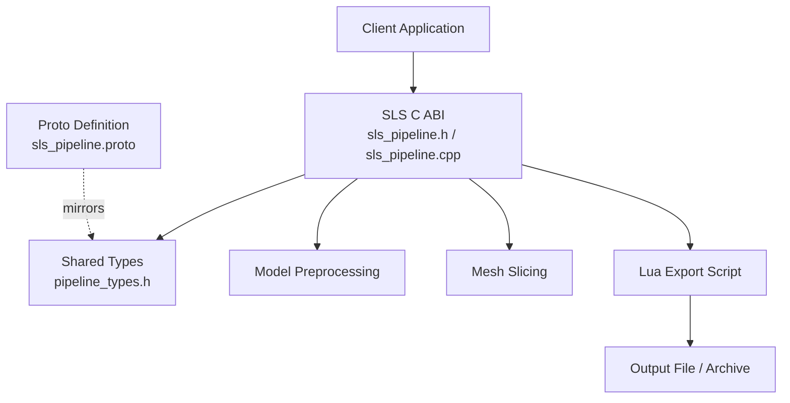
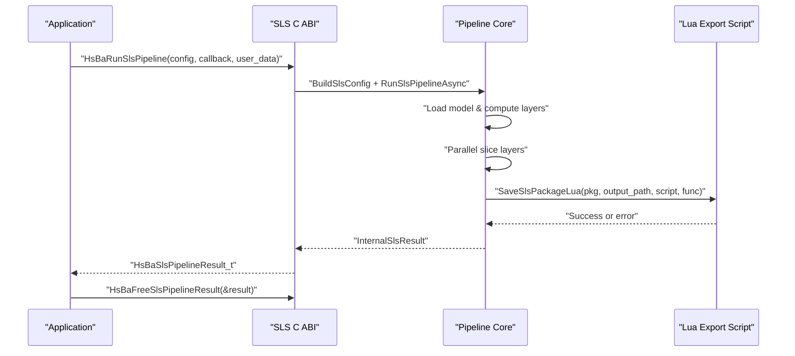
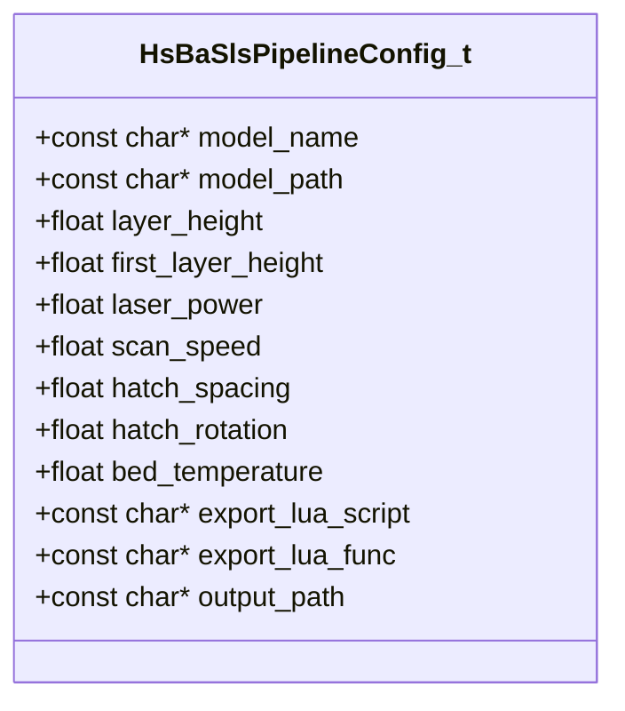
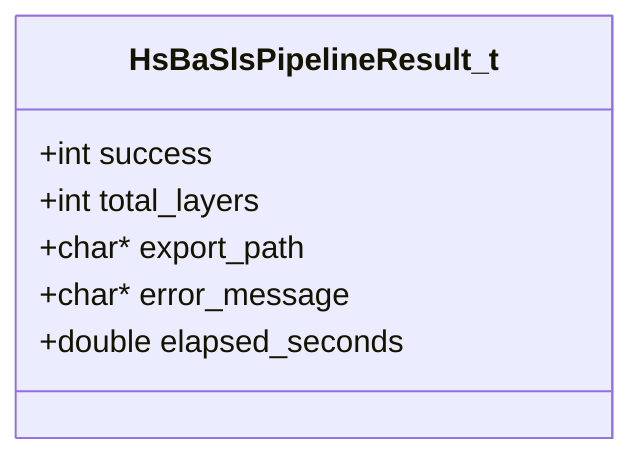
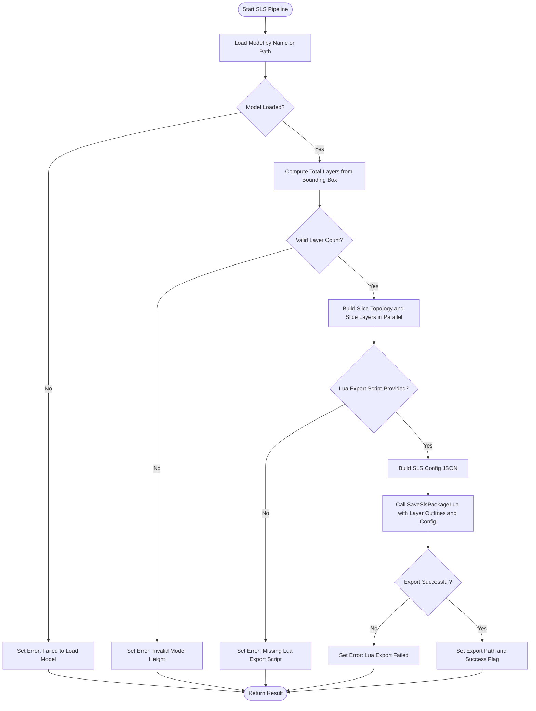
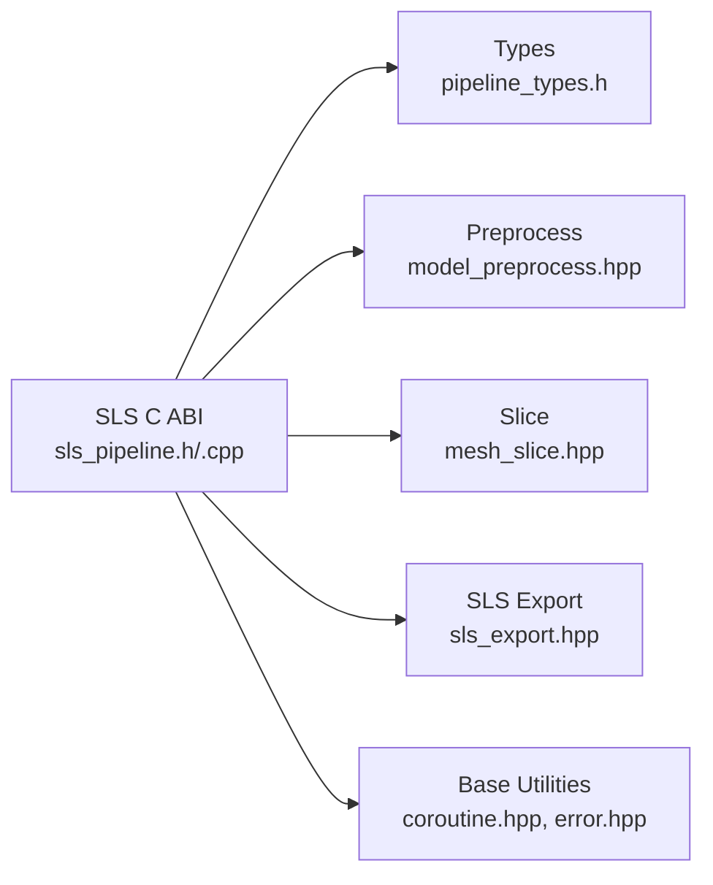

# SLS Pipeline API

<cite>
**Referenced Files in This Document**   
- [sls_pipeline.h](file://DllHsBaSlicer/sls_pipeline.h)
- [sls_pipeline.cpp](file://DllHsBaSlicer/sls_pipeline.cpp)
- [pipeline_types.h](file://pipelinetypes/pipeline_types.h)
- [sls_pipeline.proto](file://proto/sls_pipeline.proto)
- [HsBaSlicer.cpp](file://HsBaSlicer/HsBaSlicer.cpp)
</cite>

## Table of Contents
1. [Introduction](#introduction)
2. [Project Structure](#project-structure)
3. [Core Components](#core-components)
4. [Architecture Overview](#architecture-overview)
5. [Detailed Component Analysis](#detailed-component-analysis)
6. [Dependency Analysis](#dependency-analysis)
7. [Performance Considerations](#performance-considerations)
8. [Troubleshooting Guide](#troubleshooting-guide)
9. [Conclusion](#conclusion)
10. [Appendices](#appendices)

## Introduction
This document provides comprehensive API documentation for the Selective Laser Sintering (SLS) pipeline C ABI exposed by HsBaSlicer. It covers:

- The SLS C ABI functions: `HsBaCreateDefaultSlsConfig()`, `HsBaRunSlsPipeline()`, `HsBaRunSlsPipelineAsync()`, and `HsBaFreeSlsPipelineResult()`.
- The `HsBaSlsPipelineConfig_t` structure, including SLS-specific parameters such as laser power, scan speed, hatch spacing, hatch rotation, and powder bed temperature.
- The SLS workflow: model preprocessing, slicing into layer outlines, and Lua-driven export.
- Usage examples for configuring and running the SLS pipeline synchronously or asynchronously.
- Error handling, memory ownership rules, optimization techniques, and integration patterns for powder-based manufacturing systems.

The SLS pipeline is a powder-bed process where the powder itself provides support and thermal stability; therefore, no raft or support structures are generated. The output format is fully determined by the provided Lua export script.

## Project Structure
The SLS C ABI is implemented in the DllHsBaSlicer module and uses shared type definitions from pipelinetypes. The relevant files are:

- `DllHsBaSlicer/sls_pipeline.h`: Declares the SLS C ABI.
- `DllHsBaSlicer/sls_pipeline.cpp`: Implements the SLS pipeline logic and C ABI wrappers.
- `pipelinetypes/pipeline_types.h`: Defines `HsBaSlsPipelineConfig_t`, `HsBaSlsPipelineResult_t`, and related callback types.
- `proto/sls_pipeline.proto`: Proto3 message definition mirroring the SLS configuration and result.
- `HsBaSlicer/HsBaSlicer.cpp`: Contains an example showing how to configure and run the SLS pipeline.

**Diagram sources**
- [sls_pipeline.h:1-62](file://DllHsBaSlicer/sls_pipeline.h#L1-L62)
- [sls_pipeline.cpp:182-296](file://DllHsBaSlicer/sls_pipeline.cpp#L182-L296)
- [pipeline_types.h:247-310](file://pipelinetypes/pipeline_types.h#L247-L310)
- [sls_pipeline.proto:1-33](file://proto/sls_pipeline.proto#L1-L33)

**Section sources**
- [sls_pipeline.h:1-62](file://DllHsBaSlicer/sls_pipeline.h#L1-L62)
- [sls_pipeline.cpp:1-345](file://DllHsBaSlicer/sls_pipeline.cpp#L1-L345)
- [pipeline_types.h:247-310](file://pipelinetypes/pipeline_types.h#L247-L310)
- [sls_pipeline.proto:1-33](file://proto/sls_pipeline.proto#L1-L33)
- [HsBaSlicer.cpp:158-193](file://HsBaSlicer/HsBaSlicer.cpp#L158-L193)

## Core Components
The SLS C ABI exposes four primary entry points:

| Function | Purpose | Parameters | Return Value | Notes |
|---|---|---|---|---|
| `HsBaCreateDefaultSlsConfig()` | Create a default SLS configuration | None | `HsBaSlsPipelineConfig_t` | Initializes fields with documented defaults; string fields are NULL. |
| `HsBaRunSlsPipeline()` | Run the SLS pipeline synchronously | `config`, `callback`, `user_data` | `HsBaSlsPipelineResult_t` | Blocks until completion. Caller must free result via `HsBaFreeSlsPipelineResult()`. |
| `HsBaRunSlsPipelineAsync()` | Run the SLS pipeline asynchronously | `config`, `callback`, `user_data`, `result_callback`, `result_user_data` | None | Non-blocking; invokes `result_callback` when complete. Caller must free result strings inside the callback. |
| `HsBaFreeSlsPipelineResult()` | Free memory allocated in the result | Pointer to `HsBaSlsPipelineResult_t` | None | Frees `export_path` and `error_message`; safe to call with NULL. |

Key data structures:

- `HsBaSlsPipelineConfig_t`: Configuration for model input, slicing, laser parameters, Lua export, and output path.
- `HsBaSlsPipelineResult_t`: Result containing success flag, total layers, exported path, error message, and elapsed time.
- Callback types:
  - `HsBaSlsProgressCallback(percent, stage, user_data)`
  - `HsBaSlsResultCallback(result, user_data)`

**Section sources**
- [sls_pipeline.h:17-56](file://DllHsBaSlicer/sls_pipeline.h#L17-L56)
- [pipeline_types.h:247-310](file://pipelinetypes/pipeline_types.h#L247-L310)

## Architecture Overview
The SLS pipeline follows a three-stage flow:

1. **Preprocess**: Load the model by name or path and compute bounding box/volume.
2. **Slice**: Build slice topology once and generate layer outlines in parallel.
3. **Export**: Pass layer outlines, Z heights, and a JSON configuration to a Lua export script that produces the final output.

**Diagram sources**
- [sls_pipeline.cpp:182-296](file://DllHsBaSlicer/sls_pipeline.cpp#L182-L296)
- [sls_pipeline.cpp:309-334](file://DllHsBaSlicer/sls_pipeline.cpp#L309-L334)

## Detailed Component Analysis

### SLS Configuration Structure: `HsBaSlsPipelineConfig_t`
The configuration structure defines all inputs required by the SLS pipeline. Fields include:

| Field | Type | Description | Default Behavior |
|---|---|---|---|
| `model_name` | `const char*` | Logical model name used by the model registry. | NULL |
| `model_path` | `const char*` | Path to the model file if not found by name. | NULL |
| `layer_height` | `float` | Layer height in millimeters. | 0.1 mm |
| `first_layer_height` | `float` | First layer height in millimeters. | 0.15 mm |
| `laser_power` | `float` | Laser power in watts. | 30.0 W |
| `scan_speed` | `float` | Scan speed in millimeters per second. | 2000.0 mm/s |
| `hatch_spacing` | `float` | Hatch line spacing in millimeters. | 0.15 mm |
| `hatch_rotation` | `float` | Hatch rotation angle between layers in degrees. | 90.0° |
| `bed_temperature` | `float` | Powder bed temperature in degrees Celsius. | 180.0°C |
| `export_lua_script` | `const char*` | Required Lua export script path. | Must be set by caller |
| `export_lua_func` | `const char*` | Lua function name to invoke for export. | Defaults to `"export_sls"` |
| `output_path` | `const char*` | Output file path. | If NULL, defaults to `<model_name>_sls_output.zip` |

Important notes:

- SLS does not generate floor/raft or support structures because the powder bed acts as both support and thermal mass.
- The Lua export script is mandatory; there is no built-in standard output format for SLS.
- The internal pipeline builds a JSON configuration containing slice settings, laser parameters, hatch settings, and bed temperature, which is passed to the Lua export script.

**Diagram sources**
- [pipeline_types.h:259-283](file://pipelinetypes/pipeline_types.h#L259-L283)

**Section sources**
- [pipeline_types.h:247-283](file://pipelinetypes/pipeline_types.h#L247-L283)
- [sls_pipeline.cpp:125-145](file://DllHsBaSlicer/sls_pipeline.cpp#L125-L145)

### SLS Result Structure: `HsBaSlsPipelineResult_t`
The result structure contains:

| Field | Type | Description |
|---|---|---|
| `success` | `int` | Success flag (0 = false, 1 = true). |
| `total_layers` | `int` | Total number of sliced layers. |
| `export_path` | `char*` | UTF-8 path to the exported output file; caller must free. |
| `error_message` | `char*` | UTF-8 error message; caller must free. |
| `elapsed_seconds` | `double` | Elapsed time in seconds. |

Memory ownership:

- For synchronous calls (`HsBaRunSlsPipeline`), the caller owns the returned result and must call `HsBaFreeSlsPipelineResult()`.
- For asynchronous calls (`HsBaRunSlsPipelineAsync`), the `result_callback` receives a result whose string fields were allocated by the library; the callback is responsible for freeing them using `HsBaFreeSlsPipelineResult()`.

**Diagram sources**
- [pipeline_types.h:290-297](file://pipelinetypes/pipeline_types.h#L290-L297)

**Section sources**
- [pipeline_types.h:285-310](file://pipelinetypes/pipeline_types.h#L285-L310)
- [sls_pipeline.cpp:336-344](file://DllHsBaSlicer/sls_pipeline.cpp#L336-L344)

### API Functions

#### `HsBaCreateDefaultSlsConfig()`
Creates a default SLS configuration. String fields are initialized to NULL, and numeric fields use documented defaults.

Usage pattern:

1. Call `HsBaCreateDefaultSlsConfig()`.
2. Override fields such as `model_name`, `model_path`, `laser_power`, `scan_speed`, `hatch_spacing`, `hatch_rotation`, `bed_temperature`, `export_lua_script`, `export_lua_func`, and `output_path`.

**Section sources**
- [sls_pipeline.h:17-21](file://DllHsBaSlicer/sls_pipeline.h#L17-L21)
- [sls_pipeline.cpp:304-307](file://DllHsBaSlicer/sls_pipeline.cpp#L304-L307)
- [pipeline_types.h:247-283](file://pipelinetypes/pipeline_types.h#L247-L283)

#### `HsBaRunSlsPipeline()`
Runs the full SLS pipeline synchronously. Internally it:

1. Builds an internal configuration from the C config.
2. Invokes the async pipeline implementation.
3. Waits for completion and converts the internal result to the C result structure.

Error conditions include:

- Model loading failure.
- Invalid model height resulting in zero or negative layer count.
- Missing Lua export script.
- Lua export failure.

**Section sources**
- [sls_pipeline.h:23-34](file://DllHsBaSlicer/sls_pipeline.h#L23-L34)
- [sls_pipeline.cpp:309-316](file://DllHsBaSlicer/sls_pipeline.cpp#L309-L316)
- [sls_pipeline.cpp:182-296](file://DllHsBaSlicer/sls_pipeline.cpp#L182-L296)

#### `HsBaRunSlsPipelineAsync()`
Runs the SLS pipeline asynchronously. It:

1. Wraps the internal configuration in a shared pointer.
2. Starts the async task.
3. Registers a continuation that converts the internal result to the C result and invokes the user-provided `result_callback`.

The result callback must free the result strings using `HsBaFreeSlsPipelineResult()`.

**Section sources**
- [sls_pipeline.h:36-47](file://DllHsBaSlicer/sls_pipeline.h#L36-L47)
- [sls_pipeline.cpp:318-334](file://DllHsBaSlicer/sls_pipeline.cpp#L318-L334)

#### `HsBaFreeSlsPipelineResult()`
Frees memory allocated in the SLS pipeline result. It safely handles NULL pointers and frees `export_path` and `error_message`.

**Section sources**
- [sls_pipeline.h:49-56](file://DllHsBaSlicer/sls_pipeline.h#L49-L56)
- [sls_pipeline.cpp:336-344](file://DllHsBaSlicer/sls_pipeline.cpp#L336-L344)

### SLS Workflow Flowchart
The core processing logic can be represented as a flowchart:

**Diagram sources**
- [sls_pipeline.cpp:182-296](file://DllHsBaSlicer/sls_pipeline.cpp#L182-L296)

## Dependency Analysis
The SLS C ABI depends on several internal components:

- Shared type definitions in `pipeline_types.h`.
- Model preprocessing utilities.
- Mesh slicing utilities.
- Lua export utilities for SLS packages.
- Coroutine and error-handling infrastructure.

**Diagram sources**
- [sls_pipeline.cpp:17-23](file://DllHsBaSlicer/sls_pipeline.cpp#L17-L23)
- [pipeline_types.h:247-310](file://pipelinetypes/pipeline_types.h#L247-L310)

**Section sources**
- [sls_pipeline.cpp:17-23](file://DllHsBaSlicer/sls_pipeline.cpp#L17-L23)
- [pipeline_types.h:247-310](file://pipelinetypes/pipeline_types.h#L247-L310)

## Performance Considerations
- **Parallel Slicing**: The pipeline builds the slice topology once and slices layers in parallel using a parallel loop helper. This reduces total slicing time for models with many layers.
- **Layer Count Calculation**: Layer count is derived from the model bounding box and configured layer heights. Incorrect layer height values can lead to invalid layer counts and early failure.
- **Lua Export Bottleneck**: Since SLS has no standard output format, performance may be dominated by the Lua export script. Efficient Lua scripts should minimize file I/O and avoid unnecessary conversions.
- **Memory Ownership**: Always free result strings after use to prevent memory leaks, especially in asynchronous callbacks.

[No sources needed since this section provides general guidance]

## Troubleshooting Guide
Common issues and resolutions:

| Issue | Cause | Resolution |
|---|---|---|
| Model load failure | Invalid model name or path | Verify `model_name` and `model_path`; ensure the model exists and is supported. |
| Invalid model height | Zero or negative model height | Check model geometry and ensure valid mesh data. |
| Missing Lua export script | `export_lua_script` is empty | Provide a valid Lua export script path. |
| Lua export failure | Script error or missing function | Ensure the Lua script exports the expected function (default `"export_sls"`). |
| Memory leak | Not freeing result strings | Call `HsBaFreeSlsPipelineResult()` after using the result. |
| Asynchronous callback not invoked | Null result callback | Provide a non-null `result_callback`. |

Error messages are propagated through `error_message` in the result structure. The pipeline wraps internal errors into a runtime error format and reports them as pipeline errors.

**Section sources**
- [sls_pipeline.cpp:191-296](file://DllHsBaSlicer/sls_pipeline.cpp#L191-L296)
- [sls_pipeline.cpp:336-344](file://DllHsBaSlicer/sls_pipeline.cpp#L336-L344)

## Conclusion
The SLS pipeline C ABI provides a clean interface for configuring and executing powder-bed laser sintering workflows. It separates concerns between model preprocessing, slicing, and Lua-driven export, making it flexible for different machine outputs while maintaining consistent error handling and memory management. Users should focus on providing correct model inputs, appropriate laser and hatch parameters, and robust Lua export scripts tailored to their manufacturing system.

[No sources needed since this section summarizes without analyzing specific files]

## Appendices

### Usage Examples

#### Synchronous Example
A typical synchronous usage pattern:

1. Create a default configuration.
2. Set model name and path.
3. Configure laser and slicing parameters.
4. Set the Lua export script and function.
5. Optionally set the output path.
6. Run the pipeline synchronously.
7. Check success and print results.
8. Free the result.

Reference example location:

**Section sources**
- [HsBaSlicer.cpp:158-193](file://HsBaSlicer/HsBaSlicer.cpp#L158-L193)

#### Asynchronous Example Pattern
For asynchronous execution:

1. Create a default configuration.
2. Set required fields.
3. Define a progress callback.
4. Define a result callback that checks `success`, reads `export_path`, and frees the result.
5. Call `HsBaRunSlsPipelineAsync()`.

[No sources needed since this section describes a conceptual pattern based on existing API behavior]

### SLS-Specific Optimization Techniques
- **Hatch Rotation**: Use layer-dependent hatch rotation to reduce thermal stress and improve part density.
- **Hatch Spacing Tuning**: Adjust hatch spacing based on material sintering characteristics; smaller spacing increases energy density but may slow throughput.
- **Bed Temperature Control**: Maintain stable bed temperature close to the material’s sintering range to reduce warping.
- **Layer Height Trade-offs**: Thinner layers improve surface quality but increase total layers and processing time.
- **Lua Export Efficiency**: Cache repeated computations in Lua, batch file writes, and validate inputs early.

[No sources needed since this section provides general guidance]

### Integration Patterns for Powder-Based Manufacturing Systems
- **Machine Parameter Mapping**: Map `laser_power`, `scan_speed`, `hatch_spacing`, `hatch_rotation`, and `bed_temperature` to machine-specific parameters in the Lua export script.
- **Process Logging**: Use the progress callback to log stages such as model loading, slicing, and export for traceability.
- **Batch Processing**: Queue multiple models and process them concurrently using separate pipeline instances.
- **Post-Processing Hooks**: Extend the Lua export script to include post-processing steps such as database registration, artifact packaging, or telemetry upload.

[No sources needed since this section provides general guidance]