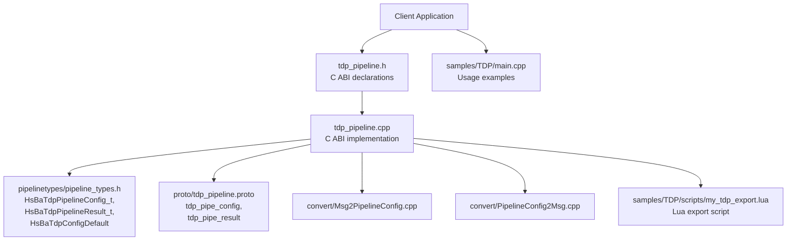
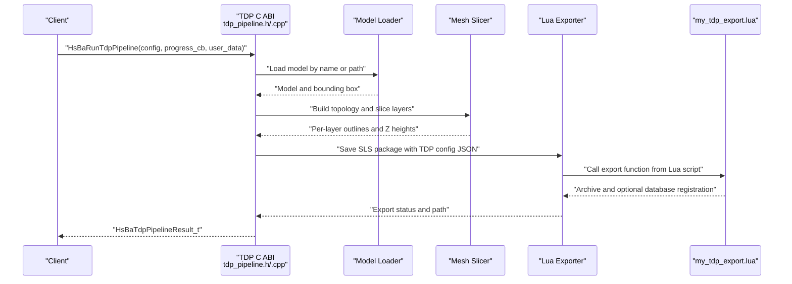
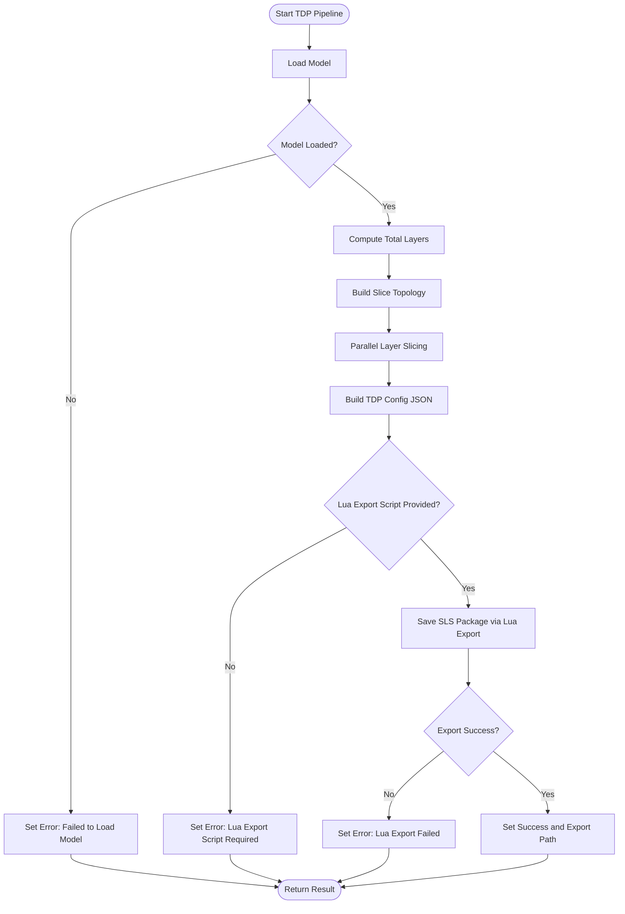
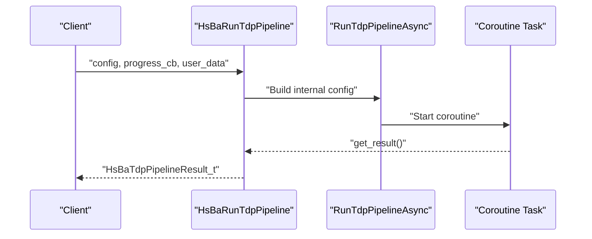
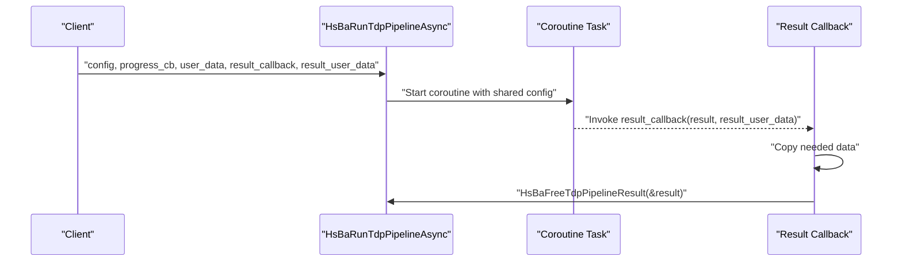
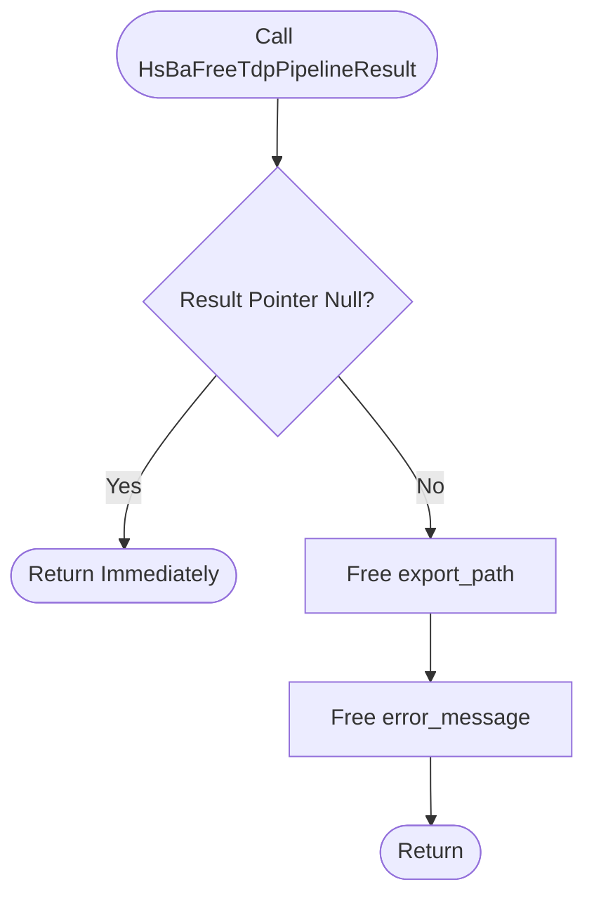
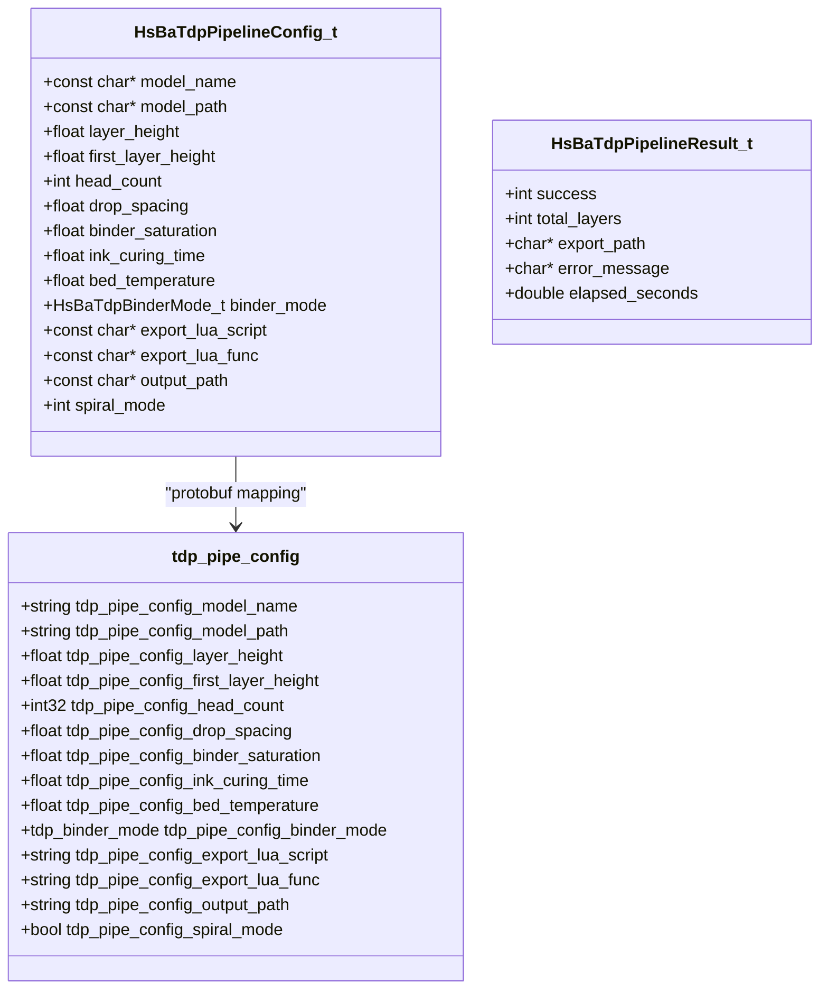
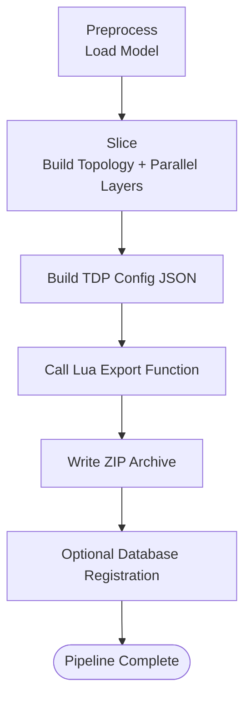
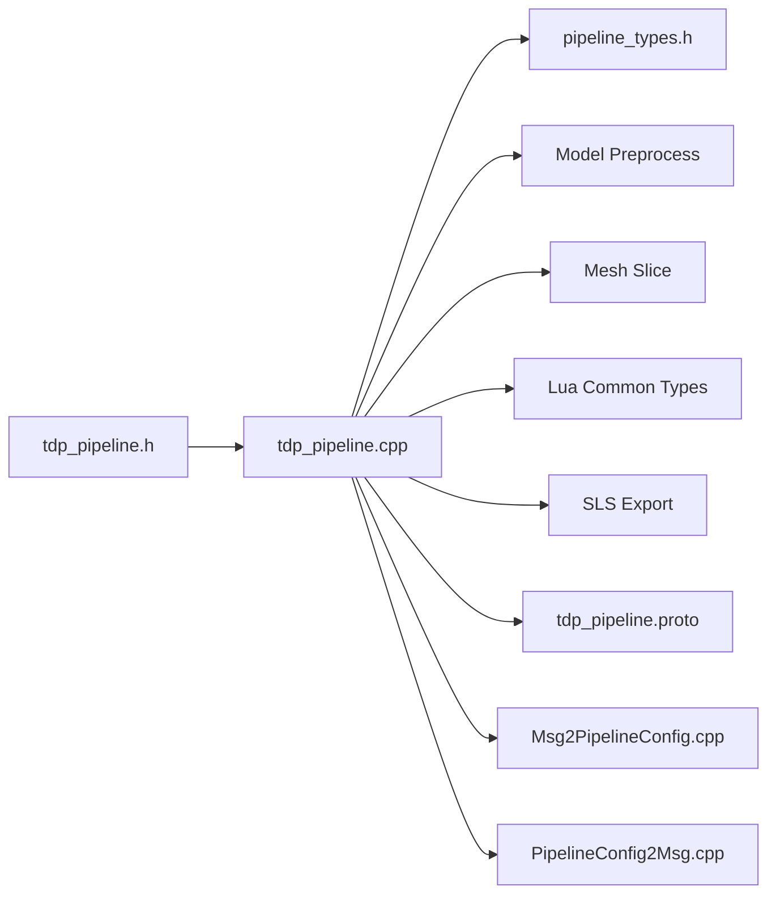
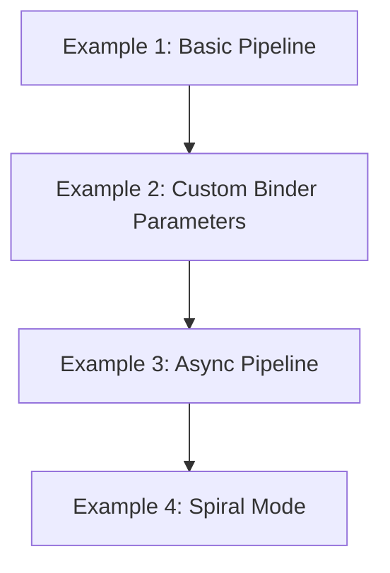

# TDP Pipeline API

<cite>
**Referenced Files in This Document**   
- [tdp_pipeline.h](file://DllHsBaSlicer/tdp_pipeline.h)
- [tdp_pipeline.cpp](file://DllHsBaSlicer/tdp_pipeline.cpp)
- [pipeline_types.h](file://pipelinetypes/pipeline_types.h)
- [tdp_pipeline.proto](file://proto/tdp_pipeline.proto)
- [Msg2PipelineConfig.cpp](file://convert/Msg2PipelineConfig.cpp)
- [PipelineConfig2Msg.cpp](file://convert/PipelineConfig2Msg.cpp)
- [main.cpp](file://samples/TDP/main.cpp)
- [my_tdp_export.lua](file://samples/TDP/scripts/my_tdp_export.lua)
</cite>

## Table of Contents
1. [Introduction](#introduction)
2. [Project Structure](#project-structure)
3. [Core Components](#core-components)
4. [Architecture Overview](#architecture-overview)
5. [Detailed Component Analysis](#detailed-component-analysis)
6. [Dependency Analysis](#dependency-analysis)
7. [Performance Considerations](#performance-considerations)
8. [Troubleshooting Guide](#troubleshooting-guide)
9. [Conclusion](#conclusion)
10. [Appendices](#appendices)

## Introduction
This document provides comprehensive API documentation for the Tape Deposition Process (TDP) pipeline C ABI exposed by HsBaSlicer. In this codebase, the TDP entry points are implemented as the 3DP (Three-Dimensional Printing / binder jetting) pipeline. The C ABI exposes configuration creation, synchronous execution, asynchronous execution, and result cleanup functions, along with a TDP-specific configuration structure and progress/result callbacks.

The TDP workflow is a powder-bed binder-jetting process:
- A CAD model is loaded and sliced into per-layer outlines.
- Binder-jetting parameters such as head count, drop spacing, binder saturation, curing time, bed temperature, and binder mode are passed to a Lua export script.
- The Lua export script packages layer data and configuration into an output archive, typically a ZIP file.

Although the user-facing terminology is “Tape Deposition Process”, the current implementation models binder jetting rather than tape feeding or thermal pressing. Consequently, TDP-specific optimization techniques documented here focus on binder jetting parameters, slicing behavior, and Lua-driven export customization.

## Project Structure
The TDP pipeline C ABI is centered around a small set of header and implementation files, plus shared type definitions and protocol buffers:

- `DllHsBaSlicer/tdp_pipeline.h` declares the public C ABI functions and types.
- `DllHsBaSlicer/tdp_pipeline.cpp` implements the default configuration builder, synchronous and asynchronous pipeline runners, and result cleanup.
- `pipelinetypes/pipeline_types.h` defines the `HsBaTdpPipelineConfig_t`, `HsBaTdpPipelineResult_t`, related enums, and the default initializer `HsBaTdpConfigDefault`.
- `proto/tdp_pipeline.proto` defines the protobuf schema for TDP configuration and results.
- `convert/Msg2PipelineConfig.cpp` and `convert/PipelineConfig2Msg.cpp` convert between C ABI structures and protobuf messages.
- `samples/TDP/main.cpp` demonstrates basic, custom-parameter, async, and spiral-mode usage.
- `samples/TDP/scripts/my_tdp_export.lua` shows how a Lua export script consumes the generated configuration JSON and layer outlines.

**Diagram sources**
- [tdp_pipeline.h:17-56](file://DllHsBaSlicer/tdp_pipeline.h#L17-L56)
- [tdp_pipeline.cpp:324-364](file://DllHsBaSlicer/tdp_pipeline.cpp#L324-L364)
- [pipeline_types.h:903-921](file://pipelinetypes/pipeline_types.h#L903-L921)
- [tdp_pipeline.proto:15-46](file://proto/tdp_pipeline.proto#L15-L46)
- [main.cpp:55-220](file://samples/TDP/main.cpp#L55-L220)
- [my_tdp_export.lua:15-60](file://samples/TDP/scripts/my_tdp_export.lua#L15-L60)

**Section sources**
- [tdp_pipeline.h:1-63](file://DllHsBaSlicer/tdp_pipeline.h#L1-L63)
- [tdp_pipeline.cpp:1-365](file://DllHsBaSlicer/tdp_pipeline.cpp#L1-L365)
- [pipeline_types.h:903-921](file://pipelinetypes/pipeline_types.h#L903-L921)
- [tdp_pipeline.proto:1-47](file://proto/tdp_pipeline.proto#L1-L47)
- [main.cpp:1-225](file://samples/TDP/main.cpp#L1-L225)
- [my_tdp_export.lua:1-63](file://samples/TDP/scripts/my_tdp_export.lua#L1-L63)

## Core Components
The TDP pipeline C ABI consists of four primary functions and one core configuration structure:

| Function | Purpose | Key Behavior |
|---|---|---|
| `HsBaCreateDefaultTdpConfig()` | Creates a default `HsBaTdpPipelineConfig_t` | Returns a fully initialized configuration with default values; string fields are NULL. |
| `HsBaRunTdpPipeline()` | Runs the full TDP pipeline synchronously | Loads the model, slices layers, builds binder-jetting configuration JSON, and exports via a Lua script. Blocks until completion. |
| `HsBaRunTdpPipelineAsync()` | Runs the full TDP pipeline asynchronously | Starts the same pipeline in a coroutine-based task and invokes a result callback when finished. |
| `HsBaFreeTdpPipelineResult()` | Frees memory owned by a `HsBaTdpPipelineResult_t` | Releases exported path and error message strings allocated by the pipeline. |

The core configuration structure is `HsBaTdpPipelineConfig_t`. Its relevant fields include:

| Field | Type | Meaning | Default Value |
|---|---|---|---|
| `model_name` | `const char*` | Model name used by the model loader. | `NULL` |
| `model_path` | `const char*` | File path to the model if not found by name. | `NULL` |
| `layer_height` | `float` | Standard layer height in millimeters. | `0.1f` |
| `first_layer_height` | `float` | First layer height in millimeters. | `0.12f` |
| `head_count` | `int` | Number of print-head nozzles. | `128` |
| `drop_spacing` | `float` | Binder drop spacing in millimeters. | `0.05f` |
| `binder_saturation` | `float` | Binder saturation in the range `[0, 1]`. | `0.6f` |
| `ink_curing_time` | `float` | Per-layer curing time in seconds. | `1.0f` |
| `bed_temperature` | `float` | Powder bed temperature in degrees Celsius. | `40.0f` |
| `binder_mode` | `HsBaTdpBinderMode_t` | Binder-jetting mode. | `HSBA_TDP_SINGLE` |
| `export_lua_script` | `const char*` | Path to the Lua export script. Required. | `NULL` |
| `export_lua_func` | `const char*` | Name of the Lua export function. | Empty string internally. |
| `output_path` | `const char*` | Output archive path. | `NULL` |
| `spiral_mode` | `int` | Enables continuous spiralized deposition path exposure to the export script. | `0` |

The result structure is `HsBaTdpPipelineResult_t`. It contains:

| Field | Type | Meaning |
|---|---|---|
| `success` | `int` | Non-zero indicates success. |
| `total_layers` | `int` | Total number of computed layers. |
| `export_path` | `char*` | Owned path to the exported archive; must be freed through `HsBaFreeTdpPipelineResult`. |
| `error_message` | `char*` | Owned error message; must be freed through `HsBaFreeTdpPipelineResult`. |
| `elapsed_seconds` | `double` | Total elapsed time of the pipeline run. |

**Section sources**
- [tdp_pipeline.h:17-56](file://DllHsBaSlicer/tdp_pipeline.h#L17-L56)
- [pipeline_types.h:903-921](file://pipelinetypes/pipeline_types.h#L903-L921)
- [tdp_pipeline.cpp:324-364](file://DllHsBaSlicer/tdp_pipeline.cpp#L324-L364)

## Architecture Overview
The TDP pipeline follows a three-stage architecture: preprocessing, slicing, and Lua-driven export.

**Diagram sources**
- [tdp_pipeline.cpp:203-316](file://DllHsBaSlicer/tdp_pipeline.cpp#L203-L316)
- [my_tdp_export.lua:15-60](file://samples/TDP/scripts/my_tdp_export.lua#L15-L60)

The pipeline uses coroutines for internal execution, allowing both blocking and non-blocking callers to share the same processing logic. Progress reporting is provided through a callback that receives percentage and stage information.

**Diagram sources**
- [tdp_pipeline.cpp:203-316](file://DllHsBaSlicer/tdp_pipeline.cpp#L203-L316)

**Section sources**
- [tdp_pipeline.cpp:203-316](file://DllHsBaSlicer/tdp_pipeline.cpp#L203-L316)

## Detailed Component Analysis

### HsBaCreateDefaultTdpConfig()
`HsBaCreateDefaultTdpConfig()` returns a default `HsBaTdpPipelineConfig_t`. Internally it delegates to `HsBaTdpConfigDefault()`, which initializes all numeric fields to safe defaults and sets string pointers to `NULL`.

Key responsibilities:
- Provide a zero-string, fully typed starting point for clients.
- Avoid uninitialized memory in exported string fields.
- Allow clients to override only the fields they need.

Recommended usage pattern:
1. Call `HsBaCreateDefaultTdpConfig()`.
2. Set `model_name` and `model_path`.
3. Set `export_lua_script` and optionally `export_lua_func`.
4. Adjust slicing and binder-jetting parameters.
5. Run the pipeline.

**Section sources**
- [tdp_pipeline.h:17-21](file://DllHsBaSlicer/tdp_pipeline.h#L17-L21)
- [tdp_pipeline.cpp:324-327](file://DllHsBaSlicer/tdp_pipeline.cpp#L324-L327)
- [pipeline_types.h:903-921](file://pipelinetypes/pipeline_types.h#L903-L921)

### HsBaRunTdpPipeline()
`HsBaRunTdpPipeline()` runs the complete TDP pipeline synchronously. It converts the C ABI configuration into an internal configuration, starts the coroutine-based runner, waits for completion, and converts the internal result back to the C ABI result structure.

Processing stages:
1. **Preprocessing**: Load the model by name or path and compute bounding-box-derived layer counts.
2. **Slicing**: Build slice topology once and slice each layer independently, using parallel iteration where supported.
3. **Export**: Validate that a Lua export script is provided, build TDP configuration JSON, and call the Lua exporter.

Error handling:
- Missing or invalid model input produces a failure result.
- Invalid model height produces a failure result.
- Missing Lua export script produces a failure result.
- Lua export errors are captured and returned through `error_message`.

Progress reporting:
- The progress callback is invoked at key stages: model loading, slicing, and export completion.

**Diagram sources**
- [tdp_pipeline.cpp:329-336](file://DllHsBaSlicer/tdp_pipeline.cpp#L329-L336)
- [tdp_pipeline.cpp:203-316](file://DllHsBaSlicer/tdp_pipeline.cpp#L203-L316)

**Section sources**
- [tdp_pipeline.h:23-37](file://DllHsBaSlicer/tdp_pipeline.h#L23-L37)
- [tdp_pipeline.cpp:329-336](file://DllHsBaSlicer/tdp_pipeline.cpp#L329-L336)
- [tdp_pipeline.cpp:203-316](file://DllHsBaSlicer/tdp_pipeline.cpp#L203-L316)

### HsBaRunTdpPipelineAsync()
`HsBaRunTdpPipelineAsync()` starts the same pipeline without blocking the caller. It wraps the internal configuration in a shared object so the coroutine can outlive the initial call stack, then attaches a continuation that converts the internal result to the C ABI result and invokes the user-provided result callback.

Important ownership rules:
- The result callback receives a `HsBaTdpPipelineResult_t` whose string fields are heap-allocated by the library.
- The caller should copy needed data before freeing the result.
- The sample code calls `HsBaFreeTdpPipelineResult()` inside the result callback after reading the result.

**Diagram sources**
- [tdp_pipeline.h:39-50](file://DllHsBaSlicer/tdp_pipeline.h#L39-L50)
- [tdp_pipeline.cpp:338-354](file://DllHsBaSlicer/tdp_pipeline.cpp#L338-L354)
- [main.cpp:130-170](file://samples/TDP/main.cpp#L130-L170)

**Section sources**
- [tdp_pipeline.h:39-50](file://DllHsBaSlicer/tdp_pipeline.h#L39-L50)
- [tdp_pipeline.cpp:338-354](file://DllHsBaSlicer/tdp_pipeline.cpp#L338-L354)
- [main.cpp:130-170](file://samples/TDP/main.cpp#L130-L170)

### HsBaFreeTdpPipelineResult()
`HsBaFreeTdpPipelineResult()` releases the owned string fields in a `HsBaTdpPipelineResult_t`. It safely handles a null pointer and clears the pointers after freeing them.

Usage rules:
- Always free the result returned by `HsBaRunTdpPipeline()`.
- For async results, free the result inside the result callback after copying required data.
- Do not manually free `export_path` or `error_message`; use the provided free function.

**Diagram sources**
- [tdp_pipeline.cpp:356-364](file://DllHsBaSlicer/tdp_pipeline.cpp#L356-L364)

**Section sources**
- [tdp_pipeline.h:52-56](file://DllHsBaSlicer/tdp_pipeline.h#L52-L56)
- [tdp_pipeline.cpp:356-364](file://DllHsBaSlicer/tdp_pipeline.cpp#L356-L364)

### HsBaTdpPipelineConfig_t and Related Types
The TDP configuration structure is defined in the shared pipeline types header and mirrored in the protobuf schema. The default initializer sets sensible defaults for binder jetting, while leaving model paths and export scripts unset.

Relevant enum: `HsBaTdpBinderMode_t`. The implementation maps it to human-readable names for the exported configuration JSON:

| Enum Value | Internal Meaning | JSON Mode |
|---|---|---|
| `HSBA_TDP_FULL_COLOR` | Colored binder jets | `"full_color"` |
| `HSBA_TDP_SINGLE` | Single binder channel | `"single"` |
| `HSBA_TDP_SINTERING` | Sintering-assisted binder | `"sintering"` |

Configuration mapping to protobuf:
- `model_name`, `model_path`, `layer_height`, `first_layer_height`, `head_count`, `drop_spacing`, `binder_saturation`, `ink_curing_time`, `bed_temperature`, `binder_mode`, `export_lua_script`, `export_lua_func`, `output_path`, and `spiral_mode` are mapped to corresponding protobuf fields.

**Diagram sources**
- [pipeline_types.h:903-921](file://pipelinetypes/pipeline_types.h#L903-L921)
- [tdp_pipeline.proto:15-37](file://proto/tdp_pipeline.proto#L15-L37)
- [PipelineConfig2Msg.cpp:426-449](file://convert/PipelineConfig2Msg.cpp#L426-L449)

**Section sources**
- [pipeline_types.h:903-921](file://pipelinetypes/pipeline_types.h#L903-L921)
- [tdp_pipeline.proto:8-37](file://proto/tdp_pipeline.proto#L8-L37)
- [PipelineConfig2Msg.cpp:426-449](file://convert/PipelineConfig2Msg.cpp#L426-L449)

### TDP Workflow: Slicing and Lua Export
The TDP pipeline does not implement physical tape feeding, heating, or pressing mechanisms directly. Instead, it models binder jetting and delegates process-specific output generation to a Lua script.

Workflow details:
- **Model loading**: The pipeline tries to resolve the model by name, then falls back to the provided path.
- **Layer calculation**: Total layers are derived from model height, first layer height, and standard layer height.
- **Slicing**: Slice topology is built once; layer slicing is performed in parallel where supported.
- **Configuration JSON**: A JSON configuration is constructed containing slice settings, binder settings, bed temperature, and spiral mode.
- **Lua export**: The pipeline calls a Lua function, typically `export_tdp`, passing layer outlines and configuration.

**Diagram sources**
- [tdp_pipeline.cpp:203-316](file://DllHsBaSlicer/tdp_pipeline.cpp#L203-L316)
- [my_tdp_export.lua:15-60](file://samples/TDP/scripts/my_tdp_export.lua#L15-L60)

**Section sources**
- [tdp_pipeline.cpp:203-316](file://DllHsBaSlicer/tdp_pipeline.cpp#L203-L316)
- [my_tdp_export.lua:1-63](file://samples/TDP/scripts/my_tdp_export.lua#L1-L63)

## Dependency Analysis
The TDP pipeline has clear layered dependencies:

- Public C ABI depends on shared pipeline types.
- Implementation depends on model preprocessing, mesh slicing, Lua common types, and SLS export utilities.
- Configuration and result data are also represented in protobuf for serialization or inter-process communication.

**Diagram sources**
- [tdp_pipeline.h:1-63](file://DllHsBaSlicer/tdp_pipeline.h#L1-L63)
- [tdp_pipeline.cpp:17-23](file://DllHsBaSlicer/tdp_pipeline.cpp#L17-L23)
- [tdp_pipeline.proto:1-47](file://proto/tdp_pipeline.proto#L1-L47)

**Section sources**
- [tdp_pipeline.cpp:17-23](file://DllHsBaSlicer/tdp_pipeline.cpp#L17-L23)
- [tdp_pipeline.proto:1-47](file://proto/tdp_pipeline.proto#L1-L47)

## Performance Considerations
Based on the implementation, performance characteristics are primarily driven by geometry processing and parallel slicing:

- **Model loading and validation**: Errors early if the model cannot be loaded or has invalid height.
- **Topology reuse**: Slice topology is built once and reused across layers.
- **Parallel slicing**: Layer slicing is executed in parallel through a parallel-for helper, reducing total slicing time for large layer counts.
- **Progress updates**: Progress is reported incrementally during slicing, enabling responsive UIs.
- **Elapsed time tracking**: The pipeline records total elapsed time for diagnostics.

Optimization recommendations:
- Use reasonable layer heights to balance resolution and computation cost.
- Prefer models with clean geometry to avoid expensive preprocessing failures.
- Tune `head_count`, `drop_spacing`, and `binder_saturation` according to target printer capabilities.
- Use async execution for long-running jobs in interactive applications.

[No sources needed since this section provides general guidance]

## Troubleshooting Guide
Common issues and their likely causes:

| Symptom | Likely Cause | Resolution |
|---|---|---|
| Pipeline fails with model load error | Invalid `model_name` or `model_path` | Verify model exists and is readable. |
| Pipeline reports invalid model height | Model has zero or negative height | Check model orientation and bounding box. |
| Pipeline fails because Lua export script is missing | `export_lua_script` is empty | Provide a valid Lua export script path. |
| Lua export fails | Export function name incorrect or script error | Verify `export_lua_func` and script contents. |
| Memory leak in client application | Result strings not freed | Call `HsBaFreeTdpPipelineResult()` after using the result. |
| Async result not processed | Result callback not registered or not called | Ensure `result_callback` is non-null and event loop allows completion. |

Memory ownership notes:
- `HsBaRunTdpPipeline()` returns a result owned by the caller; free it after use.
- `HsBaRunTdpPipelineAsync()` delivers a result to the callback; free it inside the callback after copying needed data.
- Never free result strings manually; always use `HsBaFreeTdpPipelineResult()`.

**Section sources**
- [tdp_pipeline.cpp:210-316](file://DllHsBaSlicer/tdp_pipeline.cpp#L210-L316)
- [tdp_pipeline.cpp:356-364](file://DllHsBaSlicer/tdp_pipeline.cpp#L356-L364)
- [main.cpp:68-81](file://samples/TDP/main.cpp#L68-L81)
- [main.cpp:130-170](file://samples/TDP/main.cpp#L130-L170)

## Conclusion
The TDP pipeline C ABI provides a focused interface for binder-jetting-style 3D printing workflows. It abstracts model loading, slicing, and Lua-driven export behind simple synchronous and asynchronous entry points. Clients configure the process through `HsBaTdpPipelineConfig_t`, adjust binder-jetting parameters, and customize output through a Lua export script. While the repository labels this as TDP, the actual implementation models binder jetting rather than tape deposition mechanics; therefore, optimization guidance focuses on slicing quality, binder parameters, and export customization.

[No sources needed since this section summarizes without analyzing specific files]

## Appendices

### Usage Examples Summary
The sample program demonstrates four typical usage patterns:

1. **Basic pipeline**: Minimal configuration with model path and Lua export script.
2. **Custom binder parameters**: Adjust head count, drop spacing, saturation, curing time, bed temperature, and binder mode.
3. **Async pipeline**: Start the pipeline and handle completion through a result callback.
4. **Spiral mode**: Enable continuous spiralized deposition path exposure to the export script.

**Diagram sources**
- [main.cpp:55-220](file://samples/TDP/main.cpp#L55-L220)

**Section sources**
- [main.cpp:55-220](file://samples/TDP/main.cpp#L55-L220)

### TDP-Specific Optimization Techniques
Because the current implementation represents binder jetting rather than tape deposition, the following optimization techniques apply to the available configuration fields:

- **Composite materials**: Tune `binder_saturation` and `ink_curing_time` to control binder penetration and layer bonding strength.
- **Thermal management**: Adjust `bed_temperature` to stabilize powder bed conditions and reduce warping.
- **Quality control**: Reduce `layer_height` for finer detail, increase `head_count` for higher throughput, and tune `drop_spacing` for uniform coverage.
- **Multi-layer strategies**: Use `spiral_mode` when the downstream process benefits from a continuous rising path instead of discrete per-layer outlines.

These techniques should be validated against the target hardware and material specifications, as the pipeline itself does not enforce physical constraints beyond numerical ranges.

[No sources needed since this section provides general guidance]