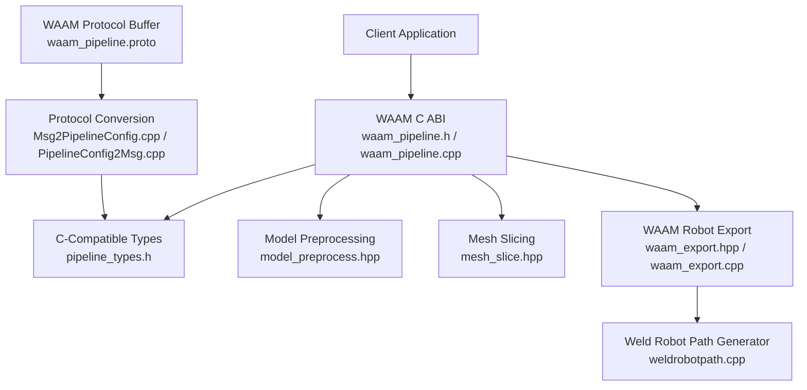
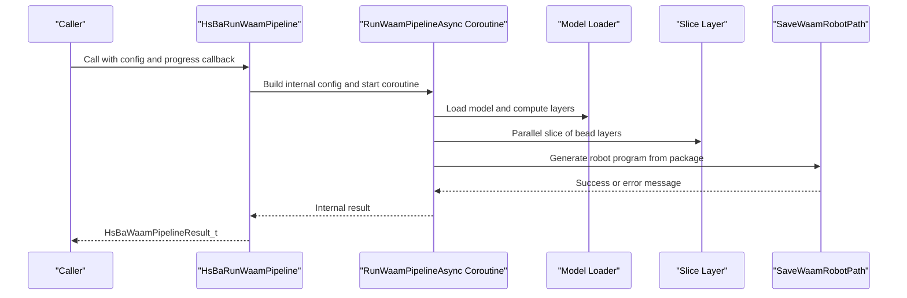
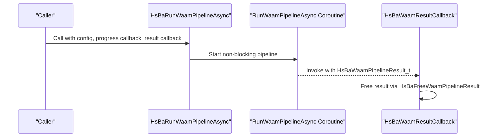
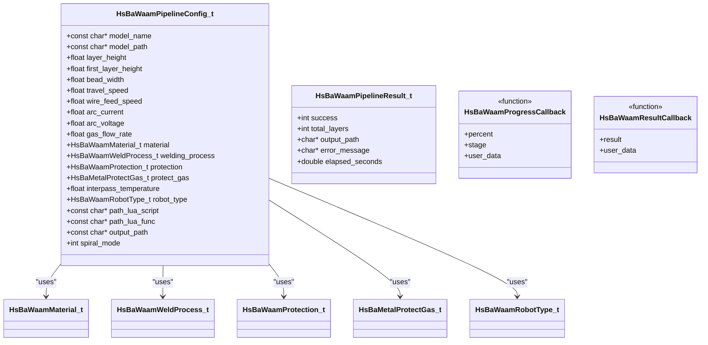
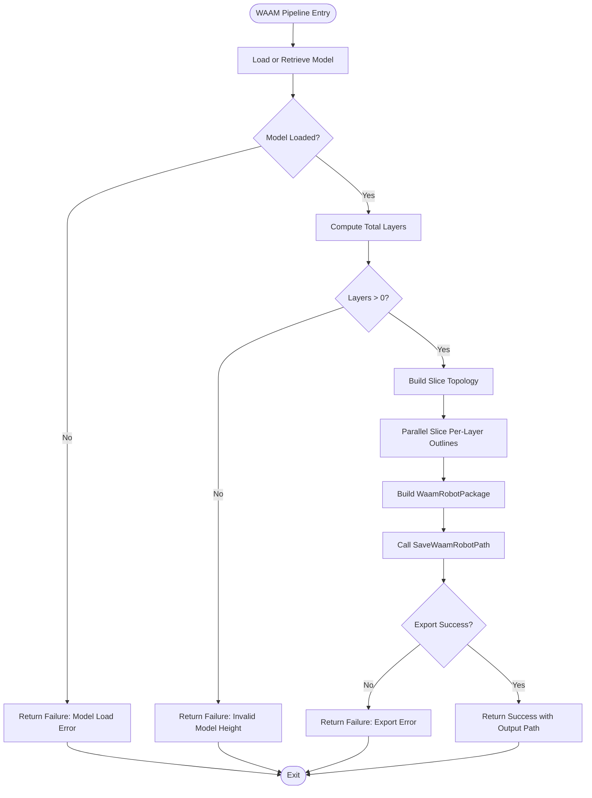
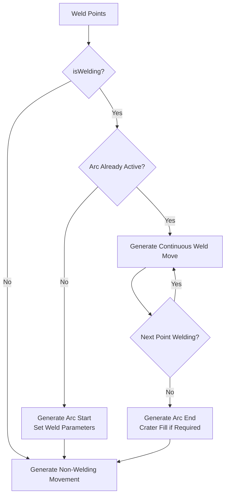
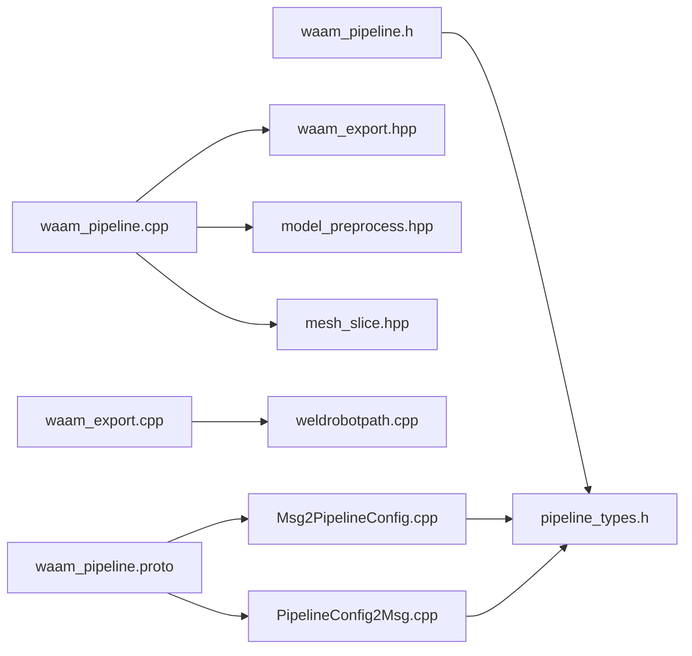

# WAAM Pipeline API

<cite>
**Referenced Files in This Document**   
- [waam_pipeline.h](file://DllHsBaSlicer/waam_pipeline.h)
- [waam_pipeline.cpp](file://DllHsBaSlicer/waam_pipeline.cpp)
- [pipeline_types.h](file://pipelinetypes/pipeline_types.h)
- [waam_export.hpp](file://LibHsBaSlicer/Path/waam_export.hpp)
- [waam_export.cpp](file://LibHsBaSlicer/Path/waam_export.cpp)
- [weldrobotpath.cpp](file://paths/weldrobotpath.cpp)
- [waam_pipeline.proto](file://proto/waam_pipeline.proto)
- [Msg2PipelineConfig.cpp](file://convert/Msg2PipelineConfig.cpp)
- [PipelineConfig2Msg.cpp](file://convert/PipelineConfig2Msg.cpp)
- [main.cpp](file://samples/WAAM/main.cpp)
</cite>

## Table of Contents
1. [Introduction](#introduction)
2. [Project Structure](#project-structure)
3. [Core Components](#core-components)
4. [Architecture Overview](#architecture-overview)
5. [Detailed Component Analysis](#detailed-component-analysis)
6. [Dependency Analysis](#dependency-analysis)
7. [Performance Considerations](#performance-considerations)
8. [Troubleshooting Guide](#troubleshooting-guide)
9. [Conclusion](#conclusion)
10. [Appendices](#appendices)

## Introduction
This document provides comprehensive API documentation for the Wire Arc Additive Manufacturing (WAAM) pipeline C ABI exposed by HsBaSlicer. It covers:

- The four exported C functions: `HsBaCreateDefaultWaamConfig()`, `HsBaRunWaamPipeline()`, `HsBaRunWaamPipelineAsync()`, and `HsBaFreeWaamPipelineResult()`.
- The `HsBaWaamPipelineConfig_t` structure, including WAAM-specific parameters such as welding current, arc voltage, wire feed speed, travel speed, shielding gas flow, material selection, protection method, interpass temperature, robot controller type, optional Lua path generator, spiral mode, and output path.
- The WAAM workflow implemented by the pipeline: model preprocessing, bead-layer slicing, parallel layer processing, and robot-program export.
- Usage examples from the WAAM sample program.
- WAAM-specific considerations for different metals, parameter optimization, and defect prevention techniques.

The WAAM pipeline is distinct from bed-based additive manufacturing pipelines because its output is a robot language program (ABB RAPID, KUKA KRL, or FANUC TP), not a per-layer archive.

## Project Structure
The WAAM C ABI is defined in the DllHsBaSlicer module and uses shared C-compatible types from `pipelinetypes/pipeline_types.h`. The actual pipeline execution delegates to LibHsBaSlicer preprocessing, slicing, and WAAM robot-path export modules.

**Diagram sources**
- [waam_pipeline.h:1-64](file://DllHsBaSlicer/waam_pipeline.h#L1-L64)
- [waam_pipeline.cpp:15-21](file://DllHsBaSlicer/waam_pipeline.cpp#L15-L21)
- [pipeline_types.h:523-625](file://pipelinetypes/pipeline_types.h#L523-L625)
- [waam_export.hpp:1-77](file://LibHsBaSlicer/Path/waam_export.hpp#L1-L77)
- [waam_export.cpp:61-87](file://LibHsBaSlicer/Path/waam_export.cpp#L61-L87)
- [weldrobotpath.cpp:225-354](file://paths/weldrobotpath.cpp#L225-L354)
- [waam_pipeline.proto:1-89](file://proto/waam_pipeline.proto#L1-L89)
- [Msg2PipelineConfig.cpp:354-385](file://convert/Msg2PipelineConfig.cpp#L354-L385)
- [PipelineConfig2Msg.cpp:488-515](file://convert/PipelineConfig2Msg.cpp#L488-L515)

**Section sources**
- [waam_pipeline.h:1-64](file://DllHsBaSlicer/waam_pipeline.h#L1-L64)
- [waam_pipeline.cpp:1-22](file://DllHsBaSlicer/waam_pipeline.cpp#L1-L22)
- [pipeline_types.h:523-625](file://pipelinetypes/pipeline_types.h#L523-L625)

## Core Components
The WAAM C ABI exposes four primary entry points:

| Function | Purpose | Return Value / Behavior |
|---|---|---|
| `HsBaCreateDefaultWaamConfig()` | Creates a default `HsBaWaamPipelineConfig_t` with documented defaults. | Returns a fully initialized configuration struct. |
| `HsBaRunWaamPipeline()` | Runs the full WAAM pipeline synchronously. | Returns `HsBaWaamPipelineResult_t`; caller must free it with `HsBaFreeWaamPipelineResult()`. |
| `HsBaRunWaamPipelineAsync()` | Starts the WAAM pipeline asynchronously without blocking the caller. | Invokes a result callback when complete; the callback receives a result that it must free. |
| `HsBaFreeWaamPipelineResult()` | Frees memory allocated inside a WAAM pipeline result. | Releases `output_path` and `error_message` strings owned by the result. |

The synchronous function internally builds an internal configuration, runs the coroutine-based pipeline, waits for completion, and converts the internal result into the C ABI result. The asynchronous function wraps the same pipeline logic in a task and invokes the user-provided result callback on completion.

**Section sources**
- [waam_pipeline.h:17-57](file://DllHsBaSlicer/waam_pipeline.h#L17-L57)
- [waam_pipeline.cpp:292-332](file://DllHsBaSlicer/waam_pipeline.cpp#L292-L332)

## Architecture Overview
The WAAM pipeline follows a three-stage workflow:

1. **Preprocessing**: Load or retrieve the CAD model and compute bounding-box information.
2. **Slicing**: Build slice topology once and compute per-layer deposition contours in parallel.
3. **Robot Path Export**: Convert layer outlines and welding parameters into a robot language program through `SaveWaamRobotPath`.

**Diagram sources**
- [waam_pipeline.cpp:173-284](file://DllHsBaSlicer/waam_pipeline.cpp#L173-L284)
- [waam_pipeline.cpp:297-304](file://DllHsBaSlicer/waam_pipeline.cpp#L297-L304)
- [waam_export.hpp:54-72](file://LibHsBaSlicer/Path/waam_export.hpp#L54-L72)

The async variant replaces the blocking wait with a continuation that converts the internal result and calls the user’s result callback.

**Diagram sources**
- [waam_pipeline.cpp:306-322](file://DllHsBaSlicer/waam_pipeline.cpp#L306-L322)

## Detailed Component Analysis

### WAAM C ABI Functions

#### `HsBaCreateDefaultWaamConfig()`
Creates a default WAAM configuration. The defaults are defined by `HsBaWaamConfigDefault()` in the shared types header.

Key default values:

| Field | Default Value | Unit / Meaning |
|---|---:|---|
| `layer_height` | 0.8 | mm |
| `first_layer_height` | 1.0 | mm |
| `bead_width` | 1.2 | mm |
| `travel_speed` | 8.0 | mm/s |
| `wire_feed_speed` | 5.0 | m/min |
| `arc_current` | 180.0 | A |
| `arc_voltage` | 22.0 | V |
| `gas_flow_rate` | 15.0 | L/min |
| `material` | `HSBA_WAAM_MATERIAL_STEEL` | Feedstock wire material |
| `welding_process` | `HSBA_WAAM_WELD_ARC` | Arc welding |
| `protection` | `HSBA_WAAM_PROTECTION_SHIELD_GAS` | Shielding gas protection |
| `protect_gas` | `HSBA_METAL_GAS_ARGON` | Argon shielding gas |
| `interpass_temperature` | 100.0 | °C |
| `robot_type` | `HSBA_WAAM_ROBOT_ABB` | ABB RAPID code generation |
| `spiral_mode` | 0 | Disabled |
| `output_path` | NULL | Auto-generated if empty |

**Section sources**
- [waam_pipeline.h:17-21](file://DllHsBaSlicer/waam_pipeline.h#L17-L21)
- [pipeline_types.h:923-951](file://pipelinetypes/pipeline_types.h#L923-L951)

#### `HsBaRunWaamPipeline()`
Runs the WAAM pipeline synchronously. It:

- Builds an internal configuration from the provided C ABI config.
- Executes the coroutine-based pipeline.
- Waits for completion.
- Converts the internal result into `HsBaWaamPipelineResult_t`.

The returned result contains:

| Field | Type | Meaning |
|---|---|---|
| `success` | int | 1 for success, 0 for failure |
| `total_layers` | int | Number of computed WAAM layers |
| `output_path` | char* | Path to generated robot program; caller must free |
| `error_message` | char* | Error text on failure; caller must free |
| `elapsed_seconds` | double | Total pipeline duration |

**Section sources**
- [waam_pipeline.h:23-38](file://DllHsBaSlicer/waam_pipeline.h#L23-L38)
- [waam_pipeline.cpp:297-304](file://DllHsBaSlicer/waam_pipeline.cpp#L297-L304)
- [pipeline_types.h:602-625](file://pipelinetypes/pipeline_types.h#L602-L625)

#### `HsBaRunWaamPipelineAsync()`
Starts the WAAM pipeline without blocking the calling thread. It:

- Copies the internal configuration into a shared object.
- Starts the same coroutine used by the synchronous path.
- Registers a continuation that converts the internal result and invokes `HsBaWaamResultCallback`.

Important ownership rule: the result callback receives a result whose string fields are heap-allocated and must be freed using `HsBaFreeWaamPipelineResult()`.

**Section sources**
- [waam_pipeline.h:40-51](file://DllHsBaSlicer/waam_pipeline.h#L40-L51)
- [waam_pipeline.cpp:306-322](file://DllHsBaSlicer/waam_pipeline.cpp#L306-L322)

#### `HsBaFreeWaamPipelineResult()`
Frees the dynamically allocated strings inside a WAAM pipeline result. It safely handles a null pointer and clears the pointers after freeing.

Usage pattern:

- For synchronous calls: call immediately after reading `success`, `total_layers`, `output_path`, `error_message`, and `elapsed_seconds`.
- For async calls: call inside the result callback before returning.

**Section sources**
- [waam_pipeline.h:53-57](file://DllHsBaSlicer/waam_pipeline.h#L53-L57)
- [waam_pipeline.cpp:324-332](file://DllHsBaSlicer/waam_pipeline.cpp#L324-L332)

### `HsBaWaamPipelineConfig_t` Structure
The WAAM configuration structure defines model input, geometry, welding process, protection, robot target, optional Lua customization, and output behavior.

**Diagram sources**
- [pipeline_types.h:523-625](file://pipelinetypes/pipeline_types.h#L523-L625)

#### Configuration Fields Reference

| Field | Type | Default | Description |
|---|---|---:|---|
| `model_name` | `const char*` | NULL | Logical model name; used for lookup or fallback loading. |
| `model_path` | `const char*` | NULL | File path to the CAD model. |
| `layer_height` | `float` | 0.8 | Bead/layer height in millimeters. |
| `first_layer_height` | `float` | 1.0 | First-layer height in millimeters. |
| `bead_width` | `float` | 1.2 | Deposited bead width in millimeters. |
| `travel_speed` | `float` | 8.0 | Torch travel speed in mm/s. |
| `wire_feed_speed` | `float` | 5.0 | Wire feed speed in m/min. |
| `arc_current` | `float` | 180.0 | Welding current in amperes. |
| `arc_voltage` | `float` | 22.0 | Arc voltage in volts. |
| `gas_flow_rate` | `float` | 15.0 | Shielding gas flow rate in L/min. |
| `material` | `HsBaWaamMaterial_t` | `HSBA_WAAM_MATERIAL_STEEL` | Feedstock wire material. |
| `welding_process` | `HsBaWaamWeldProcess_t` | `HSBA_WAAM_WELD_ARC` | Welding energy source. |
| `protection` | `HsBaWaamProtection_t` | `HSBA_WAAM_PROTECTION_SHIELD_GAS` | Atmosphere protection method. |
| `protect_gas` | `HsBaMetalProtectGas_t` | `HSBA_METAL_GAS_ARGON` | Shielding gas type. |
| `interpass_temperature` | `float` | 100.0 | Interpass temperature in °C. |
| `robot_type` | `HsBaWaamRobotType_t` | `HSBA_WAAM_ROBOT_ABB` | Target robot controller. |
| `path_lua_script` | `const char*` | NULL | Optional custom robot-code generator script. |
| `path_lua_func` | `const char*` | NULL | Optional Lua function name; defaults to `export_waam`. |
| `output_path` | `const char*` | NULL | Output robot program file path. |
| `spiral_mode` | `int` | 0 | Deposit outer walls as one continuous rising bead. |

**Section sources**
- [pipeline_types.h:523-625](file://pipelinetypes/pipeline_types.h#L523-L625)
- [pipeline_types.h:923-951](file://pipelinetypes/pipeline_types.h#L923-L951)

### WAAM Workflow and Processing Logic

#### Preprocessing Stage
The pipeline loads the model either by name or by path. If the model cannot be loaded, the pipeline fails early with an error message. It then retrieves model metadata to compute the number of layers.

Layer count calculation:

- Uses the model bounding box Z range.
- Subtracts the first-layer height.
- Divides remaining height by `layer_height`.
- Adds one for the first layer.

If the model height is invalid or zero, the pipeline returns failure.

#### Slicing Stage
The slicing stage builds slice topology once and computes per-layer bead outlines in parallel. Each layer is independent, allowing efficient parallel execution. Progress reporting maps completed layers to a percentage between 15% and 60%.

#### Robot Path Export Stage
The pipeline constructs a `WaamRobotPackage` containing:

- Per-layer deposition contours.
- Per-layer Z heights.
- Bead width.
- Robot controller type.
- Welding parameters: current, voltage, wire feed speed, gas flow rate, travel speed, and process type.
- Spiral mode flag.

`SaveWaamRobotPath` validates the package, builds base welding parameters, creates a `WeldRobotPath`, and writes brand-specific robot code. When a Lua path script is provided, it post-processes the generated robot code.

**Diagram sources**
- [waam_pipeline.cpp:173-284](file://DllHsBaSlicer/waam_pipeline.cpp#L173-L284)
- [waam_export.cpp:61-87](file://LibHsBaSlicer/Path/waam_export.cpp#L61-L87)

**Section sources**
- [waam_pipeline.cpp:99-121](file://DllHsBaSlicer/waam_pipeline.cpp#L99-L121)
- [waam_pipeline.cpp:181-272](file://DllHsBaSlicer/waam_pipeline.cpp#L181-L272)
- [waam_export.hpp:33-52](file://LibHsBaSlicer/Path/waam_export.hpp#L33-L52)
- [waam_export.cpp:61-87](file://LibHsBaSlicer/Path/waam_export.cpp#L61-L87)

### WAAM-Specific Parameters and Enums

#### Materials
Supported feedstock materials:

| Enum | Meaning |
|---|---|
| `HSBA_WAAM_MATERIAL_STEEL` | Steel wire |
| `HSBA_WAAM_MATERIAL_ALUMINUM` | Aluminum wire |
| `HSBA_WAAM_MATERIAL_TITANIUM` | Titanium wire |
| `HSBA_WAAM_MATERIAL_COPPER` | Copper wire |
| `HSBA_WAAM_MATERIAL_UNKNOWN` | Unspecified material |

#### Welding Process
| Enum | Meaning |
|---|---|
| `HSBA_WAAM_WELD_ARC` | Arc welding |
| `HSBA_WAAM_WELD_LASER` | Laser welding |
| `HSBA_WAAM_WELD_UNKNOWN` | Unspecified process |

#### Protection Method
| Enum | Meaning |
|---|---|
| `HSBA_WAAM_PROTECTION_SHIELD_GAS` | Shielding-gas protection |
| `HSBA_WAAM_PROTECTION_VACUUM` | Vacuum protection |
| `HSBA_WAAM_PROTECTION_UNKNOWN` | Unspecified protection |

#### Shielding Gas
| Enum | Meaning |
|---|---|
| `HSBA_METAL_GAS_ARGON` | Argon |
| `HSBA_METAL_GAS_HELIUM` | Helium |
| `HSBA_METAL_GAS_N2` | Nitrogen |
| `HSBA_METAL_GAS_CO2` | Carbon dioxide |
| `HSBA_METAL_GAS_UNKNOWN` | Unspecified gas |

#### Robot Controller
| Enum | Meaning |
|---|---|
| `HSBA_WAAM_ROBOT_ABB` | ABB RAPID |
| `HSBA_WAAM_ROBOT_KUKA` | KUKA KRL |
| `HSBA_WAAM_ROBOT_FANUC` | FANUC TP |
| `HSBA_WAAM_ROBOT_UNKNOWN` | Requires a Lua path script |

**Section sources**
- [pipeline_types.h:530-571](file://pipelinetypes/pipeline_types.h#L530-L571)
- [waam_pipeline.proto:9-47](file://proto/waam_pipeline.proto#L9-L47)

### Robot Code Generation and Arc Control
The WAAM export builds a `WeldRobotPath` and generates brand-specific robot code. For ABB, the generator emits arc start, continuous welding moves, arc end, and crater-fill behavior. The generated code includes welding parameters such as current, voltage, wire feed speed, and gas flow rate.

**Diagram sources**
- [weldrobotpath.cpp:225-354](file://paths/weldrobotpath.cpp#L225-L354)

**Section sources**
- [weldrobotpath.cpp:225-354](file://paths/weldrobotpath.cpp#L225-L354)
- [waam_export.hpp:17-31](file://LibHsBaSlicer/Path/waam_export.hpp#L17-L31)

### Usage Examples

#### Basic Built-In ABB Pipeline
The basic example initializes a default configuration, sets the model name and path, selects ABB robot code generation, and runs the pipeline synchronously.

Key steps:

1. Call `HsBaCreateDefaultWaamConfig()`.
2. Set `model_name`, `model_path`, `robot_type`, and `output_path`.
3. Call `HsBaRunWaamPipeline()`.
4. Check `result.success`.
5. Log or use `result.total_layers`, `result.output_path`, and `result.elapsed_seconds`.
6. Call `HsBaFreeWaamPipelineResult(&result)`.

**Section sources**
- [main.cpp:54-81](file://samples/WAAM/main.cpp#L54-L81)

#### Custom Welding Parameters with KUKA
The custom example demonstrates aluminum wire, higher current and voltage, increased wire feed speed, higher gas flow, and elevated interpass temperature. It targets KUKA robot code.

Relevant parameter changes:

| Parameter | Example Value |
|---|---:|
| `material` | `HSBA_WAAM_MATERIAL_ALUMINUM` |
| `arc_current` | 220.0 |
| `arc_voltage` | 26.0 |
| `wire_feed_speed` | 8.0 |
| `gas_flow_rate` | 18.0 |
| `interpass_temperature` | 120.0 |
| `robot_type` | `HSBA_WAAM_ROBOT_KUKA` |

**Section sources**
- [main.cpp:86-131](file://samples/WAAM/main.cpp#L86-L131)

#### Async Pipeline with Custom Lua Generator
The async example shows how to provide a custom Lua path generator and receive results through a callback.

Key steps:

1. Initialize default config.
2. Set `path_lua_script` and `path_lua_func`.
3. Call `HsBaRunWaamPipelineAsync()`.
4. In the result callback, check `result.success`.
5. Free the result using `HsBaFreeWaamPipelineResult()`.

**Section sources**
- [main.cpp:136-178](file://samples/WAAM/main.cpp#L136-L178)

#### Spiral Mode
Spiral mode merges the outer walls of all layers into one continuous, Z-rising weld bead. It avoids per-layer travel moves and arc restarts between layers.

Requirements and behavior:

- Enable `spiral_mode = 1`.
- Requires at least one closed contour per layer.
- Falls back to standard per-layer deposition if the requirement is not met.

**Section sources**
- [main.cpp:183-217](file://samples/WAAM/main.cpp#L183-L217)
- [waam_export.hpp:40-52](file://LibHsBaSlicer/Path/waam_export.hpp#L40-L52)

## Dependency Analysis
The WAAM C ABI depends on several internal components and protocol conversion utilities.

**Diagram sources**
- [waam_pipeline.h:9-10](file://DllHsBaSlicer/waam_pipeline.h#L9-L10)
- [waam_pipeline.cpp:16-21](file://DllHsBaSlicer/waam_pipeline.cpp#L16-L21)
- [waam_export.hpp:1-14](file://LibHsBaSlicer/Path/waam_export.hpp#L1-L14)
- [waam_export.cpp:61-87](file://LibHsBaSlicer/Path/waam_export.cpp#L61-L87)
- [weldrobotpath.cpp:225-354](file://paths/weldrobotpath.cpp#L225-L354)
- [Msg2PipelineConfig.cpp:354-385](file://convert/Msg2PipelineConfig.cpp#L354-L385)
- [PipelineConfig2Msg.cpp:488-515](file://convert/PipelineConfig2Msg.cpp#L488-L515)
- [waam_pipeline.proto:1-89](file://proto/waam_pipeline.proto#L1-L89)

**Section sources**
- [waam_pipeline.cpp:16-21](file://DllHsBaSlicer/waam_pipeline.cpp#L16-L21)
- [waam_export.hpp:1-77](file://LibHsBaSlicer/Path/waam_export.hpp#L1-L77)
- [Msg2PipelineConfig.cpp:354-385](file://convert/Msg2PipelineConfig.cpp#L354-L385)
- [PipelineConfig2Msg.cpp:488-515](file://convert/PipelineConfig2Msg.cpp#L488-L515)

## Performance Considerations
The WAAM pipeline implements performance optimizations relevant to large models and multi-layer builds:

- **Single topology build**: Slice topology is built once and reused across all layers.
- **Parallel layer slicing**: Each layer is sliced independently, improving throughput on multi-core systems.
- **Coroutine-based execution**: Both sync and async paths use coroutines, avoiding unnecessary thread management overhead inside the pipeline itself.
- **Progress callbacks**: Progress updates allow UI or monitoring systems to remain responsive during long runs.

Recommended practices:

- Use `HsBaRunWaamPipelineAsync()` in GUI applications to avoid blocking the main thread.
- Provide a meaningful progress callback to report stages such as model loading, slicing, and robot path generation.
- Avoid repeatedly reallocating large model data; reuse model names or preloaded models where possible.
- Tune `layer_height`, `bead_width`, and `travel_speed` based on hardware capabilities to balance quality and runtime.

[No sources needed since this section provides general guidance]

## Troubleshooting Guide

### Common Errors and Causes

| Symptom | Likely Cause | Resolution |
|---|---|---|
| Pipeline fails with model load error | Invalid `model_name` or `model_path` | Verify model registration or file path. |
| Pipeline reports invalid model height | Zero or negative model Z range | Check model bounds and coordinate system. |
| Export fails with no layers | Empty or invalid layer outlines | Validate slicing parameters and model geometry. |
| Export fails with Lua error | Custom Lua path script failed | Inspect `error_message` and validate Lua script path/function. |
| Result strings are not freed | Missing `HsBaFreeWaamPipelineResult()` call | Always free results from sync and async callbacks. |

### Memory Ownership Rules
- `HsBaRunWaamPipeline()` returns a result owned by the caller; free it after use.
- `HsBaRunWaamPipelineAsync()` passes the result to the result callback; the callback owns and must free it.
- `HsBaFreeWaamPipelineResult()` frees `output_path` and `error_message` and clears them.

### Debugging Tips
- Log the progress callback messages to identify which stage fails.
- Compare `total_layers` with expected layer count.
- Inspect `output_path` to confirm robot program generation location.
- Use the built-in robot generators first; only switch to a custom Lua path script when necessary.

**Section sources**
- [waam_pipeline.cpp:181-284](file://DllHsBaSlicer/waam_pipeline.cpp#L181-L284)
- [waam_pipeline.cpp:324-332](file://DllHsBaSlicer/waam_pipeline.cpp#L324-L332)
- [waam_export.cpp:61-75](file://LibHsBaSlicer/Path/waam_export.cpp#L61-L75)

## Conclusion
The WAAM pipeline C ABI provides a clean, C-compatible interface for generating robot programs from CAD models. It separates configuration, execution, and result handling while exposing WAAM-specific parameters for welding current, voltage, wire feed speed, travel speed, shielding gas, material selection, protection method, interpass temperature, and robot controller targeting.

For production use:

- Start with `HsBaCreateDefaultWaamConfig()` and override only required fields.
- Prefer `HsBaRunWaamPipelineAsync()` in interactive applications.
- Validate model inputs and welding parameters before running.
- Use built-in robot generators for ABB, KUKA, and FANUC unless custom behavior is required.
- Always free WAAM pipeline results to prevent memory leaks.

[No sources needed since this section summarizes without analyzing specific files]

## Appendices

### API Summary Table

| API | Input | Output | Notes |
|---|---|---|---|
| `HsBaCreateDefaultWaamConfig()` | None | `HsBaWaamPipelineConfig_t` | Initializes all WAAM defaults. |
| `HsBaRunWaamPipeline()` | Config, progress callback, user data | `HsBaWaamPipelineResult_t` | Blocking execution. |
| `HsBaRunWaamPipelineAsync()` | Config, progress callback, user data, result callback, result user data | None | Non-blocking execution. |
| `HsBaFreeWaamPipelineResult()` | Pointer to result | None | Frees result-owned strings. |

**Section sources**
- [waam_pipeline.h:17-57](file://DllHsBaSlicer/waam_pipeline.h#L17-L57)
- [pipeline_types.h:602-625](file://pipelinetypes/pipeline_types.h#L602-L625)

### Protocol Mapping Reference
The C ABI types map directly to the protobuf definitions used for serialization and cross-language integration.

| C ABI Field | Protobuf Field |
|---|---|
| `model_name` | `waam_pipe_config_model_name` |
| `model_path` | `waam_pipe_config_model_path` |
| `layer_height` | `waam_pipe_config_layer_height` |
| `first_layer_height` | `waam_pipe_config_first_layer_height` |
| `bead_width` | `waam_pipe_config_bead_width` |
| `travel_speed` | `waam_pipe_config_travel_speed` |
| `wire_feed_speed` | `waam_pipe_config_wire_feed_speed` |
| `arc_current` | `waam_pipe_config_arc_current` |
| `arc_voltage` | `waam_pipe_config_arc_voltage` |
| `gas_flow_rate` | `waam_pipe_config_gas_flow_rate` |
| `material` | `waam_pipe_config_material` |
| `welding_process` | `waam_pipe_config_welding_process` |
| `protection` | `waam_pipe_config_protection` |
| `protect_gas` | `waam_pipe_config_protect_gas` |
| `interpass_temperature` | `waam_pipe_config_interpass_temperature` |
| `robot_type` | `waam_pipe_config_robot_type` |
| `path_lua_script` | `waam_pipe_config_path_lua_script` |
| `path_lua_func` | `waam_pipe_config_path_lua_func` |
| `output_path` | `waam_pipe_config_output_path` |
| `spiral_mode` | `waam_pipe_config_spiral_mode` |

**Section sources**
- [waam_pipeline.proto:49-79](file://proto/waam_pipeline.proto#L49-L79)
- [Msg2PipelineConfig.cpp:354-385](file://convert/Msg2PipelineConfig.cpp#L354-L385)
- [PipelineConfig2Msg.cpp:488-515](file://convert/PipelineConfig2Msg.cpp#L488-L515)