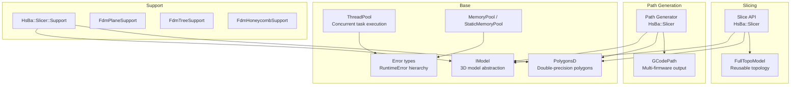
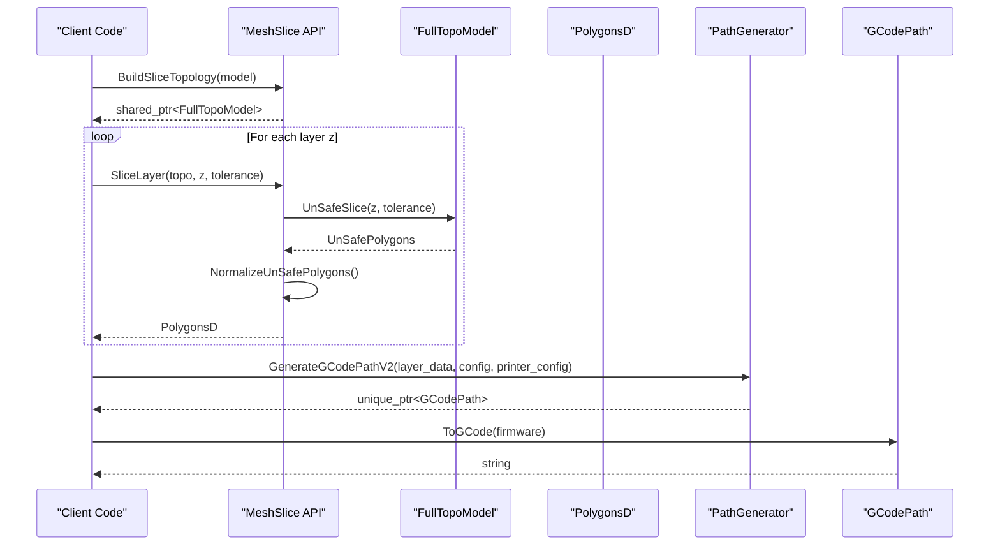
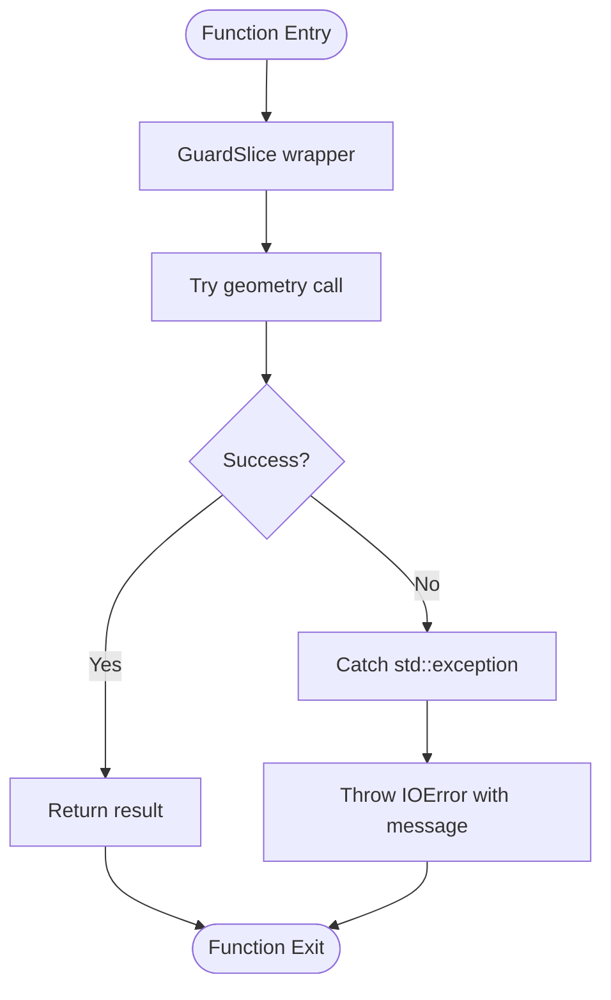
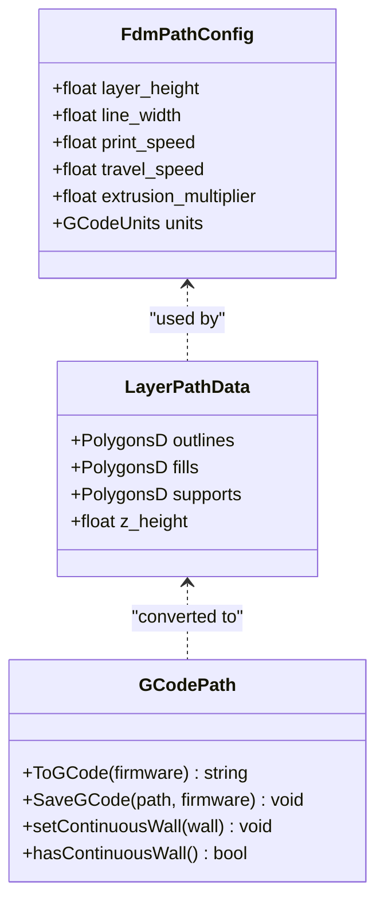
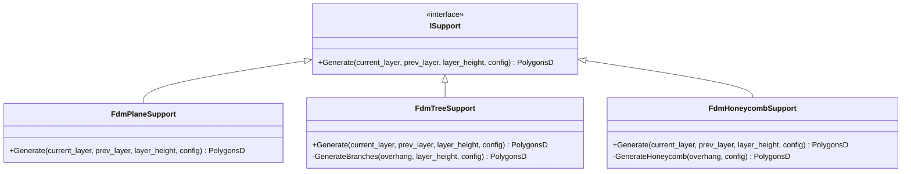
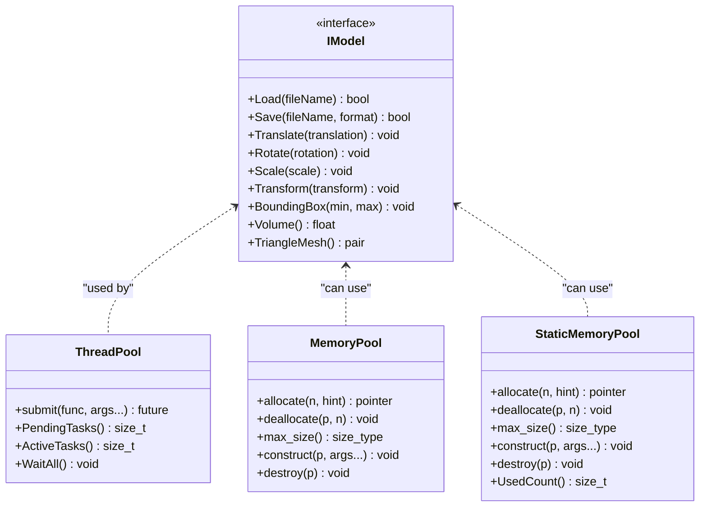
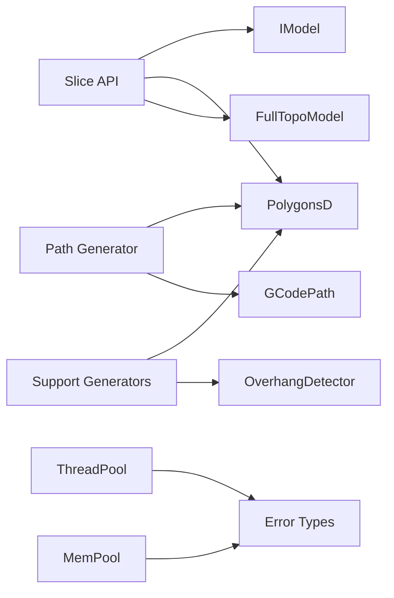
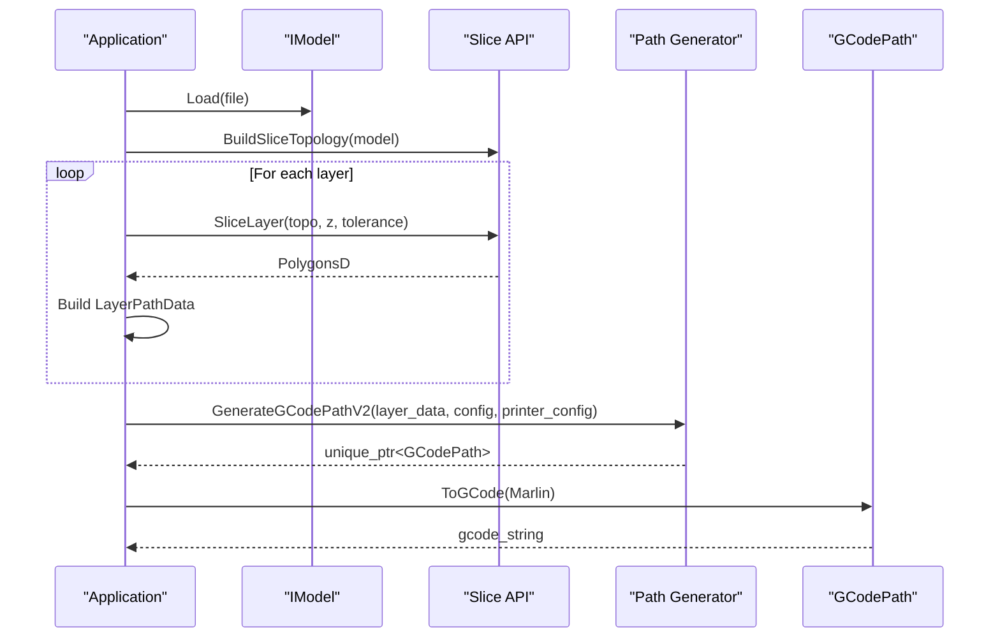

# C++ Library API / C++库API

<cite>
**Referenced Files in This Document**   
- [mesh_slice.hpp](file://LibHsBaSlicer/Slice/mesh_slice.hpp)
- [mesh_slice.cpp](file://LibHsBaSlicer/Slice/mesh_slice.cpp)
- [path_generator.hpp](file://LibHsBaSlicer/Path/path_generator.hpp)
- [path_generator.cpp](file://LibHsBaSlicer/Path/path_generator.cpp)
- [FdmSupport.hpp](file://support/FdmSupport.hpp)
- [FdmSupport.cpp](file://support/FdmSupport.cpp)
- [IModel.hpp](file://base/IModel.hpp)
- [FloatPolygons.hpp](file://2D/FloatPolygons.hpp)
- [gcodepath.hpp](file://paths/gcodepath.hpp)
- [error.hpp](file://base/error.hpp)
- [thread_pool.hpp](file://base/thread_pool.hpp)
- [memory_pool.hpp](file://base/memory_pool.hpp)
</cite>

## Table of Contents
1. [Introduction](#introduction)
2. [Project Structure](#project-structure)
3. [Core Components](#core-components)
4. [Architecture Overview](#architecture-overview)
5. [Detailed Component Analysis](#detailed-component-analysis)
6. [Dependency Analysis](#dependency-analysis)
7. [Performance Considerations](#performance-considerations)
8. [Troubleshooting Guide](#troubleshooting-guide)
9. [Conclusion](#conclusion)
10. [Appendices](#appendices)

## Introduction
This document provides a detailed API reference for the HsBaSlicer C++ library, focusing on slicing, path generation, and FDM support generation. It explains high-level interfaces such as planar mesh slicing, G-code path generation, and FDM support strategies, while documenting RAII-based resource management, exception handling patterns, smart pointer usage, namespace organization, class hierarchies, design patterns, threading models, concurrent access patterns, and resource lifecycle management.

The documentation is grounded in the actual source files:
- Slicing API is exposed through `HsBa::Slicer` functions in the slice module.
- Path generation API is exposed through `HsBa::Slicer` functions and data structures in the path module.
- FDM support generators are exposed through `HsBa::Slicer::Support` classes implementing an `ISupport` interface.
- Error types, thread pool, and memory pools are provided by base utilities under `HsBa::Slicer`.

## Project Structure
The relevant parts of the repository for this API are organized into:
- `LibHsBaSlicer/Slice`: Planar mesh slicing API and reusable topology helpers.
- `LibHsBaSlicer/Path`: FDM G-code path generation, including multi-firmware output and spiral/vase mode.
- `support`: FDM support generator implementations (plane, tree, honeycomb).
- `base`: Core utilities including model abstraction, error types, thread pool, and memory pools.
- `2D`: Double-precision polygon types and boolean operations used across slicing and support generation.
- `paths`: G-code path output types and firmware-specific serialization.

**Diagram sources**
- [mesh_slice.hpp:18-103](file://LibHsBaSlicer/Slice/mesh_slice.hpp#L18-L103)
- [path_generator.hpp:18-91](file://LibHsBaSlicer/Path/path_generator.hpp#L18-L91)
- [FdmSupport.hpp:11-63](file://support/FdmSupport.hpp#L11-L63)
- [IModel.hpp:63-139](file://base/IModel.hpp#L63-L139)
- [FloatPolygons.hpp:16-26](file://2D/FloatPolygons.hpp#L16-L26)
- [gcodepath.hpp:21-107](file://paths/gcodepath.hpp#L21-L107)
- [error.hpp:15-145](file://base/error.hpp#L15-L145)
- [thread_pool.hpp:25-162](file://base/thread_pool.hpp#L25-L162)
- [memory_pool.hpp:19-208](file://base/memory_pool.hpp#L19-L208)

**Section sources**
- [mesh_slice.hpp:1-108](file://LibHsBaSlicer/Slice/mesh_slice.hpp#L1-L108)
- [path_generator.hpp:1-96](file://LibHsBaSlicer/Path/path_generator.hpp#L1-L96)
- [FdmSupport.hpp:1-67](file://support/FdmSupport.hpp#L1-L67)
- [IModel.hpp:1-151](file://base/IModel.hpp#L1-L151)
- [FloatPolygons.hpp:1-271](file://2D/FloatPolygons.hpp#L1-L271)
- [gcodepath.hpp:1-112](file://paths/gcodepath.hpp#L1-L112)
- [error.hpp:1-147](file://base/error.hpp#L1-L147)
- [thread_pool.hpp:1-214](file://base/thread_pool.hpp#L1-L214)
- [memory_pool.hpp:1-375](file://base/memory_pool.hpp#L1-L375)

## Core Components
This section documents the primary public APIs:
- Mesh slicing functions: safe and unsafe slicing, Lua-driven slicing, normalization, reusable topology building, and single-layer slicing.
- Path generation functions: per-layer G-code path generation, multi-firmware output, spiral/vase mode, and helper conversion from polygons to G-points.
- FDM support generators: plane, tree, and honeycomb strategies via a common interface.

Key characteristics:
- All slicing entry points use RAII wrappers that translate external exceptions into project-defined errors.
- Smart pointers (`std::unique_ptr`, `std::shared_ptr`) manage ownership of generated paths and reusable topologies.
- The `HsBa::Slicer` namespace centralizes slicing and path generation; support generators live under `HsBa::Slicer::Support`.
- Data types like `PolygonsD`, `LayerPathData`, `FdmPathConfig`, and `GCodePrinterConfig` define configuration and outputs.

**Section sources**
- [mesh_slice.hpp:22-103](file://LibHsBaSlicer/Slice/mesh_slice.hpp#L22-L103)
- [path_generator.hpp:20-91](file://LibHsBaSlicer/Path/path_generator.hpp#L20-L91)
- [FdmSupport.hpp:13-63](file://support/FdmSupport.hpp#L13-L63)

## Architecture Overview
The slicing pipeline converts a 3D model into 2D layer polygons, which can then be transformed into G-code paths or support structures.

**Diagram sources**
- [mesh_slice.cpp:106-116](file://LibHsBaSlicer/Slice/mesh_slice.cpp#L106-L116)
- [path_generator.cpp:97-118](file://LibHsBaSlicer/Path/path_generator.cpp#L97-L118)
- [gcodepath.hpp:69-82](file://paths/gcodepath.hpp#L69-L82)

## Detailed Component Analysis

### Mesh Slicing API
The mesh slicing API exposes functions to slice a model at a given height, with options for safe vs unsafe slicing, Lua-driven slicing, normalization, and reusable topology construction.

Public API summary:
- `Slice(model, height, tolerance = 0.001)` returns closed-contour polygons.
- `UnSafeSlice(model, height, tolerance = 0.001)` returns polygons including open contours.
- `SliceLua(model, script, height)` returns closed-contour polygons driven by a Lua script.
- `UnSafeSliceLua(model, script, height)` returns polygons including open contours driven by a Lua script.
- `NormalizeUnSafePolygons(unsafe_polys)` filters open polylines and non-simple polygons, converting integer coordinates to double precision.
- `BuildSliceTopology(model)` builds a reusable topology independent of the source model lifetime.
- `SliceLayer(topo, z, tolerance = 0.001)` slices a single layer from a prebuilt topology and normalizes to `PolygonsD`.

RAII and exception handling:
- Each exported function wraps geometry calls in a guard that translates foreign exceptions (e.g., CGAL or OCCT failures) into `IOError`, while passing through project-defined `RuntimeError` subclasses unchanged.
- Reusable topology is returned as `std::shared_ptr<FullTopoModel>` so multiple layers can share the same read-only topology safely.

Concurrency notes:
- `SliceLayer` reads the topology only; concurrent calls sharing the same topology are safe if each writes to its own output container.

**Diagram sources**
- [mesh_slice.cpp:28-43](file://LibHsBaSlicer/Slice/mesh_slice.cpp#L28-L43)

**Section sources**
- [mesh_slice.hpp:22-103](file://LibHsBaSlicer/Slice/mesh_slice.hpp#L22-L103)
- [mesh_slice.cpp:46-116](file://LibHsBaSlicer/Slice/mesh_slice.cpp#L46-L116)

### Path Generation API
The path generation API transforms per-layer polygons into G-code paths, supporting both simple point sequences and multi-firmware output.

Public API summary:
- `FdmPathConfig`: Configuration for layer height, line width, print/travel speeds, extrusion multiplier, and units.
- `LayerPathData`: Per-layer data containing outlines, fills, supports, and Z height.
- `GenerateGCodePath(layer_data, config)` returns `std::unique_ptr<PointsPath>`.
- `GenerateGCodePathV2(layer_data, config, printer_config)` returns `std::unique_ptr<GCodePath>` for multi-firmware output.
- `GenerateGCodePathSpiral(layer_outlines, layer_zs, printer_config)` returns `std::unique_ptr<GCodePath>` for vase/spiral mode.
- `PolygonsToGPoints(polys, z, config, is_extrude)` converts polygons to a sequence of G-points.

Smart pointer usage:
- All path generation functions return `std::unique_ptr`, ensuring clear ownership transfer to the caller.

Spiral/vase mode:
- Spiralization merges outer walls across layers into a continuous helical wall, emitting header + continuous wall + footer without per-layer travel.

**Diagram sources**
- [path_generator.hpp:23-42](file://LibHsBaSlicer/Path/path_generator.hpp#L23-L42)
- [gcodepath.hpp:33-107](file://paths/gcodepath.hpp#L33-L107)

**Section sources**
- [path_generator.hpp:20-91](file://LibHsBaSlicer/Path/path_generator.hpp#L20-L91)
- [path_generator.cpp:14-140](file://LibHsBaSlicer/Path/path_generator.cpp#L14-L140)
- [gcodepath.hpp:24-107](file://paths/gcodepath.hpp#L24-L107)

### FDM Support Generators
FDM support generators implement a common interface to produce support polygons from overhang regions.

Class hierarchy:
- `ISupport` defines the virtual `Generate(current_layer, prev_layer, layer_height, config)` method.
- `FdmPlaneSupport`: Generates column supports from overhang regions using gap and diameter inflation.
- `FdmTreeSupport`: Generates tree-like branching supports by placing circular branch tips within overhang regions.
- `FdmHoneycombSupport`: Fills overhang regions with hexagonal honeycomb cells.

Design pattern:
- Strategy pattern via `ISupport` allows swapping support algorithms without changing calling code.

Configuration:
- `SupportConfig` controls overhang angle threshold, support gap, support diameter, and honeycomb cell size.

**Diagram sources**
- [FdmSupport.hpp:13-63](file://support/FdmSupport.hpp#L13-L63)

**Section sources**
- [FdmSupport.hpp:13-63](file://support/FdmSupport.hpp#L13-L63)
- [FdmSupport.cpp:48-267](file://support/FdmSupport.cpp#L48-L267)

### Base Utilities: Model Abstraction, Polygons, Errors, Threading, Memory Pools
- `IModel`: Abstract interface for 3D models, providing load/save, transformations, bounding box, volume, and triangle mesh extraction.
- `PolygonsD`: Double-precision polygon type aliasing Clipper2 types, with boolean operations, area calculation, shape generators, and integer/double conversions.
- Error types: A hierarchy of exceptions derived from `std::runtime_error`, including `RuntimeError`, `InvalidArgumentError`, `IOError`, `OutOfMemoryError`, etc.
- `ThreadPool`: Thread pool with task submission, waiting, and optional coroutine executor integration.
- `MemoryPool` and `StaticMemoryPool`: Custom allocators for fixed-size memory pools, thread-safe allocation/deallocation, and element construction/destruction.

**Diagram sources**
- [IModel.hpp:111-139](file://base/IModel.hpp#L111-L139)
- [thread_pool.hpp:29-162](file://base/thread_pool.hpp#L29-L162)
- [memory_pool.hpp:44-208](file://base/memory_pool.hpp#L44-L208)
- [memory_pool.hpp:215-372](file://base/memory_pool.hpp#L215-L372)

**Section sources**
- [IModel.hpp:63-139](file://base/IModel.hpp#L63-L139)
- [FloatPolygons.hpp:16-26](file://2D/FloatPolygons.hpp#L16-L26)
- [error.hpp:15-145](file://base/error.hpp#L15-L145)
- [thread_pool.hpp:25-162](file://base/thread_pool.hpp#L25-L162)
- [memory_pool.hpp:19-208](file://base/memory_pool.hpp#L19-L208)
- [memory_pool.hpp:215-372](file://base/memory_pool.hpp#L215-L372)

## Dependency Analysis
The following diagram shows how core components depend on each other:

**Diagram sources**
- [mesh_slice.hpp:18-103](file://LibHsBaSlicer/Slice/mesh_slice.hpp#L18-L103)
- [path_generator.hpp:18-91](file://LibHsBaSlicer/Path/path_generator.hpp#L18-L91)
- [FdmSupport.hpp:11-63](file://support/FdmSupport.hpp#L11-L63)
- [error.hpp:15-145](file://base/error.hpp#L15-L145)

**Section sources**
- [mesh_slice.hpp:18-103](file://LibHsBaSlicer/Slice/mesh_slice.hpp#L18-L103)
- [path_generator.hpp:18-91](file://LibHsBaSlicer/Path/path_generator.hpp#L18-L91)
- [FdmSupport.hpp:11-63](file://support/FdmSupport.hpp#L11-L63)
- [error.hpp:15-145](file://base/error.hpp#L15-L145)

## Performance Considerations
- Use `BuildSliceTopology` once and reuse it with `SliceLayer` to avoid rebuilding topology per layer.
- Prefer `GenerateGCodePathV2` for multi-firmware output when you need structured layer data rather than raw point sequences.
- For vase/spiral mode, use `GenerateGCodePathSpiral` to generate a continuous wall without per-layer travel overhead.
- Use `ThreadPool` to parallelize independent layer processing; ensure each thread writes to its own output container.
- Consider `MemoryPool` or `StaticMemoryPool` for high-frequency allocations in tight loops to reduce heap churn.

[No sources needed since this section provides general guidance]

## Troubleshooting Guide
Common issues and strategies:
- Geometry kernel failures (CGAL/OCCT) are translated to `IOError`; catch `IOError` around slicing calls to handle external failures gracefully.
- Invalid arguments (e.g., zero thread count) throw `InvalidArgumentError`; validate inputs before constructing `ThreadPool`.
- Out-of-memory conditions may arise from large polygon sets; monitor memory usage and consider reducing polygon complexity or using memory pools.
- Concurrency issues: Do not share mutable containers across threads; use separate outputs per thread or synchronize access.

Recommended error handling pattern:
- Wrap slicing and path generation calls in try-catch blocks catching `RuntimeError` subclasses.
- Log error messages from `what()` and decide whether to retry, skip, or abort the pipeline.

**Section sources**
- [mesh_slice.cpp:28-43](file://LibHsBaSlicer/Slice/mesh_slice.cpp#L28-L43)
- [thread_pool.hpp:37-41](file://base/thread_pool.hpp#L37-L41)
- [error.hpp:15-145](file://base/error.hpp#L15-L145)

## Conclusion
The HsBaSlicer C++ library provides a robust, RAII-friendly API for slicing, path generation, and FDM support. Its design emphasizes clear ownership via smart pointers, consistent error handling through a unified exception hierarchy, and extensibility via strategy patterns. By leveraging reusable topologies, multi-firmware path generation, and thread pools, users can build efficient and reliable 3D printing pipelines.

[No sources needed since this section summarizes without analyzing specific files]

## Appendices

### Typical Workflow Example
A typical workflow involves:
1. Loading a model via `IModel`.
2. Building a reusable topology with `BuildSliceTopology`.
3. Iterating over layer heights and calling `SliceLayer`.
4. Collecting `LayerPathData` and generating G-code via `GenerateGCodePathV2`.
5. Serializing to G-code strings or files using `GCodePath::ToGCode` or `SaveGCode`.

**Diagram sources**
- [mesh_slice.cpp:106-116](file://LibHsBaSlicer/Slice/mesh_slice.cpp#L106-L116)
- [path_generator.cpp:97-118](file://LibHsBaSlicer/Path/path_generator.cpp#L97-L118)
- [gcodepath.hpp:74-82](file://paths/gcodepath.hpp#L74-L82)

### Best Practices for Memory Management
- Prefer `std::unique_ptr` for exclusive ownership of generated paths.
- Use `std::shared_ptr` for shared resources like reusable topologies.
- Avoid raw pointers in public APIs; expose smart pointers or value types.
- Use memory pools for temporary allocations in performance-critical sections.

**Section sources**
- [path_generator.hpp:50-62](file://LibHsBaSlicer/Path/path_generator.hpp#L50-L62)
- [mesh_slice.hpp:89-103](file://LibHsBaSlicer/Slice/mesh_slice.hpp#L89-L103)
- [memory_pool.hpp:44-208](file://base/memory_pool.hpp#L44-L208)