# C++ Library API

<cite>
**Referenced Files in This Document**
- [export.h](file://LibHsBaSlicer/export.h)
- [IModel.hpp](file://base/IModel.hpp)
- [model_preprocess.hpp](file://LibHsBaSlicer/Preprocess/model_preprocess.hpp)
- [mesh_slice.hpp](file://LibHsBaSlicer/Slice/mesh_slice.hpp)
- [polygon_fill.hpp](file://LibHsBaSlicer/Fill/polygon_fill.hpp)
- [path_generator.hpp](file://LibHsBaSlicer/Path/path_generator.hpp)
- [gcodepath.hpp](file://paths/gcodepath.hpp)
- [spiral_path.hpp](file://LibHsBaSlicer/Path/spiral_path.hpp)
- [robotpath.hpp](file://paths/robotpath.hpp)
- [fdm_support.hpp](file://LibHsBaSlicer/Support/fdm_support.hpp)
- [sla_floor.hpp](file://LibHsBaSlicer/Floor/sla_floor.hpp)
- [sls_export.hpp](file://LibHsBaSlicer/Path/sls_export.hpp)
- [waam_export.hpp](file://LibHsBaSlicer/Path/waam_export.hpp)
- [param_store_ops.hpp](file://LibHsBaSlicer/ParamStore/param_store_ops.hpp)
- [file_transfer.hpp](file://LibHsBaSlicer/Transfer/file_transfer.hpp)
- [path_optimizer.hpp](file://LibHsBaSlicer/Path/path_optimizer.hpp)
- [SupportConfig.hpp](file://support/SupportConfig.hpp)
</cite>

## Table of Contents
1. [Introduction](#introduction)
2. [Project Structure](#project-structure)
3. [Core Components](#core-components)
4. [Architecture Overview](#architecture-overview)
5. [Detailed Component Analysis](#detailed-component-analysis)
6. [Dependency Analysis](#dependency-analysis)
7. [Performance Considerations](#performance-considerations)
8. [Troubleshooting Guide](#troubleshooting-guide)
9. [Conclusion](#conclusion)
10. [Appendices](#appendices)

## Introduction
This document describes the LibHsBaSlicer C++ library API for 3D model slicing, path generation, support generation, polygon fill algorithms, and utility functions. It focuses on:
- Mesh processing APIs (model preprocessing, planar slicing).
- Path generation APIs (G-code generation, robot paths, spiralized walls).
- Support generation APIs (FDM and SLA supports).
- Polygon fill algorithms and region-based path optimization.
- Utility functions (parameter store, file transfer, version info).

The documentation provides method signatures, parameters, return values, exception handling, usage patterns, object lifetimes, resource cleanup, threading considerations, memory management, and integration notes with external libraries.

## Project Structure
LibHsBaSlicer exposes a stable C++ API surface organized by feature:
- Preprocess: model loading, transforms, boolean/thick-solid operations.
- Slice: planar mesh slicing and reusable topology.
- Fill: polygon fill modes and Lua custom fills.
- Path: G-code generation, spiralized walls, robot path export, SLS/WAAM exports.
- Support: FDM and SLA support generation.
- Floor: SLA floor/raft generation and image rendering.
- ParamStore: wide-table parameter persistence.
- Transfer: remote file transfer utilities.

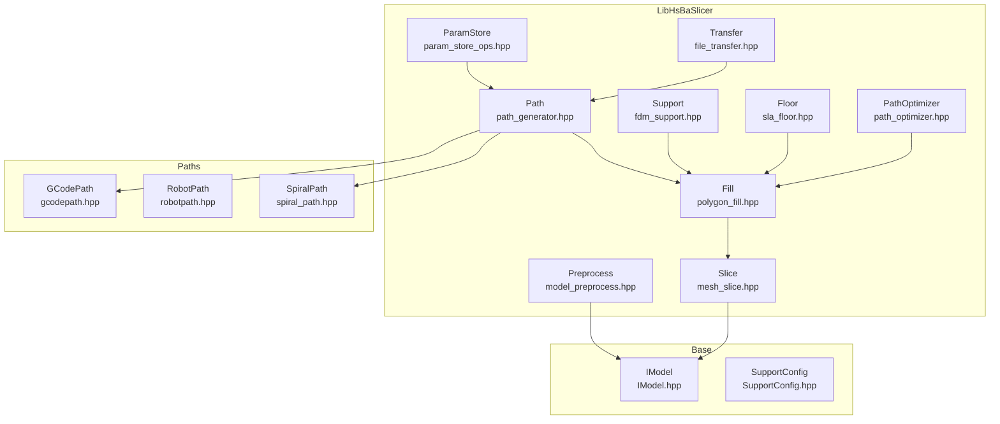

**Diagram sources**
- [model_preprocess.hpp:1-192](file://LibHsBaSlicer/Preprocess/model_preprocess.hpp#L1-L192)
- [mesh_slice.hpp:1-108](file://LibHsBaSlicer/Slice/mesh_slice.hpp#L1-L108)
- [polygon_fill.hpp:1-58](file://LibHsBaSlicer/Fill/polygon_fill.hpp#L1-L58)
- [path_generator.hpp:1-96](file://LibHsBaSlicer/Path/path_generator.hpp#L1-L96)
- [fdm_support.hpp:1-72](file://LibHsBaSlicer/Support/fdm_support.hpp#L1-L72)
- [sla_floor.hpp:1-200](file://LibHsBaSlicer/Floor/sla_floor.hpp#L1-L200)
- [param_store_ops.hpp:1-94](file://LibHsBaSlicer/ParamStore/param_store_ops.hpp#L1-L94)
- [file_transfer.hpp:1-65](file://LibHsBaSlicer/Transfer/file_transfer.hpp#L1-L65)
- [path_optimizer.hpp:1-191](file://LibHsBaSlicer/Path/path_optimizer.hpp#L1-L191)
- [gcodepath.hpp:1-112](file://paths/gcodepath.hpp#L1-L112)
- [robotpath.hpp:1-108](file://paths/robotpath.hpp#L1-L108)
- [spiral_path.hpp:1-63](file://LibHsBaSlicer/Path/spiral_path.hpp#L1-L63)
- [IModel.hpp:1-151](file://base/IModel.hpp#L1-L151)
- [SupportConfig.hpp:1-47](file://support/SupportConfig.hpp#L1-L47)

**Section sources**
- [export.h:1-22](file://LibHsBaSlicer/export.h#L1-L22)
- [model_preprocess.hpp:1-192](file://LibHsBaSlicer/Preprocess/model_preprocess.hpp#L1-L192)
- [mesh_slice.hpp:1-108](file://LibHsBaSlicer/Slice/mesh_slice.hpp#L1-L108)
- [polygon_fill.hpp:1-58](file://LibHsBaSlicer/Fill/polygon_fill.hpp#L1-L58)
- [path_generator.hpp:1-96](file://LibHsBaSlicer/Path/path_generator.hpp#L1-L96)
- [gcodepath.hpp:1-112](file://paths/gcodepath.hpp#L1-L112)
- [spiral_path.hpp:1-63](file://LibHsBaSlicer/Path/spiral_path.hpp#L1-L63)
- [robotpath.hpp:1-108](file://paths/robotpath.hpp#L1-L108)
- [fdm_support.hpp:1-72](file://LibHsBaSlicer/Support/fdm_support.hpp#L1-L72)
- [sla_floor.hpp:1-200](file://LibHsBaSlicer/Floor/sla_floor.hpp#L1-L200)
- [sls_export.hpp:1-61](file://LibHsBaSlicer/Path/sls_export.hpp#L1-L61)
- [waam_export.hpp:1-77](file://LibHsBaSlicer/Path/waam_export.hpp#L1-L77)
- [param_store_ops.hpp:1-94](file://LibHsBaSlicer/ParamStore/param_store_ops.hpp#L1-L94)
- [file_transfer.hpp:1-65](file://LibHsBaSlicer/Transfer/file_transfer.hpp#L1-L65)
- [path_optimizer.hpp:1-191](file://LibHsBaSlicer/Path/path_optimizer.hpp#L1-L191)
- [IModel.hpp:1-151](file://base/IModel.hpp#L1-L151)
- [SupportConfig.hpp:1-47](file://support/SupportConfig.hpp#L1-L47)

## Core Components
This section summarizes the primary API classes and free functions exposed by LibHsBaSlicer.

- Model preprocessing
  - LoadModel, GetModel, InsertModel, RemoveModel, ContainsModel, ModelCount, CleanupModels, TranslateModel, RotateModel, ScaleModel, GetModelInfo.
  - Advanced boolean/thick-solid operations under USE_CGAL.
- Planar slicing
  - Slice, UnSafeSlice, SliceLua, UnSafeSliceLua, NormalizeUnSafePolygons, BuildSliceTopology, SliceLayer.
- Polygon fill
  - FillPolygon, FillWithBorder, LuaCustomFillByFile.
- Path generation
  - GenerateGCodePath, GenerateGCodePathV2, GenerateGCodePathSpiral, PolygonsToGPoints.
  - GCodePath class for multi-firmware output; SpiralizeOuterWall for continuous helical walls.
- Robot path export
  - RobotPath class for ABB/KUKA/FANUC programs; WAAM export via SaveWaamRobotPath.
- Support generation
  - GenerateFdmSupport, GenerateAllFdmSupport, GenerateAllSlaSupport, GenerateAllLuaSupport.
- SLA floor and package export
  - GenerateFloorContact/Raft/Border/Fill, LuaCustomFloorByFile/String, RenderPolygonsToImage/Buffer, SaveSlaPackage/Lua.
- Utilities
  - Parameter store: SavePipelineParams, LoadPipelineParams, FreeLoadedConfigStrings.
  - File transfer: TransferFiles with progress callback.
  - Region path optimizer: RegionPathOptimizer and Lua helpers.

**Section sources**
- [model_preprocess.hpp:22-120](file://LibHsBaSlicer/Preprocess/model_preprocess.hpp#L22-L120)
- [mesh_slice.hpp:22-103](file://LibHsBaSlicer/Slice/mesh_slice.hpp#L22-L103)
- [polygon_fill.hpp:17-53](file://LibHsBaSlicer/Fill/polygon_fill.hpp#L17-L53)
- [path_generator.hpp:20-91](file://LibHsBaSlicer/Path/path_generator.hpp#L20-L91)
- [gcodepath.hpp:24-107](file://paths/gcodepath.hpp#L24-L107)
- [spiral_path.hpp:16-58](file://LibHsBaSlicer/Path/spiral_path.hpp#L16-L58)
- [robotpath.hpp:15-104](file://paths/robotpath.hpp#L15-L104)
- [fdm_support.hpp:19-67](file://LibHsBaSlicer/Support/fdm_support.hpp#L19-L67)
- [sla_floor.hpp:21-195](file://LibHsBaSlicer/Floor/sla_floor.hpp#L21-L195)
- [sls_export.hpp:17-56](file://LibHsBaSlicer/Path/sls_export.hpp#L17-L56)
- [waam_export.hpp:17-72](file://LibHsBaSlicer/Path/waam_export.hpp#L17-L72)
- [param_store_ops.hpp:24-89](file://LibHsBaSlicer/ParamStore/param_store_ops.hpp#L24-L89)
- [file_transfer.hpp:20-60](file://LibHsBaSlicer/Transfer/file_transfer.hpp#L20-L60)
- [path_optimizer.hpp:23-186](file://LibHsBaSlicer/Path/path_optimizer.hpp#L23-L186)

## Architecture Overview
The LibHsBaSlicer API composes a pipeline from model preprocessing to slicing, filling, support generation, and path export. The following diagram maps major components and their interactions.

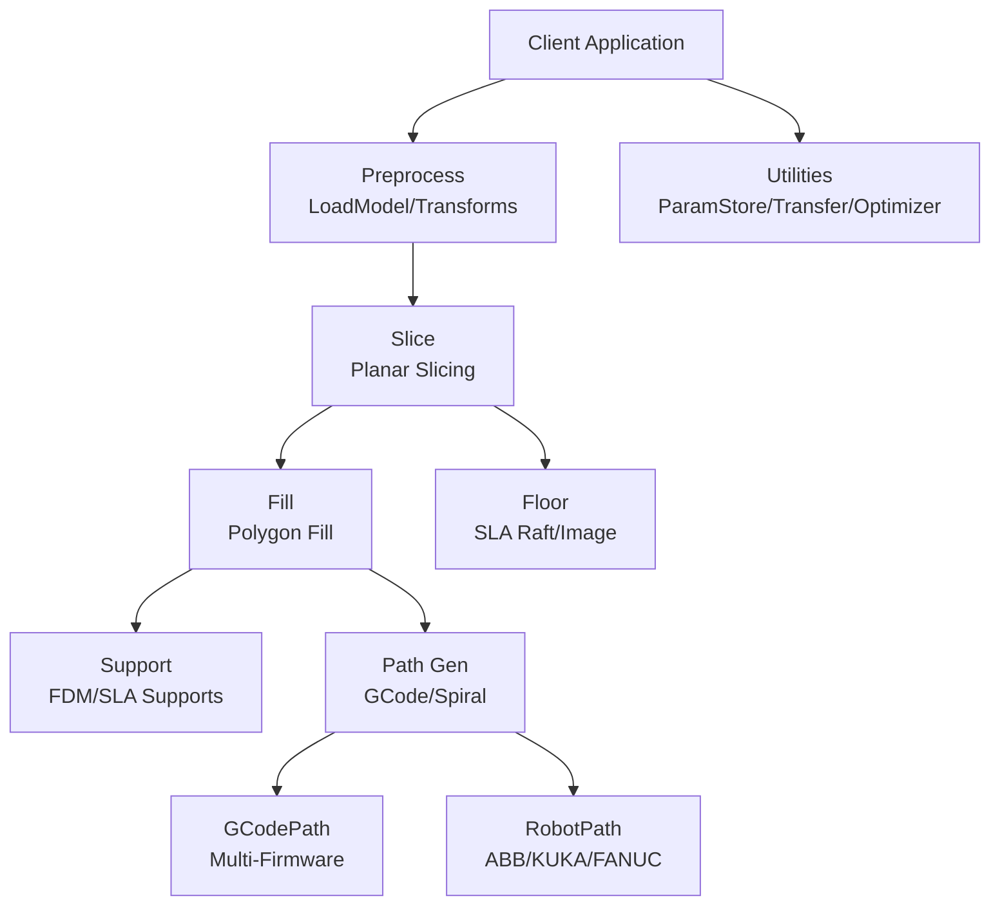

**Diagram sources**
- [model_preprocess.hpp:22-120](file://LibHsBaSlicer/Preprocess/model_preprocess.hpp#L22-L120)
- [mesh_slice.hpp:22-103](file://LibHsBaSlicer/Slice/mesh_slice.hpp#L22-L103)
- [polygon_fill.hpp:17-53](file://LibHsBaSlicer/Fill/polygon_fill.hpp#L17-L53)
- [fdm_support.hpp:19-67](file://LibHsBaSlicer/Support/fdm_support.hpp#L19-L67)
- [path_generator.hpp:20-91](file://LibHsBaSlicer/Path/path_generator.hpp#L20-L91)
- [gcodepath.hpp:24-107](file://paths/gcodepath.hpp#L24-L107)
- [robotpath.hpp:15-104](file://paths/robotpath.hpp#L15-L104)
- [sla_floor.hpp:21-195](file://LibHsBaSlicer/Floor/sla_floor.hpp#L21-L195)
- [param_store_ops.hpp:24-89](file://LibHsBaSlicer/ParamStore/param_store_ops.hpp#L24-L89)
- [file_transfer.hpp:20-60](file://LibHsBaSlicer/Transfer/file_transfer.hpp#L20-L60)

## Detailed Component Analysis

### Model Preprocessing API
Responsibilities:
- Load models into an internal pool, apply transforms, query metadata, manage lifecycle.
- Optional advanced boolean/thick-solid operations when compiled with CGAL.

Key types and functions:
- ModelInfo: bounding box and volume.
- LoadModel(name, filePath): returns shared_ptr<IModel>, throws InvalidArgumentError/RuntimeError.
- GetModel(name), InsertModel(name, model), RemoveModel(name), ContainsModel(name), ModelCount(), CleanupModels().
- TranslateModel(name, translation), RotateModel(name, rotation), ScaleModel(name, scale or vector).
- GetModelInfo(name).
- ThickSolidModel(BooleanUnion/Intersection/Difference/Xor) under USE_CGAL.

Lifecycle and resource management:
- Models are stored in an internal pool keyed by name. Use RemoveModel or CleanupModels to release unreferenced models.
- InsertModel transfers ownership via shared_ptr; ensure no dangling references after removal.

Exception handling:
- LoadModel and InsertModel may throw InvalidArgumentError (duplicate names, unsupported format) or RuntimeError (file load failure).
- Boolean/thick-solid operations require OcctModel and OCCT availability; otherwise throw RuntimeError.

Usage pattern:
- LoadModel -> Transform (Translate/Rotate/Scale) -> GetModelInfo -> Slice -> CleanupModels.

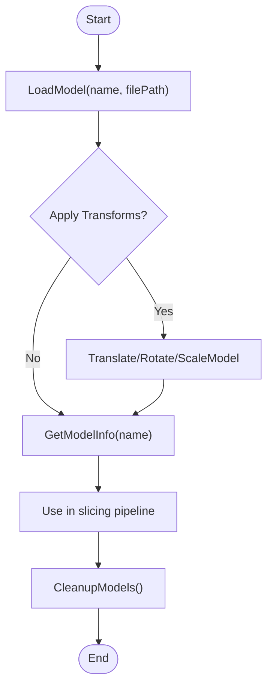

**Diagram sources**
- [model_preprocess.hpp:22-120](file://LibHsBaSlicer/Preprocess/model_preprocess.hpp#L22-L120)

**Section sources**
- [model_preprocess.hpp:22-120](file://LibHsBaSlicer/Preprocess/model_preprocess.hpp#L22-L120)
- [model_preprocess.hpp:122-187](file://LibHsBaSlicer/Preprocess/model_preprocess.hpp#L122-L187)
- [IModel.hpp:110-139](file://base/IModel.hpp#L110-L139)

### Planar Slicing API
Responsibilities:
- Slice models at a given Z height, returning closed or open contours.
- Provide Lua-driven slicing and reusable topology for multi-layer pipelines.

Key functions:
- Slice(model, height, tolerance=0.001): returns closed Polygons.
- UnSafeSlice(model, height, tolerance=0.001): returns UnSafePolygons including open contours.
- SliceLua/UnSafeSliceLua: inline Lua scripts drive slicing.
- NormalizeUnSafePolygons(unsafe_polys): cleans and converts to PolygonsD.
- BuildSliceTopology(model): builds FullTopoModel once for reuse.
- SliceLayer(topo, z, tolerance=0.001): slices one layer from prebuilt topology.

Threading and performance:
- SliceLayer is const-safe over a shared FullTopoModel; concurrent calls are safe if outputs are separate.
- Prefer BuildSliceTopology + SliceLayer for multi-layer workflows to avoid O(total_faces) rebuild per layer.

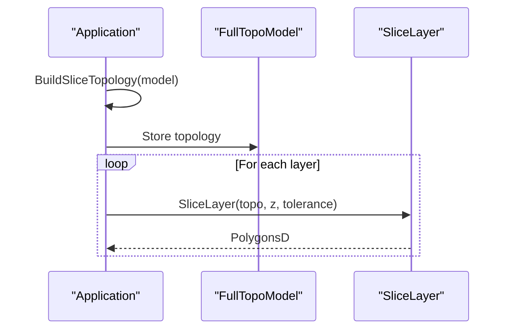

**Diagram sources**
- [mesh_slice.hpp:79-103](file://LibHsBaSlicer/Slice/mesh_slice.hpp#L79-L103)

**Section sources**
- [mesh_slice.hpp:22-103](file://LibHsBaSlicer/Slice/mesh_slice.hpp#L22-L103)

### Polygon Fill Algorithms
Responsibilities:
- Fill polygons using line/zigzag/border modes.
- Provide Lua custom fill via script files.

Key functions:
- FillPolygon(poly, spacing, mode, angle_deg): returns filled Polygons.
- FillWithBorder(poly, spacing, border_count, fill_mode, angle_deg): returns border + fill.
- LuaCustomFillByFile(poly, scriptPath, functionName="generate_fill", lineThickness=0.5): returns custom fill.

Data flow:
- Input Polygons -> Fill algorithm -> Output Polygons.

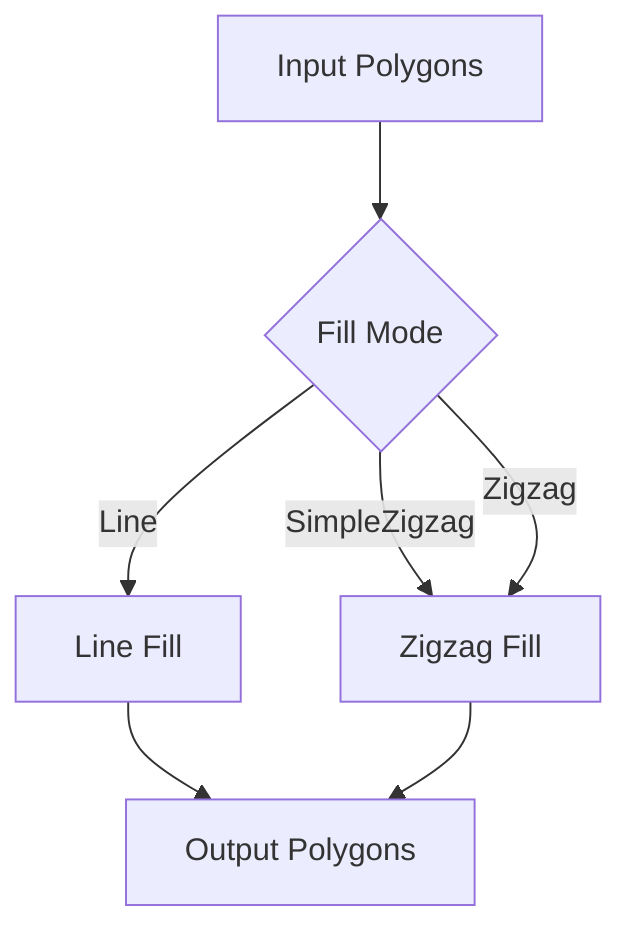

**Diagram sources**
- [polygon_fill.hpp:17-53](file://LibHsBaSlicer/Fill/polygon_fill.hpp#L17-L53)

**Section sources**
- [polygon_fill.hpp:17-53](file://LibHsBaSlicer/Fill/polygon_fill.hpp#L17-L53)

### Path Generation APIs (G-code and Robot Paths)
Responsibilities:
- Generate G-code paths for FDM processes.
- Generate continuous spiralized outer walls.
- Export robot programs for industrial robots (WAAM).

Key types and functions:
- FdmPathConfig: layer_height, line_width, print_speed, travel_speed, extrusion_multiplier, units.
- LayerPathData: outlines, fills, supports, z_height.
- GenerateGCodePath(layer_data, config): returns PointsPath.
- GenerateGCodePathV2(layer_data, config, printer_config): returns GCodePath supporting multi-firmware output.
- GenerateGCodePathSpiral(layer_outlines, layer_zs, printer_config): returns GCodePath with continuous wall.
- PolygonsToGPoints(polys, z, config, is_extrude): helper to convert polygons to GPoint sequences.
- GCodePath: ToGCode(firmware), SaveGCode(path, firmware), setContinuousWall(wall), hasContinuousWall().
- SpiralizeOuterWall(layer_sections, layer_zs): returns SpiralPoint sequence.
- RobotPath: push_back(RLPoint), Save/ToString for ABB/KUKA/FANUC.

Typical workflow:
- Prepare LayerPathData per layer -> Configure FdmPathConfig -> GenerateGCodePathV2 -> Set continuous wall if spiral mode -> ToGCode(firmware) or SaveGCode.

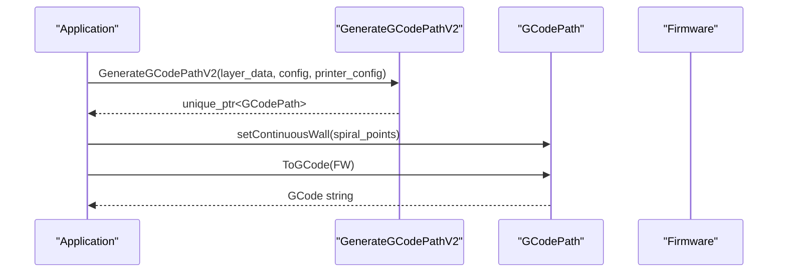

**Diagram sources**
- [path_generator.hpp:20-91](file://LibHsBaSlicer/Path/path_generator.hpp#L20-L91)
- [gcodepath.hpp:24-107](file://paths/gcodepath.hpp#L24-L107)
- [spiral_path.hpp:16-58](file://LibHsBaSlicer/Path/spiral_path.hpp#L16-L58)

**Section sources**
- [path_generator.hpp:20-91](file://LibHsBaSlicer/Path/path_generator.hpp#L20-L91)
- [gcodepath.hpp:24-107](file://paths/gcodepath.hpp#L24-L107)
- [spiral_path.hpp:16-58](file://LibHsBaSlicer/Path/spiral_path.hpp#L16-L58)
- [robotpath.hpp:15-104](file://paths/robotpath.hpp#L15-L104)

### Support Generation APIs (FDM and SLA)
Responsibilities:
- Generate FDM supports per layer or across all layers.
- Generate SLA sacrificial supports.
- Provide Lua-driven custom support generation.

Key functions:
- GenerateFdmSupport(current_layer, prev_layer, layer_height, config): returns PolygonsD.
- GenerateAllFdmSupport(layers, config): returns vector<PolygonsD>.
- GenerateAllSlaSupport(layers, config): returns vector<PolygonsD>.
- GenerateAllLuaSupport(layers, config, script, functionName="generate_support"): returns vector<PolygonsD>.

Configuration:
- Support::SupportConfig: overhang_angle_threshold, layer_height, support_gap, support_diameter, support_density, support_pattern, tree_branch_angle, tree_max_branch_radius, honeycomb_cell_size.
- Support::FdmSupportConfig: interface_layers, interface_density.
- Support::SlaSupportConfig: tip_diameter, raft_thickness.

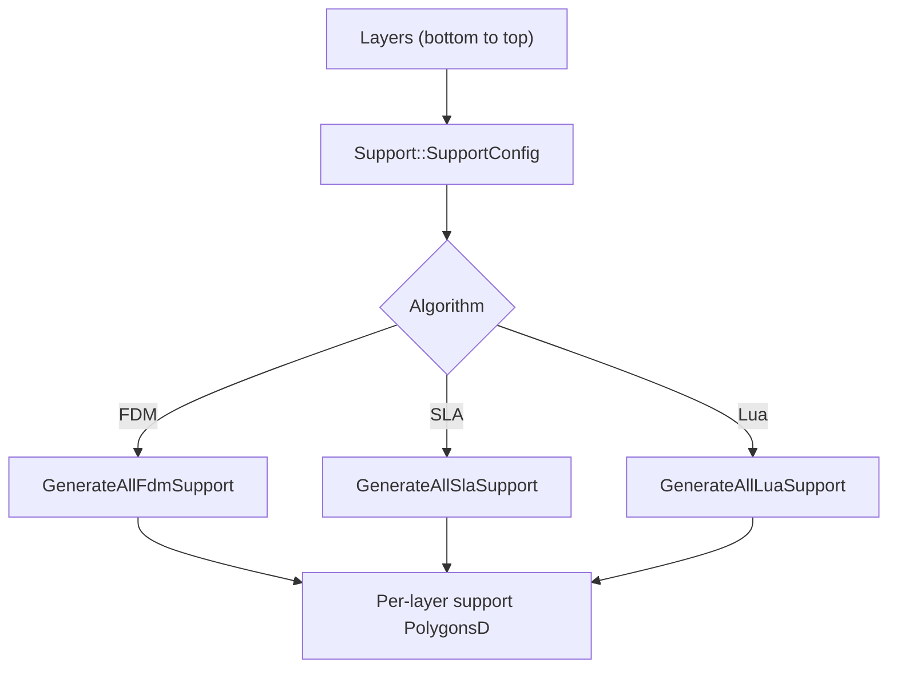

**Diagram sources**
- [fdm_support.hpp:19-67](file://LibHsBaSlicer/Support/fdm_support.hpp#L19-L67)
- [SupportConfig.hpp:11-43](file://support/SupportConfig.hpp#L11-L43)

**Section sources**
- [fdm_support.hpp:19-67](file://LibHsBaSlicer/Support/fdm_support.hpp#L19-L67)
- [SupportConfig.hpp:11-43](file://support/SupportConfig.hpp#L11-L43)

### SLA Floor and Package Export
Responsibilities:
- Generate floor contact area, raft, border, and fill.
- Render polygons to images (file or buffer).
- Save SLA packages as zip archives with layer images, floor/support images, and configuration.

Key functions:
- GenerateFloorContact(bottom_layer, config): returns Polygons.
- GenerateFloorRaft(bottom_layer, config): returns complete raft.
- GenerateFloorBorder(bottom_layer, config): returns border loops.
- GenerateFloorFill(bottom_layer, config): returns internal fill.
- LuaCustomFloorByFile/String(bottom_layer, script/function, config, lua_reg): returns custom floor.
- RenderPolygonsToImage(polys, width, height, outPath): writes image file.
- RenderPolygonsToImageBuffer(polys, width, height, ext, outBuffer): returns encoded bytes.
- SaveSlaPackage(pkg, output_zip): saves zip archive.
- SaveSlaPackageLua(pkg, output_zip, lua_script, lua_func="export_sla"): Lua-customized export.

Configuration:
- SlaFloorConfig: raft_offset, border_width, fill_spacing, fill_angle_deg, border_count, use_convex_hull, concave_hull_points.

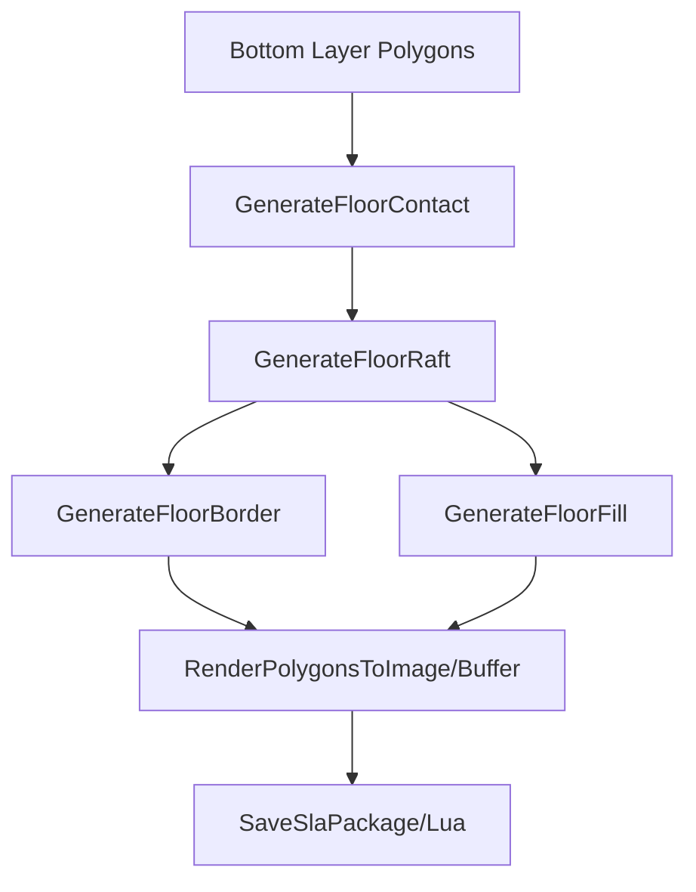

**Diagram sources**
- [sla_floor.hpp:21-195](file://LibHsBaSlicer/Floor/sla_floor.hpp#L21-L195)

**Section sources**
- [sla_floor.hpp:21-195](file://LibHsBaSlicer/Floor/sla_floor.hpp#L21-L195)

### SLS and WAAM Export
Responsibilities:
- SLS export driven by Lua scripts with layer outlines and optional spiralized wall data.
- WAAM robot program generation for ABB/KUKA/FANUC with welding parameters.

Key types and functions:
- SlsPackage: layer_outlines, layer_z_heights, config_json, spiral_mode.
- SaveSlsPackageLua(pkg, output_zip, lua_script, lua_func="export_sls", error_out): returns bool.
- WaamRobotPackage: layer_outlines, layer_z_heights, weld(WaamWeldParams), robot_type, bead_width, config_json, spiral_mode.
- SaveWaamRobotPath(pkg, output_path, lua_script="", lua_func="export_waam", error_out): returns bool.

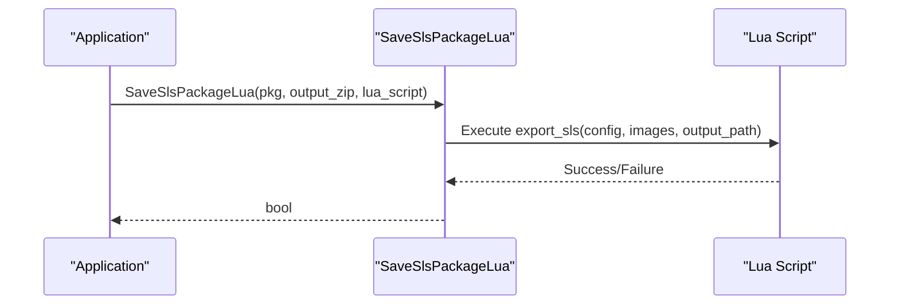

**Diagram sources**
- [sls_export.hpp:17-56](file://LibHsBaSlicer/Path/sls_export.hpp#L17-L56)
- [waam_export.hpp:17-72](file://LibHsBaSlicer/Path/waam_export.hpp#L17-L72)

**Section sources**
- [sls_export.hpp:17-56](file://LibHsBaSlicer/Path/sls_export.hpp#L17-L56)
- [waam_export.hpp:17-72](file://LibHsBaSlicer/Path/waam_export.hpp#L17-L72)

### Parameter Store and File Transfer Utilities
Responsibilities:
- Persist and retrieve pipeline configurations in a wide table backend.
- Transfer files to a remote executor service with progress callbacks.

Key types and functions:
- ParamPipelineKind: Fdm, Sla, Sls, Slm, Lom, Tdp, Waam, Custom, FileTransfer.
- ParamBackend: Sqlite, MySql, PostgreSql.
- ParamStoreConn: backend, sqlitePath, host, user, password, database, port.
- ParamStoreOutcome: success, paramId, error.
- SavePipelineParams(conn, kind, table, key, cfg): persists config.
- LoadPipelineParams(outCfg, conn, kind, table, key): loads config; caller must call FreeLoadedConfigStrings.
- FreeLoadedConfigStrings(kind, cfg): releases malloc'd strings.
- FileTransferConfig: host, port, pool_size, files.
- FileTransferResult: success, files_transferred, total_files, error_message.
- TransferFiles(config, progress): returns FileTransferResult.

Memory management:
- Loaded config strings are allocated by std::malloc; always call FreeLoadedConfigStrings after use.

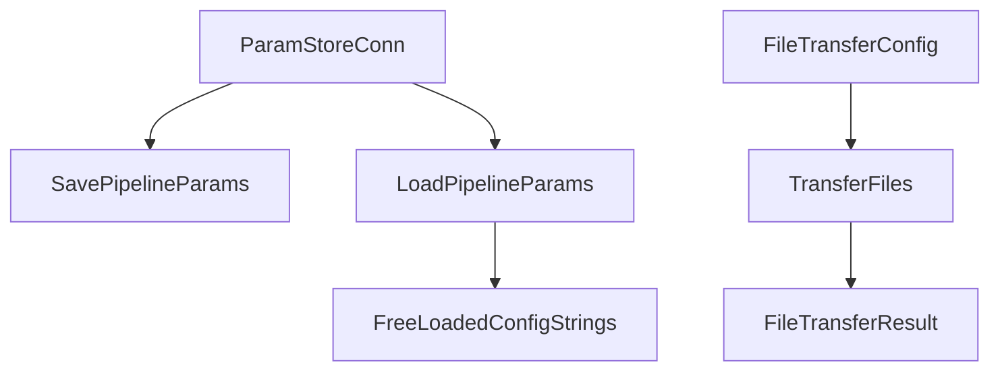

**Diagram sources**
- [param_store_ops.hpp:24-89](file://LibHsBaSlicer/ParamStore/param_store_ops.hpp#L24-L89)
- [file_transfer.hpp:20-60](file://LibHsBaSlicer/Transfer/file_transfer.hpp#L20-L60)

**Section sources**
- [param_store_ops.hpp:24-89](file://LibHsBaSlicer/ParamStore/param_store_ops.hpp#L24-L89)
- [file_transfer.hpp:20-60](file://LibHsBaSlicer/Transfer/file_transfer.hpp#L20-L60)

### Region Path Optimizer
Responsibilities:
- Optimize visit order of independent polygon regions to minimize air-move cost.
- Supports pre-fill (polygon mode) and post-fill (fill-result mode).

Key class and functions:
- RegionPathOptimizer: addRegion(regionId, paths), addPolygonRegion(regionId, polygons), addRoute(fromId, toId, cost), optimizeOrder(), buildPaths(), buildPolygons().
- RegisterLuaPathOptimizeFunctions(L): registers PathOptimize global table.
- LuaOptimizeRegionPaths/String(scriptPath/script, functionName="optimize_paths", lua_reg): optimized fill paths.
- LuaOptimizeRegionPolygons/String(scriptPath/script, functionName="optimize_polygons", lua_reg): optimized polygon order.

Algorithm overview:
- Models regions as AreaGraph vertices; gates are entry/exit points.
- Uses genetic TSP for inter-region routing; nearest-neighbor greedy for intra-region ordering.

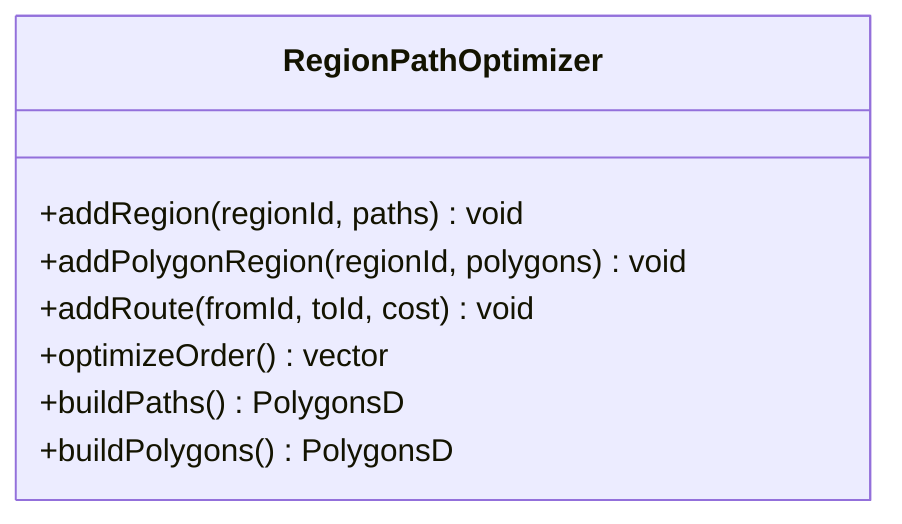

**Diagram sources**
- [path_optimizer.hpp:23-100](file://LibHsBaSlicer/Path/path_optimizer.hpp#L23-L100)

**Section sources**
- [path_optimizer.hpp:23-186](file://LibHsBaSlicer/Path/path_optimizer.hpp#L23-L186)

## Dependency Analysis
Libraries and dependencies:
- Eigen: used extensively for vectors/quaternions/matrices.
- IModel: base interface for 3D models.
- 2D geometry: Polygons, PolygonsD, IntPolygon, FloatPolygons.
- Paths: GCodePath, LayersPath, RobotPath.
- External integrations: Lua scripting, CGAL/IGL for boolean/thick-solid, OpenCASCADE for CAD models, SQLite/MySQL/PostgreSQL for parameter store, Bit7z for compression.

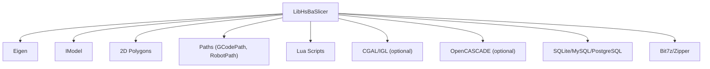

**Diagram sources**
- [IModel.hpp:110-139](file://base/IModel.hpp#L110-L139)
- [polygon_fill.hpp:11-13](file://LibHsBaSlicer/Fill/polygon_fill.hpp#L11-L13)
- [gcodepath.hpp:16-17](file://paths/gcodepath.hpp#L16-L17)
- [robotpath.hpp:11-12](file://paths/robotpath.hpp#L11-L12)
- [param_store_ops.hpp:1-12](file://LibHsBaSlicer/ParamStore/param_store_ops.hpp#L1-L12)

**Section sources**
- [IModel.hpp:110-139](file://base/IModel.hpp#L110-L139)
- [polygon_fill.hpp:11-13](file://LibHsBaSlicer/Fill/polygon_fill.hpp#L11-L13)
- [gcodepath.hpp:16-17](file://paths/gcodepath.hpp#L16-L17)
- [robotpath.hpp:11-12](file://paths/robotpath.hpp#L11-L12)
- [param_store_ops.hpp:1-12](file://LibHsBaSlicer/ParamStore/param_store_ops.hpp#L1-L12)

## Performance Considerations
- Multi-layer slicing: prefer BuildSliceTopology + SliceLayer to avoid rebuilding topology per layer.
- Parallelism: SliceLayer is const-safe over shared FullTopoModel; schedule multiple layers concurrently with separate outputs.
- Memory: Avoid holding unnecessary copies of Polygons/PolygonsD; pass by reference where possible.
- Path optimization: Use RegionPathOptimizer to reduce air-move costs; choose pre-fill vs post-fill based on pipeline stage.
- Rendering: RenderPolygonsToImageBuffer avoids intermediate files for in-memory workflows.
- Exports: For large datasets, consider streaming or chunked processing where supported.

[No sources needed since this section provides general guidance]

## Troubleshooting Guide
Common issues and resolutions:
- Model loading failures: Check file format support and path validity; handle InvalidArgumentError/RuntimeError from LoadModel.
- Duplicate model names: Ensure unique names for LoadModel/InsertModel; use ContainsModel to check before insertion.
- Unsupported boolean operations: Verify USE_CGAL and OCCT availability; otherwise ThickSolidModel/Boolean* will throw.
- Slicing artifacts: Use NormalizeUnSafePolygons after UnSafeSlice to clean open contours and non-simple polygons.
- G-code generation errors: Validate FdmPathConfig and GCodePrinterConfig; ensure consistent units and dimensions.
- Parameter store errors: Inspect ParamStoreOutcome.error; verify backend connectivity and credentials.
- File transfer failures: Check host/port accessibility and file existence; inspect FileTransferResult.error_message.

**Section sources**
- [model_preprocess.hpp:32-39](file://LibHsBaSlicer/Preprocess/model_preprocess.hpp#L32-L39)
- [model_preprocess.hpp:90-97](file://LibHsBaSlicer/Preprocess/model_preprocess.hpp#L90-L97)
- [model_preprocess.hpp:122-134](file://LibHsBaSlicer/Preprocess/model_preprocess.hpp#L122-L134)
- [mesh_slice.hpp:67-77](file://LibHsBaSlicer/Slice/mesh_slice.hpp#L67-L77)
- [param_store_ops.hpp:58-89](file://LibHsBaSlicer/ParamStore/param_store_ops.hpp#L58-L89)
- [file_transfer.hpp:49-60](file://LibHsBaSlicer/Transfer/file_transfer.hpp#L49-L60)

## Conclusion
LibHsBaSlicer provides a comprehensive C++ API for slicing, path generation, support creation, and export across multiple manufacturing processes. By leveraging reusable topologies, region-based optimization, and flexible Lua scripting, users can build efficient and customizable pipelines. Proper lifecycle management, error handling, and performance tuning are essential for robust integration.

[No sources needed since this section summarizes without analyzing specific files]

## Appendices

### Typical Workflows

#### Loading Models and Preprocessing
- LoadModel(name, filePath) -> TranslateModel/RotateModel/ScaleModel -> GetModelInfo(name) -> CleanupModels().

#### Configuring Pipelines
- Define FdmPathConfig/GCodePrinterConfig/Support::SupportConfig.
- Optionally configure ParamStoreConn for parameter persistence.

#### Generating Toolpaths
- BuildSliceTopology(model) -> SliceLayer(topo, z) -> FillPolygon/FillWithBorder -> GenerateAllFdmSupport/GenerateAllSlaSupport -> GenerateGCodePathV2 -> ToGCode(firmware).

#### Exporting Results
- SaveSlaPackage(pkg, output_zip) or SaveSlsPackageLua/pkg.
- SaveWaamRobotPath(pkg, output_path) for robot programs.

[No sources needed since this section provides general guidance]