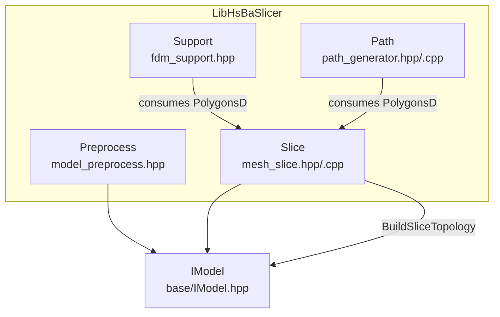
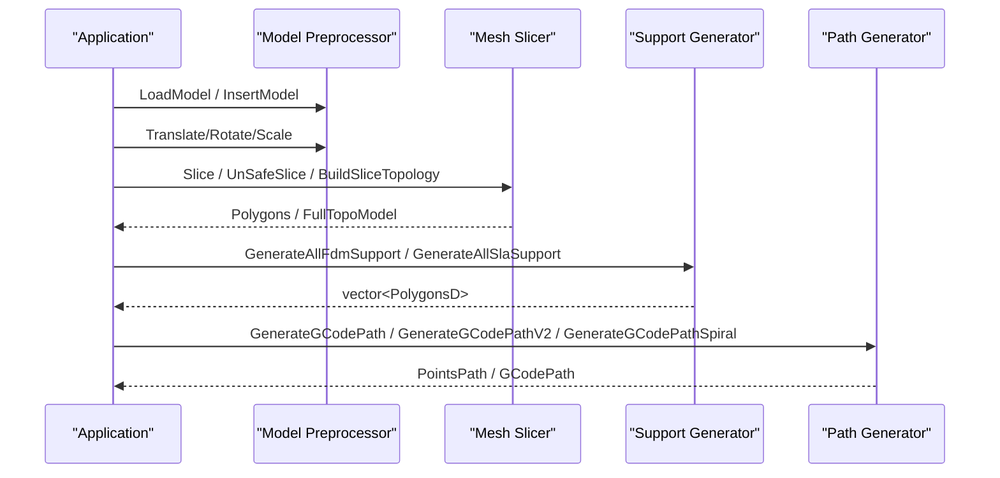
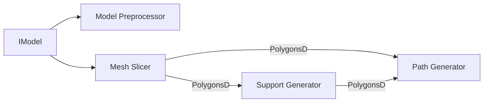

# C++ Library API

<cite>
**Referenced Files in This Document**
- [mesh_slice.hpp](file://LibHsBaSlicer/Slice/mesh_slice.hpp)
- [mesh_slice.cpp](file://LibHsBaSlicer/Slice/mesh_slice.cpp)
- [path_generator.hpp](file://LibHsBaSlicer/Path/path_generator.hpp)
- [path_generator.cpp](file://LibHsBaSlicer/Path/path_generator.cpp)
- [fdm_support.hpp](file://LibHsBaSlicer/Support/fdm_support.hpp)
- [model_preprocess.hpp](file://LibHsBaSlicer/Preprocess/model_preprocess.hpp)
- [IModel.hpp](file://base/IModel.hpp)
</cite>

## Table of Contents
1. [Introduction](#introduction)
2. [Project Structure](#project-structure)
3. [Core Components](#core-components)
4. [Architecture Overview](#architecture-overview)
5. [Detailed Component Analysis](#detailed-component-analysis)
6. [Dependency Analysis](#dependency-analysis)
7. [Performance Considerations](#performance-considerations)
8. [Troubleshooting Guide](#troubleshooting-guide)
9. [Conclusion](#conclusion)

## Introduction
This document provides the C++ API reference for LibHsBaSlicer, focusing on the core slicing pipeline: model preprocessing, mesh slicing, support generation, and path generation. It explains the object lifecycle, ownership patterns, configuration structures, error handling, threading considerations, and best practices for performance.

LibHsBaSlicer exposes functional APIs rather than a single monolithic class hierarchy. The primary abstractions are:
- Model Preprocessor (functional API over IModel)
- Mesh Slicer (functional API returning polygons or reusable topology)
- Support Generator (functional API per layer or all layers)
- Path Generator (functional API producing G-code paths from layer data)

## Project Structure
The relevant parts of LibHsBaSlicer for this API are organized by feature:
- Preprocess: model loading, transforms, queries, boolean/shell operations
- Slice: planar slicing with safe/unsafe variants, Lua-driven slicing, reusable topology
- Support: FDM/SLA/Lua support generation
- Path: G-code path generation, spiral/vase mode, helper conversions

**Diagram sources**
- [model_preprocess.hpp:20-120](file://LibHsBaSlicer/Preprocess/model_preprocess.hpp#L20-L120)
- [mesh_slice.hpp:18-103](file://LibHsBaSlicer/Slice/mesh_slice.hpp#L18-L103)
- [fdm_support.hpp:17-67](file://LibHsBaSlicer/Support/fdm_support.hpp#L17-L67)
- [path_generator.hpp:18-91](file://LibHsBaSlicer/Path/path_generator.hpp#L18-L91)
- [IModel.hpp:110-139](file://base/IModel.hpp#L110-L139)

**Section sources**
- [model_preprocess.hpp:20-120](file://LibHsBaSlicer/Preprocess/model_preprocess.hpp#L20-L120)
- [mesh_slice.hpp:18-103](file://LibHsBaSlicer/Slice/mesh_slice.hpp#L18-L103)
- [fdm_support.hpp:17-67](file://LibHsBaSlicer/Support/fdm_support.hpp#L17-L67)
- [path_generator.hpp:18-91](file://LibHsBaSlicer/Path/path_generator.hpp#L18-L91)
- [IModel.hpp:110-139](file://base/IModel.hpp#L110-L139)

## Core Components
This section summarizes the main components and their responsibilities.

- Model Preprocessor
  - Provides functions to load models into an internal pool, apply transforms, query info, remove/cleanup models, and perform advanced boolean/shell operations when available.
  - Ownership is shared via std::shared_ptr<IModel>.

- Mesh Slicer
  - Provides safe and unsafe slicing functions returning closed/open polygons.
  - Supports Lua-driven slicing and building a reusable topology for multi-layer slicing.

- Support Generator
  - Generates FDM and SLA supports across one or all layers.
  - Supports custom Lua-based support generation.

- Path Generator
  - Converts layer polygons into G-code paths.
  - Offers V2 firmware-aware output and spiral/vase mode.

**Section sources**
- [model_preprocess.hpp:20-120](file://LibHsBaSlicer/Preprocess/model_preprocess.hpp#L20-L120)
- [mesh_slice.hpp:22-103](file://LibHsBaSlicer/Slice/mesh_slice.hpp#L22-L103)
- [fdm_support.hpp:19-67](file://LibHsBaSlicer/Support/fdm_support.hpp#L19-L67)
- [path_generator.hpp:20-91](file://LibHsBaSlicer/Path/path_generator.hpp#L20-L91)

## Architecture Overview
The typical slicing workflow uses these components in sequence:
1. Load and transform models using the Model Preprocessor.
2. Slice meshes at desired heights to obtain layer contours.
3. Generate supports for each layer (FDM/SLA/Lua).
4. Convert layer polygons to G-code paths.

**Diagram sources**
- [model_preprocess.hpp:32-120](file://LibHsBaSlicer/Preprocess/model_preprocess.hpp#L32-L120)
- [mesh_slice.hpp:22-103](file://LibHsBaSlicer/Slice/mesh_slice.hpp#L22-L103)
- [fdm_support.hpp:19-67](file://LibHsBaSlicer/Support/fdm_support.hpp#L19-L67)
- [path_generator.hpp:44-91](file://LibHsBaSlicer/Path/path_generator.hpp#L44-L91)

## Detailed Component Analysis

### Model Preprocessor
Responsibilities:
- Load models from files into an internal pool keyed by name.
- Retrieve, transform, query, and manage model lifetimes.
- Provide advanced boolean/shell operations when compiled with CGAL.

Key types and members:
- ModelInfo: bounding box min/max and volume.
- Functions:
  - LoadModel(name, filePath) -> shared_ptr<IModel>
  - GetModel(name) -> shared_ptr<IModel>
  - TranslateModel(name, translation)
  - RotateModel(name, rotation)
  - ScaleModel(name, scale)
  - ScaleModel(name, Vector3f scale)
  - GetModelInfo(name) -> ModelInfo
  - RemoveModel(name)
  - InsertModel(name, shared_ptr<IModel>) -> shared_ptr<IModel>
  - ContainsModel(name) -> bool
  - ModelCount() -> size_t
  - GetModelNames() -> vector<string>
  - CleanupModels() -> size_t
  - ThickSolidModel(...) (CGAL)
  - BooleanUnion/Difference/Intersection/Xor(...) (CGAL)

Ownership and lifecycle:
- Models are stored in an internal pool and returned as shared pointers.
- Use RemoveModel to explicitly release; CleanupModels removes unreferenced models.
- InsertModel allows injecting preconstructed models into the pool.

Error handling:
- LoadModel and InsertModel may throw InvalidArgumentError or RuntimeError for invalid inputs or failures.

Threading:
- Pool access semantics are not documented here; avoid concurrent mutation unless proven safe.

Usage example outline:
- Load a model by file path.
- Apply translation/rotation/scale.
- Query bounding box and volume.
- Optionally perform boolean/shell operations.
- Remove or cleanup models when done.

**Section sources**
- [model_preprocess.hpp:22-120](file://LibHsBaSlicer/Preprocess/model_preprocess.hpp#L22-L120)
- [model_preprocess.hpp:122-187](file://LibHsBaSlicer/Preprocess/model_preprocess.hpp#L122-L187)
- [IModel.hpp:110-139](file://base/IModel.hpp#L110-L139)

### Mesh Slicer
Responsibilities:
- Slice a model at a given Z height to produce layer contours.
- Provide Lua-driven slicing.
- Build a reusable topology for efficient multi-layer slicing.

Key functions:
- Slice(model, height, tolerance) -> Polygons (closed contours)
- UnSafeSlice(model, height, tolerance) -> UnSafePolygons (may include open contours)
- SliceLua(model, script, height) -> Polygons
- UnSafeSliceLua(model, script, height) -> UnSafePolygons
- NormalizeUnSafePolygons(unsafe_polys) -> PolygonsD
- BuildSliceTopology(model) -> shared_ptr<FullTopoModel>
- SliceLayer(topo, z, tolerance) -> PolygonsD

Data flow:
- Input: IModel or prebuilt FullTopoModel.
- Output: Polygons/PolygonsD suitable for downstream fill/support/path steps.

Concurrency:
- SliceLayer reads a const FullTopoModel; multiple threads can call it concurrently if each writes to its own output container.

Error handling:
- Slicing entry points translate external geometry exceptions into project IOError, while preserving project RuntimeError.

Usage example outline:
- For a single layer: call Slice or UnSafeSlice and normalize if needed.
- For many layers: build topology once with BuildSliceTopology and repeatedly call SliceLayer.

**Section sources**
- [mesh_slice.hpp:22-103](file://LibHsBaSlicer/Slice/mesh_slice.hpp#L22-L103)
- [mesh_slice.cpp:14-43](file://LibHsBaSlicer/Slice/mesh_slice.cpp#L14-L43)

### Support Generator
Responsibilities:
- Generate support cross-sections for FDM and SLA processes.
- Allow custom Lua scripts to replace built-in algorithms.

Key functions:
- GenerateFdmSupport(current_layer, prev_layer, layer_height, config) -> PolygonsD
- GenerateAllFdmSupport(layers, config) -> vector<PolygonsD>
- GenerateAllSlaSupport(layers, sla_config) -> vector<PolygonsD>
- GenerateAllLuaSupport(layers, config, script, functionName="generate_support") -> vector<PolygonsD>

Configuration:
- Uses Support::FdmSupportConfig and Support::SlaSupportConfig.

Usage example outline:
- Compute supports per layer or for all layers.
- Replace built-in algorithm with a Lua function that returns support polygons.

**Section sources**
- [fdm_support.hpp:19-67](file://LibHsBaSlicer/Support/fdm_support.hpp#L19-L67)

### Path Generator
Responsibilities:
- Convert layer polygons into G-code paths.
- Provide firmware-aware output and spiral/vase mode.

Key types:
- FdmPathConfig: layer height, line width, print/travel speeds, extrusion multiplier, units.
- LayerPathData: outlines, fills, supports, and z height for a single layer.

Key functions:
- GenerateGCodePath(layer_data, config) -> unique_ptr<PointsPath>
- GenerateGCodePathV2(layer_data, config, printer_config) -> unique_ptr<GCodePath>
- GenerateGCodePathSpiral(layer_outlines, layer_zs, printer_config) -> unique_ptr<GCodePath>
- PolygonsToGPoints(polys, z, config, is_extrude) -> vector<GPoint>

Ownership:
- Returns smart pointers to path objects; caller owns the returned path.

Usage example outline:
- Prepare LayerPathData for each layer.
- Call GenerateGCodePath or V2 to get path output.
- For vase mode, use GenerateGCodePathSpiral with per-layer outer contours and Z values.

**Section sources**
- [path_generator.hpp:20-91](file://LibHsBaSlicer/Path/path_generator.hpp#L20-L91)
- [path_generator.cpp:12-41](file://LibHsBaSlicer/Path/path_generator.cpp#L12-L41)

## Dependency Analysis
High-level dependencies between components:
- Model Preprocessor depends on IModel abstraction.
- Mesh Slicer consumes IModel and produces Polygons/PolygonsD.
- Support Generator consumes PolygonsD and produces PolygonsD.
- Path Generator consumes PolygonsD and produces G-code path objects.

**Diagram sources**
- [model_preprocess.hpp:20-120](file://LibHsBaSlicer/Preprocess/model_preprocess.hpp#L20-L120)
- [mesh_slice.hpp:22-103](file://LibHsBaSlicer/Slice/mesh_slice.hpp#L22-L103)
- [fdm_support.hpp:19-67](file://LibHsBaSlicer/Support/fdm_support.hpp#L19-L67)
- [path_generator.hpp:20-91](file://LibHsBaSlicer/Path/path_generator.hpp#L20-L91)
- [IModel.hpp:110-139](file://base/IModel.hpp#L110-L139)

**Section sources**
- [model_preprocess.hpp:20-120](file://LibHsBaSlicer/Preprocess/model_preprocess.hpp#L20-L120)
- [mesh_slice.hpp:22-103](file://LibHsBaSlicer/Slice/mesh_slice.hpp#L22-L103)
- [fdm_support.hpp:19-67](file://LibHsBaSlicer/Support/fdm_support.hpp#L19-L67)
- [path_generator.hpp:20-91](file://LibHsBaSlicer/Path/path_generator.hpp#L20-L91)
- [IModel.hpp:110-139](file://base/IModel.hpp#L110-L139)

## Performance Considerations
- Reuse topology for multi-layer slicing: BuildSliceTopology once and call SliceLayer repeatedly to avoid rebuilding topology per layer.
- Prefer Slice over UnSafeSlice when closed contours are required to reduce downstream filtering.
- Batch layer processing: generate supports and paths for multiple layers together where possible to minimize overhead.
- Spiral/vase mode: GenerateGCodePathSpiral merges walls into a continuous path, reducing travel and improving efficiency for uniform-cross-section models.
- Avoid unnecessary copies: pass PolygonsD by const reference and reuse containers when iterating layers.

[No sources needed since this section provides general guidance]

## Troubleshooting Guide
Error propagation and debugging:
- Slicing subsystem translates external geometry exceptions (e.g., from CGAL or OCCT tessellation) into project IOError, while preserving project RuntimeError.
- Catch IOError for geometry-related failures during slicing; catch RuntimeError for application-level errors.
- Validate inputs: ensure model names exist before transformations and slicing; check polygon validity after UnSafeSlice and use NormalizeUnSafePolygons.

Common issues:
- Open contours in unsafe slices: normalize with NormalizeUnSafePolygons before downstream processing.
- Missing models: verify ContainsModel or GetModelNames before operations.
- Lua scripting errors: ensure the Lua function name matches the expected signature and returns valid polygons.

**Section sources**
- [mesh_slice.cpp:14-43](file://LibHsBaSlicer/Slice/mesh_slice.cpp#L14-L43)
- [mesh_slice.hpp:68-77](file://LibHsBaSlicer/Slice/mesh_slice.hpp#L68-L77)
- [model_preprocess.hpp:32-40](file://LibHsBaSlicer/Preprocess/model_preprocess.hpp#L32-L40)

## Conclusion
LibHsBaSlicer’s C++ API centers around functional interfaces for preprocessing, slicing, support generation, and path generation. Ownership is primarily managed through shared pointers for models and smart pointers for path outputs. For high-performance workflows, build the slicing topology once and reuse it across layers, prefer closed contours, and leverage spiral/vase mode where appropriate. Error handling should account for both project exceptions and translated geometry exceptions.

[No sources needed since this section summarizes without analyzing specific files]