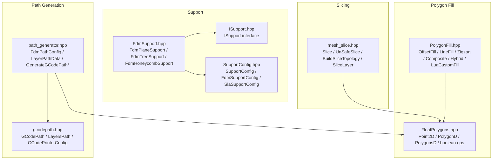
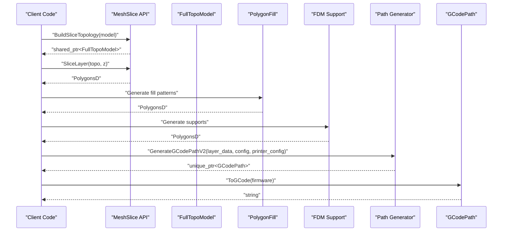
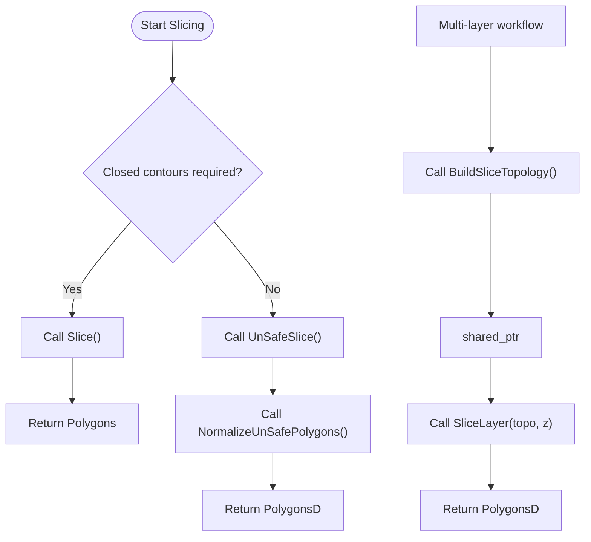
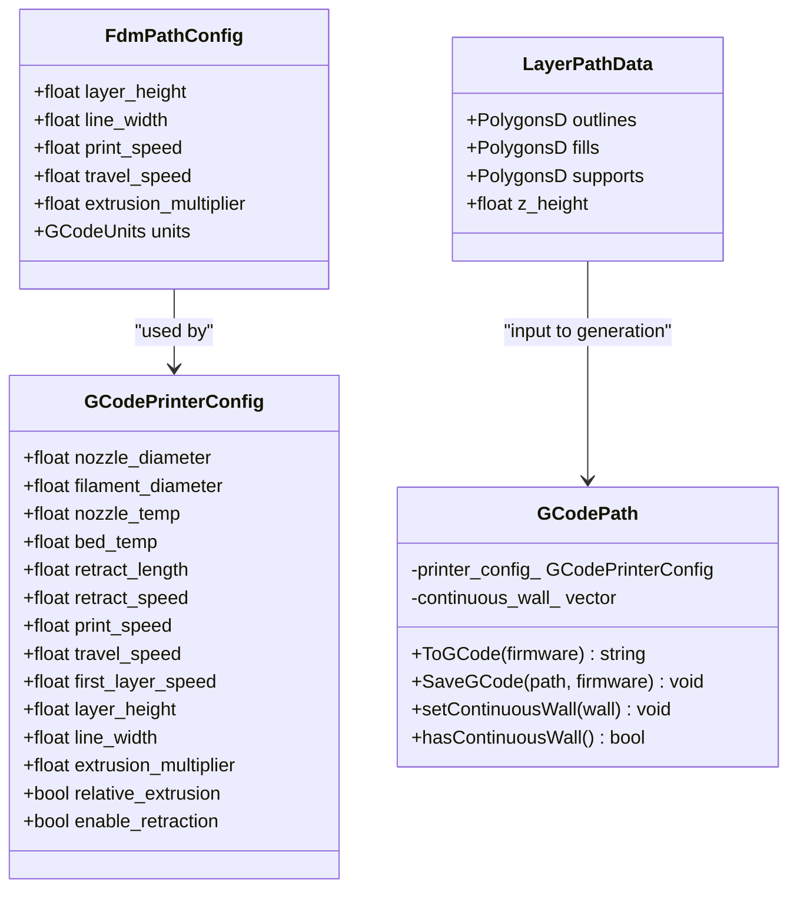
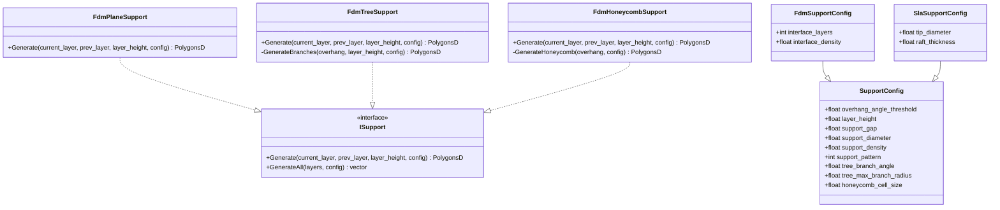
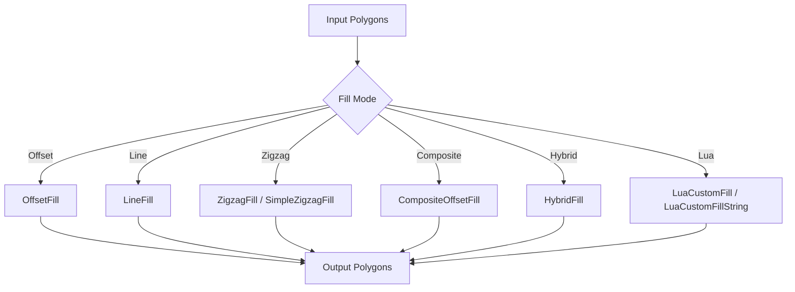
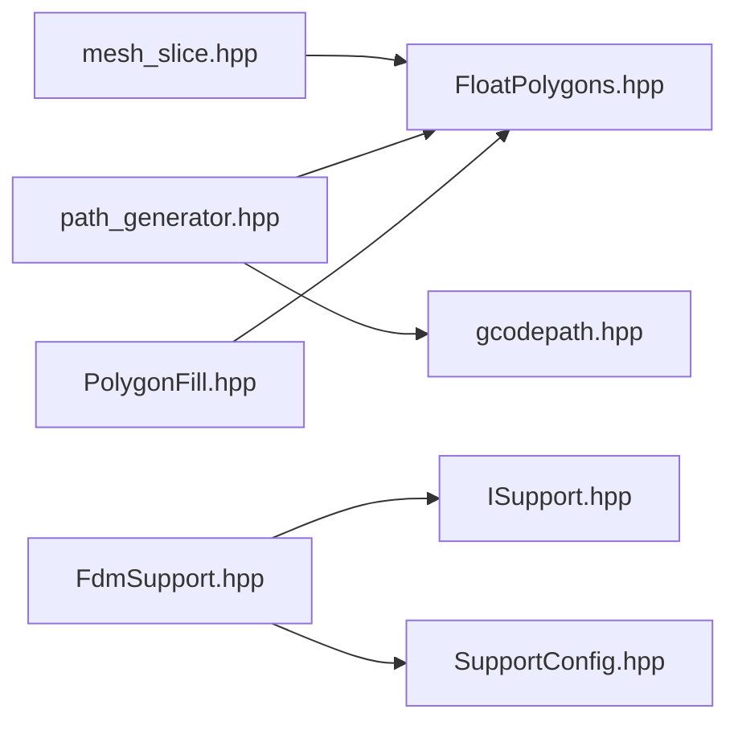

# Core Classes / 核心类

<cite>
**Referenced Files in This Document**
- [mesh_slice.hpp](file://LibHsBaSlicer/Slice/mesh_slice.hpp)
- [path_generator.hpp](file://LibHsBaSlicer/Path/path_generator.hpp)
- [FdmSupport.hpp](file://support/FdmSupport.hpp)
- [ISupport.hpp](file://support/ISupport.hpp)
- [SupportConfig.hpp](file://support/SupportConfig.hpp)
- [PolygonFill.hpp](file://2D/PolygonFill.hpp)
- [FloatPolygons.hpp](file://2D/FloatPolygons.hpp)
- [gcodepath.hpp](file://paths/gcodepath.hpp)
</cite>

## Table of Contents
1. [Introduction](#introduction)
2. [Project Structure](#project-structure)
3. [Core Components](#core-components)
4. [Architecture Overview](#architecture-overview)
5. [Detailed Component Analysis](#detailed-component-analysis)
6. [Dependency Analysis](#dependency-analysis)
7. [Performance Considerations](#performance-considerations)
8. [Troubleshooting Guide](#troubleshooting-guide)
9. [Conclusion](#conclusion)

## Introduction
This document explains the core HsBaSlicer C++ classes used by slicing, path generation, support generation, and polygon filling: MeshSlice-style slice functions, PathGenerator-style G-code path generation, FDM support strategies, and PolygonFill pattern generators. It focuses on class hierarchies, inheritance relationships, design patterns, constructors, member functions, parameters, return values, exception behavior, RAII and smart pointer usage, resource management, thread safety guarantees, concurrent access patterns, typical usage scenarios, error handling strategies, and performance considerations.

The documentation is grounded in the repository’s public headers and avoids inventing APIs or default values not present in the source.

## Project Structure
The four core areas are spread across several modules:

- Slicing API: `LibHsBaSlicer/Slice/mesh_slice.hpp`
- Path generation API: `LibHsBaSlicer/Path/path_generator.hpp`
- Support system: `support/FdmSupport.hpp`, `support/ISupport.hpp`, `support/SupportConfig.hpp`
- Polygon fill system: `2D/PolygonFill.hpp`, with geometry primitives in `2D/FloatPolygons.hpp`
- G-code output model: `paths/gcodepath.hpp`

**Diagram sources**
- [mesh_slice.hpp:18-103](file://LibHsBaSlicer/Slice/mesh_slice.hpp#L18-L103)
- [path_generator.hpp:18-91](file://LibHsBaSlicer/Path/path_generator.hpp#L18-L91)
- [FdmSupport.hpp:11-63](file://support/FdmSupport.hpp#L11-L63)
- [ISupport.hpp:14-45](file://support/ISupport.hpp#L14-L45)
- [SupportConfig.hpp:9-43](file://support/SupportConfig.hpp#L9-L43)
- [PolygonFill.hpp:16-136](file://2D/PolygonFill.hpp#L16-L136)
- [FloatPolygons.hpp:16-239](file://2D/FloatPolygons.hpp#L16-L239)
- [gcodepath.hpp:21-107](file://paths/gcodepath.hpp#L21-L107)

**Section sources**
- [README.md:25-39](file://README.md#L25-L39)
- [README.md:126-150](file://README.md#L126-L150)

## Core Components
This section summarizes the responsibilities and key interfaces of the four core areas.

### MeshSlice-style Slicing API
- Provides safe and unsafe planar slicing at a given Z height.
- Supports Lua-driven slicing for custom behavior.
- Offers reusable topology construction to avoid rebuilding per layer.
- Normalizes unsafe polygons into clean double-precision polygons.

Key responsibilities:
- Return closed-contour polygons when possible.
- Provide an unsafe variant that may include open contours.
- Allow precomputing a shared topology for multi-layer slicing.

**Section sources**
- [mesh_slice.hpp:22-103](file://LibHsBaSlicer/Slice/mesh_slice.hpp#L22-L103)

### PathGenerator-style G-code Path Generation
- Generates G-code paths from per-layer outlines, fills, and supports.
- Supports both legacy `PointsPath` and modern multi-firmware `GCodePath`.
- Includes spiralized vase-mode wall generation.
- Uses printer configuration for extrusion, retraction, speeds, and units.

Key responsibilities:
- Convert polygonal layers into continuous deposition paths.
- Produce firmware-specific G-code strings or files.
- Manage continuous helical walls for spiral printing.

**Section sources**
- [path_generator.hpp:20-91](file://LibHsBaSlicer/Path/path_generator.hpp#L20-L91)
- [gcodepath.hpp:24-107](file://paths/gcodepath.hpp#L24-L107)

### FDM Support Strategies
- Implements multiple support strategies through a common interface.
- Plane support creates cylindrical columns over overhang regions.
- Tree support grows branching structures upward.
- Honeycomb support fills overhang areas with hexagonal cells.

Design pattern:
- Strategy pattern via `ISupport` interface.
- Configuration-driven behavior through `SupportConfig` and derived types.

**Section sources**
- [FdmSupport.hpp:13-63](file://support/FdmSupport.hpp#L13-L63)
- [ISupport.hpp:16-45](file://support/ISupport.hpp#L16-L45)
- [SupportConfig.hpp:11-43](file://support/SupportConfig.hpp#L11-L43)

### PolygonFill Pattern Generators
- Provides offset-based, line, zigzag, composite, hybrid, and Lua-custom fills.
- Operates on integer or double-precision polygons.
- Exposes registration hooks for Lua integration.

Key responsibilities:
- Transform boundary polygons into infill patterns.
- Support configurable spacing, angles, thickness, and join types.
- Enable custom fills through Lua scripts.

**Section sources**
- [PolygonFill.hpp:20-136](file://2D/PolygonFill.hpp#L20-L136)
- [FloatPolygons.hpp:18-239](file://2D/FloatPolygons.hpp#L18-L239)

## Architecture Overview
The slicing pipeline can be viewed as a sequence of transformations:

**Diagram sources**
- [mesh_slice.hpp:80-103](file://LibHsBaSlicer/Slice/mesh_slice.hpp#L80-L103)
- [PolygonFill.hpp:20-136](file://2D/PolygonFill.hpp#L20-L136)
- [FdmSupport.hpp:13-63](file://support/FdmSupport.hpp#L13-L63)
- [path_generator.hpp:44-80](file://LibHsBaSlicer/Path/path_generator.hpp#L44-L80)
- [gcodepath.hpp:66-107](file://paths/gcodepath.hpp#L66-L107)

## Detailed Component Analysis

### MeshSlice-style Slicing API
The slicing API exposes free functions rather than a single class, but it encapsulates mesh slicing logic behind a stable interface.

#### Key Functions and Responsibilities
- `Slice`: Returns closed-contour polygons at a given height.
- `UnSafeSlice`: May include open contours; useful for material-fed processes.
- `SliceLua` / `UnSafeSliceLua`: Lua-driven slicing variants.
- `NormalizeUnSafePolygons`: Cleans unsafe polygons and converts to double precision.
- `BuildSliceTopology`: Builds a reusable topology once for multi-layer slicing.
- `SliceLayer`: Slices a single layer from a prebuilt topology and normalizes results.

#### Parameters and Return Values
- Most functions accept an `IModel` reference, a Z height, and a tolerance.
- Return types include `Polygons`, `UnSafePolygons`, `PolygonsD`, and `std::shared_ptr<FullTopoModel>`.

#### Thread Safety
- The header explicitly states that `SliceLayer` reads the topology only (const), so concurrent calls sharing the same topology from different threads are safe provided each writes to its own output slot.

#### RAII and Resource Management
- Reusable topology is returned as `std::shared_ptr<FullTopoModel>`, ensuring automatic lifetime management and shared ownership across layers.

**Diagram sources**
- [mesh_slice.hpp:22-103](file://LibHsBaSlicer/Slice/mesh_slice.hpp#L22-L103)

**Section sources**
- [mesh_slice.hpp:22-103](file://LibHsBaSlicer/Slice/mesh_slice.hpp#L22-L103)

### PathGenerator-style G-code Path Generation
Path generation transforms per-layer polygon data into G-code paths.

#### Data Structures
- `FdmPathConfig`: Layer height, line width, print speed, travel speed, extrusion multiplier, units.
- `LayerPathData`: Outlines, fills, supports, and Z height for one layer.
- `GCodePrinterConfig`: Nozzle diameter, filament diameter, temperatures, retraction settings, speeds, layer height, line width, extrusion multiplier, relative extrusion flag.

#### Functions
- `GenerateGCodePath`: Produces a `PointsPath` from layered data.
- `GenerateGCodePathV2`: Produces a `GCodePath` with multi-firmware support.
- `GenerateGCodePathSpiral`: Produces a continuous helical wall for vase mode.
- `PolygonsToGPoints`: Converts polygons to G-point sequences.

#### Smart Pointers and RAII
- Functions return `std::unique_ptr<PointsPath>` or `std::unique_ptr<GCodePath>`, enforcing single ownership and automatic cleanup.

**Diagram sources**
- [path_generator.hpp:20-91](file://LibHsBaSlicer/Path/path_generator.hpp#L20-L91)
- [gcodepath.hpp:32-107](file://paths/gcodepath.hpp#L32-L107)

**Section sources**
- [path_generator.hpp:20-91](file://LibHsBaSlicer/Path/path_generator.hpp#L20-L91)
- [gcodepath.hpp:32-107](file://paths/gcodepath.hpp#L32-L107)

### FDM Support Strategies
The support system uses a strategy pattern to allow pluggable support algorithms.

#### Interface and Implementations
- `ISupport`: Abstract base defining `Generate(current_layer, prev_layer, layer_height, config)` and a default `GenerateAll(layers, config)`.
- `FdmPlaneSupport`: Column supports from overhang regions.
- `FdmTreeSupport`: Branching tree supports.
- `FdmHoneycombSupport`: Hexagonal honeycomb fills.

#### Configuration
- `SupportConfig`: Overhang angle threshold, layer height, gap, diameter, density, pattern selection, tree branch angle, max branch radius, honeycomb cell size.
- `FdmSupportConfig`: Adds interface layers and interface density.
- `SlaSupportConfig`: Adds tip diameter and raft thickness.

**Diagram sources**
- [ISupport.hpp:16-45](file://support/ISupport.hpp#L16-L45)
- [FdmSupport.hpp:13-63](file://support/FdmSupport.hpp#L13-L63)
- [SupportConfig.hpp:11-43](file://support/SupportConfig.hpp#L11-L43)

**Section sources**
- [ISupport.hpp:16-45](file://support/ISupport.hpp#L16-L45)
- [FdmSupport.hpp:13-63](file://support/FdmSupport.hpp#L13-L63)
- [SupportConfig.hpp:11-43](file://support/SupportConfig.hpp#L11-L43)

### PolygonFill Pattern Generators
PolygonFill provides multiple infill strategies and Lua extensibility.

#### Functions
- `OffsetFill`: Offset-based fill with configurable join type.
- `LineFill`: Parallel line fill with spacing, angle, and thickness.
- `SimpleZigzagFill` / `ZigzagFill`: Zigzag patterns with varying corner handling.
- `CompositeOffsetFill`: Combines offset borders with internal fill modes.
- `HybridFill`: Applies offsets then fills the last offset polygons.
- `LuaCustomFill` / `LuaCustomFillString`: Custom fills via Lua script file or inline code.
- `RegisterLuaPolygonFillFunctions`: Registers Lua polygon fill functions.

#### Geometry Types
- Operates on `Polygons` (integer) and relies on `FloatPolygons.hpp` for double-precision types and operations.

**Diagram sources**
- [PolygonFill.hpp:20-136](file://2D/PolygonFill.hpp#L20-L136)
- [FloatPolygons.hpp:18-239](file://2D/FloatPolygons.hpp#L18-L239)

**Section sources**
- [PolygonFill.hpp:20-136](file://2D/PolygonFill.hpp#L20-L136)
- [FloatPolygons.hpp:18-239](file://2D/FloatPolygons.hpp#L18-L239)

## Dependency Analysis
The core components depend on shared geometry types and configuration structs:

**Diagram sources**
- [mesh_slice.hpp:12-16](file://LibHsBaSlicer/Slice/mesh_slice.hpp#L12-L16)
- [path_generator.hpp:12-16](file://LibHsBaSlicer/Path/path_generator.hpp#L12-L16)
- [FdmSupport.hpp:9-9](file://support/FdmSupport.hpp#L9-L9)
- [PolygonFill.hpp:9-14](file://2D/PolygonFill.hpp#L9-L14)
- [gcodepath.hpp:16-16](file://paths/gcodepath.hpp#L16-L16)

**Section sources**
- [mesh_slice.hpp:12-16](file://LibHsBaSlicer/Slice/mesh_slice.hpp#L12-L16)
- [path_generator.hpp:12-16](file://LibHsBaSlicer/Path/path_generator.hpp#L12-L16)
- [FdmSupport.hpp:9-9](file://support/FdmSupport.hpp#L9-L9)
- [PolygonFill.hpp:9-14](file://2D/PolygonFill.hpp#L9-L14)
- [gcodepath.hpp:16-16](file://paths/gcodepath.hpp#L16-L16)

## Performance Considerations
- **Reusable topology**: Use `BuildSliceTopology` followed by `SliceLayer` for multi-layer workflows to avoid rebuilding topology per layer.
- **Double vs integer polygons**: Prefer `PolygonsD` for downstream processing after normalization; integer polygons are suitable for intermediate geometric operations.
- **Fill pattern complexity**: Offset and composite fills may involve multiple geometric operations; choose simpler fills for large models where feasible.
- **Path generation cost**: Spiralized walls generate a continuous 3D path; ensure appropriate printer configuration to avoid excessive retraction or speed changes.
- **Thread safety**: Concurrent calls to `SliceLayer` sharing the same topology are safe if each thread writes to its own output container.

[No sources needed since this section provides general guidance]

## Troubleshooting Guide
- **Open contours in slices**: If closed contours are required, prefer `Slice` over `UnSafeSlice`; otherwise use `NormalizeUnSafePolygons` to filter open polylines and non-simple polygons.
- **Incorrect support geometry**: Verify `SupportConfig` fields such as overhang angle threshold, gap, diameter, density, and pattern selection.
- **Poor infill quality**: Adjust spacing, angle, thickness, and join type in fill functions; consider composite or hybrid fills for better border handling.
- **G-code issues**: Check `GCodePrinterConfig` values like nozzle diameter, filament diameter, temperatures, retraction settings, and speeds; select the correct firmware type when generating G-code.

**Section sources**
- [mesh_slice.hpp:67-77](file://LibHsBaSlicer/Slice/mesh_slice.hpp#L67-L77)
- [SupportConfig.hpp:11-43](file://support/SupportConfig.hpp#L11-L43)
- [PolygonFill.hpp:20-136](file://2D/PolygonFill.hpp#L20-L136)
- [gcodepath.hpp:32-107](file://paths/gcodepath.hpp#L32-L107)

## Conclusion
The core HsBaSlicer classes provide a modular, well-structured foundation for slicing, path generation, support creation, and polygon filling. The design emphasizes clear interfaces, configuration-driven behavior, RAII and smart pointer usage, and explicit thread safety guarantees for concurrent slicing. By following the documented APIs and patterns, developers can build robust, high-performance slicing pipelines tailored to FDM, SLA, and other additive manufacturing processes.

[No sources needed since this section summarizes without analyzing specific files]