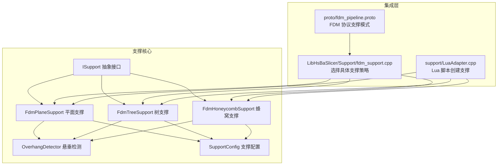
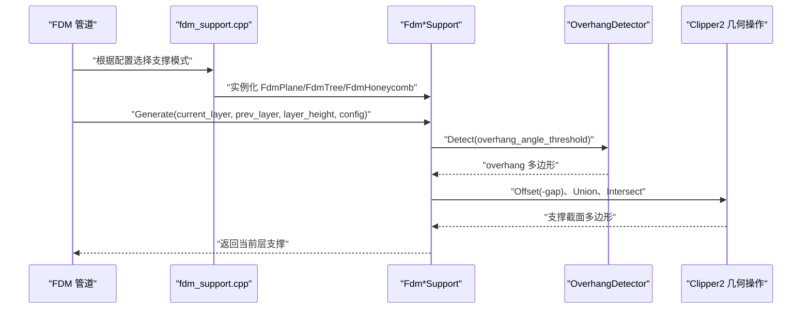
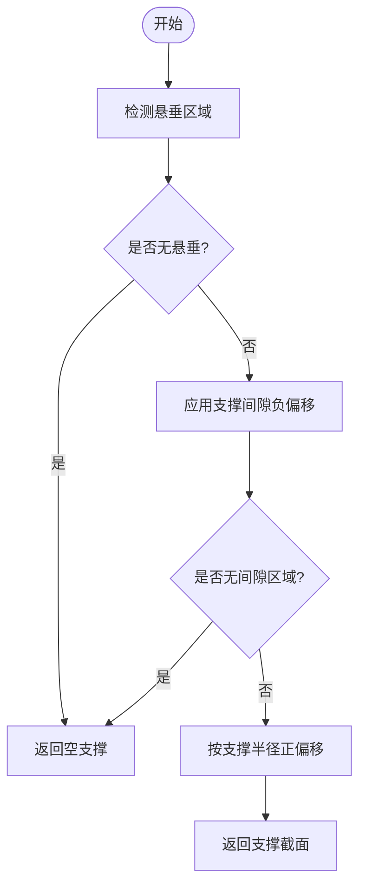
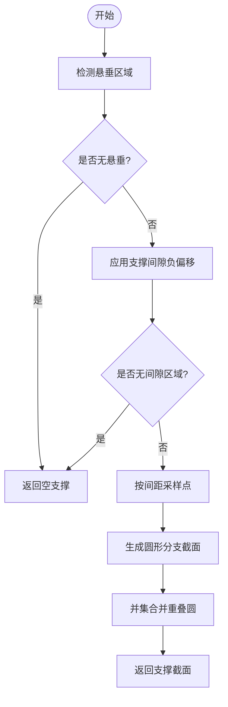
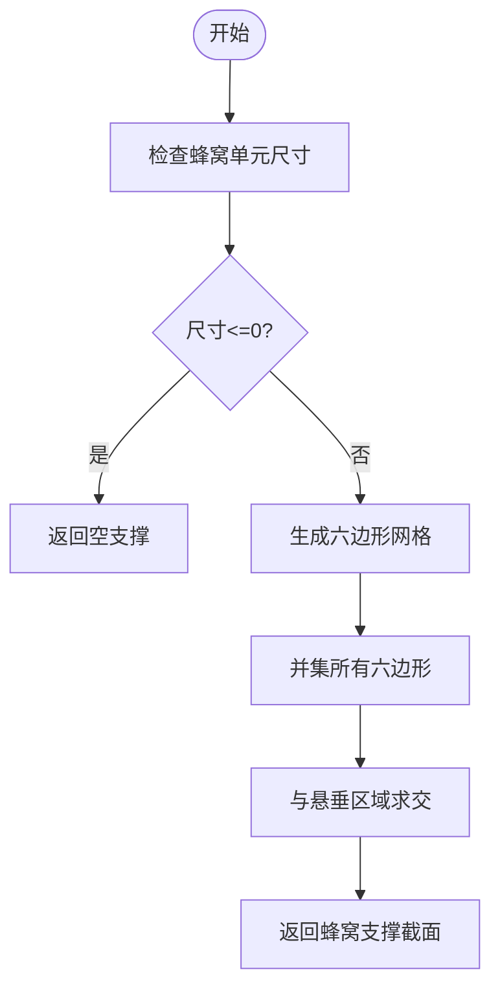
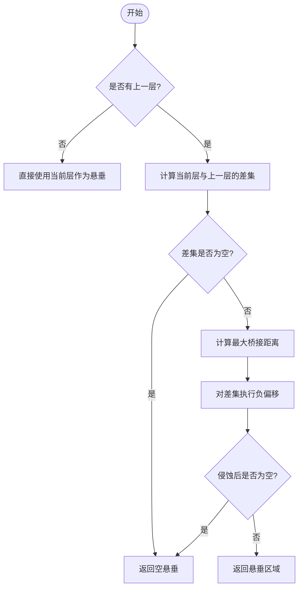
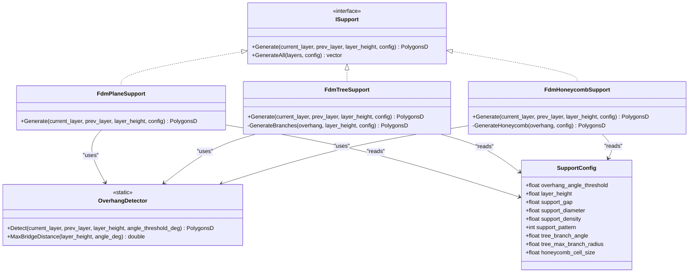
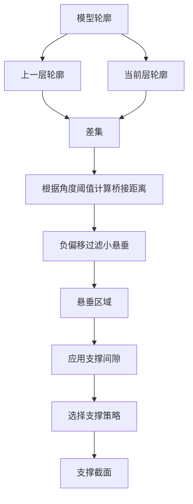

# FdmSupport / FDM支撑类

<cite>
**Referenced Files in This Document**   
- [FdmSupport.hpp](file://support/FdmSupport.hpp)
- [FdmSupport.cpp](file://support/FdmSupport.cpp)
- [ISupport.hpp](file://support/ISupport.hpp)
- [OverhangDetector.hpp](file://support/OverhangDetector.hpp)
- [OverhangDetector.cpp](file://support/OverhangDetector.cpp)
- [SupportConfig.hpp](file://support/SupportConfig.hpp)
- [fdm_support.cpp](file://LibHsBaSlicer/Support/fdm_support.cpp)
- [LuaAdapter.cpp](file://support/LuaAdapter.cpp)
- [fdm_pipeline.proto](file://proto/fdm_pipeline.proto)
- [support_test.cpp](file://tests\Support\support_test.cpp)
</cite>

## 目录
1. [简介](#简介)
2. [项目结构定位](#项目结构定位)
3. [核心组件](#核心组件)
4. [架构总览](#架构总览)
5. [详细组件分析](#详细组件分析)
6. [依赖关系分析](#依赖关系分析)
7. [性能与复杂度](#性能与复杂度)
8. [配置参数与密度控制](#配置参数与密度控制)
9. [悬垂检测与接触面优化](#悬垂检测与接触面优化)
10. [自定义支撑示例](#自定义支撑示例)
11. [常见问题与排错](#常见问题与排错)
12. [结论](#结论)

## 简介
本文档聚焦于 FDM 切片流程中的支撑生成能力，围绕 `FdmPlaneSupport`、`FdmTreeSupport`、`FdmHoneycombSupport` 三类支撑算法展开。文档说明：
- 支撑如何基于相邻层轮廓计算悬垂区域；
- 平面柱状支撑、树状分支支撑、蜂窝填充支撑的几何构造方式；
- 关键配置项：悬垂角度阈值、层高、支撑间隙、支撑直径、支撑密度、蜂窝单元尺寸等；
- 支撑与模型几何的交互方式，包括间隙收缩、膨胀、并集、交集等布尔运算；
- 在管道、Lua 脚本和测试中的集成位置。

该文档面向希望理解或定制 FDM 支撑行为的工程师与高级用户，既提供高层流程图，也给出源码级实现路径。

## 项目结构定位
FDM 支撑相关代码主要位于以下位置：
- 支撑策略定义与实现：`support/FdmSupport.hpp`、`support/FdmSupport.cpp`
- 支撑抽象接口：`support/ISupport.hpp`
- 悬垂检测器：`support/OverhangDetector.hpp`、`support/OverhangDetector.cpp`
- 支撑通用配置：`support/SupportConfig.hpp`
- FDM 管道对具体支撑策略的选择与实例化：`LibHsBaSlicer/Support/fdm_support.cpp`
- Lua 脚本侧支撑工厂：`support/LuaAdapter.cpp`
- FDM 协议中支撑模式枚举：`proto/fdm_pipeline.proto`
- 单元测试用例：`tests\Support\support_test.cpp`

**图表来源**
- [FdmSupport.hpp:11-63](file://support/FdmSupport.hpp#L11-L63)
- [ISupport.hpp:14-45](file://support/ISupport.hpp#L14-L45)
- [OverhangDetector.hpp:12-50](file://support/OverhangDetector.hpp#L12-L50)
- [SupportConfig.hpp:14-43](file://support/SupportConfig.hpp#L14-L43)
- [fdm_support.cpp:22-48](file://LibHsBaSlicer/Support/fdm_support.cpp#L22-L48)
- [LuaAdapter.cpp:115-133](file://support/LuaAdapter.cpp#L115-L133)
- [fdm_pipeline.proto:12-17](file://proto/fdm_pipeline.proto#L12-L17)

**章节来源**
- [FdmSupport.hpp:1-66](file://support/FdmSupport.hpp#L1-L66)
- [ISupport.hpp:1-49](file://support/ISupport.hpp#L1-L49)
- [OverhangDetector.hpp:1-54](file://support/OverhangDetector.hpp#L1-L54)
- [SupportConfig.hpp:1-47](file://support/SupportConfig.hpp#L1-L47)
- [fdm_support.cpp:22-48](file://LibHsBaSlicer/Support/fdm_support.cpp#L22-L48)
- [LuaAdapter.cpp:115-133](file://support/LuaAdapter.cpp#L115-L133)
- [fdm_pipeline.proto:12-17](file://proto/fdm_pipeline.proto#L12-L17)

## 核心组件
- `ISupport`：定义每层支撑生成的统一接口，包含单层的 `Generate` 与全层 `GenerateAll`。
- `FdmPlaneSupport`：从悬垂区域生成柱状支撑截面，通过支撑直径膨胀形成圆形柱体横截面。
- `FdmTreeSupport`：在悬垂区域内按间距采样点，生成树状分支的圆形截面，并在层间合并扩张。
- `FdmHoneycombSupport`：在悬垂区域内生成六边形蜂窝网格，并与悬垂区域求交得到轻量但刚性的支撑。
- `OverhangDetector`：根据当前层与上一层的差集、悬垂角度阈值与层高，计算需要支撑的区域。
- `SupportConfig`：支撑算法共享的配置结构，包括悬垂角度、层高、间隙、直径、密度、图案类型、树分支角度、最大分支半径、蜂窝单元尺寸等。

**章节来源**
- [ISupport.hpp:14-45](file://support/ISupport.hpp#L14-L45)
- [FdmSupport.hpp:13-63](file://support/FdmSupport.hpp#L13-L63)
- [OverhangDetector.hpp:14-50](file://support/OverhangDetector.hpp#L14-L50)
- [SupportConfig.hpp:14-43](file://support/SupportConfig.hpp#L14-L43)

## 架构总览
FDM 支撑系统采用“策略 + 检测 + 配置”的分层设计：
- 上层管道（如 `LibHsBaSlicer/Support/fdm_support.cpp`）根据配置选择具体的支撑策略；
- 每个策略实现 `ISupport::Generate`，调用 `OverhangDetector` 获取悬垂区域；
- 策略内部使用 Clipper2 几何库进行偏移、并集、交集等操作，输出当前层支撑多边形；
- Lua 脚本可通过 `support/LuaAdapter.cpp` 创建对应支撑对象；
- 协议层通过 `fdm_pipeline.proto` 暴露支撑模式枚举，供外部系统配置。

**图表来源**
- [fdm_support.cpp:22-48](file://LibHsBaSlicer/Support/fdm_support.cpp#L22-L48)
- [FdmSupport.cpp:48-76](file://support/FdmSupport.cpp#L48-L76)
- [FdmSupport.cpp:145-168](file://support/FdmSupport.cpp#L145-L168)
- [FdmSupport.cpp:244-267](file://support/FdmSupport.cpp#L244-L267)
- [OverhangDetector.cpp:41-87](file://support/OverhangDetector.cpp#L41-L87)

## 详细组件分析

### 平面支撑（FdmPlaneSupport）
平面支撑将悬垂区域收缩一个间隙距离，再向外膨胀支撑半径，形成柱状支撑截面。其流程为：
1. 调用 `OverhangDetector::Detect` 计算悬垂区域；
2. 若为空则直接返回空结果；
3. 应用 `support_gap` 负偏移，使支撑与模型分离；
4. 以 `support_diameter/2` 为正偏移，生成圆形柱体横截面；
5. 返回浮点多边形集合。

**图表来源**
- [FdmSupport.cpp:48-76](file://support/FdmSupport.cpp#L48-L76)
- [OverhangDetector.cpp:41-87](file://support/OverhangDetector.cpp#L41-L87)

**章节来源**
- [FdmSupport.cpp:48-76](file://support/FdmSupport.cpp#L48-L76)

### 树支撑（FdmTreeSupport）
树支撑在悬垂区域内按固定间距采样点，在每个采样点生成圆形分支截面，并通过并集合并重叠圆。其关键点：
- 分支尖端半径由 `support_diameter/2` 决定；
- 采样间距为 `support_diameter * 1.5`；
- 先应用间隙收缩，再在收缩后的区域上采样；
- 最终对多个圆做并集，得到连通的支撑点阵。

**图表来源**
- [FdmSupport.cpp:81-143](file://support/FdmSupport.cpp#L81-L143)
- [FdmSupport.cpp:145-168](file://support/FdmSupport.cpp#L145-L168)

**章节来源**
- [FdmSupport.cpp:81-168](file://support/FdmSupport.cpp#L81-L168)

### 蜂窝支撑（FdmHoneycombSupport）
蜂窝支撑在悬垂区域内生成六边形网格，然后与悬垂区域求交，得到轻量化支撑结构。其关键点：
- 六边形宽度为 `honeycomb_cell_size`，高度为 `cell_size * sqrt(3)/2`；
- 行偏移交错排列，列间距为 `hex_w * 1.5`；
- 先生成所有六边形，再做并集后与悬垂区域求交；
- 若单元格尺寸非正，直接返回空结果。

**图表来源**
- [FdmSupport.cpp:173-242](file://support/FdmSupport.cpp#L173-L242)
- [FdmSupport.cpp:244-267](file://support/FdmSupport.cpp#L244-L267)

**章节来源**
- [FdmSupport.cpp:173-267](file://support/FdmSupport.cpp#L173-L267)

### 悬垂检测器（OverhangDetector）
悬垂检测器负责根据当前层与上一层的几何差异，结合悬垂角度阈值与层高，计算需要支撑的区域。其逻辑：
- 若无上一层，则整个当前层视为悬垂；
- 计算当前层与上一层的差集；
- 根据角度阈值计算最大桥接距离；
- 对差集执行负偏移（侵蚀），过滤可桥接的小悬垂；
- 返回侵蚀后的悬垂区域。

**图表来源**
- [OverhangDetector.cpp:23-39](file://support/OverhangDetector.cpp#L23-L39)
- [OverhangDetector.cpp:41-87](file://support/OverhangDetector.cpp#L41-L87)

**章节来源**
- [OverhangDetector.cpp:23-87](file://support/OverhangDetector.cpp#L23-L87)

## 依赖关系分析
支撑策略之间的耦合度较低，主要通过 `ISupport` 接口与 `SupportConfig` 配置解耦。共同依赖：
- `OverhangDetector`：用于悬垂区域计算；
- Clipper2 几何库：用于多边形偏移、并集、交集；
- `SupportConfig`：提供算法所需参数。

**图表来源**
- [ISupport.hpp:14-45](file://support/ISupport.hpp#L14-L45)
- [FdmSupport.hpp:13-63](file://support/FdmSupport.hpp#L13-L63)
- [OverhangDetector.hpp:14-50](file://support/OverhangDetector.hpp#L14-L50)
- [SupportConfig.hpp:14-43](file://support/SupportConfig.hpp#L14-L43)

**章节来源**
- [ISupport.hpp:14-45](file://support/ISupport.hpp#L14-L45)
- [FdmSupport.hpp:13-63](file://support/FdmSupport.hpp#L13-L63)
- [OverhangDetector.hpp:14-50](file://support/OverhangDetector.hpp#L14-L50)
- [SupportConfig.hpp:14-43](file://support/SupportConfig.hpp#L14-L43)

## 性能与复杂度
- 平面支撑：主要开销在于一次差集、一次负偏移、一次正偏移，时间复杂度近似 O(n)，n 为多边形顶点数。
- 树支撑：除几何操作外，还需遍历边界框内采样点并进行点是否在多边形内的判断，复杂度约为 O(grid_points × n)。
- 蜂窝支撑：需生成大量六边形并做并集与交集，复杂度随单元格数量线性增长，且受 `honeycomb_cell_size` 影响显著。
- 悬垂检测：差集与负偏移为主要开销，角度阈值越小，侵蚀距离越大，小悬垂被过滤的概率越高。

优化建议：
- 合理设置 `honeycomb_cell_size`，避免过密网格导致性能下降；
- 调整 `support_diameter` 与采样间距，平衡支撑密度与计算量；
- 对于大模型，优先使用平面支撑或降低蜂窝密度。

[本节为通用性能讨论，不直接分析具体文件]

## 配置参数与密度控制
`SupportConfig` 提供支撑算法的核心参数，部分字段在 FDM 扩展结构中进一步细化。

| 参数 | 类型 | 默认值 | 含义 | 影响范围 |
|------|------|--------|------|----------|
| `overhang_angle_threshold` | float | 45.0f | 悬垂角度阈值（度） | 悬垂检测、桥接过滤 |
| `layer_height` | float | 0.2f | 层高（mm） | 悬垂检测、桥接距离 |
| `support_gap` | float | 0.5f | 支撑与模型间隙（mm） | 所有支撑策略的接触面分离 |
| `support_diameter` | float | 2.0f | 支撑柱直径（mm） | 平面支撑柱半径、树支撑分支半径 |
| `support_density` | float | 0.3f | 支撑填充密度 [0,1] | 后续填充阶段密度控制 |
| `support_pattern` | int | 0 | 支撑图案：0=平面，1=树，2=蜂窝 | 管道选择具体策略 |
| `tree_branch_angle` | float | 30.0f | 树分支角度（度） | 树支撑分支方向（当前 2D 截面未直接使用） |
| `tree_max_branch_radius` | float | 5.0f | 树最大分支半径（mm） | 树支撑分支扩张（当前 2D 截面未直接使用） |
| `honeycomb_cell_size` | float | 5.0f | 蜂窝单元尺寸（mm） | 蜂窝支撑网格密度 |

FDM 扩展配置：
- `interface_layers`：支撑与模型之间的界面层数；
- `interface_density`：界面层填充密度。

SLA 扩展配置：
- `tip_diameter`：支撑尖端直径（mm）；
- `raft_thickness`：筏板厚度（mm）。

**章节来源**
- [SupportConfig.hpp:14-43](file://support/SupportConfig.hpp#L14-L43)
- [fdm_pipeline.proto:12-17](file://proto/fdm_pipeline.proto#L12-L17)

## 悬垂检测与接触面优化
悬垂检测与接触面优化是支撑生成的基础：
- 悬垂检测通过差集与负偏移过滤可桥接区域，角度阈值越低，越容易触发支撑；
- 接触面优化通过 `support_gap` 负偏移，确保支撑与模型表面分离，便于后期移除；
- 平面支撑通过正偏移生成柱体，树支撑通过采样点生成分支，蜂窝支撑通过网格填充提供刚性支撑。

**图表来源**
- [OverhangDetector.cpp:41-87](file://support/OverhangDetector.cpp#L41-L87)
- [FdmSupport.cpp:48-76](file://support/FdmSupport.cpp#L48-L76)
- [FdmSupport.cpp:145-168](file://support/FdmSupport.cpp#L145-L168)
- [FdmSupport.cpp:244-267](file://support/FdmSupport.cpp#L244-L267)

**章节来源**
- [OverhangDetector.cpp:41-87](file://support/OverhangDetector.cpp#L41-L87)
- [FdmSupport.cpp:48-76](file://support/FdmSupport.cpp#L48-L76)
- [FdmSupport.cpp:145-168](file://support/FdmSupport.cpp#L145-L168)
- [FdmSupport.cpp:244-267](file://support/FdmSupport.cpp#L244-L267)

## 自定义支撑示例
以下为常见模型几何与打印需求的支撑定制建议：

| 场景 | 推荐支撑策略 | 关键参数建议 | 说明 |
|------|--------------|--------------|------|
| 简单悬垂平板 | 平面支撑 | `support_gap=0.5`, `support_diameter=2.0`, `overhang_angle_threshold=45` | 柱状支撑易于移除，适合大面积悬垂 |
| 复杂悬垂结构 | 树支撑 | `support_diameter=2.0`, 采样间距自动为 `support_diameter*1.5` | 分支点阵减少材料用量，适合复杂悬垂 |
| 轻量化刚性支撑 | 蜂窝支撑 | `honeycomb_cell_size=5.0`, 可根据强度调小 | 蜂窝网格提供良好刚度，适合薄壁悬垂 |
| 高精度表面要求 | 增大间隙 | `support_gap=0.8~1.0` | 更大间隙减少模型表面损伤 |
| 快速打印 | 降低密度 | `support_density=0.2~0.3` | 减少填充密度提升速度 |

在管道中切换支撑模式：
- C++ 管道通过 `fdm_support.cpp` 根据 `support_pattern` 选择策略；
- Lua 脚本通过 `LuaAdapter.cpp` 创建对应支撑对象；
- 协议层通过 `fdm_pipeline.proto` 的 `msg_fdm_support_pattern` 枚举传递模式。

**章节来源**
- [fdm_support.cpp:22-48](file://LibHsBaSlicer/Support/fdm_support.cpp#L22-L48)
- [LuaAdapter.cpp:115-133](file://support/LuaAdapter.cpp#L115-L133)
- [fdm_pipeline.proto:12-17](file://proto/fdm_pipeline.proto#L12-L17)

## 常见问题与排错
- 无支撑生成：
  - 检查 `overhang_angle_threshold` 是否过高，导致悬垂被过滤；
  - 确认 `layer_height` 与模型比例是否合理；
  - 验证 `support_gap` 是否过大，导致悬垂区域被完全收缩。
- 支撑过于密集：
  - 增大 `honeycomb_cell_size` 或 `support_diameter`；
  - 降低 `support_density`。
- 支撑与模型粘连：
  - 增大 `support_gap`；
  - 检查负偏移是否正确应用。
- 树支撑分支稀疏：
  - 减小 `support_diameter` 以缩小采样间距；
  - 检查悬垂区域是否过小。
- 蜂窝支撑空洞过多：
  - 减小 `honeycomb_cell_size`；
  - 检查单元格尺寸是否为正。

测试用例参考：
- 平面支撑测试：`tests\Support\support_test.cpp` 中验证悬垂环形面积与支撑面积范围；
- 树支撑测试：验证无悬垂时返回空，有悬垂时生成分支；
- 蜂窝支撑测试：验证蜂窝网格生成与悬垂区域交集。

**章节来源**
- [support_test.cpp:112-128](file://tests\Support\support_test.cpp#L112-L128)
- [support_test.cpp:137-159](file://tests\Support\support_test.cpp#L137-L159)
- [support_test.cpp:168-190](file://tests\Support\support_test.cpp#L168-L190)

## 结论
FDM 支撑系统通过 `ISupport` 抽象接口、`OverhangDetector` 悬垂检测与 `SupportConfig` 配置实现了高内聚、低耦合的支撑生成架构。平面支撑、树支撑与蜂窝支撑分别适用于不同几何与打印需求，用户可通过调整间隙、直径、密度、角度阈值等参数精细控制支撑结构与质量。在实际工程中，建议根据模型悬垂特征选择合适的支撑策略，并结合测试用例验证支撑效果。

[本节为总结性内容，不直接分析具体文件]