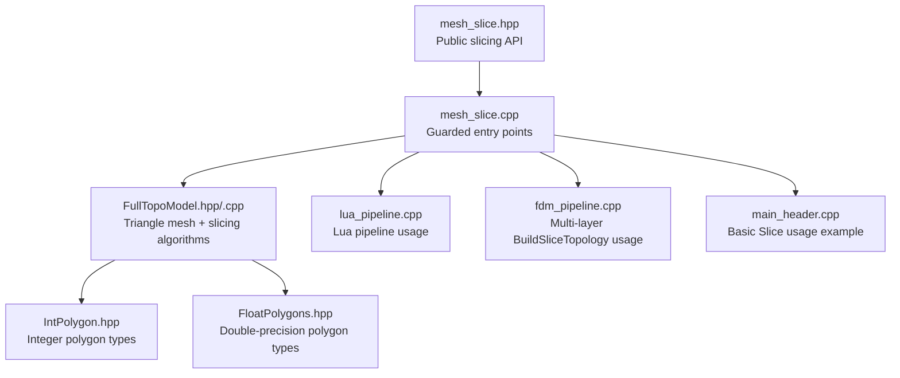
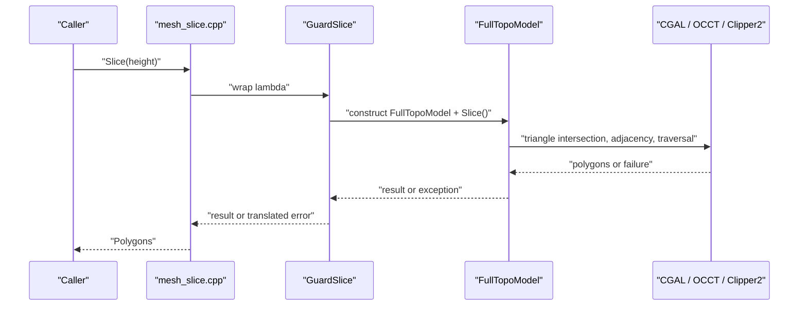
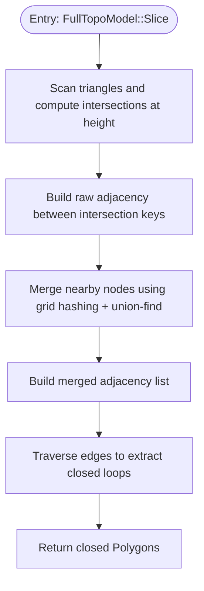
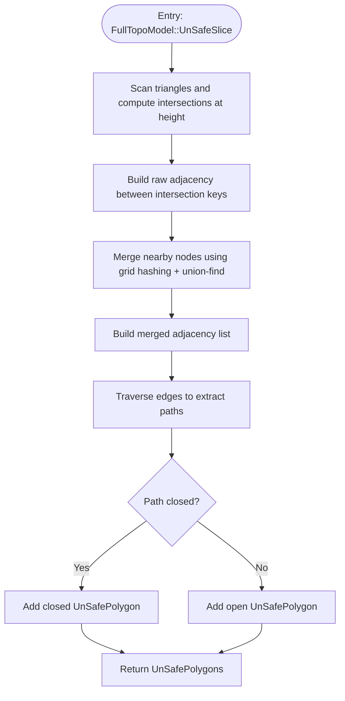
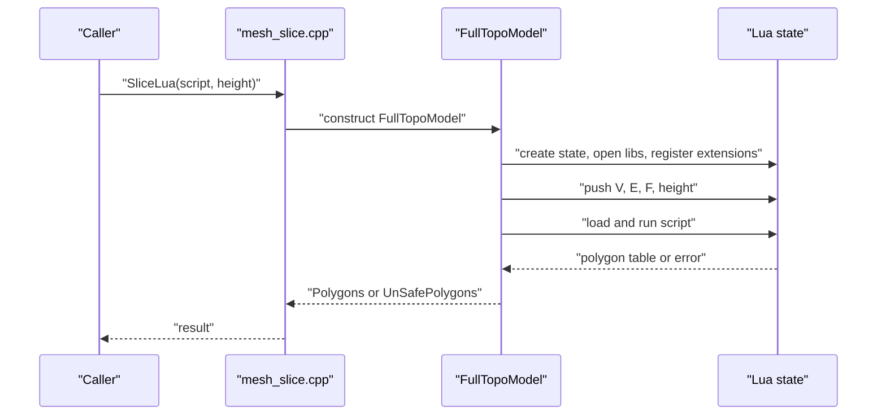
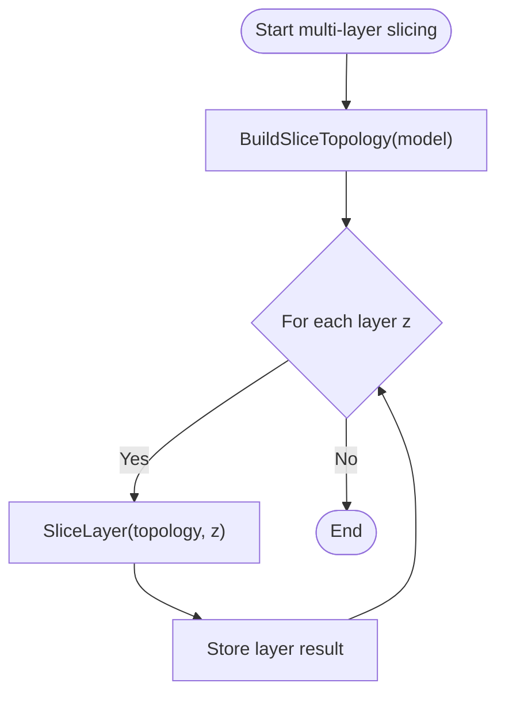
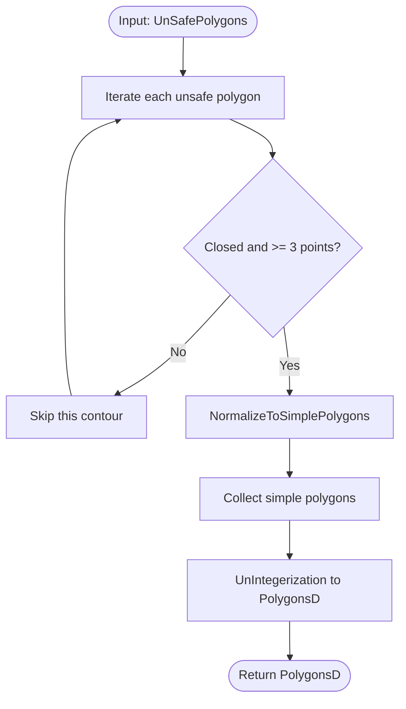
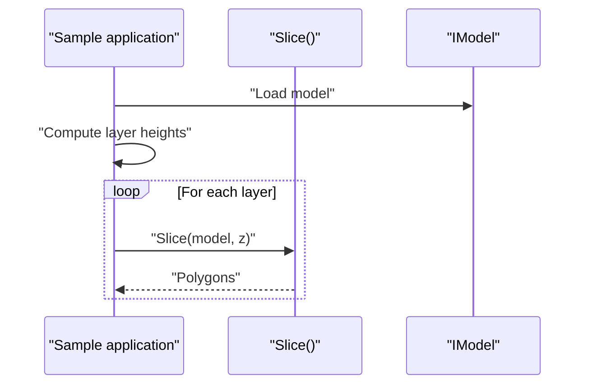
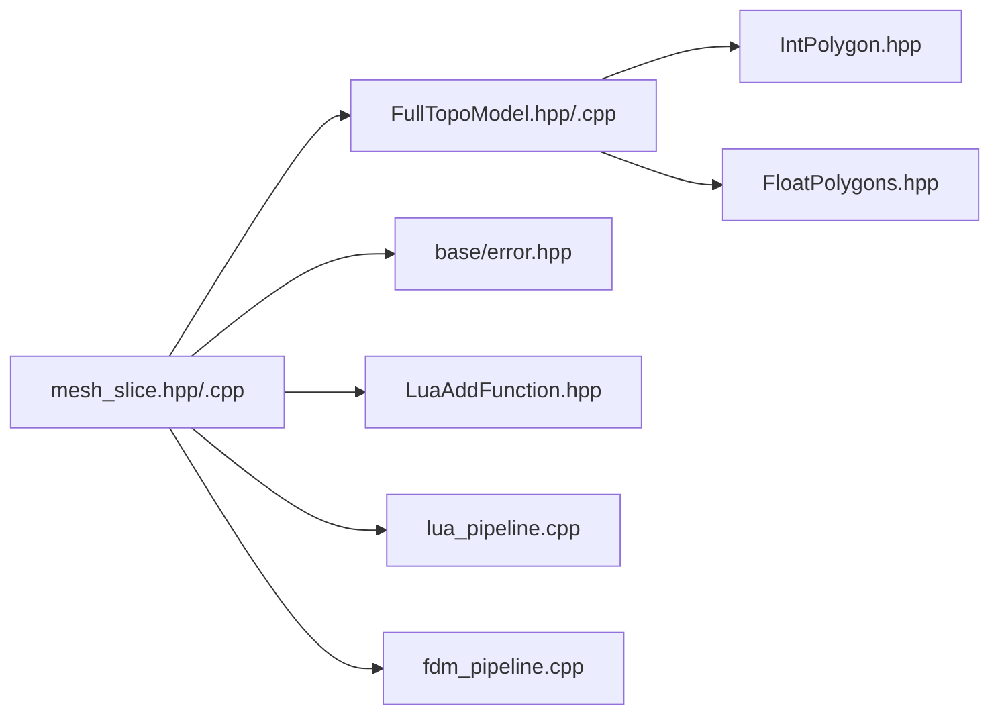

# MeshSlice / 网格切片类

<cite>
**Referenced Files in This Document**   
- [mesh_slice.hpp](file://LibHsBaSlicer/Slice/mesh_slice.hpp)
- [mesh_slice.cpp](file://LibHsBaSlicer/Slice/mesh_slice.cpp)
- [FullTopoModel.hpp](file://meshmodel/FullTopoModel.hpp)
- [FullTopoModel.cpp](file://meshmodel/FullTopoModel.cpp)
- [IntPolygon.hpp](file://2D/IntPolygon.hpp)
- [FloatPolygons.hpp](file://2D/FloatPolygons.hpp)
- [lua_pipeline.cpp](file://LibHsBaSlicer/Extends/lua_pipeline.cpp)
- [fdm_pipeline.cpp](file://DllHsBaSlicer/fdm_pipeline.cpp)
- [main_header.cpp](file://samples/LibHsBaSlicer/main_header.cpp)
</cite>

## Table of Contents
1. [Introduction](#introduction)
2. [Project Structure](#project-structure)
3. [Core Components](#core-components)
4. [Architecture Overview](#architecture-overview)
5. [Detailed Component Analysis](#detailed-component-analysis)
6. [Dependency Analysis](#dependency-analysis)
7. [Performance Considerations](#performance-considerations)
8. [Troubleshooting Guide](#troubleshooting-guide)
9. [Conclusion](#conclusion)
10. [Appendices](#appendices)

## Introduction
This document explains the MeshSlice functionality in HsBaSlicer: the planar mesh slicing API that turns a 3D model into 2D layer contours. It focuses on the core functions `Slice()`, `UnSafeSlice()`, `SliceLua()`, `UnSafeSliceLua()`, the reusable topology helpers `BuildSliceTopology()` and `SliceLayer()`, and the post-processing helper `NormalizeUnSafePolygons()`.

The key ideas are:
- Safe slicing returns only closed polygons; unsafe slicing may include open polylines.
- Lua-driven slicing lets scripts produce custom polygon outputs from vertex, edge, and face data.
- Reusable topology avoids rebuilding the full topological mesh for every layer.
- All exported C++ entry points wrap geometry kernels with exception translation so failures become project error types rather than leaking third-party exceptions.

## Project Structure
MeshSlice is implemented as a small public API surface over `FullTopoModel`, which owns the reconstructed triangle mesh and its vertex/edge/face relationships. The 2D polygon types live under the 2D geometry module.

**Diagram sources**
- [mesh_slice.hpp:1-108](file://LibHsBaSlicer/Slice/mesh_slice.hpp#L1-L108)
- [mesh_slice.cpp:1-119](file://LibHsBaSlicer/Slice/mesh_slice.cpp#L1-L119)
- [FullTopoModel.hpp:1-150](file://meshmodel/FullTopoModel.hpp#L1-L150)
- [FullTopoModel.cpp:328-1099](file://meshmodel/FullTopoModel.cpp#L328-L1099)
- [IntPolygon.hpp:1-241](file://2D/IntPolygon.hpp#L1-L241)
- [FloatPolygons.hpp:1-271](file://2D/FloatPolygons.hpp#L1-L271)
- [lua_pipeline.cpp:445-459](file://LibHsBaSlicer/Extends/lua_pipeline.cpp#L445-L459)
- [fdm_pipeline.cpp:265-272](file://DllHsBaSlicer/fdm_pipeline.cpp#L265-L272)
- [main_header.cpp:84-100](file://samples/LibHsBaSlicer/main_header.cpp#L84-L100)

**Section sources**
- [mesh_slice.hpp:1-108](file://LibHsBaSlicer/Slice/mesh_slice.hpp#L1-L108)
- [mesh_slice.cpp:1-119](file://LibHsBaSlicer/Slice/mesh_slice.cpp#L1-L119)

## Core Components
The MeshSlice API provides six primary operations:

| Function | Input | Output | Behavior |
|---|---|---|---|
| `Slice(model, height, tolerance)` | Model, slice Z, coordinate tolerance | Closed integer-coordinate polygons | Discards open contours; suitable when downstream processing requires closed loops. |
| `UnSafeSlice(model, height, tolerance)` | Model, slice Z, coordinate tolerance | Potentially open integer-coordinate contours | Keeps open polylines; useful for material-fed processes where open paths can be meaningful. |
| `SliceLua(model, script, height)` | Model, inline Lua script, slice Z | Closed integer-coordinate polygons | Runs a Lua script that receives vertex/edge/face data and returns polygons. |
| `UnSafeSliceLua(model, script, height)` | Model, inline Lua script, slice Z | Potentially open integer-coordinate contours | Same as `SliceLua` but allows open contours. |
| `BuildSliceTopology(model)` | Model | Shared topology object | Builds the full topological mesh once; reuse it across layers. |
| `SliceLayer(topology, z, tolerance)` | Prebuilt topology, slice Z, tolerance | Double-precision polygons | Reads the shared topology and normalizes results to `PolygonsD`. |
| `NormalizeUnSafePolygons(unsafe_polys)` | Unsafe polygons | Double-precision polygons | Filters invalid shapes and converts integer coordinates to double precision. |

Key type definitions:
- `Point2`, `Polygon`, `Polygons`: integer-coordinate 2D types used internally by slicing.
- `Point2D`, `PolygonD`, `PolygonsD`: double-precision 2D types used by higher-level pipelines.
- `UnSafePolygon`: a contour plus a `closed` flag.
- `UnSafePolygons`: a vector of possibly-open contours.

**Section sources**
- [mesh_slice.hpp:22-103](file://LibHsBaSlicer/Slice/mesh_slice.hpp#L22-L103)
- [FullTopoModel.hpp:23-41](file://meshmodel/FullTopoModel.hpp#L23-L41)
- [IntPolygon.hpp:16-26](file://2D/IntPolygon.hpp#L16-L26)
- [FloatPolygons.hpp:18-25](file://2D/FloatPolygons.hpp#L18-L25)

## Architecture Overview
At runtime, MeshSlice translates user calls into geometry work performed by `FullTopoModel`. A guard wrapper ensures that external geometry libraries do not leak their exception types across the public API boundary.

**Diagram sources**
- [mesh_slice.cpp:28-43](file://LibHsBaSlicer/Slice/mesh_slice.cpp#L28-L43)
- [mesh_slice.cpp:46-54](file://LibHsBaSlicer/Slice/mesh_slice.cpp#L46-L54)
- [FullTopoModel.cpp:328-599](file://meshmodel/FullTopoModel.cpp#L328-L599)

## Detailed Component Analysis

### Safe Slicing: `Slice()`
`Slice()` is the default choice when you need closed 2D outlines per layer. Internally it constructs a temporary `FullTopoModel`, calls its safe slicing algorithm, and wraps the call with `GuardSlice`.

Implementation highlights:
- Creates a local `FullTopoModel` from the input model.
- Calls `FullTopoModel::Slice(height, tolerance)`.
- Returns closed integer-coordinate polygons.

Use cases:
- FDM wall/outline generation.
- Any pipeline stage that expects closed loops.

Error handling:
- Project `RuntimeError` exceptions pass through unchanged.
- Other `std::exception` types are converted to `IOError` with a descriptive message.

Thread safety:
- Each call builds its own `FullTopoModel`; concurrent calls are independent.

**Section sources**
- [mesh_slice.cpp:46-54](file://LibHsBaSlicer/Slice/mesh_slice.cpp#L46-L54)
- [FullTopoModel.cpp:328-599](file://meshmodel/FullTopoModel.cpp#L328-L599)

#### Safe Slicing Algorithm Flow

**Diagram sources**
- [FullTopoModel.cpp:328-599](file://meshmodel/FullTopoModel.cpp#L328-L599)

### Unsafe Slicing: `UnSafeSlice()`
`UnSafeSlice()` returns both closed and open contours. It is intended for scenarios where open polylines carry meaning, such as some material-fed additive manufacturing processes.

Implementation highlights:
- Also constructs a temporary `FullTopoModel`.
- Calls `FullTopoModel::UnSafeSlice(height, tolerance)`.
- Returns `UnSafePolygons`, where each contour has a `closed` flag.

When to use:
- Material-fed processes where open paths should not be discarded.
- When you want to inspect or filter open contours yourself.

Post-processing:
- Use `NormalizeUnSafePolygons()` to remove invalid shapes and convert to double-precision polygons.

**Section sources**
- [mesh_slice.cpp:56-64](file://LibHsBaSlicer/Slice/mesh_slice.cpp#L56-L64)
- [FullTopoModel.cpp:604-873](file://meshmodel/FullTopoModel.cpp#L604-L873)

#### Unsafe Slicing Algorithm Flow

**Diagram sources**
- [FullTopoModel.cpp:604-873](file://meshmodel/FullTopoModel.cpp#L604-L873)

### Lua-Driven Slicing: `SliceLua()` and `UnSafeSliceLua()`
These functions let you write a Lua script that produces polygons from the underlying mesh data.

Script environment:
- Global tables `V`, `E`, and `F` expose vertices, edges, and faces.
- Global variable `height` exposes the current slice height.
- Scripts may return a table of polygons or set a global `polys` table.

Behavior:
- `SliceLua()` returns closed polygons.
- `UnSafeSliceLua()` returns potentially open polygons.
- Both construct a temporary `FullTopoModel` and delegate to the corresponding `FullTopoModel` Lua method.

Typical usage pattern:
1. Load or define an inline Lua script string.
2. Call `SliceLua()` or `UnSafeSliceLua()` with the model, script, and height.
3. Handle returned polygons or catch errors.

Error handling:
- Lua initialization failures, load failures, and runtime errors are wrapped as `RuntimeError`.
- The outer `GuardSlice` wrapper also catches foreign exceptions and converts them to `IOError`.

**Section sources**
- [mesh_slice.cpp:66-84](file://LibHsBaSlicer/Slice/mesh_slice.cpp#L66-L84)
- [FullTopoModel.cpp:1027-1099](file://meshmodel/FullTopoModel.cpp#L1027-L1099)
- [FullTopoModel.hpp:116-132](file://meshmodel/FullTopoModel.hpp#L116-L132)

#### Lua Slicing Sequence

**Diagram sources**
- [mesh_slice.cpp:66-84](file://LibHsBaSlicer/Slice/mesh_slice.cpp#L66-L84)
- [FullTopoModel.cpp:1027-1099](file://meshmodel/FullTopoModel.cpp#L1027-L1099)

### Reusable Topology: `BuildSliceTopology()` and `SliceLayer()`
For multi-layer slicing, repeatedly calling `Slice()` or `UnSafeSlice()` rebuilds the full topology on every layer. `BuildSliceTopology()` builds the topology once and returns a shared pointer to a self-contained `FullTopoModel`. `SliceLayer()` then slices a single layer from that prebuilt topology and returns normalized double-precision polygons.

Recommended workflow:
1. Call `BuildSliceTopology(model)` once.
2. For each layer, call `SliceLayer(topology, z)`.
3. Share the same topology across threads if needed.

Thread safety:
- The documentation states that `SliceLayer()` only const-reads the shared topology, so concurrent calls sharing the same topology are safe as long as each writes to its own output slot.

Usage in pipelines:
- Multiple pipeline implementations build the topology once and then slice multiple layers in parallel or sequential loops.

**Section sources**
- [mesh_slice.hpp:79-103](file://LibHsBaSlicer/Slice/mesh_slice.hpp#L79-L103)
- [mesh_slice.cpp:106-116](file://LibHsBaSlicer/Slice/mesh_slice.cpp#L106-L116)
- [fdm_pipeline.cpp:265-272](file://DllHsBaSlicer/fdm_pipeline.cpp#L265-L272)

#### Multi-Layer Topology Workflow

**Diagram sources**
- [mesh_slice.cpp:106-116](file://LibHsBaSlicer/Slice/mesh_slice.cpp#L106-L116)
- [fdm_pipeline.cpp:265-272](file://DllHsBaSlicer/fdm_pipeline.cpp#L265-L272)

### Post-Processing: `NormalizeUnSafePolygons()`
`NormalizeUnSafePolygons()` cleans up raw unsafe slicing results:
- Skips open polylines.
- Skips polygons with fewer than three points.
- Simplifies and splits polygons into simple polygons.
- Converts integer coordinates to double-precision coordinates.

Output:
- `PolygonsD`, suitable for downstream floating-point geometry operations.

Typical usage:
- After `UnSafeSlice()` when you want robust double-precision polygons.
- In Lua pipeline wrappers that normalize unsafe results before pushing them back to Lua.

**Section sources**
- [mesh_slice.hpp:67-77](file://LibHsBaSlicer/Slice/mesh_slice.hpp#L67-L77)
- [mesh_slice.cpp:86-104](file://LibHsBaSlicer/Slice/mesh_slice.cpp#L86-L104)
- [lua_pipeline.cpp:459-459](file://LibHsBaSlicer/Extends/lua_pipeline.cpp#L459-L459)

#### Normalization Flow

**Diagram sources**
- [mesh_slice.cpp:86-104](file://LibHsBaSlicer/Slice/mesh_slice.cpp#L86-L104)

### Typical Usage Patterns

#### Basic Safe Slicing Example
A typical FDM sample loads a model, computes total layers, and calls `Slice()` for each layer height.

**Diagram sources**
- [main_header.cpp:84-100](file://samples/LibHsBaSlicer/main_header.cpp#L84-L100)

**Section sources**
- [main_header.cpp:84-100](file://samples/LibHsBaSlicer/main_header.cpp#L84-L100)

#### Lua Pipeline Usage Pattern
The Lua pipeline wrapper demonstrates calling `Slice()` and `UnSafeSlice()` and normalizing unsafe results before pushing them onto the Lua stack.

**Section sources**
- [lua_pipeline.cpp:445-459](file://LibHsBaSlicer/Extends/lua_pipeline.cpp#L445-L459)

## Dependency Analysis
MeshSlice depends on several lower-level components:

**Diagram sources**
- [mesh_slice.hpp:1-17](file://LibHsBaSlicer/Slice/mesh_slice.hpp#L1-L17)
- [mesh_slice.cpp:12-13](file://LibHsBaSlicer/Slice/mesh_slice.cpp#L12-L13)
- [lua_pipeline.cpp:445-459](file://LibHsBaSlicer/Extends/lua_pipeline.cpp#L445-L459)
- [fdm_pipeline.cpp:265-272](file://DllHsBaSlicer/fdm_pipeline.cpp#L265-L272)

Coupling observations:
- MeshSlice is a thin, guarded API over `FullTopoModel`.
- Geometry complexity lives in `FullTopoModel`, while MeshSlice manages lifecycle, normalization, and error translation.
- Lua integration is exposed through `FullTopoModel::SliceLua` and `UnSafeSliceLua`, with MeshSlice providing convenient wrappers.

**Section sources**
- [mesh_slice.hpp:1-17](file://LibHsBaSlicer/Slice/mesh_slice.hpp#L1-L17)
- [mesh_slice.cpp:12-13](file://LibHsBaSlicer/Slice/mesh_slice.cpp#L12-L13)

## Performance Considerations
- Single-layer slicing: `Slice()` and `UnSafeSlice()` construct a new `FullTopoModel` per call. This includes topology reconstruction, which can dominate cost for large models.
- Multi-layer slicing: Prefer `BuildSliceTopology()` followed by repeated `SliceLayer()` calls to avoid rebuilding topology per layer.
- Safe vs unsafe: Safe slicing discards open contours and performs additional traversal logic to ensure closed loops; unsafe slicing retains more information but requires downstream filtering.
- Tolerance: The `tolerance` parameter controls coordinate merging. Larger tolerances reduce numerical noise but may merge distinct features; smaller tolerances preserve detail but may increase adjacency graph size.
- Lua scripting: `SliceLua()` and `UnSafeSliceLua()` add Lua state creation, script loading, and execution overhead. Use them for customization rather than performance-critical hot loops.

[No sources needed since this section provides general guidance]

## Troubleshooting Guide

### Common Errors and Causes
- **Lua initialization failed**: Occurs when creating a Lua state fails.
- **Lua load error**: Occurs when the script cannot be compiled or loaded.
- **Lua runtime error**: Occurs when the script throws during execution.
- **Slicing failed**: Generic error wrapping third-party geometry exceptions from CGAL, OCCT, or other libraries.

### Recommended Handling Strategy
1. Wrap all MeshSlice calls in try/catch blocks.
2. Catch `RuntimeError` for known project errors.
3. Catch `IOError` for translated geometry failures.
4. Log the error message and fail gracefully rather than crashing.
5. For Lua scripts, validate script content and test with small models first.

**Section sources**
- [mesh_slice.cpp:28-43](file://LibHsBaSlicer/Slice/mesh_slice.cpp#L28-L43)
- [FullTopoModel.cpp:1027-1099](file://meshmodel/FullTopoModel.cpp#L1027-L1099)

### Thread Safety Notes
- `Slice()` and `UnSafeSlice()` create local `FullTopoModel` instances, so they are naturally thread-safe across different calls.
- `BuildSliceTopology()` returns a shared topology that is read-only during `SliceLayer()`.
- Concurrent calls sharing the same topology are safe as long as each thread writes to its own output container.

**Section sources**
- [mesh_slice.hpp:91-103](file://LibHsBaSlicer/Slice/mesh_slice.hpp#L91-L103)
- [fdm_pipeline.cpp:265-272](file://DllHsBaSlicer/fdm_pipeline.cpp#L265-L272)

## Conclusion
MeshSlice provides a clear separation between high-level slicing entry points and low-level geometry algorithms. Use `Slice()` for closed-loop workflows, `UnSafeSlice()` when open contours matter, and Lua-driven slicing for custom polygon generation. For multi-layer performance, prefer `BuildSliceTopology()` plus `SliceLayer()`. Always handle errors explicitly and consider thread safety when sharing topology objects.

[No sources needed since this section summarizes without analyzing specific files]

## Appendices

### API Quick Reference

| Function | Parameters | Return Type | Notes |
|---|---|---|---|
| `Slice` | `const IModel& model`, `float height`, `double tolerance = 0.001` | `Polygons` | Closed contours only. |
| `UnSafeSlice` | `const IModel& model`, `float height`, `double tolerance = 0.001` | `UnSafePolygons` | May include open contours. |
| `SliceLua` | `const IModel& model`, `const std::string& script`, `float height` | `Polygons` | Script returns closed polygons. |
| `UnSafeSliceLua` | `const IModel& model`, `const std::string& script`, `float height` | `UnSafePolygons` | Script may return open contours. |
| `BuildSliceTopology` | `const IModel& model` | `std::shared_ptr<FullTopoModel>` | Reuse across layers. |
| `SliceLayer` | `const FullTopoModel& topo`, `float z`, `double tolerance = 0.001` | `PolygonsD` | Normalized double-precision output. |
| `NormalizeUnSafePolygons` | `const UnSafePolygons& unsafe_polys` | `PolygonsD` | Filters and converts unsafe results. |

**Section sources**
- [mesh_slice.hpp:22-103](file://LibHsBaSlicer/Slice/mesh_slice.hpp#L22-L103)