# PathGenerator / 路径生成器类

<cite>
**Referenced Files in This Document**   
- [path_generator.hpp](file://LibHsBaSlicer/Path/path_generator.hpp)
- [path_generator.cpp](file://LibHsBaSlicer/Path/path_generator.cpp)
- [spiral_path.hpp](file://LibHsBaSlicer/Path/spiral_path.hpp)
- [spiral_path.cpp](file://LibHsBaSlicer/Path/spiral_path.cpp)
- [gcodepath.hpp](file://paths/gcodepath.hpp)
- [gcodepath.cpp](file://paths/gcodepath.cpp)
- [pointspath.hpp](file://paths/pointspath.hpp)
- [FloatPolygons.hpp](file://2D/FloatPolygons.hpp)
- [hsba_slicer.cppm](file://ModuleHsBaSlicer/hsba_slicer.cppm)
</cite>

## Table of Contents
1. [Introduction](#introduction)
2. [Project Structure](#project-structure)
3. [Core Components](#core-components)
4. [Architecture Overview](#architecture-overview)
5. [Detailed Component Analysis](#detailed-component-analysis)
6. [Dependency Analysis](#dependency-analysis)
7. [Performance Considerations](#performance-considerations)
8. [Troubleshooting Guide](#troubleshooting-guide)
9. [Conclusion](#conclusion)
10. [Appendices](#appendices)

## Introduction
This document explains the path generation subsystem centered on the `PathGenerator` API exposed by HsBaSlicer. It focuses on how per-layer input polygons are converted into G-code paths, including perimeter (outline) generation, infill path handling, support path handling, and spiralized vase-mode wall generation. It also documents configuration options, output formats, integration with FDM pipelines, and performance/memory considerations.

The core responsibilities are:
- Converting 2D polygon sets into ordered G-code motion points.
- Producing either a point-based path or a multi-firmware G-code path.
- Generating a continuous helical outer wall for vase/spiral printing.
- Integrating with higher-level FDM pipeline code that fills, supports, and assembles layer data before calling the generator.

## Project Structure
The path generation functionality lives under `LibHsBaSlicer/Path`, while the concrete G-code output types live under `paths`. The 2D polygon types used as input come from `2D/FloatPolygons.hpp`. Higher-level FDM pipeline code constructs `LayerPathData` and calls the generator.

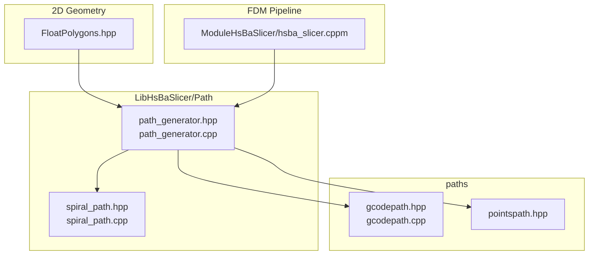

**Diagram sources**
- [path_generator.hpp:1-96](file://LibHsBaSlicer/Path/path_generator.hpp#L1-L96)
- [path_generator.cpp:1-143](file://LibHsBaSlicer/Path/path_generator.cpp#L1-L143)
- [spiral_path.hpp:1-63](file://LibHsBaSlicer/Path/spiral_path.hpp#L1-L63)
- [spiral_path.cpp:1-167](file://LibHsBaSlicer/Path/spiral_path.cpp#L1-L167)
- [gcodepath.hpp:1-112](file://paths/gcodepath.hpp#L1-L112)
- [pointspath.hpp:1-99](file://paths/pointspath.hpp#L1-L99)
- [FloatPolygons.hpp:1-271](file://2D/FloatPolygons.hpp#L1-L271)
- [hsba_slicer.cppm:695-734](file://ModuleHsBaSlicer/hsba_slicer.cppm#L695-L734)

**Section sources**
- [path_generator.hpp:1-96](file://LibHsBaSlicer/Path/path_generator.hpp#L1-L96)
- [path_generator.cpp:1-143](file://LibHsBaSlicer/Path/path_generator.cpp#L1-L143)
- [gcodepath.hpp:1-112](file://paths/gcodepath.hpp#L1-L112)
- [pointspath.hpp:1-99](file://paths/pointspath.hpp#L1-L99)
- [FloatPolygons.hpp:1-271](file://2D/FloatPolygons.hpp#L1-L271)
- [hsba_slicer.cppm:695-734](file://ModuleHsBaSlicer/hsba_slicer.cppm#L695-L734)

## Core Components
The path generation API exposes three main entry points plus helper data structures:

- `FdmPathConfig`: FDM-specific path parameters such as layer height, line width, print/travel speeds, extrusion multiplier, and units.
- `LayerPathData`: Per-layer input containing outlines, fills, supports, and Z height.
- `GenerateGCodePath`: Converts layered polygons into a `PointsPath` of G-code points.
- `GenerateGCodePathV2`: Converts layered polygons into a `GCodePath` suitable for multi-firmware G-code output.
- `GenerateGCodePathSpiral`: Generates a continuous spiralized outer wall for vase mode.
- `PolygonsToGPoints`: Low-level conversion from `PolygonsD` to an ordered sequence of `GPoint`.

Key relationships:
- Input is always `PolygonsD` (double-precision polygon sets).
- Output can be either a raw point list (`PointsPath`) or a firmware-aware G-code object (`GCodePath`).
- Spiral mode uses a separate algorithm that produces a single continuous 3D polyline rather than per-layer polygons.

**Section sources**
- [path_generator.hpp:23-91](file://LibHsBaSlicer/Path/path_generator.hpp#L23-L91)
- [path_generator.cpp:14-140](file://LibHsBaSlicer/Path/path_generator.cpp#L14-L140)

## Architecture Overview
At a high level, HsBaSlicer’s FDM pipeline slices a model into layers, computes fills and supports, then builds `LayerPathData` and calls the path generator. The generator converts polygons into either:
- A simple point stream for basic G-code export.
- A structured G-code path supporting Marlin, RepRap, and Klipper.
- A continuous spiral wall for vase-style printing.

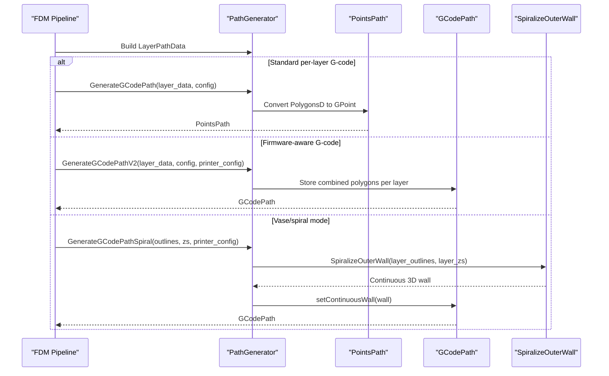

**Diagram sources**
- [hsba_slicer.cppm:695-734](file://ModuleHsBaSlicer/hsba_slicer.cppm#L695-L734)
- [path_generator.cpp:63-140](file://LibHsBaSlicer/Path/path_generator.cpp#L63-L140)
- [spiral_path.cpp:88-163](file://LibHsBaSlicer/Path/spiral_path.cpp#L88-L163)
- [gcodepath.hpp:66-107](file://paths/gcodepath.hpp#L66-L107)

## Detailed Component Analysis

### PathGenerator API and Data Structures
`PathGenerator` is not a class but a namespace-scoped API surface. Its primary data structures are:

- `FdmPathConfig`
  - `layer_height`: default `0.2f` mm.
  - `line_width`: default `0.4f` mm.
  - `print_speed`: default `50.0f` mm/s.
  - `travel_speed`: default `100.0f` mm/s.
  - `extrusion_multiplier`: default `1.0f`.
  - `units`: default `GCodeUnits::mm`.

- `LayerPathData`
  - `outlines`: outer perimeter polygons.
  - `fills`: interior fill polygons.
  - `supports`: support structure polygons.
  - `z_height`: build height for the layer.

These structures define the contract between slicing/filling/support modules and the path generator.

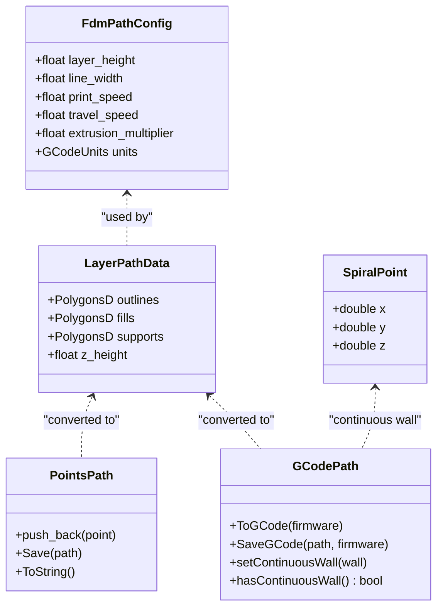

**Diagram sources**
- [path_generator.hpp:23-91](file://LibHsBaSlicer/Path/path_generator.hpp#L23-L91)
- [pointspath.hpp:44-94](file://paths/pointspath.hpp#L44-L94)
- [gcodepath.hpp:51-107](file://paths/gcodepath.hpp#L51-L107)
- [spiral_path.hpp:24-58](file://LibHsBaSlicer/Path/spiral_path.hpp#L24-L58)

**Section sources**
- [path_generator.hpp:23-91](file://LibHsBaSlicer/Path/path_generator.hpp#L23-L91)

### Polygon-to-GPoint Conversion
`PolygonsToGPoints` converts each closed polygon into a sequence of G-code moves:
- For each polygon, it emits a travel move to the first vertex.
- Then it emits linear moves to every subsequent vertex, closing back to the start.
- If `is_extrude` is true, it calculates extrusion based on segment length, line width, layer height, and extrusion multiplier.
- If false, extrusion is zero and velocity is travel speed.

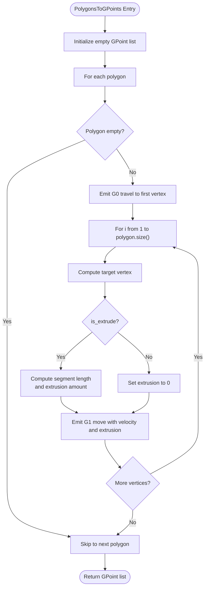

**Diagram sources**
- [path_generator.cpp:14-61](file://LibHsBaSlicer/Path/path_generator.cpp#L14-L61)

**Section sources**
- [path_generator.cpp:14-61](file://LibHsBaSlicer/Path/path_generator.cpp#L14-L61)

### Standard Per-Layer G-code Generation
`GenerateGCodePath` iterates over all layers and appends:
1. Outline paths (outer walls).
2. Fill paths (interior).
3. Support paths.

Each polygon set is converted using `PolygonsToGPoints`, producing a flat `PointsPath`.

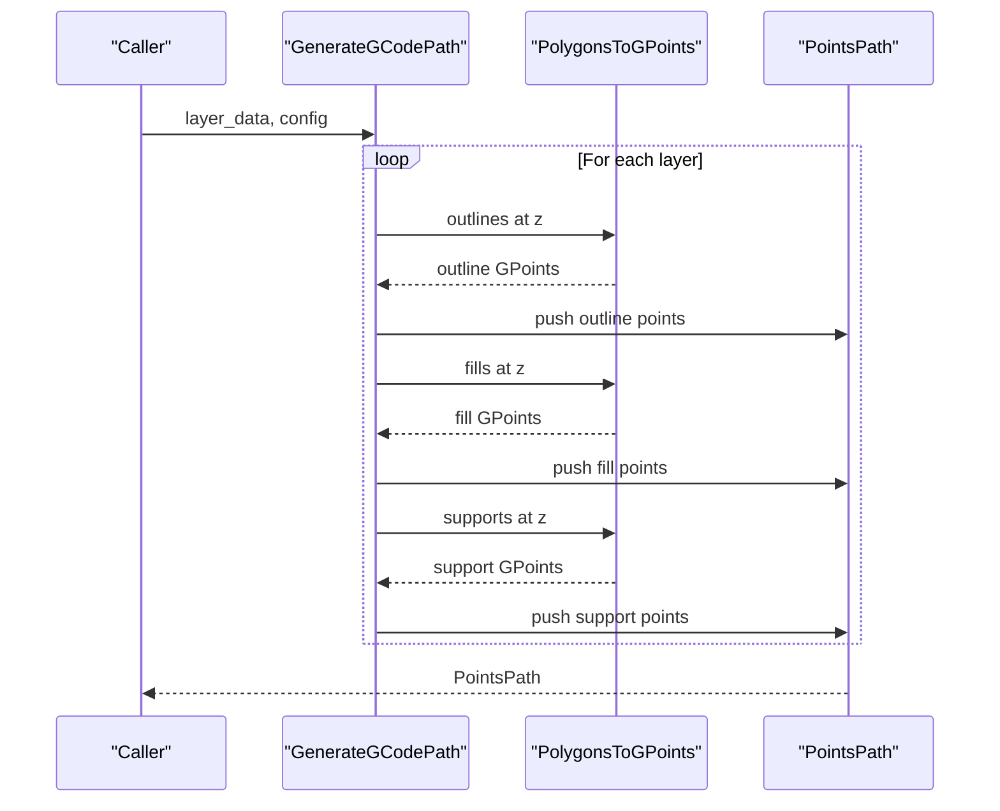

**Diagram sources**
- [path_generator.cpp:63-95](file://LibHsBaSlicer/Path/path_generator.cpp#L63-L95)

**Section sources**
- [path_generator.cpp:63-95](file://LibHsBaSlicer/Path/path_generator.cpp#L63-L95)

### Firmware-Aware G-code Generation
`GenerateGCodePathV2` creates a `GCodePath` and stores per-layer polygon data along with a layer configuration string encoding the Z height. This enables later G-code generation for multiple firmware targets.

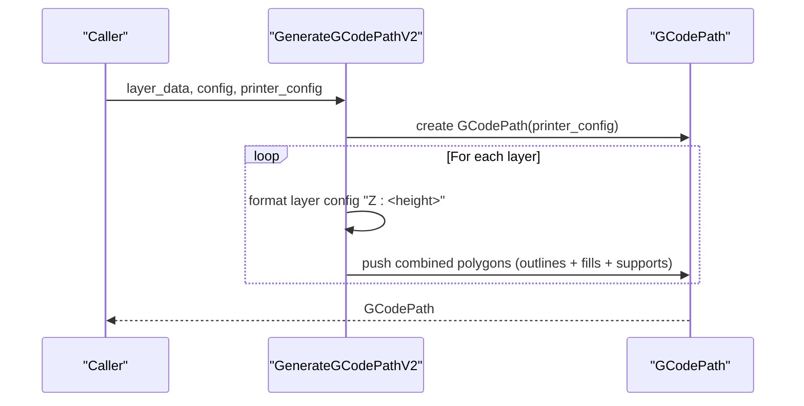

**Diagram sources**
- [path_generator.cpp:97-118](file://LibHsBaSlicer/Path/path_generator.cpp#L97-L118)
- [gcodepath.hpp:66-107](file://paths/gcodepath.hpp#L66-L107)

**Section sources**
- [path_generator.cpp:97-118](file://LibHsBaSlicer/Path/path_generator.cpp#L97-L118)
- [gcodepath.hpp:24-49](file://paths/gcodepath.hpp#L24-L49)

### Spiralized Vase Mode Wall Generation
`GenerateGCodePathSpiral` generates a continuous helical outer wall instead of per-layer polygons. It delegates the geometric computation to `SpiralizeOuterWall`, then stores the resulting 3D points as a continuous wall in `GCodePath`.

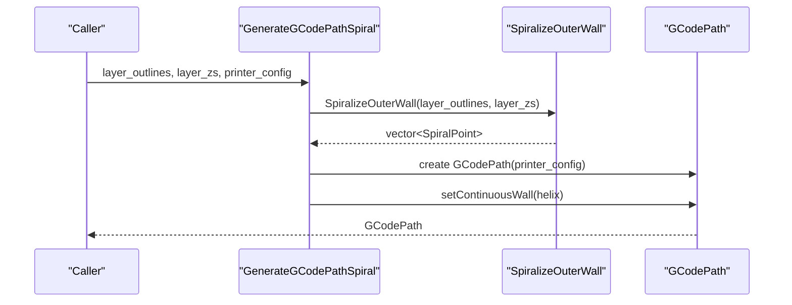

**Diagram sources**
- [path_generator.cpp:120-140](file://LibHsBaSlicer/Path/path_generator.cpp#L120-L140)
- [spiral_path.cpp:88-163](file://LibHsBaSlicer/Path/spiral_path.cpp#L88-L163)
- [gcodepath.hpp:87-96](file://paths/gcodepath.hpp#L87-L96)

**Section sources**
- [path_generator.cpp:120-140](file://LibHsBaSlicer/Path/path_generator.cpp#L120-L140)
- [spiral_path.hpp:31-58](file://LibHsBaSlicer/Path/spiral_path.hpp#L31-L58)
- [spiral_path.cpp:88-163](file://LibHsBaSlicer/Path/spiral_path.cpp#L88-L163)

### Spiralization Algorithm Details
`SpiralizeOuterWall` selects the outermost closed contour per layer, normalizes orientation, aligns seams across layers, and emits a continuous 3D polyline where Z ramps from one layer height to the next.

Key behaviors:
- Selects the polygon with the largest absolute signed area per layer.
- Normalizes loops to CCW order and removes duplicate closing vertices.
- Uses a canonical seam for the first layer and nearest-seam alignment for subsequent layers.
- Emits `m+1` points per loop so the seam closes continuously across layers.
- Skips layers without valid closed contours.

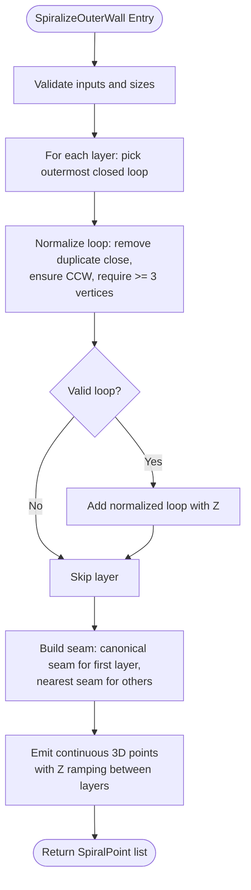

**Diagram sources**
- [spiral_path.cpp:16-85](file://LibHsBaSlicer/Path/spiral_path.cpp#L16-L85)
- [spiral_path.cpp:88-163](file://LibHsBaSlicer/Path/spiral_path.cpp#L88-L163)

**Section sources**
- [spiral_path.cpp:16-85](file://LibHsBaSlicer/Path/spiral_path.cpp#L16-L85)
- [spiral_path.cpp:88-163](file://LibHsBaSlicer/Path/spiral_path.cpp#L88-L163)

### G-code Output and Firmware Integration
`GCodePath` extends `LayersPath` and provides:
- Multi-firmware G-code generation: Marlin, RepRap, Klipper.
- Header/footer generation with temperature, homing, retraction, fan control, and positioning commands.
- Layer G-code generation that parses stored Z heights and emits per-layer moves.
- Continuous wall emission before per-layer data when vase mode is enabled.

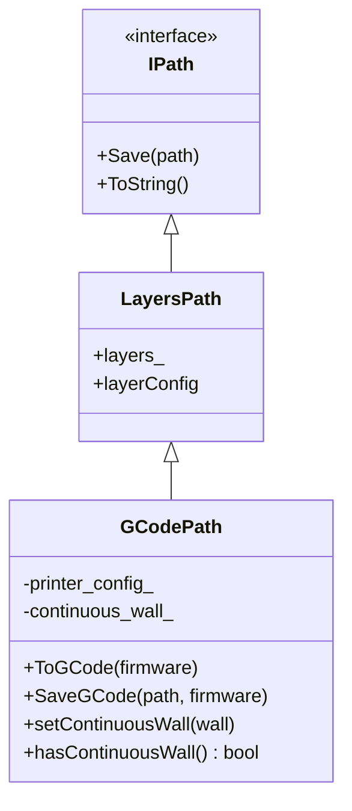

**Diagram sources**
- [gcodepath.hpp:66-107](file://paths/gcodepath.hpp#L66-L107)
- [gcodepath.cpp:69-209](file://paths/gcodepath.cpp#L69-L209)

**Section sources**
- [gcodepath.hpp:24-49](file://paths/gcodepath.hpp#L24-L49)
- [gcodepath.hpp:66-107](file://paths/gcodepath.hpp#L66-L107)
- [gcodepath.cpp:57-67](file://paths/gcodepath.cpp#L57-L67)
- [gcodepath.cpp:69-209](file://paths/gcodepath.cpp#L69-L209)

### FDM Pipeline Integration
The FDM pipeline constructs `LayerPathData` by:
- Slicing the model into integer polygons.
- Converting to double precision for support and fill operations.
- Computing supports and fills.
- Setting `z_height` using first-layer height and incremental layer height.
- Calling `GenerateGCodePathV2` with a configured `GCodePrinterConfig`.

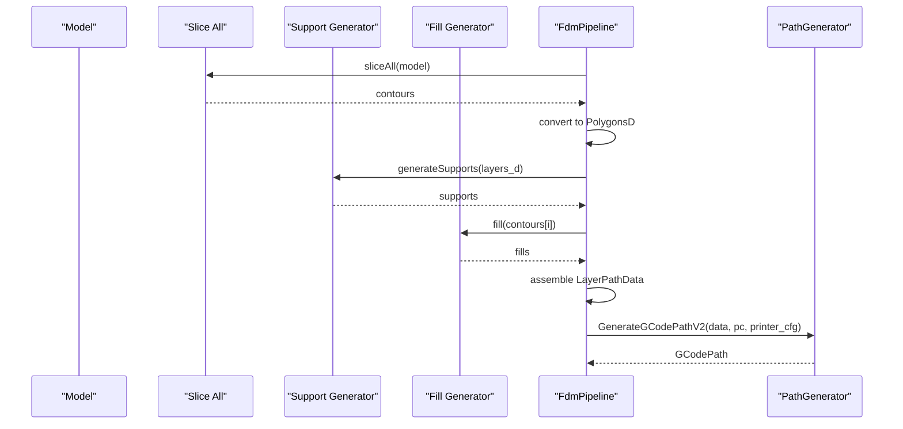

**Diagram sources**
- [hsba_slicer.cppm:695-734](file://ModuleHsBaSlicer/hsba_slicer.cppm#L695-L734)
- [path_generator.cpp:97-118](file://LibHsBaSlicer/Path/path_generator.cpp#L97-L118)

**Section sources**
- [hsba_slicer.cppm:695-734](file://ModuleHsBaSlicer/hsba_slicer.cppm#L695-L734)

## Dependency Analysis
The path generation module depends on:
- 2D geometry types (`PolygonsD`, `Point2D`, `PolygonD`) from `FloatPolygons.hpp`.
- Output path types (`PointsPath`, `GCodePath`) from `paths`.
- Spiralization logic from `spiral_path.hpp/cpp`.
- FDM pipeline code that constructs input data.

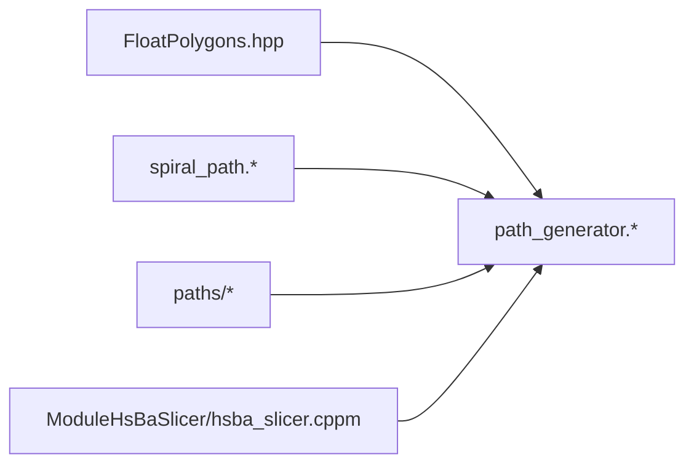

**Diagram sources**
- [FloatPolygons.hpp:1-271](file://2D/FloatPolygons.hpp#L1-L271)
- [path_generator.hpp:1-96](file://LibHsBaSlicer/Path/path_generator.hpp#L1-L96)
- [path_generator.cpp:1-143](file://LibHsBaSlicer/Path/path_generator.cpp#L1-L143)
- [spiral_path.hpp:1-63](file://LibHsBaSlicer/Path/spiral_path.hpp#L1-L63)
- [hsba_slicer.cppm:695-734](file://ModuleHsBaSlicer/hsba_slicer.cppm#L695-L734)

**Section sources**
- [path_generator.hpp:9-16](file://LibHsBaSlicer/Path/path_generator.hpp#L9-L16)
- [path_generator.cpp:5-10](file://LibHsBaSlicer/Path/path_generator.cpp#L5-L10)
- [hsba_slicer.cppm:695-734](file://ModuleHsBaSlicer/hsba_slicer.cppm#L695-L734)

## Performance Considerations
- **Pre-allocation**: `PolygonsToGPoints` reserves capacity based on polygon count to reduce reallocations.
- **Per-layer processing**: Both standard and V2 generators iterate once per layer; avoid unnecessary intermediate copies.
- **Spiral mode complexity**: Spiralization selects the largest-area polygon per layer and performs seam alignment; complexity is roughly proportional to total vertex count across selected loops.
- **Memory usage**: `PointsPath` stores all G-point moves; `GCodePath` stores layer polygons plus optional continuous wall. Large models may benefit from streaming or chunked processing if integrated at a higher level.
- **Extrusion calculation**: In `GCodePath::CalcExtrusion`, filament cross-section area is computed from nozzle and filament diameter; ensure these values match hardware to avoid over- or under-extrusion.

[No sources needed since this section provides general guidance]

## Troubleshooting Guide
Common issues and diagnostics:
- **Empty or invalid polygons**: `PolygonsToGPoints` skips empty polygons; verify slicing output contains valid closed loops.
- **Missing spiral wall**: `SpiralizeOuterWall` requires at least one valid closed contour per selected layer; check that outer loops exist and have sufficient vertices.
- **Incorrect Z height**: Ensure `LayerPathData.z_height` matches expected build height; `GCodePath` parses Z from layer config strings.
- **Firmware mismatch**: Use `GCodeFirmware` enum to select correct header/footer; verify printer configuration fields like temperatures and retraction settings.
- **Extrusion errors**: Check `line_width`, `layer_height`, `filament_diameter`, and `extrusion_multiplier`; incorrect values cause dimensional inaccuracies.

**Section sources**
- [path_generator.cpp:20-25](file://LibHsBaSlicer/Path/path_generator.cpp#L20-L25)
- [spiral_path.cpp:98-130](file://LibHsBaSlicer/Path/spiral_path.cpp#L98-L130)
- [gcodepath.cpp:28-47](file://paths/gcodepath.cpp#L28-L47)
- [gcodepath.hpp:24-49](file://paths/gcodepath.hpp#L24-L49)

## Conclusion
The `PathGenerator` API in HsBaSlicer provides a focused interface for converting sliced 2D polygons into manufacturable G-code paths. It supports:
- Basic per-layer G-point generation.
- Firmware-aware G-code output for common FDM controllers.
- Continuous spiralized walls for vase-mode printing.

Its design separates input polygon data from output serialization, enabling flexible integration with slicing, filling, and support generation. Proper configuration of `FdmPathConfig` and `GCodePrinterConfig` is essential for accurate extrusion, speed, and thermal behavior.

[No sources needed since this section summarizes without analyzing specific files]

## Appendices

### Configuration Reference

| Parameter | Type | Default | Description |
|---|---|---:|---|
| `FdmPathConfig.layer_height` | float | 0.2 | Layer height in millimeters |
| `FdmPathConfig.line_width` | float | 0.4 | Extrusion line width in millimeters |
| `FdmPathConfig.print_speed` | float | 50.0 | Print feed rate in mm/s |
| `FdmPathConfig.travel_speed` | float | 100.0 | Travel feed rate in mm/s |
| `FdmPathConfig.extrusion_multiplier` | float | 1.0 | Filament flow multiplier |
| `FdmPathConfig.units` | GCodeUnits | mm | Length units for output |
| `GCodePrinterConfig.nozzle_diameter` | float | 0.4 | Nozzle diameter in mm |
| `GCodePrinterConfig.filament_diameter` | float | 1.75 | Filament diameter in mm |
| `GCodePrinterConfig.nozzle_temp` | float | 200.0 | Nozzle temperature in °C |
| `GCodePrinterConfig.bed_temp` | float | 60.0 | Bed temperature in °C |
| `GCodePrinterConfig.retract_length` | float | 1.0 | Retraction distance in mm |
| `GCodePrinterConfig.retract_speed` | float | 40.0 | Retraction speed in mm/s |
| `GCodePrinterConfig.print_speed` | float | 50.0 | Print speed in mm/s |
| `GCodePrinterConfig.travel_speed` | float | 100.0 | Travel speed in mm/s |
| `GCodePrinterConfig.first_layer_speed` | float | 20.0 | First layer speed in mm/s |
| `GCodePrinterConfig.layer_height` | float | 0.2 | Layer height in mm |
| `GCodePrinterConfig.line_width` | float | 0.4 | Line width in mm |
| `GCodePrinterConfig.extrusion_multiplier` | float | 1.0 | Flow multiplier |
| `GCodePrinterConfig.relative_extrusion` | bool | false | Relative vs absolute extrusion |
| `GCodePrinterConfig.enable_retraction` | bool | true | Enable retraction on travel moves |

**Section sources**
- [path_generator.hpp:23-31](file://LibHsBaSlicer/Path/path_generator.hpp#L23-L31)
- [gcodepath.hpp:32-49](file://paths/gcodepath.hpp#L32-L49)

### Path Generation Scenarios

| Scenario | Input | Algorithm | Output | Notes |
|---|---|---|---|---|
| Standard FDM per-layer | `vector<LayerPathData>` | `GenerateGCodePath` | `PointsPath` | Outlines, fills, supports converted to G-points |
| Firmware-aware FDM | `vector<LayerPathData>` + `GCodePrinterConfig` | `GenerateGCodePathV2` | `GCodePath` | Supports Marlin, RepRap, Klipper |
| Vase/spiral mode | `vector<PolygonsD>` + `vector<double>` + `GCodePrinterConfig` | `GenerateGCodePathSpiral` + `SpiralizeOuterWall` | `GCodePath` | Continuous helical wall, no per-layer travel |
| Custom post-processing | Any path type | Lua script via `IPath` | File/string | Extensible through `IPath` Save/ToString APIs |

**Section sources**
- [path_generator.cpp:63-140](file://LibHsBaSlicer/Path/path_generator.cpp#L63-L140)
- [pointspath.hpp:54-94](file://paths/pointspath.hpp#L54-L94)
- [gcodepath.hpp:66-107](file://paths/gcodepath.hpp#L66-L107)