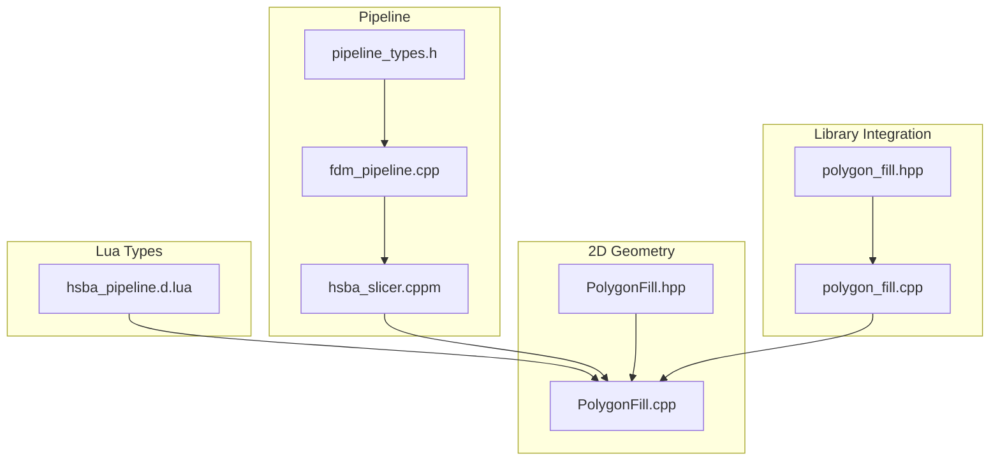
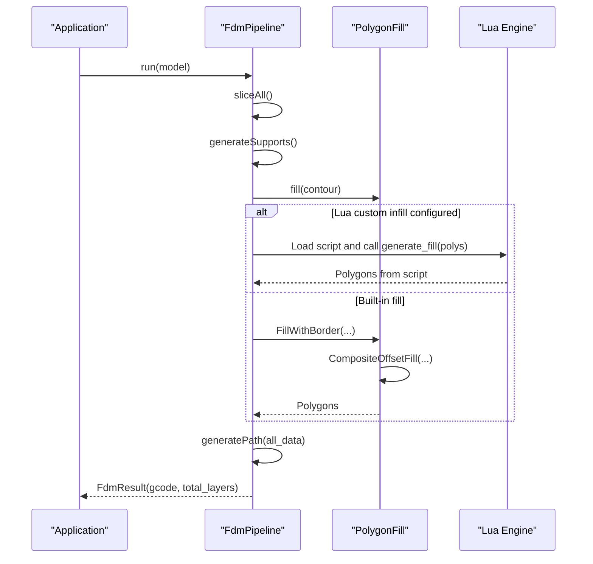
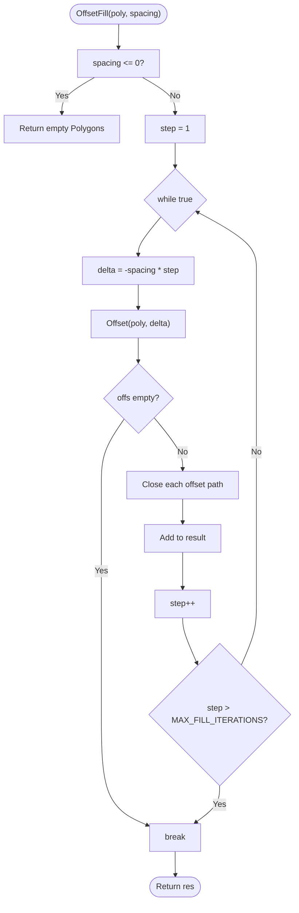
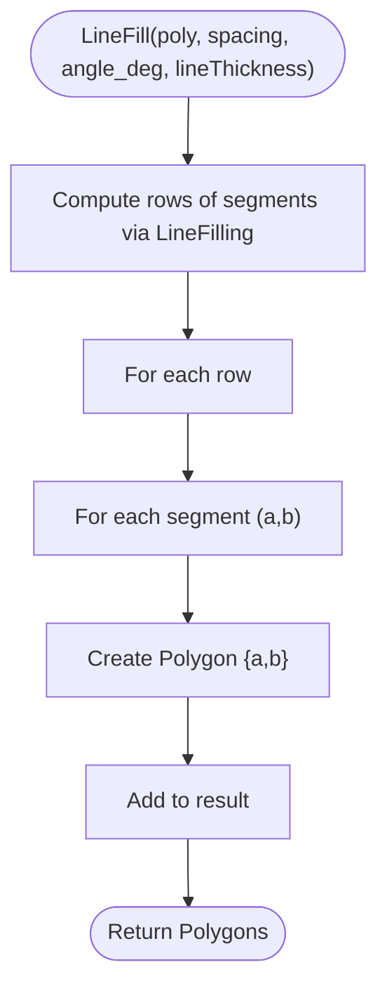
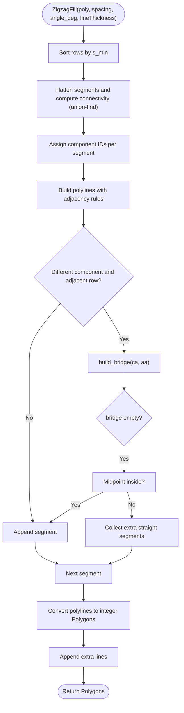
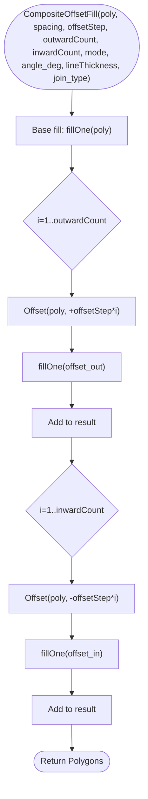
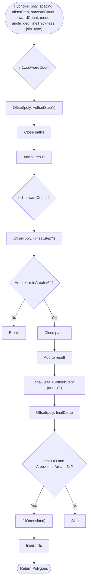
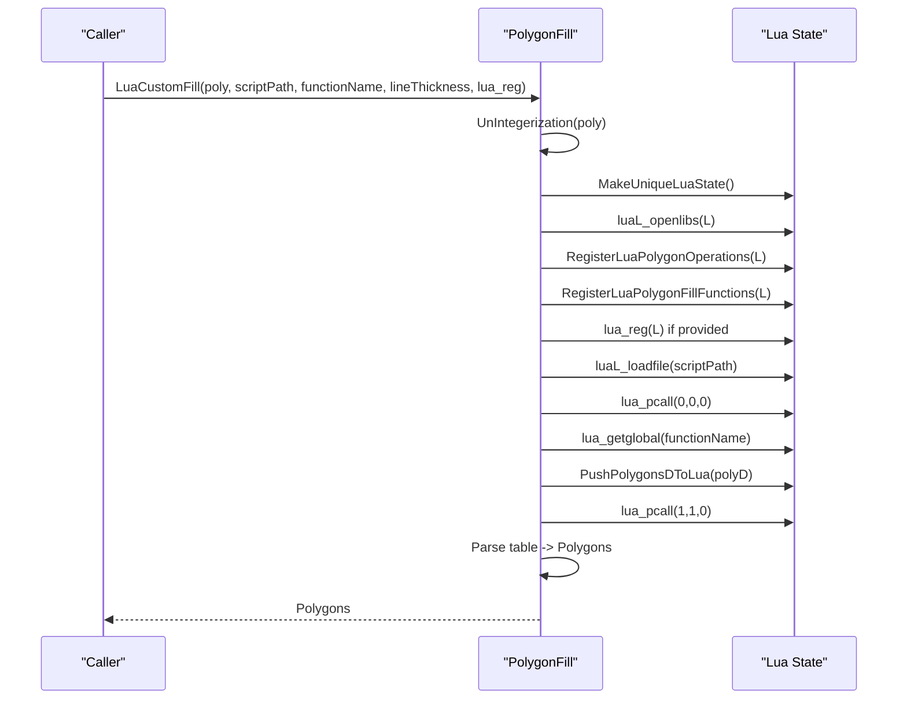
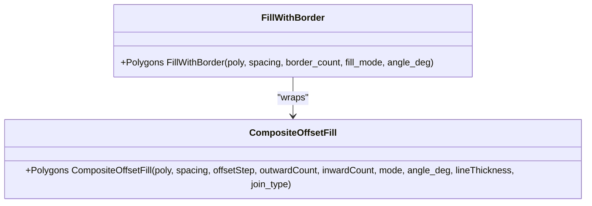
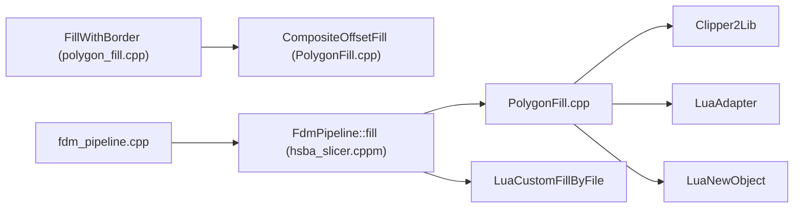

# PolygonFill / 填充算法类

<cite>
**Referenced Files in This Document**
- [PolygonFill.hpp](file://2D/PolygonFill.hpp)
- [PolygonFill.cpp](file://2D/PolygonFill.cpp)
- [hsba_pipeline.d.lua](file://types/hsba_pipeline.d.lua)
- [polygon_fill.hpp](file://LibHsBaSlicer/Fill/polygon_fill.hpp)
- [polygon_fill.cpp](file://LibHsBaSlicer/Fill/polygon_fill.cpp)
- [hsba_slicer.cppm](file://ModuleHsBaSlicer/hsba_slicer.cppm)
- [pipeline_types.h](file://pipelinetypes/pipeline_types.h)
- [fdm_pipeline.cpp](file://DllHsBaSlicer/fdm_pipeline.cpp)
</cite>

## Table of Contents
1. [Introduction](#introduction)
2. [Project Structure](#project-structure)
3. [Core Components](#core-components)
4. [Architecture Overview](#architecture-overview)
5. [Detailed Component Analysis](#detailed-component-analysis)
6. [Dependency Analysis](#dependency-analysis)
7. [Performance Considerations](#performance-considerations)
8. [Troubleshooting Guide](#troubleshooting-guide)
9. [Conclusion](#conclusion)
10. [Appendices](#appendices)

## Introduction
This document explains the PolygonFill class and its infill algorithms in HsBaSlicer. It covers supported fill patterns, algorithm parameters such as spacing, angle, density-related settings, border counts, and pattern-specific behavior. It also documents how to implement custom fill algorithms through Lua scripts and how these integrate into the FDM slicing pipeline. Performance characteristics and usage recommendations are provided for different applications.

## Project Structure
The PolygonFill functionality is implemented in the 2D geometry layer and exposed to higher-level pipelines and Lua scripting:

- Core API and implementations:
  - [PolygonFill.hpp](file://2D/PolygonFill.hpp): Declares public fill functions, enums, and Lua registration.
  - [PolygonFill.cpp](file://2D/PolygonFill.cpp): Implements offset-based fills, line/zigzag fills, composite/hybrid fills, and Lua-driven custom fills.
- Library integration:
  - [polygon_fill.hpp](file://LibHsBaSlicer/Fill/polygon_fill.hpp), [polygon_fill.cpp](file://LibHsBaSlicer/Fill/polygon_fill.cpp): Provide FillWithBorder which wraps CompositeOffsetFill for typical border + internal fill workflows.
- Pipeline integration:
  - [hsba_slicer.cppm](file://ModuleHsBaSlicer/hsba_slicer.cppm): FdmPipeline::fill selects built-in or Lua custom fill based on configuration.
  - [pipeline_types.h](file://pipelinetypes/pipeline_types.h): Defines C-compatible pipeline configuration including infill Lua script/function fields.
  - [fdm_pipeline.cpp](file://DllHsBaSlicer/fdm_pipeline.cpp): Maps external config to internal fill mode and Lua script invocation.
- Lua type definitions:
  - [hsba_pipeline.d.lua](file://types/hsba_pipeline.d.lua): Documents the PolygonFill Lua API and FillOptions used by scripts.

**Diagram sources**
- [PolygonFill.hpp:20-136](file://2D/PolygonFill.hpp#L20-L136)
- [PolygonFill.cpp:504-1669](file://2D/PolygonFill.cpp#L504-L1669)
- [polygon_fill.hpp:32-36](file://LibHsBaSlicer/Fill/polygon_fill.hpp#L32-L36)
- [polygon_fill.cpp:27-32](file://LibHsBaSlicer/Fill/polygon_fill.cpp#L27-L32)
- [hsba_slicer.cppm:663-675](file://ModuleHsBaSlicer/hsba_slicer.cppm#L663-L675)
- [pipeline_types.h:108-113](file://pipelinetypes/pipeline_types.h#L108-L113)
- [fdm_pipeline.cpp:51-61](file://DllHsBaSlicer/fdm_pipeline.cpp#L51-L61)
- [hsba_pipeline.d.lua:54-62](file://types/hsba_pipeline.d.lua#L54-L62)

**Section sources**
- [PolygonFill.hpp:20-136](file://2D/PolygonFill.hpp#L20-L136)
- [PolygonFill.cpp:504-1669](file://2D/PolygonFill.cpp#L504-L1669)
- [polygon_fill.hpp:32-36](file://LibHsBaSlicer/Fill/polygon_fill.hpp#L32-L36)
- [polygon_fill.cpp:27-32](file://LibHsBaSlicer/Fill/polygon_fill.cpp#L27-L32)
- [hsba_slicer.cppm:663-675](file://ModuleHsBaSlicer/hsba_slicer.cppm#L663-L675)
- [pipeline_types.h:108-113](file://pipelinetypes/pipeline_types.h#L108-L113)
- [fdm_pipeline.cpp:51-61](file://DllHsBaSlicer/fdm_pipeline.cpp#L51-L61)
- [hsba_pipeline.d.lua:54-62](file://types/hsba_pipeline.d.lua#L54-L62)

## Core Components
- Offset-based fill:
  - OffsetFill generates concentric offset contours at a given spacing.
- Line fill:
  - LineFill produces independent straight segments across the polygon at a specified angle and spacing.
- Zigzag fills:
  - SimpleZigzagFill connects segments into a single zigzag polyline with basic connectivity.
  - ZigzagFill improves corner handling and connectivity using component analysis and bridge building.
- Composite and hybrid fills:
  - CompositeOffsetFill applies an internal fill mode (line/simple zigzag/zigzag) to the base polygon and then to outward/inward offsets.
  - HybridFill creates outward borders and fills only the final inward island(s).
- Lua custom fills:
  - LuaCustomFill and LuaCustomFillString allow users to define custom fill logic via Lua scripts, returning tables of polygons/polylines.
- Lua registration:
  - RegisterLuaPolygonFillFunctions exposes PolygonFill.offsetFill, lineFill, simpleZigzagFill, zigzagFill, compositeOffsetFill, hybridFill, and offsetOnly to Lua.

Key parameters:
- spacing: Distance between fill lines or offset layers; controls density.
- angle_deg: Angle of parallel lines or zigzag direction in degrees.
- lineThickness: Thickness of fill lines; affects area coverage and path length.
- offsetStep: Step size for offset operations in composite/hybrid fills.
- outwardCount / inwardCount: Number of outward and inward offset layers.
- join_type: Corner join style for offset operations (Square, Bevel, Round, Miter).
- mode: FillMode enum selecting Line, SimpleZigzag, or Zigzag for internal fill.

**Section sources**
- [PolygonFill.hpp:20-136](file://2D/PolygonFill.hpp#L20-L136)
- [PolygonFill.cpp:504-1669](file://2D/PolygonFill.cpp#L504-L1669)

## Architecture Overview
The PolygonFill module provides both direct C++ APIs and Lua bindings. Higher-level pipelines like FdmPipeline select built-in or Lua custom fills based on configuration. The library wrapper FillWithBorder simplifies common use cases by combining border generation with internal fill modes.

**Diagram sources**
- [hsba_slicer.cppm:704-750](file://ModuleHsBaSlicer/hsba_slicer.cppm#L704-L750)
- [hsba_slicer.cppm:663-675](file://ModuleHsBaSlicer/hsba_slicer.cppm#L663-L675)
- [polygon_fill.cpp:27-32](file://LibHsBaSlicer/Fill/polygon_fill.cpp#L27-L32)
- [PolygonFill.cpp:1372-1491](file://2D/PolygonFill.cpp#L1372-L1491)

## Detailed Component Analysis

### Offset-based Fill
OffsetFill repeatedly offsets the input polygon inward by spacing until no more valid offsets exist. Each resulting contour is closed and added to the output.

**Diagram sources**
- [PolygonFill.cpp:504-541](file://2D/PolygonFill.cpp#L504-L541)

**Section sources**
- [PolygonFill.cpp:504-541](file://2D/PolygonFill.cpp#L504-L541)

### Line Fill
LineFill computes scanlines at a given angle and spacing, intersects them with the polygon, and returns independent line segments.

**Diagram sources**
- [PolygonFill.cpp:544-564](file://2D/PolygonFill.cpp#L544-L564)
- [PolygonFill.cpp:44-160](file://2D/PolygonFill.cpp#L44-L160)

**Section sources**
- [PolygonFill.cpp:44-160](file://2D/PolygonFill.cpp#L44-L160)
- [PolygonFill.cpp:544-564](file://2D/PolygonFill.cpp#L544-L564)

### Zigzag Fills
SimpleZigzagFill builds connected polylines by connecting centers of adjacent scanline segments, allowing connections only within the same row or adjacent rows. It uses binary search to clamp endpoints inside the polygon.

ZigzagFill improves connectivity by computing components across rows using interval overlap and union-find, then building bridges along the outer boundary when necessary.

**Diagram sources**
- [PolygonFill.cpp:803-1370](file://2D/PolygonFill.cpp#L803-L1370)

**Section sources**
- [PolygonFill.cpp:566-800](file://2D/PolygonFill.cpp#L566-L800)
- [PolygonFill.cpp:803-1370](file://2D/PolygonFill.cpp#L803-L1370)

### Composite and Hybrid Fills
CompositeOffsetFill applies an internal fill mode to the base polygon and then to outward and inward offset layers. HybridFill creates outward borders and fills only the final inward island(s), skipping small areas below a threshold.

**Diagram sources**
- [PolygonFill.cpp:1372-1428](file://2D/PolygonFill.cpp#L1372-L1428)

**Diagram sources**
- [PolygonFill.cpp:1430-1491](file://2D/PolygonFill.cpp#L1430-L1491)

**Section sources**
- [PolygonFill.cpp:1372-1491](file://2D/PolygonFill.cpp#L1372-L1491)

### Lua Custom Fills
LuaCustomFill and LuaCustomFillString create a Lua state, register polygon operations and fill functions, load a script file or string, call a user-defined function with the polygon data, and parse the returned table of polygons/polylines.

**Diagram sources**
- [PolygonFill.cpp:1494-1585](file://2D/PolygonFill.cpp#L1494-L1585)
- [PolygonFill.cpp:1587-1669](file://2D/PolygonFill.cpp#L1587-L1669)

**Section sources**
- [PolygonFill.cpp:1494-1669](file://2D/PolygonFill.cpp#L1494-L1669)

### Library Wrapper: FillWithBorder
FillWithBorder is a convenience function that wraps CompositeOffsetFill to produce border rings plus internal fill.

**Diagram sources**
- [polygon_fill.cpp:27-32](file://LibHsBaSlicer/Fill/polygon_fill.cpp#L27-L32)
- [polygon_fill.hpp:32-36](file://LibHsBaSlicer/Fill/polygon_fill.hpp#L32-L36)

**Section sources**
- [polygon_fill.cpp:27-32](file://LibHsBaSlicer/Fill/polygon_fill.cpp#L27-L32)
- [polygon_fill.hpp:32-36](file://LibHsBaSlicer/Fill/polygon_fill.hpp#L32-L36)

## Dependency Analysis
- PolygonFill depends on:
  - FloatPolygons and IntPolygon types for geometry representation.
  - Clipper2Lib for offset and intersection operations.
  - LuaAdapter and LuaNewObject for Lua interop.
- Pipeline integration:
  - FdmPipeline::fill chooses built-in FillWithBorder or LuaCustomFillByFile based on cfg_.infill_lua_script.
  - DllHsBaSlicer maps external config to internal FillMode and Lua script fields.

**Diagram sources**
- [PolygonFill.cpp:6-19](file://2D/PolygonFill.cpp#L6-L19)
- [polygon_fill.cpp:27-32](file://LibHsBaSlicer/Fill/polygon_fill.cpp#L27-L32)
- [hsba_slicer.cppm:663-675](file://ModuleHsBaSlicer/hsba_slicer.cppm#L663-L675)
- [fdm_pipeline.cpp:51-61](file://DllHsBaSlicer/fdm_pipeline.cpp#L51-L61)

**Section sources**
- [PolygonFill.cpp:6-19](file://2D/PolygonFill.cpp#L6-L19)
- [polygon_fill.cpp:27-32](file://LibHsBaSlicer/Fill/polygon_fill.cpp#L27-L32)
- [hsba_slicer.cppm:663-675](file://ModuleHsBaSlicer/hsba_slicer.cppm#L663-L675)
- [fdm_pipeline.cpp:51-61](file://DllHsBaSlicer/fdm_pipeline.cpp#L51-L61)

## Performance Considerations
- Offset-based fills:
  - Complexity grows with the number of offset iterations; bounded by MAX_FILL_ITERATIONS.
  - Suitable for dense, uniform fills but can be expensive for large models with many layers.
- Line fills:
  - Efficient for generating independent segments; performance scales with the number of scanlines and intersections.
  - Good for fast prototyping and low-density fills.
- Zigzag fills:
  - SimpleZigzagFill has moderate overhead due to connectivity checks and binary search clamping.
  - ZigzagFill adds union-find and bridge computation; more robust but heavier computationally.
- Composite/Hybrid fills:
  - CompositeOffsetFill applies fill recursively to multiple offset layers; cost increases with outwardCount and inwardCount.
  - HybridFill reduces computational load by filling only the final inward island(s) and skipping small areas.
- Lua custom fills:
  - Overhead includes Lua state creation, script loading, and parsing returned tables.
  - Useful for specialized patterns but may be slower than optimized built-ins.

Recommendations:
- Use LineFill for quick, low-density fills.
- Use ZigzagFill for stronger mechanical properties where connectivity matters.
- Prefer HybridFill when you need strong borders with minimal internal fill cost.
- Tune spacing and lineThickness to balance density and print time.
- Use Lua custom fills sparingly and cache results when possible.

[No sources needed since this section provides general guidance]

## Troubleshooting Guide
Common issues and resolutions:
- Invalid spacing:
  - If spacing <= 0, OffsetFill and ZigzagFill return empty results. Ensure positive spacing values.
- Lua script errors:
  - Errors during script loading or function calls throw RuntimeError with messages. Verify script path, function name, and return type (table of polygons).
- Join type mismatches:
  - Ensure join_type strings match expected values ("Square", "Bevel", "Round", "Miter") when calling Lua functions.
- Small islands skipped:
  - HybridFill skips islands with area below minAreaInt64 threshold. Adjust offsetStep or inwardCount to ensure meaningful fills.

**Section sources**
- [PolygonFill.cpp:504-541](file://2D/PolygonFill.cpp#L504-L541)
- [PolygonFill.cpp:1494-1669](file://2D/PolygonFill.cpp#L1494-L1669)
- [PolygonFill.cpp:1430-1491](file://2D/PolygonFill.cpp#L1430-L1491)

## Conclusion
PolygonFill provides a comprehensive set of infill algorithms tailored for 3D printing pipelines. Its design supports both high-performance built-in patterns and flexible Lua-driven customization. By understanding parameters like spacing, angle, lineThickness, and offset counts, users can optimize fill strategies for strength, speed, and material usage. Integration with FdmPipeline ensures seamless adoption in slicing workflows.

[No sources needed since this section summarizes without analyzing specific files]

## Appendices

### Supported Fill Patterns and Parameters
- Offset-based fill:
  - Function: OffsetFill
  - Parameters: spacing, join_type
- Line fill:
  - Function: LineFill
  - Parameters: spacing, angle_deg, lineThickness
- Zigzag fills:
  - Functions: SimpleZigzagFill, ZigzagFill
  - Parameters: spacing, angle_deg, lineThickness
- Composite fill:
  - Function: CompositeOffsetFill
  - Parameters: spacing, offsetStep, outwardCount, inwardCount, mode, angle_deg, lineThickness, join_type
- Hybrid fill:
  - Function: HybridFill
  - Parameters: spacing, offsetStep, outwardCount, inwardCount, mode, angle_deg, lineThickness, join_type
- Lua custom fills:
  - Functions: LuaCustomFill, LuaCustomFillString
  - Parameters: scriptPath/script, functionName, lineThickness, lua_reg

**Section sources**
- [PolygonFill.hpp:20-136](file://2D/PolygonFill.hpp#L20-L136)
- [hsba_pipeline.d.lua:54-62](file://types/hsba_pipeline.d.lua#L54-L62)

### Lua API Reference
- PolygonFill namespace:
  - offsetFill(polys, spacing, opts?)
  - lineFill(polys, spacing, angle, lineThickness)
  - simpleZigzagFill(polys, spacing, angle, lineThickness)
  - zigzagFill(polys, spacing, angle, lineThickness)
  - compositeOffsetFill(polys, spacing, offsetStep, outwardCount, inwardCount, mode, angle, lineThickness, opts?)
  - hybridFill(polys, spacing, offsetStep, outwardCount, inwardCount, mode, angle, lineThickness, opts?)
  - offsetOnly(polys, spacing)

- FillOptions:
  - spacing: number?
  - mode: string? ("line"|"zigzag"|"simpleZigzag")
  - angle: number?
  - borderCount: integer?

**Section sources**
- [hsba_pipeline.d.lua:54-62](file://types/hsba_pipeline.d.lua#L54-L62)
- [hsba_pipeline.d.lua:198-203](file://types/hsba_pipeline.d.lua#L198-L203)