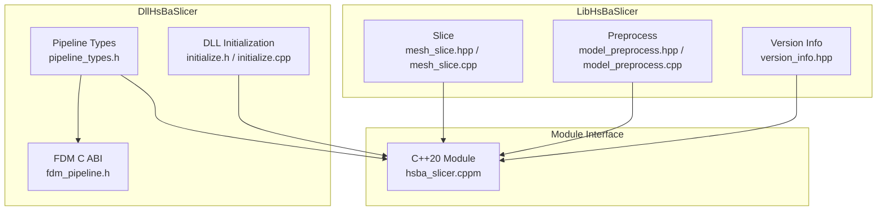
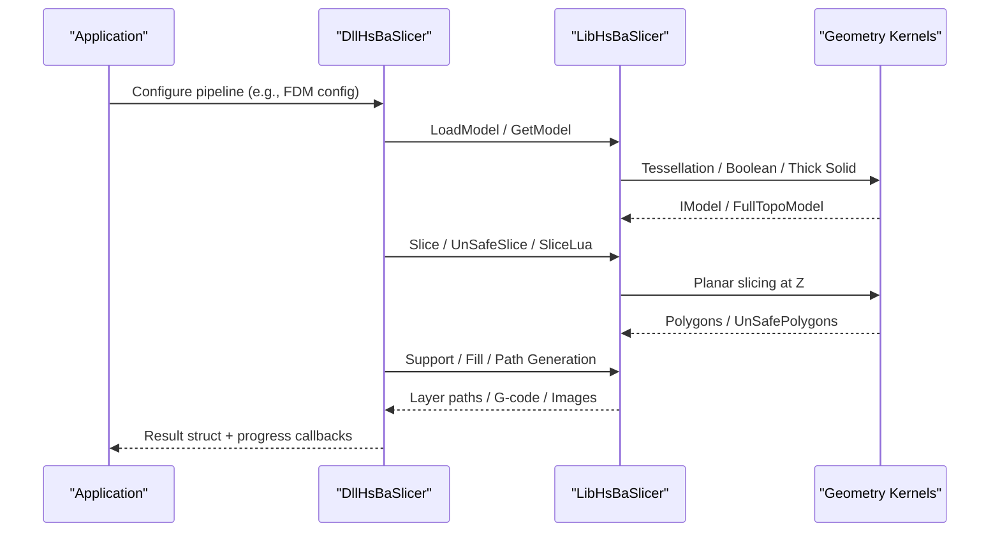
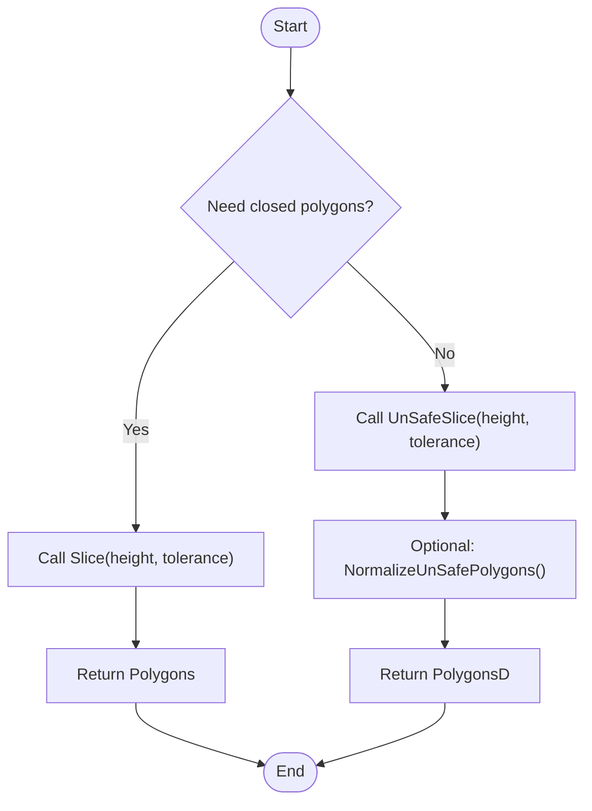
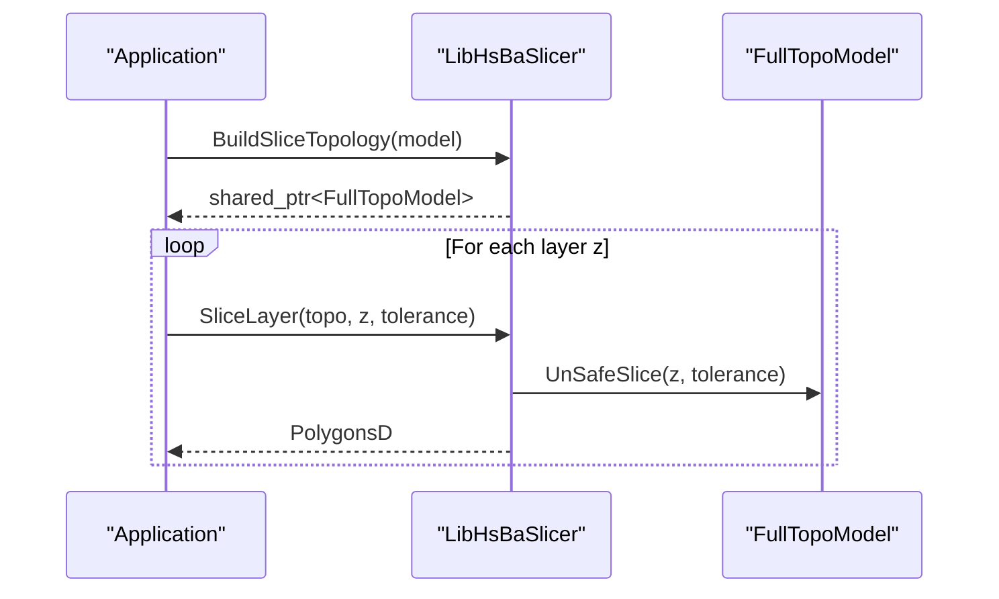
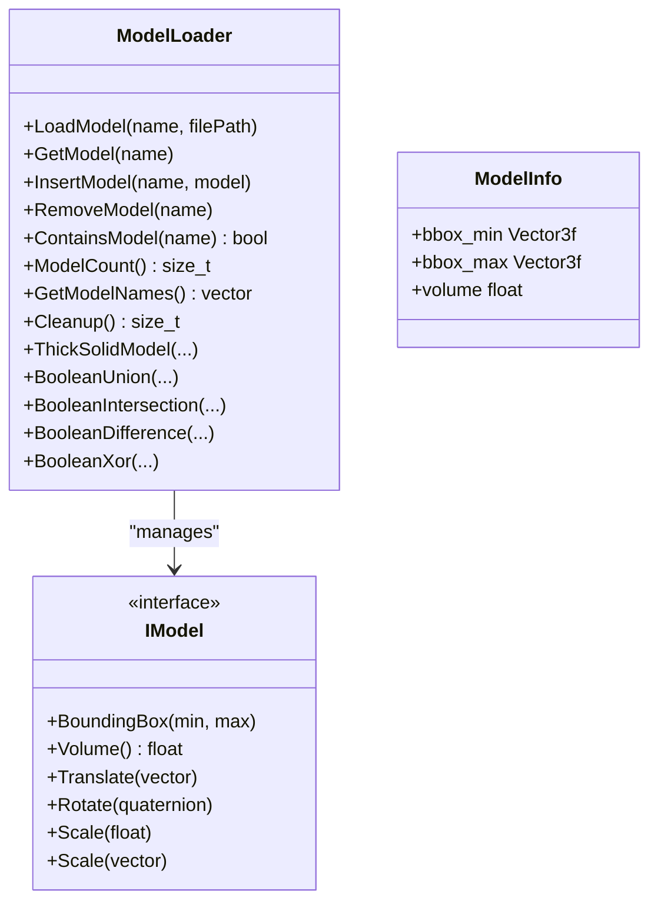
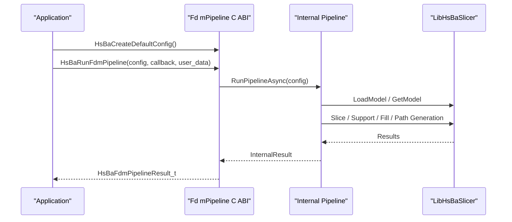
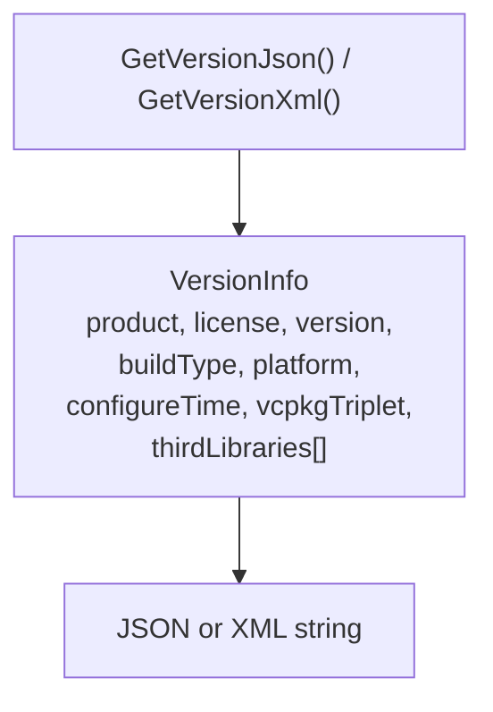
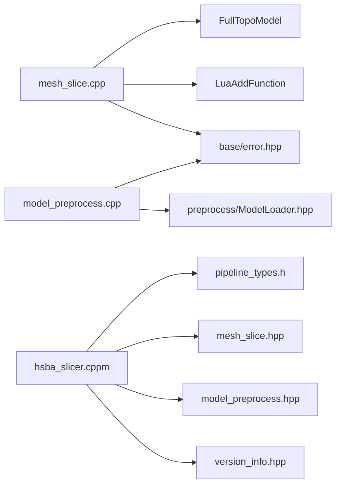

# Core Slicing Interfaces

<cite>
**Referenced Files in This Document**   
- [mesh_slice.hpp](file://LibHsBaSlicer/Slice/mesh_slice.hpp)
- [mesh_slice.cpp](file://LibHsBaSlicer/Slice/mesh_slice.cpp)
- [model_preprocess.hpp](file://LibHsBaSlicer/Preprocess/model_preprocess.hpp)
- [model_preprocess.cpp](file://LibHsBaSlicer/Preprocess/model_preprocess.cpp)
- [version_info.hpp](file://LibHsBaSlicer/version_info.hpp)
- [initialize.h](file://DllHsBaSlicer/initialize.h)
- [initialize.cpp](file://DllHsBaSlicer/initialize.cpp)
- [pipeline_types.h](file://pipelinetypes/pipeline_types.h)
- [fdm_pipeline.h](file://DllHsBaSlicer/fdm_pipeline.h)
- [hsba_slicer.cppm](file://ModuleHsBaSlicer/hsba_slicer.cppm)
- [version.hpp](file://version/version.hpp)
</cite>

## Table of Contents
1. [Introduction](#introduction)
2. [Project Structure](#project-structure)
3. [Core Components](#core-components)
4. [Architecture Overview](#architecture-overview)
5. [Detailed Component Analysis](#detailed-component-analysis)
6. [Dependency Analysis](#dependency-analysis)
7. [Performance Considerations](#performance-considerations)
8. [Troubleshooting Guide](#troubleshooting-guide)
9. [Conclusion](#conclusion)

## Introduction
This document explains the core slicing interfaces exposed by LibHsBaSlicer for converting 3D models into 2D layers, preprocessing model data before slicing, and configuring multi-stage manufacturing pipelines. It focuses on:

- Mesh slicing APIs that convert an `IModel` into closed or open polygonal contours at a given Z height.
- Model preprocessing APIs for loading, transforming, querying, and repairing geometry through boolean and thick-solid operations.
- Pipeline configuration types and orchestration entry points for FDM, SLA, SLS, SLM, LOM, 3DP, WAAM, file transfer, and fully Lua-driven custom pipelines.
- Version information APIs and DLL initialization functions.
- Practical workflows, error handling patterns, memory management, threading considerations, and integration notes with external geometry libraries such as CGAL and OpenCASCADE.

The goal is to provide both a high-level architectural view and a code-grounded reference for developers integrating HsBaSlicer into applications.

## Project Structure
LibHsBaSlicer exposes C++ APIs under `LibHsBaSlicer`, while higher-level pipeline orchestration and C ABI wrappers live under `DllHsBaSlicer`. The module interface `hsba.slicer` re-exports common types and provides a modern C++20 API surface.

**Diagram sources**
- [mesh_slice.hpp:1-107](file://LibHsBaSlicer/Slice/mesh_slice.hpp#L1-L107)
- [mesh_slice.cpp:1-119](file://LibHsBaSlicer/Slice/mesh_slice.cpp#L1-L119)
- [model_preprocess.hpp:1-192](file://LibHsBaSlicer/Preprocess/model_preprocess.hpp#L1-L192)
- [model_preprocess.cpp:1-205](file://LibHsBaSlicer/Preprocess/model_preprocess.cpp#L1-L205)
- [version_info.hpp:1-30](file://LibHsBaSlicer/version_info.hpp#L1-L30)
- [initialize.h:1-22](file://DllHsBaSlicer/initialize.h#L1-L22)
- [initialize.cpp:1-10](file://DllHsBaSlicer/initialize.cpp#L1-L10)
- [pipeline_types.h:1-800](file://pipelinetypes/pipeline_types.h#L1-L800)
- [fdm_pipeline.h:1-67](file://DllHsBaSlicer/fdm_pipeline.h#L1-L67)
- [hsba_slicer.cppm:1-200](file://ModuleHsBaSlicer/hsba_slicer.cppm#L1-L200)

**Section sources**
- [mesh_slice.hpp:1-107](file://LibHsBaSlicer/Slice/mesh_slice.hpp#L1-L107)
- [model_preprocess.hpp:1-192](file://LibHsBaSlicer/Preprocess/model_preprocess.hpp#L1-L192)
- [pipeline_types.h:1-800](file://pipelinetypes/pipeline_types.h#L1-L800)
- [hsba_slicer.cppm:1-200](file://ModuleHsBaSlicer/hsba_slicer.cppm#L1-L200)

## Core Components
This section summarizes the primary interfaces you will use when building slicing workflows.

### Mesh Slicing API
- `Slice(model, height, tolerance)` returns closed-contour polygons at a given Z height.
- `UnSafeSlice(model, height, tolerance)` returns polygons including open contours.
- `SliceLua(model, script, height)` and `UnSafeSliceLua(model, script, height)` drive slicing via inline Lua scripts.
- `NormalizeUnSafePolygons(unsafe_polys)` cleans unsafe polygons into double-precision closed polygons.
- `BuildSliceTopology(model)` builds a reusable topology once for multi-layer slicing.
- `SliceLayer(topo, z, tolerance)` slices one layer from a prebuilt topology and normalizes output.

These functions are implemented in `mesh_slice.cpp` and delegate to `FullTopoModel` methods. They wrap third-party geometry exceptions into project error types.

**Section sources**
- [mesh_slice.hpp:22-103](file://LibHsBaSlicer/Slice/mesh_slice.hpp#L22-L103)
- [mesh_slice.cpp:17-116](file://LibHsBaSlicer/Slice/mesh_slice.cpp#L17-L116)

### Model Preprocessing API
- Load and manage models in a thread-local pool: `LoadModel`, `GetModel`, `InsertModel`, `RemoveModel`, `ContainsModel`, `ModelCount`, `GetModelNames`, `CleanupModels`.
- Transform models: `TranslateModel`, `RotateModel`, `ScaleModel`.
- Query model metadata: `GetModelInfo` returns bounding box and volume.
- Advanced geometry operations (when compiled with CGAL): `ThickSolidModel`, `BooleanUnion`, `BooleanIntersection`, `BooleanDifference`, `BooleanXor`.

All exported preprocessing functions funnel third-party failures into `IOError`/`RuntimeError`.

**Section sources**
- [model_preprocess.hpp:22-187](file://LibHsBaSlicer/Preprocess/model_preprocess.hpp#L22-L187)
- [model_preprocess.cpp:18-202](file://LibHsBaSlicer/Preprocess/model_preprocess.cpp#L18-L202)

### Pipeline Configuration Management
The C-compatible type definitions in `pipeline_types.h` define configuration structs for each manufacturing process:

- FDM: fill mode, wall/top/bottom counts, infill density, support pattern, G-code firmware, extrusion parameters.
- SLA: exposure times, lift/retract speeds, floor/raft settings, image format and dimensions.
- SLS/SLM/LOM/3DP/WAAM: process-specific laser, powder bed, binder jetting, wire deposition, robot controller, and export script fields.
- File Transfer: remote host/port, connection pool size, file list.
- Custom Lua Pipeline: script path, inline source, entry function, JSON config, optional model/output paths.

Default initializers are provided inline for each config struct.

**Section sources**
- [pipeline_types.h:19-733](file://pipelinetypes/pipeline_types.h#L19-L733)
- [pipeline_types.h:734-800](file://pipelinetypes/pipeline_types.h#L734-L800)

### Version Information and Library Initialization
- `GetVersionJson()` and `GetVersionXml()` return UTF-8 encoded version metadata.
- `initialize()` is the C entry point for DLL registration and one-time runtime setup; repeated calls are safe.
- Internal version structures include product name, license, build type, platform, configure time, vcpkg triplet, and third-party library inventory.

**Section sources**
- [version_info.hpp:15-25](file://LibHsBaSlicer/version_info.hpp#L15-L25)
- [initialize.h:14-19](file://DllHsBaSlicer/initialize.h#L14-L19)
- [initialize.cpp:7-9](file://DllHsBaSlicer/initialize.cpp#L7-L9)
- [version.hpp:15-43](file://version/version.hpp#L15-L43)

## Architecture Overview
The slicing architecture separates concerns between low-level geometry operations, model lifecycle management, and high-level pipeline orchestration.

**Diagram sources**
- [fdm_pipeline.h:17-61](file://DllHsBaSlicer/fdm_pipeline.h#L17-L61)
- [pipeline_types.h:53-127](file://pipelinetypes/pipeline_types.h#L53-L127)
- [mesh_slice.cpp:46-84](file://LibHsBaSlicer/Slice/mesh_slice.cpp#L46-L84)
- [model_preprocess.cpp:55-161](file://LibHsBaSlicer/Preprocess/model_preprocess.cpp#L55-L161)

## Detailed Component Analysis

### Mesh Slicing Workflow
The mesh slicing API provides multiple entry points depending on whether you need closed polygons, open contours, Lua-driven customization, or reusable topologies.

**Diagram sources**
- [mesh_slice.hpp:22-77](file://LibHsBaSlicer/Slice/mesh_slice.hpp#L22-L77)
- [mesh_slice.cpp:46-104](file://LibHsBaSlicer/Slice/mesh_slice.cpp#L46-L104)

#### Multi-Layer Optimization with Reusable Topology
For multi-layer slicing, avoid rebuilding topology per layer:

**Diagram sources**
- [mesh_slice.hpp:79-103](file://LibHsBaSlicer/Slice/mesh_slice.hpp#L79-L103)
- [mesh_slice.cpp:106-116](file://LibHsBaSlicer/Slice/mesh_slice.cpp#L106-L116)

**Section sources**
- [mesh_slice.hpp:22-103](file://LibHsBaSlicer/Slice/mesh_slice.hpp#L22-L103)
- [mesh_slice.cpp:46-116](file://LibHsBaSlicer/Slice/mesh_slice.cpp#L46-L116)

### Model Preprocessing Lifecycle
Model preprocessing manages model storage, transformation, and advanced geometry operations.

**Diagram sources**
- [model_preprocess.hpp:22-187](file://LibHsBaSlicer/Preprocess/model_preprocess.hpp#L22-L187)
- [model_preprocess.cpp:18-202](file://LibHsBaSlicer/Preprocess/model_preprocess.cpp#L18-L202)

**Section sources**
- [model_preprocess.hpp:22-187](file://LibHsBaSlicer/Preprocess/model_preprocess.hpp#L22-L187)
- [model_preprocess.cpp:18-202](file://LibHsBaSlicer/Preprocess/model_preprocess.cpp#L18-L202)

### Pipeline Orchestration Entry Points
The FDM pipeline demonstrates the standard orchestration pattern used across other processes.

**Diagram sources**
- [fdm_pipeline.h:17-61](file://DllHsBaSlicer/fdm_pipeline.h#L17-L61)
- [pipeline_types.h:53-127](file://pipelinetypes/pipeline_types.h#L53-L127)

**Section sources**
- [fdm_pipeline.h:17-61](file://DllHsBaSlicer/fdm_pipeline.h#L17-L61)
- [pipeline_types.h:53-127](file://pipelinetypes/pipeline_types.h#L53-L127)

### Lua-Driven Custom Pipelines
Custom pipelines allow full control over stage order and content via Lua scripts. The configuration supports:

- Script path or inline source.
- Entry function name.
- Free-form JSON passed to Lua as `pipeline_config`.
- Optional model name/path and default output path.

**Section sources**
- [pipeline_types.h:676-733](file://pipelinetypes/pipeline_types.h#L676-L733)

### Version Information API
Version queries return structured metadata suitable for diagnostics and licensing checks.

**Diagram sources**
- [version_info.hpp:15-25](file://LibHsBaSlicer/version_info.hpp#L15-L25)
- [version.hpp:15-43](file://version/version.hpp#L15-L43)

**Section sources**
- [version_info.hpp:15-25](file://LibHsBaSlicer/version_info.hpp#L15-L25)
- [version.hpp:15-43](file://version/version.hpp#L15-L43)

## Dependency Analysis
LibHsBaSlicer depends on several external geometry libraries and internal modules:

- Geometry kernels: CGAL (boolean/thick-solid), OpenCASCADE (OCCT tessellation).
- 2D geometry: Clipper2 via `FloatPolygons` and `IntPolygon`.
- Eigen for vector/quaternion math.
- Lua scripting engine for custom slicing/export logic.
- Module interface re-exports common types and wraps free functions.

**Diagram sources**
- [mesh_slice.cpp:1-14](file://LibHsBaSlicer/Slice/mesh_slice.cpp#L1-L14)
- [model_preprocess.cpp:1-13](file://LibHsBaSlicer/Preprocess/model_preprocess.cpp#L1-L13)
- [hsba_slicer.cppm:37-62](file://ModuleHsBaSlicer/hsba_slicer.cppm#L37-L62)

**Section sources**
- [mesh_slice.cpp:1-14](file://LibHsBaSlicer/Slice/mesh_slice.cpp#L1-L14)
- [model_preprocess.cpp:1-13](file://LibHsBaSlicer/Preprocess/model_preprocess.cpp#L1-L13)
- [hsba_slicer.cppm:37-62](file://ModuleHsBaSlicer/hsba_slicer.cppm#L37-L62)

## Performance Considerations
- Prefer `BuildSliceTopology` plus `SliceLayer` for multi-layer workflows to avoid rebuilding topology per layer.
- Use `Slice` when closed contours are required; use `UnSafeSlice` only when open contours are meaningful for your process.
- Tune `tolerance` carefully: too small may leave gaps; too large may merge distinct features.
- For FDM/FFF, ensure `NormalizeUnSafePolygons` filters out open polylines and non-simple polygons before downstream processing.
- Avoid excessive short tasks in parallel pipelines; batch work where possible.
- When using CGAL-based boolean/thick-solid operations, expect heavier computation; consider pre-repairing models to reduce failure rates.

[No sources needed since this section provides general guidance]

## Troubleshooting Guide
Common issues and their handling patterns:

- Foreign exceptions from CGAL or OCCT are converted to `IOError`/`RuntimeError` at the boundary. Catch these in application code rather than relying on third-party exception types.
- If slicing fails due to invalid geometry, preprocess with boolean/thick-solid operations or repair the model externally.
- Ensure model names are unique; duplicate names raise errors during load/insert.
- Clean up unused models with `CleanupModels` to release memory held by the loader pool.
- For pipeline results allocated by the C ABI, call the corresponding free function (e.g., `HsBaFreePipelineResult`) after use.

**Section sources**
- [mesh_slice.cpp:17-43](file://LibHsBaSlicer/Slice/mesh_slice.cpp#L17-L43)
- [model_preprocess.cpp:25-52](file://LibHsBaSlicer/Preprocess/model_preprocess.cpp#L25-L52)
- [fdm_pipeline.h:53-61](file://DllHsBaSlicer/fdm_pipeline.h#L53-L61)

## Conclusion
LibHsBaSlicer provides a robust set of slicing and preprocessing interfaces suitable for diverse additive manufacturing processes. By combining model preprocessing, efficient multi-layer slicing, and configurable pipelines, applications can implement reliable workflows from raw CAD models to machine-ready outputs. Proper error handling, memory cleanup, and performance tuning ensure stable operation even with complex geometries and heavy external dependencies.

[No sources needed since this section summarizes without analyzing specific files]