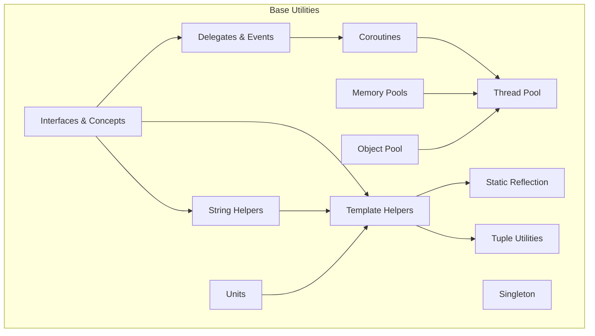
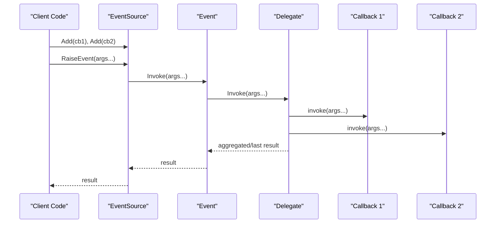
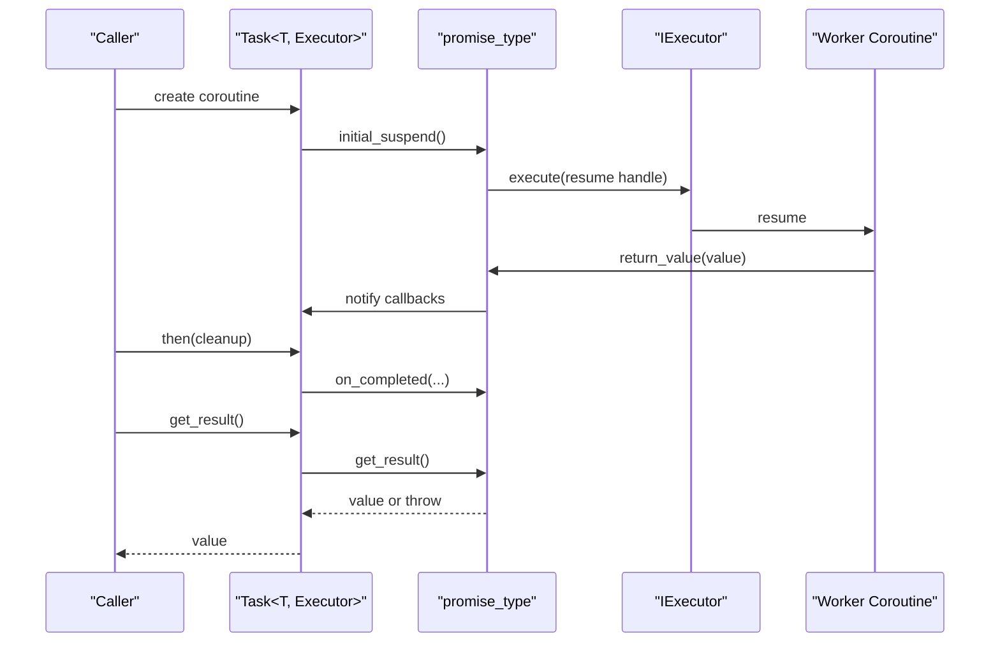
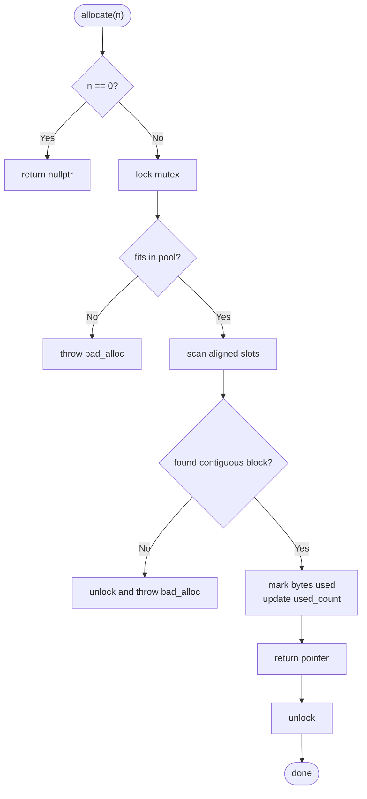
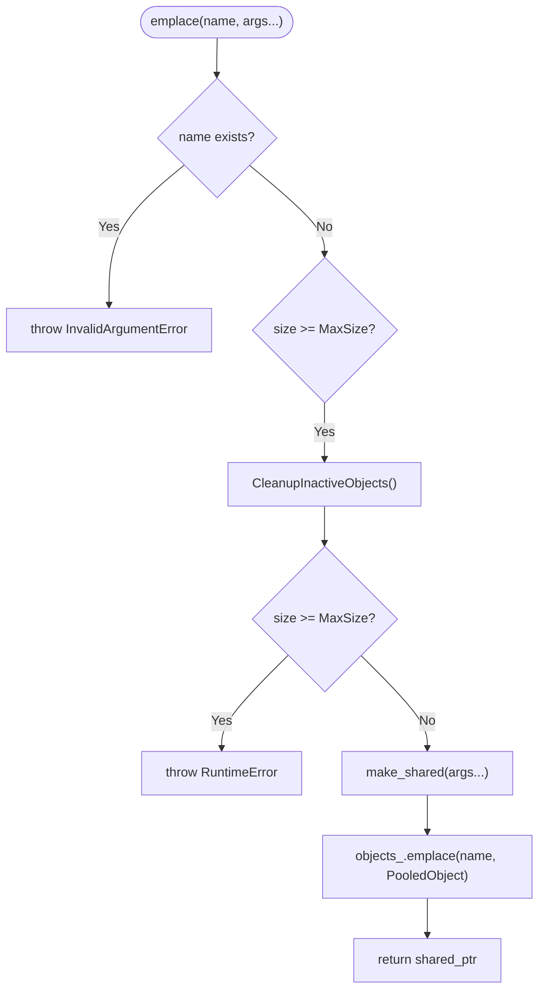
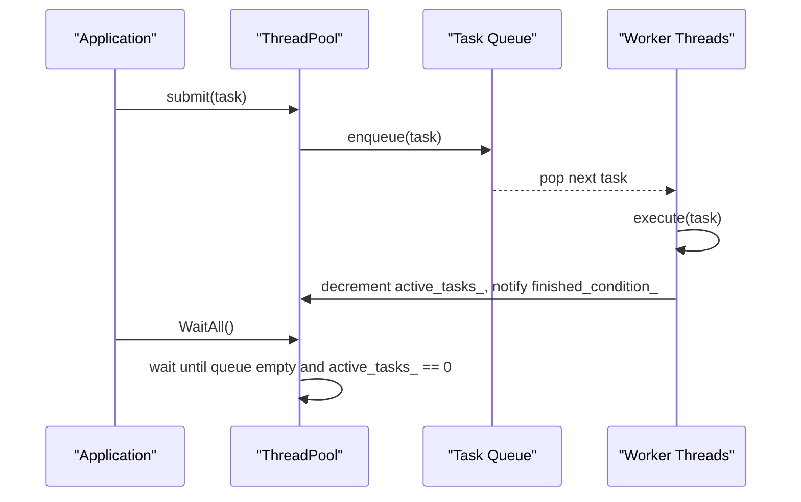
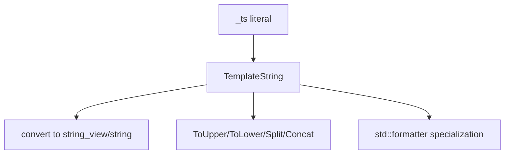
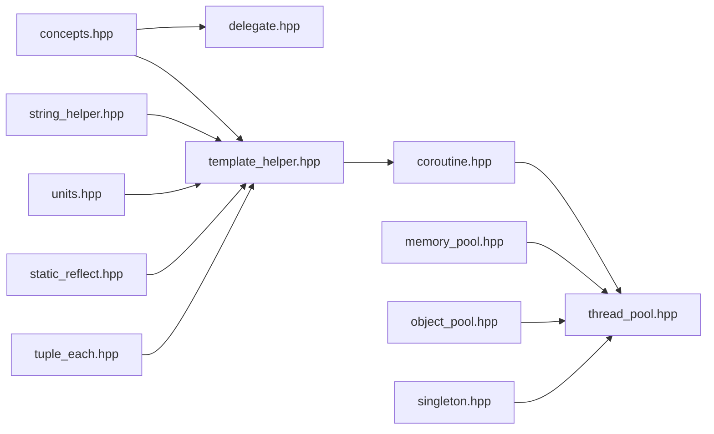

# Core Utilities API

<cite>
**Referenced Files in This Document**   
- [base_interface.hpp](file://base/base_interface.hpp)
- [delegate.hpp](file://base/delegate.hpp)
- [coroutine.hpp](file://base/coroutine.hpp)
- [memory_pool.hpp](file://base/memory_pool.hpp)
- [object_pool.hpp](file://base/object_pool.hpp)
- [thread_pool.hpp](file://base/thread_pool.hpp)
- [template_helper.hpp](file://base/template_helper.hpp)
- [string_helper.hpp](file://base/string_helper.hpp)
- [units.hpp](file://base/units.hpp)
- [concepts.hpp](file://base/concepts.hpp)
- [singleton.hpp](file://base/singleton.hpp)
- [static_reflect.hpp](file://base/static_reflect.hpp)
- [tuple_each.hpp](file://base/tuple_each.hpp)
</cite>

## Table of Contents
1. [Introduction](#introduction)
2. [Project Structure](#project-structure)
3. [Core Components](#core-components)
4. [Architecture Overview](#architecture-overview)
5. [Detailed Component Analysis](#detailed-component-analysis)
6. [Dependency Analysis](#dependency-analysis)
7. [Performance Considerations](#performance-considerations)
8. [Troubleshooting Guide](#troubleshooting-guide)
9. [Conclusion](#conclusion)
10. [Appendices](#appendices)

## Introduction
This document provides comprehensive API documentation for the core utility classes and foundational components used throughout the HsBaSlicer library. It focuses on:
- Base interfaces and type translation abstractions
- Template utilities, string helpers, and mathematical unit abstractions
- Delegate/event patterns and coroutine support
- Memory management utilities, thread pool implementations, and object pooling mechanisms
- Type conversion utilities and reflection helpers
It also includes practical usage guidance, best practices for resource management, exception safety, and performance optimization when integrating these utilities into custom extensions.

## Project Structure
The core utilities are primarily located under the base directory and provide reusable building blocks across the codebase. Key areas include:
- Interfaces and concepts: base interface definitions and C++20 concepts
- Delegates and events: callback aggregation and event source patterns
- Coroutines: task abstraction, executors, and generator utilities
- Memory and object pools: fixed-size memory allocators and named shared-object pools
- Thread pool: concurrent task execution with optional coroutine integration
- Templates and strings: compile-time string handling, enum utilities, and string manipulation
- Units: typed physical units and currency literals via Boost.Units
- Singleton and static reflection: global accessors and compile-time introspection



**Diagram sources**
- [base_interface.hpp:1-28](file://base/base_interface.hpp#L1-L28)
- [concepts.hpp:1-270](file://base/concepts.hpp#L1-L270)
- [delegate.hpp:1-247](file://base/delegate.hpp#L1-L247)
- [coroutine.hpp:1-1091](file://base/coroutine.hpp#L1-L1091)
- [memory_pool.hpp:1-375](file://base/memory_pool.hpp#L1-L375)
- [object_pool.hpp:1-286](file://base/object_pool.hpp#L1-L286)
- [thread_pool.hpp:1-214](file://base/thread_pool.hpp#L1-L214)
- [template_helper.hpp:1-780](file://base/template_helper.hpp#L1-L780)
- [string_helper.hpp:1-180](file://base/string_helper.hpp#L1-L180)
- [units.hpp:1-573](file://base/units.hpp#L1-L573)
- [singleton.hpp:1-63](file://base/singleton.hpp#L1-L63)
- [static_reflect.hpp:1-188](file://base/static_reflect.hpp#L1-L188)
- [tuple_each.hpp:1-53](file://base/tuple_each.hpp#L1-L53)

**Section sources**
- [base_interface.hpp:1-28](file://base/base_interface.hpp#L1-L28)
- [concepts.hpp:1-270](file://base/concepts.hpp#L1-L270)
- [delegate.hpp:1-247](file://base/delegate.hpp#L1-L247)
- [coroutine.hpp:1-1091](file://base/coroutine.hpp#L1-L1091)
- [memory_pool.hpp:1-375](file://base/memory_pool.hpp#L1-L375)
- [object_pool.hpp:1-286](file://base/object_pool.hpp#L1-L286)
- [thread_pool.hpp:1-214](file://base/thread_pool.hpp#L1-L214)
- [template_helper.hpp:1-780](file://base/template_helper.hpp#L1-L780)
- [string_helper.hpp:1-180](file://base/string_helper.hpp#L1-L180)
- [units.hpp:1-573](file://base/units.hpp#L1-L573)
- [singleton.hpp:1-63](file://base/singleton.hpp#L1-L63)
- [static_reflect.hpp:1-188](file://base/static_reflect.hpp#L1-L188)
- [tuple_each.hpp:1-53](file://base/tuple_each.hpp#L1-L53)

## Core Components
This section summarizes the primary APIs and their intended use cases.

- BaseInterface and Translators
  - ITranslator<T>: a generic interface to convert between a type T and its string representation. Useful for serialization/deserialization or configuration mapping.

- Delegates and Events
  - Delegate<R, Args...>: thread-safe aggregator of callbacks with Add, Invoke, Clear, size, empty, begin/end, and operator() overloads. Supports void returns, additive results (when Addable), and last-writer-wins semantics otherwise.
  - Event<R, Args...>: encapsulates a private delegate for controlled invocation.
  - EventSource<Derived, R, Args...>: CRTP-style base that exposes Add/Remove and RaiseEvent to derived types.

- Coroutines
  - IExecutor: interface for executing functions; NoopExecutor executes inline; AsyncExecutor uses std::async.
  - Task<T, Executor>: coroutine-based task with Result wrapper, then/catching/finally chaining, await_transform for nested tasks, and completion callbacks.
  - CustomAllocatorTask<T, Executor, Allocator>: variant of Task using a custom allocator for promise allocation.
  - Generator<T>: personal coroutine generator supporting yield_value overloads.

- Memory Management
  - MemoryPool<T, PoolSize>: per-instance fixed-size memory pool allocator with alignment-aware allocation and mutex protection.
  - StaticMemoryPool<T, PoolSize>: static/shared fixed-size memory pool allocator with is_always_equal semantics.

- Object Pooling
  - NamedObjectPool<T, MaxSize>: named registry of shared_ptr objects with automatic cleanup of inactive entries, capacity enforcement, and thread-safe operations.

- Threading
  - ThreadPool: worker-thread pool with submit, WaitAll, PendingTasks, ActiveTasks, and destructor-driven shutdown.
  - ThreadPoolExecutor: coroutine executor that submits work to a ThreadPool (optional feature flag).

- Template Utilities
  - TemplateString<C, N>: fixed-size compile-time string with conversions, splitting, case conversion, formatting support, and user-defined literal _ts.
  - EnumName/EnumFromName: compile-time and runtime enum name utilities backed by magic_enum.
  - AllValidEnum/MakeEnumValidTable: range-checked enum validation and dispatch.
  - NamedRawPtr/NamedPtr: named pointer wrappers for debugging and readability.
  - YCombinator: recursive lambda helper where explicit this parameter is unavailable.
  - MakeNonCopyableArray: factory for non-copyable arrays.
  - Overloaded: multi-variant lambda helper.
  - Invoke/AsyncInvoke: thin wrappers around function invocation and std::async.

- String Helpers
  - to_lower/to_upper/trim/trim_left/trim_right: locale-aware transformations.
  - split/regex_split: delimiter and regex-based splitting.

- Units
  - Currency and SI units via Boost.Units with user-defined literals (_USD, _EUR, _CNY, _JPY, _m, _kg, _mm, _cm, _km, _g, _mg, _L, _mL, _s, _min, _h, _ms, _J, _kJ, _kWh, etc.).

- Singleton
  - Singleton<T>: thread-safe singleton accessor returning std::shared_ptr<T>.

- Static Reflection
  - FieldInfo/MethodInfo/Reflector: compile-time introspection for fields and methods with reflectable class requirements.

- Tuple Utilities
  - TupleEach: apply a function to each element of a tuple, returning either void or a tuple of results.

**Section sources**
- [base_interface.hpp:1-28](file://base/base_interface.hpp#L1-L28)
- [delegate.hpp:1-247](file://base/delegate.hpp#L1-L247)
- [coroutine.hpp:1-1091](file://base/coroutine.hpp#L1-L1091)
- [memory_pool.hpp:1-375](file://base/memory_pool.hpp#L1-L375)
- [object_pool.hpp:1-286](file://base/object_pool.hpp#L1-L286)
- [thread_pool.hpp:1-214](file://base/thread_pool.hpp#L1-L214)
- [template_helper.hpp:1-780](file://base/template_helper.hpp#L1-L780)
- [string_helper.hpp:1-180](file://base/string_helper.hpp#L1-L180)
- [units.hpp:1-573](file://base/units.hpp#L1-L573)
- [singleton.hpp:1-63](file://base/singleton.hpp#L1-L63)
- [static_reflect.hpp:1-188](file://base/static_reflect.hpp#L1-L188)
- [tuple_each.hpp:1-53](file://base/tuple_each.hpp#L1-L53)

## Architecture Overview
The core utilities form a layered foundation:
- Conceptual layer: concepts define constraints used across templates.
- Abstraction layer: interfaces like ITranslator and IExecutor decouple behavior from implementation.
- Concurrency layer: ThreadPool and coroutines coordinate asynchronous work.
- Resource layer: memory pools and object pools manage lifetimes and allocations efficiently.
- Utility layer: template helpers, string utilities, units, and reflection tools provide ergonomic APIs.

```mermaid
classDiagram
class ITranslator~T~ {
+put_value(T) string
+get_value(string) T
}
class Delegate~R, Args...~ {
+Add(callback)
+Invoke(args...) R
+Clear()
+size() size_t
+empty() bool
+begin()/end()
+operator()(args...) R
}
class Event~R, Args...~ {
-delegate_ : Delegate~R, Args...~
+Invoke(args...) R
}
class EventSource~Derived, R, Args...~ {
+Add(callback)
+Remove(callback)
+RaiseEvent(args...) R
}
class IExecutor {
+execute(func)
}
class NoopExecutor
class AsyncExecutor
class Task~T, Executor~ {
+then(func)
+catching(func)
+finally(func)
+get_result() T
}
class CustomAllocatorTask~T, Executor, Allocator~
class Generator~T~
class MemoryPool~T, PoolSize~
class StaticMemoryPool~T, PoolSize~
class NamedObjectPool~T, MaxSize~
class ThreadPool {
+submit(f, args...) future
+WaitAll()
+PendingTasks() size_t
+ActiveTasks() size_t
}
class ThreadPoolExecutor
IExecutor <|-- NoopExecutor
IExecutor <|-- AsyncExecutor
Task~T, Executor~ --> IExecutor : "uses"
CustomAllocatorTask~T, Executor, Allocator~ --> IExecutor : "uses"
ThreadPoolExecutor ..|> IExecutor
ThreadPool --> Task : "executes via executor"
Delegate~R, Args... --> Event~R, Args... : "encapsulated"
EventSource~Derived, R, Args... --> Event~R, Args... : "owns"
```

**Diagram sources**
- [base_interface.hpp:1-28](file://base/base_interface.hpp#L1-L28)
- [delegate.hpp:1-247](file://base/delegate.hpp#L1-L247)
- [coroutine.hpp:1-1091](file://base/coroutine.hpp#L1-L1091)
- [memory_pool.hpp:1-375](file://base/memory_pool.hpp#L1-L375)
- [object_pool.hpp:1-286](file://base/object_pool.hpp#L1-L286)
- [thread_pool.hpp:1-214](file://base/thread_pool.hpp#L1-L214)

## Detailed Component Analysis

### Base Interface and Translator Pattern
ITranslator<T> defines a bidirectional conversion contract between a type and its string representation. Implementations can be provided for domain types to enable configuration parsing, logging, or serialization.

Key points:
- put_value converts an instance to a string.
- get_value reconstructs an instance from a string.
- Works well with StrTranslator concept for ptree or other tree-like structures.

Practical example outline:
- Define a struct ConfigValue with numeric and string fields.
- Provide ITranslator<ConfigValue> that serializes fields to/from delimited strings.
- Use with any tree storage that expects StrTranslator.

**Section sources**
- [base_interface.hpp:1-28](file://base/base_interface.hpp#L1-L28)
- [concepts.hpp:44-49](file://base/concepts.hpp#L44-L49)

### Delegate and Event System
Delegate<R, Args...> aggregates multiple callbacks with thread-safe Add/Invoke/Clear. Invoke semantics:
- For void return: call all callbacks.
- For Addable return types: accumulate results using operator+.
- Otherwise: last callback’s result wins.

Event<R, Args...> hides the delegate and restricts direct modification. EventSource<Derived, R, Args...> exposes Add/Remove and RaiseEvent to derived classes.



**Diagram sources**
- [delegate.hpp:27-167](file://base/delegate.hpp#L27-L167)
- [delegate.hpp:169-243](file://base/delegate.hpp#L169-L243)

Best practices:
- Prefer += for adding callbacks; Remove operators are deprecated due to std::function equality limitations.
- Ensure callbacks are lightweight or capture only necessary state to avoid overhead.
- Use empty() before invoking if you want to skip unnecessary locking.

**Section sources**
- [delegate.hpp:1-247](file://base/delegate.hpp#L1-L247)

### Coroutine Support
The coroutine subsystem provides:
- IExecutor interface with NoopExecutor and AsyncExecutor.
- Task<T, Executor> and Task<void, Executor> with Result wrappers, then/catching/finally, and completion callbacks.
- CustomAllocatorTask<T, Executor, Allocator> for custom promise allocation.
- Generator<T> for iterative coroutines.



**Diagram sources**
- [coroutine.hpp:47-75](file://base/coroutine.hpp#L47-L75)
- [coroutine.hpp:205-382](file://base/coroutine.hpp#L205-L382)
- [coroutine.hpp:384-555](file://base/coroutine.hpp#L384-L555)

Usage guidelines:
- Use then/catching/finally for structured error handling and cleanup.
- Set a default ThreadPoolExecutor to run tasks on a managed thread pool.
- For high-frequency allocations inside coroutines, consider CustomAllocatorTask with a suitable allocator.

**Section sources**
- [coroutine.hpp:1-1091](file://base/coroutine.hpp#L1-L1091)

### Memory Pools
Two allocator variants are provided:
- MemoryPool<T, PoolSize>: per-instance pool with shared state and mutex protection. Throws std::bad_alloc when insufficient space; validates deallocation bounds.
- StaticMemoryPool<T, PoolSize}: static/shared pool with is_always_equal semantics and a UsedCount() query.



**Diagram sources**
- [memory_pool.hpp:111-142](file://base/memory_pool.hpp#L111-L142)
- [memory_pool.hpp:266-296](file://base/memory_pool.hpp#L266-L296)

Best practices:
- Choose StaticMemoryPool for globally shared pools; MemoryPool for isolated pools.
- Ensure PoolSize is sized for expected peak allocations to avoid frequent bad_alloc.
- Always pair construct/destroy with allocate/deallocate when using raw pointers.

**Section sources**
- [memory_pool.hpp:1-375](file://base/memory_pool.hpp#L1-L375)

### Named Object Pool
NamedObjectPool<T, MaxSize> manages named shared_ptr<T> instances with:
- emplace/insert/allocate to add objects.
- get/operator[] to retrieve.
- remove to delete by name.
- CleanupInactiveObjects to reclaim unused entries when at capacity.
- Thread-safe operations via shared_mutex.



**Diagram sources**
- [object_pool.hpp:66-92](file://base/object_pool.hpp#L66-L92)
- [object_pool.hpp:262-279](file://base/object_pool.hpp#L262-L279)

Best practices:
- Use unique names to avoid collisions.
- Let the pool clean up inactive objects automatically; avoid manual removal unless necessary.
- Monitor InactiveCount/ActiveCount for health checks.

**Section sources**
- [object_pool.hpp:1-286](file://base/object_pool.hpp#L1-L286)

### Thread Pool and Coroutine Integration
ThreadPool provides:
- submit(F&&, Args&&...) returning std::future<ReturnType>.
- WaitAll to block until all tasks complete.
- PendingTasks/ActiveTasks for monitoring.
- Destructor sets stop flag and joins workers.

ThreadPoolExecutor integrates with coroutines by implementing IExecutor and submitting tasks to a ThreadPool.



**Diagram sources**
- [thread_pool.hpp:29-162](file://base/thread_pool.hpp#L29-L162)

Integration notes:
- When HSBA_ENABLE_THREAD_POOL_COROUTINE is defined, ThreadPoolExecutor becomes available.
- Set a default pool via ThreadPoolExecutor::SetDefaultPool to centralize execution.

**Section sources**
- [thread_pool.hpp:1-214](file://base/thread_pool.hpp#L1-L214)
- [coroutine.hpp:164-209](file://base/coroutine.hpp#L164-L209)

### Template Helpers and Compile-Time Strings
TemplateString<C, N> offers:
- Construction from C-string, std::array, string_view, ranges.
- Iteration, indexing, at() with bounds checking.
- Conversion to string_view/string/const char*.
- ToUpper/ToLower, Split, concatenation, and formatter specialization.
- User-defined literal _ts for compile-time construction.

Additional helpers:
- EnumName/EnumFromName for enum-to-string conversions.
- AllValidEnum/MakeEnumValidTable for validated dispatch.
- NamedRawPtr/NamedPtr for named pointers.
- YCombinator for recursive lambdas without explicit this.
- MakeNonCopyableArray for non-copyable arrays.
- Overloaded for multi-variant lambdas.
- Invoke/AsyncInvoke for convenient invocation.



**Diagram sources**
- [template_helper.hpp:50-305](file://base/template_helper.hpp#L50-L305)
- [template_helper.hpp:725-778](file://base/template_helper.hpp#L725-L778)

Best practices:
- Prefer TemplateString for fixed-size identifiers and keys to reduce allocations.
- Use _ts literals for compile-time constants.
- Leverage AllValidEnum for safe enum dispatch with defaults.

**Section sources**
- [template_helper.hpp:1-780](file://base/template_helper.hpp#L1-L780)

### String Helpers
Functions:
- to_lower/to_upper: locale-aware case conversion.
- trim/trim_left/trim_right: whitespace trimming.
- split/regex_split: delimiter and regex-based splitting.

These operate on string views and return new strings or containers of string views.

**Section sources**
- [string_helper.hpp:1-180](file://base/string_helper.hpp#L1-L180)

### Units and Mathematical Abstractions
Units provides typed quantities via Boost.Units with user-defined literals for:
- Length: _m, _mm, _cm, _km
- Volume: _L, _mL
- Mass: _kg, _g, _mg
- Density: _kg_per_m3, _g_per_cm3, _kg_per_L
- Time: _s, _min, _h, _ms
- Energy: _J, _kJ, _kWh
- Temperature: _C, _F, _K
- Currency: _USD, _EUR, _CNY, _JPY and per-kg variants

Use these literals to ensure dimensional correctness and avoid unit errors.

**Section sources**
- [units.hpp:1-573](file://base/units.hpp#L1-L573)

### Singleton
Singleton<T> provides:
- GetInstance(Args...) returning std::shared_ptr<T>.
- Thread-safe initialization via std::call_once.
- Protected constructor pattern to prevent external instantiation.

**Section sources**
- [singleton.hpp:1-63](file://base/singleton.hpp#L1-L63)

### Static Reflection
StaticReflect provides:
- FieldInfo and MethodInfo for compile-time field/method metadata.
- Reflector<T> to enumerate fields/methods and invoke methods by name.
- Reflectable concept requiring FieldList, MethodList, ClassName.

Useful for serialization, UI binding, or dynamic dispatch based on metadata.

**Section sources**
- [static_reflect.hpp:1-188](file://base/static_reflect.hpp#L1-L188)

### Tuple Utilities
TupleEach applies a function to each element of a tuple:
- If the function returns void for all elements, returns void.
- Otherwise returns a tuple of results.

**Section sources**
- [tuple_each.hpp:1-53](file://base/tuple_each.hpp#L1-L53)

## Dependency Analysis
High-level dependencies among core utilities:



**Diagram sources**
- [concepts.hpp:1-270](file://base/concepts.hpp#L1-L270)
- [delegate.hpp:1-247](file://base/delegate.hpp#L1-L247)
- [template_helper.hpp:1-780](file://base/template_helper.hpp#L1-L780)
- [coroutine.hpp:1-1091](file://base/coroutine.hpp#L1-L1091)
- [thread_pool.hpp:1-214](file://base/thread_pool.hpp#L1-L214)
- [memory_pool.hpp:1-375](file://base/memory_pool.hpp#L1-L375)
- [object_pool.hpp:1-286](file://base/object_pool.hpp#L1-L286)
- [string_helper.hpp:1-180](file://base/string_helper.hpp#L1-L180)
- [units.hpp:1-573](file://base/units.hpp#L1-L573)
- [singleton.hpp:1-63](file://base/singleton.hpp#L1-L63)
- [static_reflect.hpp:1-188](file://base/static_reflect.hpp#L1-L188)
- [tuple_each.hpp:1-53](file://base/tuple_each.hpp#L1-L53)

**Section sources**
- [concepts.hpp:1-270](file://base/concepts.hpp#L1-L270)
- [template_helper.hpp:1-780](file://base/template_helper.hpp#L1-L780)
- [coroutine.hpp:1-1091](file://base/coroutine.hpp#L1-L1091)
- [thread_pool.hpp:1-214](file://base/thread_pool.hpp#L1-L214)

## Performance Considerations
- Memory pools:
  - Pre-size pools to expected peak usage to minimize bad_alloc and scanning overhead.
  - Prefer StaticMemoryPool for shared pools to avoid per-instance state duplication.
- Object pool:
  - Avoid excessive churn of short-lived objects; let CleanupInactiveObjects reclaim unused entries.
  - Monitor ActiveCount/InactiveCount to tune MaxSize.
- Thread pool:
  - Size threads according to workload characteristics (CPU-bound vs IO-bound).
  - Use WaitAll judiciously to avoid deadlocks in single-threaded contexts.
- Coroutines:
  - Use ThreadPoolExecutor to offload heavy work to worker threads.
  - Minimize allocations inside hot paths; consider CustomAllocatorTask with a pool-backed allocator.
- Template/string utilities:
  - Use TemplateString for fixed-size identifiers to avoid heap allocations.
  - Prefer string_view-based APIs to reduce copies.

[No sources needed since this section provides general guidance]

## Troubleshooting Guide
Common issues and resolutions:
- Delegate Remove deprecation:
  - Remove operators are marked deprecated because std::function lacks operator==. Use alternative designs such as token-based unsubscription or restructure to avoid needing removal.
- ThreadPool stopped:
  - Submitting to a stopped ThreadPool throws RuntimeError. Ensure the pool remains alive while tasks are enqueued.
- Memory pool out-of-bounds:
  - deallocate may throw invalid_argument if pointer is not within pool bounds. Verify ownership and lifetime of allocated pointers.
- Object pool full:
  - Emplace/insert/allocate may throw RuntimeError if pool is full and no inactive objects are available. Increase MaxSize or ensure objects are released.
- Coroutine exceptions:
  - Use catching to handle exceptions thrown by tasks; then will not execute if an exception occurred.
- Units compilation errors:
  - Ensure Boost.Units is available and configured; verify literal suffixes match supported units.

**Section sources**
- [delegate.hpp:46-56](file://base/delegate.hpp#L46-L56)
- [thread_pool.hpp:77-89](file://base/thread_pool.hpp#L77-L89)
- [memory_pool.hpp:156-175](file://base/memory_pool.hpp#L156-L175)
- [object_pool.hpp:71-85](file://base/object_pool.hpp#L71-L85)
- [coroutine.hpp:338-353](file://base/coroutine.hpp#L338-L353)

## Conclusion
The core utilities in HsBaSlicer provide a robust foundation for type-safe conversions, concurrency, resource management, and ergonomic APIs. By leveraging delegates/events, coroutines, memory/object pools, and template/string helpers, developers can build efficient, maintainable, and extensible integrations. Adhering to the best practices outlined here ensures safe resource management, strong exception guarantees, and optimal performance.

[No sources needed since this section summarizes without analyzing specific files]

## Appendices

### Practical Usage Examples

- Using ITranslator for configuration mapping:
  - Implement ITranslator<MyType> to serialize/deserialize MyType fields.
  - Integrate with any tree-based config store expecting StrTranslator.

- Building an event-driven component with EventSource:
  - Derive from EventSource<YourClass, void, EventArgs>.
  - Expose Add/Remove and raise events via RaiseEvent.

- Running background tasks with ThreadPool and coroutines:
  - Configure ThreadPoolExecutor with a ThreadPool.
  - Launch coroutines that perform IO or CPU-heavy work and chain then/catching/finally.

- Managing temporary objects with NamedObjectPool:
  - Register long-lived resources by name.
  - Retrieve via get or operator[].
  - Allow automatic cleanup of inactive objects.

- Using TemplateString and _ts:
  - Declare compile-time identifiers with _ts.
  - Convert to string_view/string as needed.
  - Use ToUpper/ToLower and Split for processing.

- Working with units:
  - Annotate values with literals like 1.5_m, 100_g, 25_C.
  - Perform arithmetic with type safety enforced by Boost.Units.

[No sources needed since this section provides general guidance]