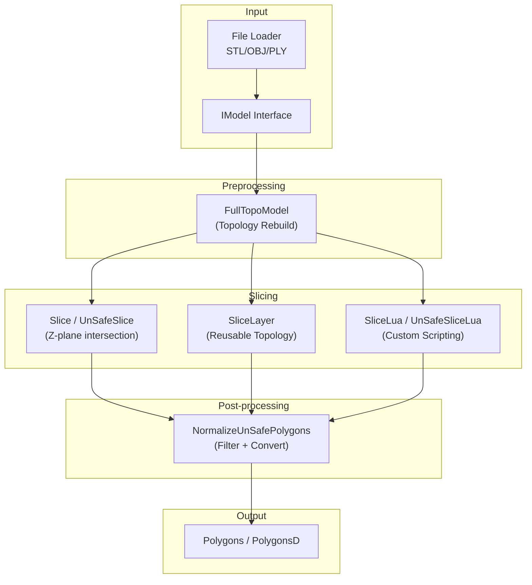
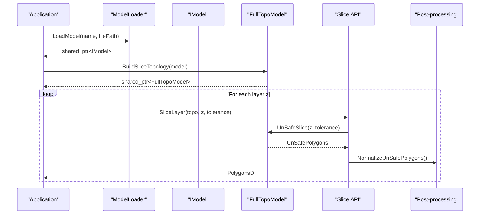
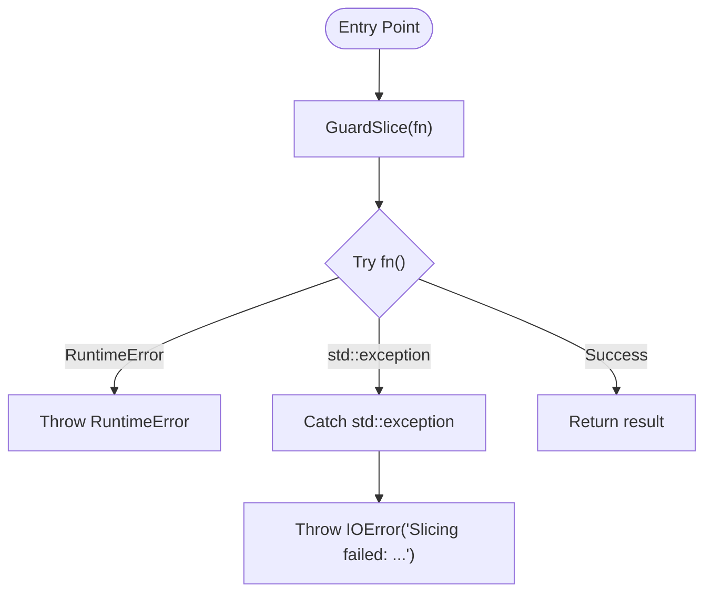
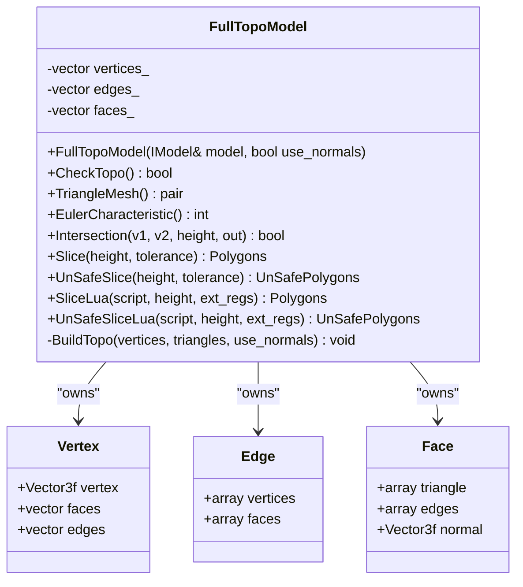
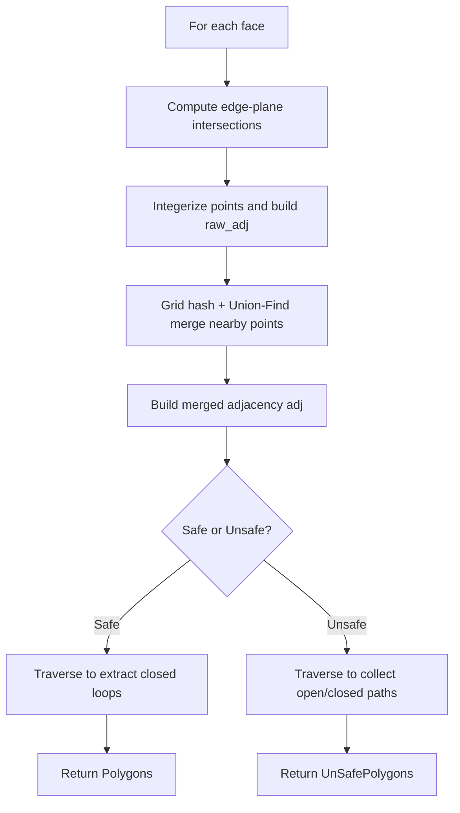
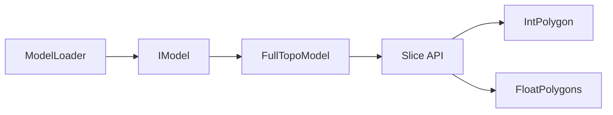

# Mesh Slicer API

<cite>
**Referenced Files in This Document**
- [mesh_slice.hpp](file://LibHsBaSlicer/Slice/mesh_slice.hpp)
- [mesh_slice.cpp](file://LibHsBaSlicer/Slice/mesh_slice.cpp)
- [FullTopoModel.hpp](file://meshmodel/FullTopoModel.hpp)
- [FullTopoModel.cpp](file://meshmodel/FullTopoModel.cpp)
- [IModel.hpp](file://base/IModel.hpp)
- [ModelFormat.hpp](file://base/ModelFormat.hpp)
- [IntPolygon.hpp](file://2D/IntPolygon.hpp)
- [FloatPolygons.hpp](file://2D/FloatPolygons.hpp)
- [IntPolygon.cpp](file://2D/IntPolygon.cpp)
- [FloatPolygons.cpp](file://2D/FloatPolygons.cpp)
- [LuaAdapter.cpp](file://2D/LuaAdapter.cpp)
- [ModelLoader.hpp](file://preprocess/ModelLoader.hpp)
- [ModelLoader.cpp](file://preprocess/ModelLoader.cpp)
- [IglModel.hpp](file://meshmodel/IglModel.hpp)
- [IglModel.cpp](file://meshmodel/IglModel.cpp)
</cite>

## Table of Contents
1. [Introduction](#introduction)
2. [Project Structure](#project-structure)
3. [Core Components](#core-components)
4. [Architecture Overview](#architecture-overview)
5. [Detailed Component Analysis](#detailed-component-analysis)
6. [Dependency Analysis](#dependency-analysis)
7. [Performance Considerations](#performance-considerations)
8. [Troubleshooting Guide](#troubleshooting-guide)
9. [Conclusion](#conclusion)

## Introduction
This document provides comprehensive API documentation for the mesh slicing functionality centered around the HsBa::Slicer namespace. It covers:
- The public slicing interface (safe and unsafe slicing, Lua-driven slicing, reusable topology slicing).
- The mesh preprocessing pipeline from file formats to a topological model suitable for slicing.
- Layer generation algorithms and contour extraction processes.
- Configuration options such as layer height and coordinate tolerance.
- Practical usage examples for STL, OBJ, and PLY models.
- Error handling, memory management patterns, threading considerations, and performance optimization techniques.

## Project Structure
The slicing API is exposed through LibHsBaSlicer’s Slice module and relies on geometry primitives in 2D, model abstractions in base, and the FullTopoModel in meshmodel.

**Diagram sources**
- [mesh_slice.hpp:22-103](file://LibHsBaSlicer/Slice/mesh_slice.hpp#L22-L103)
- [FullTopoModel.hpp:43-145](file://meshmodel/FullTopoModel.hpp#L43-L145)
- [IntPolygon.hpp:16-26](file://2D/IntPolygon.hpp#L16-L26)
- [FloatPolygons.hpp:18-25](file://2D/FloatPolygons.hpp#L18-L25)

**Section sources**
- [mesh_slice.hpp:1-108](file://LibHsBaSlicer/Slice/mesh_slice.hpp#L1-L108)
- [FullTopoModel.hpp:1-150](file://meshmodel/FullTopoModel.hpp#L1-L150)

## Core Components
- HsBa::Slicer::Slice: Returns closed-contour polygons at a given Z height.
- HsBa::Slicer::UnSafeSlice: Returns polygons including open contours at a given Z height.
- HsBa::Slicer::SliceLua / UnSafeSliceLua: Execute custom Lua scripts to produce polygons at a given Z height.
- HsBa::Slicer::NormalizeUnSafePolygons: Filters invalid/open polylines and converts integer polygons to double-precision polygons.
- HsBa::Slicer::BuildSliceTopology: Builds a reusable topology once for multi-layer slicing.
- HsBa::Slicer::SliceLayer: Slices a single layer from a prebuilt topology and normalizes to PolygonsD.

Key data types:
- IModel: Abstract 3D model interface providing triangle mesh access and transformations.
- FullTopoModel: Fully reconstructed topological mesh optimized for slicing; exposes safe/unsafe/Lua slicing.
- Polygon/Polygons: Integer-coordinate polygon types used internally during slicing.
- PolygonD/PolygonsD: Double-precision polygon types used for downstream processing.

Configuration parameters:
- height/z: Slice plane along Z-axis.
- tolerance: Coordinate merging tolerance for point snapping during slicing.

**Section sources**
- [mesh_slice.hpp:22-103](file://LibHsBaSlicer/Slice/mesh_slice.hpp#L22-L103)
- [FullTopoModel.hpp:43-145](file://meshmodel/FullTopoModel.hpp#L43-L145)
- [IModel.hpp:111-139](file://base/IModel.hpp#L111-L139)
- [IntPolygon.hpp:16-26](file://2D/IntPolygon.hpp#L16-L26)
- [FloatPolygons.hpp:18-25](file://2D/FloatPolygons.hpp#L18-L25)

## Architecture Overview
The slicing pipeline integrates model loading, topology reconstruction, planar slicing, and post-processing into a cohesive flow.

**Diagram sources**
- [ModelLoader.cpp:48-84](file://preprocess/ModelLoader.cpp#L48-L84)
- [mesh_slice.cpp:105-115](file://LibHsBaSlicer/Slice/mesh_slice.cpp#L105-L115)
- [FullTopoModel.cpp:328-600](file://meshmodel/FullTopoModel.cpp#L328-L600)

**Section sources**
- [ModelLoader.hpp:47-70](file://preprocess/ModelLoader.hpp#L47-L70)
- [ModelLoader.cpp:48-84](file://preprocess/ModelLoader.cpp#L48-L84)
- [mesh_slice.cpp:45-115](file://LibHsBaSlicer/Slice/mesh_slice.cpp#L45-L115)

## Detailed Component Analysis

### Public Slicing API (HsBa::Slicer)
- Slice(model, height, tolerance): Safe slice returning only closed contours.
- UnSafeSlice(model, height, tolerance): Unsafe slice returning both closed and open contours.
- SliceLua(model, script, height): Lua-driven safe slice.
- UnSafeSliceLua(model, script, height): Lua-driven unsafe slice.
- NormalizeUnSafePolygons(unsafe_polys): Filters invalid polylines and converts to PolygonsD.
- BuildSliceTopology(model): Builds reusable topology for multi-layer slicing.
- SliceLayer(topo, z, tolerance): Slices a single layer from prebuilt topology and returns PolygonsD.

Error handling:
- All entry points are wrapped by GuardSlice which translates foreign exceptions (e.g., CGAL, OCCT tessellation failures) into project IOError while preserving project RuntimeError.

**Diagram sources**
- [mesh_slice.cpp:27-43](file://LibHsBaSlicer/Slice/mesh_slice.cpp#L27-L43)

**Section sources**
- [mesh_slice.hpp:22-103](file://LibHsBaSlicer/Slice/mesh_slice.hpp#L22-L103)
- [mesh_slice.cpp:45-115](file://LibHsBaSlicer/Slice/mesh_slice.cpp#L45-L115)

### FullTopoModel Class
Responsibilities:
- Reconstruct full topology (vertices, edges, faces) from triangle mesh.
- Provide safe/unsafe/Lua slicing methods.
- Expose Euler characteristic and topological checks.

Key methods:
- FullTopoModel(IModel&, use_normals=false): Construct from IModel.
- CheckTopo(): Validate topological completeness.
- TriangleMesh(): Export vertices and faces.
- Slice(height, tolerance): Closed contours only.
- UnSafeSlice(height, tolerance): Includes open contours.
- SliceLua(...): Custom scripting support.

Data structures:
- Vertex: position, face indices, edge indices.
- Edge: vertex indices, adjacent face indices.
- Face: triangle vertex indices, edge indices, optional normal.

**Diagram sources**
- [FullTopoModel.hpp:53-145](file://meshmodel/FullTopoModel.hpp#L53-L145)
- [FullTopoModel.cpp:27-48](file://meshmodel/FullTopoModel.cpp#L27-L48)

**Section sources**
- [FullTopoModel.hpp:18-145](file://meshmodel/FullTopoModel.hpp#L18-L145)
- [FullTopoModel.cpp:50-158](file://meshmodel/FullTopoModel.cpp#L50-L158)

### Layer Generation Algorithms and Contour Extraction
Algorithm overview:
1. Compute intersections between each triangle edge and the Z-plane.
2. Build raw adjacency list of intersection points using integerized coordinates.
3. Merge nearby nodes via grid hashing and union-find based on tolerance.
4. Traverse merged adjacency to extract closed loops or open paths.
5. For safe slicing, discard open contours; for unsafe slicing, retain them with a closed flag.

Complexity:
- Intersection computation: O(F) where F is number of faces.
- Adjacency building and merging: O(N log N) due to sorting and hashing.
- Traversal: O(N) where N is number of unique intersection points.

**Diagram sources**
- [FullTopoModel.cpp:328-600](file://meshmodel/FullTopoModel.cpp#L328-L600)
- [FullTopoModel.cpp:604-800](file://meshmodel/FullTopoModel.cpp#L604-L800)

**Section sources**
- [FullTopoModel.cpp:328-600](file://meshmodel/FullTopoModel.cpp#L328-L600)
- [FullTopoModel.cpp:604-800](file://meshmodel/FullTopoModel.cpp#L604-L800)

### Post-processing and Output Formats
- NormalizeUnSafePolygons filters out open polylines and non-simple polygons, then converts integer polygons to double-precision polygons.
- Output types:
  - Polygons: Integer-coordinate polygons used internally.
  - PolygonsD: Double-precision polygons for downstream operations.

Conversion utilities:
- Integerization(PolygonsD) -> Polygons
- UnIntegerization(Polygon/Polygons) -> PolygonD/PolygonsD

**Section sources**
- [mesh_slice.cpp:85-103](file://LibHsBaSlicer/Slice/mesh_slice.cpp#L85-L103)
- [IntPolygon.hpp:16-26](file://2D/IntPolygon.hpp#L16-L26)
- [FloatPolygons.hpp:18-25](file://2D/FloatPolygons.hpp#L18-L25)
- [FloatPolygons.cpp:195-211](file://2D/FloatPolygons.cpp#L195-L211)

### Lua Integration
- SliceLua and UnSafeSliceLua accept inline Lua scripts that operate on V (vertices), E (edges), F (faces), and height globals.
- Scripts return tables of polygons; results are converted to Polygons or UnSafePolygons.

Usage notes:
- Use Get3DFunctions() to register 3D helper functions when invoking Lua slicing.

**Section sources**
- [mesh_slice.cpp:65-83](file://LibHsBaSlicer/Slice/mesh_slice.cpp#L65-L83)
- [FullTopoModel.hpp:116-132](file://meshmodel/FullTopoModel.hpp#L116-L132)
- [LuaAdapter.cpp:362-405](file://2D/LuaAdapter.cpp#L362-L405)

## Dependency Analysis
The slicing API depends on:
- IModel for abstract model access.
- FullTopoModel for topology-based slicing.
- 2D polygon types and utilities for contour normalization and conversion.
- ModelLoader for loading STL/OBJ/PLY files into IModel.

**Diagram sources**
- [IModel.hpp:111-139](file://base/IModel.hpp#L111-L139)
- [FullTopoModel.hpp:43-145](file://meshmodel/FullTopoModel.hpp#L43-L145)
- [mesh_slice.hpp:22-103](file://LibHsBaSlicer/Slice/mesh_slice.hpp#L22-L103)
- [ModelLoader.hpp:47-70](file://preprocess/ModelLoader.hpp#L47-L70)

**Section sources**
- [IModel.hpp:111-139](file://base/IModel.hpp#L111-L139)
- [FullTopoModel.hpp:43-145](file://meshmodel/FullTopoModel.hpp#L43-L145)
- [mesh_slice.hpp:22-103](file://LibHsBaSlicer/Slice/mesh_slice.hpp#L22-L103)
- [ModelLoader.hpp:47-70](file://preprocess/ModelLoader.hpp#L47-L70)

## Performance Considerations
- Prebuild topology: Use BuildSliceTopology followed by SliceLayer to avoid rebuilding topology per layer.
- Tolerance tuning: Adjust tolerance to balance precision vs. performance; larger tolerances reduce point count but may merge distinct features.
- Memory reuse: Reuse FullTopoModel instances across layers; ensure thread safety by writing to separate output containers.
- Avoid unnecessary conversions: Prefer PolygonsD outputs directly from SliceLayer to minimize conversions.
- Parallel slicing: Each layer can be processed independently; consider parallelizing across threads if each writes to its own output slot.

[No sources needed since this section provides general guidance]

## Troubleshooting Guide
Common issues and resolutions:
- Foreign exceptions from geometry kernels (CGAL, OCCT): These are translated to IOError by GuardSlice; inspect error messages for details.
- Open contours in unsafe slicing: Expected behavior; filter or handle open polylines in application logic.
- Invalid polygons after normalization: Ensure input polygons have at least three points and are not degenerate.
- Unsupported file formats: Verify format detection and loader capabilities; STL/OBJ/PLY are supported via IglModel.

Error types:
- RuntimeError: Project-specific errors propagated unchanged.
- IOError: Wraps foreign exceptions from external libraries.

**Section sources**
- [mesh_slice.cpp:27-43](file://LibHsBaSlicer/Slice/mesh_slice.cpp#L27-L43)
- [ModelLoader.cpp:48-84](file://preprocess/ModelLoader.cpp#L48-L84)

## Conclusion
The Mesh Slicer API provides a robust, configurable, and extensible framework for planar mesh slicing. By leveraging FullTopoModel for topology reconstruction, users can efficiently generate layer contours with precise control over tolerance and output formats. The integration with Lua enables custom slicing strategies, while the post-processing utilities ensure clean, double-precision polygon outputs ready for downstream path generation and visualization. Proper use of BuildSliceTopology and SliceLayer optimizes performance for multi-layer pipelines, and the error-handling mechanisms provide clear diagnostics for complex geometry scenarios.

[No sources needed since this section summarizes without analyzing specific files]