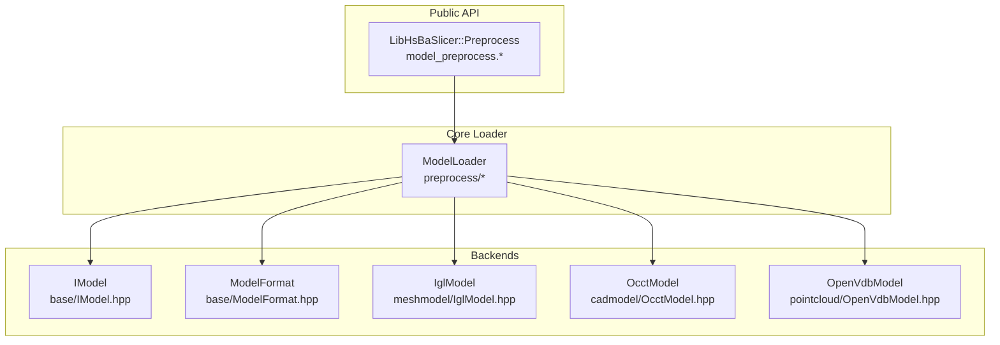
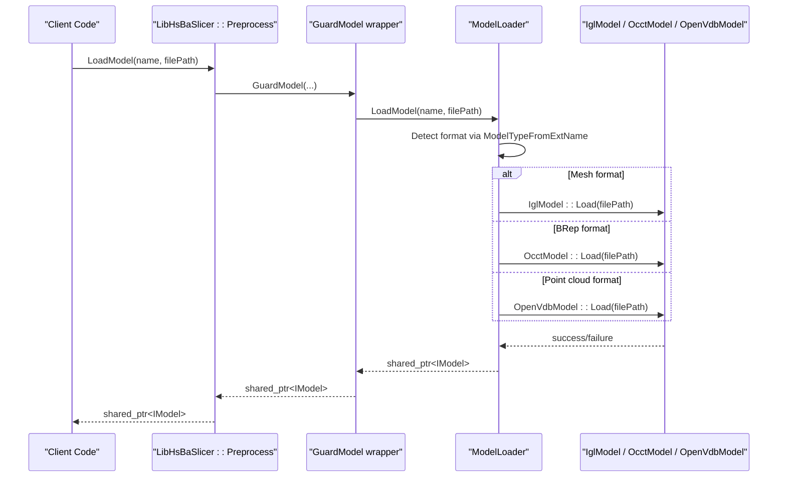
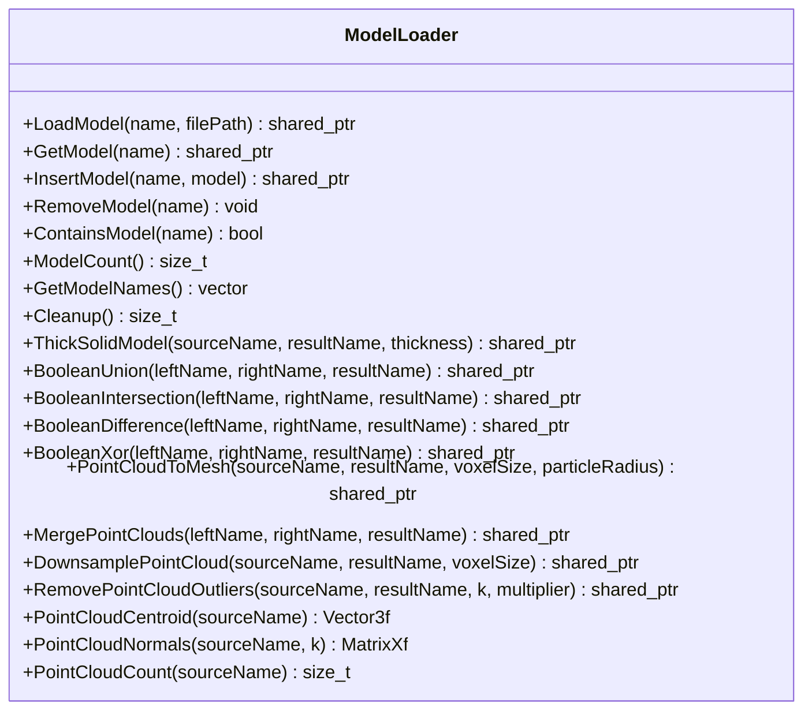
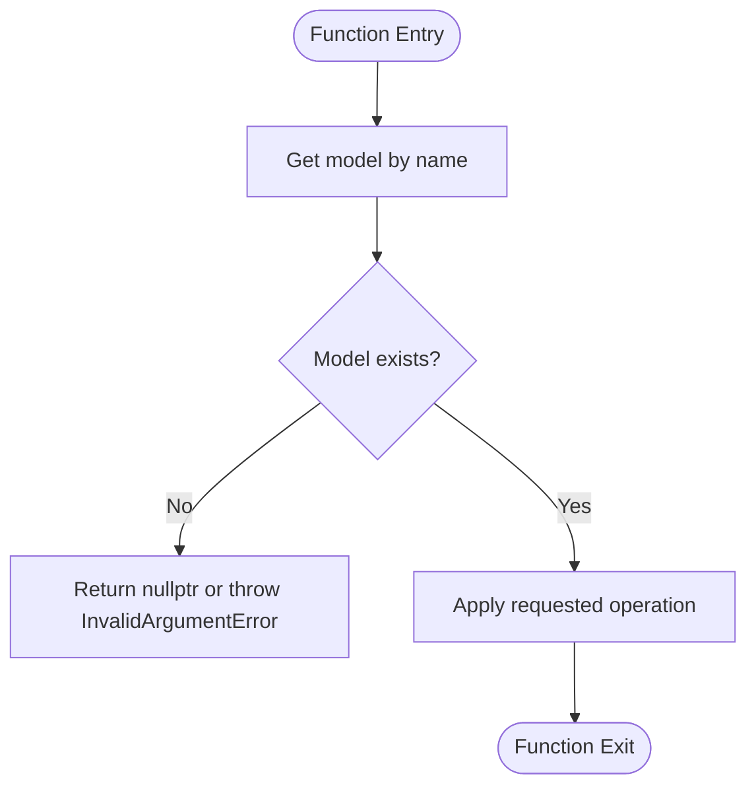
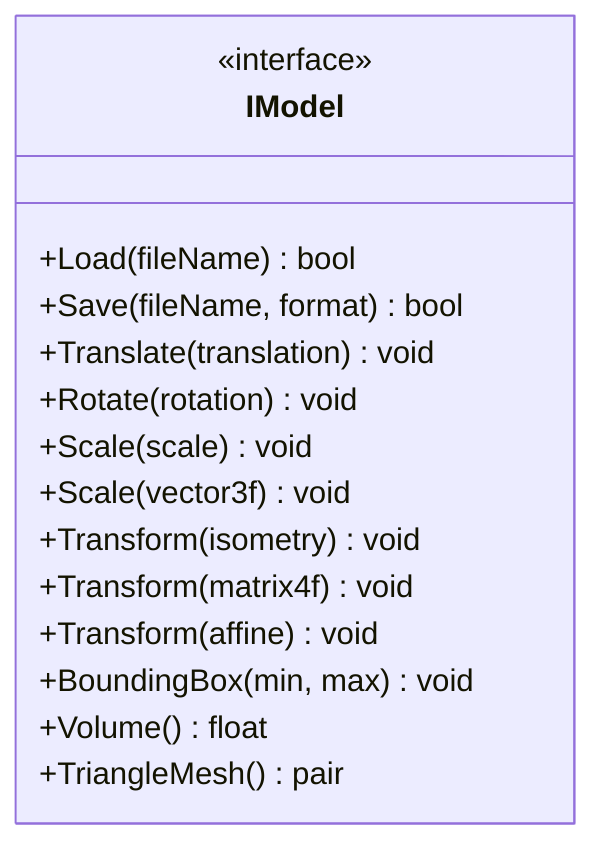
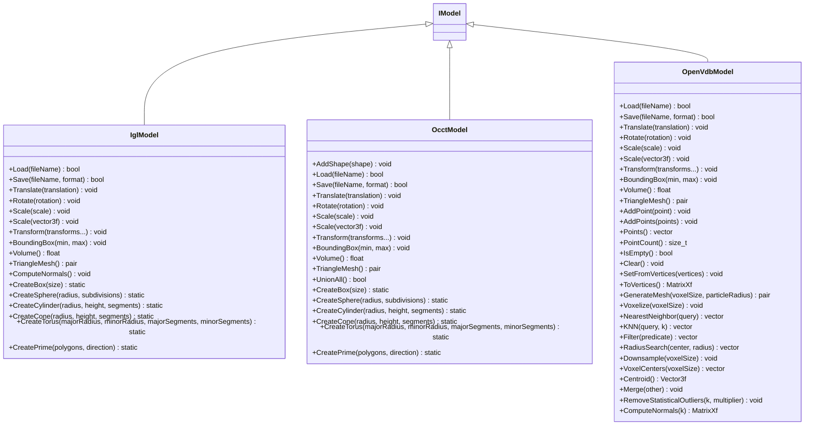
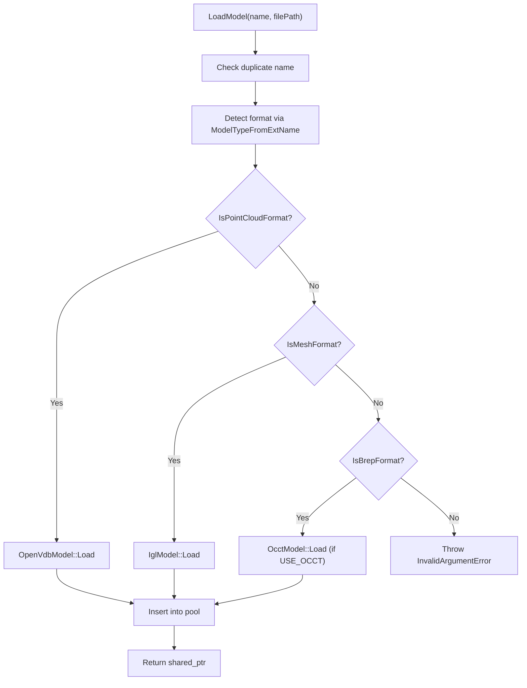
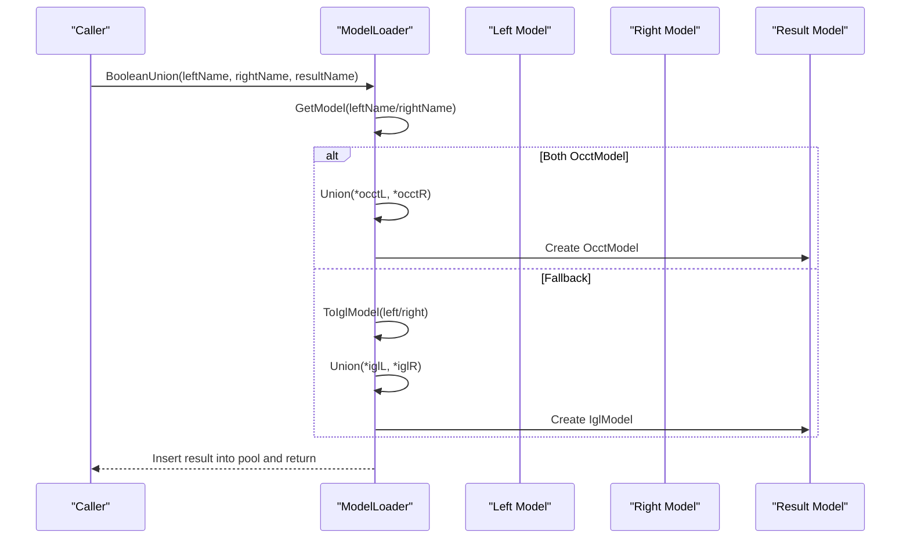
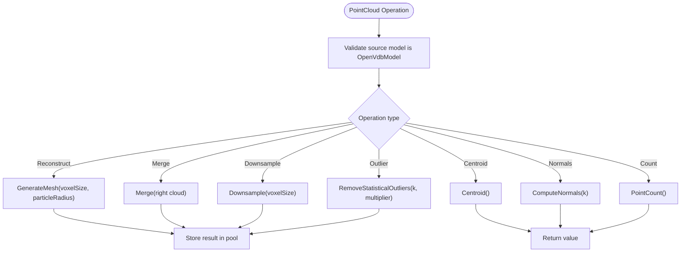
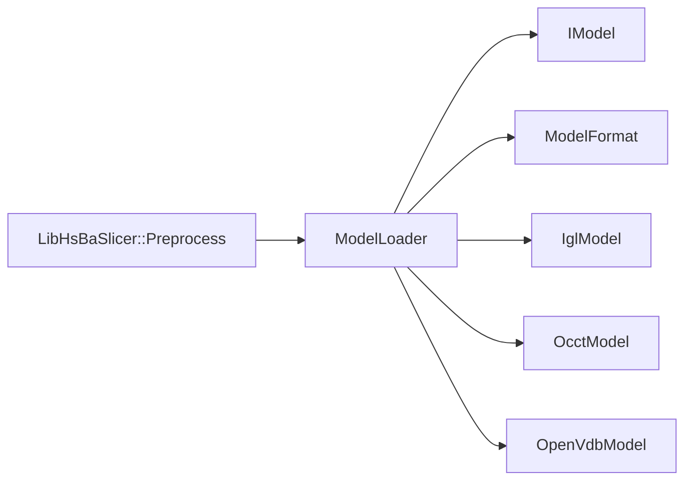

# Model Preprocessor API

<cite>
**Referenced Files in This Document**
- [model_preprocess.hpp](file://LibHsBaSlicer/Preprocess/model_preprocess.hpp)
- [model_preprocess.cpp](file://LibHsBaSlicer/Preprocess/model_preprocess.cpp)
- [ModelLoader.hpp](file://preprocess/ModelLoader.hpp)
- [ModelLoader.cpp](file://preprocess/ModelLoader.cpp)
- [IModel.hpp](file://base/IModel.hpp)
- [ModelFormat.hpp](file://base/ModelFormat.hpp)
- [IglModel.hpp](file://meshmodel/IglModel.hpp)
- [OcctModel.hpp](file://cadmodel/OcctModel.hpp)
- [OpenVdbModel.hpp](file://pointcloud/OpenVdbModel.hpp)
- [error.hpp](file://base/error.hpp)
</cite>

## Table of Contents
1. [Introduction](#introduction)
2. [Project Structure](#project-structure)
3. [Core Components](#core-components)
4. [Architecture Overview](#architecture-overview)
5. [Detailed Component Analysis](#detailed-component-analysis)
6. [Dependency Analysis](#dependency-analysis)
7. [Performance Considerations](#performance-considerations)
8. [Troubleshooting Guide](#troubleshooting-guide)
9. [Conclusion](#conclusion)

## Introduction
This document provides detailed API documentation for the model loading and preprocessing subsystem, focusing on:
- Loading 3D models from multiple formats (STL, OBJ, PLY, STEP, IGES, VRML, BREP, XYZ, VDB).
- Managing a named model pool with lifecycle operations.
- Applying coordinate system transformations (translation, rotation, scaling, arbitrary transforms).
- Performing advanced geometric operations (thick-solid/shell, boolean union/intersection/difference/XOR).
- Point cloud processing (reconstruction to mesh, merging, downsampling, outlier removal, normals, centroid).
- Quality assessment utilities (bounding box, volume, point count).
- Error handling and exception semantics across the C++ and C ABI boundaries.

Note: There is no class named ModelPreprocessor in this repository. The functionality described here is provided by the ModelLoader class and the LibHsBaSlicer::Preprocess API surface that wraps it.

## Project Structure
The model loading and preprocessing pipeline spans several modules:
- LibHsBaSlicer/Preprocess: Public C++ API for model management and transformations.
- preprocess: Unified loader implementation that dispatches to format-specific backends.
- base: Core interfaces (IModel), format detection utilities, and error types.
- meshmodel: Triangle mesh backend (libigl-backed IglModel).
- cadmodel: BRep CAD backend (OpenCASCADE-backed OcctModel).
- pointcloud: Point cloud backend (OpenVDB-backed OpenVdbModel).

**Diagram sources**
- [model_preprocess.hpp:1-192](file://LibHsBaSlicer/Preprocess/model_preprocess.hpp#L1-L192)
- [ModelLoader.hpp:1-206](file://preprocess/ModelLoader.hpp#L1-L206)
- [IModel.hpp:1-151](file://base/IModel.hpp#L1-L151)
- [ModelFormat.hpp:1-116](file://base/ModelFormat.hpp#L1-L116)
- [IglModel.hpp:1-124](file://meshmodel/IglModel.hpp#L1-L124)
- [OcctModel.hpp:1-132](file://cadmodel/OcctModel.hpp#L1-L132)
- [OpenVdbModel.hpp:1-119](file://pointcloud/OpenVdbModel.hpp#L1-L119)

**Section sources**
- [model_preprocess.hpp:1-192](file://LibHsBaSlicer/Preprocess/model_preprocess.hpp#L1-L192)
- [ModelLoader.hpp:1-206](file://preprocess/ModelLoader.hpp#L1-L206)

## Core Components
- IModel: Abstract interface defining load/save, transforms, bounding box, volume, and triangle mesh extraction.
- ModelFormat: Enumerates supported file formats and provides helpers to classify formats (mesh/BRep/CSG/point cloud).
- ModelLoader: Centralized loader that selects the correct backend based on file extension and manages a named pool of models.
- IglModel: Mesh model backed by libigl; supports STL/OBJ/PLY/OFF and more.
- OcctModel: BRep CAD model backed by OpenCASCADE; supports STEP/IGES/VRML/BREP.
- OpenVdbModel: Point cloud model backed by OpenVDB; supports XYZ/VDB and related operations.

Key responsibilities:
- Format detection and routing to appropriate loaders.
- Named model pool management (insert, get, remove, cleanup).
- Transform application via IModel methods.
- Advanced geometry operations (thick-solid, booleans) when enabled.
- Point cloud analysis and reconstruction.

**Section sources**
- [IModel.hpp:65-139](file://base/IModel.hpp#L65-L139)
- [ModelFormat.hpp:18-114](file://base/ModelFormat.hpp#L18-L114)
- [ModelLoader.hpp:23-202](file://preprocess/ModelLoader.hpp#L23-L202)
- [IglModel.hpp:18-121](file://meshmodel/IglModel.hpp#L18-L121)
- [OcctModel.hpp:22-124](file://cadmodel/OcctModel.hpp#L22-L124)
- [OpenVdbModel.hpp:20-116](file://pointcloud/OpenVdbModel.hpp#L20-L116)

## Architecture Overview
The public API exposes functions that operate on named models stored in a thread-local ModelLoader instance. All operations are guarded to translate third-party exceptions into project-defined errors.

**Diagram sources**
- [model_preprocess.cpp:54-57](file://LibHsBaSlicer/Preprocess/model_preprocess.cpp#L54-L57)
- [ModelLoader.cpp:45-84](file://preprocess/ModelLoader.cpp#L45-L84)
- [ModelFormat.hpp:68-93](file://base/ModelFormat.hpp#L68-L93)

**Section sources**
- [model_preprocess.cpp:15-52](file://LibHsBaSlicer/Preprocess/model_preprocess.cpp#L15-L52)
- [ModelLoader.cpp:45-84](file://preprocess/ModelLoader.cpp#L45-L84)

## Detailed Component Analysis

### ModelLoader Class
Responsibilities:
- Load models from files and insert them into a named pool.
- Retrieve, check existence, list names, and clean up models.
- Provide advanced operations (thick-solid, boolean ops) when CGAL is available.
- Provide point cloud operations when OpenVDB is available.

Supported formats:
- Mesh: STL, OBJ, PLY, OFF (via IglModel).
- BRep: STEP, IGES, VRML, BREP (via OcctModel; requires USE_OCCT).
- Point Cloud: XYZ, VDB (via OpenVdbModel; requires USE_OPENVDB).

Pool behavior:
- Capacity controlled by compile-time macro HSBA_MODEL_POOL_SIZE.
- Thread-local instance used by the public API.

Advanced operations:
- ThickSolidModel: Shell operation on OcctModel.
- BooleanUnion/Intersection/Difference/Xor: Prefer OCCT if both inputs are OcctModel; otherwise fallback to IglModel (requires CGAL).
- PointCloudToMesh: Reconstruct mesh from OpenVdbModel using level set.
- MergePointClouds, DownsamplePointCloud, RemovePointCloudOutliers, PointCloudCentroid, PointCloudNormals, PointCloudCount.

**Diagram sources**
- [ModelLoader.hpp:30-202](file://preprocess/ModelLoader.hpp#L30-L202)

**Section sources**
- [ModelLoader.hpp:23-202](file://preprocess/ModelLoader.hpp#L23-L202)
- [ModelLoader.cpp:45-456](file://preprocess/ModelLoader.cpp#L45-L456)

### Public API Surface (LibHsBaSlicer::Preprocess)
Functions:
- LoadModel(name, filePath): Load and store a model in the pool.
- GetModel(name): Retrieve a model by name.
- TranslateModel/RotateModel/ScaleModel: Apply transforms to a named model.
- GetModelInfo(name): Return ModelInfo with bbox_min, bbox_max, and volume.
- InsertModel/ContainsModel/ModelCount/GetModelNames/CleanupModels: Pool management.
- ThickSolidModel/BooleanUnion/BooleanIntersection/BooleanDifference/BooleanXor: Advanced geometry (USE_CGAL).

Error handling:
- All exported functions are wrapped by GuardModel to ensure only project exceptions cross the boundary.

**Diagram sources**
- [model_preprocess.cpp:59-160](file://LibHsBaSlicer/Preprocess/model_preprocess.cpp#L59-L160)

**Section sources**
- [model_preprocess.hpp:22-120](file://LibHsBaSlicer/Preprocess/model_preprocess.hpp#L22-L120)
- [model_preprocess.cpp:54-160](file://LibHsBaSlicer/Preprocess/model_preprocess.cpp#L54-L160)

### IModel Interface
Defines the contract for all model backends:
- Load/Save: File I/O.
- Translate/Rotate/Scale/Transform: Coordinate system transformations.
- BoundingBox/Volume: Basic quality assessment.
- TriangleMesh: Export to triangle mesh for slicing or visualization.

**Diagram sources**
- [IModel.hpp:110-139](file://base/IModel.hpp#L110-L139)

**Section sources**
- [IModel.hpp:65-139](file://base/IModel.hpp#L65-L139)

### Backends: IglModel, OcctModel, OpenVdbModel
- IglModel: Mesh model supporting STL/OBJ/PLY/OFF and primitives; provides normals computation and boolean operations via libigl/CGAL.
- OcctModel: BRep CAD model supporting STEP/IGES/VRML/BREP; provides boolean operations and thick-solid shell.
- OpenVdbModel: Point cloud model supporting XYZ/VDB; provides voxelization, downsampling, outlier removal, normals, centroid, and mesh reconstruction.

**Diagram sources**
- [IglModel.hpp:18-121](file://meshmodel/IglModel.hpp#L18-L121)
- [OcctModel.hpp:22-124](file://cadmodel/OcctModel.hpp#L22-L124)
- [OpenVdbModel.hpp:20-116](file://pointcloud/OpenVdbModel.hpp#L20-L116)

**Section sources**
- [IglModel.hpp:18-121](file://meshmodel/IglModel.hpp#L18-L121)
- [OcctModel.hpp:22-124](file://cadmodel/OcctModel.hpp#L22-L124)
- [OpenVdbModel.hpp:20-116](file://pointcloud/OpenVdbModel.hpp#L20-L116)

### Model Loading and Format Routing
Routing logic:
- Determine format via ModelTypeFromExtName.
- If IsPointCloudFormat: use OpenVdbModel.
- Else if IsMeshFormat: use IglModel.
- Else if IsBrepFormat: use OcctModel (requires USE_OCCT).
- Otherwise: throw InvalidArgumentError for unsupported format.

**Diagram sources**
- [ModelLoader.cpp:45-84](file://preprocess/ModelLoader.cpp#L45-L84)
- [ModelFormat.hpp:68-93](file://base/ModelFormat.hpp#L68-L93)

**Section sources**
- [ModelLoader.cpp:45-84](file://preprocess/ModelLoader.cpp#L45-L84)
- [ModelFormat.hpp:68-93](file://base/ModelFormat.hpp#L68-L93)

### Advanced Geometry Operations
ThickSolidModel:
- Requires OcctModel source; creates a shell with specified thickness.
- Optional closing faces parameter allows leaving openings.

Boolean operations:
- Prefer OCCT if both inputs are OcctModel.
- Fallback to IglModel (requires CGAL) by converting to mesh.

**Diagram sources**
- [ModelLoader.cpp:218-243](file://preprocess/ModelLoader.cpp#L218-L243)

**Section sources**
- [ModelLoader.cpp:172-321](file://preprocess/ModelLoader.cpp#L172-L321)

### Point Cloud Processing
Operations:
- PointCloudToMesh: Generate mesh from point cloud using level set reconstruction.
- MergePointClouds: Combine two point clouds.
- DownsamplePointCloud: Reduce density via voxel grid filtering.
- RemovePointCloudOutliers: Statistical outlier removal.
- PointCloudCentroid: Compute center of mass.
- PointCloudNormals: Estimate per-point normals.
- PointCloudCount: Count points.

**Diagram sources**
- [ModelLoader.cpp:343-451](file://preprocess/ModelLoader.cpp#L343-L451)

**Section sources**
- [ModelLoader.cpp:343-451](file://preprocess/ModelLoader.cpp#L343-L451)

### Coordinate System Transformations
Transforms are applied directly to the underlying model via IModel methods:
- Translate: Shift model by a 3D vector.
- Rotate: Rotate by a quaternion.
- Scale: Uniform or per-axis scaling.
- Transform: Apply isometry, 4x4 matrix, or affine transform.

These are exposed through the public API for convenience and safety.

**Section sources**
- [model_preprocess.hpp:49-75](file://LibHsBaSlicer/Preprocess/model_preprocess.hpp#L49-L75)
- [IModel.hpp:120-130](file://base/IModel.hpp#L120-L130)

### Model Analysis and Quality Assessment
- Bounding Box: Axis-aligned bounds via BoundingBox.
- Volume: Signed volume via Volume.
- Point Count: For point clouds via PointCount.
- Triangle Mesh: Extract vertices and faces for downstream processing.

These metrics are useful for pre-slice validation and diagnostics.

**Section sources**
- [model_preprocess.hpp:22-30](file://LibHsBaSlicer/Preprocess/model_preprocess.hpp#L22-L30)
- [model_preprocess.cpp:116-130](file://LibHsBaSlicer/Preprocess/model_preprocess.cpp#L116-L130)
- [OpenVdbModel.hpp:100-111](file://pointcloud/OpenVdbModel.hpp#L100-L111)

### Configuration Options and Tolerances
- Model pool capacity: Controlled by compile-time macro HSBA_MODEL_POOL_SIZE.
- Slicing tolerance: Exposed in slicing APIs (e.g., Slice function accepts a tolerance parameter for point merging).
- Point cloud reconstruction: voxelSize and particleRadius parameters control level set resolution and rasterization.

Note: No dedicated “tolerance” configuration object exists for model loading; tolerances are passed as parameters where applicable.

**Section sources**
- [ModelLoader.hpp:23-29](file://preprocess/ModelLoader.hpp#L23-L29)
- [ModelLoader.cpp:343-361](file://preprocess/ModelLoader.cpp#L343-L361)

## Dependency Analysis
High-level dependencies:
- LibHsBaSlicer::Preprocess depends on ModelLoader.
- ModelLoader depends on IModel, ModelFormat, and backend implementations (IglModel, OcctModel, OpenVdbModel).
- Conditional compilation gates advanced features (USE_CGAL, USE_OCCT, USE_OPENVDB).

**Diagram sources**
- [model_preprocess.cpp:5-12](file://LibHsBaSlicer/Preprocess/model_preprocess.cpp#L5-L12)
- [ModelLoader.cpp:5-22](file://preprocess/ModelLoader.cpp#L5-L22)

**Section sources**
- [model_preprocess.cpp:5-12](file://LibHsBaSlicer/Preprocess/model_preprocess.cpp#L5-L12)
- [ModelLoader.cpp:5-22](file://preprocess/ModelLoader.cpp#L5-L22)

## Performance Considerations
- Use OCCT-based boolean operations when possible for robustness and precision; mesh fallback may be slower and less precise.
- Avoid unnecessary conversions between model types; prefer operating on the native representation (OcctModel for CAD, IglModel for meshes, OpenVdbModel for point clouds).
- Tune point cloud reconstruction parameters (voxelSize, particleRadius) to balance accuracy and performance.
- Clean up unused models regularly via CleanupModels to free memory.

[No sources needed since this section provides general guidance]

## Troubleshooting Guide
Common issues and resolutions:
- Unsupported format: Ensure the file extension matches a supported format; otherwise, convert to a supported format first.
- Missing backend support:
  - BRep not supported: Compile with USE_OCCT enabled.
  - Point cloud not supported: Compile with USE_OPENVDB enabled.
  - Boolean/thick-solid not supported: Compile with USE_CGAL enabled.
- Duplicate model names: Choose unique names or remove existing models before inserting.
- Null model retrieval: Verify the model name exists; GetModel returns nullptr if not found.
- Exception translation: All external exceptions are translated to project-defined errors (RuntimeError family); catch these at the boundary.

Error types:
- RuntimeError and derived classes (InvalidArgumentError, IOError, NotSupportedError, etc.) provide structured error reporting.

**Section sources**
- [ModelLoader.cpp:45-84](file://preprocess/ModelLoader.cpp#L45-L84)
- [ModelLoader.cpp:172-321](file://preprocess/ModelLoader.cpp#L172-L321)
- [error.hpp:17-144](file://base/error.hpp#L17-L144)

## Conclusion
The model loading and preprocessing subsystem provides a robust, extensible foundation for handling diverse 3D data sources. It abstracts format-specific details behind a unified interface, offers powerful transformation and analysis capabilities, and integrates seamlessly with downstream slicing workflows. By leveraging the appropriate backend (OCCT for CAD, libigl for meshes, OpenVDB for point clouds) and tuning parameters like tolerances and reconstruction settings, users can achieve reliable and efficient model preparation for manufacturing pipelines.

[No sources needed since this section summarizes without analyzing specific files]