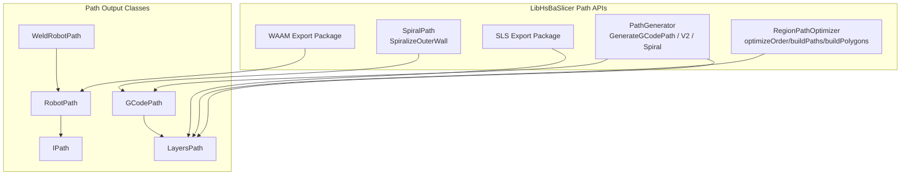
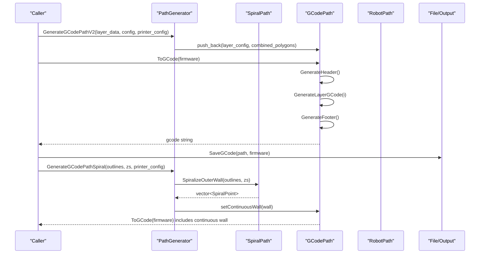
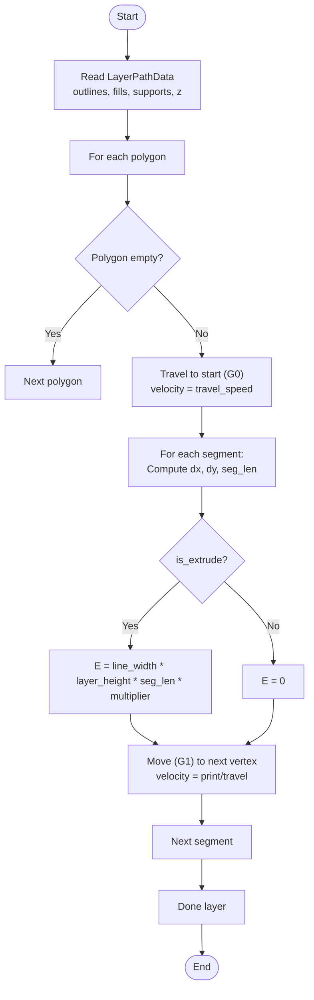
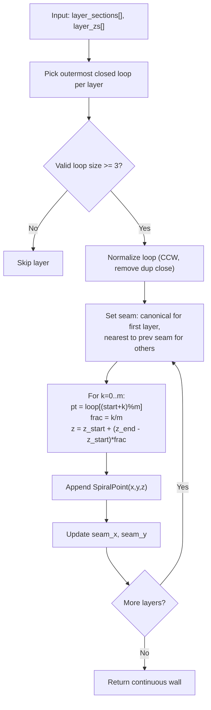
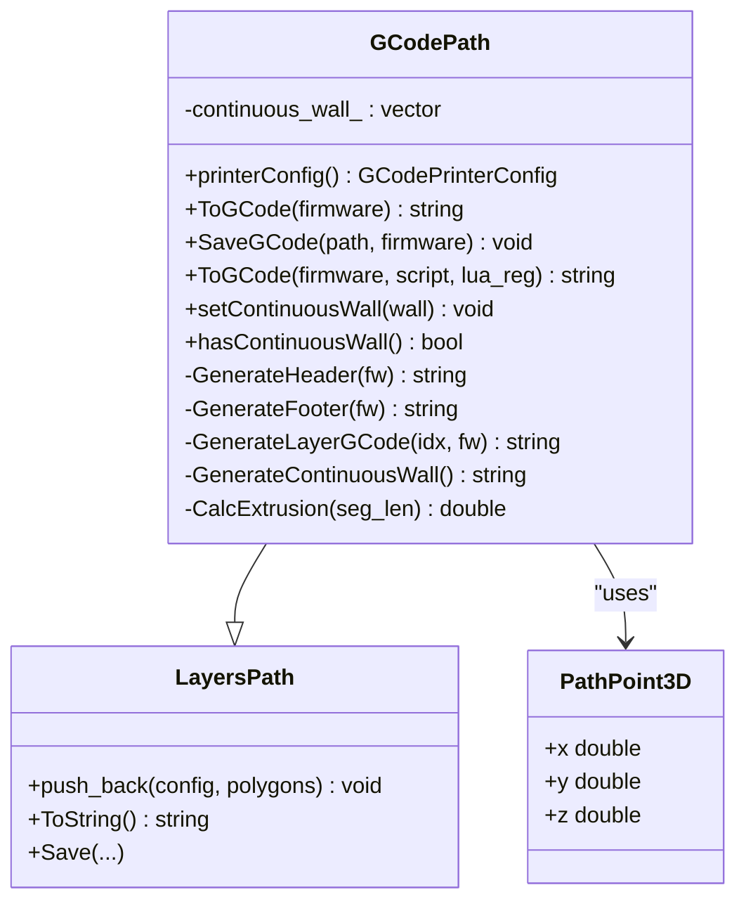
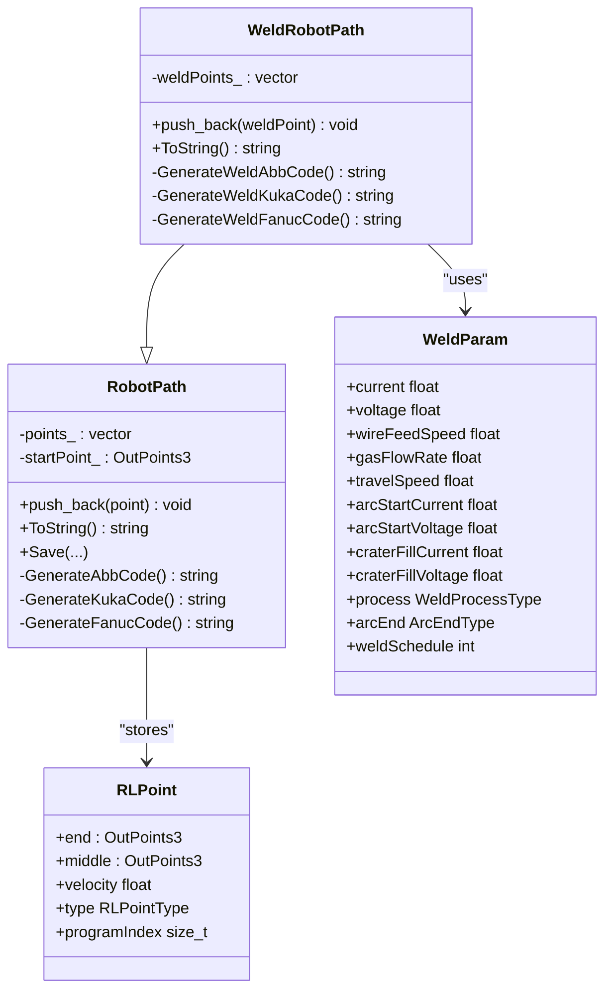
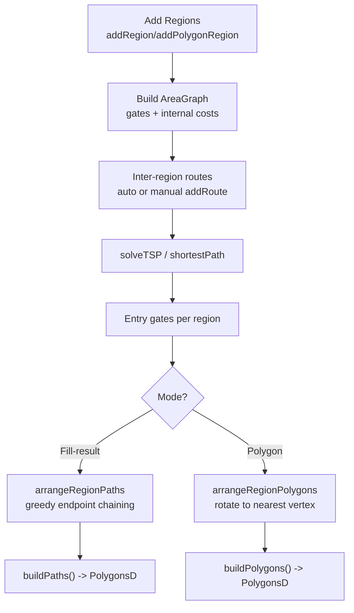
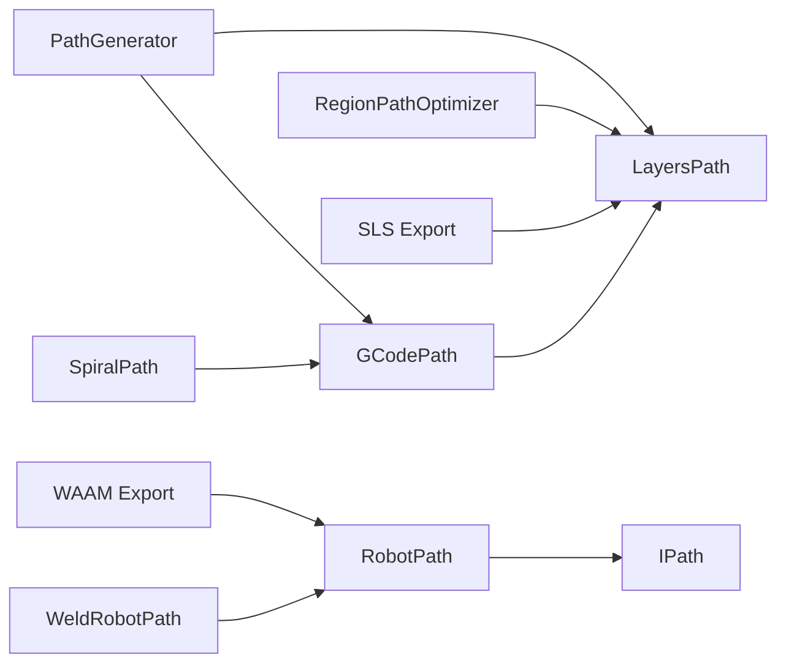

# Path Generation APIs

<cite>
**Referenced Files in This Document**
- [path_generator.hpp](file://LibHsBaSlicer/Path/path_generator.hpp)
- [path_generator.cpp](file://LibHsBaSlicer/Path/path_generator.cpp)
- [spiral_path.hpp](file://LibHsBaSlicer/Path/spiral_path.hpp)
- [spiral_path.cpp](file://LibHsBaSlicer/Path/spiral_path.cpp)
- [gcodepath.hpp](file://paths/gcodepath.hpp)
- [gcodepath.cpp](file://paths/gcodepath.cpp)
- [robotpath.hpp](file://paths/robotpath.hpp)
- [robotpath.cpp](file://paths/robotpath.cpp)
- [layerspath.hpp](file://paths/layerspath.hpp)
- [layerspath.cpp](file://paths/layerspath.cpp)
- [IPath.hpp](file://paths/IPath.hpp)
- [weldrobotpath.hpp](file://paths/weldrobotpath.hpp)
- [path_optimizer.hpp](file://LibHsBaSlicer/Path/path_optimizer.hpp)
- [path_optimizer.cpp](file://LibHsBaSlicer/Path/path_optimizer.cpp)
- [sls_export.hpp](file://LibHsBaSlicer/Path/sls_export.hpp)
- [waam_export.hpp](file://LibHsBaSlicer/Path/waam_export.hpp)
</cite>

## Table of Contents
1. [Introduction](#introduction)
2. [Project Structure](#project-structure)
3. [Core Components](#core-components)
4. [Architecture Overview](#architecture-overview)
5. [Detailed Component Analysis](#detailed-component-analysis)
6. [Dependency Analysis](#dependency-analysis)
7. [Performance Considerations](#performance-considerations)
8. [Troubleshooting Guide](#troubleshooting-guide)
9. [Conclusion](#conclusion)
10. [Appendices](#appendices)

## Introduction
This document explains the path generation APIs in LibHsBaSlicer for turning sliced layers into manufacturing toolpaths. It covers:
- The PathGenerator API that converts per-layer outlines, fills, and supports into G-code or robot paths.
- Spiral/vase mode support via a continuous helical outer wall.
- Export formats: standard 3D printer G-code (Marlin/RepRap/Klipper), industrial robot programs (ABB/KUKA/FANUC), and specialized export packages (SLS, WAAM).
- Path optimization across independent regions to minimize air travel.
- Speed profiles, extrusion control, coordinate systems, data structures, and integration guidance.

## Project Structure
The path generation system is split between LibHsBaSlicer high-level APIs and reusable path output classes under paths/.

**Diagram sources**
- [path_generator.hpp:23-91](file://LibHsBaSlicer/Path/path_generator.hpp#L23-L91)
- [spiral_path.hpp:24-58](file://LibHsBaSlicer/Path/spiral_path.hpp#L24-L58)
- [path_optimizer.hpp:44-95](file://LibHsBaSlicer/Path/path_optimizer.hpp#L44-L95)
- [sls_export.hpp:24-56](file://LibHsBaSlicer/Path/sls_export.hpp#L24-L56)
- [waam_export.hpp:23-72](file://LibHsBaSlicer/Path/waam_export.hpp#L23-L72)
- [gcodepath.hpp:66-107](file://paths/gcodepath.hpp#L66-L107)
- [robotpath.hpp:61-104](file://paths/robotpath.hpp#L61-L104)
- [layerspath.hpp:25-60](file://paths/layerspath.hpp#L25-L60)
- [IPath.hpp:29-65](file://paths/IPath.hpp#L29-L65)

**Section sources**
- [path_generator.hpp:23-91](file://LibHsBaSlicer/Path/path_generator.hpp#L23-L91)
- [gcodepath.hpp:66-107](file://paths/gcodepath.hpp#L66-L107)
- [robotpath.hpp:61-104](file://paths/robotpath.hpp#L61-L104)
- [layerspath.hpp:25-60](file://paths/layerspath.hpp#L25-L60)
- [IPath.hpp:29-65](file://paths/IPath.hpp#L29-L65)

## Core Components
- FdmPathConfig: configuration for basic G-point generation (layer height, line width, speeds, units, extrusion multiplier).
- LayerPathData: per-layer container of outlines, fills, supports, and Z height.
- PointsPath: simple sequence of GPoints with units.
- GCodePath: multi-firmware G-code generator with header/footer, retraction, speed profiles, and continuous spiral wall support.
- RobotPath/WeldRobotPath: brand-specific robot program generators (ABB/KUKA/FANUC) with optional welding parameters.
- LayersPath: layer-based storage with Lua-driven serialization.
- RegionPathOptimizer: region visit order optimizer using AreaGraph/TSP and greedy intra-region arrangement.
- SpiralPath: continuous helical outer-wall generation for vase/spiral modes.

**Section sources**
- [path_generator.hpp:23-91](file://LibHsBaSlicer/Path/path_generator.hpp#L23-L91)
- [gcodepath.hpp:24-107](file://paths/gcodepath.hpp#L24-L107)
- [robotpath.hpp:15-104](file://paths/robotpath.hpp#L15-L104)
- [layerspath.hpp:25-60](file://paths/layerspath.hpp#L25-L60)
- [path_optimizer.hpp:44-95](file://LibHsBaSlicer/Path/path_optimizer.hpp#L44-L95)
- [spiral_path.hpp:24-58](file://LibHsBaSlicer/Path/spiral_path.hpp#L24-L58)

## Architecture Overview
The typical flow from sliced layers to machine code:

**Diagram sources**
- [path_generator.cpp:63-140](file://LibHsBaSlicer/Path/path_generator.cpp#L63-L140)
- [gcodepath.cpp:69-350](file://paths/gcodepath.cpp#L69-L350)
- [spiral_path.cpp:88-163](file://LibHsBaSlicer/Path/spiral_path.cpp#L88-L163)

## Detailed Component Analysis

### PathGenerator API
Responsibilities:
- Convert per-layer polygons into G-point sequences or layered G-code.
- Provide firmware-aware G-code generation (V2).
- Generate spiralized outer walls for vase mode.

Key methods:
- PolygonsToGPoints: convert PolygonsD to GPoint sequence with travel/print moves and extrusion calculation.
- GenerateGCodePath: build a PointsPath by concatenating outline/fill/support segments per layer.
- GenerateGCodePathV2: build a GCodePath with per-layer polygon groups and Z metadata.
- GenerateGCodePathSpiral: compute a continuous helix and attach it to GCodePath.

Extrusion model:
- Segment length computed from consecutive vertices.
- Extrusion volume = line_width × layer_height × segment_length; E value derived from filament cross-section area and multiplier.

Speed profile:
- Travel vs print speeds controlled by FdmPathConfig.
- First layer may use a dedicated first_layer_speed in GCodePath.

Coordinate system:
- X/Y are planar coordinates from sliced polygons; Z is absolute build height.

**Diagram sources**
- [path_generator.cpp:14-61](file://LibHsBaSlicer/Path/path_generator.cpp#L14-L61)

**Section sources**
- [path_generator.hpp:23-91](file://LibHsBaSlicer/Path/path_generator.hpp#L23-L91)
- [path_generator.cpp:14-140](file://LibHsBaSlicer/Path/path_generator.cpp#L14-L140)

### SpiralPath Implementation
Purpose:
- Build a single continuous deposition path that rises through layers without retractions or per-layer travel jumps.

Algorithm highlights:
- Select outermost closed contour per layer (largest absolute signed area).
- Normalize loops to CCW and remove duplicate closing vertex.
- Align seam across layers by rotating loop start to nearest XY point to previous seam; canonical seam for first layer.
- Emit points along loop while linearly ramping Z from current layer height to next layer’s height; last layer traversed flat.

Data structure:
- SpiralPoint: x, y, z per point on the continuous wall.

**Diagram sources**
- [spiral_path.cpp:18-85](file://LibHsBaSlicer/Path/spiral_path.cpp#L18-L85)
- [spiral_path.cpp:88-163](file://LibHsBaSlicer/Path/spiral_path.cpp#L88-L163)

**Section sources**
- [spiral_path.hpp:24-58](file://LibHsBaSlicer/Path/spiral_path.hpp#L24-L58)
- [spiral_path.cpp:18-163](file://LibHsBaSlicer/Path/spiral_path.cpp#L18-L163)

### GCodePath: Multi-Firmware G-code Generation
Capabilities:
- Header/footer generation for Marlin, RepRap, Klipper.
- Per-layer G-code emission with travel/retraction handling.
- Continuous wall emission for spiral/vase mode.
- Lua post-processing hook to modify generated G-code.

Configuration:
- GCodePrinterConfig includes nozzle/filament dimensions, temperatures, speeds, retraction settings, relative/absolute extrusion, and extrusion multiplier.

Extrusion calculation:
- Volume = line_width × layer_height × segment_length.
- Filament area = π × (filament_diameter/2)^2.
- E = (volume / area) × extrusion_multiplier.

Speed profile:
- First layer uses first_layer_speed; other layers use print_speed.
- Travel moves use travel_speed.

Export:
- ToGCode(firmware) returns complete G-code string.
- SaveGCode writes to file.
- ToGCode(firmware, script, lua_reg) runs Lua post-processing.

**Diagram sources**
- [gcodepath.hpp:66-107](file://paths/gcodepath.hpp#L66-L107)
- [gcodepath.cpp:57-350](file://paths/gcodepath.cpp#L57-L350)

**Section sources**
- [gcodepath.hpp:24-107](file://paths/gcodepath.hpp#L24-L107)
- [gcodepath.cpp:57-459](file://paths/gcodepath.cpp#L57-L459)

### RobotPath and WeldRobotPath: Industrial Robot Programs
Capabilities:
- Generate brand-specific robot programs for ABB, KUKA, FANUC.
- Support joint/linear/circular moves and program block markers.
- Optional Lua post-processing to customize output.
- WeldRobotPath augments points with welding parameters and arc start/end logic.

Data model:
- RLPoint: end position, middle (for circular), velocity, type, program index.
- WeldRLPoint: base RLPoint plus WeldParam and isWelding flag.
- WeldParam: current, voltage, wire feed, gas flow, travel speed, arc start values, process type, arc end strategy.

**Diagram sources**
- [robotpath.hpp:15-104](file://paths/robotpath.hpp#L15-L104)
- [robotpath.cpp:60-524](file://paths/robotpath.cpp#L60-L524)
- [weldrobotpath.hpp:16-96](file://paths/weldrobotpath.hpp#L16-L96)

**Section sources**
- [robotpath.hpp:15-104](file://paths/robotpath.hpp#L15-L104)
- [robotpath.cpp:60-524](file://paths/robotpath.cpp#L60-L524)
- [weldrobotpath.hpp:16-96](file://paths/weldrobotpath.hpp#L16-L96)

### LayersPath and IPath: Base Abstractions
- IPath defines generic save/serialize interfaces with optional Lua post-processing.
- LayersPath stores ordered layers with free-form config strings and polygon sets, supporting native SQLite persistence and Lua-driven serialization.

Use cases:
- GCodePath extends LayersPath to add firmware-specific G-code generation.
- SLS/WAAM exports leverage layer polygon data and optional spiral mode.

**Section sources**
- [IPath.hpp:29-65](file://paths/IPath.hpp#L29-L65)
- [layerspath.hpp:25-60](file://paths/layerspath.hpp#L25-L60)
- [layerspath.cpp:25-496](file://paths/layerspath.cpp#L25-L496)

### Path Optimization: RegionPathOptimizer
Goal:
- Minimize total air travel between independent polygon regions by solving an inter-region visit order (TSP) and arranging intra-region entry/exit greedily.

Modes:
- Polygon mode (pre-fill): gates are all polygon vertices; outputs polygons in optimized order.
- Fill-result mode (post-fill): gates are endpoints of polylines; outputs complete fill paths.

API:
- addRegion/addPolygonRegion: register regions.
- addRoute: override inter-region cost.
- optimizeOrder: solve TSP and return region tour.
- buildPaths/buildPolygons: produce ordered output depending on mode.

Lua bindings:
- RegisterLuaPathOptimizeFunctions exposes PathOptimize.new(), optimizeRegions(), optimizePolygons().
- Convenience functions: LuaOptimizeRegionPaths*, LuaOptimizeRegionPolygons*.

**Diagram sources**
- [path_optimizer.cpp:45-439](file://LibHsBaSlicer/Path/path_optimizer.cpp#L45-L439)
- [path_optimizer.hpp:44-95](file://LibHsBaSlicer/Path/path_optimizer.hpp#L44-L95)

**Section sources**
- [path_optimizer.hpp:44-186](file://LibHsBaSlicer/Path/path_optimizer.hpp#L44-L186)
- [path_optimizer.cpp:45-741](file://LibHsBaSlicer/Path/path_optimizer.cpp#L45-L741)

### Export Packages: SLS and WAAM
- SLS package carries per-layer outlines, Z heights, JSON config, and optional spiral_mode flag exposing a continuous spiral path to Lua scripts.
- WAAM package carries per-layer deposition contours, Z heights, weld parameters, robot type, bead width, config JSON, and spiral_mode for continuous weld beads.

Both provide Lua-driven export/save APIs to generate final outputs (archives, databases, robot programs).

**Section sources**
- [sls_export.hpp:24-56](file://LibHsBaSlicer/Path/sls_export.hpp#L24-L56)
- [waam_export.hpp:23-72](file://LibHsBaSlicer/Path/waam_export.hpp#L23-L72)

## Dependency Analysis
High-level dependencies among core components:

**Diagram sources**
- [path_generator.cpp:63-140](file://LibHsBaSlicer/Path/path_generator.cpp#L63-L140)
- [gcodepath.cpp:57-350](file://paths/gcodepath.cpp#L57-L350)
- [robotpath.cpp:60-524](file://paths/robotpath.cpp#L60-L524)
- [layerspath.cpp:25-496](file://paths/layerspath.cpp#L25-L496)
- [path_optimizer.cpp:45-741](file://LibHsBaSlicer/Path/path_optimizer.cpp#L45-L741)

**Section sources**
- [path_generator.cpp:63-140](file://LibHsBaSlicer/Path/path_generator.cpp#L63-L140)
- [gcodepath.cpp:57-350](file://paths/gcodepath.cpp#L57-L350)
- [robotpath.cpp:60-524](file://paths/robotpath.cpp#L60-L524)
- [layerspath.cpp:25-496](file://paths/layerspath.cpp#L25-L496)
- [path_optimizer.cpp:45-741](file://LibHsBaSlicer/Path/path_optimizer.cpp#L45-L741)

## Performance Considerations
- Extrusion computation:
  - Avoid repeated sqrt where possible; precompute segment lengths when iterating polygons.
  - Use relative extrusion to reduce cumulative floating-point drift if your firmware supports it.
- Spiralization:
  - Ensure consistent winding (CCW) and seam alignment to avoid unnecessary zig-zags.
  - Validate that each layer has at least one valid closed contour; otherwise, fallback to per-layer mode.
- Region optimization:
  - Prefer polygon-mode optimization before filling for large sparse outlines to reduce fill work.
  - Use addRoute to encode known constraints (e.g., avoid long air moves across obstacles).
- G-code generation:
  - Batch layer writes; avoid excessive string reallocations.
  - Tune first_layer_speed and retraction settings to balance quality and speed.
- Robot program generation:
  - Group linear/circular moves appropriately; minimize program block overhead.
  - Use Lua post-processing to tailor motion commands to specific controller capabilities.

[No sources needed since this section provides general guidance]

## Troubleshooting Guide
Common issues and resolutions:
- Malformed layer Z metadata:
  - If layer config string does not match expected format, GCodePath falls back to default Z height. Ensure GenerateGCodePathV2 passes correct "Z:<value>" strings.
- Lua errors during export:
  - Check load and runtime errors returned by Lua; ensure scripts are syntactically correct and required globals are provided.
- Empty or invalid polygons:
  - Spiralization skips layers without valid closed contours; verify input outlines.
- Mixing optimizer modes:
  - Do not mix polygon and fill-result regions within one RegionPathOptimizer instance; choose one mode per optimizer.
- File I/O failures:
  - SaveGCode and Save* methods throw on open/write failures; validate output paths and permissions.

**Section sources**
- [gcodepath.cpp:28-47](file://paths/gcodepath.cpp#L28-L47)
- [gcodepath.cpp:353-362](file://paths/gcodepath.cpp#L353-L362)
- [layerspath.cpp:30-59](file://paths/layerspath.cpp#L30-L59)
- [path_optimizer.cpp:68-127](file://LibHsBaSlicer/Path/path_optimizer.cpp#L68-L127)

## Conclusion
LibHsBaSlicer’s path generation APIs provide a robust pipeline from sliced layers to machine-ready toolpaths:
- PathGenerator offers straightforward conversion to G-points and layered G-code, plus spiral/vase mode.
- GCodePath delivers multi-firmware G-code with configurable speed profiles and extrusion control.
- RobotPath/WeldRobotPath enable industrial robot programming with brand-specific syntax and optional welding parameters.
- RegionPathOptimizer reduces air travel via TSP-based ordering and greedy intra-region arrangement.
- Export packages (SLS, WAAM) integrate with Lua scripts for flexible downstream processing.

Adopt these APIs to streamline path generation, improve print quality, and integrate seamlessly with diverse manufacturing equipment.

[No sources needed since this section summarizes without analyzing specific files]

## Appendices

### Coordinate Systems and Data Structures
- Planar coordinates (X/Y) come from sliced polygons; Z is absolute build height.
- Key structures:
  - FdmPathConfig: path generation parameters.
  - LayerPathData: per-layer outlines/fills/supports and Z.
  - SpiralPoint: continuous wall point with per-point Z.
  - PathPoint3D: 3D point used by GCodePath continuous wall.
  - RLPoint/WeldRLPoint: robot path points with motion types and welding parameters.
  - OutPoints3: generic 3D output point.

**Section sources**
- [path_generator.hpp:23-42](file://LibHsBaSlicer/Path/path_generator.hpp#L23-L42)
- [spiral_path.hpp:24-29](file://LibHsBaSlicer/Path/spiral_path.hpp#L24-L29)
- [gcodepath.hpp:51-60](file://paths/gcodepath.hpp#L51-L60)
- [robotpath.hpp:44-52](file://paths/robotpath.hpp#L44-L52)
- [IPath.hpp:59-65](file://paths/IPath.hpp#L59-L65)

### Examples and Usage Patterns
- Generate basic G-code path:
  - Build LayerPathData vectors with outlines/fills/supports and Z heights.
  - Call GenerateGCodePath or GenerateGCodePathV2 with FdmPathConfig and GCodePrinterConfig.
  - Use ToGCode(Marlin/RepRap/Klipper) and SaveGCode to write files.
- Enable spiral/vase mode:
  - Compute outer contours per layer and call GenerateGCodePathSpiral.
  - The resulting GCodePath emits a continuous rising wall without per-layer retractions.
- Optimize region order:
  - Use RegionPathOptimizer.addPolygonRegion or addRegion, then optimizeOrder and buildPolygons/buildPaths.
- Export to robots:
  - Populate RobotPath or WeldRobotPath with RLPoint/WeldRLPoint entries.
  - ToString or Save produces ABB/KUKA/FANUC programs; optionally post-process with Lua.

[No sources needed since this section provides general guidance]