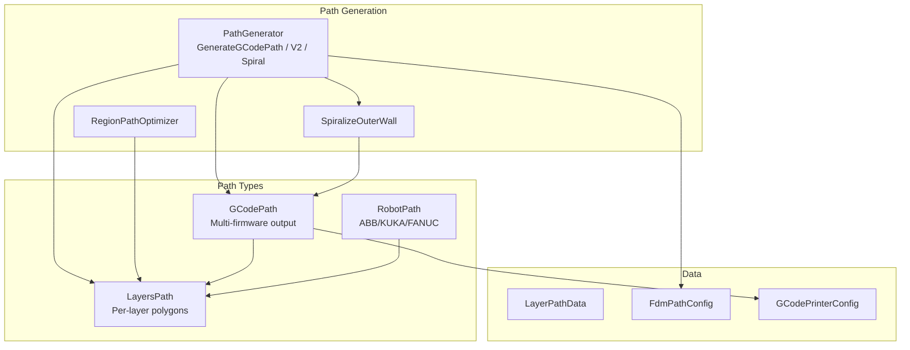
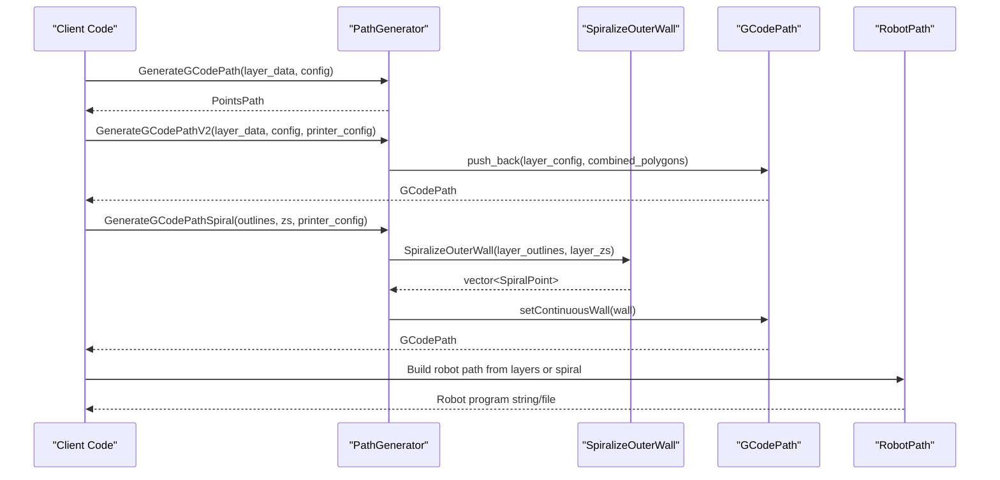
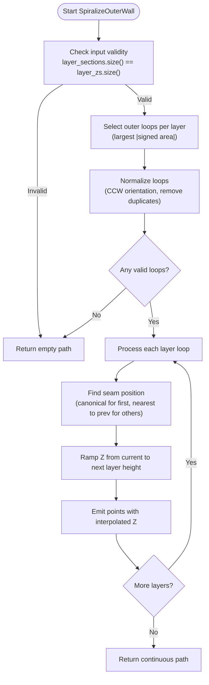
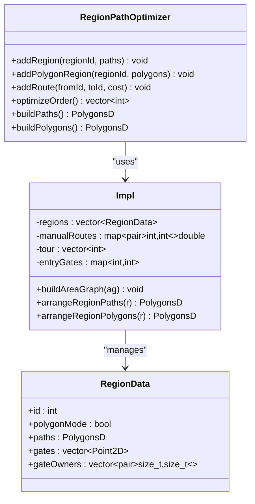
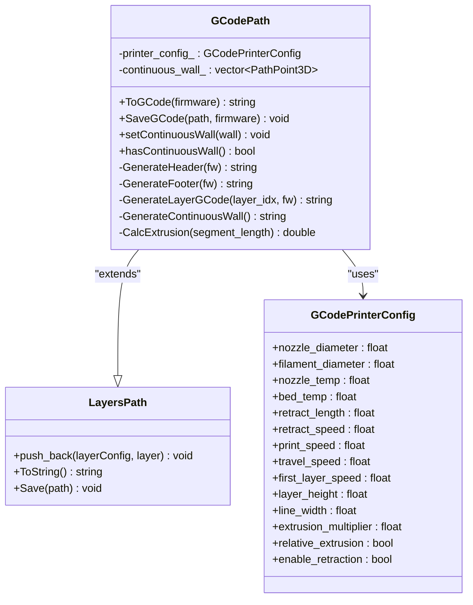
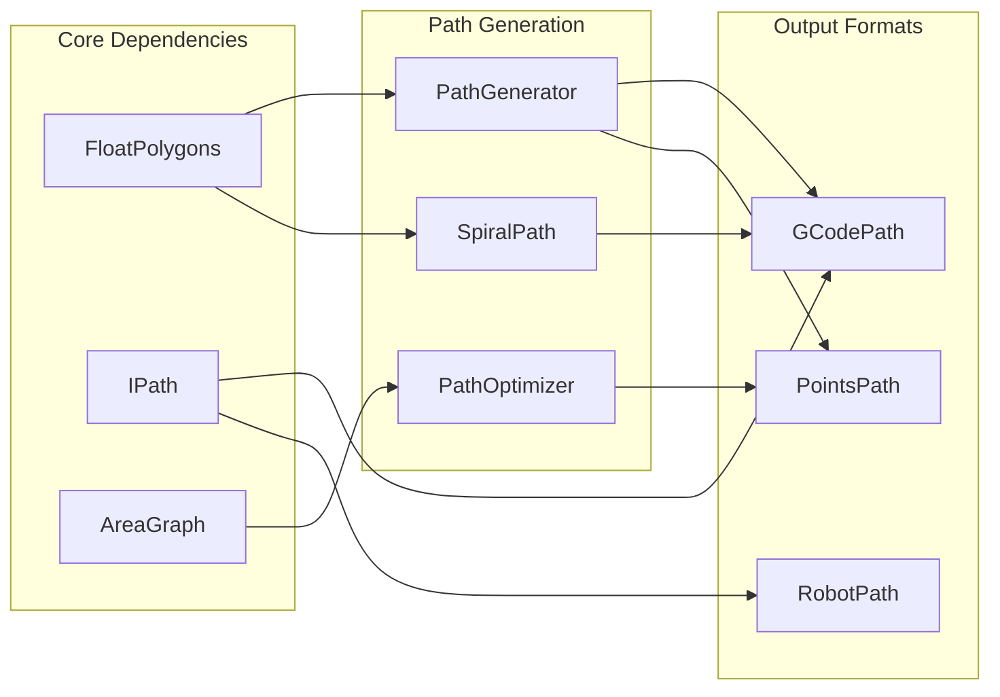

# Path Generator API

<cite>
**Referenced Files in This Document**
- [path_generator.hpp](file://LibHsBaSlicer/Path/path_generator.hpp)
- [path_generator.cpp](file://LibHsBaSlicer/Path/path_generator.cpp)
- [spiral_path.hpp](file://LibHsBaSlicer/Path/spiral_path.hpp)
- [spiral_path.cpp](file://LibHsBaSlicer/Path/spiral_path.cpp)
- [path_optimizer.hpp](file://LibHsBaSlicer/Path/path_optimizer.hpp)
- [path_optimizer.cpp](file://LibHsBaSlicer/Path/path_optimizer.cpp)
- [gcodepath.hpp](file://paths/gcodepath.hpp)
- [layerspath.hpp](file://paths/layerspath.hpp)
- [robotpath.hpp](file://paths/robotpath.hpp)
- [waam_export.cpp](file://LibHsBaSlicer/Path/waam_export.cpp)
- [path_generator_test.cpp](file://tests/PathsOut/path_generator_test.cpp)
- [spiral_path_test.cpp](file://tests/SpiralPath/spiral_path_test.cpp)
</cite>

## Table of Contents
1. [Introduction](#introduction)
2. [Project Structure](#project-structure)
3. [Core Components](#core-components)
4. [Architecture Overview](#architecture-overview)
5. [Detailed Component Analysis](#detailed-component-analysis)
6. [Dependency Analysis](#dependency-analysis)
7. [Performance Considerations](#performance-considerations)
8. [Troubleshooting Guide](#troubleshooting-guide)
9. [Conclusion](#conclusion)
10. [Appendices](#appendices)

## Introduction
This document provides comprehensive API documentation for the PathGenerator class and the path generation subsystem. It explains how to generate toolpaths from sliced layers, including G-code generation, robot path output, and spiral (vase-mode) path creation. It also documents path optimization algorithms, trajectory planning strategies, multi-firmware support (Marlin, RepRap, Klipper), configuration options for different path types, speed profiles, acceleration settings, material-specific parameters, and examples showing how to customize behavior through callbacks and Lua plugins.

## Project Structure
The path generation subsystem is implemented across several modules:
- Path generator entry points and data structures
- Spiral wall generation
- Region-based path optimizer with Lua integration
- Multi-firmware G-code output
- Robot path output for industrial robots



**Diagram sources**
- [path_generator.hpp:20-91](file://LibHsBaSlicer/Path/path_generator.hpp#L20-L91)
- [spiral_path.hpp:16-58](file://LibHsBaSlicer/Path/spiral_path.hpp#L16-L58)
- [path_optimizer.hpp:23-115](file://LibHsBaSlicer/Path/path_optimizer.hpp#L23-L115)
- [gcodepath.hpp:24-107](file://paths/gcodepath.hpp#L24-L107)
- [robotpath.hpp:15-104](file://paths/robotpath.hpp#L15-L104)
- [layerspath.hpp:17-60](file://paths/layerspath.hpp#L17-L60)

**Section sources**
- [path_generator.hpp:20-91](file://LibHsBaSlicer/Path/path_generator.hpp#L20-L91)
- [gcodepath.hpp:24-107](file://paths/gcodepath.hpp#L24-L107)
- [robotpath.hpp:15-104](file://paths/robotpath.hpp#L15-L104)
- [layerspath.hpp:17-60](file://paths/layerspath.hpp#L17-L60)

## Core Components
- PathGenerator functions: GenerateGCodePath, GenerateGCodePathV2, GenerateGCodePathSpiral, PolygonsToGPoints
- Spiralization: SpiralizeOuterWall producing a continuous helical outer wall
- RegionPathOptimizer: Optimizes visit order of independent polygon regions using AreaGraph and TSP
- GCodePath: Multi-firmware G-code output (Marlin, RepRap, Klipper) with optional continuous wall
- RobotPath: Industrial robot language output (ABB, KUKA, FANUC)
- LayersPath: Base layer container supporting per-layer polygons and config strings

Key data structures:
- FdmPathConfig: FDM path generation parameters (layer height, line width, speeds, extrusion multiplier, units)
- LayerPathData: Per-layer outlines, fills, supports, and Z height
- GCodePrinterConfig: Printer configuration for G-code generation (nozzle diameter, filament diameter, temperatures, retraction, speeds, extrusion mode)
- SpiralPoint: 3D point on a continuous deposition path
- RLPoint: Robot motion point with velocity, type, and program index

**Section sources**
- [path_generator.hpp:20-91](file://LibHsBaSlicer/Path/path_generator.hpp#L20-L91)
- [spiral_path.hpp:16-58](file://LibHsBaSlicer/Path/spiral_path.hpp#L16-L58)
- [path_optimizer.hpp:23-115](file://LibHsBaSlicer/Path/path_optimizer.hpp#L23-L115)
- [gcodepath.hpp:24-107](file://paths/gcodepath.hpp#L24-L107)
- [robotpath.hpp:15-104](file://paths/robotpath.hpp#L15-L104)

## Architecture Overview
The path generation pipeline transforms sliced layers into toolpaths suitable for various manufacturing technologies:
- For FDM printers: Convert per-layer polygons to G-code paths with firmware-specific formatting
- For spiral/vase mode: Merge outer contours into a single continuous rising wall
- For industrial robots: Convert paths to brand-specific robot programs
- For pre-processing: Optimize region visit order to minimize travel distance



**Diagram sources**
- [path_generator.cpp:61-136](file://LibHsBaSlicer/Path/path_generator.cpp#L61-L136)
- [spiral_path.cpp:88-163](file://LibHsBaSlicer/Path/spiral_path.cpp#L88-L163)
- [gcodepath.hpp:66-107](file://paths/gcodepath.hpp#L66-L107)
- [robotpath.hpp:61-104](file://paths/robotpath.hpp#L61-L104)

## Detailed Component Analysis

### PathGenerator Interface
The PathGenerator provides three main functions for generating toolpaths from sliced layers:

#### GenerateGCodePath
Generates a simple PointsPath by converting all per-layer polygons (outlines, fills, supports) to G-points with proper velocities and extrusion values.

**Interface:**
- Input: `std::vector<LayerPathData>` and `FdmPathConfig`
- Output: `std::unique_ptr<PointsPath>`
- Behavior: Iterates through layers, converts each polygon set to G-points, and appends to the result path

#### GenerateGCodePathV2
Generates a GCodePath object that supports multi-firmware output. Combines all polygons per layer and stores them with layer configuration.

**Interface:**
- Input: `std::vector<LayerPathData>`, `FdmPathConfig`, `GCodePrinterConfig`
- Output: `std::unique_ptr<GCodePath>`
- Behavior: Creates GCodePath, encodes Z height in layer config, combines polygons, and pushes to path

#### GenerateGCodePathSpiral
Creates a continuous helical wall by merging outer contours from multiple layers into a single rising path.

**Interface:**
- Input: `std::vector<PolygonsD>`, `std::vector<double>`, `GCodePrinterConfig`
- Output: `std::unique_ptr<GCodePath>`
- Behavior: Calls SpiralizeOuterWall, converts results to PathPoint3D, sets continuous wall on GCodePath

#### PolygonsToGPoints
Helper function to convert 2D polygons to G-point sequences with proper travel and print moves.

**Interface:**
- Input: `PolygonsD`, `float z`, `FdmPathConfig`, `bool is_extrude`
- Output: `std::vector<GPoint>`
- Behavior: Generates travel moves to polygon starts, then print/travel moves along polygon vertices

**Section sources**
- [path_generator.hpp:44-91](file://LibHsBaSlicer/Path/path_generator.hpp#L44-L91)
- [path_generator.cpp:14-136](file://LibHsBaSlicer/Path/path_generator.cpp#L14-L136)

### Spiral Path Generation
The spiral path algorithm creates continuous helical walls for vase-mode printing by selecting the outermost contour per layer and creating a seamless transition between layers.

#### Algorithm Details
- **Outer Loop Selection**: Chooses the polygon with the largest absolute signed area per layer
- **Seam Alignment**: Rotates each loop's starting vertex to align with the previous layer's seam position
- **Z Ramping**: Linearly interpolates Z coordinates between consecutive layers
- **Continuity**: Ensures the end of one loop connects seamlessly to the start of the next

#### Key Functions
- `SpiralizeOuterWall`: Main algorithm implementation
- `SignedArea2`: Calculates twice the signed area of a polygon (shoelace formula)
- `NormalizeOuterLoop`: Normalizes polygon orientation and removes duplicate closing vertices
- `NearestToXY`: Finds the closest vertex to a target point for seam alignment
- `CanonicalSeam`: Determines the canonical starting point for the first layer



**Diagram sources**
- [spiral_path.cpp:88-163](file://LibHsBaSlicer/Path/spiral_path.cpp#L88-L163)
- [spiral_path.cpp:18-85](file://LibHsBaSlicer/Path/spiral_path.cpp#L18-L85)

**Section sources**
- [spiral_path.hpp:16-58](file://LibHsBaSlicer/Path/spiral_path.hpp#L16-L58)
- [spiral_path.cpp:88-163](file://LibHsBaSlicer/Path/spiral_path.cpp#L88-L163)

### Path Optimization System
The RegionPathOptimizer provides advanced path optimization capabilities for reducing travel distance and improving print quality.

#### Optimization Modes
- **Polygon Mode**: Pre-fill optimization where entire polygons are optimized as regions
- **Fill Result Mode**: Post-fill optimization where individual fill paths are optimized

#### Core Algorithm
The optimizer uses an AreaGraph-based approach with genetic TSP solving:
1. **Region Modeling**: Each independent polygon region becomes a graph vertex
2. **Gate Definition**: Entry/exit points (gates) are defined for each region
3. **Cost Calculation**: Straight-line distances between gates define movement costs
4. **TSP Solving**: Genetic algorithm solves optimal region visit order
5. **Intra-region Arrangement**: Greedy nearest-neighbor algorithm arranges paths within regions

#### Key Methods
- `addRegion`: Add fill-result based regions (post-fill optimization)
- `addPolygonRegion`: Add polygon-based regions (pre-fill optimization)
- `addRoute`: Manually specify inter-region costs
- `optimizeOrder`: Solve optimal region visit sequence
- `buildPaths`: Output optimized fill paths
- `buildPolygons`: Output optimized polygon sets



**Diagram sources**
- [path_optimizer.hpp:44-100](file://LibHsBaSlicer/Path/path_optimizer.hpp#L44-L100)
- [path_optimizer.cpp:43-109](file://LibHsBaSlicer/Path/path_optimizer.cpp#L43-L109)

**Section sources**
- [path_optimizer.hpp:23-115](file://LibHsBaSlicer/Path/path_optimizer.hpp#L23-L115)
- [path_optimizer.cpp:43-411](file://LibHsBaSlicer/Path/path_optimizer.cpp#L43-L411)

### Multi-Firmware G-Code Support
GCodePath provides standardized G-code generation for multiple firmware platforms with platform-specific optimizations.

#### Supported Firmware Types
- **Marlin**: Most common FDM firmware with temperature control and standard G-code commands
- **RepRap/RRF**: RepRap firmware with additional fan control commands
- **Klipper**: Advanced firmware with pressure advance and speed/flow percentage control

#### Configuration Options
- **Nozzle Settings**: Diameter, temperature
- **Material Settings**: Filament diameter, extrusion multiplier
- **Motion Settings**: Print speed, travel speed, first layer speed
- **Retraction Settings**: Length, speed, enable/disable
- **Extrusion Mode**: Absolute vs relative extrusion

#### Output Features
- Header generation with firmware-specific initialization
- Layer-by-layer G-code generation
- Continuous wall support for spiral/vase mode
- Footer generation with cleanup commands
- Lua post-processing support



**Diagram sources**
- [gcodepath.hpp:66-107](file://paths/gcodepath.hpp#L66-L107)
- [gcodepath.hpp:32-49](file://paths/gcodepath.hpp#L32-L49)
- [layerspath.hpp:25-60](file://paths/layerspath.hpp#L25-L60)

**Section sources**
- [gcodepath.hpp:24-107](file://paths/gcodepath.hpp#L24-L107)

### Robot Path Generation
RobotPath generates brand-specific robot language programs for industrial automation applications.

#### Supported Robot Brands
- **ABB**: RobotStudio code generation
- **KUKA**: KRL (KUKA Robot Language) code generation  
- **FANUC**: TP (Teach Pendant) code generation

#### Motion Types
- **MoveJ**: Joint interpolation (point-to-point)
- **MoveL**: Linear interpolation
- **MoveC**: Circular interpolation
- **Program blocks**: Structured programming constructs

#### Configuration
- Target robot brand selection
- Initial robot position setup
- Custom program preamble/epilogue functions
- Velocity and motion type specification per point

**Section sources**
- [robotpath.hpp:15-104](file://paths/robotpath.hpp#L15-L104)

### WAAM Integration
The system integrates with Wire Arc Additive Manufacturing (WAAM) processes, combining spiral path generation with robot path output for continuous welding operations.

#### Key Features
- Spiral path generation for WAAM applications
- Continuous weld path creation
- Robot motion coordination
- Weld parameter integration

**Section sources**
- [waam_export.cpp:83-109](file://LibHsBaSlicer/Path/waam_export.cpp#L83-L109)

## Dependency Analysis
The path generation system has clear dependency relationships:



**Diagram sources**
- [path_generator.hpp:12-16](file://LibHsBaSlicer/Path/path_generator.hpp#L12-L16)
- [spiral_path.hpp:11-12](file://LibHsBaSlicer/Path/spiral_path.hpp#L11-L12)
- [path_optimizer.hpp:15-16](file://LibHsBaSlicer/Path/path_optimizer.hpp#L15-L16)
- [gcodepath.hpp:16](file://paths/gcodepath.hpp#L16)
- [robotpath.hpp:11](file://paths/robotpath.hpp#L11)

**Section sources**
- [path_generator.hpp:12-16](file://LibHsBaSlicer/Path/path_generator.hpp#L12-L16)
- [path_optimizer.hpp:15-16](file://LibHsBaSlicer/Path/path_optimizer.hpp#L15-L16)

## Performance Considerations
- **Memory Management**: Path generators use smart pointers and efficient data structures
- **Algorithm Complexity**: 
  - Spiralization: O(n*m) where n is layers and m is vertices per layer
  - Path optimization: Genetic TSP with polynomial intra-region arrangement
  - G-code generation: Linear in total number of path points
- **Optimization Opportunities**:
  - Pre-allocate vectors based on expected sizes
  - Use spatial indexing for large polygon sets
  - Parallel processing for independent regions
- **Speed Profiles**: Configurable print and travel speeds for different phases
- **Acceleration Settings**: Implicit through velocity changes in G-code

[No sources needed since this section provides general guidance]

## Troubleshooting Guide
Common issues and solutions:

### Spiral Path Issues
- **Empty Results**: Ensure input layers have valid closed contours with sufficient vertices
- **Discontinuous Walls**: Verify seam alignment and Z ramping calculations
- **Incorrect Orientation**: Check polygon winding direction (should be CCW)

### Path Optimization Problems
- **Mixed Mode Errors**: Cannot mix polygon and fill-result modes in same optimizer
- **Duplicate Regions**: Each region must have unique ID
- **Unreachable Regions**: Manual route costs may be needed for disconnected areas

### G-Code Generation Issues
- **Firmware Compatibility**: Ensure correct firmware type selection
- **Extrusion Problems**: Verify filament diameter and line width settings
- **Speed Violations**: Check machine limits against configured speeds

### Robot Path Issues
- **Brand Incompatibility**: Verify target robot brand matches generated code
- **Motion Type Errors**: Ensure appropriate motion types for application
- **Velocity Limits**: Configure velocities within robot capabilities

**Section sources**
- [path_generator_test.cpp:29-119](file://tests/PathsOut/path_generator_test.cpp#L29-L119)
- [spiral_path_test.cpp:43-165](file://tests/SpiralPath/spiral_path_test.cpp#L43-L165)

## Conclusion
The PathGenerator API provides a comprehensive solution for generating toolpaths from sliced layers across multiple manufacturing technologies. The system supports:

- **Flexible Path Generation**: From simple point sequences to complex multi-firmware G-code
- **Advanced Optimization**: Region-based path ordering with genetic TSP algorithms
- **Multi-Technology Support**: FDM, WAAM, and industrial robot applications
- **Extensible Architecture**: Lua scripting support and plugin architecture
- **Production Ready**: Comprehensive testing and error handling

The API balances ease of use with powerful customization options, making it suitable for both simple slicing workflows and complex manufacturing pipelines.

[No sources needed since this section summarizes without analyzing specific files]

## Appendices

### Usage Examples

#### Basic FDM Path Generation
```cpp
// Create layer data
std::vector<LayerPathData> layers = {...};

// Configure FDM parameters
FdmPathConfig config;
config.layer_height = 0.2f;
config.line_width = 0.4f;
config.print_speed = 50.0f;

// Generate simple path
auto path = GenerateGCodePath(layers, config);
```

#### Multi-Firmware G-Code Generation
```cpp
// Configure printer settings
GCodePrinterConfig printer_cfg;
printer_cfg.nozzle_temp = 210.0f;
printer_cfg.bed_temp = 60.0f;
printer_cfg.filament_diameter = 1.75f;

// Generate firmware-specific G-code
auto gcode_path = GenerateGCodePathV2(layers, config, printer_cfg);
std::string marlin_gcode = gcode_path->ToGCode(GCodeFirmware::Marlin);
std::string klipper_gcode = gcode_path->ToGCode(GCodeFirmware::Klipper);
```

#### Spiral/Vase Mode
```cpp
// Prepare outer contours and heights
std::vector<PolygonsD> outlines = {...};
std::vector<double> zs = {...};

// Generate continuous spiral wall
auto spiral_path = GenerateGCodePathSpiral(outlines, zs, printer_cfg);
```

#### Path Optimization
```cpp
// Create optimizer
RegionPathOptimizer optimizer;

// Add regions
optimizer.addRegion(1, fill_paths_1);
optimizer.addRegion(2, fill_paths_2);

// Optimize and build
auto ordered_regions = optimizer.optimizeOrder();
auto optimized_paths = optimizer.buildPaths();
```

**Section sources**
- [path_generator_test.cpp:77-119](file://tests/PathsOut/path_generator_test.cpp#L77-L119)
- [spiral_path_test.cpp:60-110](file://tests/SpiralPath/spiral_path_test.cpp#L60-L110)