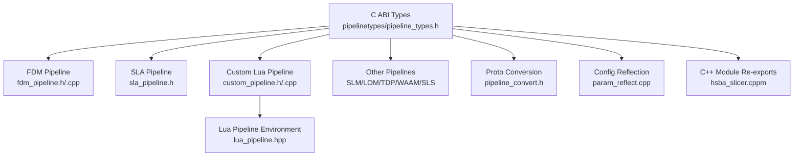
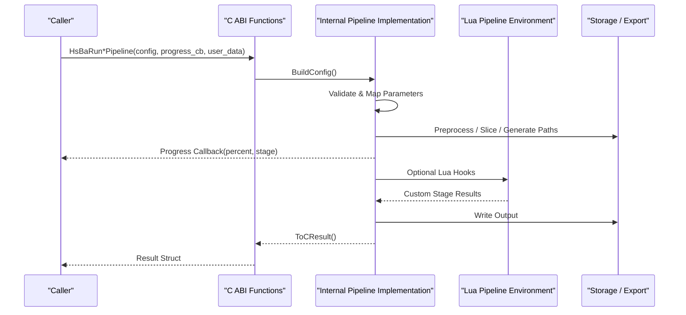
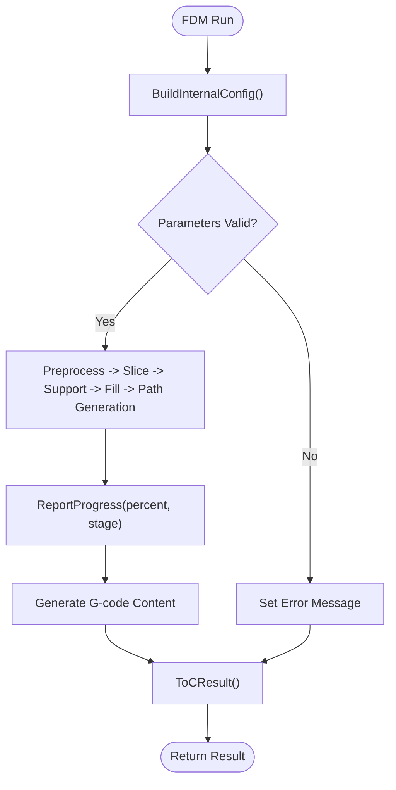
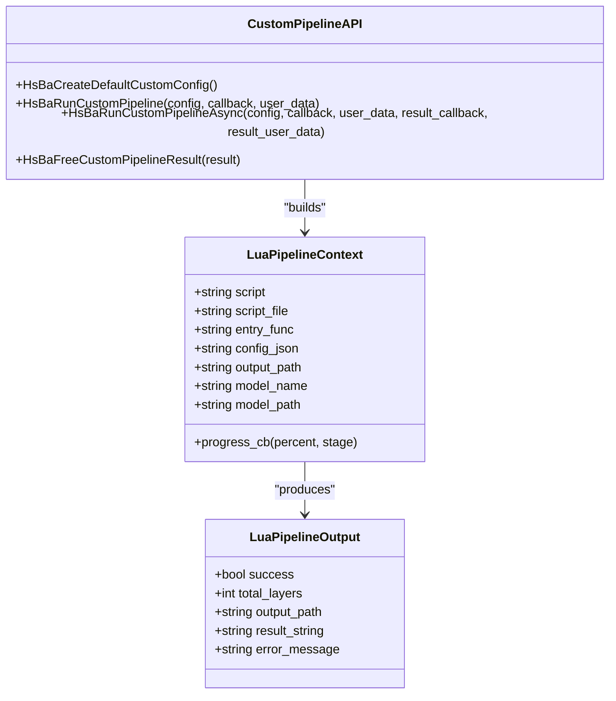
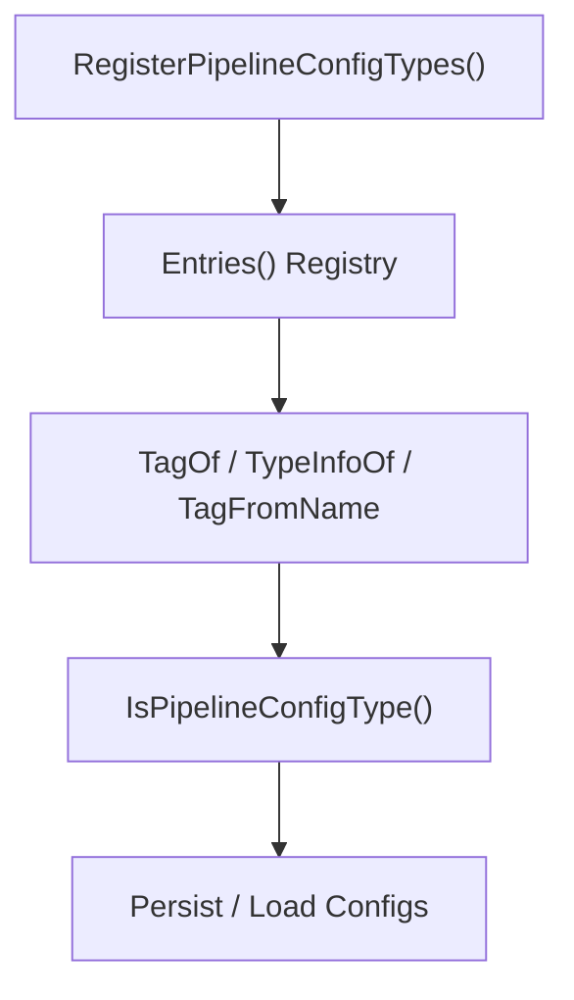
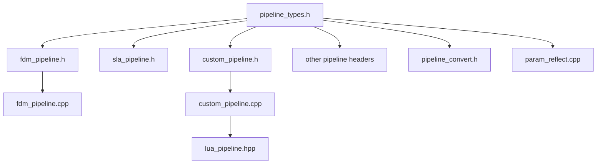

# Pipeline Interfaces / 流水线接口

<cite>
**Referenced Files in This Document**
- [pipeline_types.h](file://pipelinetypes/pipeline_types.h)
- [fdm_pipeline.h](file://DllHsBaSlicer/fdm_pipeline.h)
- [fdm_pipeline.cpp](file://DllHsBaSlicer/fdm_pipeline.cpp)
- [sla_pipeline.h](file://DllHsBaSlicer/sla_pipeline.h)
- [custom_pipeline.h](file://DllHsBaSlicer/custom_pipeline.h)
- [custom_pipeline.cpp](file://DllHsBaSlicer/custom_pipeline.cpp)
- [lua_pipeline.hpp](file://LibHsBaSlicer/Extends/lua_pipeline.hpp)
- [param_reflect.cpp](file://fileoperator/param_reflect.cpp)
- [pipeline_convert.h](file://DllHsBaSlicer/pipeline_convert.h)
- [waam_pipeline.h](file://DllHsBaSlicer/waam_pipeline.h)
- [tdp_pipeline.h](file://DllHsBaSlicer/tdp_pipeline.h)
- [lom_pipeline.h](file://DllHsBaSlicer/lom_pipeline.h)
- [slm_pipeline.h](file://DllHsBaSlicer/slm_pipeline.h)
- [hsba_slicer.cppm](file://ModuleHsBaSlicer/hsba_slicer.cppm)
</cite>

## Table of Contents
1. [Introduction](#introduction)
2. [Project Structure](#project-structure)
3. [Core Components](#core-components)
4. [Architecture Overview](#architecture-overview)
5. [Detailed Component Analysis](#detailed-component-analysis)
6. [Dependency Analysis](#dependency-analysis)
7. [Performance Considerations](#performance-considerations)
8. [Troubleshooting Guide](#troubleshooting-guide)
9. [Conclusion](#conclusion)
10. [Appendices](#appendices)

## Introduction
This document explains the pipeline interface system that enables extensible processing workflows for multiple manufacturing technologies. The system exposes:

- C-compatible configuration and result structures for each pipeline type.
- Synchronous and asynchronous execution entry points with progress callbacks.
- A fully Lua-driven custom pipeline where the entire workflow is defined by a Lua script.
- Configuration reflection, parameter validation helpers, and serialization to protobuf wire format.
- Re-exported types through a C++ module for convenient consumption.

The design separates stable C ABI definitions from internal C++ implementation, allowing external languages and applications to call pipelines without linking into the full library.

## Project Structure
The pipeline interface spans several modules:

- `pipelinetypes/pipeline_types.h`: Stable C-compatible enums, config structs, result structs, default initializers, and callback typedefs.
- `DllHsBaSlicer/*_pipeline.{h,cpp}`: Per-technology C ABI headers and implementations (FDM, SLA, SLS, SLM, LOM, TDP, WAAM, file transfer, custom).
- `LibHsBaSlicer/Extends/lua_pipeline.hpp` and related files: Lua environment setup and execution for custom pipelines.
- `fileoperator/param_reflect.cpp`: Central registration of pipeline config types for reflection-based storage and validation.
- `DllHsBaSlicer/pipeline_convert.h`: Protobuf conversion functions for configs and results.
- `ModuleHsBaSlicer/hsba_slicer.cppm`: C++ module re-exporting pipeline types for consumers.

**Diagram sources**
- [pipeline_types.h:1-120](file://pipelinetypes/pipeline_types.h#L1-L120)
- [fdm_pipeline.h:1-68](file://DllHsBaSlicer/fdm_pipeline.h#L1-L68)
- [fdm_pipeline.cpp:1-70](file://DllHsBaSlicer/fdm_pipeline.cpp#L1-L70)
- [sla_pipeline.h:1-63](file://DllHsBaSlicer/sla_pipeline.h#L1-L63)
- [custom_pipeline.h:1-69](file://DllHsBaSlicer/custom_pipeline.h#L1-L69)
- [custom_pipeline.cpp:1-45](file://DllHsBaSlicer/custom_pipeline.cpp#L1-L45)
- [lua_pipeline.hpp:1-88](file://LibHsBaSlicer/Extends/lua_pipeline.hpp#L1-L88)
- [param_reflect.cpp:1-164](file://fileoperator/param_reflect.cpp#L1-L164)
- [pipeline_convert.h:1-397](file://DllHsBaSlicer/pipeline_convert.h#L1-L397)
- [hsba_slicer.cppm:92-118](file://ModuleHsBaSlicer/hsba_slicer.cppm#L92-L118)

**Section sources**
- [pipeline_types.h:1-120](file://pipelinetypes/pipeline_types.h#L1-L120)
- [fdm_pipeline.h:1-68](file://DllHsBaSlicer/fdm_pipeline.h#L1-L68)
- [custom_pipeline.h:1-69](file://DllHsBaSlicer/custom_pipeline.h#L1-L69)
- [lua_pipeline.hpp:1-88](file://LibHsBaSlicer/Extends/lua_pipeline.hpp#L1-L88)
- [param_reflect.cpp:1-164](file://fileoperator/param_reflect.cpp#L1-L164)
- [pipeline_convert.h:1-397](file://DllHsBaSlicer/pipeline_convert.h#L1-L397)
- [hsba_slicer.cppm:92-118](file://ModuleHsBaSlicer/hsba_slicer.cppm#L92-L118)

## Core Components
The pipeline interface system is built around these core components:

- **Configuration Structures**: Each pipeline has a dedicated C-compatible config struct describing model inputs, process parameters, Lua customization hooks, and output settings. Examples include FDM, SLA, SLS, SLM, LOM, TDP, WAAM, file transfer, and custom Lua pipelines.
- **Result Structures**: Each pipeline returns a result struct containing success flags, layer counts, output paths or content, error messages, and elapsed time.
- **Callback Mechanisms**: Progress callbacks report percentage and stage descriptions; async result callbacks deliver final results.
- **Default Initializers**: Inline default constructors initialize all fields with documented defaults.
- **Execution Entry Points**: Synchronous run functions block until completion; asynchronous run functions return immediately and invoke result callbacks.
- **Memory Management**: Dedicated free functions release allocated strings in results and converted configs.

Key patterns:

- All public interfaces are declared under `extern "C"` for cross-language stability.
- Internal C++ code uses lightweight internal structs (`InternalConfig`, `InternalResult`) and RAII guards (`OwnedCString`) to manage memory safely.
- Progress reporting is optional and propagated through user-provided callbacks.

**Section sources**
- [pipeline_types.h:56-127](file://pipelinetypes/pipeline_types.h#L56-L127)
- [pipeline_types.h:170-232](file://pipelinetypes/pipeline_types.h#L170-L232)
- [pipeline_types.h:259-310](file://pipelinetypes/pipeline_types.h#L259-L310)
- [pipeline_types.h:359-401](file://pipelinetypes/pipeline_types.h#L359-L401)
- [pipeline_types.h:419-461](file://pipelinetypes/pipeline_types.h#L419-L461)
- [pipeline_types.h:480-521](file://pipelinetypes/pipeline_types.h#L480-L521)
- [pipeline_types.h:578-625](file://pipelinetypes/pipeline_types.h#L578-L625)
- [pipeline_types.h:636-674](file://pipelinetypes/pipeline_types.h#L636-L674)
- [pipeline_types.h:689-732](file://pipelinetypes/pipeline_types.h#L689-L732)
- [pipeline_types.h:742-783](file://pipelinetypes/pipeline_types.h#L742-L783)
- [fdm_pipeline.h:17-61](file://DllHsBaSlicer/fdm_pipeline.h#L17-L61)
- [custom_pipeline.h:17-62](file://DllHsBaSlicer/custom_pipeline.h#L17-L62)

## Architecture Overview
The architecture separates three layers:

1. **Stable C ABI Layer**: Defines configuration/result structs, callback types, and public functions.
2. **Implementation Layer**: Converts C configs to internal C++ objects, executes pipeline stages, and converts results back to C structs.
3. **Extension Layer**: Provides Lua scripting support for fully custom workflows and reflection utilities for configuration management.

**Diagram sources**
- [fdm_pipeline.cpp:142-197](file://DllHsBaSlicer/fdm_pipeline.cpp#L142-L197)
- [custom_pipeline.cpp:86-99](file://DllHsBaSlicer/custom_pipeline.cpp#L86-L99)
- [lua_pipeline.hpp:29-51](file://LibHsBaSlicer/Extends/lua_pipeline.hpp#L29-L51)

## Detailed Component Analysis

### FDM Pipeline Interface
The FDM pipeline provides slicing, support generation, infill, and G-code path output.

Public API:

- Default config creation.
- Synchronous run returning G-code content.
- Asynchronous run with result callback.
- Result memory cleanup.

Internal behavior:

- Config mapping fills support, path, printer, and firmware configurations.
- Progress reporting uses a helper function.
- Error handling wraps runtime errors into result messages.

**Diagram sources**
- [fdm_pipeline.cpp:142-197](file://DllHsBaSlicer/fdm_pipeline.cpp#L142-L197)
- [fdm_pipeline.cpp:134-140](file://DllHsBaSlicer/fdm_pipeline.cpp#L134-L140)

**Section sources**
- [fdm_pipeline.h:17-61](file://DllHsBaSlicer/fdm_pipeline.h#L17-L61)
- [fdm_pipeline.cpp:34-70](file://DllHsBaSlicer/fdm_pipeline.cpp#L34-L70)
- [fdm_pipeline.cpp:142-197](file://DllHsBaSlicer/fdm_pipeline.cpp#L142-L197)

### SLA Pipeline Interface
The SLA pipeline covers preprocessing, slicing, floor/raft generation, support, and zip export.

Public API:

- Default config creation.
- Synchronous run returning exported zip path.
- Asynchronous run with result callback.
- Result memory cleanup.

Behavior highlights:

- Supports configurable image formats and dimensions.
- Exposes Lua hooks for support, floor, and export customization.

**Section sources**
- [sla_pipeline.h:17-56](file://DllHsBaSlicer/sla_pipeline.h#L17-L56)
- [pipeline_types.h:170-232](file://pipelinetypes/pipeline_types.h#L170-L232)

### Custom Lua Pipeline Interface
The custom pipeline delegates the entire workflow to a Lua script.

Public API:

- Default config creation.
- Synchronous run executing Lua entry function.
- Asynchronous run with result callback.
- Result memory cleanup.

Lua environment:

- Context includes script source/file, entry function name, JSON config, model info, output path, and progress callback.
- Output captures success, layer count, output path, returned string, and error message.

**Diagram sources**
- [lua_pipeline.hpp:29-51](file://LibHsBaSlicer/Extends/lua_pipeline.hpp#L29-L51)
- [custom_pipeline.h:17-62](file://DllHsBaSlicer/custom_pipeline.h#L17-L62)
- [custom_pipeline.cpp:86-115](file://DllHsBaSlicer/custom_pipeline.cpp#L86-L115)

**Section sources**
- [custom_pipeline.h:17-62](file://DllHsBaSlicer/custom_pipeline.h#L17-L62)
- [custom_pipeline.cpp:23-44](file://DllHsBaSlicer/custom_pipeline.cpp#L23-L44)
- [custom_pipeline.cpp:86-115](file://DllHsBaSlicer/custom_pipeline.cpp#L86-L115)
- [lua_pipeline.hpp:29-51](file://LibHsBaSlicer/Extends/lua_pipeline.hpp#L29-L51)

### Other Technology Pipelines
SLM, LOM, TDP, and WAAM pipelines follow the same pattern:

- C ABI headers declare default config creation, synchronous/asynchronous run functions, and result freeing.
- Config structs include technology-specific parameters such as material, energy source, protection method, robot controller, and export hooks.
- Many require an export Lua script because their output format is not standardized like G-code.

Examples:

- WAAM outputs robot language programs rather than layer zips.
- TDP supports spiral mode for continuous rising paths.
- SLM mirrors SLS flow but adds metal-specific parameters.

**Section sources**
- [waam_pipeline.h:17-57](file://DllHsBaSlicer/waam_pipeline.h#L17-L57)
- [tdp_pipeline.h:37-56](file://DllHsBaSlicer/tdp_pipeline.h#L37-L56)
- [lom_pipeline.h:37-56](file://DllHsBaSlicer/lom_pipeline.h#L37-L56)
- [slm_pipeline.h:37-56](file://DllHsBaSlicer/slm_pipeline.h#L37-L56)
- [pipeline_types.h:359-401](file://pipelinetypes/pipeline_types.h#L359-L401)
- [pipeline_types.h:419-461](file://pipelinetypes/pipeline_types.h#L419-L461)
- [pipeline_types.h:480-521](file://pipelinetypes/pipeline_types.h#L480-L521)
- [pipeline_types.h:578-625](file://pipelinetypes/pipeline_types.h#L578-L625)

### Configuration Management and Parameter Validation
Configuration reflection centralizes metadata for all pipeline config types:

- A registry maps each config type to a tag, short name, and default table name.
- Registration forces TypeInfo initialization and adds a sentinel method for debug identification.
- Utilities determine whether a type is a pipeline config, retrieve its tag, map names to tags, and look up TypeInfo by tag.

This enables:

- Generic persistence of pipeline configurations.
- Schema-aware validation and UI generation.
- Consistent naming across storage and serialization layers.

**Diagram sources**
- [param_reflect.cpp:28-68](file://fileoperator/param_reflect.cpp#L28-L68)
- [param_reflect.cpp:72-100](file://fileoperator/param_reflect.cpp#L72-L100)
- [param_reflect.cpp:102-161](file://fileoperator/param_reflect.cpp#L102-L161)

**Section sources**
- [param_reflect.cpp:28-68](file://fileoperator/param_reflect.cpp#L28-L68)
- [param_reflect.cpp:72-100](file://fileoperator/param_reflect.cpp#L72-L100)
- [param_reflect.cpp:102-161](file://fileoperator/param_reflect.cpp#L102-L161)

### Serialization and Interoperability
The pipeline convert layer provides protobuf wire-format conversion for all pipeline configs and results:

- Deserialization functions parse proto bytes into C structs.
- Serialization functions allocate malloc buffers for proto bytes.
- Free functions release allocated string fields in converted configs.

This allows external systems to exchange pipeline definitions without linking into the full library.

**Section sources**
- [pipeline_convert.h:24-62](file://DllHsBaSlicer/pipeline_convert.h#L24-L62)
- [pipeline_convert.h:64-102](file://DllHsBaSlicer/pipeline_convert.h#L64-L102)
- [pipeline_convert.h:104-142](file://DllHsBaSlicer/pipeline_convert.h#L104-L142)
- [pipeline_convert.h:148-186](file://DllHsBaSlicer/pipeline_convert.h#L148-L186)
- [pipeline_convert.h:196-234](file://DllHsBaSlicer/pipeline_convert.h#L196-L234)
- [pipeline_convert.h:240-334](file://DllHsBaSlicer/pipeline_convert.h#L240-L334)
- [pipeline_convert.h:342-390](file://DllHsBaSlicer/pipeline_convert.h#L342-L390)

### C++ Module Re-exports
The C++ module re-exports pipeline types for convenient consumption:

- Type aliases expose enums and config/result structs.
- This reduces duplication for consumers who prefer C++ namespaces over raw C types.

**Section sources**
- [hsba_slicer.cppm:92-118](file://ModuleHsBaSlicer/hsba_slicer.cppm#L92-L118)

## Dependency Analysis
The pipeline system exhibits clear separation between stable interfaces and internal implementations:

- `pipeline_types.h` has no DLL dependency and can be used by downstream modules.
- Per-pipeline headers depend on `dllexport.h` and `pipeline_types.h`.
- Implementations depend on internal libraries for preprocessing, slicing, support, fill, path generation, and coroutines.
- Custom pipeline depends on Lua environment setup and common type registration.
- Reflection and conversion utilities depend on type metadata and protobuf definitions.

**Diagram sources**
- [pipeline_types.h:1-120](file://pipelinetypes/pipeline_types.h#L1-L120)
- [fdm_pipeline.h:1-68](file://DllHsBaSlicer/fdm_pipeline.h#L1-L68)
- [custom_pipeline.h:1-69](file://DllHsBaSlicer/custom_pipeline.h#L1-L69)
- [custom_pipeline.cpp:1-45](file://DllHsBaSlicer/custom_pipeline.cpp#L1-L45)
- [lua_pipeline.hpp:1-88](file://LibHsBaSlicer/Extends/lua_pipeline.hpp#L1-L88)
- [pipeline_convert.h:1-397](file://DllHsBaSlicer/pipeline_convert.h#L1-L397)
- [param_reflect.cpp:1-164](file://fileoperator/param_reflect.cpp#L1-L164)

**Section sources**
- [pipeline_types.h:1-120](file://pipelinetypes/pipeline_types.h#L1-L120)
- [fdm_pipeline.h:1-68](file://DllHsBaSlicer/fdm_pipeline.h#L1-L68)
- [custom_pipeline.h:1-69](file://DllHsBaSlicer/custom_pipeline.h#L1-L69)
- [custom_pipeline.cpp:1-45](file://DllHsBaSlicer/custom_pipeline.cpp#L1-L45)
- [lua_pipeline.hpp:1-88](file://LibHsBaSlicer/Extends/lua_pipeline.hpp#L1-L88)
- [pipeline_convert.h:1-397](file://DllHsBaSlicer/pipeline_convert.h#L1-L397)
- [param_reflect.cpp:1-164](file://fileoperator/param_reflect.cpp#L1-L164)

## Performance Considerations
- Asynchronous APIs use C++20 coroutines to avoid blocking the caller thread.
- Progress callbacks allow UI updates without synchronizing with pipeline internals.
- Memory allocation for result strings is centralized and must be released via provided free functions.
- Lua-driven custom pipelines incur interpreter overhead but provide maximum flexibility.
- For high-throughput scenarios, prefer built-in pipelines over custom Lua scripts when possible.

[No sources needed since this section provides general guidance]

## Troubleshooting Guide
Common issues and resolutions:

- **Missing Lua script or source**: Custom pipeline requires either `pipeline_lua_script` or `pipeline_lua_source`; otherwise it returns an error message.
- **Unreleased memory**: Always call the corresponding `HsBaFree*PipelineResult` function after using result structs.
- **Invalid configuration**: Use default initializers and reflection utilities to validate and persist configs consistently.
- **Serialization failures**: Check return values of protobuf conversion functions and ensure input pointers are valid.
- **Progress callback not invoked**: Ensure progress callback is non-null and that pipeline stages call progress reporting.

**Section sources**
- [custom_pipeline.cpp:127-133](file://DllHsBaSlicer/custom_pipeline.cpp#L127-L133)
- [custom_pipeline.cpp:203-212](file://DllHsBaSlicer/custom_pipeline.cpp#L203-L212)
- [pipeline_convert.h:342-390](file://DllHsBaSlicer/pipeline_convert.h#L342-L390)

## Conclusion
The pipeline interface system provides a robust, extensible foundation for additive manufacturing workflows. It combines stable C ABIs, asynchronous execution, Lua-driven customization, reflection-based configuration management, and protobuf interoperability. Users can extend existing pipelines through Lua hooks or build entirely custom workflows while maintaining consistent progress reporting, error handling, and memory management.

[No sources needed since this section summarizes without analyzing specific files]

## Appendices

### How to Extend Existing Pipelines
- Use built-in pipeline configs and override Lua hooks where available (for example, support, infill, floor, or export functions).
- Configure technology-specific parameters such as layer height, exposure times, materials, or robot controllers.
- Provide progress callbacks to update UI during long-running operations.

**Section sources**
- [pipeline_types.h:104-108](file://pipelinetypes/pipeline_types.h#L104-L108)
- [pipeline_types.h:204-210](file://pipelinetypes/pipeline_types.h#L204-L210)
- [pipeline_types.h:276-278](file://pipelinetypes/pipeline_types.h#L276-L278)

### How to Create a Completely Custom Processing Workflow
- Set `pipeline_lua_script` or `pipeline_lua_source` in the custom pipeline config.
- Define an entry function (default `run_pipeline`) that uses the exposed Lua API to load models, slice, generate support/fill, and export results.
- Use `HsBa.progress()` to report progress and set output metadata through the Lua context.

**Section sources**
- [custom_pipeline.h:23-36](file://DllHsBaSlicer/custom_pipeline.h#L23-L36)
- [lua_pipeline.hpp:29-51](file://LibHsBaSlicer/Extends/lua_pipeline.hpp#L29-L51)
- [custom_pipeline.cpp:117-163](file://DllHsBaSlicer/custom_pipeline.cpp#L117-L163)