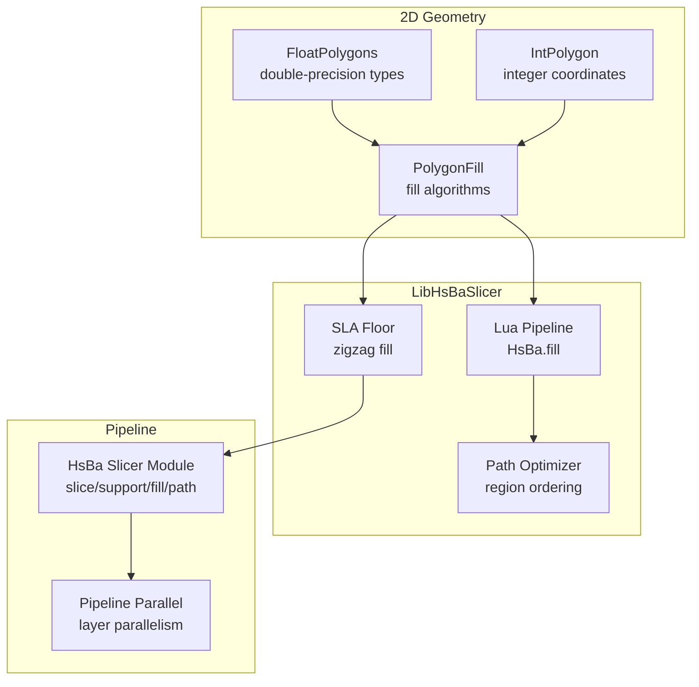
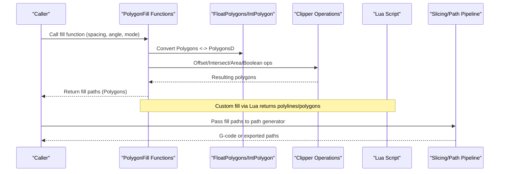
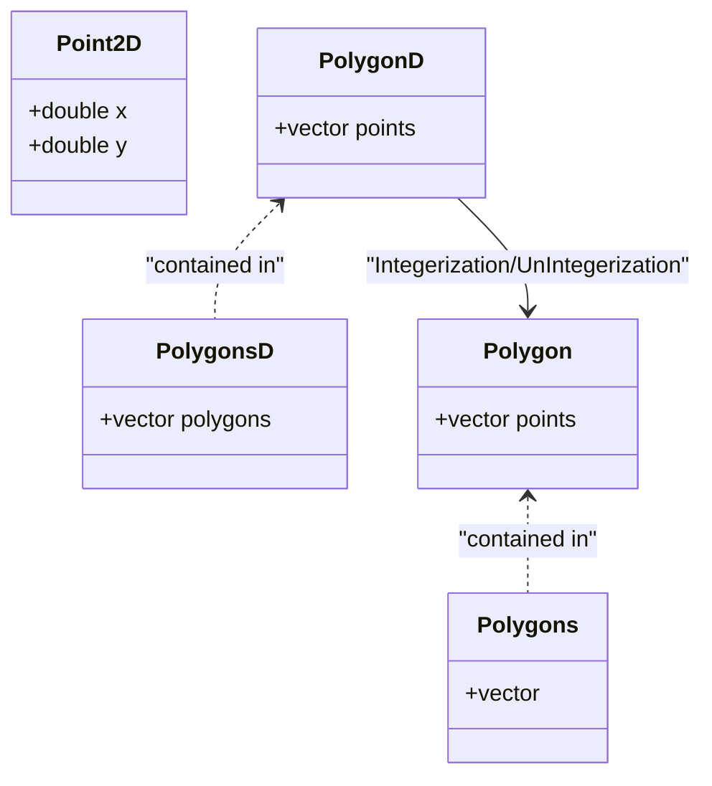
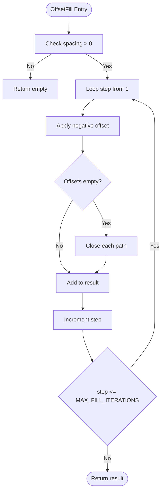
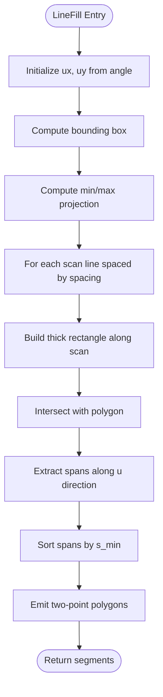
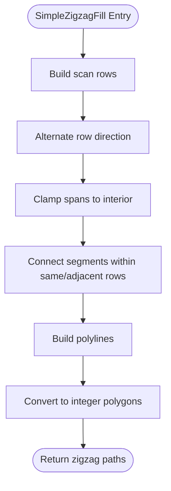
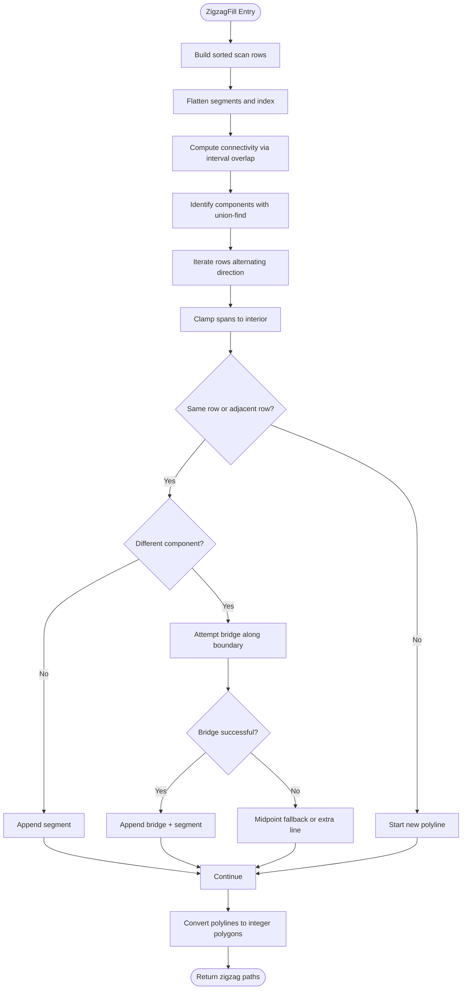
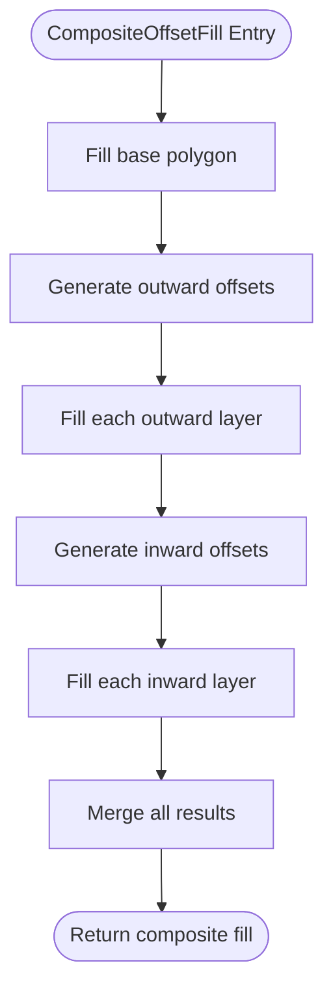
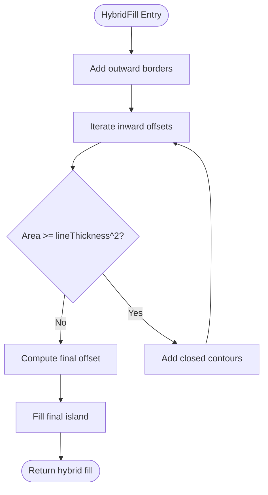
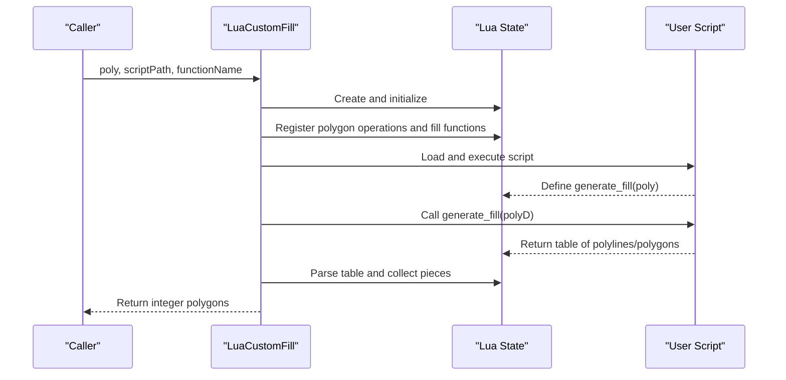

# Polygon Fill Algorithms

<cite>
**Referenced Files in This Document**   
- [PolygonFill.hpp](file://2D/PolygonFill.hpp)
- [PolygonFill.cpp](file://2D/PolygonFill.cpp)
- [FloatPolygons.hpp](file://2D/FloatPolygons.hpp)
- [FloatPolygons.cpp](file://2D/FloatPolygons.cpp)
- [IntPolygon.hpp](file://2D/IntPolygon.hpp)
- [lua_pipeline.cpp](file://LibHsBaSlicer/Extends/lua_pipeline.cpp)
- [sla_floor.cpp](file://LibHsBaSlicer/Floor/sla_floor.cpp)
- [path_optimizer.cpp](file://LibHsBaSlicer/Path/path_optimizer.cpp)
- [hsba_slicer.cppm](file://ModuleHsBaSlicer/hsba_slicer.cppm)
- [pipeline_parallel.hpp](file://DllHsBaSlicer/pipeline_parallel.hpp)
- [polygon_fill_test.cpp](file://tests/PolygonFill/polygon_fill_test.cpp)
</cite>

## Table of Contents
1. [Introduction](#introduction)
2. [Project Structure](#project-structure)
3. [Core Components](#core-components)
4. [Architecture Overview](#architecture-overview)
5. [Detailed Component Analysis](#detailed-component-analysis)
6. [Dependency Analysis](#dependency-analysis)
7. [Performance Considerations](#performance-considerations)
8. [Troubleshooting Guide](#troubleshooting-guide)
9. [Conclusion](#conclusion)
10. [Appendices](#appendices)

## Introduction
This document explains the polygon fill algorithms used by LibHsBaSlicer to generate infill patterns inside 2D polygon boundaries. It focuses on the public fill API, the internal geometric pipeline, the double-precision polygon data structures, and the integration points with the slicing and path generation systems. The goal is to help users configure existing fill patterns, understand their behavior, optimize density and orientation, and implement custom fill algorithms through Lua scripts or C++ extensions.

The repository does not include a dedicated `PolygonFill` class; instead, fill functionality is exposed as functions in the `HsBa::Slicer` namespace. These functions operate on integer-coordinate polygons for geometry operations and use double-precision polygons internally where needed.

## Project Structure
The fill system lives primarily under the 2D geometry layer and integrates with higher-level pipelines:

- 2D geometry layer:
  - Double-precision polygon types and operations: `FloatPolygons.hpp`, `FloatPolygons.cpp`.
  - Integer polygon primitives and Clipper-based operations: `IntPolygon.hpp`.
  - Fill pattern generators: `PolygonFill.hpp`, `PolygonFill.cpp`.
- LibHsBaSlicer integration:
  - Lua extension exposing `HsBa.fill` and coordinate conversion helpers: `lua_pipeline.cpp`.
  - SLA floor generation using zigzag fill: `sla_floor.cpp`.
  - Path optimization and region ordering: `path_optimizer.cpp`.
  - Pipeline module interface showing slice → support → fill → path flow: `hsba_slicer.cppm`.
  - Layer-parallel execution helper for slicing/fill hot paths: `pipeline_parallel.hpp`.
- Tests:
  - Fill behavior tests including Lua integration and zigzag bridging cases: `polygon_fill_test.cpp`.



**Diagram sources**
- [PolygonFill.hpp:1-141](file://2D/PolygonFill.hpp#L1-L141)
- [FloatPolygons.hpp:1-271](file://2D/FloatPolygons.hpp#L1-L271)
- [lua_pipeline.cpp:480-508](file://LibHsBaSlicer/Extends/lua_pipeline.cpp#L480-L508)
- [sla_floor.cpp:105-116](file://LibHsBaSlicer/Floor/sla_floor.cpp#L105-L116)
- [path_optimizer.cpp:43-72](file://LibHsBaSlicer/Path/path_optimizer.cpp#L43-L72)
- [hsba_slicer.cppm:204-225](file://ModuleHsBaSlicer/hsba_slicer.cppm#L204-L225)
- [pipeline_parallel.hpp:1-38](file://DllHsBaSlicer/pipeline_parallel.hpp#L1-L38)

**Section sources**
- [PolygonFill.hpp:1-141](file://2D/PolygonFill.hpp#L1-L141)
- [FloatPolygons.hpp:1-271](file://2D/FloatPolygons.hpp#L1-L271)
- [lua_pipeline.cpp:480-508](file://LibHsBaSlicer/Extends/lua_pipeline.cpp#L480-L508)
- [sla_floor.cpp:105-116](file://LibHsBaSlicer/Floor/sla_floor.cpp#L105-L116)
- [path_optimizer.cpp:43-72](file://LibHsBaSlicer/Path/path_optimizer.cpp#L43-L72)
- [hsba_slicer.cppm:204-225](file://ModuleHsBaSlicer/hsba_slicer.cppm#L204-L225)
- [pipeline_parallel.hpp:1-38](file://DllHsBaSlicer/pipeline_parallel.hpp#L1-L38)

## Core Components
The core fill components are:

- Double-precision polygon types:
  - `Point2D`: double-precision 2D point.
  - `PolygonD`: double-precision polygon path.
  - `PolygonsD`: collection of double-precision polygons.
- Integer polygon types and operations:
  - `Polygon` and `Polygons`: integer-coordinate polygons used by Clipper-based boolean and offset operations.
  - `Offset`, `Union`, `Intersection`, `Difference`, `Xor`, `Area`, `Integerization`, `UnIntegerization`.
- Fill pattern generators:
  - `OffsetFill`: concentric inward offset loops.
  - `LineFill`: independent parallel line segments.
  - `SimpleZigzagFill`: connected zigzag polyline across scan rows.
  - `ZigzagFill`: advanced zigzag with bridge construction for concave shapes.
  - `CompositeOffsetFill`: base fill plus outward/inward offset layers filled independently.
  - `HybridFill`: outward borders plus inward closed contours, then fill the final island.
  - `LuaCustomFill` / `LuaCustomFillString`: custom fill via Lua script returning polylines/polygons.
  - `RegisterLuaPolygonFillFunctions`: registers built-in fill functions into Lua.

Key configuration parameters:
- Spacing: distance between fill lines or offset steps.
- Angle: orientation of parallel lines or zigzag direction in degrees.
- Line thickness: controls minimum area thresholds and sampling during bridges.
- Join type: corner join style for offset operations (Square, Bevel, Round, Miter).
- Outward/inward counts: number of offset layers for composite/hybrid fills.

**Section sources**
- [FloatPolygons.hpp:18-26](file://2D/FloatPolygons.hpp#L18-L26)
- [FloatPolygons.hpp:195-221](file://2D/FloatPolygons.hpp#L195-L221)
- [IntPolygon.hpp:148-166](file://2D/IntPolygon.hpp#L148-L166)
- [PolygonFill.hpp:20-136](file://2D/PolygonFill.hpp#L20-L136)

## Architecture Overview
The fill architecture separates concerns between geometry representation, algorithmic pattern generation, and pipeline integration:

- Geometry layer:
  - Double-precision types provide numerical stability for calculations.
  - Integer types are used for robust boolean and offset operations via Clipper.
  - Conversion functions bridge between representations.
- Algorithm layer:
  - Pattern generators accept integer polygons and return integer polygons representing fill paths.
  - Internal helpers compute scan rows, segment intersections, connectivity, and boundary clamping.
- Integration layer:
  - Lua exposes fill functions to scripts.
  - SLA floor uses zigzag fill for interior regions.
  - Path optimizer orders regions before or after fill to reduce travel moves.
  - Pipeline module orchestrates slice → support → fill → path.



**Diagram sources**
- [PolygonFill.cpp:44-160](file://2D/PolygonFill.cpp#L44-L160)
- [FloatPolygons.cpp:184-221](file://2D/FloatPolygons.cpp#L184-L221)
- [lua_pipeline.cpp:480-508](file://LibHsBaSlicer/Extends/lua_pipeline.cpp#L480-L508)
- [hsba_slicer.cppm:204-225](file://ModuleHsBaSlicer/hsba_slicer.cppm#L204-L225)

## Detailed Component Analysis

### Data Structures: FloatPolygons and Integer Polygons
- `Point2D`, `PolygonD`, `PolygonsD` represent double-precision geometry.
- `Polygon`, `Polygons` represent integer geometry used by Clipper.
- `Integerization` and `UnIntegerization` convert between representations.
- Boolean operations (`Union`, `Intersection`, `Difference`, `Xor`) and `Offset` are provided for both single polygons and collections.
- Area calculation supports signed area for winding direction checks.

Complexity considerations:
- Conversions are linear in the number of vertices.
- Boolean operations depend on Clipper’s implementation; typical complexity is near-linear in the total number of edges but can be higher for complex self-intersections.
- Offset operations may increase vertex count due to rounding and corner handling.



**Diagram sources**
- [FloatPolygons.hpp:18-26](file://2D/FloatPolygons.hpp#L18-L26)
- [FloatPolygons.hpp:195-221](file://2D/FloatPolygons.hpp#L195-L221)
- [FloatPolygons.cpp:184-221](file://2D/FloatPolygons.cpp#L184-L221)

**Section sources**
- [FloatPolygons.hpp:18-26](file://2D/FloatPolygons.hpp#L18-L26)
- [FloatPolygons.hpp:195-221](file://2D/FloatPolygons.hpp#L195-L221)
- [FloatPolygons.cpp:184-221](file://2D/FloatPolygons.cpp#L184-L221)

### Fill Patterns: Offset, Line, Zigzag, Composite, Hybrid, Custom

#### Offset Fill
Generates concentric inward offset loops until no more offsets remain. Each loop is closed and added to the result. Controlled by spacing and join type.

Behavior:
- Iteratively applies negative offset distances.
- Stops when offset results are empty or iteration limit reached.
- Suitable for simple infill rings.



**Diagram sources**
- [PolygonFill.cpp:504-541](file://2D/PolygonFill.cpp#L504-L541)

**Section sources**
- [PolygonFill.hpp:20-28](file://2D/PolygonFill.hpp#L20-L28)
- [PolygonFill.cpp:504-541](file://2D/PolygonFill.cpp#L504-L541)

#### Line Fill
Generates independent straight line segments within the polygon at a given angle and spacing. Uses scan-line intersection with rotated rectangles to find spans.

Behavior:
- Computes bounding box and projects corners to determine scan range.
- For each scan line, intersects a thick rectangle with the polygon.
- Extracts span endpoints along the line direction.
- Returns a list of two-point polygons.



**Diagram sources**
- [PolygonFill.cpp:44-160](file://2D/PolygonFill.cpp#L44-L160)
- [PolygonFill.cpp:543-563](file://2D/PolygonFill.cpp#L543-L563)

**Section sources**
- [PolygonFill.hpp:30-38](file://2D/PolygonFill.hpp#L30-L38)
- [PolygonFill.cpp:44-160](file://2D/PolygonFill.cpp#L44-L160)
- [PolygonFill.cpp:543-563](file://2D/PolygonFill.cpp#L543-L563)

#### Simple Zigzag Fill
Connects centers of line segments across adjacent scan rows to form a continuous zigzag polyline. Allows connections only between same row or adjacent rows.

Behavior:
- Builds scan rows of spans.
- Alternates traversal direction per row.
- Clamps spans to interior using binary search against polygon membership.
- Connects segments while avoiding duplicate points.



**Diagram sources**
- [PolygonFill.cpp:566-800](file://2D/PolygonFill.cpp#L566-L800)

**Section sources**
- [PolygonFill.hpp:40-48](file://2D/PolygonFill.hpp#L40-L48)
- [PolygonFill.cpp:566-800](file://2D/PolygonFill.cpp#L566-L800)

#### Advanced Zigzag Fill
Improves corner handling and builds bridges between disconnected components when necessary. Uses union-find to identify connected components across rows and constructs boundary-following arcs to route around open notches.

Behavior:
- Sorts segments by projected position.
- Flattens segments and computes connectivity via interval overlap.
- Identifies components using union-find.
- For different components on adjacent rows, attempts bridge construction:
  - Finds entry/exit points on outer ring.
  - Chooses shortest arc along boundary.
  - Samples points along arc based on line thickness.
- Falls back to midpoint check or extra straight segments if bridge fails.



**Diagram sources**
- [PolygonFill.cpp:803-1370](file://2D/PolygonFill.cpp#L803-L1370)

**Section sources**
- [PolygonFill.hpp:50-58](file://2D/PolygonFill.hpp#L50-L58)
- [PolygonFill.cpp:803-1370](file://2D/PolygonFill.cpp#L803-L1370)

#### Composite Offset Fill
Combines base fill with outward and inward offset layers. Each offset layer is filled independently using the selected mode.

Behavior:
- Applies base fill to original polygon.
- Generates outward offsets and fills each.
- Generates inward offsets and fills each.
- Supports Line, SimpleZigzag, and Zigzag modes.



**Diagram sources**
- [PolygonFill.cpp:1372-1428](file://2D/PolygonFill.cpp#L1372-L1428)

**Section sources**
- [PolygonFill.hpp:70-85](file://2D/PolygonFill.hpp#L70-L85)
- [PolygonFill.cpp:1372-1428](file://2D/PolygonFill.cpp#L1372-L1428)

#### Hybrid Fill
Applies outward borders and inward closed contours, then fills the final island region. Uses line thickness to skip small areas.

Behavior:
- Adds outward offset borders as closed paths.
- Iterates inward offsets until area threshold is exceeded.
- Fills the final remaining island with selected mode.



**Diagram sources**
- [PolygonFill.cpp:1430-1491](file://2D/PolygonFill.cpp#L1430-L1491)

**Section sources**
- [PolygonFill.hpp:87-102](file://2D/PolygonFill.hpp#L87-L102)
- [PolygonFill.cpp:1430-1491](file://2D/PolygonFill.cpp#L1430-L1491)

#### Custom Fill via Lua
Allows users to define custom fill patterns by writing a Lua function that receives polygons and returns a table of polylines or polygons.

Behavior:
- Converts integer polygons to double-precision for Lua.
- Initializes Lua state and registers polygon operations and fill functions.
- Loads and executes user script.
- Parses returned table of points or polygons.
- Converts back to integer polygons.



**Diagram sources**
- [PolygonFill.cpp:1493-1585](file://2D/PolygonFill.cpp#L1493-L1585)

**Section sources**
- [PolygonFill.hpp:104-136](file://2D/PolygonFill.hpp#L104-L136)
- [PolygonFill.cpp:1493-1585](file://2D/PolygonFill.cpp#L1493-L1585)

### Fill Density Controls, Orientation, and Boundary Adaptation
- Spacing controls density: smaller spacing increases fill density.
- Angle controls orientation: rotates scan lines or zigzag direction.
- Line thickness affects minimum area thresholds and bridge sampling.
- Join type influences corner handling during offset operations.
- Boundary adaptation:
  - Zigzag fill clamps spans to interior using binary search.
  - Bridges follow boundary arcs to avoid cutting across open notches.
  - Composite/hybrid fills adapt to multiple offset layers.

**Section sources**
- [PolygonFill.cpp:26-31](file://2D/PolygonFill.cpp#L26-L31)
- [PolygonFill.cpp:566-800](file://2D/PolygonFill.cpp#L566-L800)
- [PolygonFill.cpp:803-1370](file://2D/PolygonFill.cpp#L803-L1370)
- [PolygonFill.cpp:1372-1491](file://2D/PolygonFill.cpp#L1372-L1491)

### Examples of Configuring Different Fill Patterns
- Offset fill:
  - Use `OffsetFill(poly, spacing, join_type)` for concentric rings.
  - Adjust spacing to control density.
- Line fill:
  - Use `LineFill(poly, spacing, angle_deg, lineThickness)` for parallel lines.
  - Set angle to rotate pattern orientation.
- Zigzag fill:
  - Use `SimpleZigzagFill` for basic connected zigzag.
  - Use `ZigzagFill` for improved corner handling and bridges.
- Composite/hybrid fill:
  - Use `CompositeOffsetFill` to combine base fill with offset layers.
  - Use `HybridFill` to add borders and fill final island.
- Custom fill:
  - Use `LuaCustomFill` or `LuaCustomFillString` to implement custom logic.

Configuration tips:
- Increase spacing to reduce material usage.
- Rotate angle to align with print direction or stress patterns.
- Use larger line thickness to ensure structural integrity.
- Choose appropriate join type for smoother corners.

**Section sources**
- [PolygonFill.hpp:20-136](file://2D/PolygonFill.hpp#L20-L136)
- [polygon_fill_test.cpp:522-553](file://tests/PolygonFill/polygon_fill_test.cpp#L522-L553)

### Performance Considerations for Large Polygons
- Avoid excessive offset iterations: `MAX_FILL_ITERATIONS` limits loop depth.
- Binary search for boundary clamping uses fixed iterations (`MAX_BINARY_SEARCH_ITERATIONS`).
- Union-find and interval overlap computations scale with number of segments.
- Bridge construction involves boundary arc sampling proportional to perimeter.
- Memory usage grows with number of generated segments and polylines.

Optimization strategies:
- Reduce spacing carefully to balance density and performance.
- Prefer `SimpleZigzagFill` for simpler shapes; use `ZigzagFill` only when bridges are needed.
- Use composite/hybrid fills sparingly to avoid excessive offset layers.
- Pre-order regions using path optimizer to reduce travel moves.

**Section sources**
- [PolygonFill.cpp:26-31](file://2D/PolygonFill.cpp#L26-L31)
- [PolygonFill.cpp:566-800](file://2D/PolygonFill.cpp#L566-L800)
- [PolygonFill.cpp:803-1370](file://2D/PolygonFill.cpp#L803-L1370)

### Integration with Slicing Pipeline and Path Generation
- SLA floor generation uses zigzag fill for interior regions after computing raft borders.
- Lua pipeline exposes `HsBa.fill` which calls underlying fill functions with configurable spacing, mode, angle, and border count.
- Path optimizer can order regions before fill (polygon mode) or after fill (fill-result mode) to minimize travel cost.
- Pipeline module defines slice → support → fill → path workflow.
- Layer-parallel execution distributes independent layer work across threads.

```mermaid
sequenceDiagram
participant Slice as "Slice Layers"
participant Support as "Generate Supports"
participant Fill as "Polygon Fill"
participant Path as "Path Generator"
participant Opt as "Path Optimizer"
Slice->>Support : Generate support polygons
Support->>Fill : Provide layer contours
Fill->>Fill : Generate fill patterns
Fill->>Opt : Optional region ordering
Opt->>Path : Ordered regions or paths
Path-->>Slice : Output G-code or export paths
```

**Diagram sources**
- [sla_floor.cpp:105-116](file://LibHsBaSlicer/Floor/sla_floor.cpp#L105-L116)
- [lua_pipeline.cpp:480-508](file://LibHsBaSlicer/Extends/lua_pipeline.cpp#L480-L508)
- [path_optimizer.cpp:43-72](file://LibHsBaSlicer/Path/path_optimizer.cpp#L43-L72)
- [hsba_slicer.cppm:204-225](file://ModuleHsBaSlicer/hsba_slicer.cppm#L204-L225)
- [pipeline_parallel.hpp:1-38](file://DllHsBaSlicer/pipeline_parallel.hpp#L1-L38)

**Section sources**
- [sla_floor.cpp:105-116](file://LibHsBaSlicer/Floor/sla_floor.cpp#L105-L116)
- [lua_pipeline.cpp:480-508](file://LibHsBaSlicer/Extends/lua_pipeline.cpp#L480-L508)
- [path_optimizer.cpp:43-72](file://LibHsBaSlicer/Path/path_optimizer.cpp#L43-L72)
- [hsba_slicer.cppm:204-225](file://ModuleHsBaSlicer/hsba_slicer.cppm#L204-L225)
- [pipeline_parallel.hpp:1-38](file://DllHsBaSlicer/pipeline_parallel.hpp#L1-L38)

## Dependency Analysis
The fill system depends on:

- Clipper2 for boolean operations, offset, and area calculations.
- FreeType for text-to-polygon conversion (optional).
- Lua for custom fill scripting.
- Path optimizer for region ordering.
- Pipeline modules for orchestration.

Coupling:
- Fill functions depend on integer polygon operations and double-precision conversions.
- Lua integration depends on registration functions and polygon operation wrappers.
- SLA floor depends on zigzag fill and offset operations.
- Path optimizer depends on polygon or fill-result data structures.

Potential circular dependencies:
- None observed between fill and path optimizer; they communicate via data structures.

External dependencies:
- Clipper2 library for robust geometry operations.
- FreeType for optional text rendering.
- Lua runtime for scripting.

**Section sources**
- [FloatPolygons.cpp:17-21](file://2D/FloatPolygons.cpp#L17-L21)
- [FloatPolygons.cpp:364-429](file://2D/FloatPolygons.cpp#L364-L429)
- [PolygonFill.cpp:11-19](file://2D/PolygonFill.cpp#L11-L19)
- [path_optimizer.cpp:43-72](file://LibHsBaSlicer/Path/path_optimizer.cpp#L43-L72)

## Performance Considerations
- Spacing and angle affect computational load: finer spacing increases scan rows.
- Zigzag bridge construction can be expensive for complex concave shapes.
- Composite/hybrid fills multiply offset operations and fill calls.
- Memory usage scales with number of generated segments and polylines.
- Layer-parallel execution helps distribute workload across independent layers.

Recommendations:
- Tune spacing to achieve desired density without excessive computation.
- Use simple zigzag for most cases; reserve advanced zigzag for challenging geometries.
- Limit outward/inward offset counts to prevent excessive processing.
- Pre-order regions to reduce travel moves and improve overall throughput.

[No sources needed since this section provides general guidance]

## Troubleshooting Guide
Common issues and resolutions:

- Empty fill results:
  - Check spacing value; too large spacing may produce no valid spans.
  - Verify polygon validity and orientation.
- Zigzag gaps or incorrect bridges:
  - Inspect concave shapes; ensure bridge construction is enabled.
  - Adjust line thickness to improve sampling along boundary arcs.
- Lua custom fill errors:
  - Ensure script returns a table of polylines or polygons.
  - Validate point coordinates and polygon closure.
- Performance bottlenecks:
  - Reduce spacing or simplify polygons.
  - Use path optimizer to reduce travel moves.

Debugging utilities:
- SVG dump functions for visualizing polygons (debug build).
- Test cases cover edge cases like concave U-shapes and multi-contour islands.

**Section sources**
- [FloatPolygons.cpp:77-180](file://2D/FloatPolygons.cpp#L77-L180)
- [polygon_fill_test.cpp:542-652](file://tests/PolygonFill/polygon_fill_test.cpp#L542-L652)

## Conclusion
LibHsBaSlicer’s polygon fill system provides flexible and robust algorithms for generating infill patterns within 2D polygon boundaries. The design separates geometry representation, algorithmic pattern generation, and pipeline integration, enabling users to configure existing patterns and implement custom ones via Lua. Key considerations include spacing, angle, line thickness, join type, and boundary adaptation strategies. For large polygons, careful tuning of parameters and use of path optimization can significantly improve performance. The system integrates seamlessly with the slicing and path generation pipeline, supporting both FDM and SLA workflows.

[No sources needed since this section summarizes without analyzing specific files]

## Appendices

### API Reference Summary
- `OffsetFill`: Concentric inward offset loops.
- `LineFill`: Independent parallel line segments.
- `SimpleZigzagFill`: Connected zigzag polyline.
- `ZigzagFill`: Advanced zigzag with bridges.
- `CompositeOffsetFill`: Base fill plus offset layers.
- `HybridFill`: Borders plus final island fill.
- `LuaCustomFill` / `LuaCustomFillString`: Custom fill via Lua.
- `RegisterLuaPolygonFillFunctions`: Register built-in fill functions.

**Section sources**
- [PolygonFill.hpp:20-136](file://2D/PolygonFill.hpp#L20-L136)