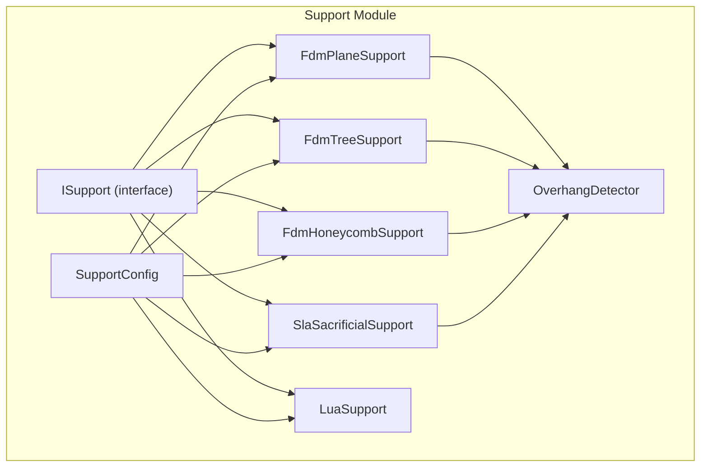
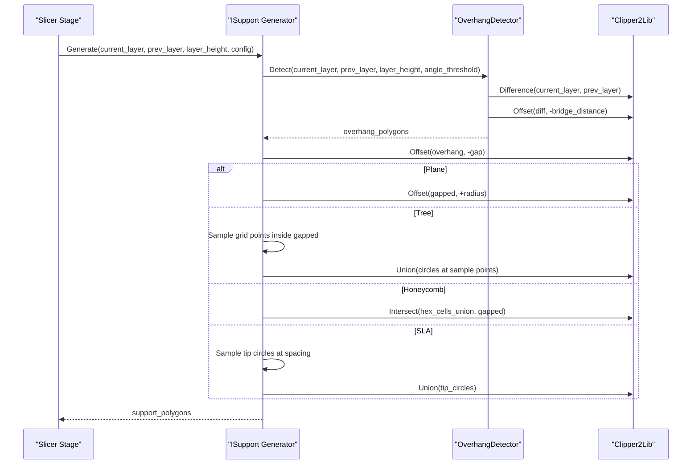
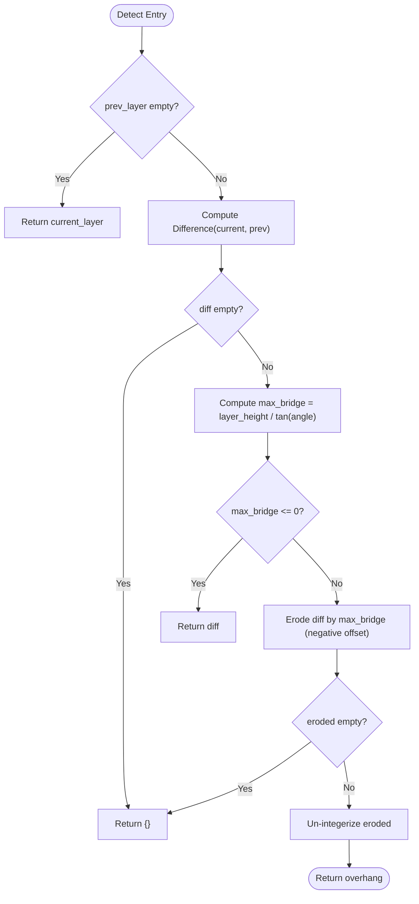
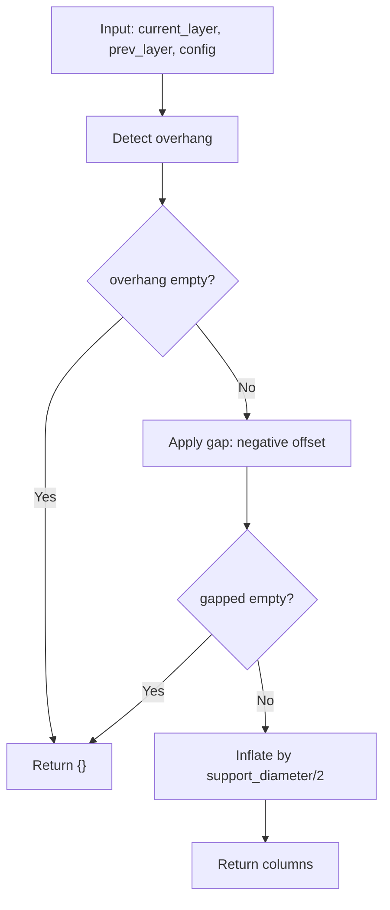
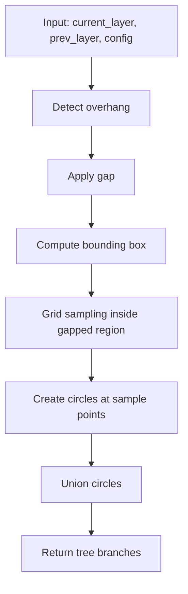
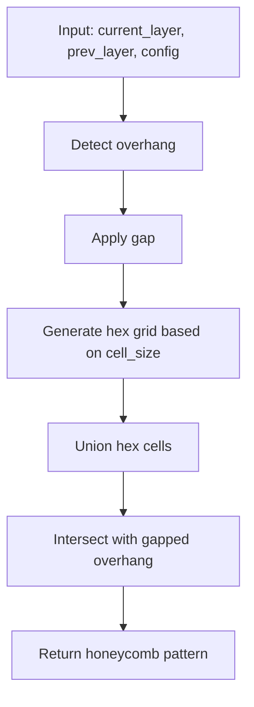
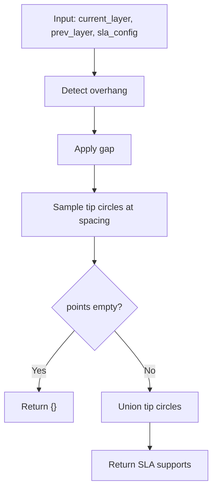
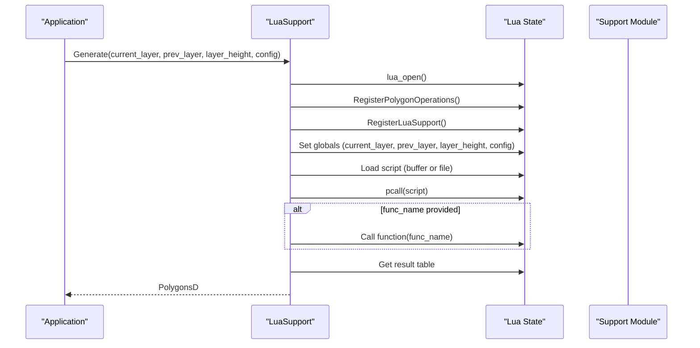
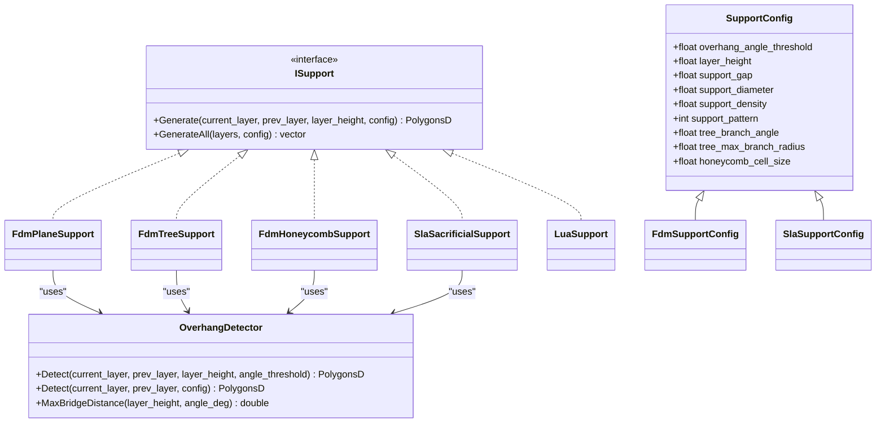

# Support Generation APIs

<cite>
**Referenced Files in This Document**
- [ISupport.hpp](file://support/ISupport.hpp)
- [SupportConfig.hpp](file://support/SupportConfig.hpp)
- [OverhangDetector.hpp](file://support/OverhangDetector.hpp)
- [OverhangDetector.cpp](file://support/OverhangDetector.cpp)
- [FdmSupport.hpp](file://support/FdmSupport.hpp)
- [FdmSupport.cpp](file://support/FdmSupport.cpp)
- [SlaSupport.hpp](file://support/SlaSupport.hpp)
- [SlaSupport.cpp](file://support/SlaSupport.cpp)
- [LuaSupport.hpp](file://support/LuaSupport.hpp)
- [LuaSupport.cpp](file://support/LuaSupport.cpp)
- [my_support.lua](file://samples/FDM/scripts/my_support.lua)
- [my_sla_support.lua](file://samples/SLA/scripts/my_sla_support.lua)
</cite>

## Table of Contents
1. [Introduction](#introduction)
2. [Project Structure](#project-structure)
3. [Core Components](#core-components)
4. [Architecture Overview](#architecture-overview)
5. [Detailed Component Analysis](#detailed-component-analysis)
6. [Dependency Analysis](#dependency-analysis)
7. [Performance Considerations](#performance-considerations)
8. [Troubleshooting Guide](#troubleshooting-guide)
9. [Conclusion](#conclusion)
10. [Appendices](#appendices)

## Introduction
This document explains the support generation APIs in LibHsBaSlicer, focusing on FDM and SLA support strategies, overhang detection, configuration parameters, and extensibility through Lua scripting. It covers:
- FDM plane supports, tree supports, and honeycomb patterns
- SLA sacrificial supports
- Overhang detection algorithm and the OverhangDetector class
- Support configuration and density controls
- Removal strategies and post-processing considerations
- Integration with other slicing stages via the ISupport interface
- Examples for configuring different support types and customizing algorithms

## Project Structure
The support system is implemented under the support module and exposed through a common interface. The key files are:
- Abstract generator interface: ISupport
- Shared configuration: SupportConfig
- Overhang detection: OverhangDetector
- FDM generators: FdmPlaneSupport, FdmTreeSupport, FdmHoneycombSupport
- SLA generator: SlaSacrificialSupport
- Custom Lua-based generator: LuaSupport
- Sample scripts demonstrating usage

**Diagram sources**
- [ISupport.hpp:14-45](file://support/ISupport.hpp#L14-L45)
- [SupportConfig.hpp:14-43](file://support/SupportConfig.hpp#L14-L43)
- [OverhangDetector.hpp:20-49](file://support/OverhangDetector.hpp#L20-L49)
- [FdmSupport.hpp:19-63](file://support/FdmSupport.hpp#L19-L63)
- [SlaSupport.hpp:20-42](file://support/SlaSupport.hpp#L20-L42)
- [LuaSupport.hpp:40-81](file://support/LuaSupport.hpp#L40-L81)

**Section sources**
- [ISupport.hpp:14-45](file://support/ISupport.hpp#L14-L45)
- [SupportConfig.hpp:14-43](file://support/SupportConfig.hpp#L14-L43)
- [OverhangDetector.hpp:20-49](file://support/OverhangDetector.hpp#L20-L49)
- [FdmSupport.hpp:19-63](file://support/FdmSupport.hpp#L19-L63)
- [SlaSupport.hpp:20-42](file://support/SlaSupport.hpp#L20-L42)
- [LuaSupport.hpp:40-81](file://support/LuaSupport.hpp#L40-L81)

## Core Components
- ISupport: Defines the per-layer support generation contract and a default all-layers iterator.
- SupportConfig: Holds shared parameters such as overhang angle threshold, layer height, gap, diameter, density, pattern selection, and geometry-specific options.
- OverhangDetector: Computes regions that need support by comparing adjacent layers using an angle-based bridge distance.
- FdmPlaneSupport: Generates cylindrical columns from overhang regions with configurable diameter and gap.
- FdmTreeSupport: Places circular branch tips across overhang areas to form tree-like structures.
- FdmHoneycombSupport: Fills overhang regions with hexagonal cells for lightweight rigid support.
- SlaSacrificialSupport: Produces small-diameter sacrificial points spaced regularly for resin printing.
- LuaSupport: Executes user-provided Lua scripts to generate supports, exposing polygon operations and built-in generators.

Key responsibilities:
- Detect overhangs consistently across all generators
- Apply model-support gap to avoid adhesion
- Produce PolygonsD cross-sections per layer
- Allow customization via configuration or Lua scripts

**Section sources**
- [ISupport.hpp:14-45](file://support/ISupport.hpp#L14-L45)
- [SupportConfig.hpp:14-43](file://support/SupportConfig.hpp#L14-L43)
- [OverhangDetector.hpp:20-49](file://support/OverhangDetector.hpp#L20-L49)
- [FdmSupport.hpp:19-63](file://support/FdmSupport.hpp#L19-L63)
- [SlaSupport.hpp:20-42](file://support/SlaSupport.hpp#L20-L42)
- [LuaSupport.hpp:40-81](file://support/LuaSupport.hpp#L40-L81)

## Architecture Overview
The support pipeline processes each layer pair (current_layer, prev_layer) to compute support polygons. All generators share the same input/output contract and rely on OverhangDetector for consistent overhang identification. Configuration determines strategy and geometry.

**Diagram sources**
- [FdmSupport.cpp:48-76](file://support/FdmSupport.cpp#L48-L76)
- [FdmSupport.cpp:145-168](file://support/FdmSupport.cpp#L145-L168)
- [FdmSupport.cpp:244-267](file://support/FdmSupport.cpp#L244-L267)
- [SlaSupport.cpp:81-133](file://support/SlaSupport.cpp#L81-L133)
- [OverhangDetector.cpp:41-87](file://support/OverhangDetector.cpp#L41-L87)

## Detailed Component Analysis

### Overhang Detection and OverhangDetector
OverhangDetector computes regions present in the current layer but not supported by the previous layer, filtered by an angle threshold. It uses:
- Polygon difference between current and previous layers
- Maximum bridge distance derived from layer height and angle threshold
- Negative offset (erosion) to filter out small overhangs that can be bridged

Algorithm highlights:
- If no previous layer exists, the entire current layer is considered overhang
- MaxBridgeDistance returns 0 for vertical walls (angle >= 90°) and very large values for flat angles (<= 0°)
- Erosion uses integerized coordinates and round joins for smooth corners

**Diagram sources**
- [OverhangDetector.cpp:23-87](file://support/OverhangDetector.cpp#L23-L87)

Configuration used:
- layer_height and overhang_angle_threshold from SupportConfig

Practical implications:
- Lower angle thresholds increase sensitivity to overhangs
- Larger layer heights increase bridge distance, reducing detected overhangs

**Section sources**
- [OverhangDetector.hpp:20-49](file://support/OverhangDetector.hpp#L20-L49)
- [OverhangDetector.cpp:23-87](file://support/OverhangDetector.cpp#L23-L87)
- [SupportConfig.hpp:14-25](file://support/SupportConfig.hpp#L14-L25)

### FDM Support Generators

#### FdmPlaneSupport
Generates simple column supports by inflating the gapped overhang region by half the support diameter.

Key steps:
- Detect overhangs
- Apply model-support gap
- Inflate by radius to create columns

**Diagram sources**
- [FdmSupport.cpp:48-76](file://support/FdmSupport.cpp#L48-L76)

Relevant configuration:
- support_gap, support_diameter, overhang_angle_threshold

Use cases:
- Fast, robust supports for most geometries
- Easy removal due to uniform column shape

**Section sources**
- [FdmSupport.hpp:19-24](file://support/FdmSupport.hpp#L19-L24)
- [FdmSupport.cpp:48-76](file://support/FdmSupport.cpp#L48-L76)
- [SupportConfig.hpp:14-25](file://support/SupportConfig.hpp#L14-L25)

#### FdmTreeSupport
Places circular branch tips within the overhang area at regular spacing, then unions them to form discrete contact points.

Key steps:
- Detect overhangs and apply gap
- Compute bounding box of gapped region
- Sample a grid of candidate points inside the region
- Create circles at valid points and union them

**Diagram sources**
- [FdmSupport.cpp:81-143](file://support/FdmSupport.cpp#L81-L143)
- [FdmSupport.cpp:145-168](file://support/FdmSupport.cpp#L145-L168)

Relevant configuration:
- support_diameter (controls tip radius and spacing), support_gap, overhang_angle_threshold

Use cases:
- Reduced material usage compared to plane supports
- Better printability for complex overhangs

**Section sources**
- [FdmSupport.hpp:26-44](file://support/FdmSupport.hpp#L26-L44)
- [FdmSupport.cpp:81-168](file://support/FdmSupport.cpp#L81-L168)
- [SupportConfig.hpp:14-25](file://support/SupportConfig.hpp#L14-L25)

#### FdmHoneycombSupport
Fills overhang regions with a hexagonal honeycomb pattern, providing lightweight yet rigid support.

Key steps:
- Detect overhangs and apply gap
- Generate a grid of flat-top hexagons based on cell size
- Intersect the union of hexagons with the gapped overhang region

**Diagram sources**
- [FdmSupport.cpp:173-242](file://support/FdmSupport.cpp#L173-L242)
- [FdmSupport.cpp:244-267](file://support/FdmSupport.cpp#L244-L267)

Relevant configuration:
- honeycomb_cell_size, support_gap, overhang_angle_threshold

Use cases:
- Lightweight support with good stiffness
- Suitable for large overhang areas where minimal material is desired

**Section sources**
- [FdmSupport.hpp:46-63](file://support/FdmSupport.hpp#L46-L63)
- [FdmSupport.cpp:173-267](file://support/FdmSupport.cpp#L173-L267)
- [SupportConfig.hpp:14-25](file://support/SupportConfig.hpp#L14-L25)

### SLA Sacrificial Supports
Produces small-diameter sacrificial points spaced regularly to minimize adhesion marks and facilitate easy removal.

Key steps:
- Detect overhangs and apply gap
- Sample tip circles at spacing derived from support_diameter
- Union tip circles to produce final support points

**Diagram sources**
- [SlaSupport.cpp:38-79](file://support/SlaSupport.cpp#L38-L79)
- [SlaSupport.cpp:81-133](file://support/SlaSupport.cpp#L81-L133)

Relevant configuration:
- tip_diameter, support_diameter (spacing), support_gap, overhang_angle_threshold

Removal and post-processing:
- Small tip diameters reduce surface damage
- Spacing controls density and ease of removal

**Section sources**
- [SlaSupport.hpp:20-42](file://support/SlaSupport.hpp#L20-L42)
- [SlaSupport.cpp:38-133](file://support/SlaSupport.cpp#L38-L133)
- [SupportConfig.hpp:36-43](file://support/SupportConfig.hpp#L36-L43)

### Lua-Based Custom Support Generation
LuaSupport allows users to replace built-in algorithms with custom logic. It exposes:
- Layer data: current_layer, prev_layer
- Parameters: layer_height, config table
- Helpers: polygon operations and built-in generator wrappers via the Support module

Execution flow:
- Initialize Lua state and libraries
- Register polygon operations and Support module
- Push globals (layers, height, config)
- Load script (inline or file)
- Execute script chunk and optional function
- Extract result polygons

**Diagram sources**
- [LuaSupport.cpp:19-90](file://support/LuaSupport.cpp#L19-L90)
- [LuaSupport.cpp:113-178](file://support/LuaSupport.cpp#L113-L178)

Usage examples:
- FDM custom script selecting built-in generators based on config.support_pattern
- SLA custom script filtering support points by area

**Section sources**
- [LuaSupport.hpp:40-81](file://support/LuaSupport.hpp#L40-L81)
- [LuaSupport.cpp:19-178](file://support/LuaSupport.cpp#L19-L178)
- [my_support.lua:30-83](file://samples/FDM/scripts/my_support.lua#L30-L83)
- [my_sla_support.lua:32-76](file://samples/SLA/scripts/my_sla_support.lua#L32-L76)

## Dependency Analysis
The support system exhibits clear separation of concerns:
- ISupport defines a stable interface for all generators
- OverhangDetector centralizes overhang computation
- Generators depend on OverhangDetector and Clipper2Lib for geometric operations
- LuaSupport depends on Lua runtime and registered modules

**Diagram sources**
- [ISupport.hpp:14-45](file://support/ISupport.hpp#L14-L45)
- [SupportConfig.hpp:14-43](file://support/SupportConfig.hpp#L14-L43)
- [OverhangDetector.hpp:20-49](file://support/OverhangDetector.hpp#L20-L49)
- [FdmSupport.hpp:19-63](file://support/FdmSupport.hpp#L19-L63)
- [SlaSupport.hpp:20-42](file://support/SlaSupport.hpp#L20-L42)
- [LuaSupport.hpp:40-81](file://support/LuaSupport.hpp#L40-L81)

**Section sources**
- [ISupport.hpp:14-45](file://support/ISupport.hpp#L14-L45)
- [SupportConfig.hpp:14-43](file://support/SupportConfig.hpp#L14-L43)
- [OverhangDetector.hpp:20-49](file://support/OverhangDetector.hpp#L20-L49)
- [FdmSupport.hpp:19-63](file://support/FdmSupport.hpp#L19-L63)
- [SlaSupport.hpp:20-42](file://support/SlaSupport.hpp#L20-L42)
- [LuaSupport.hpp:40-81](file://support/LuaSupport.hpp#L40-L81)

## Performance Considerations
- Overhang detection complexity:
  - Difference and offset operations dominate; performance scales with polygon complexity
  - Integerization and rounding add overhead but improve numerical stability
- FdmPlaneSupport:
  - Two offsets per layer; efficient for moderate overhang areas
- FdmTreeSupport:
  - Grid sampling cost proportional to bounding box area and spacing; smaller spacing increases point count
  - Union of many circles may be expensive; consider increasing spacing or limiting bounding box
- FdmHoneycombSupport:
  - Hex grid generation and union before intersection; cell size controls number of hexagons
  - Large cell sizes reduce computational load but decrease resolution
- SlaSacrificialSupport:
  - Sampling spacing controls number of tip circles; larger spacing reduces union cost
- General recommendations:
  - Tune support_diameter and spacing to balance coverage and performance
  - Use higher overhang_angle_threshold to reduce overhang detection when appropriate
  - Limit layer iteration to necessary ranges (e.g., skip first layer if no supports needed)

[No sources needed since this section provides general guidance]

## Troubleshooting Guide
Common issues and resolutions:
- No supports generated:
  - Verify overhang_angle_threshold is not too high; lower it to detect more overhangs
  - Ensure layer_height matches slicer settings; mismatch affects bridge distance calculation
  - Check that prev_layer is empty only for the first layer; otherwise, overhang detection may return empty
- Excessive supports or slow generation:
  - Increase support_diameter or spacing to reduce point density
  - For honeycomb, increase honeycomb_cell_size to reduce hex count
  - For tree supports, increase spacing or limit bounding box processing
- Poor removal quality:
  - For SLA, reduce tip_diameter to minimize adhesion marks
  - Adjust support_gap to control clearance; too small may cause adhesion, too large may weaken support
- Lua script errors:
  - Validate script syntax and ensure required functions exist
  - Confirm global variables (current_layer, prev_layer, layer_height, config) are correctly set
  - Inspect error messages thrown by LuaSupport during load or execution

**Section sources**
- [OverhangDetector.cpp:23-87](file://support/OverhangDetector.cpp#L23-L87)
- [FdmSupport.cpp:48-76](file://support/FdmSupport.cpp#L48-L76)
- [FdmSupport.cpp:81-168](file://support/FdmSupport.cpp#L81-L168)
- [FdmSupport.cpp:173-267](file://support/FdmSupport.cpp#L173-L267)
- [SlaSupport.cpp:38-133](file://support/SlaSupport.cpp#L38-L133)
- [LuaSupport.cpp:113-178](file://support/LuaSupport.cpp#L113-L178)

## Conclusion
LibHsBaSlicer’s support generation system provides a flexible, layered architecture:
- Consistent overhang detection via OverhangDetector
- Multiple FDM strategies (plane, tree, honeycomb) tailored to different needs
- SLA sacrificial supports optimized for resin printing
- Extensible Lua scripting for custom algorithms
By tuning configuration parameters and selecting appropriate strategies, users can optimize support structures for printability, material usage, and post-processing efficiency.

[No sources needed since this section summarizes without analyzing specific files]

## Appendices

### Support Configuration Reference
- SupportConfig fields:
  - overhang_angle_threshold: degrees; controls overhang sensitivity
  - layer_height: mm; affects bridge distance
  - support_gap: mm; clearance between model and support
  - support_diameter: mm; base dimension for columns/tips/spacing
  - support_density: [0,1]; fill density hint (used by higher-level stages)
  - support_pattern: int; selects strategy (0=Plane, 1=Tree, 2=Honeycomb)
  - tree_branch_angle: degrees; influences branching behavior
  - tree_max_branch_radius: mm; limits branch growth
  - honeycomb_cell_size: mm; hex cell dimension

- FdmSupportConfig extensions:
  - interface_layers: number of interface layers between support and model
  - interface_density: interface fill density

- SlaSupportConfig extensions:
  - tip_diameter: mm; small for easy removal
  - raft_thickness: mm; build plate adhesion layer thickness

**Section sources**
- [SupportConfig.hpp:14-43](file://support/SupportConfig.hpp#L14-L43)

### Example Usage Patterns
- FDM custom support script:
  - Uses Support.detect_overhang and built-in generators based on config.support_pattern
  - Demonstrates refining support polygons via offset operations

- SLA custom support script:
  - Uses Support.new_sla and filters support points by area threshold

**Section sources**
- [my_support.lua:30-83](file://samples/FDM/scripts/my_support.lua#L30-L83)
- [my_sla_support.lua:32-76](file://samples/SLA/scripts/my_sla_support.lua#L32-L76)