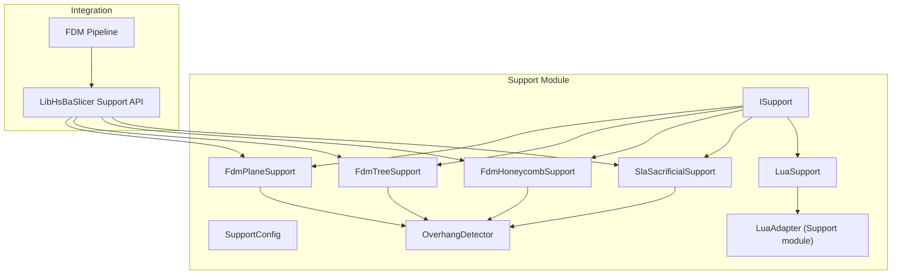
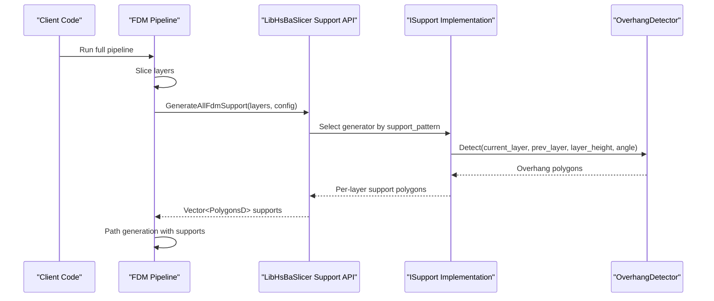
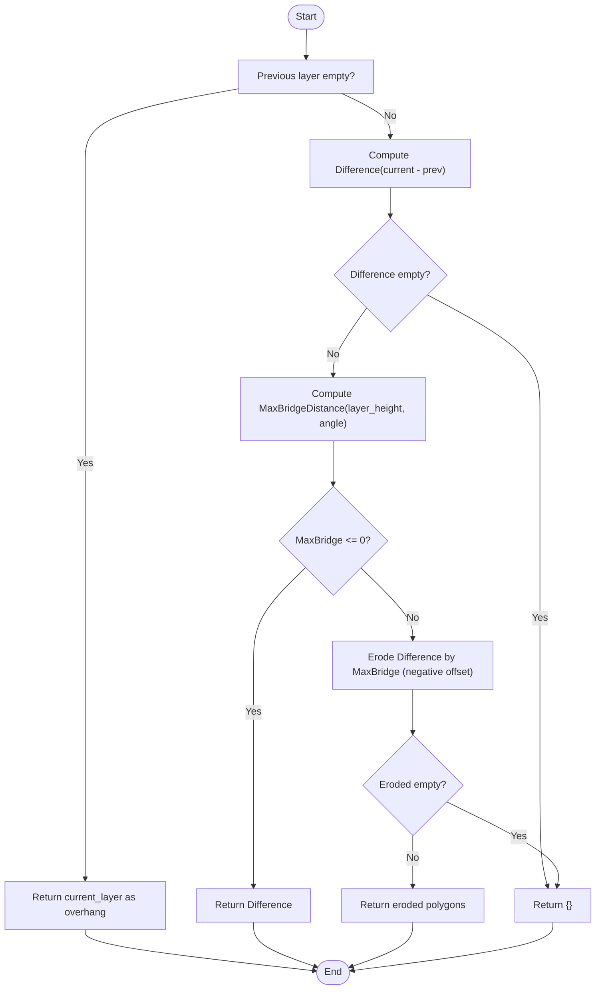
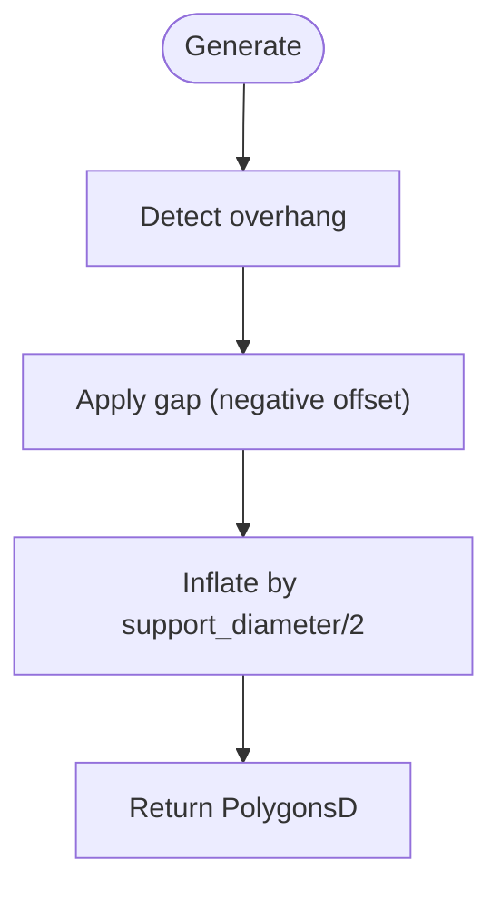
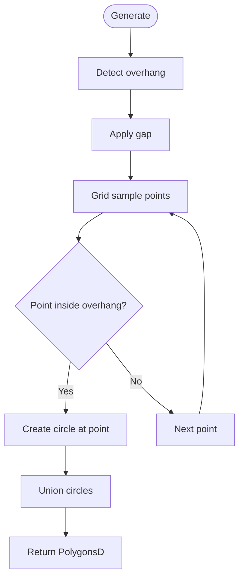
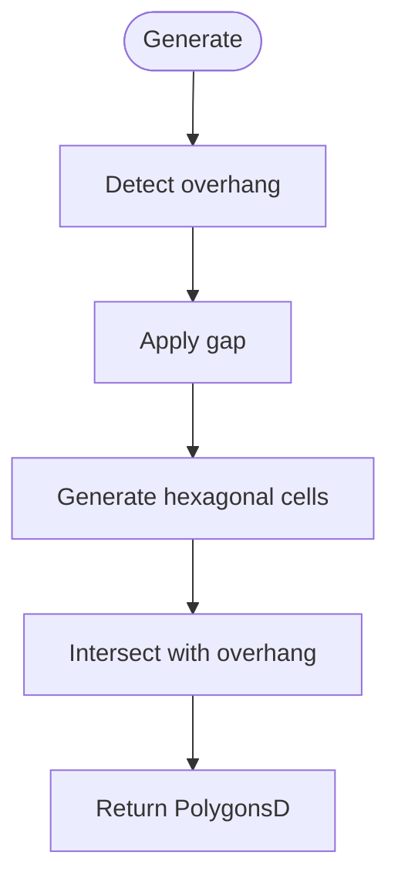
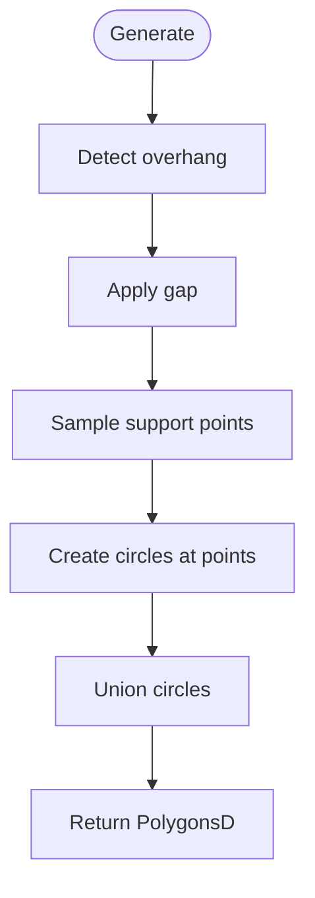
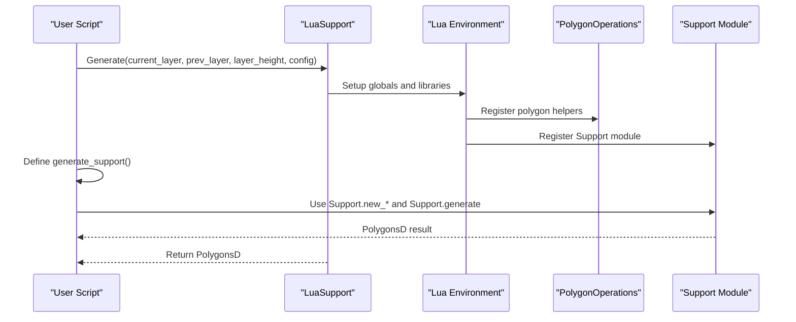
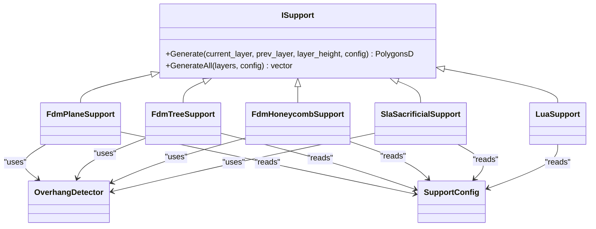

# Support Generator API

<cite>
**Referenced Files in This Document**
- [ISupport.hpp](file://support/ISupport.hpp)
- [ISupport.cpp](file://support/ISupport.cpp)
- [FdmSupport.hpp](file://support/FdmSupport.hpp)
- [FdmSupport.cpp](file://support/FdmSupport.cpp)
- [SlaSupport.hpp](file://support/SlaSupport.hpp)
- [SlaSupport.cpp](file://support/SlaSupport.cpp)
- [OverhangDetector.hpp](file://support/OverhangDetector.hpp)
- [OverhangDetector.cpp](file://support/OverhangDetector.cpp)
- [LuaSupport.hpp](file://support/LuaSupport.hpp)
- [LuaSupport.cpp](file://support/LuaSupport.cpp)
- [LuaAdapter.hpp](file://support/LuaAdapter.hpp)
- [SupportConfig.hpp](file://support\SupportConfig.hpp)
- [fdm_support.cpp](file://LibHsBaSlicer\Support\fdm_support.cpp)
- [fdm_pipeline.cpp](file://DllHsBaSlicer\fdm_pipeline.cpp)
- [my_support.lua](file://samples\FDM\scripts\my_support.lua)
- [my_sla_support.lua](file://samples\SLA\scripts\my_sla_support.lua)
</cite>

## Table of Contents
1. [Introduction](#introduction)
2. [Project Structure](#project-structure)
3. [Core Components](#core-components)
4. [Architecture Overview](#architecture-overview)
5. [Detailed Component Analysis](#detailed-component-analysis)
6. [Dependency Analysis](#dependency-analysis)
7. [Performance Considerations](#performance-considerations)
8. [Troubleshooting Guide](#troubleshooting-guide)
9. [Conclusion](#conclusion)
10. [Appendices](#appendices)

## Introduction
This document provides comprehensive API documentation for the support structure generation system, focusing on:
- The abstract ISupport interface and its concrete implementations for FDM and SLA printing.
- Overhang detection algorithms that determine where supports are needed.
- Support pattern generation strategies: plane, tree, honeycomb, and SLA sacrificial supports.
- Configuration options controlling density, adhesion gap, removal characteristics, and material usage optimization.
- Custom support algorithm development via Lua scripting and integration with the main slicing pipeline.

The goal is to enable both C++ developers and script authors to create, configure, and extend support generation within the slicer pipeline.

## Project Structure
The support generation system resides under the support module and integrates with higher-level pipelines:
- Core interfaces and configurations: ISupport, SupportConfig.
- Built-in generators: FdmPlaneSupport, FdmTreeSupport, FdmHoneycombSupport, SlaSacrificialSupport.
- Overhang detection: OverhangDetector.
- Custom scripting: LuaSupport and LuaAdapter exposing a Support module to Lua scripts.
- Library and pipeline integration: LibHsBaSlicer wrapper functions and DllHsBaSlicer FDM pipeline orchestration.

**Diagram sources**
- [ISupport.hpp:22-45](file://support/ISupport.hpp#L22-L45)
- [FdmSupport.hpp:19-63](file://support/FdmSupport.hpp#L19-L63)
- [SlaSupport.hpp:20-42](file://support/SlaSupport.hpp#L20-L42)
- [OverhangDetector.hpp:20-50](file://support/OverhangDetector.hpp#L20-L50)
- [LuaSupport.hpp:40-81](file://support/LuaSupport.hpp#L40-L81)
- [LuaAdapter.hpp:13-30](file://support/LuaAdapter.hpp#L13-L30)
- [fdm_support.cpp:36-52](file://LibHsBaSlicer\Support\fdm_support.cpp#L36-L52)
- [fdm_pipeline.cpp:280-297](file://DllHsBaSlicer\fdm_pipeline.cpp#L280-L297)

**Section sources**
- [ISupport.hpp:22-45](file://support/ISupport.hpp#L22-L45)
- [SupportConfig.hpp:14-43](file://support\SupportConfig.hpp#L14-L43)
- [fdm_support.cpp:36-52](file://LibHsBaSlicer\Support\fdm_support.cpp#L36-L52)
- [fdm_pipeline.cpp:280-297](file://DllHsBaSlicer\fdm_pipeline.cpp#L280-L297)

## Core Components
- ISupport: Abstract interface defining per-layer support generation and batch generation across all layers.
- SupportConfig: Shared configuration fields including overhang angle threshold, layer height, gap, diameter, density, pattern selection, tree parameters, and honeycomb cell size.
- OverhangDetector: Computes overhang regions between adjacent layers using geometric difference and erosion based on bridge distance derived from angle threshold.
- FdmPlaneSupport: Generates cylindrical column supports by offsetting overhang regions by gap and inflating by half the support diameter.
- FdmTreeSupport: Samples branch points within overhang regions and unions circular cross-sections; expansion across layers is handled by GenerateAll iteration.
- FdmHoneycombSupport: Fills overhang regions with hexagonal cells sized by honeycomb_cell_size, intersected with the gapped overhang area.
- SlaSacrificialSupport: Produces thin sacrificial columns by sampling points at spacing proportional to support_diameter and generating circles of tip_diameter.
- LuaSupport: Executes user-provided Lua scripts to generate custom support polygons, exposing polygon operations and a Support module.

Key responsibilities:
- Detect overhangs consistently across patterns.
- Apply model-support gap to avoid contact.
- Produce PolygonsD representing support cross-sections per layer.
- Provide default multi-layer iteration via GenerateAll.

**Section sources**
- [ISupport.hpp:22-45](file://support/ISupport.hpp#L22-L45)
- [ISupport.cpp:9-21](file://support/ISupport.cpp#L9-L21)
- [SupportConfig.hpp:14-43](file://support\SupportConfig.hpp#L14-L43)
- [OverhangDetector.hpp:20-50](file://support/OverhangDetector.hpp#L20-L50)
- [FdmSupport.hpp:19-63](file://support/FdmSupport.hpp#L19-L63)
- [SlaSupport.hpp:20-42](file://support/SlaSupport.hpp#L20-L42)
- [LuaSupport.hpp:40-81](file://support/LuaSupport.hpp#L40-L81)

## Architecture Overview
The support generation architecture follows a layered design:
- Configuration layer: SupportConfig and specialized configs (FdmSupportConfig, SlaSupportConfig).
- Detection layer: OverhangDetector computes unsupported areas between layers.
- Generation layer: Concrete ISupport implementations produce per-layer support polygons.
- Scripting layer: LuaSupport allows custom algorithms via Lua, integrating with built-in helpers.
- Integration layer: LibHsBaSlicer exposes high-level APIs; DllHsBaSlicer orchestrates the full FDM pipeline, selecting built-in or Lua-based support generation.

**Diagram sources**
- [fdm_pipeline.cpp:280-297](file://DllHsBaSlicer\fdm_pipeline.cpp#L280-L297)
- [fdm_support.cpp:36-52](file://LibHsBaSlicer\Support\fdm_support.cpp#L36-L52)
- [ISupport.hpp:22-45](file://support/ISupport.hpp#L22-L45)
- [OverhangDetector.hpp:20-50](file://support/OverhangDetector.hpp#L20-L50)

## Detailed Component Analysis

### Overhang Detection Algorithm
OverhangDetector determines unsupported regions by:
- Computing the difference between current and previous layer contours.
- Calculating maximum bridge distance from layer height and angle threshold.
- Eroding the difference region by the bridge distance to filter small bridges.
- Returning remaining polygons as overhang areas requiring support.

**Diagram sources**
- [OverhangDetector.cpp:23-75](file://support/OverhangDetector.cpp#L23-L75)

**Section sources**
- [OverhangDetector.hpp:20-50](file://support/OverhangDetector.hpp#L20-L50)
- [OverhangDetector.cpp:23-75](file://support/OverhangDetector.cpp#L23-L75)

### FDM Plane Support
FdmPlaneSupport generates simple column supports:
- Detect overhang regions using OverhangDetector.
- Apply model-support gap via negative offset.
- Inflate by half support_diameter to form cylindrical cross-sections.
- Return unioned result as PolygonsD.

**Diagram sources**
- [FdmSupport.cpp:48-72](file://support/FdmSupport.cpp#L48-L72)

**Section sources**
- [FdmSupport.hpp:19-24](file://support/FdmSupport.hpp#L19-L24)
- [FdmSupport.cpp:48-72](file://support/FdmSupport.cpp#L48-L72)

### FDM Tree Support
FdmTreeSupport creates branching-like supports:
- Detect overhang and apply gap.
- Sample candidate branch points on a grid within the overhang bounding box.
- For each point inside overhang, create a circle of radius support_diameter/2.
- Union circles to collapse overlaps and return resulting polygons.

**Diagram sources**
- [FdmSupport.cpp:77-149](file://support/FdmSupport.cpp#L77-L149)

**Section sources**
- [FdmSupport.hpp:26-44](file://support/FdmSupport.hpp#L26-L44)
- [FdmSupport.cpp:77-149](file://support/FdmSupport.cpp#L77-L149)

### FDM Honeycomb Support
FdmHoneycombSupport fills overhang regions with hexagonal cells:
- Detect overhang and apply gap.
- Generate flat-top hexagons across the bounding box with spacing determined by honeycomb_cell_size.
- Intersect the union of hexagons with the gapped overhang region.
- Return resulting polygons.

**Diagram sources**
- [FdmSupport.cpp:155-233](file://support/FdmSupport.cpp#L155-L233)

**Section sources**
- [FdmSupport.hpp:46-63](file://support/FdmSupport.hpp#L46-L63)
- [FdmSupport.cpp:155-233](file://support/FdmSupport.cpp#L155-L233)

### SLA Sacrificial Support
SlaSacrificialSupport produces thin sacrificial columns:
- Detect overhang and apply gap.
- Sample support points at spacing proportional to support_diameter.
- Create circles of radius tip_diameter/2 at sampled points.
- Union circles to produce final support polygons.

**Diagram sources**
- [SlaSupport.cpp:38-118](file://support/SlaSupport.cpp#L38-L118)

**Section sources**
- [SlaSupport.hpp:20-42](file://support/SlaSupport.hpp#L20-L42)
- [SlaSupport.cpp:38-118](file://support/SlaSupport.cpp#L38-L118)

### Lua Custom Support
LuaSupport enables custom support algorithms via Lua:
- Exposes global variables: current_layer, prev_layer, layer_height, config.
- Registers polygon helper functions and a Support module with constructors for built-in generators and utilities.
- Loads inline or file-based scripts, executes them, optionally calls a named function, and returns polygons.

**Diagram sources**
- [LuaSupport.cpp:18-89](file://support/LuaSupport.cpp#L18-L89)
- [LuaAdapter.hpp:13-30](file://support/LuaAdapter.hpp#L13-L30)

**Section sources**
- [LuaSupport.hpp:40-81](file://support/LuaSupport.hpp#L40-L81)
- [LuaSupport.cpp:18-173](file://support/LuaSupport.cpp#L18-L173)
- [LuaAdapter.hpp:13-30](file://support/LuaAdapter.hpp#L13-L30)

### Configuration Options
SupportConfig defines core parameters:
- overhang_angle_threshold: Angle in degrees used to compute bridge distance and filter overhangs.
- layer_height: Layer thickness in mm, influencing bridge distance calculation.
- support_gap: Gap between model and support to prevent adhesion.
- support_diameter: Diameter used for FDM column/tree supports and spacing for SLA supports.
- support_density: Fill density indicator [0,1] for planning infill density.
- support_pattern: Pattern selector (0=Plane, 1=Tree, 2=Honeycomb).
- tree_branch_angle and tree_max_branch_radius: Parameters for tree support behavior.
- honeycomb_cell_size: Hexagon cell size for honeycomb pattern.

Specialized configs:
- FdmSupportConfig adds interface_layers and interface_density for better model/support transition.
- SlaSupportConfig adds tip_diameter and raft_thickness for sacrificial support characteristics.

**Section sources**
- [SupportConfig.hpp:14-43](file://support\SupportConfig.hpp#L14-L43)

## Dependency Analysis
The support system exhibits clear separation of concerns:
- ISupport defines the contract implemented by all generators.
- OverhangDetector is a pure utility used by all generators.
- FDM and SLA generators depend on geometry operations (offset, union, intersection) and integerization helpers.
- LuaSupport depends on Lua runtime and adapters for polygon operations and the Support module.
- Higher-level pipelines select generators based on configuration and integrate results into path generation.

**Diagram sources**
- [ISupport.hpp:22-45](file://support/ISupport.hpp#L22-L45)
- [FdmSupport.hpp:19-63](file://support/FdmSupport.hpp#L19-L63)
- [SlaSupport.hpp:20-42](file://support/SlaSupport.hpp#L20-L42)
- [LuaSupport.hpp:40-81](file://support/LuaSupport.hpp#L40-L81)
- [OverhangDetector.hpp:20-50](file://support/OverhangDetector.hpp#L20-L50)
- [SupportConfig.hpp:14-43](file://support\SupportConfig.hpp#L14-L43)

**Section sources**
- [ISupport.hpp:22-45](file://support/ISupport.hpp#L22-L45)
- [FdmSupport.hpp:19-63](file://support/FdmSupport.hpp#L19-L63)
- [SlaSupport.hpp:20-42](file://support/SlaSupport.hpp#L20-L42)
- [LuaSupport.hpp:40-81](file://support/LuaSupport.hpp#L40-L81)
- [OverhangDetector.hpp:20-50](file://support/OverhangDetector.hpp#L20-L50)
- [SupportConfig.hpp:14-43](file://support\SupportConfig.hpp#L14-L43)

## Performance Considerations
- Parallel slicing and fill stages are supported; support generation can be parallelized when using built-in generators through GenerateAll iteration.
- Lua-based support generation runs serially due to interpreter state constraints.
- Geometry operations (offset, union, intersection) dominate computational cost; minimizing overhang area and tuning gap/density reduces processing time.
- Honeycomb generation involves many hexagons; adjust honeycomb_cell_size to balance detail and performance.
- Tree support sampling uses grid traversal; tune spacing relative to support_diameter to control point density.

[No sources needed since this section provides general guidance]

## Troubleshooting Guide
Common issues and resolutions:
- No supports generated:
  - Verify overhang_angle_threshold is appropriate for the model geometry.
  - Ensure layer_height matches actual slicing settings.
  - Check support_gap is not too large, causing overhang erosion to remove all regions.
- Excessive support material:
  - Reduce support_density or increase support_diameter spacing for SLA.
  - Switch to honeycomb pattern for lighter structures.
- Poor removal characteristics (SLA):
  - Increase tip_diameter slightly for stronger bases if needed, but keep it small for easier removal.
- Lua script errors:
  - Validate script syntax and ensure generate_support function exists or returns polygons.
  - Confirm Support module and PolygonOperations are available in the environment.

**Section sources**
- [OverhangDetector.cpp:23-75](file://support/OverhangDetector.cpp#L23-L75)
- [LuaSupport.cpp:112-173](file://support/LuaSupport.cpp#L112-L173)

## Conclusion
The support generation system provides a robust, extensible framework for creating FDM and SLA supports:
- Consistent overhang detection ensures accurate support placement.
- Multiple pattern strategies allow trade-offs between strength, material usage, and printability.
- Lua scripting enables fully custom algorithms while leveraging built-in geometry tools.
- Integration with the main slicing pipeline ensures seamless workflow from slicing to G-code generation.

[No sources needed since this section summarizes without analyzing specific files]

## Appendices

### Practical Examples: Implementing Custom Support Algorithms via Lua

#### FDM Custom Support Example
The example script demonstrates:
- Skipping first layer support.
- Detecting overhang regions using Support.detect_overhang.
- Selecting a generator based on config.support_pattern.
- Generating supports with Support.generate and refining contact points via offset.

Reference:
- [my_support.lua:32-79](file://samples\FDM\scripts\my_support.lua#L32-L79)

#### SLA Custom Support Example
The example script demonstrates:
- Detecting overhang regions.
- Using Support.new_sla to create sacrificial supports.
- Filtering support polygons by area to optimize material usage.

Reference:
- [my_sla_support.lua:34-72](file://samples\SLA\scripts\my_sla_support.lua#L34-L72)

**Section sources**
- [my_support.lua:32-79](file://samples\FDM\scripts\my_support.lua#L32-L79)
- [my_sla_support.lua:34-72](file://samples\SLA\scripts\my_sla_support.lua#L34-L72)

### Integration with Main Slicing Pipeline
The FDM pipeline selects support generation strategy:
- If a Lua script is provided, it loads and executes the script to generate supports.
- Otherwise, it uses built-in FDM support generation based on config.support_pattern.
- Supports are integrated into path generation along with outlines and fills.

References:
- [fdm_pipeline.cpp:280-297](file://DllHsBaSlicer\fdm_pipeline.cpp#L280-L297)
- [fdm_support.cpp:36-52](file://LibHsBaSlicer\Support\fdm_support.cpp#L36-L52)

**Section sources**
- [fdm_pipeline.cpp:280-297](file://DllHsBaSlicer\fdm_pipeline.cpp#L280-L297)
- [fdm_support.cpp:36-52](file://LibHsBaSlicer\Support\fdm_support.cpp#L36-L52)