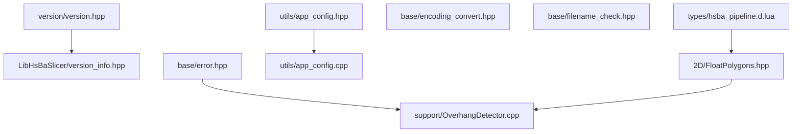
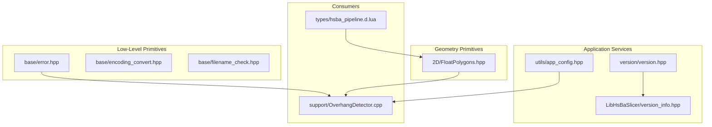
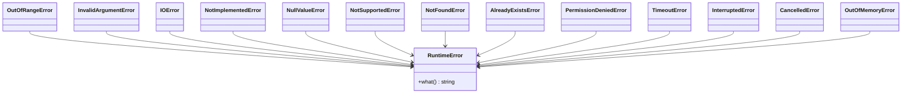
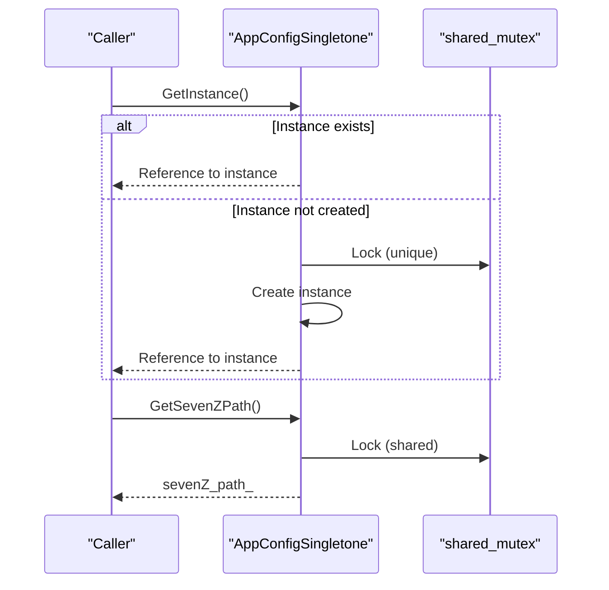
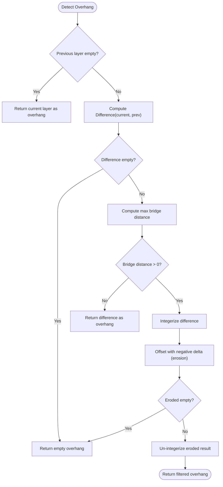
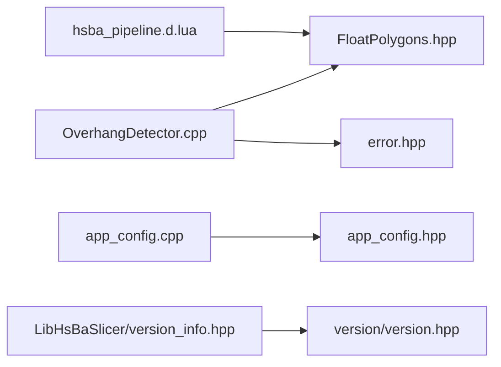

# Utility Functions / 工具函数

<cite>
**Referenced Files in This Document**   
- [version.hpp](file://version/version.hpp)
- [LibHsBaSlicer version_info.hpp](file://LibHsBaSlicer/version_info.hpp)
- [error.hpp](file://base/error.hpp)
- [app_config.hpp](file://utils/app_config.hpp)
- [app_config.cpp](file://utils/app_config.cpp)
- [FloatPolygons.hpp](file://2D/FloatPolygons.hpp)
- [encoding_convert.hpp](file://base/encoding_convert.hpp)
- [filename_check.hpp](file://base/filename_check.hpp)
- [OverhangDetector.cpp](file://support/OverhangDetector.cpp)
- [hsba_pipeline.d.lua](file://types/hsba_pipeline.d.lua)
</cite>

## Table of Contents
1. [Introduction](#introduction)
2. [Project Structure](#project-structure)
3. [Core Components](#core-components)
4. [Architecture Overview](#architecture-overview)
5. [Detailed Component Analysis](#detailed-component-analysis)
6. [Dependency Analysis](#dependency-analysis)
7. [Performance Considerations](#performance-considerations)
8. [Troubleshooting Guide](#troubleshooting-guide)
9. [Conclusion](#conclusion)

## Introduction
This document describes the utility functions and helper classes that support the main slicing workflow in HsBaSlicer. It focuses on:
- Version information retrieval for the library and build environment.
- Error handling utilities based on a custom exception hierarchy.
- Configuration management helpers, including a thread-safe application configuration singleton.
- Common mathematical and geometric operations exposed through polygon utilities.
- String, encoding, and filename validation helpers used across the pipeline.

The goal is to explain function signatures, parameter constraints, return value semantics, error conditions, and how these utilities integrate with the main slicing process.

## Project Structure
The relevant utilities are spread across several small, focused modules:
- `version/version.hpp` defines the core version data structure and query function.
- `LibHsBaSlicer/version_info.hpp` exposes JSON/XML version queries for consumers.
- `base/error.hpp` defines the project-wide exception hierarchy.
- `utils/app_config.{hpp,cpp}` implements a thread-safe application configuration singleton.
- `2D/FloatPolygons.hpp` provides double-precision polygon types and common geometry operations.
- `base/encoding_convert.hpp` and `base/filename_check.hpp` provide string and path utilities.
- `support/OverhangDetector.cpp` demonstrates how polygon utilities are used during slicing.
- `types/hsba_pipeline.d.lua` documents Lua-side polygon operation APIs that wrap these utilities.

**Diagram sources**
- [version.hpp:13-43](file://version/version.hpp#L13-L43)
- [LibHsBaSlicer version_info.hpp:13-25](file://LibHsBaSlicer/version_info.hpp#L13-L25)
- [error.hpp:15-144](file://base/error.hpp#L15-L144)
- [app_config.hpp:19-45](file://utils/app_config.hpp#L19-L45)
- [app_config.cpp:14-41](file://utils/app_config.cpp#L14-L41)
- [FloatPolygons.hpp:16-221](file://2D/FloatPolygons.hpp#L16-L221)
- [encoding_convert.hpp:16-46](file://base/encoding_convert.hpp#L16-L46)
- [filename_check.hpp:16-37](file://base/filename_check.hpp#L16-L37)
- [OverhangDetector.cpp:42-87](file://support/OverhangDetector.cpp#L42-L87)
- [hsba_pipeline.d.lua:35-49](file://types/hsba_pipeline.d.lua#L35-L49)

**Section sources**
- [version.hpp:13-43](file://version/version.hpp#L13-L43)
- [LibHsBaSlicer version_info.hpp:13-25](file://LibHsBaSlicer/version_info.hpp#L13-L25)
- [error.hpp:15-144](file://base/error.hpp#L15-L144)
- [app_config.hpp:19-45](file://utils/app_config.hpp#L19-L45)
- [app_config.cpp:14-41](file://utils/app_config.cpp#L14-L41)
- [FloatPolygons.hpp:16-221](file://2D/FloatPolygons.hpp#L16-L221)
- [encoding_convert.hpp:16-46](file://base/encoding_convert.hpp#L16-L46)
- [filename_check.hpp:16-37](file://base/filename_check.hpp#L16-L37)
- [OverhangDetector.cpp:42-87](file://support/OverhangDetector.cpp#L42-L87)
- [hsba_pipeline.d.lua:35-49](file://types/hsba_pipeline.d.lua#L35-L49)

## Core Components
This section summarizes the primary utility components and their responsibilities.

### Version Information Retrieval
- `HsBa::Slicer::Version::GetVersionInfo()` returns a `VersionInfo` object containing product name, license, version string, build type, platform, configure time, vcpkg triplet, and third-party libraries.
- `HsBa::Slicer::GetVersionJson()` and `HsBa::Slicer::GetVersionXml()` expose version info as UTF-8 JSON or XML strings for external consumers.

Key characteristics:
- Return values are non-null aggregates or strings; errors are not indicated by exceptions in these headers.
- Third-party library inventory uses an inplace vector with capacity hints.

**Section sources**
- [version.hpp:19-43](file://version/version.hpp#L19-L43)
- [LibHsBaSlicer version_info.hpp:15-25](file://LibHsBaSlicer/version_info.hpp#L15-L25)

### Error Handling Utilities
- The project defines a hierarchy of exceptions under `HsBa::Slicer`, all derived from `std::runtime_error`.
- Categories include runtime, out-of-range, invalid argument, IO, not implemented, null value, not supported, not found, already exists, permission denied, timeout, interrupted, cancelled, and out-of-memory errors.

Usage guidance:
- Throw specific error types to communicate failure reasons.
- Catch `RuntimeError` to handle any project-specific error, or catch more specific subclasses when needed.

**Section sources**
- [error.hpp:17-144](file://base/error.hpp#L17-L144)

### Configuration Management Helpers
- `AppConfigSingletone` is a thread-safe singleton providing shared application settings such as the 7-Zip executable path.
- Public API includes `GetInstance()`, `DeleteInstance()`, and `GetSevenZPath()`.
- Internal state is protected by a shared mutex; read access uses a shared lock, write access uses an exclusive lock.

Thread-safety notes:
- Singleton creation and deletion are guarded by a unique lock.
- Reading the 7-Zip path uses a shared lock to allow concurrent reads.

**Section sources**
- [app_config.hpp:19-45](file://utils/app_config.hpp#L19-L45)
- [app_config.cpp:14-41](file://utils/app_config.cpp#L14-L41)

### Common Mathematical and Geometric Operations
- Double-precision polygon types: `Point2D`, `PolygonD`, `PolygonsD`.
- Boolean operations: union, intersection, difference, XOR for both single polygons and polygon sets.
- Area computation: area of a single polygon and total area of multiple polygons.
- Shape generators: rectangle, circle, ellipse, regular polygon.
- Text-to-polygon conversion using a font file.
- Integerization and de-integerization between double and integer polygon representations.
- Optional debug SVG dumping when compiled with `HSBA_POLYGON_DUMP`.

Parameter constraints and semantics:
- Boolean operations accept a fill rule (default EvenOdd).
- Area sign indicates orientation: positive for clockwise, negative for counter-clockwise.
- Circle/ellipse/regular polygon constructors accept segment counts and rotation angles.
- Integerization converts coordinates to integers for downstream algorithms; un-integerization restores doubles.

**Section sources**
- [FloatPolygons.hpp:16-221](file://2D/FloatPolygons.hpp#L16-L221)

### String, Encoding, and Filename Utilities
- Encoding conversion:
  - `utf8_to_local(str)` converts UTF-8 to local encoding.
  - `local_to_utf8(str)` converts local encoding to UTF-8.
  - `encoding_convert(str, from, to)` performs explicit encoding conversion when not using Qt.
  - Windows console helpers set UTF-8 code page where applicable.
- Filename/path validation:
  - `StringIsOnlyASCII(str)` checks ASCII-only content.
  - `StringIsValidFileName(str)` validates filenames.
  - `StringIsValidPath(str)` validates paths.

These helpers ensure safe file I/O and cross-platform text handling.

**Section sources**
- [encoding_convert.hpp:16-46](file://base/encoding_convert.hpp#L16-L46)
- [filename_check.hpp:16-37](file://base/filename_check.hpp#L16-L37)

## Architecture Overview
The utilities form a layered foundation:
- Low-level primitives: exceptions, string/encoding helpers, filename validators.
- Geometry primitives: double-precision polygons and boolean/area operations.
- Application services: version queries and configuration singleton.
- Consumers: slicing stages like overhang detection use polygon utilities and may raise domain-specific exceptions.

**Diagram sources**
- [error.hpp:15-144](file://base/error.hpp#L15-L144)
- [encoding_convert.hpp:16-46](file://base/encoding_convert.hpp#L16-L46)
- [filename_check.hpp:16-37](file://base/filename_check.hpp#L16-L37)
- [FloatPolygons.hpp:16-221](file://2D/FloatPolygons.hpp#L16-L221)
- [version.hpp:13-43](file://version/version.hpp#L13-L43)
- [LibHsBaSlicer version_info.hpp:13-25](file://LibHsBaSlicer/version_info.hpp#L13-L25)
- [app_config.hpp:19-45](file://utils/app_config.hpp#L19-L45)
- [OverhangDetector.cpp:42-87](file://support/OverhangDetector.cpp#L42-L87)
- [hsba_pipeline.d.lua:35-49](file://types/hsba_pipeline.d.lua#L35-L49)

## Detailed Component Analysis

### Version Information Retrieval
- `VersionInfo` aggregates build metadata and third-party libraries.
- `GetVersionInfo()` returns this aggregate.
- `GetVersionJson()` and `GetVersionXml()` serialize version info into UTF-8 strings.

Return semantics:
- Non-empty strings for JSON/XML.
- Structured fields for programmatic access.

Error conditions:
- Not specified in headers; callers should treat returned strings as valid.

Practical integration:
- Use `GetVersionJson()` for diagnostics and telemetry.
- Use `GetVersionInfo()` for internal logging and feature gating.

**Section sources**
- [version.hpp:19-43](file://version/version.hpp#L19-L43)
- [LibHsBaSlicer version_info.hpp:15-25](file://LibHsBaSlicer/version_info.hpp#L15-L25)

### Error Handling Utilities
Exception hierarchy overview:

**Diagram sources**
- [error.hpp:17-144](file://base/error.hpp#L17-L144)

Usage patterns:
- Throw `InvalidArgumentError` for bad parameters.
- Throw `IOError` for file system failures.
- Throw `NotFoundError` when expected resources are missing.
- Catch specific exceptions in pipeline stages to recover or report detailed diagnostics.

**Section sources**
- [error.hpp:17-144](file://base/error.hpp#L17-L144)

### Configuration Management Helpers
Singleton lifecycle and thread safety:

**Diagram sources**
- [app_config.hpp:19-45](file://utils/app_config.hpp#L19-L45)
- [app_config.cpp:14-41](file://utils/app_config.cpp#L14-L41)

Integration example:
- Before invoking compression tools, retrieve the 7-Zip path via `GetSevenZPath()`.
- Ensure `DeleteInstance()` is called at shutdown if explicitly managing lifecycle.

**Section sources**
- [app_config.hpp:19-45](file://utils/app_config.hpp#L19-L45)
- [app_config.cpp:14-41](file://utils/app_config.cpp#L14-L41)

### Common Mathematical and Geometric Operations
Polygon operations flow in overhang detection:

**Diagram sources**
- [OverhangDetector.cpp:42-87](file://support/OverhangDetector.cpp#L42-L87)
- [FloatPolygons.hpp:103-121](file://2D/FloatPolygons.hpp#L103-L121)
- [FloatPolygons.hpp:195-221](file://2D/FloatPolygons.hpp#L195-L221)

Function highlights:
- `Difference(const PolygonsD&, const PolygonsD&, FillRule)` computes regions in the current layer not covered by the previous layer.
- `Integerization` and `UnIntegerization` convert between double and integer polygon representations.
- Negative offset simulates erosion to filter small overhangs that can be bridged.

Return semantics:
- Empty polygon sets indicate no overhang.
- Non-empty results represent regions requiring support.

Error conditions:
- Invalid input polygons may produce unexpected results; validate inputs before calling.

**Section sources**
- [OverhangDetector.cpp:42-87](file://support/OverhangDetector.cpp#L42-L87)
- [FloatPolygons.hpp:103-121](file://2D/FloatPolygons.hpp#L103-L121)
- [FloatPolygons.hpp:195-221](file://2D/FloatPolygons.hpp#L195-L221)

### String, Encoding, and Filename Utilities
Encoding conversion usage:
- Convert user-provided UTF-8 text to local encoding for OS calls.
- Convert OS-reported paths back to UTF-8 for consistent internal representation.

Filename validation usage:
- Validate filenames before creating files or directories.
- Validate paths before performing I/O operations.

Practical examples:
- Use `utf8_to_local()` before passing paths to system APIs on platforms where local encoding differs from UTF-8.
- Use `StringIsValidFileName()` to sanitize user input prior to file creation.

**Section sources**
- [encoding_convert.hpp:16-46](file://base/encoding_convert.hpp#L16-L46)
- [filename_check.hpp:16-37](file://base/filename_check.hpp#L16-L37)

### Lua Integration with Polygon Utilities
Lua-side polygon operations mirror C++ utilities:
- Boolean operations: union, intersection, difference, xor.
- Offset and hull operations.
- Area calculation and shape construction.
- Text-to-polygon conversion.

These APIs enable scripting workflows that integrate with the main slicing pipeline.

**Section sources**
- [hsba_pipeline.d.lua:35-49](file://types/hsba_pipeline.d.lua#L35-L49)

## Dependency Analysis
Utility dependencies and coupling:
- `OverhangDetector` depends on polygon boolean operations and integerization utilities.
- `AppConfigSingletone` encapsulates configuration state and is independent of geometry logic.
- Version utilities are standalone and do not depend on geometry or configuration.
- String and encoding utilities are low-level and reused across modules.

**Diagram sources**
- [OverhangDetector.cpp:42-87](file://support/OverhangDetector.cpp#L42-L87)
- [FloatPolygons.hpp:16-221](file://2D/FloatPolygons.hpp#L16-L221)
- [error.hpp:15-144](file://base/error.hpp#L15-L144)
- [app_config.cpp:14-41](file://utils/app_config.cpp#L14-L41)
- [app_config.hpp:19-45](file://utils/app_config.hpp#L19-L45)
- [LibHsBaSlicer version_info.hpp:13-25](file://LibHsBaSlicer/version_info.hpp#L13-L25)
- [version.hpp:13-43](file://version/version.hpp#L13-L43)
- [hsba_pipeline.d.lua:35-49](file://types/hsba_pipeline.d.lua#L35-L49)

**Section sources**
- [OverhangDetector.cpp:42-87](file://support/OverhangDetector.cpp#L42-L87)
- [FloatPolygons.hpp:16-221](file://2D/FloatPolygons.hpp#L16-L221)
- [error.hpp:15-144](file://base/error.hpp#L15-L144)
- [app_config.cpp:14-41](file://utils/app_config.cpp#L14-L41)
- [app_config.hpp:19-45](file://utils/app_config.hpp#L19-L45)
- [LibHsBaSlicer version_info.hpp:13-25](file://LibHsBaSlicer/version_info.hpp#L13-L25)
- [version.hpp:13-43](file://version/version.hpp#L13-L43)
- [hsba_pipeline.d.lua:35-49](file://types/hsba_pipeline.d.lua#L35-L49)

## Performance Considerations
- Polygon boolean operations can be expensive; prefer operating on simplified polygons (`MakeSimple`) when appropriate.
- Integerization reduces precision but improves performance for downstream algorithms; un-integerize only when necessary.
- Avoid repeated conversions between double and integer representations; batch operations where possible.
- Singleton access is thread-safe but still incurs locking overhead; cache frequently accessed configuration values locally when safe.

[No sources needed since this section provides general guidance]

## Troubleshooting Guide
Common issues and resolutions:
- Incorrect encoding:
  - Symptom: Garbled characters in logs or file names.
  - Resolution: Use `utf8_to_local()` and `local_to_utf8()` consistently around OS boundaries.
- Invalid filenames:
  - Symptom: File creation fails due to reserved characters or invalid paths.
  - Resolution: Validate with `StringIsValidFileName()` and `StringIsValidPath()` before I/O.
- Unexpected overhang detection:
  - Symptom: Too many or too few support regions.
  - Resolution: Adjust bridge distance and angle thresholds; verify polygon orientation and area signs.
- Configuration path not found:
  - Symptom: Compression tool invocation fails.
  - Resolution: Verify `GetSevenZPath()` returns a valid path; check application configuration initialization.

**Section sources**
- [encoding_convert.hpp:16-46](file://base/encoding_convert.hpp#L16-L46)
- [filename_check.hpp:16-37](file://base/filename_check.hpp#L16-L37)
- [OverhangDetector.cpp:42-87](file://support/OverhangDetector.cpp#L42-L87)
- [app_config.hpp:34-39](file://utils/app_config.hpp#L34-L39)

## Conclusion
The utility functions and helper classes documented here provide essential building blocks for HsBaSlicer’s slicing workflow. They offer robust version querying, comprehensive error handling, thread-safe configuration access, and powerful geometric operations. By understanding their interfaces, constraints, and integration points, developers can extend and customize the slicing pipeline reliably and efficiently.

[No sources needed since this section summarizes without analyzing specific files]