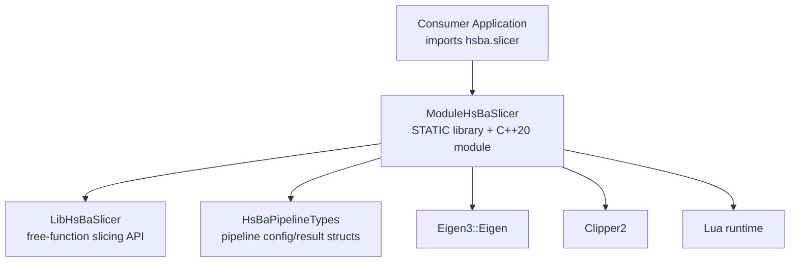
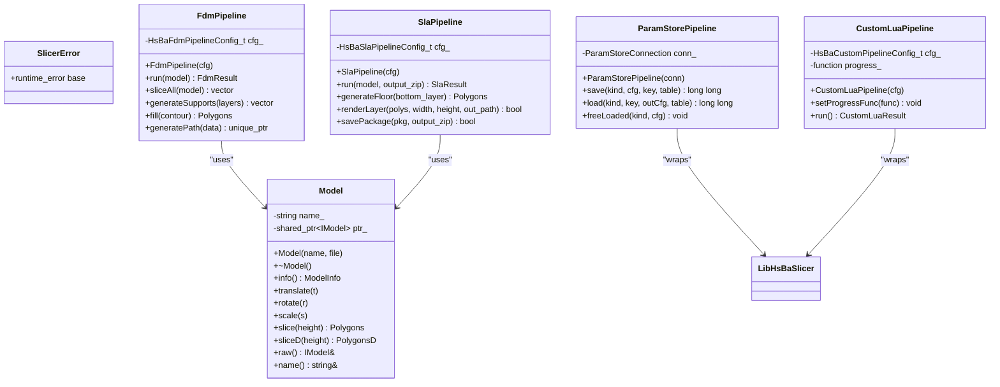
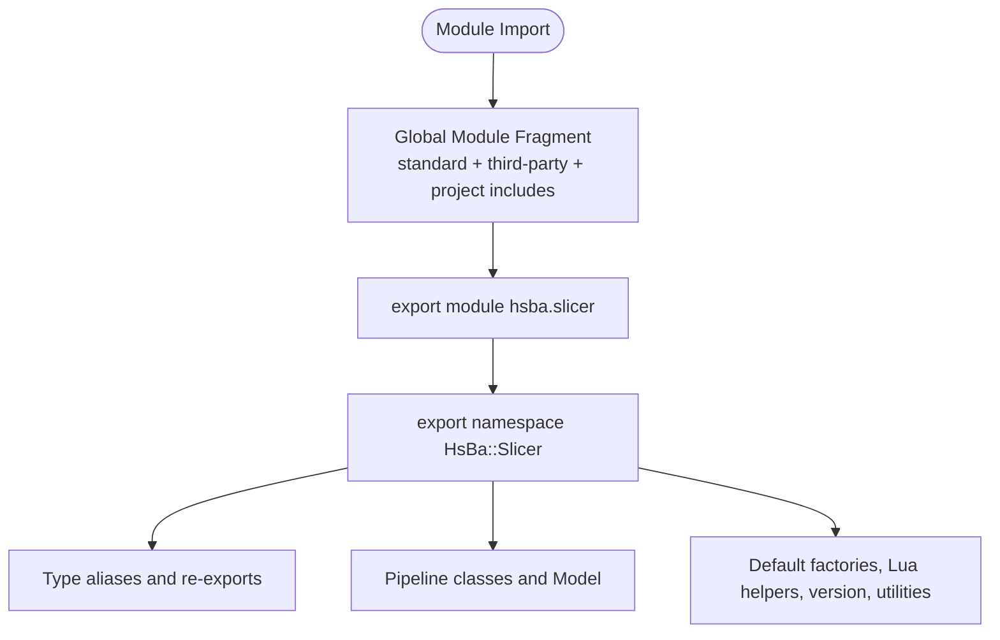
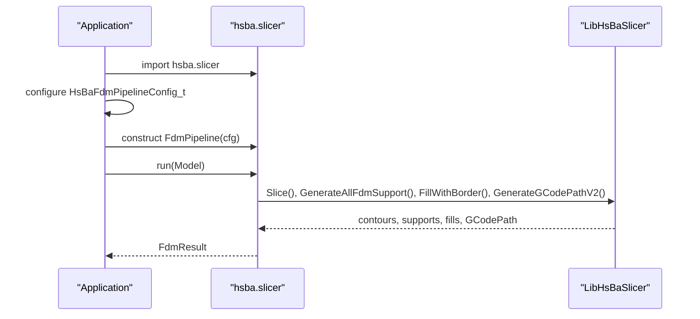
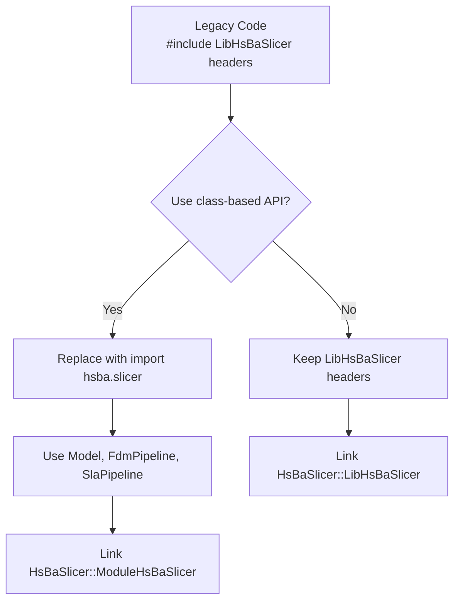
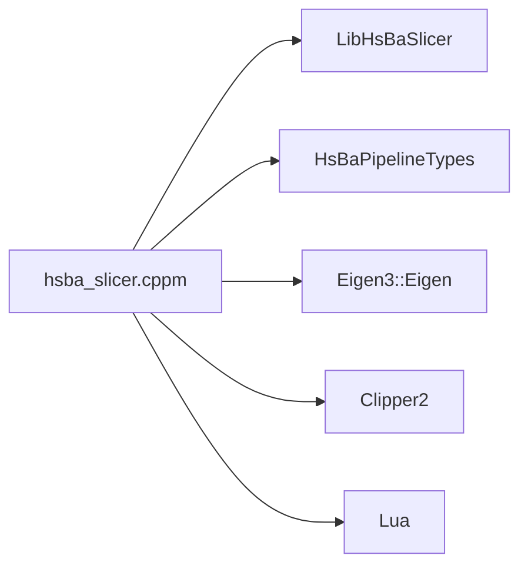

# C++20 Module API

<cite>
**Referenced Files in This Document**   
- [hsba_slicer.cppm](file://ModuleHsBaSlicer/hsba_slicer.cppm)
- [module_anchor.cpp](file://ModuleHsBaSlicer/module_anchor.cpp)
- [CMakeLists.txt (ModuleHsBaSlicer)](file://ModuleHsBaSlicer/CMakeLists.txt)
- [main_module.cpp](file://samples/LibHsBaSlicer/main_module.cpp)
- [cpp_cmake_usage.md](file://docs/en/cpp_cmake_usage.md)
- [CMakeLists.txt (root)](file://CMakeLists.txt)
</cite>

## Table of Contents
1. [Introduction](#introduction)
2. [Project Structure](#project-structure)
3. [Core Components](#core-components)
4. [Architecture Overview](#architecture-overview)
5. [Detailed Component Analysis](#detailed-component-analysis)
6. [Dependency Analysis](#dependency-analysis)
7. [Performance Considerations](#performance-considerations)
8. [Troubleshooting Guide](#troubleshooting-guide)
9. [Conclusion](#conclusion)
10. [Appendices](#appendices)

## Introduction
This document describes the HsBaSlicer C++20 module interface exposed by `ModuleHsBaSlicer`. The module provides a class-based, RAII-oriented C++ API over LibHsBaSlicer’s free-function slicing pipeline. Consumers import it with `import hsba.slicer;` and use types such as `Model`, `FdmPipeline`, `SlaPipeline`, `SlsPipeline`, `SlmPipeline`, `LomPipeline`, `TdpPipeline`, `WaamPipeline`, `FileTransferPipeline`, `ParamStorePipeline`, and `CustomLuaPipeline` inside the `HsBa::Slicer` namespace.

The module is implemented as a single-file interface unit: declarations and definitions live together in `hsba_slicer.cppm`. This design avoids MSVC C2572 errors caused by implicit standard library redefinition when separate implementation units are used.

## Project Structure
The module lives under `ModuleHsBaSlicer`:

| File | Responsibility |
|---|---|
| `hsba_slicer.cppm` | Declares and defines the exported `hsba.slicer` module interface and its implementation. |
| `module_anchor.cpp` | Empty translation unit that forces the archiver to produce `ModuleHsBaSlicer.lib`. |
| `CMakeLists.txt` | Defines the static library target, registers the C++20 module file set, links dependencies, and exports compiler flags required for BMI compatibility. |



**Diagram sources**
- [CMakeLists.txt (ModuleHsBaSlicer):12-29](file://ModuleHsBaSlicer/CMakeLists.txt#L12-L29)
- [hsba_slicer.cppm:37-65](file://ModuleHsBaSlicer/hsba_slicer.cppm#L37-L65)

**Section sources**
- [hsba_slicer.cppm:1-65](file://ModuleHsBaSlicer/hsba_slicer.cppm#L1-L65)
- [module_anchor.cpp:1-13](file://ModuleHsBaSlicer/module_anchor.cpp#L1-L13)
- [CMakeLists.txt (ModuleHsBaSlicer):1-46](file://ModuleHsBaSlicer/CMakeLists.txt#L1-L46)

## Core Components
The module exports one primary namespace: `HsBa::Slicer`. Its public surface includes:

| Category | Public Items | Purpose |
|---|---|---|
| Exception | `SlicerError` | Unified exception type for slicer failures. |
| Type aliases | `Point2`, `Polygon`, `Polygons`, `Point2D`, `PolygonD`, `PolygonsD` | Re-exported Clipper2 polygon types for convenience. |
| Config/result re-exports | `HsBa*PipelineConfig_t`, `HsBa*PipelineResult_t`, support configs | Re-exported from `pipelinetypes/pipeline_types.h` and support headers. |
| Default factories | `defaultFdmConfig()`, `defaultSlaConfig()`, `defaultSlsConfig()`, etc. | Create default pipeline configuration structs. |
| Model | `Model` | RAII model handle: load, transform, slice, query info, release. |
| FDM pipeline | `FdmPipeline`, `FdmResult` | Full FDM workflow: slice → support → fill → path → G-code. |
| SLA pipeline | `SlaPipeline`, `SlaResult` | Full SLA workflow: slice → support → floor → render → package. |
| Lua-driven pipelines | `SlsPipeline`, `SlmPipeline`, `LomPipeline`, `TdpPipeline`, `WaamPipeline` | Export workflows driven by Lua scripts or robot-path export. |
| File transfer | `FileTransferPipeline`, `FileTransferOutcome` | Validate → connect → transfer files with optional progress callback. |
| Parameter store | `ParamStoreKind`, `ParamStoreBackend`, `ParamStoreConnection`, `ParamStorePipeline` | Persist and reload process parameters via SQLite/MySQL/PostgreSQL. |
| Custom Lua pipeline | `CustomLuaPipeline`, `CustomLuaResult` | Fully Lua-defined workflow orchestrated through the global `HsBa` table. |
| Lua extension functions | `luaCustomFill`, `luaCustomFloor`, `luaCustomSupport` | Call custom Lua implementations for fill/floor/support. |
| External registration | `add2DFunction`, `add3DFunction`, `addFileFunction`, `addEventCallback`, `addZipperEventCallback`, `addDBEventCallback` | Register Lua functions and C++ event callbacks. |
| Version utilities | `versionJson`, `versionXml` | Return version information as JSON or XML. |
| Polygon utilities | `toDouble`, `toInt` | Convert between integer and double precision polygons. |

**Section sources**
- [hsba_slicer.cppm:67-540](file://ModuleHsBaSlicer/hsba_slicer.cppm#L67-L540)

## Architecture Overview
At runtime, the module acts as a thin C++ wrapper around LibHsBaSlicer. It does not reimplement slicing algorithms; instead, it composes existing free functions into higher-level classes and adds RAII, exceptions, and clearer ownership semantics.



**Diagram sources**
- [hsba_slicer.cppm:74-191](file://ModuleHsBaSlicer/hsba_slicer.cppm#L74-L191)
- [hsba_slicer.cppm:197-480](file://ModuleHsBaSlicer/hsba_slicer.cppm#L197-L480)
- [hsba_slicer.cppm:546-1241](file://ModuleHsBaSlicer/hsba_slicer.cppm#L546-L1241)

## Detailed Component Analysis

### Module Interface and Namespace Organization
The module declares `export module hsba.slicer;` and exports everything under `export namespace HsBa::Slicer`. The Global Module Fragment at the top includes standard libraries, third-party headers, and project headers without exporting them. Only the explicitly exported symbols become part of the module ABI.

Key organization points:
- Global fragment imports: filesystem, functional, memory, stdexcept, string, string_view, vector, Clipper2, Eigen, Lua, and internal LibHsBaSlicer headers.
- Re-exports: polygon types, pipeline config/result types, support configs, Lua function typedefs, and event callback typedefs.
- Public API: classes, structs, enums, and free functions grouped by feature area.



**Diagram sources**
- [hsba_slicer.cppm:10-65](file://ModuleHsBaSlicer/hsba_slicer.cppm#L10-L65)
- [hsba_slicer.cppm:67-128](file://ModuleHsBaSlicer/hsba_slicer.cppm#L67-L128)

**Section sources**
- [hsba_slicer.cppm:10-65](file://ModuleHsBaSlicer/hsba_slicer.cppm#L10-L65)
- [hsba_slicer.cppm:67-128](file://ModuleHsBaSlicer/hsba_slicer.cppm#L67-L128)

### Compile-Time Optimizations Provided by the Module System
The module system contributes compile-time benefits through module boundaries rather than algorithmic changes:

1. **Single-file module interface**: The interface and implementation are combined in `hsba_slicer.cppm`. This avoids MSVC C2572 errors caused by implicit standard library redefinition across multiple translation units.
2. **BMI consumption**: Consumers receive a compiled module binary interface (BMI), which can reduce repeated header parsing compared to traditional `#include` chains.
3. **Explicit dependency boundary**: The module clearly separates what consumers see (`HsBa::Slicer`) from internal LibHsBaSlicer calls.
4. **Compiler flag propagation**: The module target re-exports MSVC-specific flags (`/fp:strict`, `/fp:except-`, `_SCL_SECURE_NO_DEPRECATE`, `_SCL_SECURE_NO_WARNINGS`) so consumers importing the BMI do not mismatch CGAL-propagated settings.

These optimizations are architectural and build-system oriented; they improve build stability and consumer ergonomics more than raw runtime performance.

**Section sources**
- [hsba_slicer.cppm:1-9](file://ModuleHsBaSlicer/hsba_slicer.cppm#L1-L9)
- [CMakeLists.txt (ModuleHsBaSlicer):36-45](file://ModuleHsBaSlicer/CMakeLists.txt#L36-L45)

### How to Import and Use the Module
Consumers should:

1. Enable C++20 modules in their build system.
2. Link against `HsBaSlicer::ModuleHsBaSlicer`.
3. Use `import hsba.slicer;` before using `HsBa::Slicer`.
4. Include legacy headers only for types not exported by the module, such as `ModelInfo` and pipeline config structs.

Example usage is provided in the sample program:



**Diagram sources**
- [main_module.cpp:27-127](file://samples/LibHsBaSlicer/main_module.cpp#L27-L127)
- [hsba_slicer.cppm:604-751](file://ModuleHsBaSlicer/hsba_slicer.cppm#L604-L751)

**Section sources**
- [main_module.cpp:1-39](file://samples/LibHsBaSlicer/main_module.cpp#L1-L39)
- [main_module.cpp:45-127](file://samples/LibHsBaSlicer/main_module.cpp#L45-L127)
- [cpp_cmake_usage.md:155-219](file://docs/en/cpp_cmake_usage.md#L155-L219)

### Build System Configuration and Linking Requirements
The root CMake enables the module option by default:

- `HSBA_SLICER_MODULE` controls whether `ModuleHsBaSlicer` is built.
- If the toolchain supports C++20 modules, the project sets `HSBA_HAS_CXX_MODULES`.
- The module target is always STATIC and uses `FILE_SET hsba_slicer_modules TYPE CXX_MODULES`.
- It links PUBLIC against `LibHsBaSlicer`, `HsBaPipelineTypes`, `Eigen3::Eigen`, `PkgConfig::Clipper2`, and `${LUA_LIBRARIES}`.

Recommended consumer configuration:

```cmake
cmake_minimum_required(VERSION 3.28)
project(MyModuleApp LANGUAGES CXX)

set(CMAKE_CXX_STANDARD 20)
set(CMAKE_CXX_STANDARD_REQUIRED ON)

find_package(HsBaSlicer REQUIRED)

add_executable(my_app main.cpp)
target_link_libraries(my_app PRIVATE HsBaSlicer::ModuleHsBaSlicer)
```

**Section sources**
- [CMakeLists.txt (root):116-127](file://CMakeLists.txt#L116-L127)
- [CMakeLists.txt (ModuleHsBaSlicer):12-29](file://ModuleHsBaSlicer/CMakeLists.txt#L12-L29)
- [cpp_cmake_usage.md:155-173](file://docs/en/cpp_cmake_usage.md#L155-L173)

### Public Interface Summary

#### Exceptions and Error Handling
- `SlicerError` derives from `std::runtime_error`.
- Most pipeline methods throw `SlicerError` on failure.
- Consumers should catch `SlicerError` first, then fall back to `std::exception`.

#### Model
- `Model` wraps model loading and cleanup.
- Construction loads the model; destruction removes it.
- Supports transformation and slicing.

#### FDM Pipeline
- `FdmPipeline::run` performs slice → support → fill → path → G-code generation.
- `FdmResult` contains generated G-code and layer count.

#### SLA Pipeline
- `SlaPipeline::run` slices layers, generates supports, computes floor, packages images, and saves ZIP output.
- `SlaResult` reports whether saving succeeded and how many layers were produced.

#### Lua-Driven Pipelines
- `SlsPipeline`, `SlmPipeline`, `LomPipeline`, `TdpPipeline` require an export Lua script.
- `WaamPipeline` produces robot-program data.
- `CustomLuaPipeline` allows fully Lua-defined workflows with optional progress callbacks.

#### File Transfer Pipeline
- `FileTransferPipeline::run` validates configuration, connects, and transfers files.
- Optional progress callback returns percentage and stage information.

#### Parameter Store Pipeline
- Persists and loads `HsBa*PipelineConfig_t` structs by business key.
- Supports SQLite, MySQL, and PostgreSQL backends.
- `freeLoaded` releases heap strings allocated by the library after `load`.

#### Lua Extension and Event Registration
- `add2DFunction`, `add3DFunction`, `addFileFunction` register Lua functions.
- `addEventCallback` registers named events.
- `addZipperEventCallback`, `addDBEventCallback` register C++ event handlers.

#### Utilities
- `versionJson`, `versionXml` return version metadata.
- `toDouble`, `toInt` convert polygon precision.
- Default factory functions create default pipeline configurations.

**Section sources**
- [hsba_slicer.cppm:74-128](file://ModuleHsBaSlicer/hsba_slicer.cppm#L74-L128)
- [hsba_slicer.cppm:152-191](file://ModuleHsBaSlicer/hsba_slicer.cppm#L152-L191)
- [hsba_slicer.cppm:197-480](file://ModuleHsBaSlicer/hsba_slicer.cppm#L197-L480)
- [hsba_slicer.cppm:546-1241](file://ModuleHsBaSlicer/hsba_slicer.cppm#L546-L1241)

### Migration Guide from Legacy Include-Based Approaches
If your project currently uses LibHsBaSlicer through traditional headers, migration steps include:

1. Replace `#include` chains with `import hsba.slicer;`.
2. Use `HsBa::Slicer::Model` instead of manual model lifecycle management.
3. Replace free-function pipelines with `FdmPipeline`, `SlaPipeline`, or other pipeline classes.
4. Keep including `pipelinetypes/pipeline_types.h` and relevant preprocessing headers for types not exported by the module.
5. Link against `HsBaSlicer::ModuleHsBaSlicer` instead of `HsBaSlicer::LibHsBaSlicer` if you want the class-based API.

Migration example flow:



**Diagram sources**
- [cpp_cmake_usage.md:82-140](file://docs/en/cpp_cmake_usage.md#L82-L140)
- [cpp_cmake_usage.md:155-219](file://docs/en/cpp_cmake_usage.md#L155-L219)

**Section sources**
- [cpp_cmake_usage.md:82-140](file://docs/en/cpp_cmake_usage.md#L82-L140)
- [cpp_cmake_usage.md:155-219](file://docs/en/cpp_cmake_usage.md#L155-L219)
- [main_module.cpp:14-29](file://samples/LibHsBaSlicer/main_module.cpp#L14-L29)

## Dependency Analysis
The module depends on several layers:

| Dependency | Role | Visibility |
|---|---|---|
| LibHsBaSlicer | Core slicing, support, fill, path, floor, transfer, parameter store, Lua pipeline execution | Linked PUBLIC |
| HsBaPipelineTypes | Pipeline config/result struct definitions | Linked PUBLIC |
| Eigen3::Eigen | Vector and quaternion math | Linked PUBLIC |
| Clipper2 | Polygon geometry operations | Linked PUBLIC |
| Lua | Scripting integration | Linked PUBLIC |
| Standard library | STL containers, filesystem, exceptions, strings | Used in Global Module Fragment |



**Diagram sources**
- [hsba_slicer.cppm:37-65](file://ModuleHsBaSlicer/hsba_slicer.cppm#L37-L65)
- [CMakeLists.txt (ModuleHsBaSlicer):22-29](file://ModuleHsBaSlicer/CMakeLists.txt#L22-L29)

**Section sources**
- [hsba_slicer.cppm:37-65](file://ModuleHsBaSlicer/hsba_slicer.cppm#L37-L65)
- [CMakeLists.txt (ModuleHsBaSlicer):22-29](file://ModuleHsBaSlicer/CMakeLists.txt#L22-L29)

## Performance Considerations
The module itself is primarily a composition layer. Its performance characteristics come from:

1. **RAII model handling**: Reduces manual resource leaks and ensures deterministic cleanup.
2. **Reserve patterns**: Some pipeline stages reserve vectors based on layer counts to avoid reallocations.
3. **Module BMI**: May reduce header parsing overhead compared to large include trees, depending on compiler and build setup.
4. **Static module library**: Avoids DLL link-stage issues and keeps transitive dependencies explicit.

There is no evidence in the source that the module introduces additional runtime overhead beyond calling LibHsBaSlicer functions.

[No sources needed since this section provides general guidance]

## Troubleshooting Guide

### MSVC C2572: Implicit-Import std Redefinition
**Cause**: Separate implementation units or incorrect include/import ordering cause the BMI’s standard library declarations to conflict with re-included headers.

**Resolution**:
- Use the provided single-file module `hsba_slicer.cppm`.
- In MSVC consumers, place standard library `#include` directives before `import hsba.slicer;`.
- Ensure the module is built with the same compiler flags as consumers.

**Section sources**
- [hsba_slicer.cppm:1-9](file://ModuleHsBaSlicer/hsba_slicer.cppm#L1-L9)
- [main_module.cpp:14-25](file://samples/LibHsBaSlicer/main_module.cpp#L14-L25)
- [cpp_cmake_usage.md:312-332](file://docs/en/cpp_cmake_usage.md#L312-L332)

### MSVC C5050: Compiler Flag Mismatch
**Cause**: CGAL propagates `/fp:strict` and `_SCL_SECURE_NO_WARNINGS` via INTERFACE properties. If consumers do not inherit these flags, importing the BMI fails.

**Resolution**:
- Link against `HsBaSlicer::ModuleHsBaSlicer`, which re-exports the required flags as PUBLIC.
- Do not manually override conflicting floating-point or security warning flags.

**Section sources**
- [CMakeLists.txt (ModuleHsBaSlicer):36-45](file://ModuleHsBaSlicer/CMakeLists.txt#L36-L45)
- [cpp_cmake_usage.md:312-318](file://docs/en/cpp_cmake_usage.md#L312-L318)

### Missing Model File or Output Path
**Symptoms**: Sample program prints model-not-found messages or fails during pipeline execution.

**Resolution**:
- Place the test model in the expected directory.
- Verify `cfg.output_path` is writable.
- Catch `SlicerError` and inspect error messages.

**Section sources**
- [main_module.cpp:35-43](file://samples/LibHsBaSlicer/main_module.cpp#L35-L43)
- [main_module.cpp:129-138](file://samples/LibHsBaSlicer/main_module.cpp#L129-L138)

### Lua Pipeline Requires Script
**Symptoms**: SLS/SLM/LOM/TDP pipelines throw `SlicerError` indicating missing export Lua script.

**Resolution**:
- Set `export_lua_script` in the corresponding pipeline config.
- For `CustomLuaPipeline`, set `pipeline_lua_script` or `pipeline_lua_source`.

**Section sources**
- [hsba_slicer.cppm:864-867](file://ModuleHsBaSlicer/hsba_slicer.cppm#L864-L867)
- [hsba_slicer.cppm:897-899](file://ModuleHsBaSlicer/hsba_slicer.cppm#L897-L899)
- [hsba_slicer.cppm:927-929](file://ModuleHsBaSlicer/hsba_slicer.cppm#L927-L929)
- [hsba_slicer.cppm:957-959](file://ModuleHsBaSlicer/hsba_slicer.cppm#L957-L959)
- [hsba_slicer.cppm:1154-1155](file://ModuleHsBaSlicer/hsba_slicer.cppm#L1154-L1155)

### Parameter Store Heap Strings
**Symptoms**: Memory issues or undefined behavior after loading parameters.

**Resolution**:
- After calling `ParamStorePipeline::load`, use `freeLoaded` to release heap-allocated string fields.
- Treat loaded config structs as owned by the library until freed.

**Section sources**
- [hsba_slicer.cppm:433-441](file://ModuleHsBaSlicer/hsba_slicer.cppm#L433-L441)
- [hsba_slicer.cppm:1127-1139](file://ModuleHsBaSlicer/hsba_slicer.cppm#L1127-L1139)

## Conclusion
The HsBaSlicer C++20 module provides a clean, class-based entry point to the slicing pipeline. It improves ergonomics through RAII, exceptions, and explicit pipeline classes while remaining a thin wrapper over LibHsBaSlicer. For modern C++ projects with C++20 module support, `import hsba.slicer;` offers a stable, well-scoped interface. For legacy projects, migration is incremental: replace manual lifecycle code with `Model` and pipeline classes, keep necessary legacy includes for non-exported types, and switch linking to `HsBaSlicer::ModuleHsBaSlicer`.

[No sources needed since this section summarizes without analyzing specific files]

## Appendices

### A. Module Target Build Details
- Target: `ModuleHsBaSlicer`
- Type: STATIC
- Module file set: `hsba_slicer.cppm`
- Anchor TU: `module_anchor.cpp`
- Dependencies: `LibHsBaSlicer`, `HsBaPipelineTypes`, `Eigen3::Eigen`, `PkgConfig::Clipper2`, `${LUA_LIBRARIES}`

**Section sources**
- [CMakeLists.txt (ModuleHsBaSlicer):12-34](file://ModuleHsBaSlicer/CMakeLists.txt#L12-L34)
- [module_anchor.cpp:1-13](file://ModuleHsBaSlicer/module_anchor.cpp#L1-L13)

### B. Recommended Consumer CMake Pattern
```cmake
cmake_minimum_required(VERSION 3.28)
project(MyModuleApp LANGUAGES CXX)

set(CMAKE_CXX_STANDARD 20)
set(CMAKE_CXX_STANDARD_REQUIRED ON)

find_package(HsBaSlicer REQUIRED)

add_executable(my_app main.cpp)
target_link_libraries(my_app PRIVATE HsBaSlicer::ModuleHsBaSlicer)
```

**Section sources**
- [cpp_cmake_usage.md:155-173](file://docs/en/cpp_cmake_usage.md#L155-L173)

### C. Minimal Module Usage Flow
1. Include standard headers before `import`.
2. Import `hsba.slicer`.
3. Load a model with `Model`.
4. Configure a pipeline using default factories.
5. Run the pipeline and handle `SlicerError`.

**Section sources**
- [main_module.cpp:14-127](file://samples/LibHsBaSlicer/main_module.cpp#L14-L127)