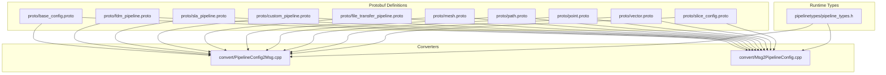
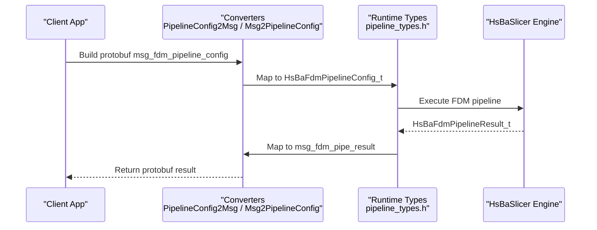
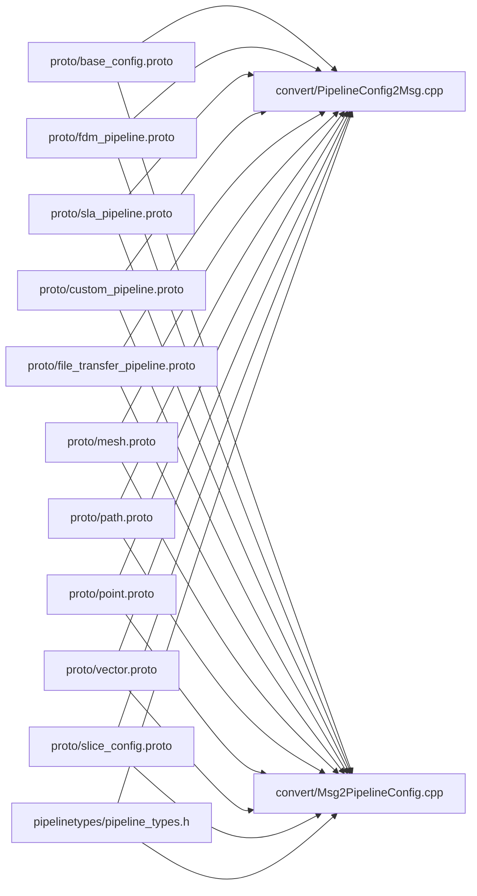

# Integration Protocols

<cite>
**Referenced Files in This Document**
- [base_config.proto](file://proto/base_config.proto)
- [custom_pipeline.proto](file://proto/custom_pipeline.proto)
- [fdm_pipeline.proto](file://proto/fdm_pipeline.proto)
- [sla_pipeline.proto](file://proto/sla_pipeline.proto)
- [file_transfer_pipeline.proto](file://proto/file_transfer_pipeline.proto)
- [mesh.proto](file://proto/mesh.proto)
- [path.proto](file://proto/path.proto)
- [point.proto](file://proto/point.proto)
- [vector.proto](file://proto/vector.proto)
- [slice_config.proto](file://proto/slice_config.proto)
- [PipelineConfig2Msg.cpp](file://convert/PipelineConfig2Msg.cpp)
- [Msg2PipelineConfig.cpp](file://convert/Msg2PipelineConfig.cpp)
- [pipeline_types.h](file://pipelinetypes/pipeline_types.h)
- [IModel.hpp](file://base/IModel.hpp)
- [base_interface.hpp](file://base/base_interface.hpp)
</cite>

## Table of Contents
1. [Introduction](#introduction)
2. [Project Structure](#project-structure)
3. [Core Components](#core-components)
4. [Architecture Overview](#architecture-overview)
5. [Detailed Component Analysis](#detailed-component-analysis)
6. [Dependency Analysis](#dependency-analysis)
7. [Performance Considerations](#performance-considerations)
8. [Troubleshooting Guide](#troubleshooting-guide)
9. [Conclusion](#conclusion)

## Introduction
This document describes the integration protocols used by HsBaSlicer, focusing on:
- Protobuf message formats for pipeline configuration and results across technologies (FDM, SLA, SLS, SLM, LOM, 3DP/WAAM), plus base types and geometry primitives.
- Serialization/deserialization between C/C++ pipeline config/result structures and protobuf messages.
- Base interface contracts that enable extensibility and plugin-style behavior.
- Inter-process communication patterns via file transfer pipelines and Lua-driven custom pipelines.
- Versioning, compatibility, validation, error handling, security considerations, and performance optimization strategies for large data transfers.

## Project Structure
The protocol surface is defined in the proto directory and consumed by converters under convert/. The canonical runtime types are exposed as C-compatible structs in pipelinetypes/pipeline_types.h. Geometry primitives and slice configuration are also defined in proto files.

**Diagram sources**
- [base_config.proto:1-132](file://proto/base_config.proto#L1-L132)
- [fdm_pipeline.proto:1-81](file://proto/fdm_pipeline.proto#L1-L81)
- [sla_pipeline.proto:1-67](file://proto/sla_pipeline.proto#L1-L67)
- [custom_pipeline.proto:1-31](file://proto/custom_pipeline.proto#L1-L31)
- [file_transfer_pipeline.proto:1-21](file://proto/file_transfer_pipeline.proto#L1-L21)
- [mesh.proto:1-31](file://proto/mesh.proto#L1-L31)
- [path.proto:1-15](file://proto/path.proto#L1-L15)
- [point.proto:1-16](file://proto/point.proto#L1-L16)
- [vector.proto:1-24](file://proto/vector.proto#L1-L24)
- [slice_config.proto:1-27](file://proto/slice_config.proto#L1-L27)
- [PipelineConfig2Msg.cpp:1-405](file://convert/PipelineConfig2Msg.cpp#L1-L405)
- [Msg2PipelineConfig.cpp:1-382](file://convert/Msg2PipelineConfig.cpp#L1-L382)
- [pipeline_types.h:1-800](file://pipelinetypes/pipeline_types.h#L1-L800)

**Section sources**
- [base_config.proto:1-132](file://proto/base_config.proto#L1-L132)
- [fdm_pipeline.proto:1-81](file://proto/fdm_pipeline.proto#L1-L81)
- [sla_pipeline.proto:1-67](file://proto/sla_pipeline.proto#L1-L67)
- [custom_pipeline.proto:1-31](file://proto/custom_pipeline.proto#L1-L31)
- [file_transfer_pipeline.proto:1-21](file://proto/file_transfer_pipeline.proto#L1-L21)
- [mesh.proto:1-31](file://proto/mesh.proto#L1-L31)
- [path.proto:1-15](file://proto/path.proto#L1-L15)
- [point.proto:1-16](file://proto/point.proto#L1-L16)
- [vector.proto:1-24](file://proto/vector.proto#L1-L24)
- [slice_config.proto:1-27](file://proto/slice_config.proto#L1-L27)
- [PipelineConfig2Msg.cpp:1-405](file://convert/PipelineConfig2Msg.cpp#L1-L405)
- [Msg2PipelineConfig.cpp:1-382](file://convert/Msg2PipelineConfig.cpp#L1-L382)
- [pipeline_types.h:1-800](file://pipelinetypes/pipeline_types.h#L1-L800)

## Core Components
- Protocol buffers define the wire format for all pipeline configurations and results.
- Converters implement bidirectional mapping between protobuf messages and C-compatible pipeline config/result structures.
- Runtime types provide a stable ABI for external integrators and language bindings.

Key responsibilities:
- PipelineConfig: per-technology configuration messages (FDM, SLA, SLS, SLM, LOM, 3DP/TDP, WAAM, File Transfer, Custom).
- MeshData: STL/trimesh representations for geometry exchange.
- LayerData: represented through path and slice configuration messages.
- PathData: 2D/3D path definitions for toolpaths or robot programs.

**Section sources**
- [pipeline_types.h:1-800](file://pipelinetypes/pipeline_types.h#L1-L800)
- [PipelineConfig2Msg.cpp:1-405](file://convert/PipelineConfig2Msg.cpp#L1-L405)
- [Msg2PipelineConfig.cpp:1-382](file://convert/Msg2PipelineConfig.cpp#L1-L382)

## Architecture Overview
The integration architecture separates three layers:
- Wire Format: Protobuf schemas in proto/.
- Conversion Layer: Converters in convert/ that map to/from C ABI types.
- Runtime API: Stable C ABI types in pipelinetypes/pipeline_types.h.

**Diagram sources**
- [PipelineConfig2Msg.cpp:10-74](file://convert/PipelineConfig2Msg.cpp#L10-L74)
- [Msg2PipelineConfig.cpp:31-88](file://convert/Msg2PipelineConfig.cpp#L31-L88)
- [pipeline_types.h:53-127](file://pipelinetypes/pipeline_types.h#L53-L127)

## Detailed Component Analysis

### Protobuf Message Formats

#### Base Configuration and Enums
- base_config.proto defines shared enums for technology type, support type, materials, light sources, output types, and profile formats. It also includes a base configuration message with version, technology, profiles format, output type, and output filename.

Use cases:
- Selecting the target manufacturing technology and output format.
- Communicating profile serialization format (JSON/XML/INI/YAML).

**Section sources**
- [base_config.proto:1-132](file://proto/base_config.proto#L1-L132)

#### FDM Pipeline Config and Result
- fdm_pipeline.proto defines fill modes, support patterns, firmware targets, and the full FDM pipeline configuration and result messages.

Highlights:
- Fill spacing, angle, wall counts, top/bottom layer counts.
- Support enablement, overhang angle, gap, diameter, density, pattern, interface layers/density.
- Path parameters: line width, print speed, travel speed, extrusion multiplier.
- Firmware-specific G-code settings: nozzle diameter, filament diameter, temperatures, retraction, first layer speed.
- Optional Lua scripts/functions for support and infill customization.
- Spiral mode flag for vase printing.

**Section sources**
- [fdm_pipeline.proto:1-81](file://proto/fdm_pipeline.proto#L1-L81)

#### SLA Pipeline Config and Result
- sla_pipeline.proto defines support patterns, image types, and SLA configuration/result messages.

Highlights:
- Exposure times, lift distances/speeds, retract speed.
- Floor/raft parameters: offset, border width/count, fill spacing/angle, convex hull option.
- Support parameters similar to FDM but SLA-specific patterns.
- Optional Lua scripts/functions for support, floor, and export stages.
- Output image format and dimensions.

**Section sources**
- [sla_pipeline.proto:1-67](file://proto/sla_pipeline.proto#L1-L67)

#### Custom Pipeline Config and Result
- custom_pipeline.proto defines a minimal configuration for fully Lua-driven pipelines, including script/source paths, entry function name, free-form JSON config, model metadata, and default output path. Results include success, total layers, output path, returned string, error message, and elapsed time.

**Section sources**
- [custom_pipeline.proto:1-31](file://proto/custom_pipeline.proto#L1-L31)

#### File Transfer Pipeline Config and Result
- file_transfer_pipeline.proto defines host/port, connection pool size, list of file paths, and result fields indicating transferred count, total count, error message, and elapsed time.

**Section sources**
- [file_transfer_pipeline.proto:1-21](file://proto/file_transfer_pipeline.proto#L1-L21)

#### Geometry Primitives and Mesh Data
- point.proto and vector.proto define 2D/3D points and vectors.
- mesh.proto defines STL trimesh representation and a topological trimesh with indexed vertices.

Usage:
- Transporting triangle meshes and normals.
- Supporting downstream slicing and path generation.

**Section sources**
- [point.proto:1-16](file://proto/point.proto#L1-L16)
- [vector.proto:1-24](file://proto/vector.proto#L1-L24)
- [mesh.proto:1-31](file://proto/mesh.proto#L1-L31)

#### Path Data
- path.proto defines 2D and 3D path messages composed of repeated points.

Usage:
- Representing toolpaths, robot trajectories, or layer outlines.

**Section sources**
- [path.proto:1-15](file://proto/path.proto#L1-L15)

#### Slice Configuration
- slice_config.proto defines slice types (same height, different heights, curved, ring, none), slice height, diff string encoding, ring radius/center/normal, and curved surface path reference.

Usage:
- Describing non-uniform slicing strategies and curved surfaces.

**Section sources**
- [slice_config.proto:1-27](file://proto/slice_config.proto#L1-L27)

### Serialization and Deserialization Processes

#### From C/C++ Config to Protobuf
- PipelineConfig2Msg.cpp implements functions to populate protobuf messages from C-compatible config structs for each technology (FDM, SLA, SLS, SLM, LOM, TDP, WAAM, File Transfer, Custom).
- Mapping includes direct numeric assignments, enum casts, optional string fields, and boolean flags.

Patterns:
- Safe null checks before setting optional strings.
- Enum casting between C ABI enums and protobuf enums.
- Repeated fields populated via loops (e.g., file paths).

**Section sources**
- [PipelineConfig2Msg.cpp:10-74](file://convert/PipelineConfig2Msg.cpp#L10-L74)
- [PipelineConfig2Msg.cpp:76-136](file://convert/PipelineConfig2Msg.cpp#L76-L136)
- [PipelineConfig2Msg.cpp:138-172](file://convert/PipelineConfig2Msg.cpp#L138-L172)
- [PipelineConfig2Msg.cpp:174-200](file://convert/PipelineConfig2Msg.cpp#L174-L200)
- [PipelineConfig2Msg.cpp:202-233](file://convert/PipelineConfig2Msg.cpp#L202-L233)
- [PipelineConfig2Msg.cpp:235-273](file://convert/PipelineConfig2Msg.cpp#L235-L273)
- [PipelineConfig2Msg.cpp:275-314](file://convert/PipelineConfig2Msg.cpp#L275-L314)
- [PipelineConfig2Msg.cpp:316-354](file://convert/PipelineConfig2Msg.cpp#L316-L354)
- [PipelineConfig2Msg.cpp:356-402](file://convert/PipelineConfig2Msg.cpp#L356-L402)

#### From Protobuf to C/C++ Config
- Msg2PipelineConfig.cpp implements reverse mappings, initializing defaults and duplicating strings into malloc’d memory for ownership semantics.
- Boolean flags are converted to integer flags where required by the C ABI.
- Arrays of strings (e.g., file paths) are allocated and copied element-wise.

Patterns:
- Default initialization using inline default constructors for each config struct.
- Duplication helper for safe string copying.
- Consistent field-by-field mapping mirroring forward conversion.

**Section sources**
- [Msg2PipelineConfig.cpp:17-27](file://convert/Msg2PipelineConfig.cpp#L17-L27)
- [Msg2PipelineConfig.cpp:31-88](file://convert/Msg2PipelineConfig.cpp#L31-L88)
- [Msg2PipelineConfig.cpp:90-141](file://convert/Msg2PipelineConfig.cpp#L90-L141)
- [Msg2PipelineConfig.cpp:143-172](file://convert/Msg2PipelineConfig.cpp#L143-L172)
- [Msg2PipelineConfig.cpp:174-204](file://convert/Msg2PipelineConfig.cpp#L174-L204)
- [Msg2PipelineConfig.cpp:206-230](file://convert/Msg2PipelineConfig.cpp#L206-L230)
- [Msg2PipelineConfig.cpp:232-265](file://convert/Msg2PipelineConfig.cpp#L232-L265)
- [Msg2PipelineConfig.cpp:267-301](file://convert/Msg2PipelineConfig.cpp#L267-L301)
- [Msg2PipelineConfig.cpp:303-336](file://convert/Msg2PipelineConfig.cpp#L303-L336)
- [Msg2PipelineConfig.cpp:338-379](file://convert/Msg2PipelineConfig.cpp#L338-L379)

### Base Interface Contracts and Extensibility

#### IModel Interface
- IModel.hpp defines an abstract interface for 3D models supporting load/save, transformations (translate, rotate, scale, transform), bounding box, volume, and triangle mesh extraction.
- Also exposes C-compatible geometric types for interop.

Extensibility:
- Implementations can plug in various backends (e.g., CAD, mesh, point cloud) while preserving a uniform API.

**Section sources**
- [IModel.hpp:1-151](file://base/IModel.hpp#L1-L151)

#### Translator Interface
- base_interface.hpp defines a generic translator interface for converting between a type and its string representation.

Use cases:
- Pluggable serialization formats or domain-specific conversions.

**Section sources**
- [base_interface.hpp:1-28](file://base/base_interface.hpp#L1-L28)

### Inter-Process Communication and Data Streaming

#### File Transfer Pipeline
- file_transfer_pipeline.proto defines remote host/port, connection pool size, and file paths to transfer.
- The converter maps these to/from the C ABI structure, which uses a connection pool to send files to a remote service.

Considerations:
- Validate host/port and ensure pool size within supported range.
- Handle partial transfer results and propagate errors.

**Section sources**
- [file_transfer_pipeline.proto:1-21](file://proto/file_transfer_pipeline.proto#L1-L21)
- [pipeline_types.h:631-674](file://pipelinetypes/pipeline_types.h#L631-L674)
- [PipelineConfig2Msg.cpp:174-200](file://convert/PipelineConfig2Msg.cpp#L174-L200)
- [Msg2PipelineConfig.cpp:174-204](file://convert/Msg2PipelineConfig.cpp#L174-L204)

#### Custom Lua Pipeline
- custom_pipeline.proto provides a lightweight configuration for fully Lua-driven workflows.
- The engine exposes building blocks to Lua; the script controls stage order and content.

Security:
- Treat Lua source/script paths as untrusted input; sandbox execution and restrict filesystem access.

**Section sources**
- [custom_pipeline.proto:1-31](file://proto/custom_pipeline.proto#L1-L31)

### Version Compatibility Matrix

- base_config.proto includes a version field in the base configuration message. Consumers should check this field to determine protocol compatibility.
- For backward compatibility:
  - New fields should be added at the end of messages.
  - Existing fields must not change meaning or type.
  - Enumerations should be extended carefully; unknown values should be handled gracefully.

Recommended matrix:
- Protocol version N: All current proto messages as defined.
- Downstream clients must accept unknown fields and ignore them when parsing older messages.

**Section sources**
- [base_config.proto:125-132](file://proto/base_config.proto#L125-L132)

### Examples of Custom Protocol Implementations

- To add a new technology:
  - Define enums and messages in a new proto file under proto/.
  - Add corresponding C ABI structs and defaults in pipelinetypes/pipeline_types.h.
  - Implement forward and reverse converters in convert/PipelineConfig2Msg.cpp and convert/Msg2PipelineConfig.cpp.
  - Ensure enum casts are consistent and handle unknown values.

- Example flow for FDM:
  - Build msg_fdm_pipeline_config.
  - Convert to HsBaFdmPipelineConfig_t.
  - Run pipeline and obtain HsBaFdmPipelineResult_t.
  - Convert result to msg_fdm_pipe_result.

**Section sources**
- [fdm_pipeline.proto:1-81](file://proto/fdm_pipeline.proto#L1-L81)
- [pipeline_types.h:53-127](file://pipelinetypes/pipeline_types.h#L53-L127)
- [PipelineConfig2Msg.cpp:10-74](file://convert/PipelineConfig2Msg.cpp#L10-L74)
- [Msg2PipelineConfig.cpp:31-88](file://convert/Msg2PipelineConfig.cpp#L31-L88)

### Migration Strategies for Protocol Updates

- Adding fields:
  - Append new fields with new tag numbers.
  - Provide defaults in converters if needed.
- Changing enums:
  - Add new values; preserve existing ones.
  - In converters, map unknown values to a safe default or log a warning.
- Deprecation:
  - Mark fields as deprecated in comments; do not remove until major version bump.
- Testing:
  - Maintain round-trip tests for config/result pairs.
  - Validate that old clients can parse new messages and vice versa.

**Section sources**
- [PipelineConfig2Msg.cpp:10-74](file://convert/PipelineConfig2Msg.cpp#L10-L74)
- [Msg2PipelineConfig.cpp:31-88](file://convert/Msg2PipelineConfig.cpp#L31-L88)

### Performance Optimization Techniques for Large Data Transfers

- Use streaming where possible:
  - For large meshes or G-code content, consider chunked transfer or temporary files referenced by paths rather than embedding large strings in messages.
- Minimize allocations:
  - Reuse buffers in converters when processing repeated fields.
- Compression:
  - Compress large payloads (e.g., G-code or mesh data) before transmission; decompress on the other side.
- Connection pooling:
  - Tune pool_size for file transfer pipelines based on network bandwidth and latency.
- Parallelism:
  - Process multiple files concurrently within the pool limits.

[No sources needed since this section provides general guidance]

## Dependency Analysis

**Diagram sources**
- [base_config.proto:1-132](file://proto/base_config.proto#L1-L132)
- [fdm_pipeline.proto:1-81](file://proto/fdm_pipeline.proto#L1-L81)
- [sla_pipeline.proto:1-67](file://proto/sla_pipeline.proto#L1-L67)
- [custom_pipeline.proto:1-31](file://proto/custom_pipeline.proto#L1-L31)
- [file_transfer_pipeline.proto:1-21](file://proto/file_transfer_pipeline.proto#L1-L21)
- [mesh.proto:1-31](file://proto/mesh.proto#L1-L31)
- [path.proto:1-15](file://proto/path.proto#L1-L15)
- [point.proto:1-16](file://proto/point.proto#L1-L16)
- [vector.proto:1-24](file://proto/vector.proto#L1-L24)
- [slice_config.proto:1-27](file://proto/slice_config.proto#L1-L27)
- [PipelineConfig2Msg.cpp:1-405](file://convert/PipelineConfig2Msg.cpp#L1-L405)
- [Msg2PipelineConfig.cpp:1-382](file://convert/Msg2PipelineConfig.cpp#L1-L382)
- [pipeline_types.h:1-800](file://pipelinetypes/pipeline_types.h#L1-L800)

**Section sources**
- [PipelineConfig2Msg.cpp:1-405](file://convert/PipelineConfig2Msg.cpp#L1-L405)
- [Msg2PipelineConfig.cpp:1-382](file://convert/Msg2PipelineConfig.cpp#L1-L382)
- [pipeline_types.h:1-800](file://pipelinetypes/pipeline_types.h#L1-L800)

## Performance Considerations
- Prefer path-based references for large outputs (G-code, images, zips) instead of embedding content in protobuf strings.
- Use appropriate buffer sizes and avoid unnecessary string copies in converters.
- Tune file transfer pool size and concurrency based on system resources.
- Consider compression for large payloads to reduce bandwidth usage.

[No sources needed since this section provides general guidance]

## Troubleshooting Guide

Common issues and resolutions:
- Unknown enum values:
  - Ensure converters handle unknown enum values safely and map to defaults or log warnings.
- Memory leaks:
  - Converters allocate duplicated strings; callers must free allocated memory according to the C ABI contract.
- Partial file transfers:
  - Inspect result fields for transferred vs. total files and error messages.
- Invalid configuration:
  - Validate required fields (e.g., host/port for file transfer, model_path for pipelines) before invoking the engine.

Error handling patterns:
- Results include success flags, error_message strings, and elapsed_seconds for diagnostics.
- Propagate detailed error messages from lower layers to callers.

**Section sources**
- [PipelineConfig2Msg.cpp:65-74](file://convert/PipelineConfig2Msg.cpp#L65-L74)
- [Msg2PipelineConfig.cpp:81-88](file://convert/Msg2PipelineConfig.cpp#L81-L88)
- [file_transfer_pipeline.proto:13-20](file://proto/file_transfer_pipeline.proto#L13-L20)

## Conclusion
HsBaSlicer’s integration protocols are centered around well-defined protobuf messages and robust converters that bridge to a stable C ABI. This design enables extensible, cross-language integrations with clear separation between wire format, conversion logic, and runtime types. By following the migration strategies, validation rules, and performance recommendations outlined here, developers can extend the system safely and efficiently while maintaining compatibility across versions.