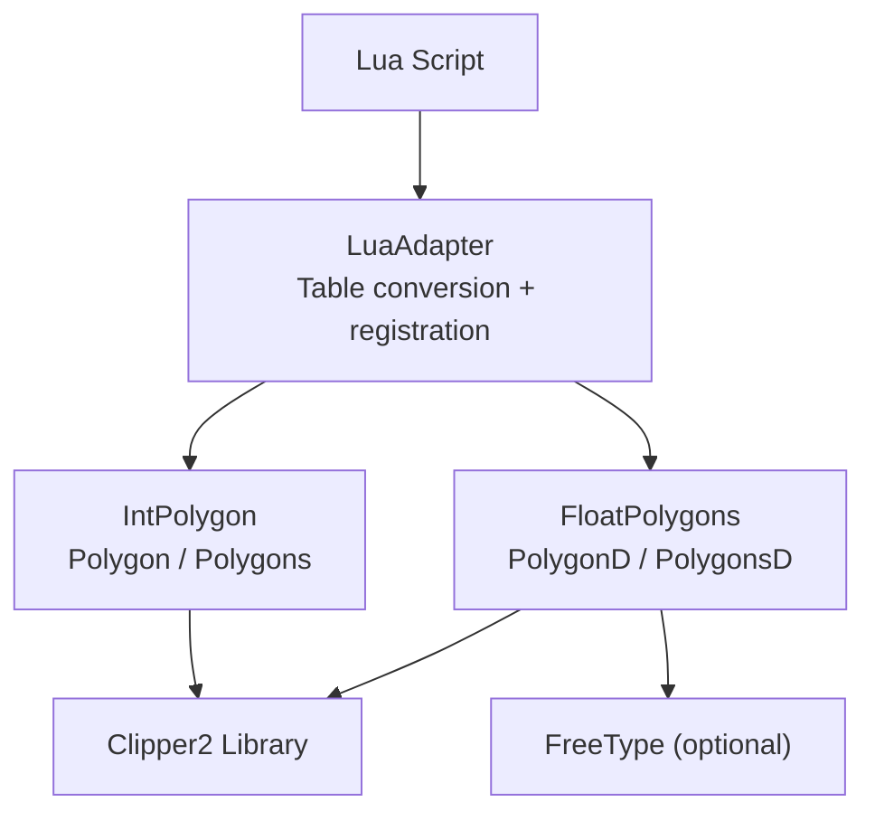
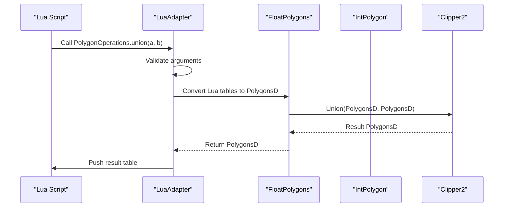
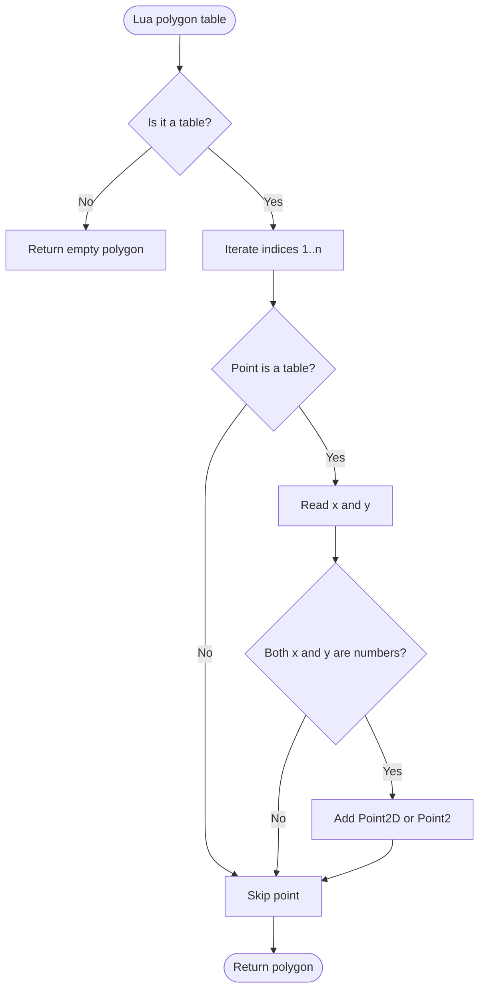
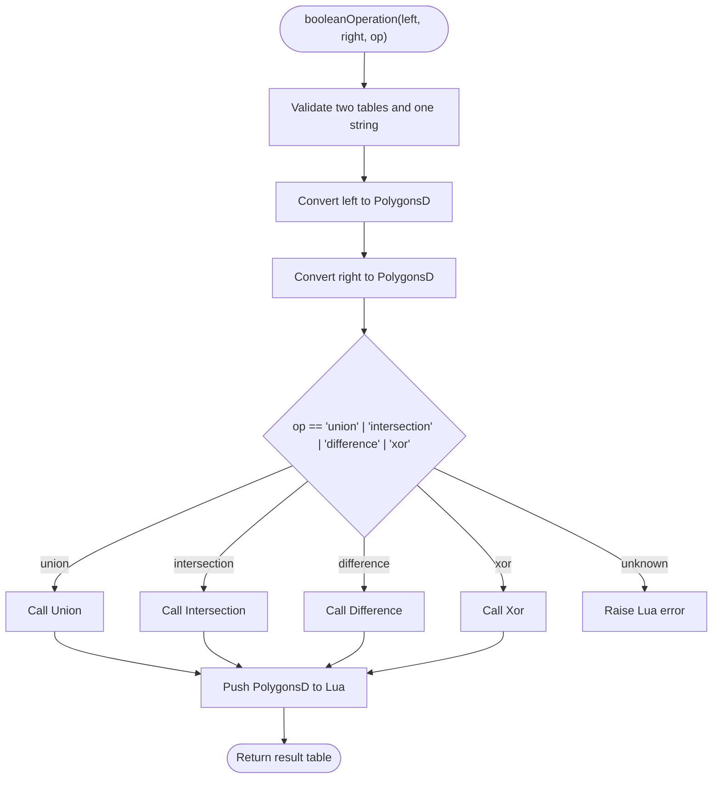
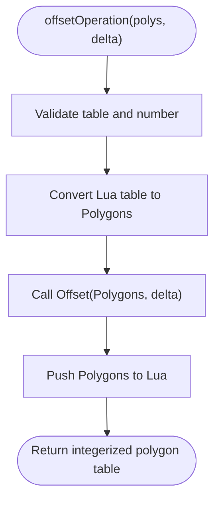
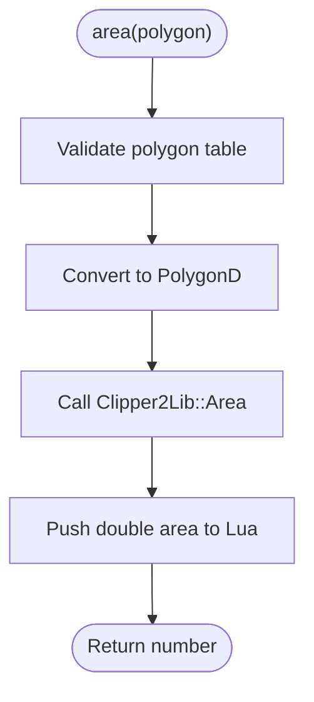
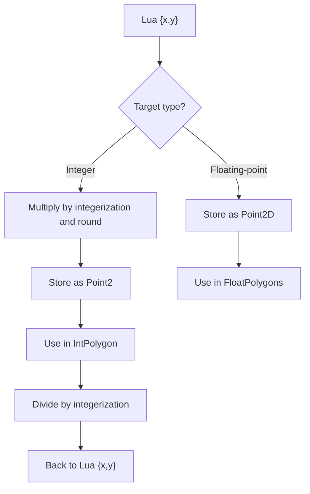
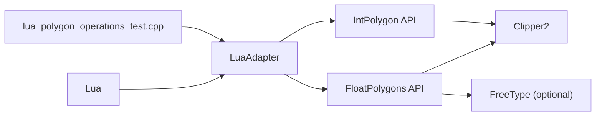

# 2D Geometry API / 2D几何API

<cite>
**Referenced Files in This Document**   
- [LuaAdapter.hpp](file://2D/LuaAdapter.hpp)
- [LuaAdapter.cpp](file://2D/LuaAdapter.cpp)
- [FloatPolygons.hpp](file://2D/FloatPolygons.hpp)
- [FloatPolygons.cpp](file://2D/FloatPolygons.cpp)
- [IntPolygon.hpp](file://2D/IntPolygon.hpp)
- [IntPolygon.cpp](file://2D/IntPolygon.cpp)
- [lua_pipeline_api.md](file://docs/en/lua_pipeline_api.md)
- [lua_polygon_operations_test.cpp](file://tests/PolygonFill/lua_polygon_operations_test.cpp)
</cite>

## Table of Contents
1. [Introduction](#introduction)
2. [Project Structure](#project-structure)
3. [Core Components](#core-components)
4. [Architecture Overview](#architecture-overview)
5. [Detailed Component Analysis](#detailed-component-analysis)
6. [Dependency Analysis](#dependency-analysis)
7. [Performance Considerations](#performance-considerations)
8. [Troubleshooting Guide](#troubleshooting-guide)
9. [Conclusion](#conclusion)
10. [Appendices](#appendices)

## Introduction
This document describes the 2D geometry Lua API exposed through `LuaAdapter`. It focuses on polygon data structures, boolean operations, offset calculations, simplification, area computation, shape generation, and coordinate conversion between floating-point and integer systems. The documentation is grounded in the actual C++ implementation and test usage so that both script authors and integrators can reason about behavior, performance, and error handling.

The Lua surface is centered on a global table named `PolygonOperations`. Scripts pass polygons as Lua tables containing ordered point tables with numeric `x` and `y` fields. Integer-coordinate functions use an internal scaling factor to convert between double-precision coordinates and 64-bit integer coordinates used by the underlying Clipper2 library.

## Project Structure
The 2D geometry subsystem is organized into three main layers:

- **Lua binding layer**: Converts Lua tables to C++ polygon types and registers the `PolygonOperations` table.
- **Double-precision polygon layer**: Provides `Point2D`, `PolygonD`, `PolygonsD`, boolean operations, area, simplification, shape generators, text-to-polygons, and integerization helpers.
- **Integer-coordinate polygon layer**: Provides `Point2`, `Polygon`, `Polygons`, boolean operations, offset, point-in-polygon, simplification, normalization, and hashing utilities.



**Diagram sources**
- [LuaAdapter.cpp:311-329](file://2D/LuaAdapter.cpp#L311-L329)
- [FloatPolygons.hpp:18-26](file://2D/FloatPolygons.hpp#L18-L26)
- [IntPolygon.hpp:16-26](file://2D/IntPolygon.hpp#L16-L26)
- [FloatPolygons.cpp:17-21](file://2D/FloatPolygons.cpp#L17-L21)

**Section sources**
- [LuaAdapter.hpp:1-84](file://2D/LuaAdapter.hpp#L1-L84)
- [LuaAdapter.cpp:1-493](file://2D/LuaAdapter.cpp#L1-L493)
- [FloatPolygons.hpp:1-271](file://2D/FloatPolygons.hpp#L1-L271)
- [IntPolygon.hpp:1-241](file://2D/IntPolygon.hpp#L1-L241)

## Core Components
The core components are:

| Component | Responsibility | Key Types or Functions |
|---|---|---|
| `LuaAdapter` | Converts between Lua tables and C++ polygon types; registers `PolygonOperations` | `PushPolygonToLua`, `PushPolygonsToLua`, `LuaTableToPolygon`, `LuaTableToPolygons`, `RegisterLuaPolygonOperations` |
| `FloatPolygons` | Double-precision polygon operations, shape/text generation, integerization | `MakeSimple`, `Union`, `Intersection`, `Difference`, `Xor`, `Area`, `MakeRectangle`, `MakeCircle`, `MakeEllipse`, `MakeRegularPolygon`, `TextToPolygons`, `Integerization`, `UnIntegerization` |
| `IntPolygon` | Integer-coordinate polygon operations, offset, point-in-polygon, normalization | `MakeSimple`, `Union`, `Intersection`, `Difference`, `Xor`, `Offset`, `PointInPolygons`, `Area`, `MakeSimpleAndSplit`, `NormalizeToSimplePolygons` |

**Section sources**
- [LuaAdapter.hpp:16-81](file://2D/LuaAdapter.hpp#L16-L81)
- [FloatPolygons.hpp:27-221](file://2D/FloatPolygons.hpp#L27-L221)
- [IntPolygon.hpp:28-192](file://2D/IntPolygon.hpp#L28-L192)

## Architecture Overview
The Lua API exposes geometric operations through a single namespace-like table. Each Lua function validates arguments, converts input tables to C++ polygon types, calls the appropriate algorithm, and pushes results back to Lua.



**Diagram sources**
- [LuaAdapter.cpp:56-66](file://2D/LuaAdapter.cpp#L56-L66)
- [FloatPolygons.cpp:34-37](file://2D/FloatPolygons.cpp#L34-L37)

**Section sources**
- [LuaAdapter.cpp:22-54](file://2D/LuaAdapter.cpp#L22-L54)
- [lua_pipeline_api.md:140-155](file://docs/en/lua_pipeline_api.md#L140-L155)

## Detailed Component Analysis

### Lua Polygon Data Model
A polygon in Lua is represented as an ordered table of point tables. Each point table has numeric `x` and `y` fields. A set of polygons is a table of polygon tables.

- Floating-point polygon: `PolygonD` maps to a Lua table of `{x, y}` points.
- Integer polygon: `Polygon` maps to a Lua table of `{x, y}` points, but internally uses 64-bit integers scaled by `integerization`.



**Diagram sources**
- [LuaAdapter.cpp:386-412](file://2D/LuaAdapter.cpp#L386-L412)
- [LuaAdapter.cpp:437-464](file://2D/LuaAdapter.cpp#L437-L464)

**Section sources**
- [LuaAdapter.cpp:332-382](file://2D/LuaAdapter.cpp#L332-L382)
- [LuaAdapter.cpp:386-485](file://2D/LuaAdapter.cpp#L386-L485)

### Boolean Operations
The Lua API provides both generic and dedicated boolean operations for `PolygonsD`:

| Lua Function | Input | Output | Behavior |
|---|---|---|---|
| `booleanOperation(left, right, op)` | Two polygon tables, one operation string | Polygon table | Dispatches to union, intersection, difference, or xor |
| `union(left, right)` | Two polygon tables | Polygon table | Computes union |
| `intersection(left, right)` | Two polygon tables | Polygon table | Computes intersection |
| `difference(left, right)` | Two polygon tables | Polygon table | Computes left minus right |
| `xor(left, right)` | Two polygon tables | Polygon table | Computes symmetric difference |

All boolean operations accept polygon sets and return polygon sets. The underlying algorithms delegate to Clipper2.



**Diagram sources**
- [LuaAdapter.cpp:22-54](file://2D/LuaAdapter.cpp#L22-L54)
- [FloatPolygons.cpp:34-66](file://2D/FloatPolygons.cpp#L34-L66)

**Section sources**
- [LuaAdapter.cpp:22-106](file://2D/LuaAdapter.cpp#L22-L106)
- [FloatPolygons.hpp:43-121](file://2D/FloatPolygons.hpp#L43-L121)
- [lua_polygon_operations_test.cpp:148-158](file://tests/PolygonFill/lua_polygon_operations_test.cpp#L148-L158)

### Offset Calculations
The offset operation works on integer-coordinate polygons. In Lua, the delta parameter is a number interpreted in world units, but the adapter converts the input Lua polygon table to integer coordinates before calling the integer offset algorithm.

Key behaviors:
- Positive delta expands the polygon outward.
- Negative delta contracts the polygon inward.
- The implementation uses Clipper2’s offset engine with configurable join and end types at the C++ level.



**Diagram sources**
- [LuaAdapter.cpp:108-119](file://2D/LuaAdapter.cpp#L108-L119)
- [IntPolygon.cpp:62-77](file://2D/IntPolygon.cpp#L62-L77)

**Section sources**
- [LuaAdapter.cpp:108-119](file://2D/LuaAdapter.cpp#L108-L119)
- [IntPolygon.hpp:148-168](file://2D/IntPolygon.hpp#L148-L168)
- [IntPolygon.cpp:62-77](file://2D/IntPolygon.cpp#L62-L77)
- [lua_polygon_operations_test.cpp:160-162](file://tests/PolygonFill/lua_polygon_operations_test.cpp#L160-L162)

### Hull Operations
Two hull operations are exposed:

- `convexHullOperation(polys)`: Computes the convex hull for each polygon in the input set.
- `concaveHullOperation(polys, additional_points)`: Computes a concave-hull simulation using a configurable number of additional points.

Both operate on floating-point polygons and return floating-point polygon sets.

**Section sources**
- [LuaAdapter.cpp:121-153](file://2D/LuaAdapter.cpp#L121-L153)

### Area Computation
The `area(polygon)` function computes the signed area of a single floating-point polygon. The sign indicates orientation: positive for clockwise and negative for counter-clockwise according to the documented contract.



**Diagram sources**
- [LuaAdapter.cpp:155-165](file://2D/LuaAdapter.cpp#L155-L165)
- [FloatPolygons.cpp:68-75](file://2D/FloatPolygons.cpp#L68-L75)

**Section sources**
- [LuaAdapter.cpp:155-165](file://2D/LuaAdapter.cpp#L155-L165)
- [FloatPolygons.hpp:123-135](file://2D/FloatPolygons.hpp#L123-L135)
- [lua_polygon_operations_test.cpp:138-146](file://tests/PolygonFill/lua_polygon_operations_test.cpp#L138-L146)

### Shape Generation
Shape generators create floating-point polygons and return them wrapped in a single-element polygon set:

| Function | Parameters | Returns | Notes |
|---|---|---|---|
| `makeRectangle(x, y, width, height)` | Four numbers | One `PolygonD` inside a `PolygonsD` | Bottom-left origin convention |
| `makeCircle(cx, cy, radius[, segments])` | Center, radius, optional segment count | One `PolygonD` inside a `PolygonsD` | Default segments is 64 |
| `makeEllipse(cx, cy, rx, ry[, segments[, rotation]])` | Center, radii, optional segments and rotation | One `PolygonD` inside a `PolygonsD` | Rotation in radians |
| `makeRegularPolygon(cx, cy, radius, sides[, rotation])` | Center, radius, side count, optional rotation | One `PolygonD` inside a `PolygonsD` | Requires at least three sides |

**Section sources**
- [LuaAdapter.cpp:167-244](file://2D/LuaAdapter.cpp#L167-L244)
- [FloatPolygons.cpp:330-362](file://2D/FloatPolygons.cpp#L330-L362)
- [lua_polygon_operations_test.cpp:170-174](file://tests/PolygonFill/lua_polygon_operations_test.cpp#L170-L174)

### Text to Polygons
`textToPolygons(text, font_file, font_size[, x[, y[, curve_segments]]])` converts UTF-8 text into polygon outlines using FreeType when available. If FreeType support is not compiled in, the function raises a not-supported error.

Important characteristics:
- Returns a `PolygonsD` representing glyph outlines.
- Curve approximation uses a configurable number of segments per curve.
- Positioning supports optional x/y offsets.

**Section sources**
- [LuaAdapter.cpp:246-273](file://2D/LuaAdapter.cpp#L246-L273)
- [FloatPolygons.cpp:364-429](file://2D/FloatPolygons.cpp#L364-L429)

### Coordinate Conversion Between Float and Integer Systems
The system maintains two coordinate representations:

- Floating-point: `Point2D`, `PolygonD`, `PolygonsD`.
- Integer: `Point2`, `Polygon`, `Polygons`, scaled by `integerization = 1e6`.

Conversion functions:
- `Integerization`: Converts floating-point polygons to integer polygons.
- `UnIntegerization`: Converts integer polygons back to floating-point polygons.
- Lua adapter conversion: When converting from Lua to integer polygons, coordinates are multiplied by `integerization` and rounded. When converting from integer polygons to Lua, coordinates are divided by `integerization`.



**Diagram sources**
- [IntPolygon.hpp:16-17](file://2D/IntPolygon.hpp#L16-L17)
- [FloatPolygons.cpp:184-221](file://2D/FloatPolygons.cpp#L184-L221)
- [LuaAdapter.cpp:358-382](file://2D/LuaAdapter.cpp#L358-L382)
- [LuaAdapter.cpp:437-464](file://2D/LuaAdapter.cpp#L437-L464)

**Section sources**
- [IntPolygon.hpp:16-26](file://2D/IntPolygon.hpp#L16-L26)
- [FloatPolygons.hpp:195-221](file://2D/FloatPolygons.hpp#L195-L221)
- [FloatPolygons.cpp:184-221](file://2D/FloatPolygons.cpp#L184-L221)
- [LuaAdapter.cpp:358-382](file://2D/LuaAdapter.cpp#L358-L382)
- [LuaAdapter.cpp:437-464](file://2D/LuaAdapter.cpp#L437-L464)

### Simplification and Normalization
Simplification removes collinear points and reduces unnecessary vertices.

- Floating-point simplification: `MakeSimple` delegates to Clipper2’s path simplifier.
- Integer simplification: `MakeSimple` also delegates to Clipper2.
- Advanced integer normalization: `MakeSimpleAndSplit` splits self-intersecting or complex polygons into simple groups, then normalizes orientation and builds hole relationships.
- `NormalizeToSimplePolygons` produces a flat list of outer contours followed by their holes, based on containment and area checks.

```mermaid
flowchart TD
Start(["NormalizeToSimplePolygons(polygon)"]) --> SimpleSplit["MakeSimpleAndSplit"]
SimpleSplit --> NormalizeOrientation["Normalize contour orientation"]
NormalizeOrientation --> BuildNodes["Build contour nodes"]
BuildNodes --> FindParent["Find smallest enclosing parent"]
FindParent --> MarkHoles["Mark child as hole"]
MarkHoles --> CollectRoots["Collect root contours and children"]
CollectRoots --> End(["Return normalized polygons"))
```

**Diagram sources**
- [IntPolygon.cpp:278-290](file://2D/IntPolygon.cpp#L278-L290)
- [IntPolygon.cpp:333-350](file://2D/IntPolygon.cpp#L333-L350)
- [IntPolygon.cpp:353-446](file://2D/IntPolygon.cpp#L353-L446)

**Section sources**
- [FloatPolygons.hpp:27-41](file://2D/FloatPolygons.hpp#L27-L41)
- [FloatPolygons.cpp:25-32](file://2D/FloatPolygons.cpp#L25-L32)
- [IntPolygon.hpp:28-66](file://2D/IntPolygon.hpp#L28-L66)
- [IntPolygon.cpp:19-26](file://2D/IntPolygon.cpp#L19-L26)
- [IntPolygon.cpp:278-446](file://2D/IntPolygon.cpp#L278-L446)

### Practical 2D Operations

#### Hole Detection
Hole detection is implemented as part of integer polygon normalization. After splitting and simplifying, the algorithm determines which contours are holes by checking containment and choosing the smallest enclosing outer contour.

Recommended workflow:
1. Convert input polygons to integer coordinates if needed.
2. Run `MakeSimpleAndSplit` or `NormalizeToSimplePolygons`.
3. Interpret returned polygons as outer contours followed by their holes.

**Section sources**
- [IntPolygon.cpp:278-290](file://2D/IntPolygon.cpp#L278-L290)
- [IntPolygon.cpp:353-446](file://2D/IntPolygon.cpp#L353-L446)

#### Polygon Merging
Merging overlapping or adjacent polygons is achieved through boolean union. For large datasets:
- Prefer operating on `PolygonsD` when working in floating-point space.
- Use `Union` to merge multiple shapes into fewer, simpler shapes.
- Optionally simplify afterward with `MakeSimple`.

**Section sources**
- [FloatPolygons.hpp:83-121](file://2D/FloatPolygons.hpp#L83-L121)
- [FloatPolygons.cpp:51-66](file://2D/FloatPolygons.cpp#L51-L66)

#### Path Generation from Geometric Primitives
Shape generators provide a convenient way to create paths from rectangles, circles, ellipses, regular polygons, and text outlines. These outputs are suitable as inputs to boolean operations, offsetting, filling, or export.

Typical pipeline:
1. Generate primitive polygons with `makeRectangle`, `makeCircle`, `makeEllipse`, `makeRegularPolygon`, or `textToPolygons`.
2. Combine primitives with `union`, `intersection`, `difference`, or `xor`.
3. Apply `offsetOperation` for toolpath expansion or clearance.
4. Compute `area` for validation or cost estimation.

**Section sources**
- [LuaAdapter.cpp:167-273](file://2D/LuaAdapter.cpp#L167-L273)
- [FloatPolygons.cpp:330-429](file://2D/FloatPolygons.cpp#L330-L429)

## Dependency Analysis
The Lua API depends on several layers:

- Lua state and table conversion utilities.
- Floating-point polygon algorithms backed by Clipper2.
- Integer polygon algorithms backed by Clipper2.
- Optional FreeType integration for text-to-polygon conversion.
- Test suite validating argument validation, boolean operations, area, offset, hulls, and shape factories.



**Diagram sources**
- [LuaAdapter.cpp:311-329](file://2D/LuaAdapter.cpp#L311-L329)
- [FloatPolygons.cpp:17-21](file://2D/FloatPolygons.cpp#L17-L21)
- [lua_polygon_operations_test.cpp:138-191](file://tests/PolygonFill/lua_polygon_operations_test.cpp#L138-L191)

**Section sources**
- [LuaAdapter.cpp:487-491](file://2D/LuaAdapter.cpp#L487-L491)
- [FloatPolygons.cpp:1-21](file://2D/FloatPolygons.cpp#L1-L21)
- [IntPolygon.cpp:1-16](file://2D/IntPolygon.cpp#L1-L16)
- [lua_polygon_operations_test.cpp:138-191](file://tests/PolygonFill/lua_polygon_operations_test.cpp#L138-L191)

## Performance Considerations
When working with large polygon datasets:

- **Coordinate system choice**: Floating-point operations are convenient for scripting, but many advanced algorithms such as offset rely on integer coordinates. Converting between systems incurs memory allocation and arithmetic overhead.
- **Boolean operations**: Clipper2-based unions, intersections, differences, and XORs scale with the number of vertices and intersections. Large or highly detailed polygons can be expensive.
- **Simplification**: Applying `MakeSimple` before expensive operations reduces vertex count and improves stability.
- **Offset complexity**: Offset operations can produce multiple output polygons and are sensitive to delta magnitude and join/end configuration.
- **Memory usage**: Each Lua table conversion creates intermediate C++ containers. Reusing computed results and avoiding unnecessary conversions helps reduce allocations.
- **Text generation**: `TextToPolygons` allocates FreeType resources and may generate many curve segments depending on `curve_segments`.

Optimization techniques:
- Pre-simplify polygons with `MakeSimple`.
- Merge overlapping shapes with `union` before further processing.
- Limit segment counts for circles, ellipses, and text curves unless high fidelity is required.
- Batch operations where possible to minimize repeated conversions.
- Avoid repeatedly converting between Lua tables and C++ types in tight loops.

[No sources needed since this section provides general guidance]

## Troubleshooting Guide
Common issues and how to diagnose them:

| Symptom | Likely Cause | Resolution |
|---|---|---|
| Lua error about expected polygon table | Invalid argument type or missing parameters | Ensure inputs are Lua tables of `{x, y}` points |
| Unknown operation error | Invalid operation string in `booleanOperation` | Use `union`, `intersection`, `difference`, or `xor` |
| Offset produces unexpected results | Delta interpreted in integerized space | Remember that integer coordinates are scaled by `integerization`; adjust delta accordingly |
| Text generation fails | FreeType not available or invalid font file | Compile with FreeType support and provide a valid TTF/OTF path |
| Area is zero or unexpectedly signed | Degenerate polygon or wrong orientation | Verify polygon has enough vertices and consider absolute area when comparing sizes |

Error handling in the adapter uses Lua errors for invalid arguments and unknown operations. Tests assert that invalid calls raise errors via `pcall`.

**Section sources**
- [LuaAdapter.cpp:16-19](file://2D/LuaAdapter.cpp#L16-L19)
- [LuaAdapter.cpp:22-54](file://2D/LuaAdapter.cpp#L22-L54)
- [lua_polygon_operations_test.cpp:176-181](file://tests/PolygonFill/lua_polygon_operations_test.cpp#L176-L181)
- [FloatPolygons.cpp:364-375](file://2D/FloatPolygons.cpp#L364-L375)

## Conclusion
The 2D geometry Lua API provides a practical bridge between Lua scripts and robust C++ polygon algorithms. It exposes boolean operations, offset, hulls, area, shape generation, and text-to-polygon conversion through the `PolygonOperations` table. Under the hood, floating-point and integer polygon layers work together, with integerization enabling precise Clipper2 operations while keeping a friendly Lua interface. For large datasets, careful use of simplification, merging, and coordinate conversion is essential to maintain performance and numerical stability.

[No sources needed since this section summarizes without analyzing specific files]

## Appendices

### Lua API Reference Summary
The following table summarizes the primary functions available under `PolygonOperations`.

| Function | Description | Input Type | Output Type |
|---|---|---|---|
| `booleanOperation(a, b, op)` | Generic boolean operation dispatcher | Two polygon tables, one string | Polygon table |
| `union(a, b)` | Union of two polygon sets | Two polygon tables | Polygon table |
| `intersection(a, b)` | Intersection of two polygon sets | Two polygon tables | Polygon table |
| `difference(a, b)` | Left minus right | Two polygon tables | Polygon table |
| `xor(a, b)` | Symmetric difference | Two polygon tables | Polygon table |
| `offsetOperation(polys, delta)` | Inflate/deflate integer polygons | Polygon table, number | Polygon table |
| `convexHullOperation(polys)` | Convex hull per polygon | Polygon table | Polygon table |
| `concaveHullOperation(polys, additional_points)` | Concave hull simulation | Polygon table, integer | Polygon table |
| `area(polygon)` | Signed area of a floating-point polygon | Polygon table | Number |
| `makeRectangle(x, y, width, height)` | Rectangle generator | Four numbers | Polygon table |
| `makeCircle(cx, cy, r[, segments])` | Circle generator | Center, radius, optional segments | Polygon table |
| `makeEllipse(cx, cy, rx, ry[, segments[, rotation]])` | Ellipse generator | Center, radii, optional segments and rotation | Polygon table |
| `makeRegularPolygon(cx, cy, radius, sides[, rotation])` | Regular polygon generator | Center, radius, sides, optional rotation | Polygon table |
| `textToPolygons(text, font_file, font_size[, x[, y[, curve_segments]]])` | Text outline generator | String, font path, size, optional position and segments | Polygon table |

**Section sources**
- [LuaAdapter.cpp:311-329](file://2D/LuaAdapter.cpp#L311-L329)
- [lua_pipeline_api.md:140-155](file://docs/en/lua_pipeline_api.md#L140-L155)