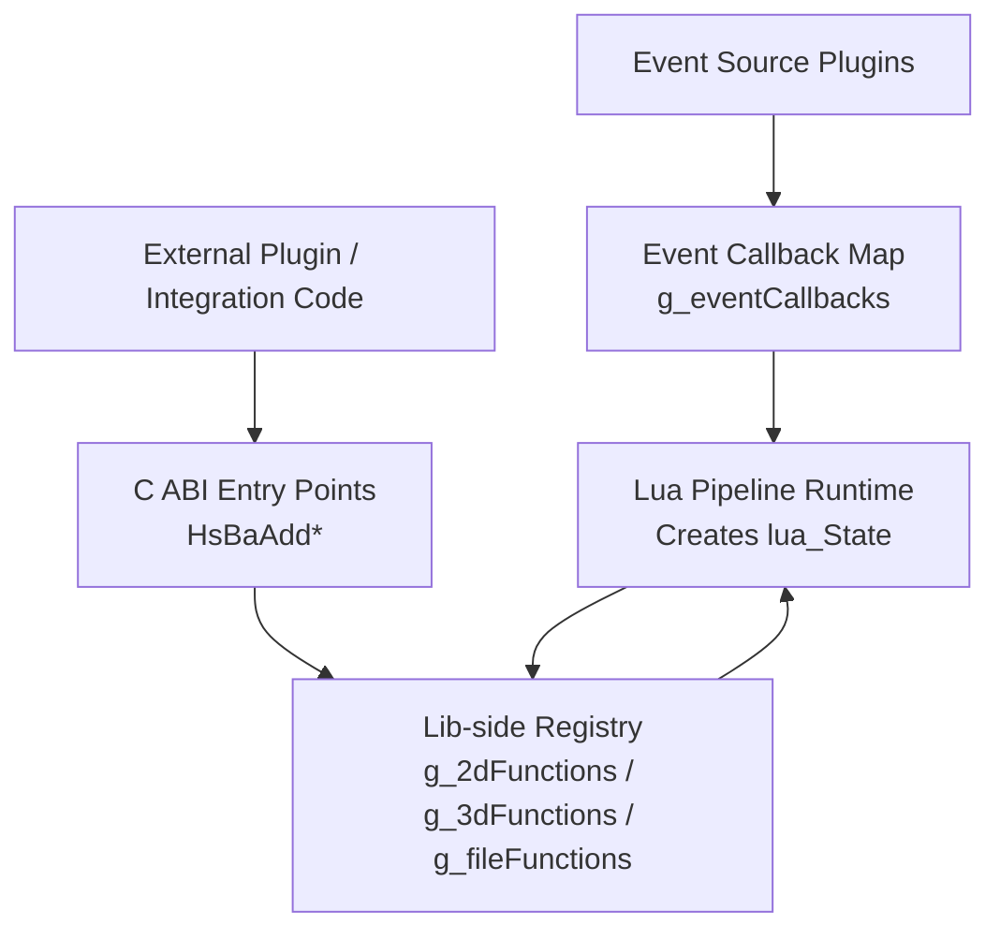
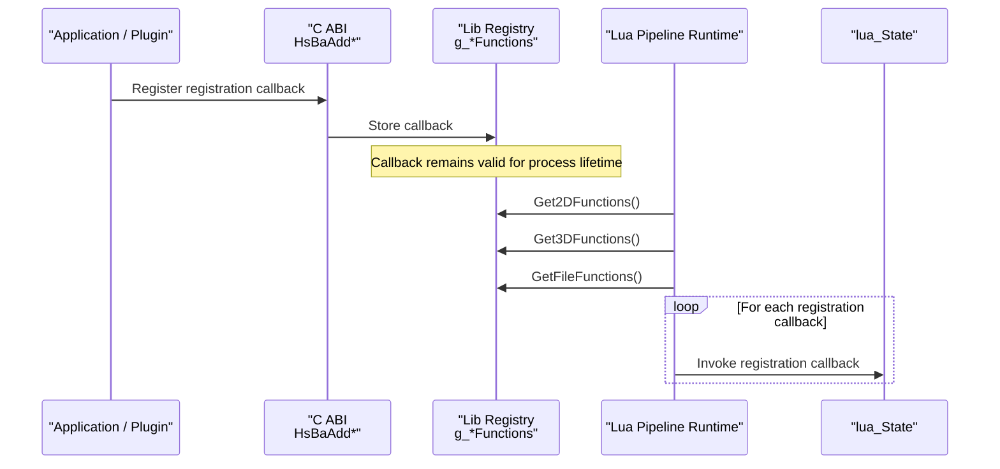
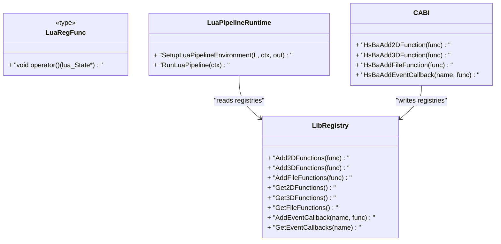
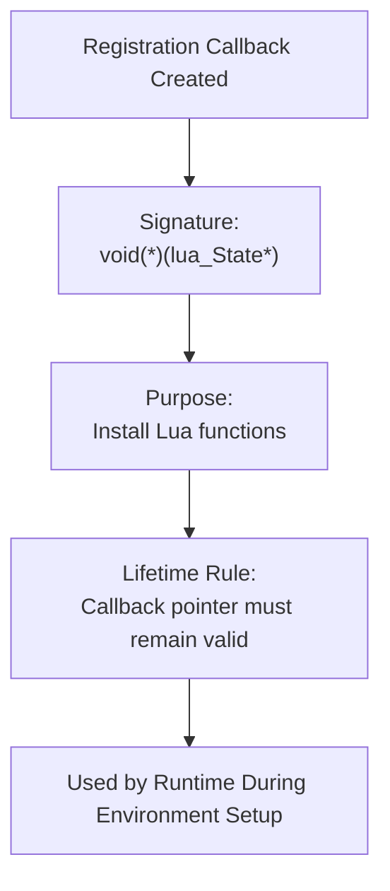
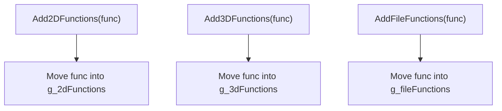
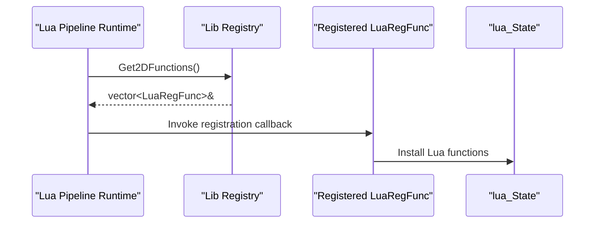
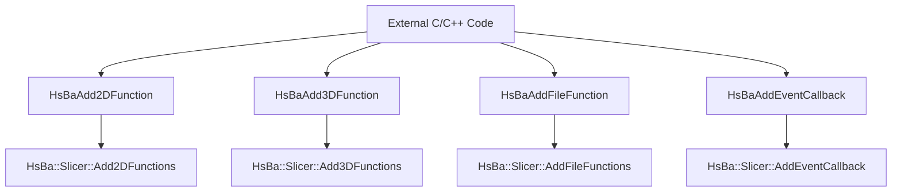
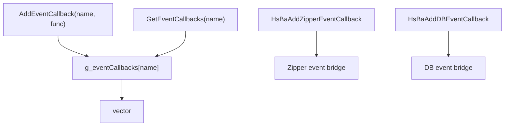
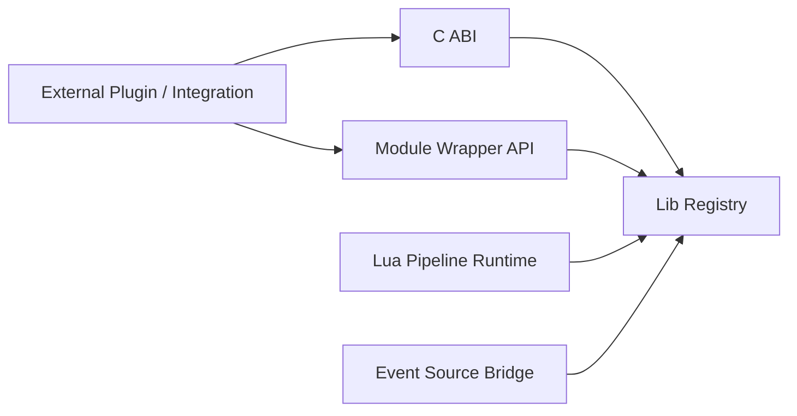

# Function Registration System / 函数注册系统

<cite>
**Referenced Files in This Document**
- [LuaAddFunction.hpp](file://LibHsBaSlicer/Extends/LuaAddFunction.hpp)
- [LuaAddFunction.cpp](file://LibHsBaSlicer/Extends/LuaAddFunction.cpp)
- [lua_register.h](file://DllHsBaSlicer/lua_register.h)
- [lua_register.cpp](file://DllHsBaSlicer/lua_register.cpp)
- [event_source_register.h](file://DllHsBaSlicer/event_source_register.h)
- [event_source_register.cpp](file://DllHsBaSlicer/event_source_register.cpp)
- [lua_pipeline.hpp](file://LibHsBaSlicer/Extends/lua_pipeline.hpp)
- [lua_pipeline.cpp](file://LibHsBaSlicer/Extends/lua_pipeline.cpp)
- [hsba_slicer.cppm](file://ModuleHsBaSlicer/hsba_slicer.cppm)
</cite>

## Table of Contents
1. [Introduction](#introduction)
2. [Project Structure](#project-structure)
3. [Core Components](#core-components)
4. [Architecture Overview](#architecture-overview)
5. [Detailed Component Analysis](#detailed-component-analysis)
6. [Dependency Analysis](#dependency-analysis)
7. [Performance Considerations](#performance-considerations)
8. [Troubleshooting Guide](#troubleshooting-guide)
9. [Conclusion](#conclusion)

## Introduction
This document explains the Lua function registration system used by HsBaSlicer to expose C++ capabilities to Lua scripts across pipeline stages. The system centers on a single registration callback type, `LuaRegFunc`, and three dimension-based registration APIs:

- **2D functions**: operations that work on 2D polygon data, such as polygon processing for Fill and SLA output.
- **3D functions**: operations that consume or produce 3D model data, such as slicing and support generation.
- **File functions**: operations related to file packaging, compression, export, and I/O during SLS/SLA output.

The same mechanism also supports an extensible event callback system through `AddEventCallback` and `GetEventCallbacks`, allowing external modules to register Lua-side initialization logic for named events like zipper compression or database queries.

## Project Structure
The registration system spans three layers:

| Layer | Responsibility | Key Files |
|---|---|---|
| Lib-side registry | Defines `LuaRegFunc`, stores registered callbacks, and exposes Add/Get APIs | [LuaAddFunction.hpp](file://LibHsBaSlicer/Extends/LuaAddFunction.hpp), [LuaAddFunction.cpp](file://LibHsBaSlicer/Extends/LuaAddFunction.cpp) |
| Dll-side C ABI | Exposes stable C entry points for external plugins and integration code | [lua_register.h](file://DllHsBaSlicer/lua_register.h), [lua_register.cpp](file://DllHsBaSlicer/lua_register.cpp), [event_source_register.h](file://DllHsBaSlicer/event_source_register.h), [event_source_register.cpp](file://DllHsBaSlicer/event_source_register.cpp) |
| Runtime consumer | Builds the Lua environment and invokes all registered registration callbacks when creating a pipeline Lua state | [lua_pipeline.hpp](file://LibHsBaSlicer/Extends/lua_pipeline.hpp), [lua_pipeline.cpp](file://LibHsBaSlicer/Extends/lua_pipeline.cpp) |
| Module convenience API | Provides inline wrappers around the lib-side APIs for module users | [hsba_slicer.cppm](file://ModuleHsBaSlicer/hsba_slicer.cppm) |

**Diagram sources**
- [lua_pipeline.cpp:909-922](file://LibHsBaSlicer/Extends/lua_pipeline.cpp#L909-L922)
- [LuaAddFunction.cpp:11-19](file://LibHsBaSlicer/Extends/LuaAddFunction.cpp#L11-L19)
- [lua_register.cpp:9-41](file://DllHsBaSlicer/lua_register.cpp#L9-L41)
- [LuaAddFunction.cpp:53-67](file://LibHsBaSlicer/Extends/LuaAddFunction.cpp#L53-L67)

**Section sources**
- [LuaAddFunction.hpp:19-74](file://LibHsBaSlicer/Extends/LuaAddFunction.hpp#L19-L74)
- [LuaAddFunction.cpp:11-67](file://LibHsBaSlicer/Extends/LuaAddFunction.cpp#L11-L67)
- [lua_register.h:11-31](file://DllHsBaSlicer/lua_register.h#L11-L31)
- [lua_register.cpp:9-41](file://DllHsBaSlicer/lua_register.cpp#L9-L41)
- [lua_pipeline.hpp:53-83](file://LibHsBaSlicer/Extends/lua_pipeline.hpp#L53-L83)
- [lua_pipeline.cpp:909-953](file://LibHsBaSlicer/Extends/lua_pipeline.cpp#L909-L953)

## Core Components
At the center of the system is `LuaRegFunc`, a C++ callable that receives a `lua_State*` and installs one or more Lua functions into that state.

| Concept | Description |
|---|---|
| `LuaRegFunc` | A registration callback type: `std::function<void(lua_State*)>`. It does not return values; its purpose is side effects on the Lua state. |
| 2D registration | Functions that operate on 2D polygon data, typically used by Support, Fill, and SLA Output stages. |
| 3D registration | Functions that operate on 3D models or slices, typically used by Slice and Support stages. |
| File registration | Functions that handle file packaging, compression, export, or other I/O tasks, typically used by SLS Output and SLA Output stages. |
| Event registration | Named callbacks bound to strings such as `"zipper.on_add"` or `"db.on_query"`. |

### Registration Lifecycle
1. External code calls a registration API during application startup or plugin initialization.
2. The callback is stored in a global registry vector or map.
3. When a Lua pipeline environment is created, the runtime retrieves the registered callbacks and invokes each one with the new `lua_State`.
4. Each registration callback installs domain-specific Lua functions into the stage’s Lua environment.

**Diagram sources**
- [lua_register.cpp:11-41](file://DllHsBaSlicer/lua_register.cpp#L11-L41)
- [LuaAddFunction.cpp:21-49](file://LibHsBaSlicer/Extends/LuaAddFunction.cpp#L21-L49)
- [lua_pipeline.cpp:909-922](file://LibHsBaSlicer/Extends/lua_pipeline.cpp#L909-L922)

**Section sources**
- [LuaAddFunction.hpp:21-40](file://LibHsBaSlicer/Extends/LuaAddFunction.hpp#L21-L40)
- [LuaAddFunction.cpp:21-49](file://LibHsBaSlicer/Extends/LuaAddFunction.cpp#L21-L49)
- [lua_pipeline.cpp:909-922](file://LibHsBaSlicer/Extends/lua_pipeline.cpp#L909-L922)

## Architecture Overview
The architecture separates concerns between interface exposure, storage, and consumption:

- **Interface layer**: C ABI functions (`HsBaAdd2DFunction`, `HsBaAdd3DFunction`, `HsBaAddFileFunction`, `HsBaAddEventCallback`) provide a stable boundary for external integrations.
- **Storage layer**: Global vectors store 2D, 3D, and File registration callbacks; a global map stores named event callbacks.
- **Consumption layer**: The Lua pipeline runtime iterates through the registries and invokes each callback during environment setup.

**Diagram sources**
- [LuaAddFunction.hpp:21-74](file://LibHsBaSlicer/Extends/LuaAddFunction.hpp#L21-L74)
- [lua_register.h:13-31](file://DllHsBaSlicer/lua_register.h#L13-L31)
- [lua_pipeline.hpp:53-83](file://LibHsBaSlicer/Extends/lua_pipeline.hpp#L53-L83)

**Section sources**
- [LuaAddFunction.hpp:19-74](file://LibHsBaSlicer/Extends/LuaAddFunction.hpp#L19-L74)
- [lua_register.h:11-31](file://DllHsBaSlicer/lua_register.h#L11-L31)
- [lua_pipeline.hpp:53-83](file://LibHsBaSlicer/Extends/lua_pipeline.hpp#L53-L83)

## Detailed Component Analysis

### LuaRegFunc Type
`LuaRegFunc` is defined as a `std::function<void(lua_State*)>`. It represents a registration callback rather than a Lua-callable function itself. Its responsibilities are:

- Receive a fresh or partially initialized `lua_State`.
- Install one or more Lua functions into that state.
- Avoid long-lived captures that could outlive the process unless explicitly intended.

**Diagram sources**
- [LuaAddFunction.hpp:21-22](file://LibHsBaSlicer/Extends/LuaAddFunction.hpp#L21-L22)
- [lua_pipeline.cpp:909-922](file://LibHsBaSlicer/Extends/lua_pipeline.cpp#L909-L922)

**Section sources**
- [LuaAddFunction.hpp:21-22](file://LibHsBaSlicer/Extends/LuaAddFunction.hpp#L21-L22)

### Dimension-Based Registration APIs
The system categorizes registration callbacks by pipeline dimension:

| API | Storage | Typical Use Cases |
|---|---|---|
| `Add2DFunctions` | `g_2dFunctions` | Polygon operations, fill customization, SLA output helpers |
| `Add3DFunctions` | `g_3dFunctions` | Model slicing, support generation, 3D-aware utilities |
| `AddFileFunctions` | `g_fileFunctions` | Compression, packaging, export, file I/O helpers |

#### Registration Implementation
Each `Add*` function appends a moved `LuaRegFunc` into a module-scoped global vector. There is no deduplication, so registering the same callback multiple times results in multiple invocations.

**Diagram sources**
- [LuaAddFunction.cpp:21-34](file://LibHsBaSlicer/Extends/LuaAddFunction.cpp#L21-L34)

**Section sources**
- [LuaAddFunction.cpp:11-34](file://LibHsBaSlicer/Extends/LuaAddFunction.cpp#L11-L34)

### Retrieval APIs
The retrieval APIs return references to the internal vectors:

- `Get2DFunctions()`
- `Get3DFunctions()`
- `GetFileFunctions()`

These are primarily consumed by the Lua pipeline runtime during environment setup. Consumers should treat them as read-only iteration targets; modifying them after pipeline creation can lead to undefined behavior if pipelines are already running.

**Diagram sources**
- [LuaAddFunction.cpp:36-49](file://LibHsBaSlicer/Extends/LuaAddFunction.cpp#L36-L49)
- [lua_pipeline.cpp:909-922](file://LibHsBaSlicer/Extends/lua_pipeline.cpp#L909-L922)

**Section sources**
- [LuaAddFunction.hpp:42-58](file://LibHsBaSlicer/Extends/LuaAddFunction.hpp#L42-L58)
- [LuaAddFunction.cpp:36-49](file://LibHsBaSlicer/Extends/LuaAddFunction.cpp#L36-L49)
- [lua_pipeline.cpp:909-922](file://LibHsBaSlicer/Extends/lua_pipeline.cpp#L909-L922)

### C ABI Layer
The Dll-side C ABI provides stable entry points for external code:

| C ABI Function | Purpose |
|---|---|
| `HsBaAdd2DFunction` | Registers a 2D registration callback |
| `HsBaAdd3DFunction` | Registers a 3D registration callback |
| `HsBaAddFileFunction` | Registers a File registration callback |
| `HsBaAddEventCallback` | Registers a named event callback |

The implementation validates non-null pointers before forwarding to the lib-side registry.

**Diagram sources**
- [lua_register.h:21-31](file://DllHsBaSlicer/lua_register.h#L21-L31)
- [lua_register.cpp:11-41](file://DllHsBaSlicer/lua_register.cpp#L11-L41)

**Section sources**
- [lua_register.h:11-31](file://DllHsBaSlicer/lua_register.h#L11-L31)
- [lua_register.cpp:9-41](file://DllHsBaSlicer/lua_register.cpp#L9-L41)

### Event Callback System
The event callback system uses a string-keyed registry:

- `AddEventCallback(event_name, func)` stores a registration callback under a named event.
- `GetEventCallbacks(event_name)` returns the list of registration callbacks for that event.
- Example event names include `"zipper.on_add"` and `"db.on_query"`.

Additionally, there are C ABI functions for C-style event-source callbacks:

| C ABI Function | Event Mapping |
|---|---|
| `HsBaAddZipperEventCallback` | Maps to zipper events such as `"zipper.on_add"` |
| `HsBaAddDBEventCallback` | Maps to database events such as `"db.on_query"` |

**Diagram sources**
- [LuaAddFunction.cpp:53-67](file://LibHsBaSlicer/Extends/LuaAddFunction.cpp#L53-L67)
- [event_source_register.cpp:9-33](file://DllHsBaSlicer/event_source_register.cpp#L9-L33)

**Section sources**
- [LuaAddFunction.hpp:60-74](file://LibHsBaSlicer/Extends/LuaAddFunction.hpp#L60-L74)
- [LuaAddFunction.cpp:53-67](file://LibHsBaSlicer/Extends/LuaAddFunction.cpp#L53-L67)
- [event_source_register.h:15-17](file://DllHsBaSlicer/event_source_register.h#L15-L17)
- [event_source_register.cpp:9-33](file://DllHsBaSlicer/event_source_register.cpp#L9-L33)

### Module Convenience API
The module-level header exposes convenient inline wrappers:

| Wrapper | Underlying Call |
|---|---|
| `add2DFunction(func)` | `Add2DFunctions(std::move(func))` |
| `add3DFunction(func)` | `Add3DFunctions(std::move(func))` |
| `addFileFunction(func)` | `AddFileFunctions(std::move(func))` |
| `addEventCallback(name, func)` | `AddEventCallback(name, std::move(func))` |

This allows module consumers to use C++-style APIs instead of the C ABI when appropriate.

**Section sources**
- [hsba_slicer.cppm:504-514](file://ModuleHsBaSlicer/hsba_slicer.cppm#L504-L514)
- [hsba_slicer.cppm:1208-1214](file://ModuleHsBaSlicer/hsba_slicer.cppm#L1208-L1214)

## Dependency Analysis
The registration system has clear directional dependencies:

- External plugins call the C ABI or module wrapper APIs.
- The C ABI forwards to the lib-side registry.
- The Lua pipeline runtime reads from the registry during environment setup.
- Event bridges connect C-style event callbacks to the broader event system.

**Diagram sources**
- [lua_register.cpp:9-41](file://DllHsBaSlicer/lua_register.cpp#L9-L41)
- [hsba_slicer.cppm:1208-1214](file://ModuleHsBaSlicer/hsba_slicer.cppm#L1208-L1214)
- [lua_pipeline.cpp:909-922](file://LibHsBaSlicer/Extends/lua_pipeline.cpp#L909-L922)
- [event_source_register.cpp:9-33](file://DllHsBaSlicer/event_source_register.cpp#L9-L33)

**Section sources**
- [lua_register.cpp:9-41](file://DllHsBaSlicer/lua_register.cpp#L9-L41)
- [hsba_slicer.cppm:1208-1214](file://ModuleHsBaSlicer/hsba_slicer.cppm#L1208-L1214)
- [lua_pipeline.cpp:909-922](file://LibHsBaSlicer/Extends/lua_pipeline.cpp#L909-L922)
- [event_source_register.cpp:9-33](file://DllHsBaSlicer/event_source_register.cpp#L9-L33)

## Performance Considerations
- Registration is O(1) per callback because it appends to a vector.
- Retrieval is O(1) reference access; iteration over all callbacks is O(n).
- Event lookup uses a string key and returns a vector reference; repeated lookups may be slightly more expensive due to map access.
- Registration callbacks are invoked once per Lua environment creation, so heavy initialization inside a registration callback should be avoided or cached.
- Because the registry is global, registration order matters: later callbacks run after earlier ones.

[No sources needed since this section provides general guidance]

## Troubleshooting Guide

### Custom Function Does Not Appear in Lua Scripts
Check the following:

1. Ensure the registration callback was called before the pipeline Lua environment is created.
2. Verify the correct dimension category was used:
   - 2D: Support, Fill, SLA Output.
   - 3D: Slice, Support.
   - File: SLS Output, SLA Output.
3. Confirm the registration callback actually installs functions into the provided `lua_State`.
4. Check that the registration callback pointer remains valid for the process lifetime.

**Section sources**
- [lua_pipeline.cpp:909-922](file://LibHsBaSlicer/Extends/lua_pipeline.cpp#L909-L922)
- [lua_register.cpp:11-41](file://DllHsBaSlicer/lua_register.cpp#L11-L41)

### Event Callback Is Not Triggered
Check the following:

1. Confirm the event name matches exactly, including case and dot notation.
2. For C-style event callbacks, verify the bridge mapping:
   - `"zipper.on_add"` maps to zipper events.
   - `"db.on_query"` maps to database events.
3. Ensure the event callback registration occurs before the event source triggers the event.

**Section sources**
- [event_source_register.cpp:9-33](file://DllHsBaSlicer/event_source_register.cpp#L9-L33)
- [LuaAddFunction.cpp:53-67](file://LibHsBaSlicer/Extends/LuaAddFunction.cpp#L53-L67)

### Duplicate Function Names in Lua
If multiple registration callbacks install functions with the same name, later registrations may overwrite earlier ones depending on how they are installed. To avoid conflicts:

- Namespace functions using distinct table prefixes.
- Avoid registering the same callback multiple times unless duplicate invocation is intentional.
- Keep registration logic organized by domain.

**Section sources**
- [LuaAddFunction.cpp:21-49](file://LibHsBaSlicer/Extends/LuaAddFunction.cpp#L21-L49)
- [lua_pipeline.cpp:909-922](file://LibHsBaSlicer/Extends/lua_pipeline.cpp#L909-L922)

## Conclusion
The HsBaSlicer Lua function registration system provides a clean, dimension-based extension mechanism. `LuaRegFunc` abstracts the idea of “installing Lua functions into a Lua state,” while `Add2DFunctions`, `Add3DFunctions`, and `AddFileFunctions` organize those extensions by pipeline domain. The C ABI and module wrappers make integration straightforward, and the event callback system adds extensibility beyond function registration. By understanding the registration lifecycle, dimension categories, and event naming conventions, developers can reliably extend the slicer’s Lua environment for custom geometry, slicing, support, file packaging, and cross-domain workflows.