# Lua Extension API / Lua扩展API

<cite>
**Referenced Files in This Document**   
- [LuaAddFunction.hpp](file://LibHsBaSlicer/Extends/LuaAddFunction.hpp)
- [LuaAddFunction.cpp](file://LibHsBaSlicer/Extends/LuaAddFunction.cpp)
- [lua_register.h](file://DllHsBaSlicer/lua_register.h)
- [lua_register.cpp](file://DllHsBaSlicer/lua_register.cpp)
- [LuaCommonTypes.hpp](file://LibHsBaSlicer/Extends/LuaCommonTypes.hpp)
- [LuaCommonTypes.cpp](file://LibHsBaSlicer/Extends/LuaCommonTypes.cpp)
- [lua_pipeline.hpp](file://LibHsBaSlicer/Extends/lua_pipeline.hpp)
- [lua_pipeline.cpp](file://LibHsBaSlicer/Extends/lua_pipeline.cpp)
- [LuaAdapter.hpp](file://2D/LuaAdapter.hpp)
- [LuaSupport.hpp](file://support/LuaSupport.hpp)
- [LuaSupport.cpp](file://support/LuaSupport.cpp)
</cite>

## Table of Contents
1. [Introduction](#introduction)
2. [Project Structure](#project-structure)
3. [Core Components](#core-components)
4. [Architecture Overview](#architecture-overview)
5. [Detailed Component Analysis](#detailed-component-analysis)
6. [Dependency Analysis](#dependency-analysis)
7. [Performance Considerations](#performance-considerations)
8. [Troubleshooting Guide](#troubleshooting-guide)
9. [Conclusion](#conclusion)
10. [Appendices](#appendices)

## Introduction
This document describes the HsBaSlicer Lua Extension API: how C++ exposes functions to Lua, how custom data types are bound through `AnyObject`, how memory ownership is managed across the C++ and Lua boundaries, and how the fully Lua-driven pipeline environment is constructed. It also documents all exposed Lua functions under the global `HsBa` table for model operations, slicing, support generation, filling, path output, packaging, and file I/O. Finally, it explains Lua state setup, global variables, event callback registration, and error handling patterns used by the scripting integration.

## Project Structure
The Lua extension surface is implemented primarily in three areas:

- Function registration pools: `LibHsBaSlicer/Extends/LuaAddFunction.*` plus the C ABI wrapper `DllHsBaSlicer/lua_register.*`.
- Custom type binding and common Lua adapters: `LibHsBaSlicer/Extends/LuaCommonTypes.*`.
- Fully Lua-driven pipeline environment and `HsBa` operations: `LibHsBaSlicer/Extends/lua_pipeline.*`.
- Polygon conversion helpers: `2D/LuaAdapter.hpp`.
- Script-based custom support generator: `support/LuaSupport.*`.

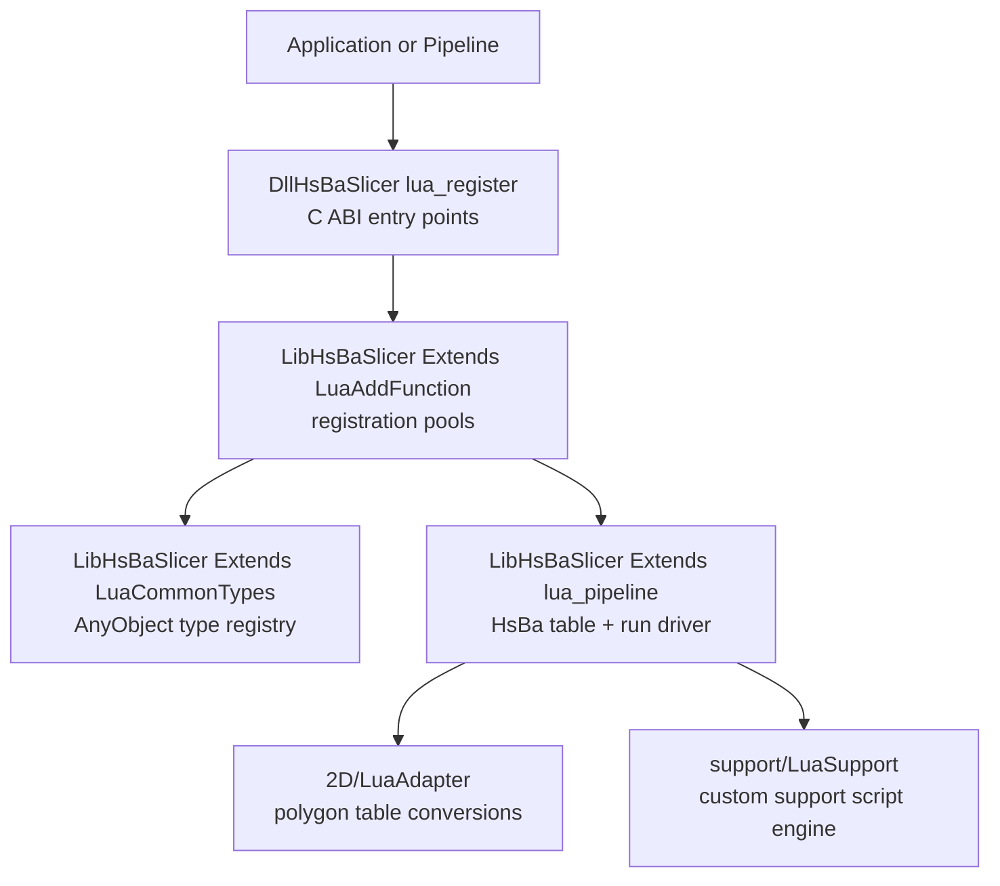

**Diagram sources**
- [lua_register.h:11-31](file://DllHsBaSlicer/lua_register.h#L11-L31)
- [lua_register.cpp:9-41](file://DllHsBaSlicer/lua_register.cpp#L9-L41)
- [LuaAddFunction.hpp:19-74](file://LibHsBaSlicer/Extends/LuaAddFunction.hpp#L19-L74)
- [LuaCommonTypes.hpp:146-183](file://LibHsBaSlicer/Extends/LuaCommonTypes.hpp#L146-L183)
- [lua_pipeline.hpp:19-83](file://LibHsBaSlicer/Extends/lua_pipeline.hpp#L19-L83)
- [LuaAdapter.hpp:14-81](file://2D/LuaAdapter.hpp#L14-L81)
- [LuaSupport.hpp:19-81](file://support/LuaSupport.hpp#L19-L81)

**Section sources**
- [LuaAddFunction.hpp:19-74](file://LibHsBaSlicer/Extends/LuaAddFunction.hpp#L19-L74)
- [lua_register.h:11-31](file://DllHsBaSlicer/lua_register.h#L11-L31)
- [LuaCommonTypes.hpp:146-183](file://LibHsBaSlicer/Extends/LuaCommonTypes.hpp#L146-L183)
- [lua_pipeline.hpp:19-83](file://LibHsBaSlicer/Extends/lua_pipeline.hpp#L19-L83)
- [LuaAdapter.hpp:14-81](file://2D/LuaAdapter.hpp#L14-L81)
- [LuaSupport.hpp:19-81](file://support/LuaSupport.hpp#L19-L81)

## Core Components
The Lua extension system has five core responsibilities:

1. **External function registration**: C++ code registers Lua functions into per-stage pools (2D, 3D, File), which are later installed into each stage’s Lua state.
2. **Custom type binding**: Eigen vectors/matrices/quaternions and Clipper2 geometry types are reflected into `AnyObject`, exposing `new_<Name>` and `cast_<Name>` globals.
3. **Lua state lifecycle**: The fully Lua-driven pipeline creates a fresh Lua state, opens standard libraries, installs pooled registrations, binds the `HsBa` operations table, injects context globals, executes user scripts, and calls an entry function.
4. **Exposed `HsBa` API**: Model loading/transform/querying, layer math, slicing, polygon fill, FDM/SLA support, SLA floor, G-code generation, spiralization, SLS/WAAM/SLA packaging, image rendering, and basic file I/O.
5. **Scriptable support generator**: A separate `LuaSupport` class lets users replace built-in support algorithms with a Lua script that receives current/previous layers, layer height, and configuration.

**Section sources**
- [LuaAddFunction.cpp:21-67](file://LibHsBaSlicer/Extends/LuaAddFunction.cpp#L21-L67)
- [LuaCommonTypes.cpp:438-531](file://LibHsBaSlicer/Extends/LuaCommonTypes.cpp#L438-L531)
- [lua_pipeline.cpp:830-860](file://LibHsBaSlicer/Extends/lua_pipeline.cpp#L830-L860)
- [lua_pipeline.cpp:903-1043](file://LibHsBaSlicer/Extends/lua_pipeline.cpp#L903-L1043)
- [LuaSupport.cpp:113-178](file://support/LuaSupport.cpp#L113-L178)

## Architecture Overview
At runtime, there are two main integration paths:

- **Built-in pipelines**: Each pipeline (FDM, SLA, SLS, etc.) calls `InstallCommonAnyObjectTypes()` once, then consumes the 2D/3D/File registration pools when building its Lua environment.
- **Fully Lua-driven pipeline**: `RunLuaPipeline` creates a new Lua state, runs `SetupLuaPipelineEnvironment`, executes optional inline prelude and script file, then calls the configured entry function.

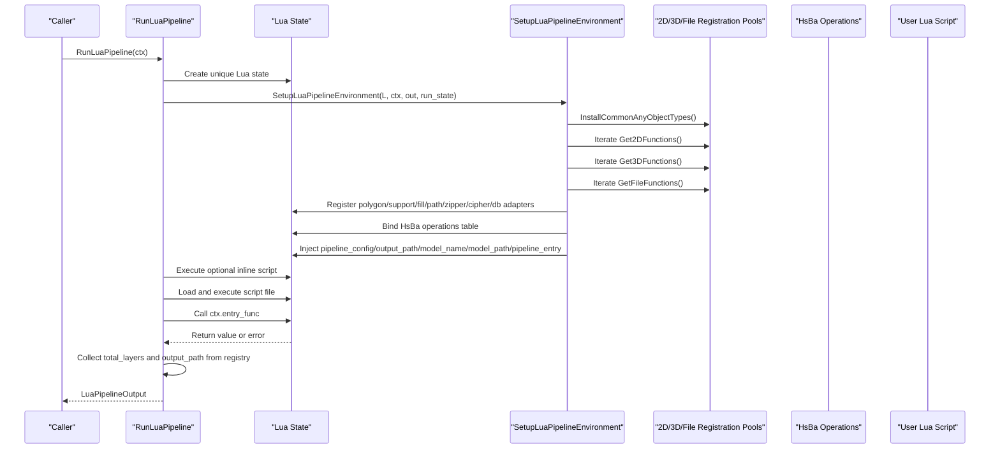

**Diagram sources**
- [lua_pipeline.cpp:960-1043](file://LibHsBaSlicer/Extends/lua_pipeline.cpp#L960-L1043)
- [lua_pipeline.cpp:903-958](file://LibHsBaSlicer/Extends/lua_pipeline.cpp#L903-L958)
- [LuaCommonTypes.cpp:514-531](file://LibHsBaSlicer/Extends/LuaCommonTypes.cpp#L514-L531)

## Detailed Component Analysis

### Function Registration Mechanism: `LuaAddFunction` and C ABI Wrapper
The registration mechanism uses process-wide pools of `LuaRegFunc` callbacks grouped by pipeline dimension:

- `Add2DFunctions`: Functions available in Support, Fill, and SLA Output stages.
- `Add3DFunctions`: Functions available in Slice and Support stages.
- `AddFileFunctions`: Functions available in SLS Output and SLA Output stages.
- `AddEventCallback`: Named event callbacks such as Zipper or database events.

The DLL exports a C-compatible ABI so external modules can register functions without linking against C++ symbols directly.

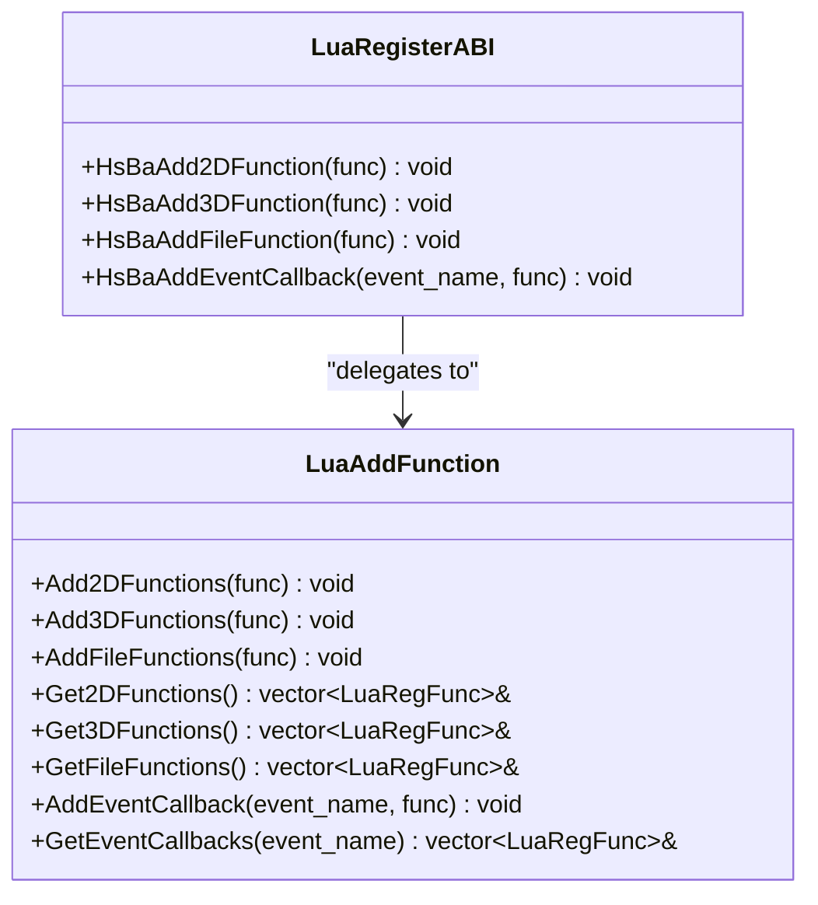

**Diagram sources**
- [LuaAddFunction.hpp:19-74](file://LibHsBaSlicer/Extends/LuaAddFunction.hpp#L19-L74)
- [lua_register.h:11-31](file://DllHsBaSlicer/lua_register.h#L11-L31)
- [lua_register.cpp:9-41](file://DllHsBaSlicer/lua_register.cpp#L9-L41)

Key implementation details:

- The pools are stored in static module-level vectors keyed by dimension.
- Event callbacks are stored in a map from event name to a vector of registration functions.
- The C ABI wrappers validate null pointers before delegating to the C++ API.

**Section sources**
- [LuaAddFunction.cpp:11-67](file://LibHsBaSlicer/Extends/LuaAddFunction.cpp#L11-L67)
- [lua_register.cpp:9-41](file://DllHsBaSlicer/lua_register.cpp#L9-L41)

#### Example: Registering a Custom Function
A typical registration pattern is:

1. Define a C-style Lua function that reads arguments from the stack and pushes results.
2. Write a registration function that calls `lua_register` on the provided `lua_State`.
3. Register the registration function using `HsBaAdd2DFunction`, `HsBaAdd3DFunction`, or `HsBaAddFileFunction`.
4. During pipeline execution, the corresponding stage will call the registration function with its Lua state.

**Section sources**
- [lua_register.h:11-31](file://DllHsBaSlicer/lua_register.h#L11-L31)
- [lua_register.cpp:9-41](file://DllHsBaSlicer/lua_register.cpp#L9-L41)

### Type Binding Interfaces: `LuaCommonTypes` and `AnyObject`
`LuaCommonTypes` provides two complementary mechanisms:

1. **Reflection metadata**: Template macros generate `GetTypeInfo<T>()` specializations for Eigen vectors, quaternions, matrices, and Clipper2 points/polygons. These add stable names, scalar field iteration, and `cast_<Name>` methods.
2. **Lua table adapters**: For each registered type, a `TableAdapter` exposes:
   - `new_<Name>(table)` to construct an `AnyObject` wrapping the native type.
   - `cast_<Name>(any_object)` to convert an `AnyObject` back into a plain Lua table.

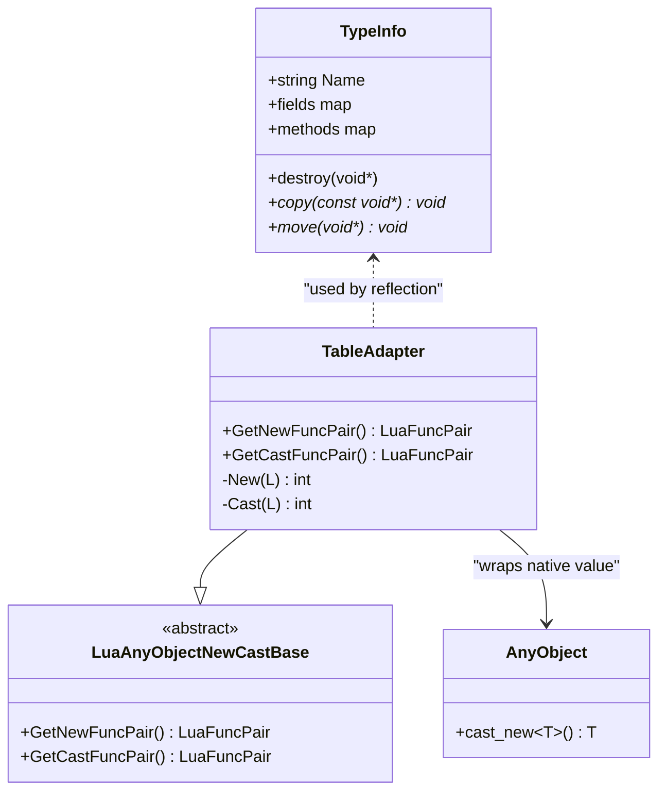

**Diagram sources**
- [LuaCommonTypes.hpp:47-108](file://LibHsBaSlicer/Extends/LuaCommonTypes.hpp#L47-L108)
- [LuaCommonTypes.cpp:342-389](file://LibHsBaSlicer/Extends/LuaCommonTypes.cpp#L342-L389)

Registered families include:

- Fixed vectors: `Vector2f`, `Vector3f`, `Vector4f`, `Vector2d`, `Vector3d`, `Vector4d`, `Vector2i`, `Vector3i`, `Vector4i`.
- Quaternions: `Quaternionf`, `Quaterniond`.
- Matrices: `Matrix2d`, `Matrix3d`, `Matrix4d`, `MatrixXf`, `MatrixXi`.
- Clipper2 points: `Point2D`, `Point2`.
- Clipper2 polygons: `PolygonD`, `PolygonsD`, `Polygon`, `Polygons`.

Encoding rules:

- Vectors and quaternions use named keys `x`, `y`, optionally `z`, `w`.
- Matrices use nested row sequences.
- Points use `{x, y}` maps.
- Polygons are arrays of point tables.

**Section sources**
- [LuaCommonTypes.hpp:110-140](file://LibHsBaSlicer/Extends/LuaCommonTypes.hpp#L110-L140)
- [LuaCommonTypes.cpp:78-200](file://LibHsBaSlicer/Extends/LuaCommonTypes.cpp#L78-L200)
- [LuaCommonTypes.cpp:202-337](file://LibHsBaSlicer/Extends/LuaCommonTypes.cpp#L202-L337)
- [LuaCommonTypes.cpp:342-467](file://LibHsBaSlicer/Extends/LuaCommonTypes.cpp#L342-L467)

#### Memory Ownership Between C++ and Lua
Ownership follows these rules:

- `new_<Name>(table)` constructs the native value and wraps it in an `AnyObject`; the `AnyObject` owns the heap allocation.
- `cast_<Name>(any_object)` copies the value out via `AnyObject::cast_new<T>()`, so the caller receives a temporary native object and does not share ownership with the original `AnyObject`.
- Identity destroy/copy/move hooks are set up for reflected types, ensuring `AnyObject` manages lifetime safely.
- Per-state idempotency guards prevent multiple registrations of the same common types into one Lua state.

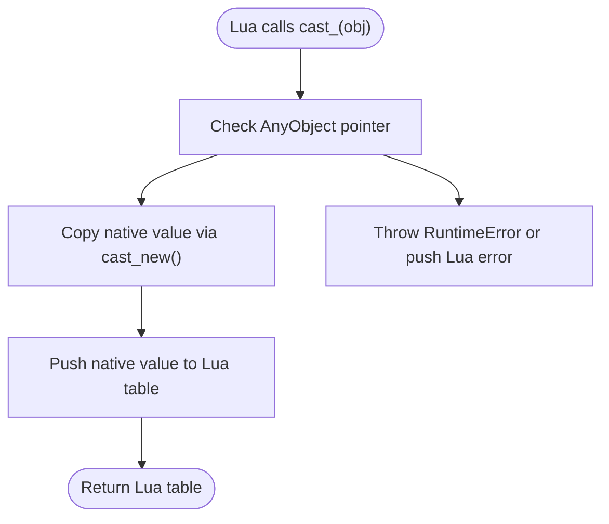

**Diagram sources**
- [LuaCommonTypes.cpp:368-389](file://LibHsBaSlicer/Extends/LuaCommonTypes.cpp#L368-L389)

**Section sources**
- [LuaCommonTypes.cpp:469-531](file://LibHsBaSlicer/Extends/LuaCommonTypes.cpp#L469-L531)

### Object Lifecycle Management: `LuaPipelineContext`, `LuaPipelineOutput`, and Registry State
The fully Lua-driven pipeline separates configuration, execution, and result collection:

- `LuaPipelineContext` holds script source, script file, entry function name, free-form JSON config, default output path, model name/path, and a progress callback.
- `LuaPipelineOutput` collects success status, total layers, output path, result string, and error message.
- Internal registry slots store the run state pointer, reported layer count, and reported output path.

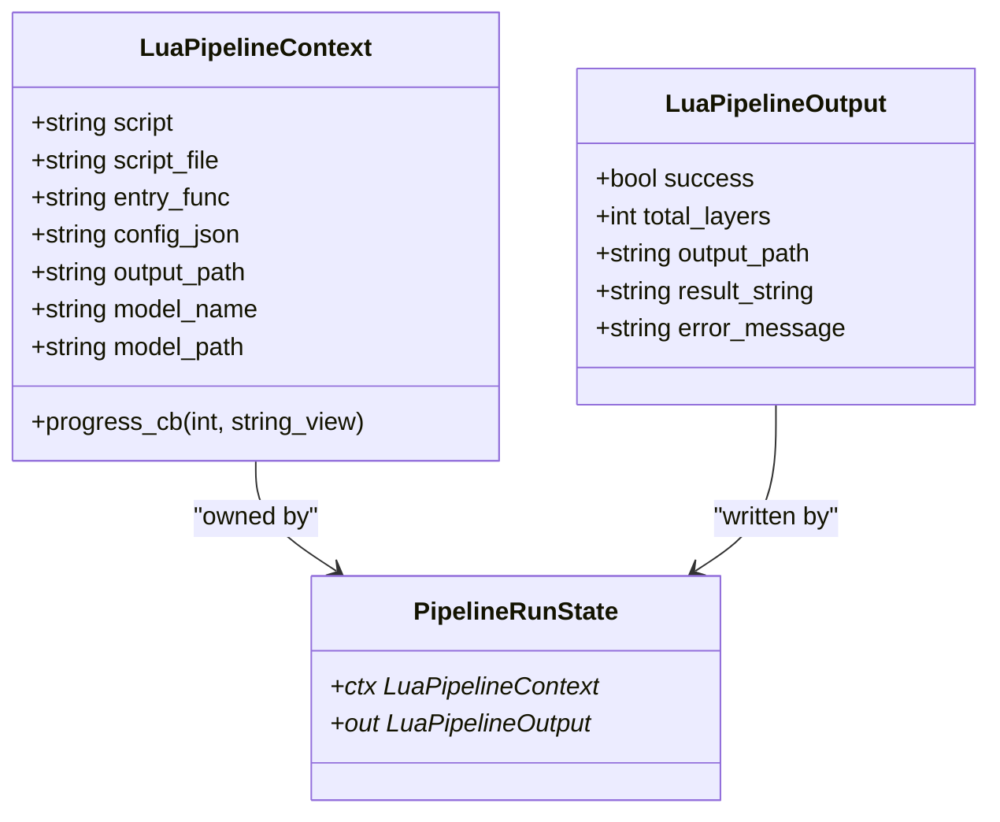

**Diagram sources**
- [lua_pipeline.hpp:19-51](file://LibHsBaSlicer/Extends/lua_pipeline.hpp#L19-L51)
- [lua_pipeline.cpp:50-63](file://LibHsBaSlicer/Extends/lua_pipeline.cpp#L50-L63)

Lifecycle steps:

1. `RunLuaPipeline` creates a unique Lua state.
2. `SetupLuaPipelineEnvironment` opens standard libraries, installs common types, iterates 2D/3D/File registration pools, registers polygon/support/fill/path/zipper/cipher/database adapters, binds the `HsBa` table, and injects context globals.
3. Optional inline script is executed first as a prelude.
4. Script file is loaded and executed.
5. Entry function is called; truthy return means success, string return is captured as `result_string`.
6. Layer count and output path are read from registry slots.
7. Errors from Lua execution or C++ runtime are wrapped into `LuaPipelineOutput.error_message`.

**Section sources**
- [lua_pipeline.hpp:19-83](file://LibHsBaSlicer/Extends/lua_pipeline.hpp#L19-L83)
- [lua_pipeline.cpp:903-1043](file://LibHsBaSlicer/Extends/lua_pipeline.cpp#L903-L1043)

### Exposed Lua Functions: `HsBa` Table
The `HsBa` table exposes the following operations:

| Function | Purpose | Input | Output | Notes |
|---|---|---|---|---|
| `HsBa.progress(percent[, stage])` | Report progress | integer percent, optional string stage | none | Calls the progress callback if present. |
| `HsBa.setLayers(n)` | Set total layers | integer | none | Stored in registry for `LuaPipelineOutput.total_layers`. |
| `HsBa.setOutputPath(path)` | Set output path | string | none | Stored in registry for `LuaPipelineOutput.output_path`. |
| `HsBa.readFile(path)` | Read binary file | string path | string or nil | Returns nil on failure. |
| `HsBa.writeFile(path, content)` | Write binary file | string path, string content | boolean | Throws Lua error on open failure. |
| `HsBa.loadModel(name, path)` | Load model into pool | string name, string path | boolean | Loads cached model if already present. |
| `HsBa.modelInfo(name)` | Query model metadata | string name | table with bbox_min, bbox_max, volume, layerHeight, firstLayerHeight | Throws if model not found. |
| `HsBa.translateModel(name, {x,y,z})` | Translate model | string name, vector table | none | Uses zero translation if empty table. |
| `HsBa.rotateModel(name, {x,y,z,w})` | Rotate model | string name, quaternion table | none | Defaults to identity quaternion. |
| `HsBa.scaleModel(name, s \| {x,y,z})` | Scale model | string name, number or vector table | none | Supports uniform or per-axis scaling. |
| `HsBa.removeModel(name)` | Remove model from pool | string name | none | |
| `HsBa.modelNames()` | List models | none | array of strings | |
| `HsBa.layerCount(name, layerHeight, firstLayerHeight)` | Estimate layer count | string name, numbers | integer | Handles zero-height models. |
| `HsBa.layerZ(index0based, layerHeight, firstLayerHeight)` | Compute Z coordinate | integers/numbers | number | First layer uses firstLayerHeight. |
| `HsBa.slice(name, z)` | Safe slice at Z | string name, number | double polygon array | Closed contours only. |
| `HsBa.sliceUnsafe(name, z)` | Unsafe slice at Z | string name, number | normalized polygon array | May drop open contours. |
| `HsBa.toInt(polygons)` | Convert double polygons to integer | double polygon array | integer polygon array | |
| `HsBa.toDouble(intPolygons)` | Convert integer polygons to double | integer polygon array | double polygon array | |
| `HsBa.fill(polygons[, cfg])` | Generate fill lines | polygon array, optional table | polygon array | Supports spacing, mode, angle, borderCount. |
| `HsBa.fdmSupport(layers, cfg)` | Generate FDM supports | layer list, config table | layer list | Reads base support config plus interface fields. |
| `HsBa.slaSupport(layers, cfg)` | Generate SLA supports | layer list, config table | layer list | Reads base support config plus tip/raft fields. |
| `HsBa.floor(bottomPolygons, cfg)` | Generate SLA floor raft | polygon array, config table | integer polygon array | |
| `HsBa.toGcode(layers, cfg)` | Generate G-code string | layer path data array, printer config table | string | Supports Marlin, RepRap, Klipper firmware. |
| `HsBa.spiralize(sections[, cfg])` | Generate continuous spiral path | layer sections, optional config table | array of {x,y,z} points | Supports layerHeight, startZ, zHeights. |
| `HsBa.saveSlsPackage(pkg)` | Package SLS output | package table | boolean | Requires output and script. |
| `HsBa.saveWaamPackage(pkg)` | Package WAAM robot path | package table | boolean or boolean+error | Returns second error detail on failure. |
| `HsBa.saveSlaPackage(pkg)` | Package SLA output | package table | boolean | Requires output. |
| `HsBa.renderImage(polygons, width, height, path)` | Render polygons to image | double polygon array, integers, string path | boolean | |

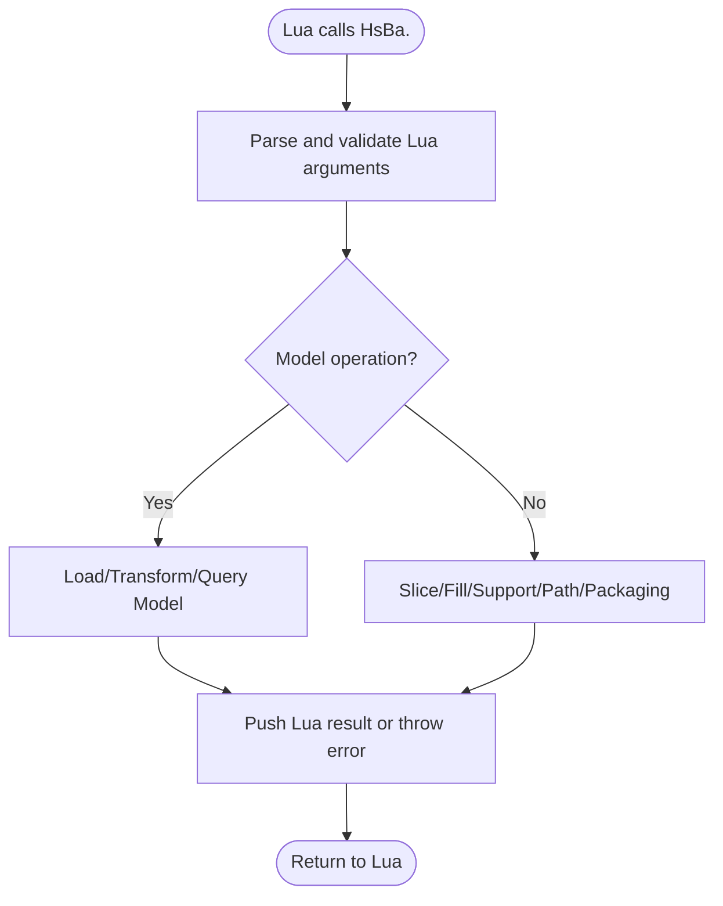

**Diagram sources**
- [lua_pipeline.cpp:228-860](file://LibHsBaSlicer/Extends/lua_pipeline.cpp#L228-L860)

**Section sources**
- [lua_pipeline.cpp:228-860](file://LibHsBaSlicer/Extends/lua_pipeline.cpp#L228-L860)

### Handling Lua Userdata and Custom Objects
When working with `AnyObject` userdata:

- Use `new_<Name>(table)` to create typed objects from plain Lua tables.
- Use `cast_<Name>(any_object)` to extract a native value.
- Avoid assuming shared ownership between Lua and C++; treat `cast_*` as copy semantics.
- When passing `AnyObject` across C++ boundaries, prefer non-owning views where supported by the surrounding API.

For polygon userdata, the 2D adapter provides helper functions to push and read polygon tables. These are used internally by `HsBa.slice`, `HsBa.fill`, `HsBa.fdmSupport`, `HsBa.slaSupport`, and packaging functions.

**Section sources**
- [LuaCommonTypes.cpp:342-467](file://LibHsBaSlicer/Extends/LuaCommonTypes.cpp#L342-L467)
- [LuaAdapter.hpp:14-81](file://2D/LuaAdapter.hpp#L14-L81)

### Implementing Callbacks: Progress and External Events
Progress reporting is exposed through `HsBa.progress`. The C++ side stores a `progress_cb` in `LuaPipelineContext`; when Lua calls `HsBa.progress`, the C++ handler invokes the callback with percentage and optional stage description.

External events are registered through `AddEventCallback`. The event name acts as a key into a global map of registration functions. Consumers of the event system can look up callbacks by event name and invoke them during relevant operations.

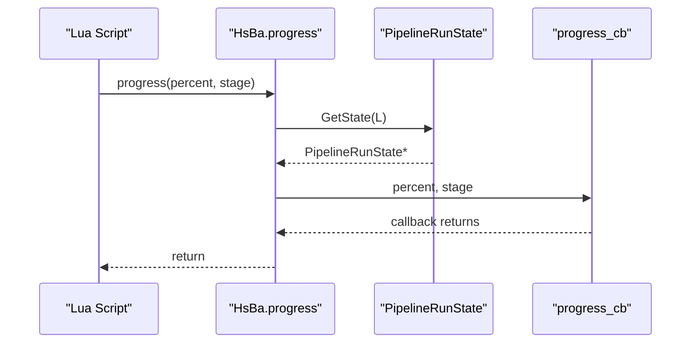

**Diagram sources**
- [lua_pipeline.cpp:64-69](file://LibHsBaSlicer/Extends/lua_pipeline.cpp#L64-L69)
- [lua_pipeline.cpp:228-239](file://LibHsBaSlicer/Extends/lua_pipeline.cpp#L228-L239)

**Section sources**
- [lua_pipeline.cpp:64-69](file://LibHsBaSlicer/Extends/lua_pipeline.cpp#L64-L69)
- [lua_pipeline.cpp:228-239](file://LibHsBaSlicer/Extends/lua_pipeline.cpp#L228-L239)
- [LuaAddFunction.cpp:51-67](file://LibHsBaSlicer/Extends/LuaAddFunction.cpp#L51-L67)

### Lua State Management, Environment Setup, Global Variables, and Error Handling
Environment setup performs these steps:

1. Open standard Lua libraries.
2. Ensure common `AnyObject` types are installed into the registration pools.
3. Iterate and execute 2D, 3D, and File registration functions.
4. Register polygon operations, support module, polygon fill, path optimization, zipper, cipher, SQLite, ParamStore, optional Bit7Z, MySQL, and PostgreSQL adapters.
5. Bind the `HsBa` operations table.
6. Inject global variables: `pipeline_config`, `output_path`, `model_name`, `model_path`, `pipeline_entry`.
7. Store `PipelineRunState` in the Lua registry for function implementations to access.

Global variables exposed to scripts:

- `pipeline_config`: free-form JSON string from `LuaPipelineContext.config_json`.
- `output_path`: default output path from `LuaPipelineContext.output_path`.
- `model_name`: model name from `LuaPipelineContext.model_name`.
- `model_path`: model file path from `LuaPipelineContext.model_path`.
- `pipeline_entry`: entry function name from `LuaPipelineContext.entry_func`.

Error handling patterns:

- Invalid model names or missing models raise Lua errors.
- File write failures raise Lua errors.
- Lua script load or runtime errors are caught and converted into `RuntimeError`, then wrapped into `LuaPipelineOutput.error_message`.
- Entry function not found produces a descriptive error message.
- Failure to create a Lua state sets `error_message` and returns a failed output.

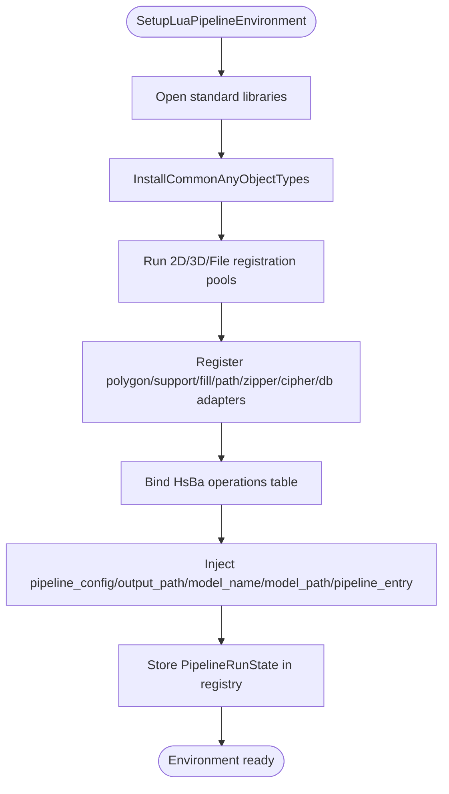

**Diagram sources**
- [lua_pipeline.cpp:903-958](file://LibHsBaSlicer/Extends/lua_pipeline.cpp#L903-L958)

**Section sources**
- [lua_pipeline.cpp:866-958](file://LibHsBaSlicer/Extends/lua_pipeline.cpp#L866-L958)
- [lua_pipeline.cpp:960-1043](file://LibHsBaSlicer/Extends/lua_pipeline.cpp#L960-L1043)

### Script-Based Custom Support Generator
`LuaSupport` allows replacing built-in support generation with a Lua script. The script receives:

- `current_layer`: table of polygons.
- `prev_layer`: table of polygons.
- `layer_height`: number.
- `config`: table with support parameters.

It may return a polygon table from the main chunk or define a function (default `generate_support`) that returns polygons. Helper functions from `2D/LuaAdapter` and the support module are registered automatically.

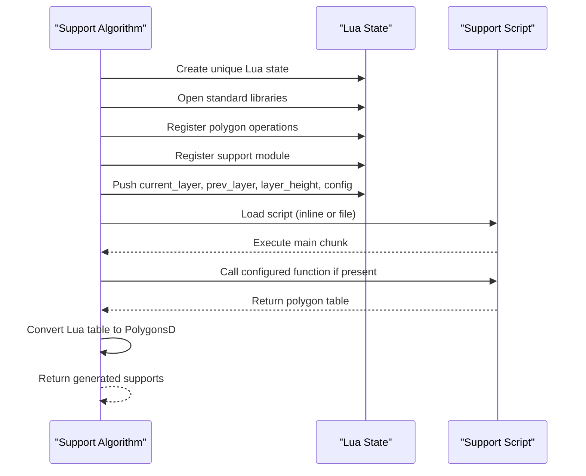

**Diagram sources**
- [LuaSupport.cpp:19-90](file://support/LuaSupport.cpp#L19-L90)
- [LuaSupport.cpp:113-178](file://support/LuaSupport.cpp#L113-L178)

**Section sources**
- [LuaSupport.hpp:19-81](file://support/LuaSupport.hpp#L19-L81)
- [LuaSupport.cpp:19-178](file://support/LuaSupport.cpp#L19-L178)

## Dependency Analysis
The Lua extension system has clear dependency boundaries:

- `lua_register.*` depends on `LibHsBaSlicer/Extends/LuaAddFunction.hpp`.
- `lua_pipeline.cpp` depends on `LuaAddFunction`, `LuaCommonTypes`, polygon adapters, support adapters, path generators, slicer, preprocess, cipher, file operator, and path output modules.
- `LuaCommonTypes.cpp` depends on `LuaAddFunction` to install common types into the generic registration pools.
- Built-in pipelines depend on `InstallCommonAnyObjectTypes` to ensure common types are available before creating their Lua environments.

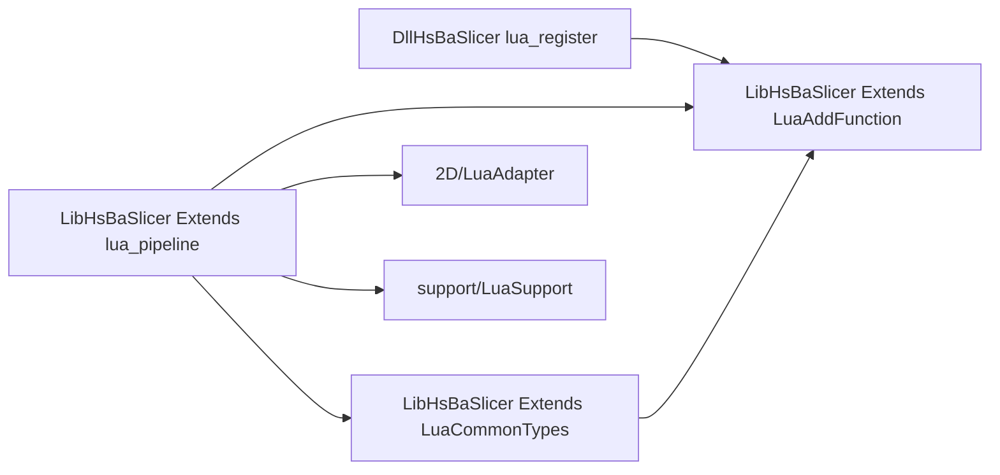

**Diagram sources**
- [lua_register.cpp:7-41](file://DllHsBaSlicer/lua_register.cpp#L7-L41)
- [lua_pipeline.cpp:17-39](file://LibHsBaSlicer/Extends/lua_pipeline.cpp#L17-L39)
- [LuaCommonTypes.cpp:18-21](file://LibHsBaSlicer/Extends/LuaCommonTypes.cpp#L18-L21)

**Section sources**
- [lua_register.cpp:7-41](file://DllHsBaSlicer/lua_register.cpp#L7-L41)
- [lua_pipeline.cpp:17-39](file://LibHsBaSlicer/Extends/lua_pipeline.cpp#L17-L39)
- [LuaCommonTypes.cpp:18-21](file://LibHsBaSlicer/Extends/LuaCommonTypes.cpp#L18-L21)

## Performance Considerations
- Avoid excessive copying of large polygon arrays between Lua and C++. Prefer using the existing `PushPolygonsDToLua` and `LuaTableToPolygonsD` helpers rather than manual element-by-element conversion.
- Reuse Lua states when possible. The default `RunLuaPipeline` creates a new state per run; long-running applications should consider managing state lifetimes carefully.
- Be cautious with `sliceUnsafe`: it normalizes polygons but may drop open contours, which can affect downstream fill or support algorithms.
- Packaging functions build intermediate structures from Lua tables; keep input layer lists reasonably sized to avoid repeated allocations.
- The common type registration is guarded per Lua state, so calling it multiple times for the same state is safe but unnecessary after the first registration.

[No sources needed since this section provides general guidance]

## Troubleshooting Guide
Common issues and resolutions:

| Symptom | Likely Cause | Resolution |
|---|---|---|
| `HsBa.loadModel` fails | Model name invalid or file cannot be loaded | Verify model name and path; check model loader availability. |
| `HsBa.modelInfo` throws | Model not in pool | Call `loadModel` first or verify model name. |
| `HsBa.writeFile` throws | File path invalid or permission denied | Check filesystem permissions and path validity. |
| `HsBa.slice` or `HsBa.sliceUnsafe` throws | Model not loaded | Ensure `loadModel` succeeded before slicing. |
| `HsBa.toGcode` fails | Path generation returned null | Validate layer data structure and printer configuration. |
| `saveSlsPackage` or `saveWaamPackage` fails | Missing required fields | Provide `output` and `script`; for WAAM, inspect second return value for error detail. |
| Lua entry function not found | Wrong `entry_func` name | Check `LuaPipelineContext.entry_func` and script definition. |
| Lua runtime error | Script syntax or runtime exception | Inspect `LuaPipelineOutput.error_message`. |
| Custom type `cast_<Name>` fails | Invalid `AnyObject` or unsupported type | Ensure the type was registered via `RegisterCommonAnyObjectTypes` and pass a valid `AnyObject`. |

**Section sources**
- [lua_pipeline.cpp:292-340](file://LibHsBaSlicer/Extends/lua_pipeline.cpp#L292-L340)
- [lua_pipeline.cpp:435-460](file://LibHsBaSlicer/Extends/lua_pipeline.cpp#L435-L460)
- [lua_pipeline.cpp:622-690](file://LibHsBaSlicer/Extends/lua_pipeline.cpp#L622-L690)
- [lua_pipeline.cpp:697-815](file://LibHsBaSlicer/Extends/lua_pipeline.cpp#L697-L815)
- [lua_pipeline.cpp:998-1043](file://LibHsBaSlicer/Extends/lua_pipeline.cpp#L998-L1043)
- [LuaCommonTypes.cpp:368-389](file://LibHsBaSlicer/Extends/LuaCommonTypes.cpp#L368-L389)

## Conclusion
The HsBaSlicer Lua Extension API provides a structured way to extend slicing workflows with Lua. Function registration is organized by pipeline dimension, custom types are bound through `AnyObject` with clear ownership semantics, and the fully Lua-driven pipeline offers a complete environment for model operations, slicing, support generation, path output, and packaging. By following the documented patterns for registration, userdata handling, memory ownership, and error handling, developers can integrate custom algorithms and scripts safely and predictably.

[No sources needed since this section summarizes without analyzing specific files]

## Appendices

### Appendix A: Lua State and Global Variable Reference
| Global | Type | Source | Description |
|---|---|---|---|
| `pipeline_config` | string | `LuaPipelineContext.config_json` | Free-form JSON configuration exposed to scripts. |
| `output_path` | string | `LuaPipelineContext.output_path` | Default output path. |
| `model_name` | string | `LuaPipelineContext.model_name` | Model name. |
| `model_path` | string | `LuaPipelineContext.model_path` | Model file path. |
| `pipeline_entry` | string | `LuaPipelineContext.entry_func` | Name of the Lua entry function. |

**Section sources**
- [lua_pipeline.cpp:874-886](file://LibHsBaSlicer/Extends/lua_pipeline.cpp#L874-L886)

### Appendix B: Supported Firmware and Fill Modes
| Category | Values | Mapping |
|---|---|---|
| Fill mode | `"line"` / `"Line"` | `FillMode::Line` |
| Fill mode | `"simpleZigzag"` / `"SimpleZigzag"` | `FillMode::SimpleZigzag` |
| Fill mode | other | `FillMode::Zigzag` |
| Firmware | `"reprap"` / `"RRF"` | `GCodeFirmware::RepRap` |
| Firmware | `"klipper"` / `"Klipper"` | `GCodeFirmware::Klipper` |
| Firmware | other | `GCodeFirmware::Marlin` |

**Section sources**
- [lua_pipeline.cpp:134-158](file://LibHsBaSlicer/Extends/lua_pipeline.cpp#L134-L158)