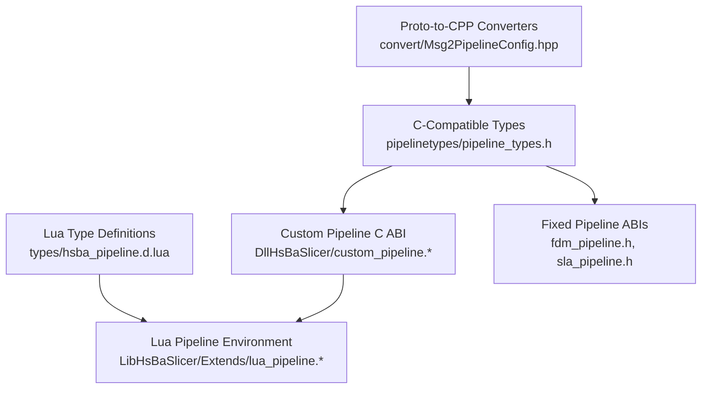
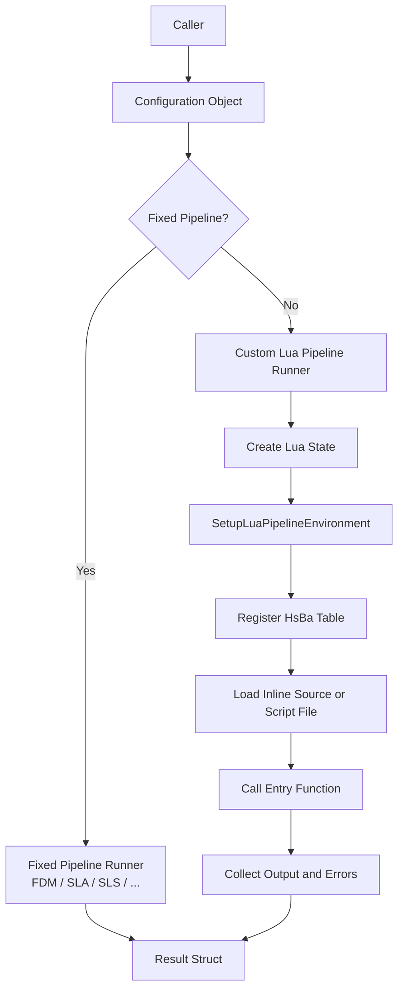
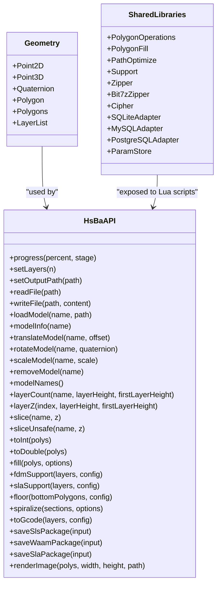
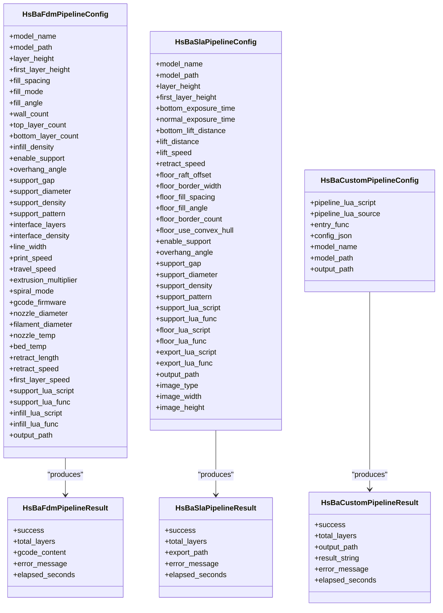
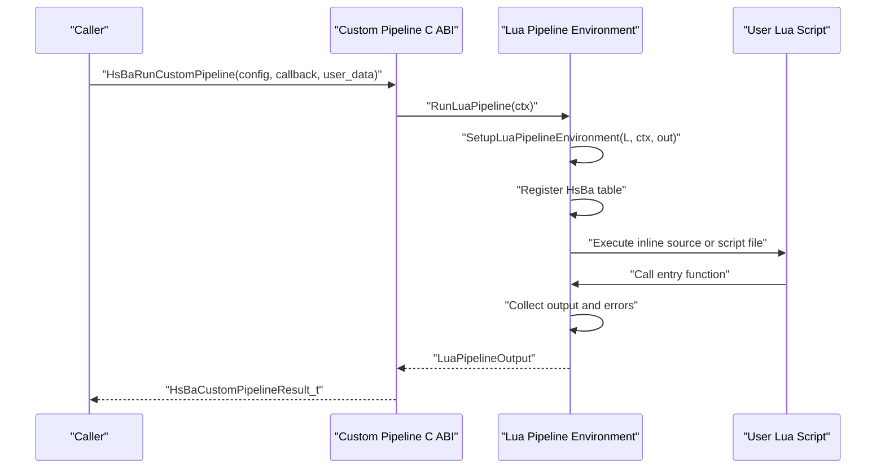
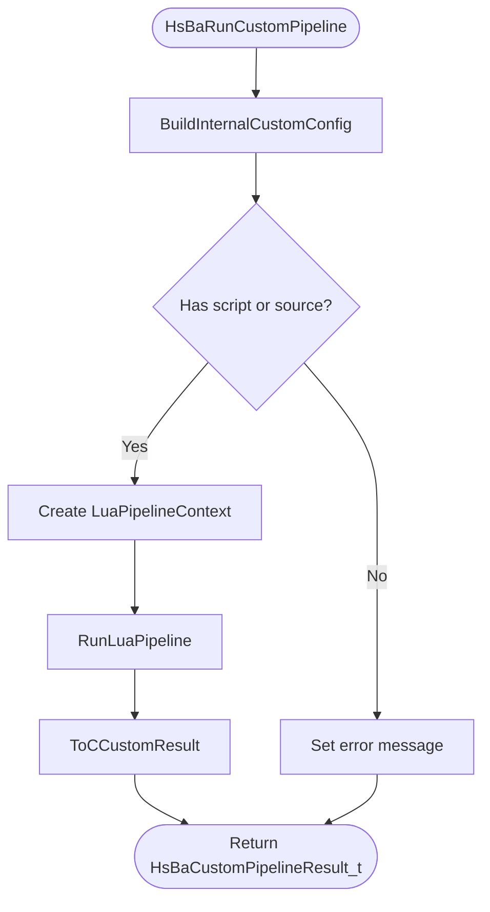
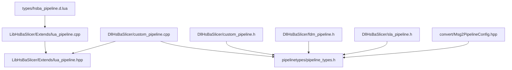

# Pipeline Type Definitions / 流水线类型定义

<cite>
**Referenced Files in This Document**   
- [hsba_pipeline.d.lua](file://types/hsba_pipeline.d.lua)
- [pipeline_types.h](file://pipelinetypes/pipeline_types.h)
- [lua_pipeline.hpp](file://LibHsBaSlicer/Extends/lua_pipeline.hpp)
- [lua_pipeline.cpp](file://LibHsBaSlicer/Extends/lua_pipeline.cpp)
- [custom_pipeline.h](file://DllHsBaSlicer/custom_pipeline.h)
- [custom_pipeline.cpp](file://DllHsBaSlicer/custom_pipeline.cpp)
- [fdm_pipeline.h](file://DllHsBaSlicer/fdm_pipeline.h)
- [sla_pipeline.h](file://DllHsBaSlicer/sla_pipeline.h)
- [Msg2PipelineConfig.hpp](file://convert/Msg2PipelineConfig.hpp)
</cite>

## Table of Contents
1. [Introduction](#introduction)
2. [Project Structure](#project-structure)
3. [Core Components](#core-components)
4. [Architecture Overview](#architecture-overview)
5. [Detailed Component Analysis](#detailed-component-analysis)
6. [Dependency Analysis](#dependency-analysis)
7. [Performance Considerations](#performance-considerations)
8. [Troubleshooting Guide](#troubleshooting-guide)
9. [Conclusion](#conclusion)
10. [Appendices](#appendices)

## Introduction
This document explains how HsBaSlicer defines pipeline types across three layers:
- Lua type definitions for IntelliSense and IDE completion.
- C-compatible pipeline configuration and result structs.
- C++ implementation that executes fixed pipelines or fully Lua-driven custom pipelines.

The central Lua file `types/hsba_pipeline.d.lua` does not run at runtime; it provides type annotations for editors such as LuaLS or EmmyLua. The C/C++ layer defines the real data contracts through `pipelinetypes/pipeline_types.h`, while `LibHsBaSlicer/Extends/lua_pipeline.*` implements the Lua environment exposed by the global `HsBa` table.

## Project Structure
The pipeline type system spans several directories:

**Diagram sources**
- [hsba_pipeline.d.lua:1-18](file://types/hsba_pipeline.d.lua#L1-L18)
- [pipeline_types.h:5-12](file://pipelinetypes/pipeline_types.h#L5-L12)
- [Msg2PipelineConfig.hpp:1-20](file://convert/Msg2PipelineConfig.hpp#L1-L20)
- [custom_pipeline.h:1-10](file://DllHsBaSlicer/custom_pipeline.h#L1-L10)
- [lua_pipeline.hpp:1-28](file://LibHsBaSlicer/Extends/lua_pipeline.hpp#L1-L28)
- [fdm_pipeline.h:1-11](file://DllHsBaSlicer/fdm_pipeline.h#L1-L11)
- [sla_pipeline.h:1-11](file://DllHsBaSlicer/sla_pipeline.h#L1-L11)

**Section sources**
- [hsba_pipeline.d.lua:1-18](file://types/hsba_pipeline.d.lua#L1-L18)
- [pipeline_types.h:5-12](file://pipelinetypes/pipeline_types.h#L5-L12)
- [Msg2PipelineConfig.hpp:1-20](file://convert/Msg2PipelineConfig.hpp#L1-L20)
- [custom_pipeline.h:1-10](file://DllHsBaSlicer/custom_pipeline.h#L1-L10)
- [lua_pipeline.hpp:1-28](file://LibHsBaSlicer/Extends/lua_pipeline.hpp#L1-L28)
- [fdm_pipeline.h:1-11](file://DllHsBaSlicer/fdm_pipeline.h#L1-L11)
- [sla_pipeline.h:1-11](file://DllHsBaSlicer/sla_pipeline.h#L1-L11)

## Core Components
There are four major components in this type system:

| Layer | Primary File | Responsibility |
|---|---|---|
| Lua IDE types | `types/hsba_pipeline.d.lua` | Declares geometry types, shared libraries, `HsBa` API, built-in stage environments, and pipeline-stage annotation classes. |
| C-compatible types | `pipelinetypes/pipeline_types.h` | Defines enums, config structs, result structs, progress/result callbacks, default initializers, and pipeline kind enumeration. |
| Lua execution environment | `LibHsBaSlicer/Extends/lua_pipeline.hpp` and `.cpp` | Builds a Lua state, registers polygon/support/fill/file/database tools, exposes `HsBa`, runs user scripts, and collects output. |
| Custom pipeline C ABI | `DllHsBaSlicer/custom_pipeline.h` and `.cpp` | Converts C ABI configs/results into internal C++ objects and calls the Lua pipeline runner. |

**Section sources**
- [hsba_pipeline.d.lua:1-18](file://types/hsba_pipeline.d.lua#L1-L18)
- [pipeline_types.h:5-12](file://pipelinetypes/pipeline_types.h#L5-L12)
- [lua_pipeline.hpp:19-83](file://LibHsBaSlicer/Extends/lua_pipeline.hpp#L19-L83)
- [custom_pipeline.h:17-62](file://DllHsBaSlicer/custom_pipeline.h#L17-L62)

## Architecture Overview
The pipeline architecture has two modes:

1. **Fixed pipelines**: FDM, SLA, SLS, SLM, LOM, TDP, WAAM, and file transfer have predefined stage order implemented in C++. Their configuration is described by C-compatible structs.
2. **Custom Lua pipeline**: The entire workflow is defined by a Lua entry function. C++ only provides building blocks through the `HsBa` table.

**Diagram sources**
- [pipeline_types.h:53-113](file://pipelinetypes/pipeline_types.h#L53-L113)
- [pipeline_types.h:165-218](file://pipelinetypes/pipeline_types.h#L165-L218)
- [pipeline_types.h:689-704](file://pipelinetypes/pipeline_types.h#L689-L704)
- [lua_pipeline.hpp:19-83](file://LibHsBaSlicer/Extends/lua_pipeline.hpp#L19-L83)
- [custom_pipeline.cpp:118-163](file://DllHsBaSlicer/custom_pipeline.cpp#L118-L163)

**Section sources**
- [pipeline_types.h:53-113](file://pipelinetypes/pipeline_types.h#L53-L113)
- [pipeline_types.h:165-218](file://pipelinetypes/pipeline_types.h#L165-L218)
- [pipeline_types.h:689-704](file://pipelinetypes/pipeline_types.h#L689-L704)
- [lua_pipeline.hpp:19-83](file://LibHsBaSlicer/Extends/lua_pipeline.hpp#L19-L83)
- [custom_pipeline.cpp:118-163](file://DllHsBaSlicer/custom_pipeline.cpp#L118-L163)

## Detailed Component Analysis

### Lua Type Definition File: `hsba_pipeline.d.lua`
The Lua definition file is primarily documentation and IDE support. It declares:

- Basic geometry aliases: `Point2D`, `Point3D`, `Quaternion`, `Polygon`, `Polygons`, `LayerList`.
- Shared library interfaces: `PolygonOperations`, `PolygonFill`, `PathOptimize`, `Support`, `Zipper`, `Bit7zZipper`, `Cipher`, SQLite/MySQL/PostgreSQL adapters, and `ParamStore`.
- The `HsBa` global operations table used by Custom pipelines.
- Built-in stage environments: FDM support/fill, SLA floor, export stages, and WAAM robot path generation.
- Pipeline-stage annotation classes for IDE navigation.

Key responsibilities:
- Provide IntelliSense for Lua script authors.
- Document parameter shapes for optional tables such as `FillOptions`, `SupportOptions`, `FloorConfig`, `GcodeOptions`, `SlsPackageInput`, `WaamPackageInput`, and `SlaPackageInput`.
- Define built-in entry functions like `generate_support`, `generate_fill`, `generate_floor`, `export_sls`, `export_slm`, `export_lom`, `export_tdp`, `export_sla`, and `export_waam`.

**Diagram sources**
- [hsba_pipeline.d.lua:24-30](file://types/hsba_pipeline.d.lua#L24-L30)
- [hsba_pipeline.d.lua:35-187](file://types/hsba_pipeline.d.lua#L35-L187)
- [hsba_pipeline.d.lua:290-463](file://types/hsba_pipeline.d.lua#L290-L463)

**Section sources**
- [hsba_pipeline.d.lua:24-30](file://types/hsba_pipeline.d.lua#L24-L30)
- [hsba_pipeline.d.lua:35-187](file://types/hsba_pipeline.d.lua#L35-L187)
- [hsba_pipeline.d.lua:290-463](file://types/hsba_pipeline.d.lua#L290-L463)
- [hsba_pipeline.d.lua:465-663](file://types/hsba_pipeline.d.lua#L465-L663)

### C-Compatible Pipeline Types: `pipeline_types.h`
The C header defines the stable contract between callers and the slicer library. It includes:

- Enums for fill mode, support pattern, G-code firmware, image type, material, light source, protection method, robot controller, cut mode, binder mode, and pipeline kind.
- Configuration structs for each pipeline: FDM, SLA, SLS, SLM, LOM, TDP, WAAM, file transfer, and custom Lua pipeline.
- Result structs with success flags, layer counts, output paths, error messages, and elapsed time.
- Progress and result callback typedefs.
- Default initializer functions such as `HsBaFdmConfigDefault`, `HsBaSlaConfigDefault`, `HsBaSlsConfigDefault`, `HsBaSlmConfigDefault`, `HsBaLomConfigDefault`, `HsBaTdpConfigDefault`, `HsBaWaamConfigDefault`, `HsBaFileTransferConfigDefault`, and `HsBaCustomConfigDefault`.
- A `HsBaPipelineKind` enum aligned with the parameter store backend and reflect system.

Important design notes:
- The header is intentionally free of DLL export macros so downstream modules can include struct definitions without depending on the shared library.
- String fields in config structs are `const char*`; result string fields are owned by the caller after allocation.
- Many pipeline configs include Lua customization fields such as `support_lua_script`, `infill_lua_script`, `floor_lua_script`, `export_lua_script`, and `path_lua_script`.

**Diagram sources**
- [pipeline_types.h:53-127](file://pipelinetypes/pipeline_types.h#L53-L127)
- [pipeline_types.h:165-232](file://pipelinetypes/pipeline_types.h#L165-L232)
- [pipeline_types.h:689-719](file://pipelinetypes/pipeline_types.h#L689-L719)

**Section sources**
- [pipeline_types.h:5-12](file://pipelinetypes/pipeline_types.h#L5-L12)
- [pipeline_types.h:53-127](file://pipelinetypes/pipeline_types.h#L53-L127)
- [pipeline_types.h:165-232](file://pipelinetypes/pipeline_types.h#L165-L232)
- [pipeline_types.h:259-310](file://pipelinetypes/pipeline_types.h#L259-L310)
- [pipeline_types.h:359-401](file://pipelinetypes/pipeline_types.h#L359-L401)
- [pipeline_types.h:419-461](file://pipelinetypes/pipeline_types.h#L419-L461)
- [pipeline_types.h:480-521](file://pipelinetypes/pipeline_types.h#L480-L521)
- [pipeline_types.h:578-625](file://pipelinetypes/pipeline_types.h#L578-L625)
- [pipeline_types.h:636-674](file://pipelinetypes/pipeline_types.h#L636-L674)
- [pipeline_types.h:689-732](file://pipelinetypes/pipeline_types.h#L689-L732)
- [pipeline_types.h:742-983](file://pipelinetypes/pipeline_types.h#L742-L983)
- [pipeline_types.h:993-1042](file://pipelinetypes/pipeline_types.h#L993-L1042)

### Lua Pipeline Environment: `lua_pipeline.hpp` and `lua_pipeline.cpp`
The C++ implementation creates a Lua environment for custom pipelines. Its main responsibilities are:

- Defining `LuaPipelineContext` and `LuaPipelineOutput`.
- Registering common Lua types, polygon operations, support generators, fill algorithms, path optimizers, zip/cipher/database adapters, model loading, slicing, support, floor, G-code generation, and packaging.
- Exposing the `HsBa` table with methods matching the Lua type definitions.
- Running the user-defined entry function and collecting results.

Key implementation details:
- `PipelineRunState` stores the context pointer, output pointer, registry keys for total layers and output path.
- Helper functions read Lua tables into C++ structures with defaults.
- Polygon data is converted between Lua tables and internal polygon types.
- Progress reporting from Lua is forwarded to the C++ progress callback.
- Model, slice, fill, support, floor, spiral, G-code, and package APIs validate inputs and return Lua values.

**Diagram sources**
- [custom_pipeline.cpp:176-183](file://DllHsBaSlicer/custom_pipeline.cpp#L176-L183)
- [lua_pipeline.hpp:69-83](file://LibHsBaSlicer/Extends/lua_pipeline.hpp#L69-L83)
- [lua_pipeline.cpp:118-163](file://LibHsBaSlicer/Extends/lua_pipeline.cpp#L118-L163)

**Section sources**
- [lua_pipeline.hpp:19-83](file://LibHsBaSlicer/Extends/lua_pipeline.hpp#L19-L83)
- [lua_pipeline.cpp:46-70](file://LibHsBaSlicer/Extends/lua_pipeline.cpp#L46-L70)
- [lua_pipeline.cpp:76-145](file://LibHsBaSlicer/Extends/lua_pipeline.cpp#L76-L145)
- [lua_pipeline.cpp:160-222](file://LibHsBaSlicer/Extends/lua_pipeline.cpp#L160-L222)
- [lua_pipeline.cpp:228-288](file://LibHsBaSlicer/Extends/lua_pipeline.cpp#L228-L288)
- [lua_pipeline.cpp:292-397](file://LibHsBaSlicer/Extends/lua_pipeline.cpp#L292-L397)
- [lua_pipeline.cpp:401-478](file://LibHsBaSlicer/Extends/lua_pipeline.cpp#L401-L478)
- [lua_pipeline.cpp:482-556](file://LibHsBaSlicer/Extends/lua_pipeline.cpp#L482-L556)
- [lua_pipeline.cpp:560-690](file://LibHsBaSlicer/Extends/lua_pipeline.cpp#L560-L690)
- [lua_pipeline.cpp:695-800](file://LibHsBaSlicer/Extends/lua_pipeline.cpp#L695-L800)

### Custom Pipeline C ABI: `custom_pipeline.h` and `custom_pipeline.cpp`
The custom pipeline C ABI bridges the C-compatible config/result structs to the internal C++ pipeline runner.

Responsibilities:
- Convert `HsBaCustomPipelineConfig_t` into an internal `InternalCustomConfig`.
- Validate that either `pipeline_lua_script` or `pipeline_lua_source` is provided.
- Build a `LuaPipelineContext` with script, entry function, JSON config, model info, output path, and progress callback.
- Run the pipeline asynchronously using coroutines and convert the internal result back to the C ABI.
- Provide synchronous and asynchronous entry points plus a memory-free function.

**Diagram sources**
- [custom_pipeline.cpp:86-99](file://DllHsBaSlicer/custom_pipeline.cpp#L86-L99)
- [custom_pipeline.cpp:101-115](file://DllHsBaSlicer/custom_pipeline.cpp#L101-L115)
- [custom_pipeline.cpp:118-163](file://DllHsBaSlicer/custom_pipeline.cpp#L118-L163)
- [custom_pipeline.cpp:176-183](file://DllHsBaSlicer/custom_pipeline.cpp#L176-L183)

**Section sources**
- [custom_pipeline.h:17-62](file://DllHsBaSlicer/custom_pipeline.h#L17-L62)
- [custom_pipeline.cpp:23-84](file://DllHsBaSlicer/custom_pipeline.cpp#L23-L84)
- [custom_pipeline.cpp:86-115](file://DllHsBaSlicer/custom_pipeline.cpp#L86-L115)
- [custom_pipeline.cpp:118-163](file://DllHsBaSlicer/custom_pipeline.cpp#L118-L163)
- [custom_pipeline.cpp:171-213](file://DllHsBaSlicer/custom_pipeline.cpp#L171-L213)

### Fixed Pipeline ABIs: FDM and SLA
Fixed pipelines expose similar C ABI patterns: create default config, run synchronously or asynchronously, and free results.

- FDM pipeline: Preprocess → Slice → Support → Fill → Path Generation.
- SLA pipeline: Preprocess → Slice → Floor → Support → Export.

These headers do not define behavior themselves; they declare the public interface backed by implementations that use the same C-compatible types from `pipeline_types.h`.

**Section sources**
- [fdm_pipeline.h:17-61](file://DllHsBaSlicer/fdm_pipeline.h#L17-L61)
- [sla_pipeline.h:17-56](file://DllHsBaSlicer/sla_pipeline.h#L17-L56)

### Serialization and Configuration Management
The project uses multiple serialization and configuration mechanisms:

| Mechanism | Purpose | Relevant Files |
|---|---|---|
| C-compatible structs | Stable ABI for pipeline configs and results | `pipelinetypes/pipeline_types.h` |
| Protocol Buffers | Message-based configuration and result exchange | `proto/*_pipeline.proto`, `convert/Msg2PipelineConfig.hpp` |
| Lua tables | Runtime configuration passed through `HsBa` API and built-in stage environments | `types/hsba_pipeline.d.lua`, `LibHsBaSlicer/Extends/lua_pipeline.cpp` |
| JSON | Free-form configuration string passed to Lua via `pipeline_config` | `pipelinetypes/pipeline_types.h`, `LibHsBaSlicer/Extends/lua_pipeline.cpp` |
| ParamStore | Persistent process-parameter storage | `pipelinetypes/pipeline_types.h`, `types/hsba_pipeline.d.lua` |

The converter header maps protobuf messages to native C configs and results. This keeps network or stored configurations decoupled from the C ABI.

**Diagram sources**
- [Msg2PipelineConfig.hpp:1-20](file://convert/Msg2PipelineConfig.hpp#L1-L20)
- [Msg2PipelineConfig.hpp:24-99](file://convert/Msg2PipelineConfig.hpp#L24-L99)
- [pipeline_types.h:53-127](file://pipelinetypes/pipeline_types.h#L53-L127)
- [pipeline_types.h:165-232](file://pipelinetypes/pipeline_types.h#L165-L232)

**Section sources**
- [Msg2PipelineConfig.hpp:1-20](file://convert/Msg2PipelineConfig.hpp#L1-L20)
- [Msg2PipelineConfig.hpp:24-99](file://convert/Msg2PipelineConfig.hpp#L24-L99)
- [pipeline_types.h:993-1042](file://pipelinetypes/pipeline_types.h#L993-L1042)
- [hsba_pipeline.d.lua:177-187](file://types/hsba_pipeline.d.lua#L177-L187)

## Dependency Analysis
The dependency relationships among pipeline-related components are:

**Diagram sources**
- [hsba_pipeline.d.lua:1-18](file://types/hsba_pipeline.d.lua#L1-L18)
- [lua_pipeline.cpp:1-40](file://LibHsBaSlicer/Extends/lua_pipeline.cpp#L1-L40)
- [lua_pipeline.hpp:1-28](file://LibHsBaSlicer/Extends/lua_pipeline.hpp#L1-L28)
- [pipeline_types.h:5-12](file://pipelinetypes/pipeline_types.h#L5-L12)
- [custom_pipeline.cpp:1-16](file://DllHsBaSlicer/custom_pipeline.cpp#L1-L16)
- [custom_pipeline.h:1-10](file://DllHsBaSlicer/custom_pipeline.h#L1-L10)
- [fdm_pipeline.h:1-11](file://DllHsBaSlicer/fdm_pipeline.h#L1-L11)
- [sla_pipeline.h:1-11](file://DllHsBaSlicer/sla_pipeline.h#L1-L11)
- [Msg2PipelineConfig.hpp:1-20](file://convert/Msg2PipelineConfig.hpp#L1-L20)

**Section sources**
- [hsba_pipeline.d.lua:1-18](file://types/hsba_pipeline.d.lua#L1-L18)
- [lua_pipeline.cpp:1-40](file://LibHsBaSlicer/Extends/lua_pipeline.cpp#L1-L40)
- [lua_pipeline.hpp:1-28](file://LibHsBaSlicer/Extends/lua_pipeline.hpp#L1-L28)
- [pipeline_types.h:5-12](file://pipelinetypes/pipeline_types.h#L5-L12)
- [custom_pipeline.cpp:1-16](file://DllHsBaSlicer/custom_pipeline.cpp#L1-L16)
- [custom_pipeline.h:1-10](file://DllHsBaSlicer/custom_pipeline.h#L1-L10)
- [fdm_pipeline.h:1-11](file://DllHsBaSlicer/fdm_pipeline.h#L1-L11)
- [sla_pipeline.h:1-11](file://DllHsBaSlicer/sla_pipeline.h#L1-L11)
- [Msg2PipelineConfig.hpp:1-20](file://convert/Msg2PipelineConfig.hpp#L1-L20)

## Performance Considerations
- Custom pipelines should avoid excessive Lua-to-C++ conversions inside tight loops. Prefer batching polygon data and using the provided `HsBa` helpers.
- Progress callbacks are invoked from Lua through `HsBa.progress`; heavy work in the callback can block the pipeline runner.
- Large models and many layers increase slicing, support, fill, and packaging costs. Use appropriate layer heights and optional Lua customization to reduce unnecessary computation.
- The custom pipeline runner measures elapsed time and reports it in the result struct, which helps identify slow stages.

[No sources needed since this section provides general guidance]

## Troubleshooting Guide
Common type-related issues and their likely causes:

| Symptom | Likely Cause | Resolution |
|---|---|---|
| Lua script cannot find `HsBa` | Custom pipeline script executed outside the registered environment | Ensure the script is loaded through `HsBaRunCustomPipeline` or `SetupLuaPipelineEnvironment`. |
| `HsBa.loadModel` fails | Invalid model name or missing file | Verify model pool contents and file paths before calling. |
| `HsBa.slice` returns empty polygons | Open mesh or invalid Z value | Check model validity and ensure Z is within model bounds. |
| `HsBa.toGcode` fails | Missing required layer data or invalid configuration | Confirm `LayerPathInput` fields and `GcodeOptions`. |
| Custom pipeline reports missing script/source | Both `pipeline_lua_script` and `pipeline_lua_source` are empty | Set at least one field in `HsBaCustomPipelineConfig_t`. |
| Memory leak in C ABI result | Caller did not call the corresponding free function | Call `HsBaFreeCustomPipelineResult`, `HsBaFreePipelineResult`, or other result-free functions. |
| IDE shows no completions for `HsBa` | Lua language server not configured with type definitions | Include `types/hsba_pipeline.d.lua` in the LuaLS/EmmyLua configuration. |

**Section sources**
- [custom_pipeline.cpp:127-133](file://DllHsBaSlicer/custom_pipeline.cpp#L127-L133)
- [lua_pipeline.cpp:258-288](file://LibHsBaSlicer/Extends/lua_pipeline.cpp#L258-L288)
- [lua_pipeline.cpp:292-340](file://LibHsBaSlicer/Extends/lua_pipeline.cpp#L292-L340)
- [lua_pipeline.cpp:401-478](file://LibHsBaSlicer/Extends/lua_pipeline.cpp#L401-L478)
- [lua_pipeline.cpp:622-690](file://LibHsBaSlicer/Extends/lua_pipeline.cpp#L622-L690)
- [custom_pipeline.cpp:203-213](file://DllHsBaSlicer/custom_pipeline.cpp#L203-L213)
- [hsba_pipeline.d.lua:1-18](file://types/hsba_pipeline.d.lua#L1-L18)

## Conclusion
HsBaSlicer’s pipeline type system separates concerns cleanly:
- Lua type definitions provide developer experience and contract documentation.
- C-compatible structs provide a stable, cross-language boundary.
- The Lua pipeline environment exposes reusable building blocks while letting users control workflow logic.
- Protobuf converters allow configuration to be serialized independently of the C ABI.

Maintaining type safety requires keeping these layers synchronized:
- Update `hsba_pipeline.d.lua` when adding or changing Lua APIs.
- Update `pipeline_types.h` when changing C ABI structs.
- Update `lua_pipeline.cpp` when implementing new `HsBa` methods.
- Update protobuf messages and converters when extending external configuration formats.

[No sources needed since this section summarizes without analyzing specific files]

## Appendices

### How to Define a Custom Pipeline Type
1. Add Lua type annotations in `types/hsba_pipeline.d.lua` if the new API is visible to Lua scripts.
2. Add C-compatible config/result fields in `pipelinetypes/pipeline_types.h` if the change affects the C ABI.
3. Implement the C++ behavior in `LibHsBaSlicer/Extends/lua_pipeline.cpp` if the change is part of the Lua environment.
4. If the change is exposed through the custom pipeline C ABI, update `DllHsBaSlicer/custom_pipeline.*`.
5. If the change is part of a fixed pipeline, update the relevant pipeline header and implementation.
6. If the change is part of serialized configuration, update the protobuf message and `Msg2PipelineConfig` converter.

**Section sources**
- [hsba_pipeline.d.lua:290-463](file://types/hsba_pipeline.d.lua#L290-L463)
- [pipeline_types.h:689-732](file://pipelinetypes/pipeline_types.h#L689-L732)
- [lua_pipeline.cpp:228-800](file://LibHsBaSlicer/Extends/lua_pipeline.cpp#L228-L800)
- [custom_pipeline.h:17-62](file://DllHsBaSlicer/custom_pipeline.h#L17-L62)
- [Msg2PipelineConfig.hpp:64-73](file://convert/Msg2PipelineConfig.hpp#L64-L73)

### Relationship Between Lua Types and C++ Mappings
- Lua geometry types (`Point2D`, `Point3D`, `Polygon`, `Polygons`) map to Lua tables and internal polygon structures handled by the Lua adapter and polygon utilities.
- Optional configuration tables in Lua correspond to C++ helper readers that apply defaults.
- The `HsBa` Lua API is implemented in C++ and validates input before calling core algorithms.
- The C ABI structs are independent of Lua runtime but share semantic meaning with Lua tables documented in the Lua type file.

**Section sources**
- [hsba_pipeline.d.lua:24-30](file://types/hsba_pipeline.d.lua#L24-L30)
- [hsba_pipeline.d.lua:193-292](file://types/hsba_pipeline.d.lua#L193-L292)
- [lua_pipeline.cpp:76-145](file://LibHsBaSlicer/Extends/lua_pipeline.cpp#L76-L145)
- [lua_pipeline.cpp:185-222](file://LibHsBaSlicer/Extends/lua_pipeline.cpp#L185-L222)