# Support Generation API / 支撑生成API

<cite>
**Referenced Files in This Document**   
- [LuaSupport.cpp](file://support/LuaSupport.cpp)
- [LuaAdapter.cpp](file://support/LuaAdapter.cpp)
- [FdmSupport.cpp](file://support/FdmSupport.cpp)
- [SlaSupport.cpp](file://support/SlaSupport.cpp)
- [OverhangDetector.cpp](file://support/OverhangDetector.cpp)
- [SupportConfig.hpp](file://support/SupportConfig.hpp)
- [LuaSupport.hpp](file://support/LuaSupport.hpp)
- [LuaAdapter.hpp](file://support/LuaAdapter.hpp)
- [FdmSupport.hpp](file://support/FdmSupport.hpp)
- [SlaSupport.hpp](file://support/SlaSupport.hpp)
- [OverhangDetector.hpp](file://support/OverhangDetector.hpp)
- [fdm_support.cpp](file://LibHsBaSlicer/Support/fdm_support.cpp)
- [my_support.lua](file://samples/FDM/scripts/my_support.lua)
- [my_sla_support.lua](file://samples/SLA/scripts/my_sla_support.lua)
- [hsba_pipeline.d.lua](file://types/hsba_pipeline.d.lua)
</cite>

## Table of Contents
1. [Introduction](#introduction)
2. [Project Structure](#project-structure)
3. [Core Components](#core-components)
4. [Architecture Overview](#architecture-overview)
5. [Detailed Component Analysis](#detailed-component-analysis)
6. [Dependency Analysis](#dependency-analysis)
7. [Performance Considerations](#performance-considerations)
8. [Troubleshooting Guide](#troubleshooting-guide)
9. [Conclusion](#conclusion)
10. [Appendices](#appendices)

## Introduction
This document explains the support generation Lua API and the underlying C++ support pipeline for FDM and SLA slicing. It covers:
- FDM support strategies: plane supports, tree supports, and honeycomb patterns.
- SLA sacrificial support generation.
- Overhang detection parameters and how they control where supports are needed.
- Support density and geometry controls exposed through configuration structures.
- The Lua interface for creating custom support generators, modifying built-in strategies, and integrating with the main slicing pipeline.
- Parameter validation, error handling, and performance tuning guidance for complex scenarios.

The goal is to help both new users and advanced script authors understand how to configure, customize, and optimize support generation across manufacturing processes.

## Project Structure
The support generation system is implemented under `support/` and exposed via a Lua module named `Support`. Core implementation files include:
- Strategy implementations: FDM plane/tree/honeycomb and SLA sacrificial supports.
- Overhang detection logic used by all strategies.
- Lua bindings that expose support creation, generation, overhang detection, and default configuration.
- A Lua-based custom generator wrapper that executes user scripts per layer.

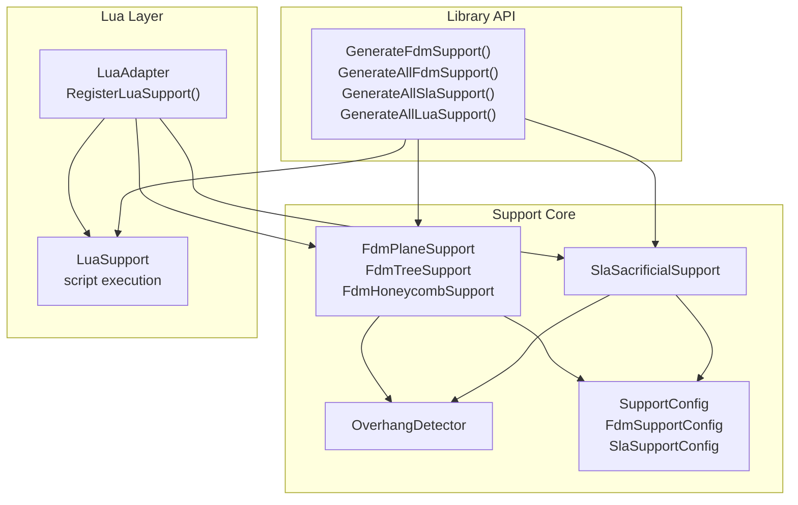

**Diagram sources**
- [LuaAdapter.cpp:110-172](file://support/LuaAdapter.cpp#L110-L172)
- [FdmSupport.cpp:48-76](file://support/FdmSupport.cpp#L48-L76)
- [SlaSupport.cpp:81-124](file://support/SlaSupport.cpp#L81-L124)
- [OverhangDetector.cpp:41-87](file://support/OverhangDetector.cpp#L41-L87)
- [fdm_support.cpp:14-75](file://LibHsBaSlicer/Support/fdm_support.cpp#L14-L75)

**Section sources**
- [LuaAdapter.cpp:110-172](file://support/LuaAdapter.cpp#L110-L172)
- [LuaSupport.cpp:93-178](file://support/LuaSupport.cpp#L93-L178)
- [FdmSupport.cpp:48-267](file://support/FdmSupport.cpp#L48-L267)
- [SlaSupport.cpp:38-133](file://support/SlaSupport.cpp#L38-L133)
- [OverhangDetector.cpp:23-87](file://support/OverhangDetector.cpp#L23-L87)
- [fdm_support.cpp:14-75](file://LibHsBaSlicer/Support/fdm_support.cpp#L14-L75)

## Core Components
This section summarizes the core classes and their responsibilities.

- OverhangDetector
  - Computes overhang regions between adjacent layers based on layer height and angle threshold.
  - Provides a helper to compute maximum bridge distance from angle and layer height.

- FDM Strategies
  - FdmPlaneSupport: inflates overhang regions by half the support diameter to create column cross-sections.
  - FdmTreeSupport: samples branch points within overhang regions and creates circular tips; merging handled at higher levels.
  - FdmHoneycombSupport: fills overhang regions with hexagonal cells of configurable size.

- SLA Strategy
  - SlaSacrificialSupport: samples small tip circles spaced by support diameter to generate thin sacrificial columns.

- Lua Integration
  - LuaSupport: executes user-provided Lua scripts per layer, exposing polygon helpers and the Support module.
  - LuaAdapter: registers the global `Support` table with constructors for each strategy and utility functions.

- Configuration
  - SupportConfig: shared fields including overhang angle threshold, layer height, gap, diameter, density, pattern, tree parameters, and honeycomb cell size.
  - FdmSupportConfig: adds interface layer settings.
  - SlaSupportConfig: adds tip diameter and raft thickness.

**Section sources**
- [OverhangDetector.hpp:20-50](file://support/OverhangDetector.hpp#L20-L50)
- [FdmSupport.hpp:13-63](file://support/FdmSupport.hpp#L13-L63)
- [SlaSupport.hpp:13-42](file://support/SlaSupport.hpp#L13-L42)
- [LuaSupport.hpp:21-67](file://support/LuaSupport.hpp#L21-L67)
- [LuaAdapter.hpp:13-30](file://support/LuaAdapter.hpp#L13-L30)
- [SupportConfig.hpp:14-43](file://support/SupportConfig.hpp#L14-L43)

## Architecture Overview
The support generation pipeline integrates C++ strategies with a flexible Lua scripting layer.

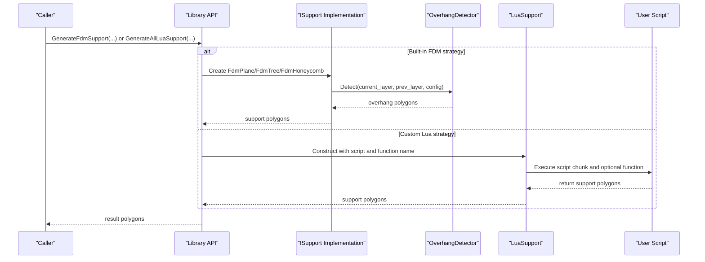

**Diagram sources**
- [fdm_support.cpp:14-75](file://LibHsBaSlicer/Support/fdm_support.cpp#L14-L75)
- [LuaSupport.cpp:113-178](file://support/LuaSupport.cpp#L113-L178)
- [OverhangDetector.cpp:41-87](file://support/OverhangDetector.cpp#L41-L87)

## Detailed Component Analysis

### Overhang Detection
Overhang detection determines which areas need support by comparing current and previous layers.

Key behaviors:
- If there is no previous layer, the entire current layer is considered an overhang.
- Otherwise, it computes the difference between current and previous layers.
- It erodes the difference by a distance derived from layer height and angle threshold to filter out small bridges.
- Returns empty polygons when no overhang remains after erosion.

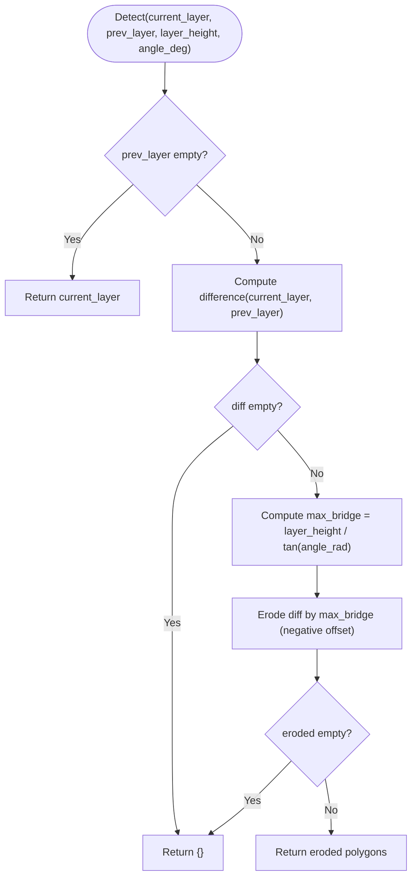

**Diagram sources**
- [OverhangDetector.cpp:41-87](file://support/OverhangDetector.cpp#L41-L87)

**Section sources**
- [OverhangDetector.cpp:23-87](file://support/OverhangDetector.cpp#L23-L87)
- [OverhangDetector.hpp:20-50](file://support/OverhangDetector.hpp#L20-L50)

### FDM Plane Supports
FdmPlaneSupport generates simple column supports by inflating overhang regions.

Processing steps:
- Detect overhang using OverhangDetector.
- Apply a negative offset equal to support_gap to separate support from model.
- Inflate the gapped region by half the support_diameter to form cylindrical cross-sections.
- Return the resulting polygons.

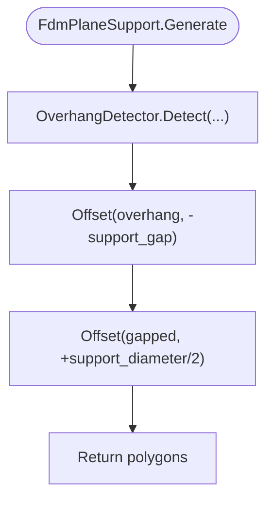

**Diagram sources**
- [FdmSupport.cpp:48-76](file://support/FdmSupport.cpp#L48-L76)

**Section sources**
- [FdmSupport.cpp:48-76](file://support/FdmSupport.cpp#L48-L76)
- [FdmSupport.hpp:13-24](file://support/FdmSupport.hpp#L13-L24)

### FDM Tree Supports
FdmTreeSupport places circular branch tips at sample points inside the overhang region.

Processing steps:
- Detect overhang and apply gap.
- Compute bounding box of the gapped overhang.
- Sample candidate points on a grid with spacing proportional to support_diameter.
- For each point inside the overhang, create a circle of radius support_diameter/2.
- Union overlapping circles to produce final branch cross-sections.

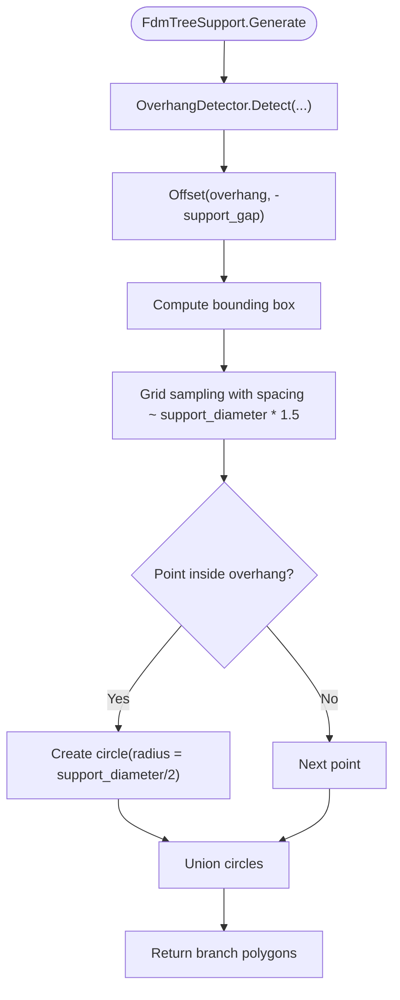

**Diagram sources**
- [FdmSupport.cpp:81-168](file://support/FdmSupport.cpp#L81-L168)

**Section sources**
- [FdmSupport.cpp:81-168](file://support/FdmSupport.cpp#L81-L168)
- [FdmSupport.hpp:26-44](file://support/FdmSupport.hpp#L26-L44)

### FDM Honeycomb Supports
FdmHoneycombSupport fills overhang regions with hexagonal cells.

Processing steps:
- Detect overhang and apply gap.
- Generate flat-top hexagons with configurable cell_size.
- Intersect the union of hexagons with the overhang region.
- Return the intersected polygons.

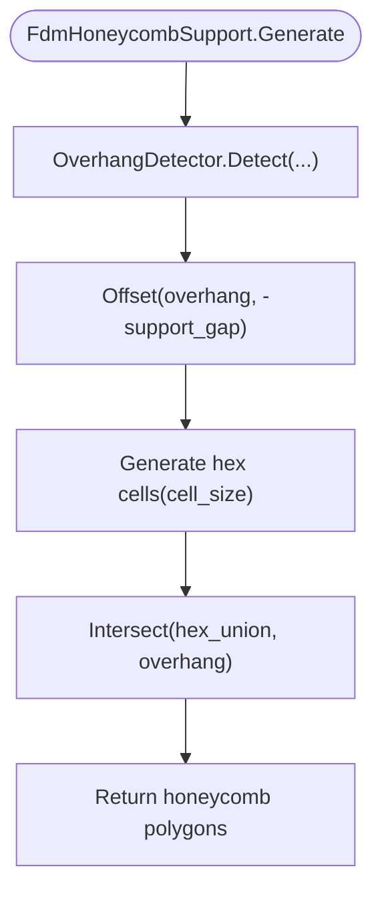

**Diagram sources**
- [FdmSupport.cpp:173-267](file://support/FdmSupport.cpp#L173-L267)

**Section sources**
- [FdmSupport.cpp:173-267](file://support/FdmSupport.cpp#L173-L267)
- [FdmSupport.hpp:46-63](file://support/FdmSupport.hpp#L46-L63)

### SLA Sacrificial Supports
SlaSacrificialSupport generates thin sacrificial supports suitable for resin printing.

Processing steps:
- Detect overhang and apply gap.
- Sample support points using tip_radius and spacing derived from support_diameter.
- Create small circles at sampled points.
- Union circles to produce final support cross-sections.

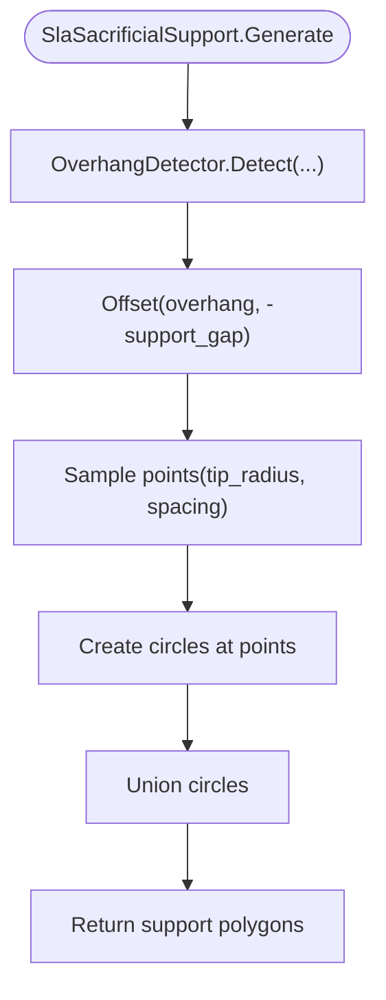

**Diagram sources**
- [SlaSupport.cpp:38-124](file://support/SlaSupport.cpp#L38-L124)

**Section sources**
- [SlaSupport.cpp:38-133](file://support/SlaSupport.cpp#L38-L133)
- [SlaSupport.hpp:13-42](file://support/SlaSupport.hpp#L13-L42)

### Lua Support Module Interface
The Lua `Support` module exposes:
- Constructors: `new_plane`, `new_tree`, `new_honeycomb`, `new_sla`, `new_lua`, `new_lua_file`.
- Utilities: `generate(support_obj, current_layer, prev_layer, layer_height, config_table)` and `detect_overhang(current_layer, prev_layer, layer_height, angle_deg)`.
- Default configuration: `default_config()` returns a table with all supported fields.

Configuration table fields exposed to Lua:
- overhang_angle_threshold
- layer_height
- support_gap
- support_diameter
- support_density
- support_pattern
- tree_branch_angle
- tree_max_branch_radius
- honeycomb_cell_size

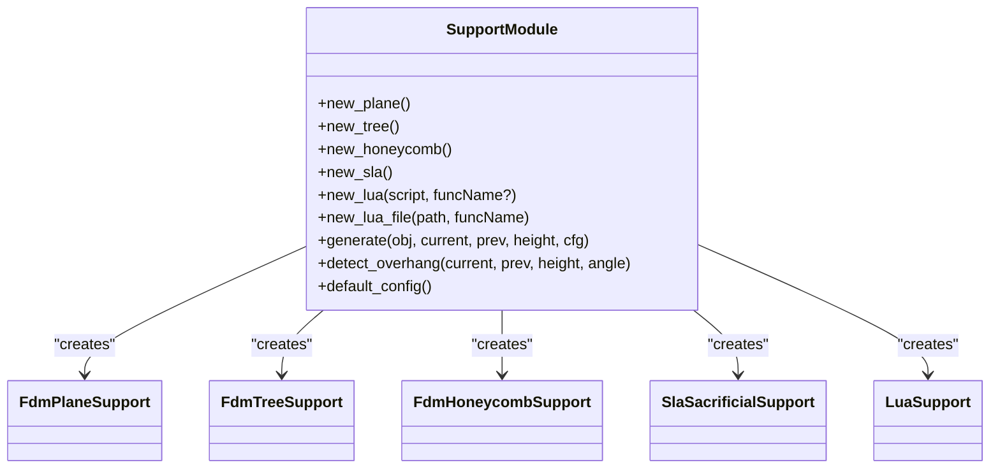

**Diagram sources**
- [LuaAdapter.cpp:110-172](file://support/LuaAdapter.cpp#L110-L172)
- [LuaAdapter.cpp:215-241](file://support/LuaAdapter.cpp#L215-L241)
- [LuaAdapter.cpp:253-276](file://support/LuaAdapter.cpp#L253-L276)

**Section sources**
- [LuaAdapter.cpp:110-172](file://support/LuaAdapter.cpp#L110-L172)
- [LuaAdapter.cpp:215-241](file://support/LuaAdapter.cpp#L215-L241)
- [LuaAdapter.cpp:253-276](file://support/LuaAdapter.cpp#L253-L276)
- [LuaAdapter.hpp:13-30](file://support/LuaAdapter.hpp#L13-L30)
- [hsba_pipeline.d.lua:91-105](file://types/hsba_pipeline.d.lua#L91-L105)

### Custom Support Generator via Lua
LuaSupport allows replacing built-in algorithms with user scripts.

Key aspects:
- Supports inline scripts or script files.
- Exposes globals: `current_layer`, `prev_layer`, `layer_height`, `config`.
- Registers polygon helper functions from 2D/LuaAdapter.
- Calls a specified function (default: `generate_support`) if provided.
- Reads return value from function or global `support_polys`.

Error handling:
- Throws runtime errors for Lua state creation failures, script load errors, runtime errors, and function call errors.

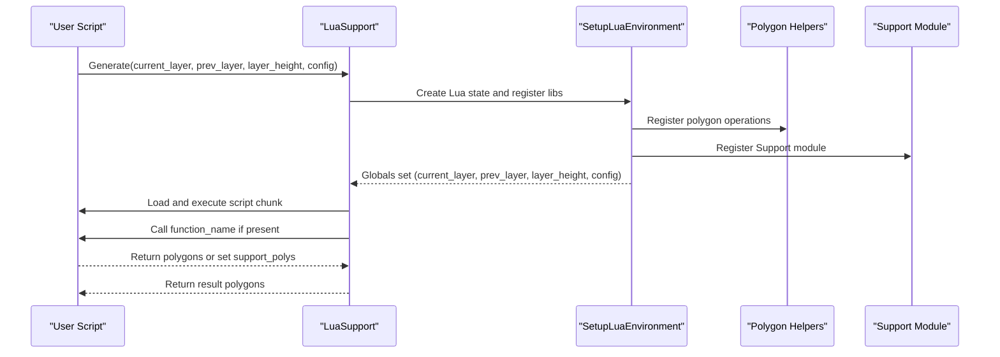

**Diagram sources**
- [LuaSupport.cpp:19-90](file://support/LuaSupport.cpp#L19-L90)
- [LuaSupport.cpp:113-178](file://support/LuaSupport.cpp#L113-L178)

**Section sources**
- [LuaSupport.cpp:19-90](file://support/LuaSupport.cpp#L19-L90)
- [LuaSupport.cpp:93-178](file://support/LuaSupport.cpp#L93-L178)
- [LuaSupport.hpp:21-67](file://support/LuaSupport.hpp#L21-L67)

### Library Integration Points
The library provides entry points for generating supports across layers:
- `GenerateFdmSupport`: selects strategy based on `support_pattern`.
- `GenerateAllFdmSupport`: applies strategy across all layers.
- `GenerateAllSlaSupport`: runs SLA sacrificial support across layers.
- `GenerateAllLuaSupport`: wires external 2D/3D functions into the Lua environment and runs user scripts per layer.

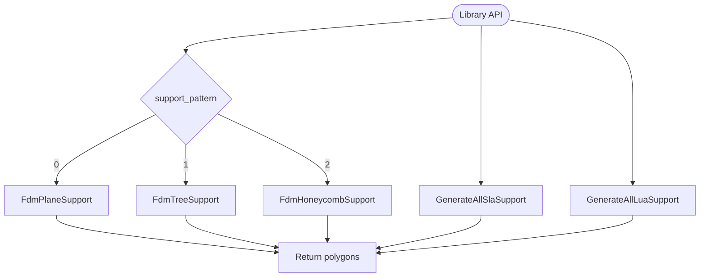

**Diagram sources**
- [fdm_support.cpp:14-75](file://LibHsBaSlicer/Support/fdm_support.cpp#L14-L75)

**Section sources**
- [fdm_support.cpp:14-75](file://LibHsBaSlicer/Support/fdm_support.cpp#L14-L75)

## Dependency Analysis
The support generation components have clear dependencies:
- All FDM and SLA strategies depend on OverhangDetector for determining where supports are required.
- LuaAdapter depends on strategy implementations and LuaSupport to expose them to scripts.
- LuaSupport depends on 2D polygon helpers and the Support module registration.
- Library API depends on strategy implementations and LuaSupport to provide high-level functions.

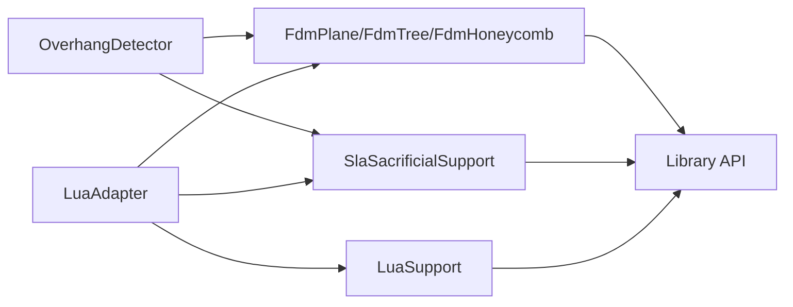

**Diagram sources**
- [OverhangDetector.cpp:41-87](file://support/OverhangDetector.cpp#L41-L87)
- [FdmSupport.cpp:48-267](file://support/FdmSupport.cpp#L48-L267)
- [SlaSupport.cpp:81-133](file://support/SlaSupport.cpp#L81-L133)
- [LuaAdapter.cpp:110-172](file://support/LuaAdapter.cpp#L110-L172)
- [fdm_support.cpp:14-75](file://LibHsBaSlicer/Support/fdm_support.cpp#L14-L75)

**Section sources**
- [OverhangDetector.cpp:41-87](file://support/OverhangDetector.cpp#L41-L87)
- [FdmSupport.cpp:48-267](file://support/FdmSupport.cpp#L48-L267)
- [SlaSupport.cpp:81-133](file://support/SlaSupport.cpp#L81-L133)
- [LuaAdapter.cpp:110-172](file://support/LuaAdapter.cpp#L110-L172)
- [fdm_support.cpp:14-75](file://LibHsBaSlicer/Support/fdm_support.cpp#L14-L75)

## Performance Considerations
- Overhang detection uses geometric difference and offset operations; large models benefit from reasonable layer heights and angle thresholds to avoid excessive erosion computations.
- Tree and honeycomb strategies involve grid sampling and polygon unions; increasing support_diameter reduces sample count but may reduce resolution.
- Honeycomb generation creates many hex cells; larger cell_size reduces polygon count and improves performance.
- SLA sacrificial supports sample points with spacing proportional to support_diameter; larger spacing reduces point count.
- Lua scripts should minimize heavy polygon operations and reuse computed results where possible.

[No sources needed since this section provides general guidance]

## Troubleshooting Guide
Common issues and resolutions:
- Lua state creation failure: ensure the Lua environment is available and not corrupted.
- Script load error: verify script syntax and file path correctness.
- Runtime error during script execution: check function names and return types; ensure polygons are returned as tables of points.
- Function call error: confirm the specified function exists and returns polygons or sets `support_polys`.
- Invalid support object: ensure the object passed to `Support.generate` was created via `Support.new_*`.

Error propagation:
- C++ exceptions from LuaSupport are caught and converted to Lua errors.
- Strategy generation errors propagate through the Lua adapter and surface as Lua errors.

**Section sources**
- [LuaSupport.cpp:113-178](file://support/LuaSupport.cpp#L113-L178)
- [LuaAdapter.cpp:174-200](file://support/LuaAdapter.cpp#L174-L200)

## Conclusion
The support generation API combines robust C++ strategies with a flexible Lua scripting layer. Users can select built-in FDM and SLA strategies, tune overhang detection and support geometry, or fully replace algorithms with custom Lua scripts. The design emphasizes clarity, configurability, and extensibility, enabling optimization for different manufacturing processes while maintaining consistent interfaces.

[No sources needed since this section summarizes without analyzing specific files]

## Appendices

### Configuration Reference
Shared and process-specific configuration fields:

- SupportConfig
  - overhang_angle_threshold: float, degrees
  - layer_height: float, mm
  - support_gap: float, mm
  - support_diameter: float, mm
  - support_density: float, [0,1]
  - support_pattern: int, 0=Plane, 1=Tree, 2=Honeycomb
  - tree_branch_angle: float, degrees
  - tree_max_branch_radius: float, mm
  - honeycomb_cell_size: float, mm

- FdmSupportConfig extends SupportConfig
  - interface_layers: int
  - interface_density: float, [0,1]

- SlaSupportConfig extends SupportConfig
  - tip_diameter: float, mm
  - raft_thickness: float, mm

**Section sources**
- [SupportConfig.hpp:14-43](file://support/SupportConfig.hpp#L14-L43)

### Lua Examples
- FDM custom support script demonstrates detecting overhangs, selecting a generator by pattern, and refining support polygons.
- SLA custom support script shows using the SLA sacrificial generator and filtering small support areas.

Example paths:
- [my_support.lua](file://samples/FDM/scripts/my_support.lua)
- [my_sla_support.lua](file://samples/SLA/scripts/my_sla_support.lua)

**Section sources**
- [my_support.lua:1-83](file://samples/FDM/scripts/my_support.lua#L1-L83)
- [my_sla_support.lua:1-76](file://samples/SLA/scripts/my_sla_support.lua#L1-L76)