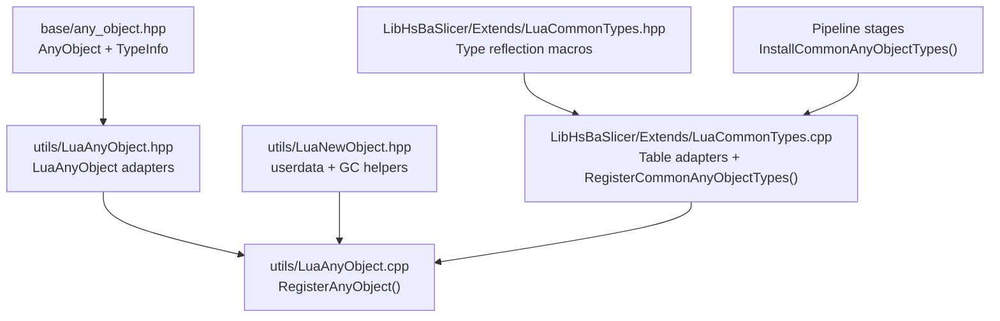
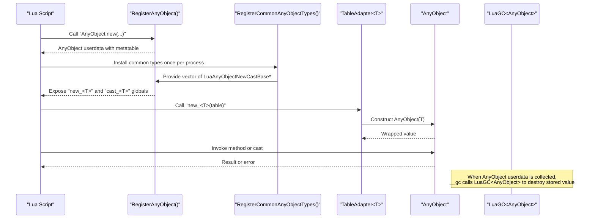
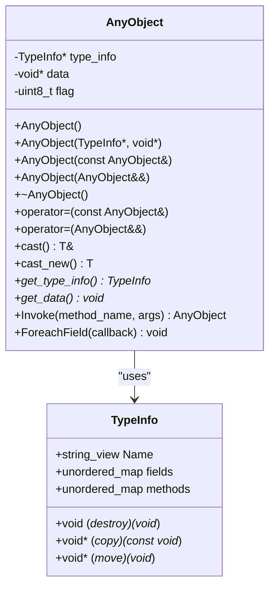
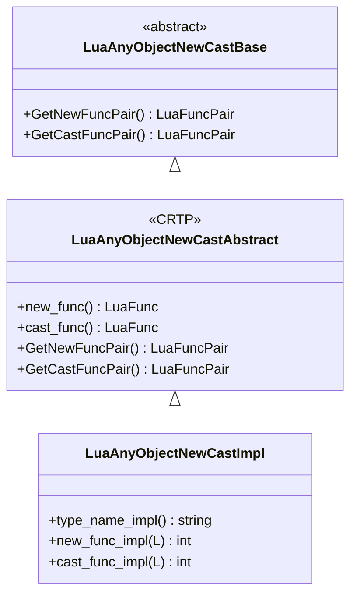
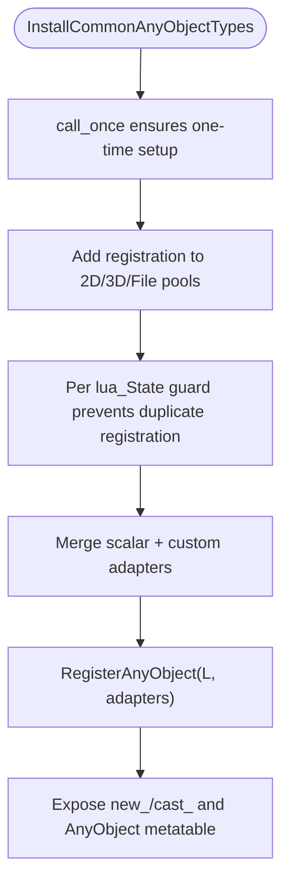
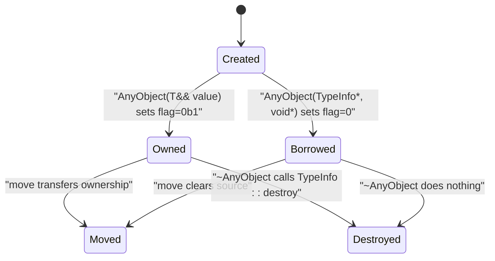
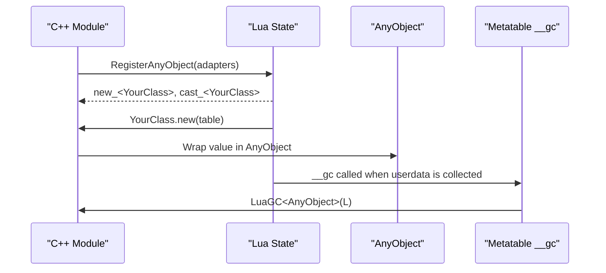
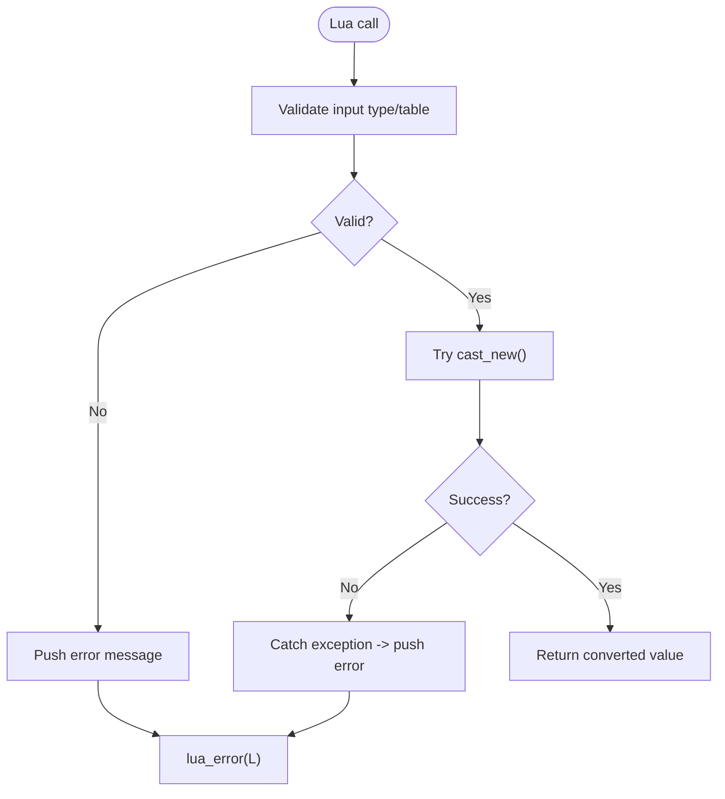
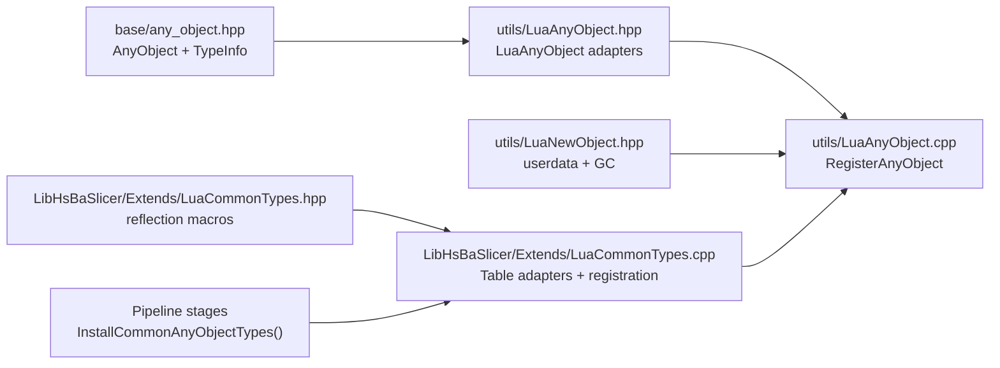

# Type Binding & Memory Management / 类型绑定与内存管理

<cite>
**Referenced Files in This Document**
- [LuaCommonTypes.hpp](file://LibHsBaSlicer/Extends/LuaCommonTypes.hpp)
- [LuaCommonTypes.cpp](file://LibHsBaSlicer/Extends/LuaCommonTypes.cpp)
- [LuaAnyObject.hpp](file://utils/LuaAnyObject.hpp)
- [LuaAnyObject.cpp](file://utils/LuaAnyObject.cpp)
- [any_object.hpp](file://base/any_object.hpp)
- [any_object.cpp](file://base/any_object.cpp)
- [LuaNewObject.hpp](file://utils/LuaNewObject.hpp)
- [lua_pipeline.cpp](file://LibHsBaSlicer/Extends/lua_pipeline.cpp)
- [fdm_pipeline.cpp](file://DllHsBaSlicer/fdm_pipeline.cpp)
- [sla_pipeline.cpp](file://DllHsBaSlicer/sla_pipeline.cpp)
- [lua_common_types_test.cpp](file://tests/LuaCommonTypes/lua_common_types_test.cpp)
</cite>

## Table of Contents
1. [Introduction](#introduction)
2. [Project Structure](#project-structure)
3. [Core Components](#core-components)
4. [Architecture Overview](#architecture-overview)
5. [Detailed Component Analysis](#detailed-component-analysis)
6. [Dependency Analysis](#dependency-analysis)
7. [Performance Considerations](#performance-considerations)
8. [Troubleshooting Guide](#troubleshooting-guide)
9. [Conclusion](#conclusion)
10. [Appendices](#appendices)

## Introduction
This document explains how HsBaSlicer binds C++ types to Lua, manages memory across the C++–Lua boundary, and exposes common geometry and numeric types through a unified reflection system. The core design centers on:

- `Utils::AnyObject`: a type-erased wrapper that stores a value together with runtime type information (`TypeInfo`), enabling reflection, method dispatch, and safe typed casts.
- `LuaAnyObject` adapters: bridge between Lua values and `AnyObject`, providing per-type `new_<T>` and `cast_<T>` functions.
- `LuaCommonTypes`: registers commonly used custom types (Eigen vectors/matrices/quaternions, Clipper2 points/polygons) as `AnyObject` instances and provides table encodings for Lua.
- `LuaNewObject` helpers: construct C++ objects inside Lua userdata and integrate with Lua’s garbage collector via metatables and finalizers.

The result is a consistent protocol where Lua scripts can create, inspect, and pass rich C++ geometry and numeric types without manual memory management, while C++ retains ownership semantics and deterministic cleanup.

## Project Structure
The type binding and memory management logic spans several modules:

- `base/any_object.*`: defines `AnyObject`, `TypeInfo`, reflection fields/methods, and default destruction/copy/move hooks.
- `utils/LuaAnyObject.*`: implements Lua-side registration of `AnyObject`, generic new/cast adapters, and basic scalar adapters.
- `utils/LuaNewObject.hpp`: provides userdata allocation, metatable assignment, and Lua state lifetime helpers.
- `LibHsBaSlicer/Extends/LuaCommonTypes.{hpp,cpp}`: registers common custom types and their Lua table encodings; installs them into pipeline Lua states.
- Pipeline entry points call `InstallCommonAnyObjectTypes()` so every stage gets the same set of registered types.

**Diagram sources**
- [any_object.hpp:46-115](file://base/any_object.hpp#L46-L115)
- [LuaAnyObject.hpp:21-112](file://utils/LuaAnyObject.hpp#L21-L112)
- [LuaAnyObject.cpp:130-178](file://utils/LuaAnyObject.cpp#L130-L178)
- [LuaNewObject.hpp:15-87](file://utils/LuaNewObject.hpp#L15-L87)
- [LuaCommonTypes.hpp:20-45](file://LibHsBaSlicer/Extends/LuaCommonTypes.hpp#L20-L45)
- [LuaCommonTypes.cpp:438-531](file://LibHsBaSlicer/Extends/LuaCommonTypes.cpp#L438-L531)

**Section sources**
- [any_object.hpp:46-115](file://base/any_object.hpp#L46-L115)
- [LuaAnyObject.hpp:21-112](file://utils/LuaAnyObject.hpp#L21-L112)
- [LuaAnyObject.cpp:130-178](file://utils/LuaAnyObject.cpp#L130-L178)
- [LuaNewObject.hpp:15-87](file://utils/LuaNewObject.hpp#L15-L87)
- [LuaCommonTypes.hpp:20-45](file://LibHsBaSlicer/Extends/LuaCommonTypes.hpp#L20-L45)
- [LuaCommonTypes.cpp:438-531](file://LibHsBaSlicer/Extends/LuaCommonTypes.cpp#L438-L531)

## Core Components
- `AnyObject` and `TypeInfo`:
  - `TypeInfo` holds a stable name, function pointers for destroy/copy/move, and maps for reflective fields and methods.
  - `AnyObject` owns either a heap-allocated copy or a non-owning view, controlled by an internal flag. It supports typed cast operations and method invocation.
- `LuaAnyObject` adapter framework:
  - Base interface `LuaAnyObjectNewCastBase` exposes `GetNewFuncPair()` and `GetCastFuncPair()`.
  - CRTP helper `LuaAnyObjectNewCastAbstract` builds names and static function pointers.
  - Default implementation `LuaAnyObjectNewCastImpl<T, TypeName>` wraps a native type T and bridges it to/from `AnyObject`.
  - Basic scalar specializations provide Lua-native conversions for int, long, long long, size_t, float, double, bool, string, cstring.
- `LuaCommonTypes`:
  - Declares reflected metadata for Eigen vectors/matrices/quaternions and Clipper2 points/polygons using macros.
  - Implements table encodings for each family and constructs `TableAdapter` instances.
  - Provides `RegisterCommonAnyObjectTypes(L)` and `InstallCommonAnyObjectTypes()` to register all adapters into Lua states.
- `LuaNewObject`:
  - Allocates C++ objects inside Lua userdata and assigns a metatable.
  - Provides `LuaGC<T>` finalizers and smart-pointer helpers for Lua state lifetime.

**Section sources**
- [any_object.hpp:46-115](file://base/any_object.hpp#L46-L115)
- [any_object.cpp:9-74](file://base/any_object.cpp#L9-L74)
- [LuaAnyObject.hpp:21-112](file://utils/LuaAnyObject.hpp#L21-L112)
- [LuaAnyObject.hpp:114-521](file://utils/LuaAnyObject.hpp#L114-L521)
- [LuaCommonTypes.hpp:84-143](file://LibHsBaSlicer/Extends/LuaCommonTypes.hpp#L84-L143)
- [LuaCommonTypes.cpp:342-436](file://LibHsBaSlicer/Extends/LuaCommonTypes.cpp#L342-L436)
- [LuaNewObject.hpp:15-87](file://utils/LuaNewObject.hpp#L15-L87)

## Architecture Overview
The binding architecture connects Lua code to C++ through three layers:

1. **Reflection layer**: `AnyObject` + `TypeInfo` describe types, fields, and methods at runtime.
2. **Adapter layer**: `LuaAnyObject` adapters implement per-type conversion between Lua and `AnyObject`.
3. **Registration layer**: `RegisterAnyObject` installs metatables and global functions; `RegisterCommonAnyObjectTypes` adds custom geometry and numeric types; `InstallCommonAnyObjectTypes` wires these into pipeline Lua pools.

**Diagram sources**
- [LuaAnyObject.cpp:11-93](file://utils/LuaAnyObject.cpp#L11-L93)
- [LuaAnyObject.cpp:130-178](file://utils/LuaAnyObject.cpp#L130-L178)
- [LuaCommonTypes.cpp:438-531](file://LibHsBaSlicer/Extends/LuaCommonTypes.cpp#L438-L531)
- [LuaNewObject.hpp:15-87](file://utils/LuaNewObject.hpp#L15-L87)

## Detailed Component Analysis

### AnyObject and TypeInfo
`AnyObject` is the central type-erased container. It stores:

- `type_info`: pointer to `TypeInfo` describing the concrete type.
- `data`: opaque pointer to the underlying value.
- `flag`: indicates whether `data` is owned (heap-allocated copy) or borrowed (non-owning view).

Key behaviors:

- Copy/move constructors and assignment operators respect ownership: copies allocate via `TypeInfo::copy`; moves transfer ownership and clear the source.
- Destructor calls `TypeInfo::destroy` only when the object owns its data.
- `cast<T>()` returns a reference to the stored value after verifying type identity; `cast_new<T>()` returns a copy.
- `Invoke(method_name, args)` dispatches to a method registered in `TypeInfo::methods`, supporting reflection-based scripting.
- `ForeachField(callback)` iterates over reflective fields defined by `TypeInfo::fields`.

**Diagram sources**
- [any_object.hpp:46-115](file://base/any_object.hpp#L46-L115)
- [any_object.cpp:9-74](file://base/any_object.cpp#L9-L74)

**Section sources**
- [any_object.hpp:46-115](file://base/any_object.hpp#L46-L115)
- [any_object.cpp:9-74](file://base/any_object.cpp#L9-L74)

### LuaAnyObject Adapter Framework
The adapter framework enables registering arbitrary C++ types as Lua-callable constructors and casters.

Core elements:

- `LuaAnyObjectNewCastBase`: abstract base exposing `GetNewFuncPair()` and `GetCastFuncPair()`.
- `LuaAnyObjectNewCastAbstract<Derived>`: CRTP helper that computes type names and static function pointers.
- `LuaAnyObjectNewCastImpl<T, TypeName>`: default implementation that:
  - `new_func_impl`: validates input and wraps it in `AnyObject`.
  - `cast_func_impl`: extracts a copy from `AnyObject` and pushes the native value back to Lua.
- Scalar specializations for built-in types provide robust validation and conversion.

Registration:

- `RegisterAnyObject(L, added_types)` creates the `AnyObject` metatable, sets `__gc`, exposes `invoke` and `foreach_field`, and attaches per-type `cast_<T>` and `new_<T>` functions.

**Diagram sources**
- [LuaAnyObject.hpp:21-112](file://utils/LuaAnyObject.hpp#L21-L112)

**Section sources**
- [LuaAnyObject.hpp:21-112](file://utils/LuaAnyObject.hpp#L21-L112)
- [LuaAnyObject.hpp:114-521](file://utils/LuaAnyObject.hpp#L114-L521)
- [LuaAnyObject.cpp:130-178](file://utils/LuaAnyObject.cpp#L130-L178)

### LuaCommonTypes System
`LuaCommonTypes` extends the adapter framework to cover commonly used geometry and numeric types:

- Reflected types include:
  - Eigen fixed vectors: `Vector2f/3f/4f`, `Vector2d/3d/4d`, `Vector2i/3i/4i`.
  - Eigen quaternions: `Quaternionf`, `Quaterniond`.
  - Eigen matrices: `Matrix2d/3d/4d`, dynamic `MatrixXf`, `MatrixXi`.
  - Clipper2 points: `Point2D`, `Point2`.
  - Clipper2 polygons: `PolygonD`, `PolygonsD`, `Polygon`, `Polygons`.

- Reflection macros:
  - `HSBA_DEFINE_REFLECTED_TYPEINFO(CleanName, LuaName, Type, Scalar, N)` generates field descriptors for contiguous components (x/y/z/w) and a `cast_<LuaName>` method.
  - `HSBA_DEFINE_OPAQUE_TYPEINFO(CleanName, LuaName, Type)` registers opaque containers without component fields.

- Table encodings:
  - Vectors/quaternions use named keys `{x, y, z?, w?}`.
  - Matrices use nested row sequences.
  - Points use `{x, y}` maps.
  - Polygons are sequences of points; polygon collections are sequences of polygons.

- Adapters:
  - `TableAdapter<T, Name, Push, Read>` implements `new_<Name>` and `cast_<Name>` by reading/writing Lua tables and wrapping/unwrapping `AnyObject`.

- Registration:
  - `GetCommonAnyObjectTypes()` returns static singleton adapters for all registered types.
  - `RegisterCommonAnyObjectTypes(L)` merges built-in scalar adapters and custom adapters, then calls `RegisterAnyObject`.
  - `InstallCommonAnyObjectTypes()` installs a single registration function into the generic 2D/3D/File Lua pools, ensuring idempotent setup across pipeline stages.

**Diagram sources**
- [LuaCommonTypes.cpp:438-531](file://LibHsBaSlicer/Extends/LuaCommonTypes.cpp#L438-L531)
- [LuaCommonTypes.hpp:148-183](file://LibHsBaSlicer/Extends/LuaCommonTypes.hpp#L148-L183)

**Section sources**
- [LuaCommonTypes.hpp:20-45](file://LibHsBaSlicer/Extends/LuaCommonTypes.hpp#L20-L45)
- [LuaCommonTypes.hpp:84-143](file://LibHsBaSlicer/Extends/LuaCommonTypes.hpp#L84-L143)
- [LuaCommonTypes.hpp:148-183](file://LibHsBaSlicer/Extends/LuaCommonTypes.hpp#L148-L183)
- [LuaCommonTypes.cpp:342-436](file://LibHsBaSlicer/Extends/LuaCommonTypes.cpp#L342-L436)
- [LuaCommonTypes.cpp:438-531](file://LibHsBaSlicer/Extends/LuaCommonTypes.cpp#L438-L531)

### Memory Ownership and Garbage Collection
Memory ownership follows a clear protocol:

- Construction:
  - `NewLuaObject<T>(L, mt, ...)` allocates a C++ object inside Lua userdata and assigns a metatable.
  - For `AnyObject`, this means storing a value with ownership flag set to indicate heap allocation.

- Destruction:
  - `LuaGC<T>(L, mt)` finalizer retrieves userdata and calls the destructor.
  - `AnyObject`’s destructor uses `TypeInfo::destroy` only if it owns the underlying data.

- Reference counting:
  - There is no explicit reference counting. Ownership is determined by the `flag` bit in `AnyObject`:
    - Flag bit `0b1` indicates owned data; copy/move/dtor respect this.
    - Non-owned views are passed around without extra allocations or frees.

- Lua integration:
  - `RegisterAnyObject` sets `__gc` for `AnyObject` userdata to `LuaGC<AnyObject>`.
  - Custom types registered via `LuaAnyObject` adapters also rely on userdata lifetimes managed by Lua’s GC.

**Diagram sources**
- [any_object.hpp:71-115](file://base/any_object.hpp#L71-L115)
- [any_object.cpp:9-74](file://base/any_object.cpp#L9-L74)
- [LuaNewObject.hpp:15-87](file://utils/LuaNewObject.hpp#L15-L87)
- [LuaAnyObject.cpp:89-93](file://utils/LuaAnyObject.cpp#L89-L93)

**Section sources**
- [any_object.hpp:71-115](file://base/any_object.hpp#L71-L115)
- [any_object.cpp:9-74](file://base/any_object.cpp#L9-L74)
- [LuaNewObject.hpp:15-87](file://utils/LuaNewObject.hpp#L15-L87)
- [LuaAnyObject.cpp:89-93](file://utils/LuaAnyObject.cpp#L89-L93)

### Binding Custom C++ Classes to Lua
To bind a custom C++ class:

1. Define `TypeInfo` for your type:
   - Use `GetTypeInfo<T>()` specialization or the macros in `LuaCommonTypes.hpp` if the type fits the reflected pattern.
   - Provide `destroy`, `copy`, `move` hooks.
   - Optionally add reflective fields and methods.

2. Create a `LuaAnyObjectNewCastImpl` adapter:
   - Implement `type_name_impl`, `new_func_impl`, and `cast_func_impl`.
   - Validate Lua inputs and wrap values in `AnyObject`.

3. Register the adapter:
   - Include it in the list passed to `RegisterAnyObject(L, adapters)`.
   - Or use `RegisterCommonAnyObjectTypes(L)` if you want to merge with built-in scalars and common custom types.

4. Manage lifetimes:
   - Use `NewLuaObject<T>(L, "YourClass_mt", ...)` to place objects in userdata.
   - Set `__gc` to `LuaGC<T>(L, "YourClass_mt")` in the metatable.

Example workflow (conceptual):

**Diagram sources**
- [LuaAnyObject.cpp:130-178](file://utils/LuaAnyObject.cpp#L130-L178)
- [LuaNewObject.hpp:15-87](file://utils/LuaNewObject.hpp#L15-L87)

**Section sources**
- [LuaAnyObject.hpp:21-112](file://utils/LuaAnyObject.hpp#L21-L112)
- [LuaAnyObject.cpp:130-178](file://utils/LuaAnyObject.cpp#L130-L178)
- [LuaNewObject.hpp:15-87](file://utils/LuaNewObject.hpp#L15-L87)

### Avoiding Memory Leaks and Cleanup Strategies
Best practices:

- Always pair `NewLuaObject` with a metatable that has a `__gc` finalizer calling `LuaGC<T>`.
- Prefer `AnyObject::cast_new<T>()` when returning values from Lua to avoid double destruction in `_gc`.
- Use `InstallCommonAnyObjectTypes()` once per process to ensure pipeline stages share the same registrations without duplication.
- Avoid holding raw Lua userdata pointers beyond the Lua state lifetime; prefer `AnyObject` wrappers.
- For large geometry data, consider passing references via non-owned `AnyObject` views to minimize copies.

**Section sources**
- [LuaAnyObject.hpp:89-112](file://utils/LuaAnyObject.hpp#L89-L112)
- [LuaCommonTypes.cpp:469-531](file://LibHsBaSlicer/Extends/LuaCommonTypes.cpp#L469-L531)
- [LuaNewObject.hpp:15-87](file://utils/LuaNewObject.hpp#L15-L87)

### Error Handling Patterns
Error handling is consistent across adapters:

- Input validation:
  - Scalars check Lua type before conversion and push descriptive errors.
  - Tables validate structure (e.g., expecting a table for `new_<T>`).

- Cast failures:
  - `AnyObject::cast<T>()` throws `RuntimeError` on type mismatch.
  - Lua wrappers catch exceptions and convert them to Lua errors.

- Method invocation:
  - `AnyObject::Invoke` throws if the method is not found or if invoked on an empty object.
  - `lua_any_object_invoke` catches exceptions and propagates messages to Lua.

**Diagram sources**
- [LuaAnyObject.cpp:17-87](file://utils/LuaAnyObject.cpp#L17-L87)
- [LuaCommonTypes.cpp:356-388](file://LibHsBaSlicer/Extends/LuaCommonTypes.cpp#L356-L388)
- [any_object.cpp:88-111](file://base/any_object.cpp#L88-L111)

**Section sources**
- [LuaAnyObject.cpp:17-87](file://utils/LuaAnyObject.cpp#L17-L87)
- [LuaCommonTypes.cpp:356-388](file://LibHsBaSlicer/Extends/LuaCommonTypes.cpp#L356-L388)
- [any_object.cpp:88-111](file://base/any_object.cpp#L88-L111)

## Dependency Analysis
The following diagram shows key dependencies among the type binding components:

**Diagram sources**
- [any_object.hpp:46-115](file://base/any_object.hpp#L46-L115)
- [LuaAnyObject.hpp:21-112](file://utils/LuaAnyObject.hpp#L21-L112)
- [LuaAnyObject.cpp:130-178](file://utils/LuaAnyObject.cpp#L130-L178)
- [LuaNewObject.hpp:15-87](file://utils/LuaNewObject.hpp#L15-L87)
- [LuaCommonTypes.hpp:84-143](file://LibHsBaSlicer/Extends/LuaCommonTypes.hpp#L84-L143)
- [LuaCommonTypes.cpp:438-531](file://LibHsBaSlicer/Extends/LuaCommonTypes.cpp#L438-L531)

**Section sources**
- [any_object.hpp:46-115](file://base/any_object.hpp#L46-L115)
- [LuaAnyObject.hpp:21-112](file://utils/LuaAnyObject.hpp#L21-L112)
- [LuaAnyObject.cpp:130-178](file://utils/LuaAnyObject.cpp#L130-L178)
- [LuaNewObject.hpp:15-87](file://utils/LuaNewObject.hpp#L15-L87)
- [LuaCommonTypes.hpp:84-143](file://LibHsBaSlicer/Extends/LuaCommonTypes.hpp#L84-L143)
- [LuaCommonTypes.cpp:438-531](file://LibHsBaSlicer/Extends/LuaCommonTypes.cpp#L438-L531)

## Performance Considerations
- Minimize copies:
  - Use non-owned `AnyObject` views when passing large geometry data between Lua and C++.
  - Prefer `cast_new<T>()` only when a copy is necessary; otherwise access via `get_data()` or reflective field traversal.

- Avoid repeated registration:
  - Call `InstallCommonAnyObjectTypes()` once per process; it uses `std::call_once` and per-state guards to prevent redundant work.

- Efficient table encoding:
  - Vector/quaternion encodings use named keys, reducing parsing overhead compared to positional arrays.
  - Matrix encodings iterate rows/columns directly; keep matrix dimensions reasonable to avoid excessive Lua table creation.

- GC pressure:
  - Ensure userdata metatables have proper `__gc` finalizers to avoid leaking C++ objects.
  - Reuse `AnyObject` wrappers where possible instead of creating many short-lived userdata objects.

[No sources needed since this section provides general guidance]

## Troubleshooting Guide
Common issues and resolutions:

- Type mismatch errors:
  - Symptom: `Bad AnyObject cast: type mismatch`.
  - Cause: Calling `cast<T>()` on an `AnyObject` holding a different type.
  - Resolution: Verify the type before casting; use reflective inspection or ensure correct adapter usage.

- Invalid AnyObject object:
  - Symptom: Lua error indicating invalid `AnyObject`.
  - Cause: Passing nil or wrong userdata to adapter functions.
  - Resolution: Confirm the value is created via `AnyObject.new` or a registered `new_<T>` function.

- Duplicate registration warnings:
  - Symptom: Unexpected behavior after multiple registrations.
  - Cause: Calling `RegisterAnyObject` or `RegisterCommonAnyObjectTypes` multiple times on the same Lua state.
  - Resolution: Use `InstallCommonAnyObjectTypes()` once per process; rely on per-state guards.

- Memory leaks:
  - Symptom: Growing memory usage during long-running scripts.
  - Cause: Missing `__gc` finalizers or holding userdata references indefinitely.
  - Resolution: Attach `LuaGC<T>` to userdata metatables; avoid retaining userdata pointers beyond scope.

**Section sources**
- [any_object.hpp:84-100](file://base/any_object.hpp#L84-L100)
- [LuaAnyObject.cpp:17-87](file://utils/LuaAnyObject.cpp#L17-L87)
- [LuaCommonTypes.cpp:469-531](file://LibHsBaSlicer/Extends/LuaCommonTypes.cpp#L469-L531)
- [LuaNewObject.hpp:15-87](file://utils/LuaNewObject.hpp#L15-L87)

## Conclusion
HsBaSlicer’s type binding system combines a robust reflection model (`AnyObject` + `TypeInfo`) with flexible Lua adapters and standardized registration mechanisms. Common geometry and numeric types are exposed through consistent table encodings, while memory ownership is clearly delineated between Lua userdata and C++ heap storage. By following the documented patterns—using `NewLuaObject`, attaching `__gc` finalizers, leveraging `InstallCommonAnyObjectTypes`, and validating inputs—you can safely extend the system with custom classes and maintain high performance and correctness.

[No sources needed since this section summarizes without analyzing specific files]

## Appendices

### API Quick Reference
- `RegisterAnyObject(L, adapters)`: Registers metatable and per-type `new_<T>`/`cast_<T>` functions.
- `RegisterCommonAnyObjectTypes(L)`: Merges scalar and custom adapters and registers them.
- `InstallCommonAnyObjectTypes()`: Installs registration into pipeline Lua pools once per process.
- `NewLuaObject<T>(L, mt, ...)`: Allocates userdata and assigns metatable.
- `LuaGC<T>(L, mt)`: Finalizer to destroy userdata-backed objects.

**Section sources**
- [LuaAnyObject.cpp:130-178](file://utils/LuaAnyObject.cpp#L130-L178)
- [LuaCommonTypes.cpp:469-531](file://LibHsBaSlicer/Extends/LuaCommonTypes.cpp#L469-L531)
- [LuaNewObject.hpp:15-87](file://utils/LuaNewObject.hpp#L15-L87)