# Module Interface

<cite>
**Referenced Files in This Document**   
- [hsba_slicer.cppm](file://ModuleHsBaSlicer/hsba_slicer.cppm)
- [CMakeLists.txt](file://ModuleHsBaSlicer/CMakeLists.txt)
- [module_anchor.cpp](file://ModuleHsBaSlicer/module_anchor.cpp)
- [main_module.cpp](file://samples/LibHsBaSlicer/main_module.cpp)
- [cpp_cmake_usage.md](file://docs/en/cpp_cmake_usage.md)
</cite>

## Table of Contents
1. [Introduction](#introduction)
2. [Project Structure](#project-structure)
3. [Core Components](#core-components)
4. [Architecture Overview](#architecture-overview)
5. [Detailed Component Analysis](#detailed-component-analysis)
6. [Dependency Analysis](#dependency-analysis)
7. [Performance Considerations](#performance-considerations)
8. [Troubleshooting Guide](#troubleshooting-guide)
9. [Conclusion](#conclusion)

## Introduction
This document explains the C++20 module interface for HsBaSlicer, centered on the `hsba.slicer` module. It covers the module structure, exported symbols, namespace organization, and how to import and consume the module in modern C++ applications. It also documents build system integration with CMake, advantages over traditional include-based usage, consumption patterns, dependency resolution, troubleshooting, and platform-specific considerations.

The module provides a class-based C++ API that wraps LibHsBaSlicer’s free functions. Consumers use `import hsba.slicer;` to access slicing workflows such as FDM, SLA, SLS, SLM, LOM, 3DP, WAAM, file transfer, parameter persistence, and fully Lua-driven pipelines.

## Project Structure
The module is implemented as a single-file C++20 module unit:

- `ModuleHsBaSlicer/hsba_slicer.cppm`: Declares and defines the public module interface and implementation.
- `ModuleHsBaSlicer/CMakeLists.txt`: Builds the static library target `ModuleHsBaSlicer`, registers the module interface via `FILE_SET hsba_slicer_modules`, links dependencies, and re-exports compiler flags required by consumers.
- `ModuleHsBaSlicer/module_anchor.cpp`: Ensures the archiver produces a static library even when only module sources are present.

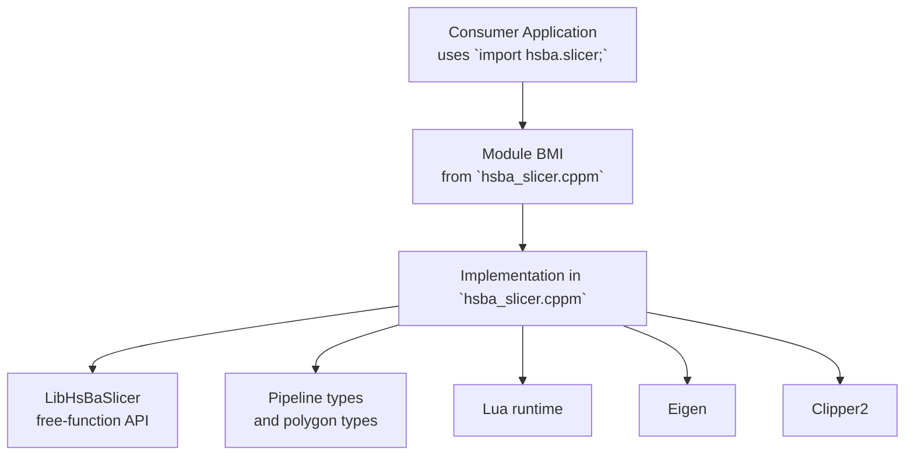

**Diagram sources**
- [hsba_slicer.cppm:10-65](file://ModuleHsBaSlicer/hsba_slicer.cppm#L10-L65)
- [CMakeLists.txt:8-29](file://ModuleHsBaSlicer/CMakeLists.txt#L8-L29)

**Section sources**
- [hsba_slicer.cppm:1-65](file://ModuleHsBaSlicer/hsba_slicer.cppm#L1-L65)
- [CMakeLists.txt:1-46](file://ModuleHsBaSlicer/CMakeLists.txt#L1-L46)
- [module_anchor.cpp:1-13](file://ModuleHsBaSlicer/module_anchor.cpp#L1-L13)

## Core Components
The module exports the `HsBa::Slicer` namespace containing:

- Exception type: `SlicerError`.
- Type aliases for 2D polygons and re-exported pipeline configuration/result types from `pipelinetypes/pipeline_types.h`.
- RAII model handle: `Model`.
- Pipeline classes:
  - `FdmPipeline`
  - `SlaPipeline`
  - `SlsPipeline`
  - `SlmPipeline`
  - `LomPipeline`
  - `TdpPipeline`
  - `WaamPipeline`
  - `FileTransferPipeline`
  - `ParamStorePipeline`
  - `CustomLuaPipeline`
- Utility and extension functions:
  - Default config factories: `defaultFdmConfig`, `defaultSlaConfig`, etc.
  - Lua custom fill/floor/support helpers: `luaCustomFill`, `luaCustomFloor`, `luaCustomSupport`.
  - External function registration: `add2DFunction`, `add3DFunction`, `addFileFunction`, `addEventCallback`.
  - C++ event callbacks: `addZipperEventCallback`, `addDBEventCallback`.
  - Version utilities: `versionJson`, `versionXml`.
  - Polygon conversion utilities: `toDouble`, `toInt`.

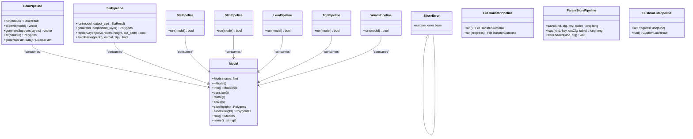

**Diagram sources**
- [hsba_slicer.cppm:70-540](file://ModuleHsBaSlicer/hsba_slicer.cppm#L70-L540)

**Section sources**
- [hsba_slicer.cppm:70-540](file://ModuleHsBaSlicer/hsba_slicer.cppm#L70-L540)

## Architecture Overview
The module acts as a thin, high-level C++ wrapper around LibHsBaSlicer. It exposes a cohesive API while hiding lower-level free functions and data transformations. The module imports standard libraries and third-party headers in its global fragment, then declares and implements the public API under `export module hsba.slicer;`.

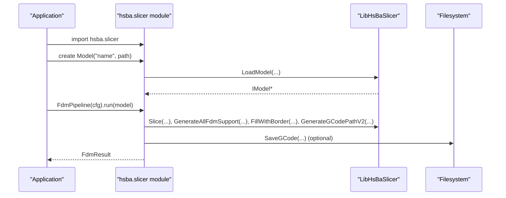

**Diagram sources**
- [hsba_slicer.cppm:567-751](file://ModuleHsBaSlicer/hsba_slicer.cppm#L567-L751)

**Section sources**
- [hsba_slicer.cppm:10-65](file://ModuleHsBaSlicer/hsba_slicer.cppm#L10-L65)
- [hsba_slicer.cppm:546-751](file://ModuleHsBaSlicer/hsba_slicer.cppm#L546-L751)

## Detailed Component Analysis

### Module Interface and Namespace Organization
- The module declares `export module hsba.slicer;` and exports the `HsBa::Slicer` namespace.
- Global includes are placed before the module declaration to avoid MSVC implicit-import conflicts.
- Re-exported types include polygon types and pipeline configuration/result types from `pipelinetypes/pipeline_types.h`.
- The module provides default config factory functions so consumers do not need to rely on global module fragment statics.

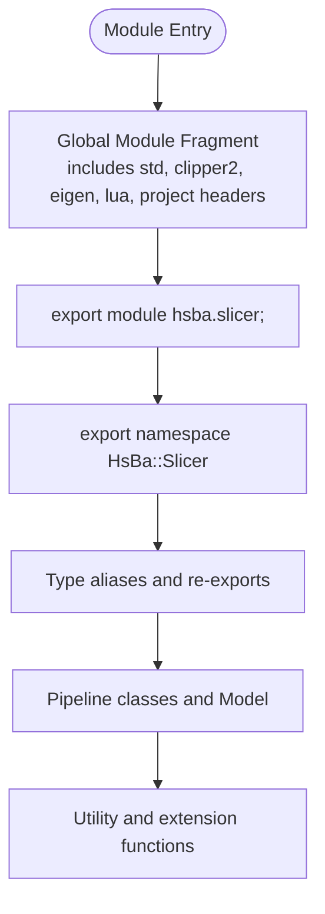

**Diagram sources**
- [hsba_slicer.cppm:10-65](file://ModuleHsBaSlicer/hsba_slicer.cppm#L10-L65)
- [hsba_slicer.cppm:67-147](file://ModuleHsBaSlicer/hsba_slicer.cppm#L67-L147)

**Section sources**
- [hsba_slicer.cppm:10-65](file://ModuleHsBaSlicer/hsba_slicer.cppm#L10-L65)
- [hsba_slicer.cppm:67-147](file://ModuleHsBaSlicer/hsba_slicer.cppm#L67-L147)

### Model and RAII Lifecycle
- `Model` loads a model into the pool on construction and removes it on destruction.
- It supports translation, rotation, scaling, slicing at integer or double precision, and raw access to the underlying `IModel`.
- Errors during load throw `SlicerError`.

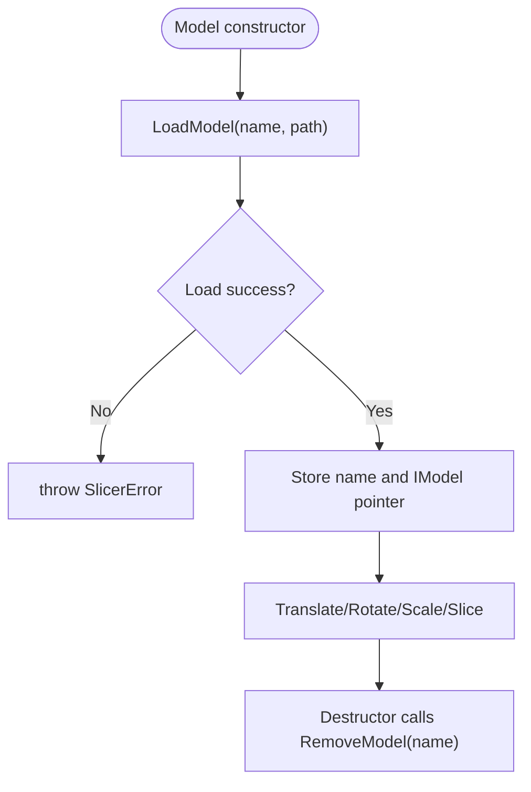

**Diagram sources**
- [hsba_slicer.cppm:567-615](file://ModuleHsBaSlicer/hsba_slicer.cppm#L567-L615)

**Section sources**
- [hsba_slicer.cppm:152-191](file://ModuleHsBaSlicer/hsba_slicer.cppm#L152-L191)
- [hsba_slicer.cppm:567-615](file://ModuleHsBaSlicer/hsba_slicer.cppm#L567-L615)

### FDM Pipeline Workflow
- `FdmPipeline::run` orchestrates slice-all, support generation, fill, path generation, and optional G-code saving.
- Support can be generated using built-in algorithms or a Lua script.
- Fill can be generated using built-in modes or a Lua script.

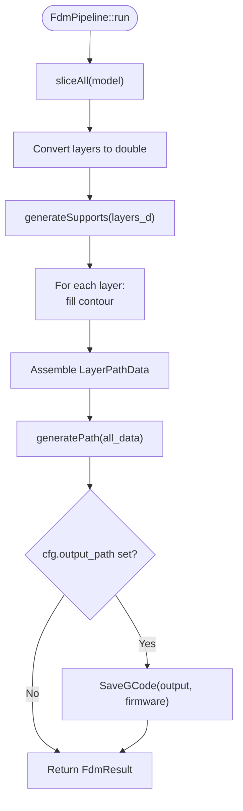

**Diagram sources**
- [hsba_slicer.cppm:621-751](file://ModuleHsBaSlicer/hsba_slicer.cppm#L621-L751)

**Section sources**
- [hsba_slicer.cppm:197-225](file://ModuleHsBaSlicer/hsba_slicer.cppm#L197-L225)
- [hsba_slicer.cppm:621-751](file://ModuleHsBaSlicer/hsba_slicer.cppm#L621-L751)

### SLA Pipeline Workflow
- `SlaPipeline::run` slices all layers, optionally generates supports, computes floor/raft, renders layers to images, and packages results into a zip.
- Floor generation can use built-in raft logic or a Lua script.
- Package saving can use built-in logic or a Lua export function.

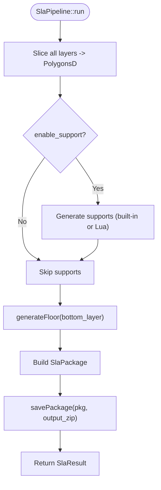

**Diagram sources**
- [hsba_slicer.cppm:757-856](file://ModuleHsBaSlicer/hsba_slicer.cppm#L757-L856)

**Section sources**
- [hsba_slicer.cppm:231-258](file://ModuleHsBaSlicer/hsba_slicer.cppm#L231-L258)
- [hsba_slicer.cppm:757-856](file://ModuleHsBaSlicer/hsba_slicer.cppm#L757-L856)

### Lua-Driven Pipelines (SLS, SLM, LOM, 3DP, WAAM)
- These pipelines slice layers and delegate export to Lua scripts configured via `export_lua_script` and `export_lua_func`.
- WAAM additionally builds robot package parameters and uses a path Lua script.

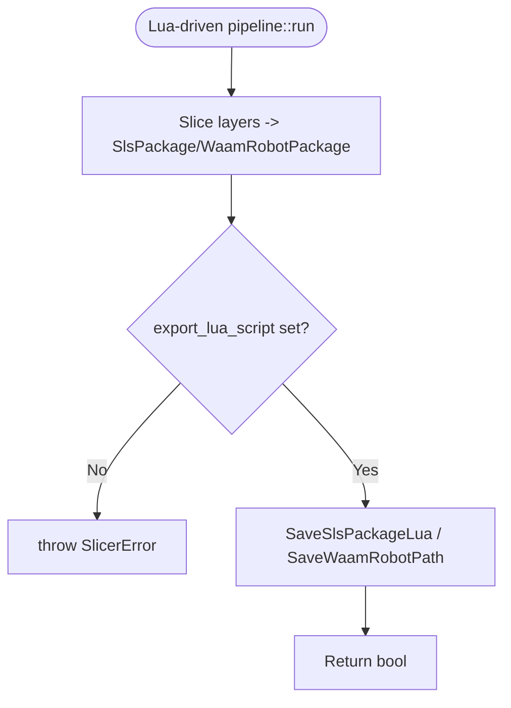

**Diagram sources**
- [hsba_slicer.cppm:862-1013](file://ModuleHsBaSlicer/hsba_slicer.cppm#L862-L1013)

**Section sources**
- [hsba_slicer.cppm:264-348](file://ModuleHsBaSlicer/hsba_slicer.cppm#L264-L348)
- [hsba_slicer.cppm:862-1013](file://ModuleHsBaSlicer/hsba_slicer.cppm#L862-L1013)

### File Transfer Pipeline
- Validates configuration, constructs a lib-layer transfer config, and executes transfer with optional progress callback.
- On failure, throws `SlicerError` with the error message.

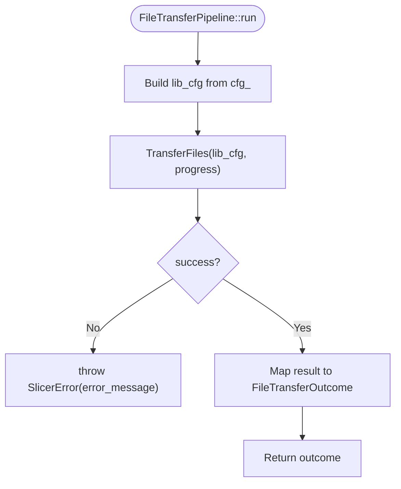

**Diagram sources**
- [hsba_slicer.cppm:1019-1052](file://ModuleHsBaSlicer/hsba_slicer.cppm#L1019-L1052)

**Section sources**
- [hsba_slicer.cppm:354-378](file://ModuleHsBaSlicer/hsba_slicer.cppm#L354-L378)
- [hsba_slicer.cppm:1019-1052](file://ModuleHsBaSlicer/hsba_slicer.cppm#L1019-L1052)

### Parameter Store Pipeline
- Persists and retrieves process-parameter configuration structs via a database backend.
- Provides kind and backend mapping to the lib layer and releases heap strings produced by load.

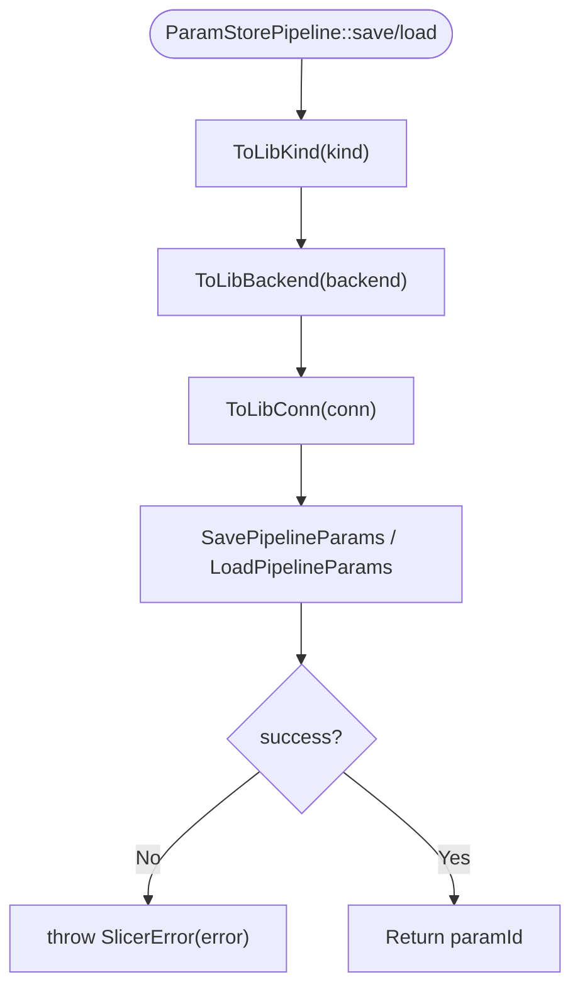

**Diagram sources**
- [hsba_slicer.cppm:1058-1139](file://ModuleHsBaSlicer/hsba_slicer.cppm#L1058-L1139)

**Section sources**
- [hsba_slicer.cppm:384-445](file://ModuleHsBaSlicer/hsba_slicer.cppm#L384-L445)
- [hsba_slicer.cppm:1058-1139](file://ModuleHsBaSlicer/hsba_slicer.cppm#L1058-L1139)

### Custom Lua Pipeline
- Executes a fully Lua-defined workflow through `RunLuaPipeline`.
- Supports inline source or script file, entry function, JSON config, model metadata, output path, and progress callback.

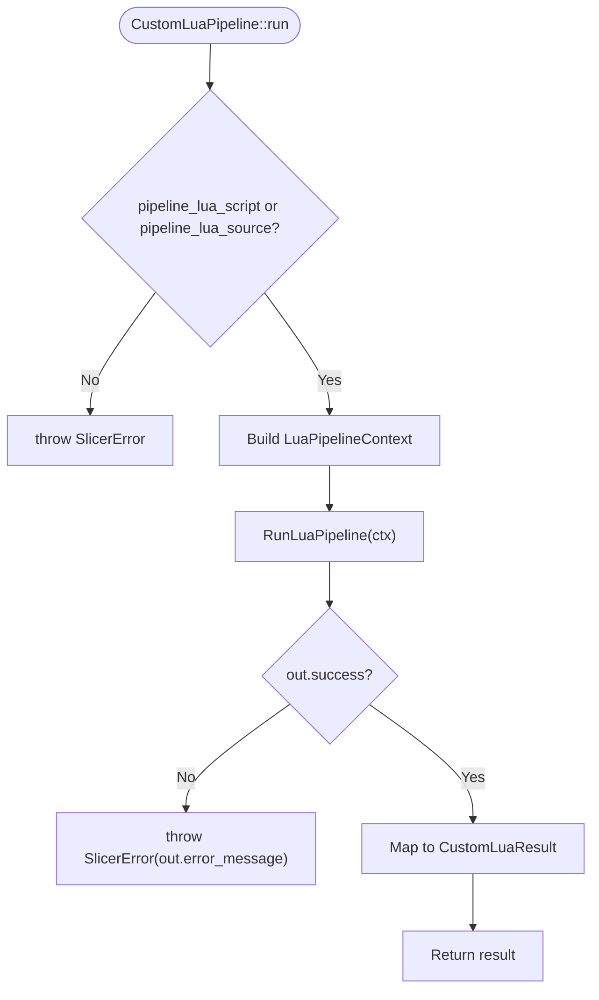

**Diagram sources**
- [hsba_slicer.cppm:1145-1178](file://ModuleHsBaSlicer/hsba_slicer.cppm#L1145-L1178)

**Section sources**
- [hsba_slicer.cppm:451-479](file://ModuleHsBaSlicer/hsba_slicer.cppm#L451-L479)
- [hsba_slicer.cppm:1145-1178](file://ModuleHsBaSlicer/hsba_slicer.cppm#L1145-L1178)

### Lua Extension and Event Callbacks
- Exposes functions to register external 2D/3D/File Lua functions and event callbacks.
- Also exposes C++ event callbacks for zipper and database events.

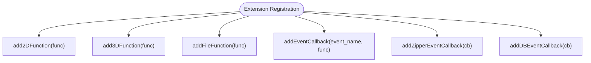

**Diagram sources**
- [hsba_slicer.cppm:1208-1224](file://ModuleHsBaSlicer/hsba_slicer.cppm#L1208-L1224)

**Section sources**
- [hsba_slicer.cppm:481-520](file://ModuleHsBaSlicer/hsba_slicer.cppm#L481-L520)
- [hsba_slicer.cppm:1208-1224](file://ModuleHsBaSlicer/hsba_slicer.cppm#L1208-L1224)

## Dependency Analysis
The module depends on:

- Standard library: `<filesystem>`, `<functional>`, `<memory>`, `<stdexcept>`, `<string>`, `<string_view>`, `<vector>`.
- Third-party libraries: Clipper2, Eigen, Lua.
- Project headers: pipeline types, 2D polygon types, mesh model, paths, support configs, and LibHsBaSlicer APIs.

CMake configuration:

- Target: `ModuleHsBaSlicer` (STATIC).
- Module interface unit registered via `FILE_SET hsba_slicer_modules`.
- Links against `LibHsBaSlicer`, `HsBaPipelineTypes`, `Eigen3::Eigen`, `PkgConfig::Clipper2`, and `${LUA_LIBRARIES}`.
- Re-exports MSVC compile definitions and options to ensure consistent ABI across consumers.

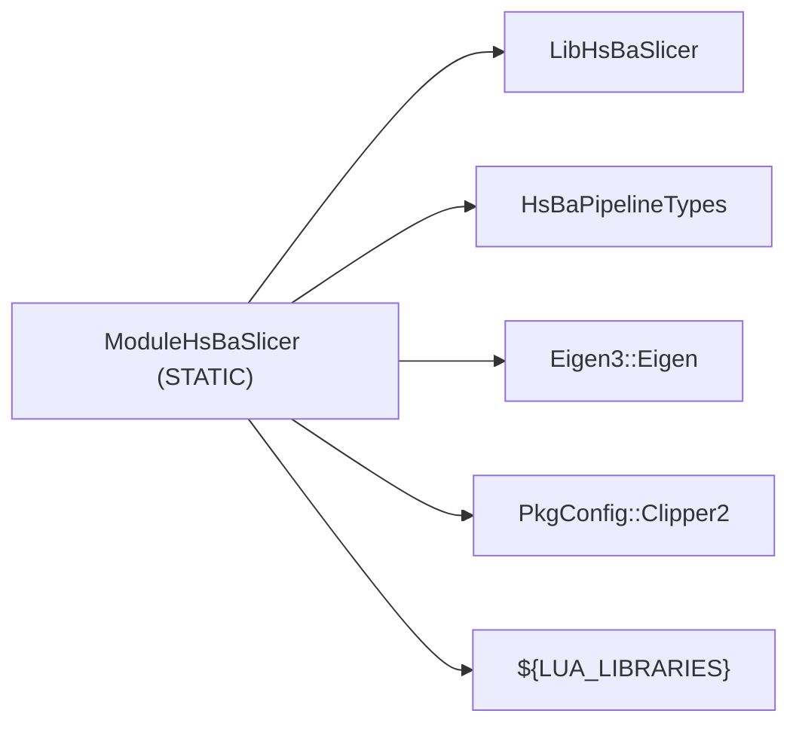

**Diagram sources**
- [CMakeLists.txt:12-29](file://ModuleHsBaSlicer/CMakeLists.txt#L12-L29)

**Section sources**
- [CMakeLists.txt:1-46](file://ModuleHsBaSlicer/CMakeLists.txt#L1-L46)
- [hsba_slicer.cppm:17-63](file://ModuleHsBaSlicer/hsba_slicer.cppm#L17-L63)

## Performance Considerations
- Single-file module design avoids MSVC C2572 errors caused by implicit-import std:: redefinition in separate implementation units.
- Static library linkage avoids DLL link-stage issues and ensures transitive dependencies propagate cleanly to consumers.
- Re-exporting MSVC compile flags prevents ABI mismatches between the module and consumers.
- Using RAII (`Model`) reduces manual resource management overhead and potential leaks.
- Vector pre-reservation in pipeline loops improves memory allocation performance.

[No sources needed since this section provides general guidance]

## Troubleshooting Guide

### Common Issues and Resolutions

- **MSVC C2572 (std redefinition)**:
  - Cause: Including standard library headers after `import hsba.slicer;`.
  - Resolution: Place all `#include <...>` directives before `import hsba.slicer;`.

- **MSVC C5050 (propagated flags mismatch)**:
  - Cause: CGAL propagates `/fp:strict` and `_SCL_SECURE_NO_WARNINGS` via INTERFACE properties.
  - Resolution: Link against `ModuleHsBaSlicer` so these flags are re-exported as PUBLIC; no manual setup required.

- **GMF types not visible to consumers**:
  - Cause: C++20 standard limitation; types introduced via `#include` in the global module fragment are not exported.
  - Resolution: Include relevant headers directly in consumer code, e.g., `LibHsBaSlicer/Preprocess/model_preprocess.hpp` and `pipelinetypes/pipeline_types.h`.

- **Static library not produced**:
  - Cause: Some CMake versions may not trigger the archiver when only module sources exist.
  - Resolution: Use `module_anchor.cpp` to force archive creation.

- **Missing Lua script for Lua-driven pipelines**:
  - Cause: Pipeline requires `export_lua_script` or `pipeline_lua_script/source`.
  - Resolution: Configure the appropriate Lua script or inline source in the pipeline configuration.

**Section sources**
- [hsba_slicer.cppm:10-12](file://ModuleHsBaSlicer/hsba_slicer.cppm#L10-L12)
- [CMakeLists.txt:36-45](file://ModuleHsBaSlicer/CMakeLists.txt#L36-L45)
- [module_anchor.cpp:1-13](file://ModuleHsBaSlicer/module_anchor.cpp#L1-L13)
- [cpp_cmake_usage.md:312-333](file://docs/en/cpp_cmake_usage.md#L312-L333)

## Conclusion
The `hsba.slicer` C++20 module provides a clean, encapsulated, and efficient API for HsBaSlicer. It consolidates slicing workflows behind well-defined classes and utility functions, improves compilation ergonomics, and leverages CMake module features for robust dependency propagation. By following the documented consumption patterns and platform notes, developers can integrate HsBaSlicer into modern C++ applications with improved maintainability and performance.

[No sources needed since this section summarizes without analyzing specific files]