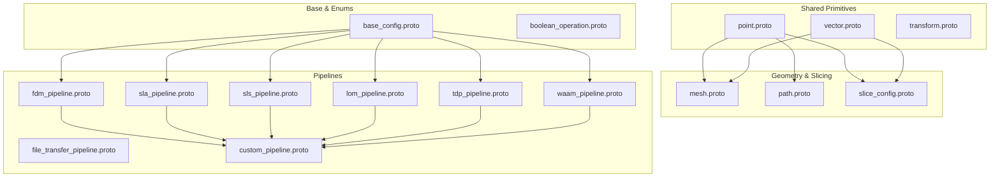
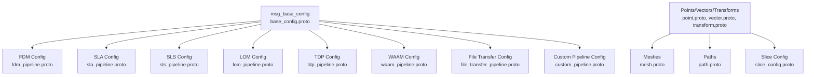
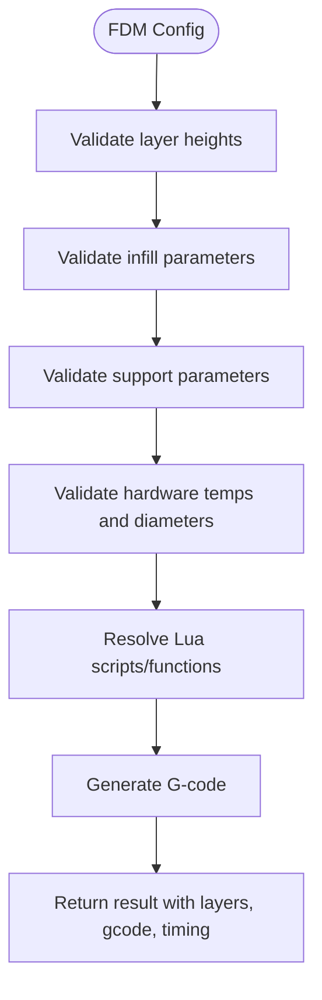
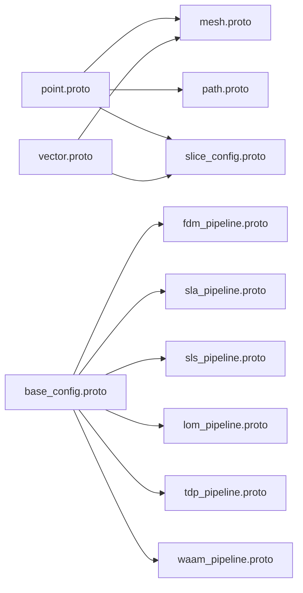

# Protocol Buffers

<cite>
**Referenced Files in This Document**   
- [base_config.proto](file://proto/base_config.proto)
- [boolean_operation.proto](file://proto/boolean_operation.proto)
- [custom_pipeline.proto](file://proto/custom_pipeline.proto)
- [fdm_pipeline.proto](file://proto/fdm_pipeline.proto)
- [file_transfer_pipeline.proto](file://proto/file_transfer_pipeline.proto)
- [lom_pipeline.proto](file://proto/lom_pipeline.proto)
- [mesh.proto](file://proto/mesh.proto)
- [path.proto](file://proto/path.proto)
- [point.proto](file://proto/point.proto)
- [sla_pipeline.proto](file://proto/sla_pipeline.proto)
- [slice_config.proto](file://proto/slice_config.proto)
- [sls_pipeline.proto](file://proto/sls_pipeline.proto)
- [tdp_pipeline.proto](file://proto/tdp_pipeline.proto)
- [transform.proto](file://proto/transform.proto)
- [vector.proto](file://proto/vector.proto)
- [waam_pipeline.proto](file://proto/waam_pipeline.proto)
</cite>

## Table of Contents
1. [Introduction](#introduction)
2. [Project Structure](#project-structure)
3. [Core Components](#core-components)
4. [Architecture Overview](#architecture-overview)
5. [Detailed Component Analysis](#detailed-component-analysis)
6. [Dependency Analysis](#dependency-analysis)
7. [Performance Considerations](#performance-considerations)
8. [Troubleshooting Guide](#troubleshooting-guide)
9. [Conclusion](#conclusion)
10. [Appendices](#appendices)

## Introduction
This document provides comprehensive protocol buffer documentation for HsBaSlicer cross-language communication. It covers all .proto definitions under the proto directory, including:
- Base configuration and shared primitives (points, vectors, transforms, meshes, paths, slice configuration).
- Pipeline-specific configurations for FDM, SLA, SLS, LOM, TDP, WAAM, file transfer, and fully Lua-driven custom pipelines.
- Message semantics, field meanings, validation rules, serialization format, versioning strategy, compatibility guarantees, examples, migration strategies, performance considerations, and debugging techniques.

The goal is to enable developers to construct, serialize, deserialize, validate, and evolve these messages safely across languages such as C++, Python, Java, Go, and others.

## Project Structure
The protocol buffer schema is organized by domain:
- Shared primitives: point.proto, vector.proto, transform.proto.
- Geometry and slicing: mesh.proto, path.proto, slice_config.proto.
- Base configuration and enums: base_config.proto, boolean_operation.proto.
- Pipeline schemas: fdm_pipeline.proto, sla_pipeline.proto, sls_pipeline.proto, lom_pipeline.proto, tdp_pipeline.proto, waam_pipeline.proto, file_transfer_pipeline.proto, custom_pipeline.proto.

**Diagram sources**
- [point.proto:1-16](file://proto/point.proto#L1-L16)
- [vector.proto:1-24](file://proto/vector.proto#L1-L24)
- [transform.proto:1-21](file://proto/transform.proto#L1-L21)
- [mesh.proto:1-31](file://proto/mesh.proto#L1-L31)
- [path.proto:1-15](file://proto/path.proto#L1-L15)
- [slice_config.proto:1-27](file://proto/slice_config.proto#L1-L27)
- [base_config.proto:1-132](file://proto/base_config.proto#L1-L132)
- [boolean_operation.proto:1-12](file://proto/boolean_operation.proto#L1-L12)
- [fdm_pipeline.proto:1-81](file://proto/fdm_pipeline.proto#L1-L81)
- [sla_pipeline.proto:1-67](file://proto/sla_pipeline.proto#L1-L67)
- [sls_pipeline.proto:1-33](file://proto/sls_pipeline.proto#L1-L33)
- [lom_pipeline.proto:1-46](file://proto/lom_pipeline.proto#L1-L46)
- [tdp_pipeline.proto:1-47](file://proto/tdp_pipeline.proto#L1-L47)
- [waam_pipeline.proto:1-89](file://proto/waam_pipeline.proto#L1-L89)
- [file_transfer_pipeline.proto:1-21](file://proto/file_transfer_pipeline.proto#L1-L21)
- [custom_pipeline.proto:1-31](file://proto/custom_pipeline.proto#L1-L31)

**Section sources**
- [point.proto:1-16](file://proto/point.proto#L1-L16)
- [vector.proto:1-24](file://proto/vector.proto#L1-L24)
- [transform.proto:1-21](file://proto/transform.proto#L1-L21)
- [mesh.proto:1-31](file://proto/mesh.proto#L1-L31)
- [path.proto:1-15](file://proto/path.proto#L1-L15)
- [slice_config.proto:1-27](file://proto/slice_config.proto#L1-L27)
- [base_config.proto:1-132](file://proto/base_config.proto#L1-L132)
- [boolean_operation.proto:1-12](file://proto/boolean_operation.proto#L1-L12)
- [fdm_pipeline.proto:1-81](file://proto/fdm_pipeline.proto#L1-L81)
- [sla_pipeline.proto:1-67](file://proto/sla_pipeline.proto#L1-L67)
- [sls_pipeline.proto:1-33](file://proto/sls_pipeline.proto#L1-L33)
- [lom_pipeline.proto:1-46](file://proto/lom_pipeline.proto#L1-L46)
- [tdp_pipeline.proto:1-47](file://proto/tdp_pipeline.proto#L1-L47)
- [waam_pipeline.proto:1-89](file://proto/waam_pipeline.proto#L1-L89)
- [file_transfer_pipeline.proto:1-21](file://proto/file_transfer_pipeline.proto#L1-L21)
- [custom_pipeline.proto:1-31](file://proto/custom_pipeline.proto#L1-L31)

## Core Components
This section documents the foundational message types used across pipelines.

### Points and Vectors
- msg_point2: 2D point with x, y floats.
- msg_point3: 3D point with x, y, z floats.
- msg_vector2: 2D vector with x, y floats.
- msg_vector3: 3D vector with x, y, z floats.
- msg_vector4: 4D vector with x, y, z, w floats.

Validation rules:
- Coordinates are floating-point values; units are millimeters unless otherwise specified per pipeline.
- Normals should be normalized where applicable (e.g., mesh normals).

Semantic meaning:
- Points represent positions in space.
- Vectors represent directions or displacements.

**Section sources**
- [point.proto:1-16](file://proto/point.proto#L1-L16)
- [vector.proto:1-24](file://proto/vector.proto#L1-L24)

### Transforms
- msg_quaternion: Quaternion rotation with x, y, z, w floats.
- msg_transform3: 3D transformation matrix stored as repeated float.
- msg_transform2: 2D transformation matrix stored as repeated float.

Validation rules:
- Quaternions should be unit length when representing rotations.
- Matrices should conform to expected dimensions (e.g., 3x3 or 4x4 depending on usage).

Semantic meaning:
- Represent rigid-body transformations applied to geometry.

**Section sources**
- [transform.proto:1-21](file://proto/transform.proto#L1-L21)

### Meshes
- msg_stlmeshes: Collection of STL-like triangles with explicit vertex coordinates and normals.
- msg_topo_trimeshes: Topological triangle list referencing a shared vertices array.

Validation rules:
- Triangle indices must be within bounds of the vertices array.
- Normals should be consistent with triangle orientation.

Semantic meaning:
- Provide input geometry for slicing and export.

**Section sources**
- [mesh.proto:1-31](file://proto/mesh.proto#L1-L31)

### Paths
- msg_path3: Sequence of 3D points.
- msg_path2: Sequence of 2D points.

Validation rules:
- Path points should be ordered along the intended trajectory.
- For continuous deposition (e.g., spiral mode), adjacent points should not have large gaps.

Semantic meaning:
- Represent toolpaths, contours, or extrusion trajectories.

**Section sources**
- [path.proto:1-15](file://proto/path.proto#L1-L15)

### Slice Configuration
- msg_slice_type: Enumerates slice generation modes (same height, different heights, curved surface, ring, none, unknown).
- msg_slice_config: Defines slice parameters including type, height, diff string, ring radius/center/normal, and curved surface path.

Validation rules:
- diff_string must follow the documented range-to-height mapping when type is different heights.
- Ring parameters must define a valid plane and radius.
- Curved path references a mesh file when type is curved.

Semantic meaning:
- Controls how slices are generated from geometry.

**Section sources**
- [slice_config.proto:1-27](file://proto/slice_config.proto#L1-L27)

### Base Configuration and Enums
- msg_base_config: Contains protocol version, technology type, profiles format, output type, and output filename.
- Technology/material/process enums cover FFF/FDM, SLA, SLM, SLS, LOM, WAAM, and generic outputs.

Validation rules:
- version should match the expected protocol version at runtime.
- technology_type must align with the selected pipeline.
- output_type must be compatible with the pipeline’s output format.

Semantic meaning:
- Global settings that apply across pipelines and outputs.

**Section sources**
- [base_config.proto:1-132](file://proto/base_config.proto#L1-L132)

### Boolean Operations
- msg_boolean_operation: Enumerates union, intersection, difference, XOR, and unknown operations.

Validation rules:
- Only defined enum values should be used; unknown indicates unsupported or future extension.

Semantic meaning:
- Describes geometric boolean operations between shapes.

**Section sources**
- [boolean_operation.proto:1-12](file://proto/boolean_operation.proto#L1-L12)

## Architecture Overview
The protocol buffer architecture separates shared primitives from pipeline-specific schemas. Each pipeline defines its own configuration and result messages, while reusing common types like points, vectors, and base enums.

**Diagram sources**
- [base_config.proto:125-132](file://proto/base_config.proto#L125-L132)
- [fdm_pipeline.proto:26-81](file://proto/fdm_pipeline.proto#L26-L81)
- [sla_pipeline.proto:18-67](file://proto/sla_pipeline.proto#L18-L67)
- [sls_pipeline.proto:5-33](file://proto/sls_pipeline.proto#L5-L33)
- [lom_pipeline.proto:13-46](file://proto/lom_pipeline.proto#L13-L46)
- [tdp_pipeline.proto:15-47](file://proto/tdp_pipeline.proto#L15-L47)
- [waam_pipeline.proto:49-89](file://proto/waam_pipeline.proto#L49-L89)
- [file_transfer_pipeline.proto:5-21](file://proto/file_transfer_pipeline.proto#L5-L21)
- [custom_pipeline.proto:9-31](file://proto/custom_pipeline.proto#L9-L31)
- [point.proto:1-16](file://proto/point.proto#L1-L16)
- [vector.proto:1-24](file://proto/vector.proto#L1-L24)
- [transform.proto:1-21](file://proto/transform.proto#L1-L21)
- [mesh.proto:1-31](file://proto/mesh.proto#L1-L31)
- [path.proto:1-15](file://proto/path.proto#L1-L15)
- [slice_config.proto:1-27](file://proto/slice_config.proto#L1-L27)

## Detailed Component Analysis

### FDM Pipeline
Purpose:
- Configure FFF/FDM printing parameters including layering, infill, supports, print speeds, temperatures, and firmware targets.

Key fields:
- Model metadata: model name, model path.
- Layering: layer height, first layer height.
- Infill: fill space, fill type, fill angle, wall count, top/bottom layer counts.
- Supports: enable flag, angle, gap, diameter, density, pattern, interface layers/density.
- Print kinematics: line width, print speed, travel speed, extrusion multiplier.
- Hardware: firmware target, nozzle diameter, filament diameter, nozzle temperature, bed temperature.
- Extruder tuning: retract length, retract speed, first layer speed.
- Scripting: support and infill Lua script/function names.
- Output: output path.
- Spiral mode: vase mode enabling continuous outer wall without infill/support.

Validation rules:
- Layer heights must be positive and typically less than nozzle diameter.
- Fill angles should be within [0, 180] degrees.
- Support parameters must be non-negative and physically plausible.
- Temperatures must be within material and hardware limits.
- Firmware enum must match the target controller.

Result:
- Success flag, total layers, G-code content, error message, elapsed seconds.

**Diagram sources**
- [fdm_pipeline.proto:26-81](file://proto/fdm_pipeline.proto#L26-L81)

**Section sources**
- [fdm_pipeline.proto:1-81](file://proto/fdm_pipeline.proto#L1-L81)

### SLA Pipeline
Purpose:
- Configure stereolithography parameters including exposure times, lift/retract speeds, floor settings, supports, and image export options.

Key fields:
- Model metadata: model name, model path.
- Layering: layer height, first layer height.
- Exposure: bottom exposure time, normal exposure time.
- Lift/retract: bottom lift distance, lift distance, lift speed, retract speed.
- Floor: raft offset, border width, fill spacing, fill angle, border count, convex hull option.
- Supports: enable flag, overhang angle, gap, diameter, density, pattern.
- Scripting: support, floor, export Lua script/function names.
- Output: output path, image type (PNG/JPG/SVG), image dimensions.

Validation rules:
- Exposure times must be non-negative and within resin/camera capabilities.
- Lift distances and speeds must avoid damaging the build plate or part.
- Image export dimensions must be positive and supported by the exporter.

Result:
- Success flag, total layers, export path, error message, elapsed seconds.

**Section sources**
- [sla_pipeline.proto:1-67](file://proto/sla_pipeline.proto#L1-L67)

### SLS Pipeline
Purpose:
- Configure selective laser sintering parameters including laser power, scan speed, hatch spacing/rotation, and powder bed temperature.

Key fields:
- Model metadata: model name, model path.
- Layering: layer height, first layer height.
- Laser: power, scan speed, hatch spacing, hatch rotation.
- Bed: bed temperature.
- Scripting: export Lua script/function names.
- Output: output path.

Validation rules:
- Laser power and scan speed must be within machine limits.
- Hatch spacing must be smaller than laser spot size to ensure overlap.
- Bed temperature must be appropriate for the powder material.

Result:
- Success flag, total layers, export path, error message, elapsed seconds.

**Section sources**
- [sls_pipeline.proto:1-33](file://proto/sls_pipeline.proto#L1-L33)

### LOM Pipeline
Purpose:
- Configure laminated object manufacturing sheet-bonding and contour-cutting parameters.

Key fields:
- Model metadata: model name, model path.
- Layering: sheet thickness, first sheet thickness.
- Cutting: cut speed, margin, power.
- Bonding: temperature, pressure, time per layer.
- Edge sealing: seal contour toggle.
- Cut mode: contour or halftone.
- Scripting: export Lua script/function names.
- Output: output path.

Validation rules:
- Cut power must be within [0, 1].
- Bonding parameters must be within material and equipment limits.
- Margin should be non-negative and sized appropriately for kerf.

Result:
- Success flag, total layers, export path, error message, elapsed seconds.

**Section sources**
- [lom_pipeline.proto:1-46](file://proto/lom_pipeline.proto#L1-L46)

### TDP Pipeline
Purpose:
- Configure binder jetting (3DP) parameters including head count, drop spacing, binder saturation, curing time, bed temperature, and binder mode.

Key fields:
- Model metadata: model name, model path.
- Layering: layer height, first layer height.
- Head/droplet: head count, drop spacing.
- Binder: saturation, curing time.
- Bed: bed temperature.
- Mode: full color, single channel, sintering-assisted.
- Scripting: export Lua script/function names.
- Output: output path.
- Spiral mode: expose continuous spiralized deposition path to export script.

Validation rules:
- Drop spacing must be compatible with head resolution.
- Saturation must be within [0, 1].
- Curing time must allow adequate binder setting.

Result:
- Success flag, total layers, export path, error message, elapsed seconds.

**Section sources**
- [tdp_pipeline.proto:1-47](file://proto/tdp_pipeline.proto#L1-L47)

### WAAM Pipeline
Purpose:
- Configure wire arc additive manufacturing robot-based metal deposition parameters including bead geometry, travel/feed speeds, electrical parameters, shielding gas, interpass temperature, and robot controller.

Key fields:
- Model metadata: model name, model path.
- Layering: layer height, first layer height.
- Bead/travel: bead width, travel speed.
- Electrical: wire feed speed, arc current, arc voltage.
- Gas: flow rate, protection type, gas composition.
- Material/process: material, welding process.
- Thermal: interpass temperature.
- Robot: robot controller type.
- Scripting: optional path Lua script/function.
- Output: output path (robot program).
- Spiral mode: continuous rising bead for vase mode.

Validation rules:
- Electrical and thermal parameters must be within material and equipment limits.
- Gas flow rates must be sufficient for chosen protection method.
- Robot type must match the exported program format.

Result:
- Success flag, total layers, output path, error message, elapsed seconds.

**Section sources**
- [waam_pipeline.proto:1-89](file://proto/waam_pipeline.proto#L1-L89)

### File Transfer Pipeline
Purpose:
- Configure remote file transfer with host/port, connection pool size, and file paths.

Key fields:
- Host address, port.
- Pool size in [1, 16].
- List of file paths to transfer.

Validation rules:
- Port must be a valid integer.
- Pool size must be within allowed range.
- File paths must exist and be readable.

Result:
- Success flag, files transferred count, total files requested, error message, elapsed seconds.

**Section sources**
- [file_transfer_pipeline.proto:1-21](file://proto/file_transfer_pipeline.proto#L1-L21)

### Custom Pipeline
Purpose:
- Configure a fully Lua-driven pipeline where workflow logic resides in a Lua entry function. The message carries minimal configuration and delegates most behavior to the script.

Key fields:
- Lua script path and inline source.
- Entry function name (default if empty).
- Free-form JSON config exposed to Lua.
- Model name, model path, default output path.

Validation rules:
- At least one of script path or inline source must be provided.
- Entry function name should resolve to an existing Lua function.
- JSON config must be parseable by the Lua environment.

Result:
- Success flag, total layers reported by script, output path reported by script, return string from Lua entry, error message, elapsed seconds.

**Section sources**
- [custom_pipeline.proto:1-31](file://proto/custom_pipeline.proto#L1-L31)

## Dependency Analysis
The following diagram shows import relationships among .proto files.

**Diagram sources**
- [point.proto:1-16](file://proto/point.proto#L1-L16)
- [vector.proto:1-24](file://proto/vector.proto#L1-L24)
- [mesh.proto:1-31](file://proto/mesh.proto#L1-L31)
- [path.proto:1-15](file://proto/path.proto#L1-L15)
- [slice_config.proto:1-27](file://proto/slice_config.proto#L1-L27)
- [base_config.proto:1-132](file://proto/base_config.proto#L1-L132)
- [fdm_pipeline.proto:1-81](file://proto/fdm_pipeline.proto#L1-L81)
- [sla_pipeline.proto:1-67](file://proto/sla_pipeline.proto#L1-L67)
- [sls_pipeline.proto:1-33](file://proto/sls_pipeline.proto#L1-L33)
- [lom_pipeline.proto:1-46](file://proto/lom_pipeline.proto#L1-L46)
- [tdp_pipeline.proto:1-47](file://proto/tdp_pipeline.proto#L1-L47)
- [waam_pipeline.proto:1-89](file://proto/waam_pipeline.proto#L1-L89)

**Section sources**
- [point.proto:1-16](file://proto/point.proto#L1-L16)
- [vector.proto:1-24](file://proto/vector.proto#L1-L24)
- [mesh.proto:1-31](file://proto/mesh.proto#L1-L31)
- [path.proto:1-15](file://proto/path.proto#L1-L15)
- [slice_config.proto:1-27](file://proto/slice_config.proto#L1-L27)
- [base_config.proto:1-132](file://proto/base_config.proto#L1-L132)
- [fdm_pipeline.proto:1-81](file://proto/fdm_pipeline.proto#L1-L81)
- [sla_pipeline.proto:1-67](file://proto/sla_pipeline.proto#L1-L67)
- [sls_pipeline.proto:1-33](file://proto/sls_pipeline.proto#L1-L33)
- [lom_pipeline.proto:1-46](file://proto/lom_pipeline.proto#L1-L46)
- [tdp_pipeline.proto:1-47](file://proto/tdp_pipeline.proto#L1-L47)
- [waam_pipeline.proto:1-89](file://proto/waam_pipeline.proto#L1-L89)

## Performance Considerations
- Binary format: All messages use protobuf v3 binary encoding, which is compact and efficient. Prefer binary transport for large payloads (meshes, G-code, images).
- Field ordering: Keep frequently used fields at lower tag numbers to improve decoding speed.
- Repeated fields: Use repeated arrays for large lists (e.g., trimesh indices, points) and consider streaming or chunking for very large models.
- Compression: Apply gzip or zstd compression around serialized protobuf payloads when transmitting over networks or storing in archives.
- Memory management: Avoid unnecessary copies of large byte buffers; pass references where possible in C++ and zero-copy APIs in other languages.
- Validation cost: Perform lightweight validation early (ranges, non-negativity) before heavy processing to fail fast.
- Serialization hot paths: Cache compiled serializers/deserializers per message type in long-running services.

[No sources needed since this section provides general guidance]

## Troubleshooting Guide
Common issues and resolutions:
- Unknown enum values: If a consumer receives an unknown enum value, treat it as “unknown” and log a warning rather than failing hard. This ensures forward compatibility.
- Missing required strings: For pipeline configs requiring Lua scripts/functions, verify existence and readability before execution.
- Invalid ranges: Validate physical parameters (temperatures, speeds, powers) against device constraints; reject out-of-range values with clear error messages.
- Large payloads: If memory usage spikes during deserialization, reduce repeated field sizes or enable streaming/chunked processing.
- Version mismatch: Compare msg_base_config.version with the expected protocol version; reject incompatible versions with a descriptive error.
- Network timeouts: For file transfer pipeline, adjust pool size and retry policies based on network conditions.

**Section sources**
- [base_config.proto:125-132](file://proto/base_config.proto#L125-L132)
- [file_transfer_pipeline.proto:5-21](file://proto/file_transfer_pipeline.proto#L5-L21)

## Conclusion
HsBaSlicer’s protocol buffer schema provides a robust, extensible foundation for cross-language communication across multiple additive manufacturing pipelines. By adhering to the validation rules, using binary serialization efficiently, and following the versioning and migration strategies outlined here, teams can evolve the schema safely while maintaining backward compatibility and high performance.

[No sources needed since this section summarizes without analyzing specific files]

## Appendices

### Serialization Formats and Compatibility
- Format: Protobuf v3 binary.
- Versioning: Use msg_base_config.version to indicate protocol version; consumers should check and reject incompatible versions.
- Compatibility guarantees:
  - Backward compatible: Adding new optional fields is safe; old consumers ignore unknown tags.
  - Forward compatible: New consumers should handle unknown enum values gracefully.
  - Breaking changes: Renaming or removing fields requires a new major version and migration strategy.

**Section sources**
- [base_config.proto:125-132](file://proto/base_config.proto#L125-L132)

### Examples of Message Construction and Serialization/Deserialization
Below are conceptual examples showing how to construct and serialize/deserialize key messages in multiple languages. Replace placeholders with actual generated classes from your language’s protobuf compiler.

- C++:
  - Construct msg_fdm_pipeline_config, set fields, serialize to std::string via SerializeToString(), deserialize via ParseFromString().
- Python:
  - Instantiate FdmPipelineConfig(), assign attributes, serialize with SerializeToString(), deserialize with FdmPipelineConfig.FromString().
- Java:
  - Build FdmPipelineConfig.FdmPipelineConfigMessage.Builder(), set fields, serialize to ByteString, deserialize via parseFrom().
- Go:
  - Create &FdmPipelineConfig{}, populate fields, serialize with proto.Marshal(), deserialize with proto.Unmarshal().

Note: These are procedural examples; do not include raw code in production documentation. Use the generated API for your language.

[No sources needed since this section provides general guidance]

### Migration Strategies for Schema Changes
- Additive changes:
  - Add new optional fields with new tag numbers.
  - Provide defaults in application logic if necessary.
- Enum evolution:
  - Append new enum values; preserve existing values.
  - Treat unknown enum values as “unknown” in consumers.
- Removal/deprecation:
  - Mark fields as deprecated in comments and stop using them in new code.
  - Remove only in a major version bump after a deprecation period.
- Major version bumps:
  - Change package or introduce a new namespace if necessary.
  - Provide migration tools/scripts to convert old messages to new formats.

**Section sources**
- [base_config.proto:125-132](file://proto/base_config.proto#L125-L132)

### Debugging Techniques for Protocol Buffer Messages
- Inspect serialized bytes:
  - Use hex dumps or protobuf text format (where available) to inspect structure.
- Log field presence:
  - Check has_field() or equivalent in your language to detect missing data.
- Validate ranges:
  - Implement validators for physical parameters and log violations.
- Trace pipeline stages:
  - Log elapsed_seconds and error_message from pipeline results to pinpoint failures.
- Unit tests:
  - Write tests for serialization round-trips and edge cases (empty lists, extreme values).

**Section sources**
- [fdm_pipeline.proto:74-81](file://proto/fdm_pipeline.proto#L74-L81)
- [sla_pipeline.proto:60-67](file://proto/sla_pipeline.proto#L60-L67)
- [sls_pipeline.proto:25-33](file://proto/sls_pipeline.proto#L25-L33)
- [lom_pipeline.proto:38-46](file://proto/lom_pipeline.proto#L38-L46)
- [tdp_pipeline.proto:39-47](file://proto/tdp_pipeline.proto#L39-L47)
- [waam_pipeline.proto:81-89](file://proto/waam_pipeline.proto#L81-L89)
- [file_transfer_pipeline.proto:13-21](file://proto/file_transfer_pipeline.proto#L13-L21)
- [custom_pipeline.proto:22-31](file://proto/custom_pipeline.proto#L22-L31)