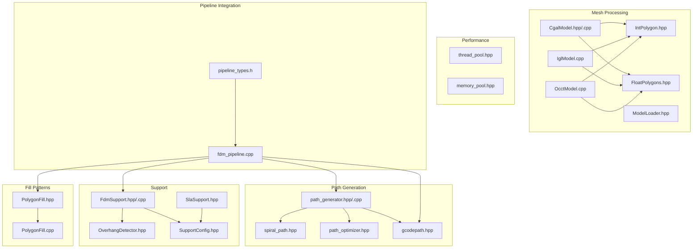
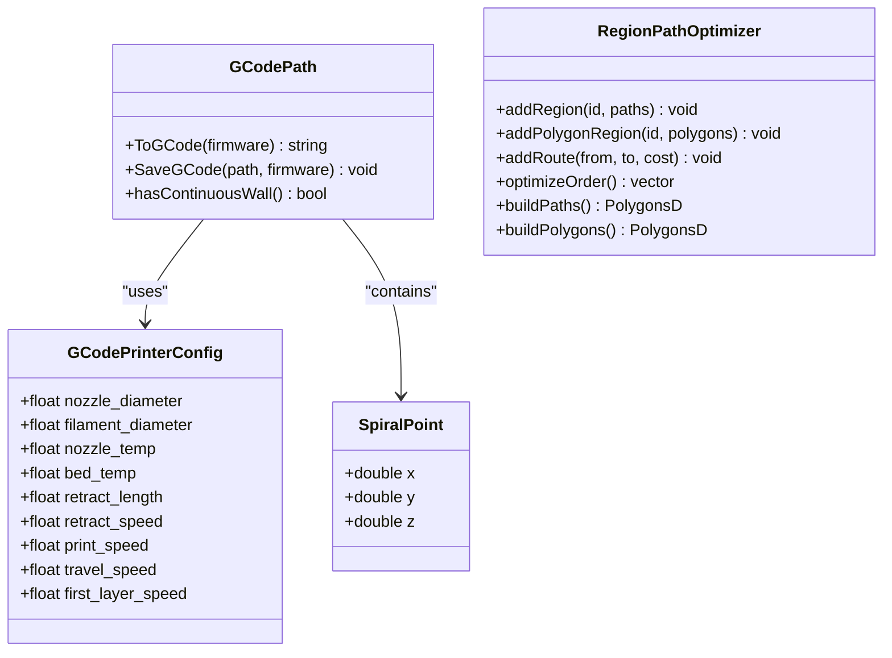
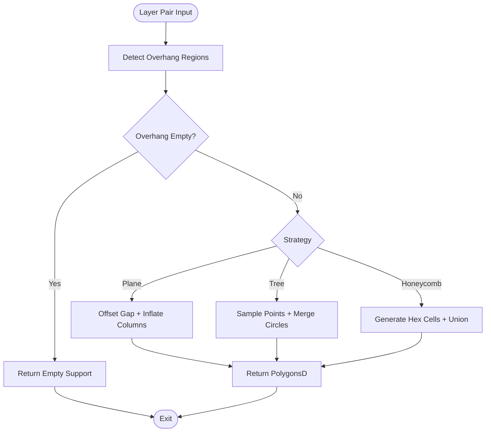
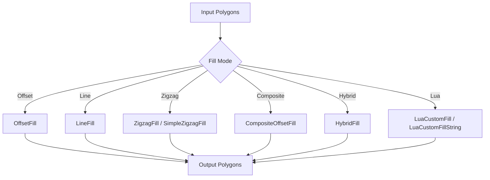
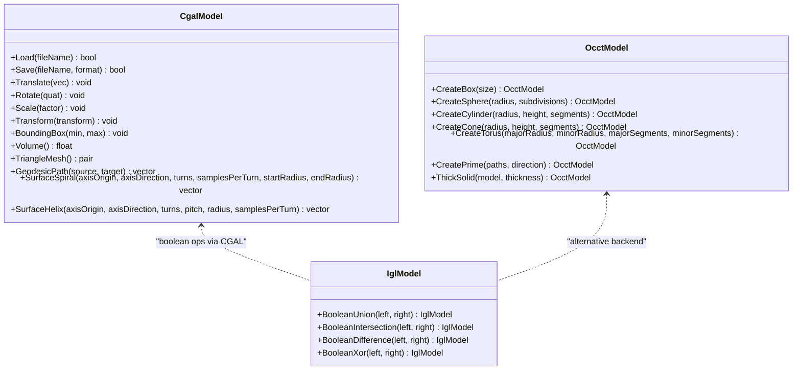
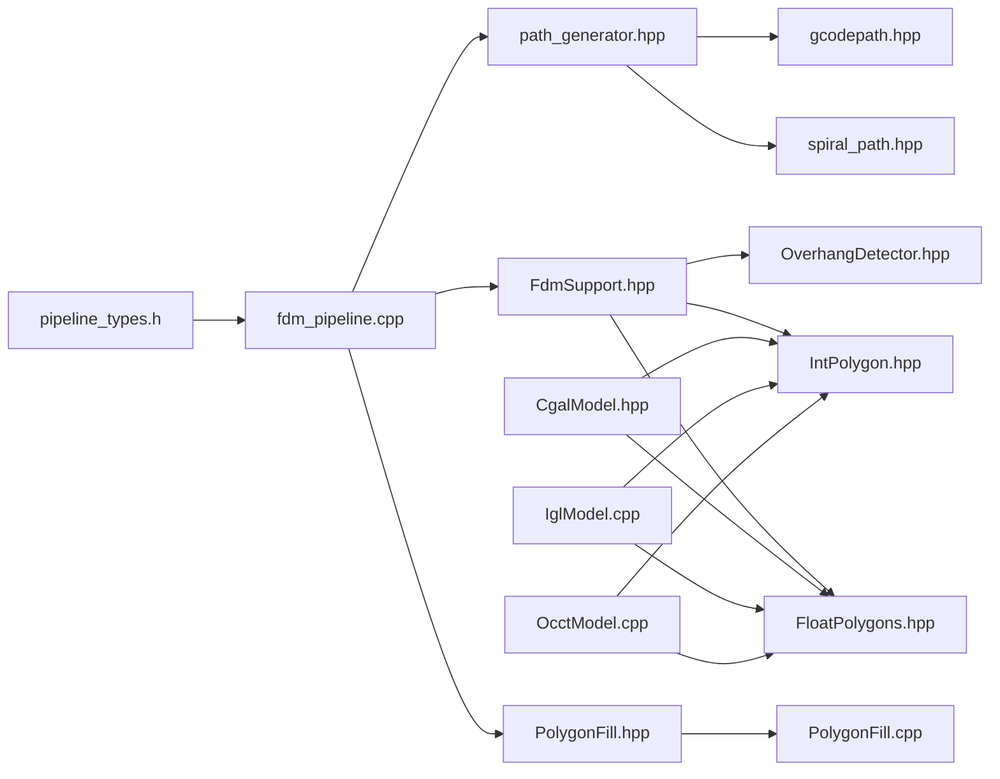
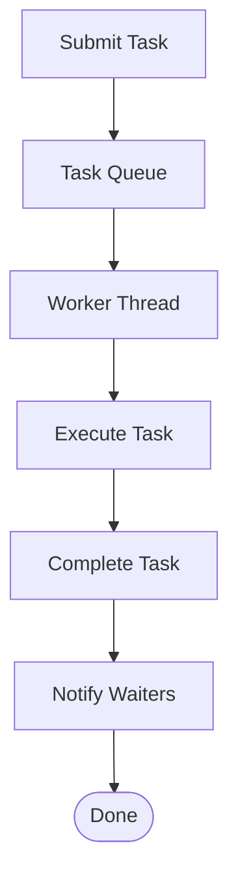

# Advanced Features

<cite>
**Referenced Files in This Document**
- [path_generator.hpp](file://LibHsBaSlicer/Path/path_generator.hpp)
- [path_generator.cpp](file://LibHsBaSlicer/Path/path_generator.cpp)
- [spiral_path.hpp](file://LibHsBaSlicer/Path/spiral_path.hpp)
- [gcodepath.hpp](file://paths/gcodepath.hpp)
- [path_optimizer.hpp](file://LibHsBaSlicer/Path/path_optimizer.hpp)
- [FdmSupport.hpp](file://support/FdmSupport.hpp)
- [FdmSupport.cpp](file://support/FdmSupport.cpp)
- [OverhangDetector.hpp](file://support/OverhangDetector.hpp)
- [SlaSupport.hpp](file://support/SlaSupport.hpp)
- [SupportConfig.hpp](file://support/SupportConfig.hpp)
- [PolygonFill.hpp](file://2D/PolygonFill.hpp)
- [PolygonFill.cpp](file://2D/PolygonFill.cpp)
- [thread_pool.hpp](file://base/thread_pool.hpp)
- [memory_pool.hpp](file://base/memory_pool.hpp)
- [CgalModel.hpp](file://meshmodel/CgalModel.hpp)
- [CgalModel.cpp](file://meshmodel/CgalModel.cpp)
- [IglModel.cpp](file://meshmodel/IglModel.cpp)
- [OcctModel.cpp](file://cadmodel/OcctModel.cpp)
- [IntPolygon.hpp](file://2D/IntPolygon.hpp)
- [FloatPolygons.hpp](file://2D/FloatPolygons.hpp)
- [ModelLoader.hpp](file://preprocess/ModelLoader.hpp)
- [fdm_pipeline.cpp](file://DllHsBaSlicer/fdm_pipeline.cpp)
- [pipeline_types.h](file://pipelinetypes/pipeline_types.h)
- [path_generator_test.cpp](file://tests/PathsOut/path_generator_test.cpp)
- [support_test.cpp](file://tests/Support/support_test.cpp)
- [fdm_support_lib_test.cpp](file://tests/Support/fdm_support_lib_test.cpp)
- [igl_model_test.cpp](file://tests/Models/igl_model_test.cpp)
- [occt_model_test.cpp](file://tests/Models/occt_model_test.cpp)
- [model_loader_test.cpp](file://tests/Preprocess/model_loader_test.cpp)
</cite>

## Table of Contents
1. [Introduction](#introduction)
2. [Project Structure](#project-structure)
3. [Core Components](#core-components)
4. [Architecture Overview](#architecture-overview)
5. [Detailed Component Analysis](#detailed-component-analysis)
6. [Dependency Analysis](#dependency-analysis)
7. [Performance Considerations](#performance-considerations)
8. [Troubleshooting Guide](#troubleshooting-guide)
9. [Conclusion](#conclusion)

## Introduction
This document explains the advanced features of HsBaSlicer with a focus on:
- Sophisticated path generation and G-code optimization
- Spiral path planning for continuous walls
- Multi-firmware G-code output (Marlin, RepRap/RRF, Klipper)
- Support structure generation for FDM and SLA
- Fill pattern implementations and custom Lua-driven algorithms
- Advanced mesh processing including boolean operations, repair, and topology analysis
- Performance optimization via parallel execution and memory management

The content maps directly to the repository’s implementation and tests, providing both conceptual understanding and concrete code-level references.

## Project Structure
HsBaSlicer organizes advanced functionality across several modules:
- Path generation and optimization: LibHsBaSlicer/Path
- 2D polygon fill patterns: 2D
- Support generation: support
- Mesh models and boolean operations: meshmodel, cadmodel
- Pipeline integration and C API: DllHsBaSlicer, pipelinetypes
- Base performance primitives: base



**Diagram sources**
- [path_generator.hpp:46-70](file://LibHsBaSlicer/Path/path_generator.hpp#L46-L70)
- [spiral_path.hpp:16-58](file://LibHsBaSlicer/Path/spiral_path.hpp#L16-L58)
- [path_optimizer.hpp:23-99](file://LibHsBaSlicer/Path/path_optimizer.hpp#L23-L99)
- [gcodepath.hpp:24-43](file://paths/gcodepath.hpp#L24-L43)
- [FdmSupport.hpp:13-63](file://support/FdmSupport.hpp#L13-L63)
- [OverhangDetector.hpp:14-50](file://support/OverhangDetector.hpp#L14-L50)
- [SlaSupport.hpp:13-42](file://support/SlaSupport.hpp#L13-L42)
- [SupportConfig.hpp:14-38](file://support/SupportConfig.hpp#L14-L38)
- [PolygonFill.hpp:20-136](file://2D/PolygonFill.hpp#L20-L136)
- [CgalModel.hpp:26-155](file://meshmodel/CgalModel.hpp#L26-L155)
- [IglModel.cpp:227-276](file://meshmodel/IglModel.cpp#L227-L276)
- [OcctModel.cpp:451-469](file://cadmodel/OcctModel.cpp#L451-L469)
- [IntPolygon.hpp:75-106](file://2D/IntPolygon.hpp#L75-L106)
- [FloatPolygons.hpp:72-106](file://2D/FloatPolygons.hpp#L72-L106)
- [ModelLoader.hpp:120-133](file://preprocess/ModelLoader.hpp#L120-L133)
- [fdm_pipeline.cpp:49-68](file://DllHsBaSlicer/fdm_pipeline.cpp#L49-L68)
- [pipeline_types.h:108-142](file://pipelinetypes/pipeline_types.h#L108-L142)

**Section sources**
- [path_generator.hpp:46-70](file://LibHsBaSlicer/Path/path_generator.hpp#L46-L70)
- [spiral_path.hpp:16-58](file://LibHsBaSlicer/Path/spiral_path.hpp#L16-L58)
- [path_optimizer.hpp:23-99](file://LibHsBaSlicer/Path/path_optimizer.hpp#L23-L99)
- [gcodepath.hpp:24-43](file://paths/gcodepath.hpp#L24-L43)
- [FdmSupport.hpp:13-63](file://support/FdmSupport.hpp#L13-L63)
- [OverhangDetector.hpp:14-50](file://support/OverhangDetector.hpp#L14-L50)
- [SlaSupport.hpp:13-42](file://support/SlaSupport.hpp#L13-L42)
- [SupportConfig.hpp:14-38](file://support/SupportConfig.hpp#L14-L38)
- [PolygonFill.hpp:20-136](file://2D/PolygonFill.hpp#L20-L136)
- [CgalModel.hpp:26-155](file://meshmodel/CgalModel.hpp#L26-L155)
- [IglModel.cpp:227-276](file://meshmodel/IglModel.cpp#L227-L276)
- [OcctModel.cpp:451-469](file://cadmodel/OcctModel.cpp#L451-L469)
- [IntPolygon.hpp:75-106](file://2D/IntPolygon.hpp#L75-L106)
- [FloatPolygons.hpp:72-106](file://2D/FloatPolygons.hpp#L72-L106)
- [ModelLoader.hpp:120-133](file://preprocess/ModelLoader.hpp#L120-L133)
- [fdm_pipeline.cpp:49-68](file://DllHsBaSlicer/fdm_pipeline.cpp#L49-L68)
- [pipeline_types.h:108-142](file://pipelinetypes/pipeline_types.h#L108-L142)

## Core Components
- Path generation and multi-firmware G-code output:
  - GenerateGCodePathV2 builds a GCodePath that supports Marlin, RepRap/RRF, and Klipper outputs.
  - Spiralized outer-wall generation merges per-layer contours into a continuous rising wall.
- Region-based path optimizer:
  - Reduces air-move travel by solving region visit order using TSP heuristics and greedy intra-region ordering.
- Support generation:
  - FDM strategies: plane, tree, honeycomb; driven by overhang detection and configurable geometry.
  - SLA sacrificial supports: thin columns with tapered cross-sections.
- Fill patterns:
  - Offset, line, zigzag, composite, hybrid fills; extensible via Lua scripts.
- Mesh processing:
  - Boolean operations (union, intersection, difference, xor) across multiple backends (CGAL, IGL, OpenCASCADE).
  - Mesh repair and orientation correction; topology checks.
- Performance:
  - ThreadPool for concurrent task execution.
  - MemoryPool and StaticMemoryPool for efficient allocation.

**Section sources**
- [path_generator.hpp:46-70](file://LibHsBaSlicer/Path/path_generator.hpp#L46-L70)
- [spiral_path.hpp:16-58](file://LibHsBaSlicer/Path/spiral_path.hpp#L16-L58)
- [path_optimizer.hpp:23-99](file://LibHsBaSlicer/Path/path_optimizer.hpp#L23-L99)
- [FdmSupport.hpp:13-63](file://support/FdmSupport.hpp#L13-L63)
- [SlaSupport.hpp:13-42](file://support/SlaSupport.hpp#L13-L42)
- [PolygonFill.hpp:20-136](file://2D/PolygonFill.hpp#L20-L136)
- [CgalModel.hpp:26-155](file://meshmodel/CgalModel.hpp#L26-L155)
- [thread_pool.hpp:27-162](file://base/thread_pool.hpp#L27-L162)
- [memory_pool.hpp:28-208](file://base/memory_pool.hpp#L28-L208)

## Architecture Overview
The advanced pipeline integrates slicing, support generation, fill patterns, path optimization, and G-code output. The FDM pipeline orchestrates these components and exposes a C-compatible interface for external applications.

```mermaid
sequenceDiagram
participant App as "Caller Application"
participant Pipe as "FDM Pipeline"
participant Gen as "Path Generator"
participant Sup as "Support Generator"
participant Fill as "Fill Patterns"
participant Opt as "Region Optimizer"
participant GCode as "GCodePath"
App->>Pipe : Configure parameters<br/>and call pipeline function
Pipe->>Gen : Generate layer paths
Pipe->>Sup : Detect overhangs and generate supports
Pipe->>Fill : Compute infill patterns
Pipe->>Opt : Optimize region visit order
Pipe->>GCode : Build firmware-specific G-code
GCode-->>App : Return G-code strings or save files
```

**Diagram sources**
- [fdm_pipeline.cpp:49-68](file://DllHsBaSlicer/fdm_pipeline.cpp#L49-L68)
- [path_generator.hpp:46-70](file://LibHsBaSlicer/Path/path_generator.hpp#L46-L70)
- [FdmSupport.hpp:13-63](file://support/FdmSupport.hpp#L13-L63)
- [PolygonFill.hpp:20-136](file://2D/PolygonFill.hpp#L20-L136)
- [path_optimizer.hpp:23-99](file://LibHsBaSlicer/Path/path_optimizer.hpp#L23-L99)
- [gcodepath.hpp:24-43](file://paths/gcodepath.hpp#L24-L43)

## Detailed Component Analysis

### Path Generation and G-code Optimization
- Multi-firmware G-code:
  - GenerateGCodePathV2 returns a GCodePath object capable of producing firmware-specific G-code (Marlin, RepRap/RRF, Klipper).
  - Printer configuration includes nozzle diameter, filament diameter, temperatures, retraction, and speeds.
- Spiral path planning:
  - SpiralizeOuterWall constructs a continuous helical wall from per-layer outer contours, aligning seams and ramping Z continuously.
- Region-based path optimization:
  - RegionPathOptimizer models independent regions as graph vertices and solves visit order to minimize air-move cost.
  - Supports pre-fill (polygon mode) and post-fill (fill-result mode), with greedy intra-region ordering.



**Diagram sources**
- [gcodepath.hpp:24-43](file://paths/gcodepath.hpp#L24-L43)
- [spiral_path.hpp:16-58](file://LibHsBaSlicer/Path/spiral_path.hpp#L16-L58)
- [path_optimizer.hpp:23-99](file://LibHsBaSlicer/Path/path_optimizer.hpp#L23-L99)

**Section sources**
- [path_generator.hpp:46-70](file://LibHsBaSlicer/Path/path_generator.hpp#L46-L70)
- [path_generator.cpp:14-41](file://LibHsBaSlicer/Path/path_generator.cpp#L14-L41)
- [spiral_path.hpp:16-58](file://LibHsBaSlicer/Path/spiral_path.hpp#L16-L58)
- [path_optimizer.hpp:23-99](file://LibHsBaSlicer/Path/path_optimizer.hpp#L23-L99)
- [gcodepath.hpp:24-43](file://paths/gcodepath.hpp#L24-L43)
- [path_generator_test.cpp:108-119](file://tests/PathsOut/path_generator_test.cpp#L108-L119)

### Support Structure Generation Systems
- Overhang detection:
  - OverhangDetector computes unsupported areas between adjacent layers based on angle threshold and layer height.
- FDM supports:
  - Plane: columnar supports inflated from overhang regions with gap separation.
  - Tree: branching supports generated by sampling points within overhang and merging circles.
  - Honeycomb: hexagonal cells filling overhang regions for lightweight rigid support.
- SLA sacrificial supports:
  - Thin columns with tapered diameters for easy removal; sample support points from overhang.



**Diagram sources**
- [OverhangDetector.hpp:14-50](file://support/OverhangDetector.hpp#L14-L50)
- [FdmSupport.cpp:48-72](file://support/FdmSupport.cpp#L48-L72)
- [FdmSupport.cpp:77-149](file://support/FdmSupport.cpp#L77-L149)
- [FdmSupport.cpp:155-200](file://support/FdmSupport.cpp#L155-L200)
- [SlaSupport.hpp:13-42](file://support/SlaSupport.hpp#L13-L42)

**Section sources**
- [OverhangDetector.hpp:14-50](file://support/OverhangDetector.hpp#L14-L50)
- [FdmSupport.hpp:13-63](file://support/FdmSupport.hpp#L13-L63)
- [FdmSupport.cpp:48-72](file://support/FdmSupport.cpp#L48-L72)
- [FdmSupport.cpp:77-149](file://support/FdmSupport.cpp#L77-L149)
- [FdmSupport.cpp:155-200](file://support/FdmSupport.cpp#L155-L200)
- [SlaSupport.hpp:13-42](file://support/SlaSupport.hpp#L13-L42)
- [SupportConfig.hpp:14-38](file://support/SupportConfig.hpp#L14-L38)
- [support_test.cpp:150-195](file://tests/Support/support_test.cpp#L150-L195)
- [fdm_support_lib_test.cpp:41-75](file://tests/Support/fdm_support_lib_test.cpp#L41-L75)

### Fill Pattern Implementations
- Built-in strategies:
  - OffsetFill, LineFill, SimpleZigzagFill, ZigzagFill.
  - CompositeOffsetFill and HybridFill combine offset borders with internal fills.
- Custom fills:
  - LuaCustomFill and LuaCustomFillString allow user-defined algorithms via Lua scripts.
  - RegisterLuaPolygonFillFunctions exposes built-in functions to Lua environment.



**Diagram sources**
- [PolygonFill.hpp:20-136](file://2D/PolygonFill.hpp#L20-L136)
- [PolygonFill.cpp:1-45](file://2D/PolygonFill.cpp#L1-L45)

**Section sources**
- [PolygonFill.hpp:20-136](file://2D/PolygonFill.hpp#L20-L136)
- [PolygonFill.cpp:1-45](file://2D/PolygonFill.cpp#L1-L45)

### Advanced Mesh Processing Techniques
- Boolean operations:
  - Union, Intersection, Difference, Xor available for IGL and OpenCASCADE models; CGAL-backed Nef polyhedra provide robust operations.
- Mesh repair and orientation:
  - CGAL model validates and repairs face orientations; corrects volume sign when needed.
- Topology analysis:
  - FullTopoModel provides topological manifold checks and vertex/edge/face relationships.



**Diagram sources**
- [CgalModel.hpp:26-155](file://meshmodel/CgalModel.hpp#L26-L155)
- [CgalModel.cpp:82-123](file://meshmodel/CgalModel.cpp#L82-L123)
- [IglModel.cpp:227-276](file://meshmodel/IglModel.cpp#L227-L276)
- [OcctModel.cpp:451-469](file://cadmodel/OcctModel.cpp#L451-L469)

**Section sources**
- [CgalModel.hpp:26-155](file://meshmodel/CgalModel.hpp#L26-L155)
- [CgalModel.cpp:82-123](file://meshmodel/CgalModel.cpp#L82-L123)
- [IglModel.cpp:227-276](file://meshmodel/IglModel.cpp#L227-L276)
- [OcctModel.cpp:451-469](file://cadmodel/OcctModel.cpp#L451-L469)
- [IntPolygon.hpp:75-106](file://2D/IntPolygon.hpp#L75-L106)
- [FloatPolygons.hpp:72-106](file://2D/FloatPolygons.hpp#L72-L106)
- [ModelLoader.hpp:120-133](file://preprocess/ModelLoader.hpp#L120-L133)
- [igl_model_test.cpp:44-67](file://tests/Models/igl_model_test.cpp#L44-L67)
- [occt_model_test.cpp:34-70](file://tests/Models/occt_model_test.cpp#L34-L70)
- [model_loader_test.cpp:149-188](file://tests/Preprocess/model_loader_test.cpp#L149-L188)

## Dependency Analysis
Key dependencies and interactions:
- Path generator depends on spiral path utilities and produces GCodePath instances.
- Support generators depend on overhang detection and use Clipper2 for polygon operations.
- Fill patterns are independent but can be orchestrated by the pipeline.
- Mesh models expose boolean operations through different backends; tests validate correctness.
- Pipeline integration composes all components and exposes C-compatible types.



**Diagram sources**
- [path_generator.hpp:46-70](file://LibHsBaSlicer/Path/path_generator.hpp#L46-L70)
- [gcodepath.hpp:24-43](file://paths/gcodepath.hpp#L24-L43)
- [spiral_path.hpp:16-58](file://LibHsBaSlicer/Path/spiral_path.hpp#L16-L58)
- [FdmSupport.hpp:13-63](file://support/FdmSupport.hpp#L13-L63)
- [OverhangDetector.hpp:14-50](file://support/OverhangDetector.hpp#L14-L50)
- [IntPolygon.hpp:75-106](file://2D/IntPolygon.hpp#L75-L106)
- [FloatPolygons.hpp:72-106](file://2D/FloatPolygons.hpp#L72-L106)
- [PolygonFill.hpp:20-136](file://2D/PolygonFill.hpp#L20-L136)
- [PolygonFill.cpp:1-45](file://2D/PolygonFill.cpp#L1-L45)
- [CgalModel.hpp:26-155](file://meshmodel/CgalModel.hpp#L26-L155)
- [IglModel.cpp:227-276](file://meshmodel/IglModel.cpp#L227-L276)
- [OcctModel.cpp:451-469](file://cadmodel/OcctModel.cpp#L451-L469)
- [fdm_pipeline.cpp:49-68](file://DllHsBaSlicer/fdm_pipeline.cpp#L49-L68)
- [pipeline_types.h:108-142](file://pipelinetypes/pipeline_types.h#L108-L142)

**Section sources**
- [path_generator.hpp:46-70](file://LibHsBaSlicer/Path/path_generator.hpp#L46-L70)
- [gcodepath.hpp:24-43](file://paths/gcodepath.hpp#L24-L43)
- [spiral_path.hpp:16-58](file://LibHsBaSlicer/Path/spiral_path.hpp#L16-L58)
- [FdmSupport.hpp:13-63](file://support/FdmSupport.hpp#L13-L63)
- [OverhangDetector.hpp:14-50](file://support/OverhangDetector.hpp#L14-L50)
- [IntPolygon.hpp:75-106](file://2D/IntPolygon.hpp#L75-L106)
- [FloatPolygons.hpp:72-106](file://2D/FloatPolygons.hpp#L72-L106)
- [PolygonFill.hpp:20-136](file://2D/PolygonFill.hpp#L20-L136)
- [PolygonFill.cpp:1-45](file://2D/PolygonFill.cpp#L1-L45)
- [CgalModel.hpp:26-155](file://meshmodel/CgalModel.hpp#L26-L155)
- [IglModel.cpp:227-276](file://meshmodel/IglModel.cpp#L227-L276)
- [OcctModel.cpp:451-469](file://cadmodel/OcctModel.cpp#L451-L469)
- [fdm_pipeline.cpp:49-68](file://DllHsBaSlicer/fdm_pipeline.cpp#L49-L68)
- [pipeline_types.h:108-142](file://pipelinetypes/pipeline_types.h#L108-L142)

## Performance Considerations
- Parallel processing:
  - ThreadPool manages worker threads, submits tasks, tracks active/pending counts, and supports coroutine executors.
  - Recommended thread count equals hardware concurrency for CPU-bound tasks; adjust for I/O-bound workloads.
- Memory management:
  - MemoryPool and StaticMemoryPool provide fixed-size pools with STL allocator compatibility.
  - Thread-safe allocation/deallocation; useful for high-frequency small allocations during slicing and path generation.



**Diagram sources**
- [thread_pool.hpp:27-162](file://base/thread_pool.hpp#L27-L162)

**Section sources**
- [thread_pool.hpp:27-162](file://base/thread_pool.hpp#L27-L162)
- [memory_pool.hpp:28-208](file://base/memory_pool.hpp#L28-L208)

## Troubleshooting Guide
- G-code generation issues:
  - Verify printer configuration fields (nozzle diameter, filament diameter, temperatures, speeds).
  - Ensure firmware selection matches target device capabilities.
- Support generation failures:
  - Check overhang angle threshold and layer height settings.
  - Validate gap and support diameter values to avoid empty or overly dense supports.
- Fill pattern problems:
  - Confirm spacing and angle parameters; ensure polygon inputs are valid (single outer boundary with holes).
  - For Lua custom fills, verify script path/function name and Lua registration callbacks.
- Mesh boolean operation errors:
  - Ensure meshes are watertight and oriented correctly; CGAL repair attempts may fail if input is invalid.
  - Use appropriate backend (CGAL vs IGL vs OpenCASCADE) depending on geometry complexity.

**Section sources**
- [gcodepath.hpp:24-43](file://paths/gcodepath.hpp#L24-L43)
- [OverhangDetector.hpp:14-50](file://support/OverhangDetector.hpp#L14-L50)
- [FdmSupport.cpp:48-72](file://support/FdmSupport.cpp#L48-L72)
- [PolygonFill.hpp:20-136](file://2D/PolygonFill.hpp#L20-L136)
- [CgalModel.cpp:82-123](file://meshmodel/CgalModel.cpp#L82-L123)

## Conclusion
HsBaSlicer provides a comprehensive set of advanced features for modern slicing workflows:
- Robust path generation with multi-firmware G-code output and spiralized walls
- Flexible support generation for FDM and SLA processes
- Extensible fill patterns with Lua scripting
- Powerful mesh processing with boolean operations and repair
- High-performance primitives for parallel execution and memory management

These components are well-integrated through the FDM pipeline and exposed via clear APIs, enabling both straightforward usage and deep customization.