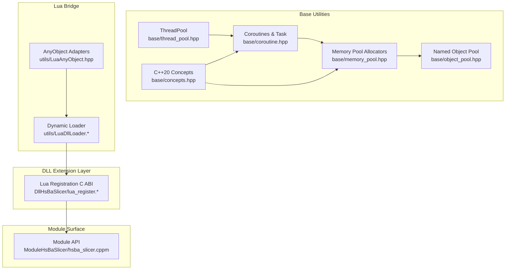
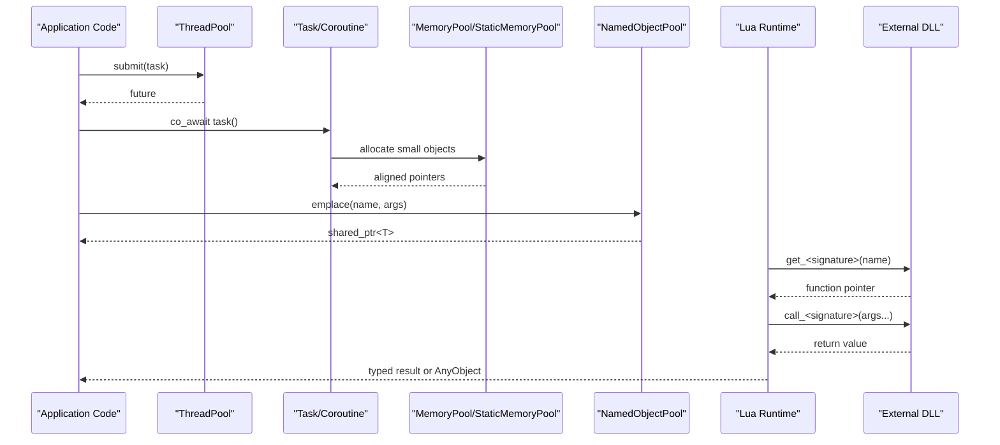
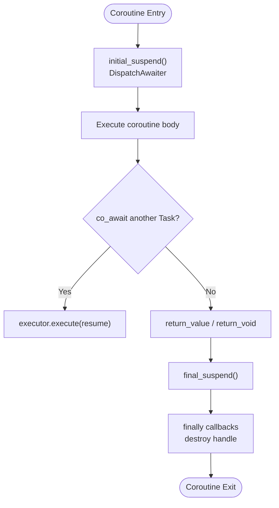
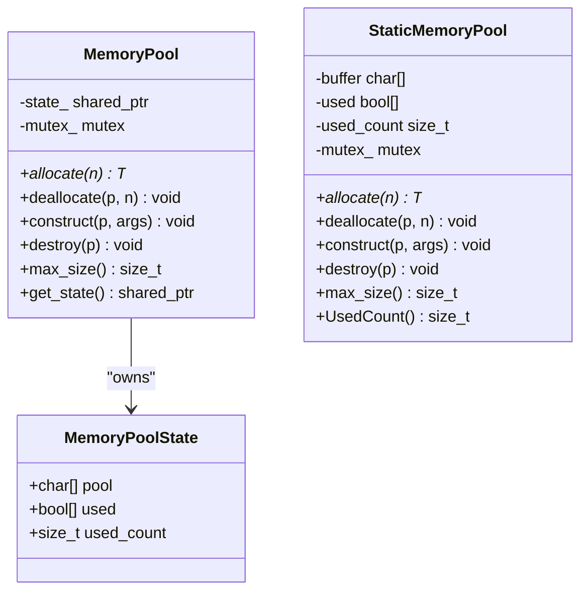
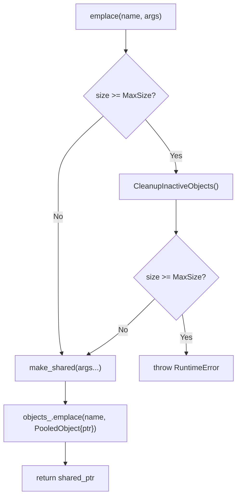
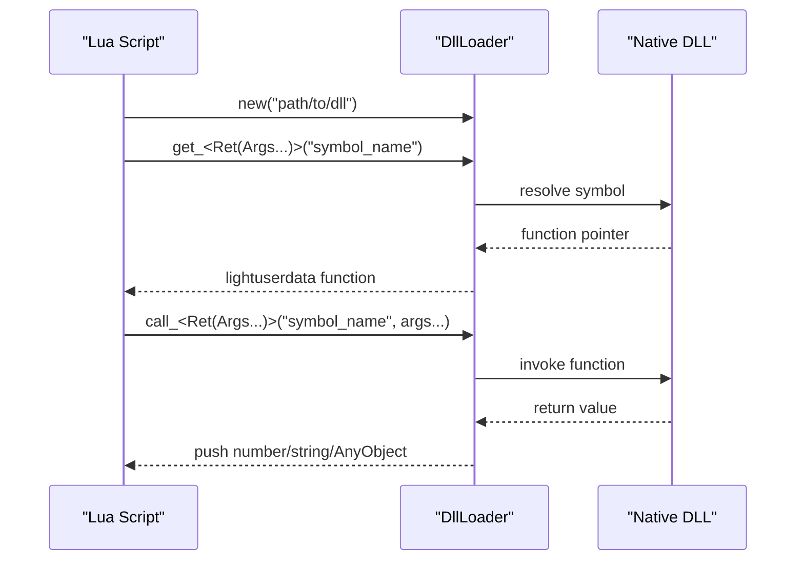
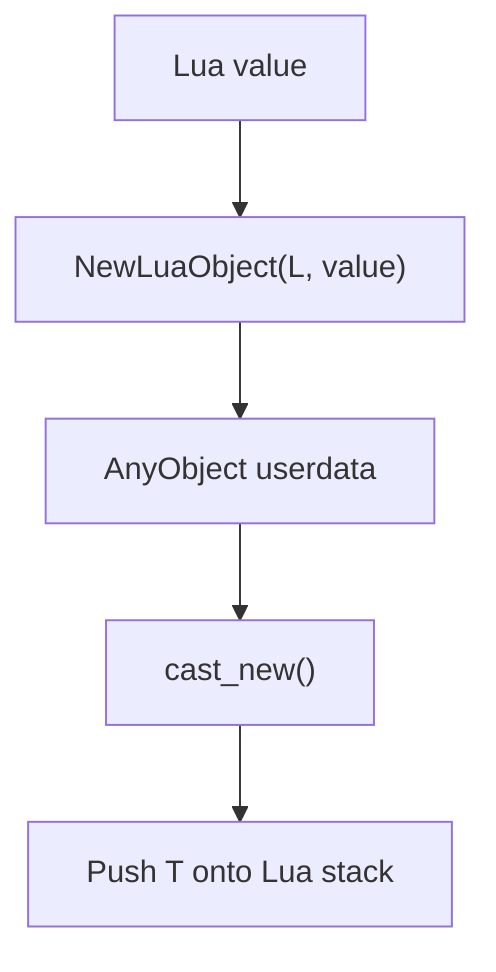
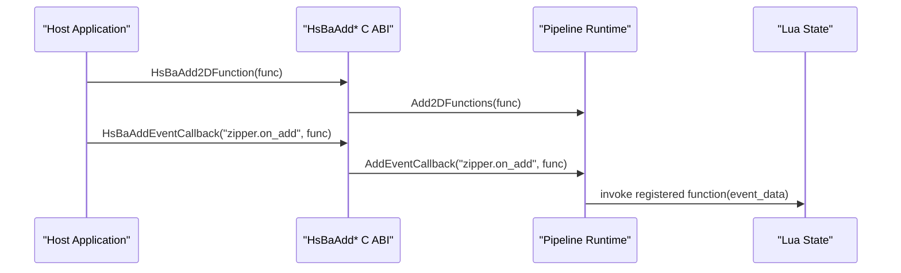
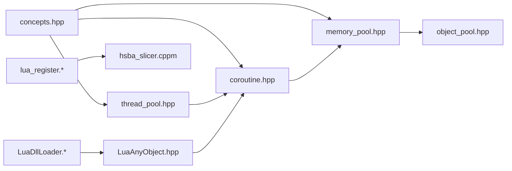

# Advanced Features

<cite>
**Referenced Files in This Document**
- [thread_pool.hpp](file://base/thread_pool.hpp)
- [coroutine.hpp](file://base/coroutine.hpp)
- [memory_pool.hpp](file://base/memory_pool.hpp)
- [object_pool.hpp](file://base/object_pool.hpp)
- [concepts.hpp](file://base/concepts.hpp)
- [lua_register.h](file://DllHsBaSlicer/lua_register.h)
- [lua_register.cpp](file://DllHsBaSlicer/lua_register.cpp)
- [LuaAnyObject.hpp](file://utils/LuaAnyObject.hpp)
- [LuaDllLoader.hpp](file://utils/LuaDllLoader.hpp)
- [LuaDllLoader.cpp](file://utils/LuaDllLoader.cpp)
- [hsba_slicer.cppm](file://ModuleHsBaSlicer/hsba_slicer.cppm)
</cite>

## Table of Contents
1. [Introduction](#introduction)
2. [Project Structure](#project-structure)
3. [Core Components](#core-components)
4. [Architecture Overview](#architecture-overview)
5. [Detailed Component Analysis](#detailed-component-analysis)
6. [Dependency Analysis](#dependency-analysis)
7. [Performance Considerations](#performance-considerations)
8. [Troubleshooting Guide](#troubleshooting-guide)
9. [Conclusion](#conclusion)

## Introduction
This document explains HsBaSlicer’s advanced features with a focus on performance, memory management, type safety, and Lua integration. It covers:

- Parallel processing through a thread pool and C++20 coroutine-based async execution.
- Memory management using custom allocators, object pooling, and memory pools.
- Type safety through C++20 concepts and generic programming constraints.
- Lua integration including dynamic loading, type conversion, and event registration.
- Practical guidance for benchmarking, profiling, optimization, and troubleshooting.

The content is grounded in the repository’s core base utilities, DLL extension interface, and Lua bridge components.

## Project Structure
The advanced features are primarily implemented in:

- `base/`: concurrency, coroutines, memory pools, object pools, and C++20 concepts.
- `DllHsBaSlicer/`: C ABI for registering external Lua functions and events into the pipeline runtime.
- `utils/`: Lua type adapters, dynamic library loader, and Lua-visible helpers.
- `ModuleHsBaSlicer/`: module-level API surface exposing registration and event callback functions.



**Diagram sources**
- [thread_pool.hpp:29-162](file://base/thread_pool.hpp#L29-L162)
- [coroutine.hpp:47-773](file://base/coroutine.hpp#L47-L773)
- [memory_pool.hpp:43-208](file://base/memory_pool.hpp#L43-L208)
- [object_pool.hpp:22-283](file://base/object_pool.hpp#L22-L283)
- [concepts.hpp:15-267](file://base/concepts.hpp#L15-L267)
- [lua_register.h:11-35](file://DllHsBaSlicer/lua_register.h#L11-L35)
- [LuaAnyObject.hpp:19-521](file://utils/LuaAnyObject.hpp#L19-L521)
- [LuaDllLoader.hpp:27-263](file://utils/LuaDllLoader.hpp#L27-L263)
- [hsba_slicer.cppm:504-520](file://ModuleHsBaSlicer/hsba_slicer.cppm#L504-L520)

**Section sources**
- [thread_pool.hpp:29-162](file://base/thread_pool.hpp#L29-L162)
- [coroutine.hpp:47-773](file://base/coroutine.hpp#L47-L773)
- [memory_pool.hpp:43-208](file://base/memory_pool.hpp#L43-L208)
- [object_pool.hpp:22-283](file://base/object_pool.hpp#L22-L283)
- [concepts.hpp:15-267](file://base/concepts.hpp#L15-L267)
- [lua_register.h:11-35](file://DllHsBaSlicer/lua_register.h#L11-L35)
- [LuaAnyObject.hpp:19-521](file://utils/LuaAnyObject.hpp#L19-L521)
- [LuaDllLoader.hpp:27-263](file://utils/LuaDllLoader.hpp#L27-L263)
- [hsba_slicer.cppm:504-520](file://ModuleHsBaSlicer/hsba_slicer.cppm#L504-L520)

## Core Components
This section summarizes the key building blocks used across advanced features.

- ThreadPool: A bounded worker-thread pool that submits tasks via futures, tracks active/pending work, supports graceful shutdown, and optionally integrates with C++20 coroutines through an executor interface.
- Coroutines: A Task abstraction over C++20 coroutines with executors (noop, async, thread pool), awaiters, result handling, callbacks, and optional custom allocator support for coroutine promise allocation.
- Memory Pools: Fixed-size allocators (`MemoryPool`, `StaticMemoryPool`) providing predictable allocation behavior, alignment guarantees, and per-pool or static shared state.
- Named Object Pool: A named registry of shared objects with capacity limits, inactive-object cleanup, and concurrent access protection.
- Concepts: Reusable C++20 concepts for streamability, hashing, string types, allocators, arithmetic operations, and more, enabling compile-time checks and generic APIs.
- Lua Integration: C ABI entry points to register 2D/3D/File Lua functions and event callbacks; AnyObject adapters bridging native values to Lua; dynamic loader exposing function resolution and invocation from Lua.

**Section sources**
- [thread_pool.hpp:29-162](file://base/thread_pool.hpp#L29-L162)
- [coroutine.hpp:47-773](file://base/coroutine.hpp#L47-L773)
- [memory_pool.hpp:43-208](file://base/memory_pool.hpp#L43-L208)
- [object_pool.hpp:22-283](file://base/object_pool.hpp#L22-L283)
- [concepts.hpp:15-267](file://base/concepts.hpp#L15-L267)
- [lua_register.h:11-35](file://DllHsBaSlicer/lua_register.h#L11-L35)
- [LuaAnyObject.hpp:19-521](file://utils/LuaAnyObject.hpp#L19-L521)
- [LuaDllLoader.hpp:27-263](file://utils/LuaDllLoader.hpp#L27-L263)

## Architecture Overview
The advanced feature architecture connects parallel execution, memory management, type safety, and Lua scripting into a cohesive system.



**Diagram sources**
- [thread_pool.hpp:67-111](file://base/thread_pool.hpp#L67-L111)
- [coroutine.hpp:205-382](file://base/coroutine.hpp#L205-L382)
- [memory_pool.hpp:111-175](file://base/memory_pool.hpp#L111-L175)
- [object_pool.hpp:66-92](file://base/object_pool.hpp#L66-L92)
- [LuaDllLoader.hpp:160-245](file://utils/LuaDllLoader.hpp#L160-L245)

## Detailed Component Analysis

### Parallel Processing: Thread Pool and Coroutine Executors
HsBaSlicer provides a robust thread pool and coroutine infrastructure suitable for high-throughput slicing pipelines.

Key behaviors:
- Worker threads pull tasks from a queue protected by a mutex and condition variable.
- Tasks are wrapped in packaged tasks returning futures.
- Active and pending task counts are tracked atomically and via queue size.
- Shutdown sets a stop flag, notifies all workers, and joins threads.
- Optional coroutine executor integrates with Task via IExecutor.

```mermaid
classDiagram
class ThreadPool {
+submit(f, args) future
+PendingTasks() size_t
+ActiveTasks() size_t
+WaitAll() void
-WorkerLoop() void
-workers_ vector<thread>
-tasks_ queue<function<void()>>
-queue_mutex_ mutex
-condition_ condition_variable
-finished_condition_ condition_variable
-stop_ atomic<bool>
-active_tasks_ atomic<size_t>
}
class IExecutor {
<<interface>>
+execute(func) void
}
class ThreadPoolExecutor {
+execute(func) void
+SetDefaultPool(pool) void
-default_pool_ ThreadPool*
-pool_ ThreadPool*
-get_pool() ThreadPool*
}
ThreadPoolExecutor --> ThreadPool : "uses"
ThreadPoolExecutor ..|> IExecutor : "implements"
```

**Diagram sources**
- [thread_pool.hpp:29-162](file://base/thread_pool.hpp#L29-L162)
- [thread_pool.hpp:170-207](file://base/thread_pool.hpp#L170-L207)

Practical usage patterns:
- Submit CPU-bound slices or path computations concurrently.
- Use WaitAll to synchronize completion before exporting results.
- Configure thread count based on hardware concurrency and workload characteristics.

Best practices:
- Avoid submitting extremely fine-grained tasks to reduce overhead.
- Prefer batching independent work units.
- Monitor ActiveTasks and PendingTasks to detect bottlenecks.

**Section sources**
- [thread_pool.hpp:29-162](file://base/thread_pool.hpp#L29-L162)
- [thread_pool.hpp:170-207](file://base/thread_pool.hpp#L170-L207)

### Coroutine-Based Async Operations
The coroutine layer abstracts asynchronous execution with customizable executors and strong result semantics.

Highlights:
- Task<T, Executor> encapsulates coroutine state, result, and lifecycle.
- DispatchAwaiter ensures initial suspension on the configured executor.
- Finalization hooks allow cleanup after completion.
- CustomAllocatorTask enables allocator-aware coroutine promises.



**Diagram sources**
- [coroutine.hpp:234-276](file://base/coroutine.hpp#L234-L276)
- [coroutine.hpp:414-448](file://base/coroutine.hpp#L414-L448)
- [coroutine.hpp:593-687](file://base/coroutine.hpp#L593-L687)

Integration with ThreadPool:
- ThreadPoolExecutor implements IExecutor and forwards execution to ThreadPool::submit.
- SetDefaultPool allows global default executor configuration.

Error handling:
- Result wraps exceptions and values; get_or_throw rethrows stored exceptions.
- catching and then provide callback-based error and success handling.

**Section sources**
- [coroutine.hpp:47-773](file://base/coroutine.hpp#L47-L773)
- [thread_pool.hpp:170-207](file://base/thread_pool.hpp#L170-L207)

### Memory Management Strategies
HsBaSlicer offers multiple strategies to control allocation patterns and resource lifetimes.

#### Custom Allocators and Memory Pools
- MemoryPool<T, PoolSize>: Per-instance fixed-size pool with alignment-safe scanning and usage tracking.
- StaticMemoryPool<T, PoolSize>: Shared static buffer with identical allocation semantics but process-wide state.



**Diagram sources**
- [memory_pool.hpp:28-34](file://base/memory_pool.hpp#L28-L34)
- [memory_pool.hpp:43-208](file://base/memory_pool.hpp#L43-L208)
- [memory_pool.hpp:215-372](file://base/memory_pool.hpp#L215-L372)

Usage guidance:
- Use MemoryPool when you need isolated pools per algorithm or stage.
- Use StaticMemoryPool for globally shared buffers where identity equality is expected.
- Ensure PoolSize accommodates peak allocations; otherwise, bad_alloc is thrown.

#### Object Pooling
NamedObjectPool manages named shared objects with capacity limits and inactive-object cleanup.

Key capabilities:
- emplace/insert/allocate create pooled objects.
- get/operator[] retrieve shared pointers.
- CleanupInactiveObjects removes entries whose use count equals one.
- InactiveCount/ActiveCount expose pool health metrics.



**Diagram sources**
- [object_pool.hpp:66-92](file://base/object_pool.hpp#L66-L92)
- [object_pool.hpp:262-279](file://base/object_pool.hpp#L262-L279)

Resource management patterns:
- Prefer shared ownership for long-lived resources.
- Trigger cleanup only when necessary to avoid thrashing.
- Monitor ActiveCount/InactiveCount to tune MaxSize.

**Section sources**
- [memory_pool.hpp:43-208](file://base/memory_pool.hpp#L43-L208)
- [memory_pool.hpp:215-372](file://base/memory_pool.hpp#L215-L372)
- [object_pool.hpp:22-283](file://base/object_pool.hpp#L22-L283)

### Type Safety with C++20 Concepts
Concepts enforce compile-time requirements and improve generic code readability.

Important concepts:
- Streamability: CharStream, WCharStream.
- String handling: StdString, CStyleString, String, StringView.
- Hashing: StdHash, Hash, EqualAndStdHash, EqualAndHash.
- Allocator traits: TAllocator, NoStateAllocator.
- Arithmetic operations: Addable, Subtractable, Multipliable, Dividable.
- Pointer-like behavior: PointerLike, PointerOrIt.
- Enumerations and references: Enum, LvalueRef, RvalueRef, Ref.

Generic programming patterns:
- Functions can constrain parameters with concepts to fail early at compile time.
- Allocator-aware algorithms can require TAllocator and NoStateAllocator for predictable behavior.
- String abstractions unify std::string variants and C-style strings.

Example application areas:
- Serialization/deserialization helpers requiring streamable types.
- Config mapping requiring hashable keys.
- Custom allocators for containers and coroutine promises.

**Section sources**
- [concepts.hpp:15-267](file://base/concepts.hpp#L15-L267)

### Lua Integration Architecture
HsBaSlicer exposes a flexible Lua integration surface for extending pipeline stages and interacting with native code.

#### Dynamic Loading
Lua sees a DllLoader object that can load, reload, and unload native libraries. It also exposes typed get_/call_ functions generated per signature.



**Diagram sources**
- [LuaDllLoader.hpp:27-79](file://utils/LuaDllLoader.hpp#L27-L79)
- [LuaDllLoader.hpp:160-245](file://utils/LuaDllLoader.hpp#L160-L245)
- [LuaDllLoader.cpp:14-52](file://utils/LuaDllLoader.cpp#L14-L52)
- [LuaDllLoader.cpp:55-103](file://utils/LuaDllLoader.cpp#L55-L103)

#### Type Conversion
AnyObject adapters bridge native values to Lua and back.

- New functions wrap native values into Lua userdata representing AnyObject.
- Cast functions extract native values from AnyObject with type checking and exception propagation.
- Built-in adapters exist for int, long, long long, size_t, float, double, bool, string, cstring.



**Diagram sources**
- [LuaAnyObject.hpp:72-112](file://utils/LuaAnyObject.hpp#L72-L112)
- [LuaAnyObject.hpp:118-126](file://utils/LuaAnyObject.hpp#L118-L126)
- [LuaAnyObject.hpp:128-509](file://utils/LuaAnyObject.hpp#L128-L509)

#### Event System
The C ABI exposes registration functions for 2D/3D/File Lua functions and named event callbacks.

- HsBaAdd2DFunction/HsBaAdd3DFunction/HsBaAddFileFunction register Lua functions into pipeline stages.
- HsBaAddEventCallback registers a Lua function for a named event such as zipper or database events.
- Module-level API mirrors these registrations for higher-level consumers.



**Diagram sources**
- [lua_register.h:21-31](file://DllHsBaSlicer/lua_register.h#L21-L31)
- [lua_register.cpp:11-41](file://DllHsBaSlicer/lua_register.cpp#L11-L41)
- [hsba_slicer.cppm:504-520](file://ModuleHsBaSlicer/hsba_slicer.cppm#L504-L520)

**Section sources**
- [LuaDllLoader.hpp:27-263](file://utils/LuaDllLoader.hpp#L27-L263)
- [LuaDllLoader.cpp:14-103](file://utils/LuaDllLoader.cpp#L14-L103)
- [LuaAnyObject.hpp:19-521](file://utils/LuaAnyObject.hpp#L19-L521)
- [lua_register.h:11-35](file://DllHsBaSlicer/lua_register.h#L11-L35)
- [lua_register.cpp:11-41](file://DllHsBaSlicer/lua_register.cpp#L11-L41)
- [hsba_slicer.cppm:504-520](file://ModuleHsBaSlicer/hsba_slicer.cppm#L504-L520)

## Dependency Analysis
The following diagram shows how advanced features depend on each other.



**Diagram sources**
- [concepts.hpp:15-267](file://base/concepts.hpp#L15-L267)
- [thread_pool.hpp:29-162](file://base/thread_pool.hpp#L29-L162)
- [coroutine.hpp:47-773](file://base/coroutine.hpp#L47-L773)
- [memory_pool.hpp:43-208](file://base/memory_pool.hpp#L43-L208)
- [object_pool.hpp:22-283](file://base/object_pool.hpp#L22-L283)
- [LuaAnyObject.hpp:19-521](file://utils/LuaAnyObject.hpp#L19-L521)
- [LuaDllLoader.hpp:27-263](file://utils/LuaDllLoader.hpp#L27-L263)
- [lua_register.h:11-35](file://DllHsBaSlicer/lua_register.h#L11-L35)
- [hsba_slicer.cppm:504-520](file://ModuleHsBaSlicer/hsba_slicer.cppm#L504-L520)

**Section sources**
- [concepts.hpp:15-267](file://base/concepts.hpp#L15-L267)
- [thread_pool.hpp:29-162](file://base/thread_pool.hpp#L29-L162)
- [coroutine.hpp:47-773](file://base/coroutine.hpp#L47-L773)
- [memory_pool.hpp:43-208](file://base/memory_pool.hpp#L43-L208)
- [object_pool.hpp:22-283](file://base/object_pool.hpp#L22-L283)
- [LuaAnyObject.hpp:19-521](file://utils/LuaAnyObject.hpp#L19-L521)
- [LuaDllLoader.hpp:27-263](file://utils/LuaDllLoader.hpp#L27-L263)
- [lua_register.h:11-35](file://DllHsBaSlicer/lua_register.h#L11-L35)
- [hsba_slicer.cppm:504-520](file://ModuleHsBaSlicer/hsba_slicer.cppm#L504-L520)

## Performance Considerations
Guidance derived from the implementation details:

- Parallelism tuning:
  - Size ThreadPool according to hardware_concurrency and workload type.
  - Batch independent tasks to amortize scheduling overhead.
  - Use ActiveTasks/PendingTasks to detect saturation and adjust batch sizes.

- Coroutines:
  - Prefer executor-driven dispatch to avoid blocking the calling thread.
  - Use finally hooks for deterministic cleanup.
  - For heavy data paths, consider CustomAllocatorTask with a NoStateAllocator to localize allocations.

- Memory pools:
  - Choose PoolSize to cover peak allocations; repeated bad_alloc indicates undersized pools.
  - Prefer MemoryPool for isolation and StaticMemoryPool for shared state.
  - Validate alignment-sensitive allocations; the pool scans by alignment.

- Object pooling:
  - Tune MaxSize based on typical concurrent usage.
  - Monitor InactiveCount/ActiveCount to ensure timely cleanup without thrashing.

- Lua integration:
  - Minimize cross-boundary calls; batch data transfers where possible.
  - Use typed get_/call_ functions to avoid reflection overhead.
  - Validate argument counts and types before invoking native functions.

[No sources needed since this section provides general guidance]

## Troubleshooting Guide
Common issues and remedies:

- ThreadPool submission errors:
  - Submitting to a stopped pool throws a runtime error. Ensure the pool remains alive while tasks are submitted.
  - Verify num_threads > 0 during construction.

- Coroutine failures:
  - Exceptions inside coroutines are captured; use catching to inspect errors or let get_or_throw propagate them.
  - If awaiting tasks never resume, verify the executor is correctly set and not blocked.

- Memory pool exhaustion:
  - bad_alloc indicates insufficient PoolSize or incorrect deallocation patterns.
  - Ensure every allocated block is destroyed and deallocated exactly once.

- Object pool full:
  - RuntimeError occurs if the pool is full and no inactive objects are available. Increase MaxSize or trigger Cleanup proactively.

- Lua dynamic loading:
  - Invalid DllLoader object or mismatched signatures cause Lua errors. Confirm the DLL path and function signatures match get_/call_ templates.
  - Argument count mismatches raise errors; validate stack length before calling.

- Event callbacks:
  - Ensure event names match exactly (e.g., zipper.on_add).
  - Register callbacks before triggering events.

**Section sources**
- [thread_pool.hpp:37-46](file://base/thread_pool.hpp#L37-L46)
- [thread_pool.hpp:77-89](file://base/thread_pool.hpp#L77-L89)
- [coroutine.hpp:277-316](file://base/coroutine.hpp#L277-L316)
- [memory_pool.hpp:111-175](file://base/memory_pool.hpp#L111-L175)
- [object_pool.hpp:71-85](file://base/object_pool.hpp#L71-L85)
- [LuaDllLoader.hpp:160-245](file://utils/LuaDllLoader.hpp#L160-L245)

## Conclusion
HsBaSlicer’s advanced features combine high-performance parallelism, efficient memory management, strong type safety, and extensible Lua scripting. By leveraging ThreadPool and coroutine executors, custom allocators and pools, C++20 concepts, and a robust Lua bridge, developers can build scalable slicing pipelines that are both fast and safe. The provided diagrams and source references offer concrete pathways for implementing custom algorithms, optimizing memory usage, and extending functionality through Lua scripts.

[No sources needed since this section summarizes without analyzing specific files]