# Advanced Features / 高级主题

<cite>
**Referenced Files in This Document**
- [pipeline_types.h](file://pipelinetypes/pipeline_types.h)
- [fdm_pipeline.h](file://DllHsBaSlicer/fdm_pipeline.h)
- [sla_pipeline.h](file://DllHsBaSlicer/sla_pipeline.h)
- [slm_pipeline.h](file://DllHsBaSlicer/slm_pipeline.h)
- [sls_pipeline.h](file://DllHsBaSlicer/sls_pipeline.h)
- [tdp_pipeline.h](file://DllHsBaSlicer/tdp_pipeline.h)
- [waam_pipeline.h](file://DllHsBaSlicer/waam_pipeline.h)
- [thread_pool.hpp](file://base/thread_pool.hpp)
- [coroutine.hpp](file://base/coroutine.hpp)
- [memory_pool.hpp](file://base/memory_pool.hpp)
- [object_pool.hpp](file://base/object_pool.hpp)
- [app_config.hpp](file://utils/app_config.hpp)
- [param_store.hpp](file://fileoperator/param_store.hpp)
- [param_schema.hpp](file://fileoperator/param_schema.hpp)
- [LuaDllLoader.hpp](file://utils/LuaDllLoader.hpp)
- [EventSourceFunction.hpp](file://LibHsBaSlicer/Extends/EventSourceFunction.hpp)
</cite>

## Table of Contents
1. [Introduction](#introduction)
2. [Project Structure](#project-structure)
3. [Core Components](#core-components)
4. [Architecture Overview](#architecture-overview)
5. [Detailed Component Analysis](#detailed-component-analysis)
6. [Dependency Analysis](#dependency-analysis)
7. [Performance Considerations](#performance-considerations)
8. [Troubleshooting Guide](#troubleshooting-guide)
9. [Conclusion](#conclusion)
10. [Appendices](#appendices)

## Introduction
This document explains HsBaSlicer’s advanced features and specialized capabilities with a focus on the complete pipeline system, custom Lua-driven workflows, performance infrastructure, configuration management, plugin architecture, event-driven programming, error handling, and debugging techniques. It is intended for users who need to extend or optimize production slicing pipelines across FDM, SLA, metal powder-bed fusion (SLM/SLS), binder jetting (TDP), and wire arc additive manufacturing (WAAM).

## Project Structure
The advanced feature surface is exposed through:
- C ABI pipeline headers that define per-process configurations, results, progress callbacks, and async entry points.
- A shared type layer defining all pipeline config/result structs and enums.
- Performance primitives such as thread pools, coroutines, memory pools, and object pools.
- Configuration and parameter persistence layers including application settings and schema-backed parameter storage.
- Plugin and extension mechanisms via dynamic DLL loading and Lua integration.
- Event source functions enabling progress and I/O callbacks.

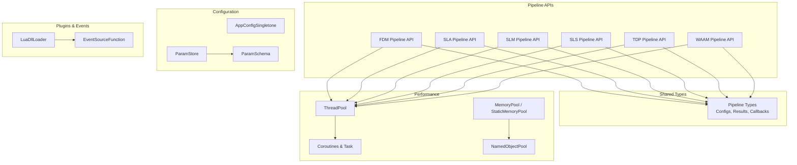

**Diagram sources**
- [pipeline_types.h:23-783](file://pipelinetypes/pipeline_types.h#L23-L783)
- [fdm_pipeline.h:17-61](file://DllHsBaSlicer/fdm_pipeline.h#L17-L61)
- [sla_pipeline.h:17-56](file://DllHsBaSlicer/sla_pipeline.h#L17-L56)
- [slm_pipeline.h:17-56](file://DllHsBaSlicer/slm_pipeline.h#L17-L56)
- [sls_pipeline.h:17-56](file://DllHsBaSlicer/sls_pipeline.h#L17-L56)
- [tdp_pipeline.h:17-56](file://DllHsBaSlicer/tdp_pipeline.h#L17-L56)
- [waam_pipeline.h:17-57](file://DllHsBaSlicer/waam_pipeline.h#L17-L57)
- [thread_pool.hpp:29-162](file://base/thread_pool.hpp#L29-L162)
- [coroutine.hpp:47-382](file://base/coroutine.hpp#L47-L382)
- [memory_pool.hpp:44-208](file://base/memory_pool.hpp#L44-L208)
- [object_pool.hpp:23-283](file://base/object_pool.hpp#L23-L283)
- [app_config.hpp:19-46](file://utils/app_config.hpp#L19-L46)
- [param_store.hpp:33-105](file://fileoperator/param_store.hpp#L33-L105)
- [param_schema.hpp:58-92](file://fileoperator/param_schema.hpp#L58-L92)
- [LuaDllLoader.hpp:27-79](file://utils/LuaDllLoader.hpp#L27-L79)
- [EventSourceFunction.hpp:18-41](file://LibHsBaSlicer/Extends/EventSourceFunction.hpp#L18-L41)

**Section sources**
- [pipeline_types.h:23-783](file://pipelinetypes/pipeline_types.h#L23-L783)
- [fdm_pipeline.h:17-61](file://DllHsBaSlicer/fdm_pipeline.h#L17-L61)
- [sla_pipeline.h:17-56](file://DllHsBaSlicer/sla_pipeline.h#L17-L56)
- [slm_pipeline.h:17-56](file://DllHsBaSlicer/slm_pipeline.h#L17-L56)
- [sls_pipeline.h:17-56](file://DllHsBaSlicer/sls_pipeline.h#L17-L56)
- [tdp_pipeline.h:17-56](file://DllHsBaSlicer/tdp_pipeline.h#L17-L56)
- [waam_pipeline.h:17-57](file://DllHsBaSlicer/waam_pipeline.h#L17-L57)

## Core Components
This section summarizes the core pipeline families and their responsibilities.

- FDM (Fused Deposition Modeling)
  - Config fields include model inputs, slice parameters, fill mode and density, support pattern and geometry, path generation options, G-code firmware target, nozzle/filament/temperature/retraction settings, optional Lua support/infill scripts, and output path.
  - Result contains success flag, total layers, G-code content, error message, and elapsed time.
  - Exposes synchronous and asynchronous run functions plus a result-freeing function.

- SLA (Stereolithography)
  - Config includes model inputs, slice parameters, exposure/lift/retract settings, floor/raft geometry, support options, Lua customization for support/floor/export, image format and resolution, and output zip path.
  - Result contains success flag, total layers, exported zip path, error message, and elapsed time.

- SLS (Selective Laser Sintering)
  - Config includes model inputs, slice parameters, laser power/scan speed/hatch spacing/rotation, bed temperature, required Lua export script/function, and output path.
  - No built-in floor/support; output format is fully defined by the Lua export script.

- SLM (Selective Laser Melting)
  - Mirrors SLS flow but adds metal-specific material, light source, and shielding gas enums.
  - Requires Lua export script/function; output is produced by the export script.

- TDP (Binder Jetting / 3DP)
  - Config includes model inputs, slice parameters, head count, drop spacing, binder saturation, curing time, bed temperature, binder mode, required Lua export script/function, spiral mode, and output path.
  - Output is produced by the Lua export script.

- WAAM (Wire Arc Additive Manufacturing)
  - Config includes model inputs, bead/layer height, travel/wire feed speeds, arc current/voltage, gas flow, material/process/protection/gas enums, interpass temperature, robot controller type, optional Lua path generator, spiral mode, and output path.
  - Produces robot program code rather than a layer archive.

- Custom Lua Pipeline
  - Fully Lua-driven workflow where stage order and behavior are defined by a Lua entry function. The C++ side exposes pipeline building blocks through a global Lua table.
  - Config supports either an external Lua script file or inline Lua source, an entry function name, free-form JSON passed as pipeline configuration, optional model metadata, and default output path.

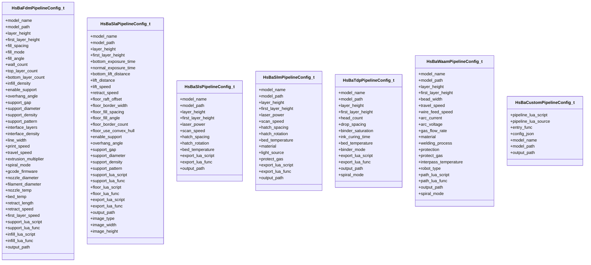

**Diagram sources**
- [pipeline_types.h:56-113](file://pipelinetypes/pipeline_types.h#L56-L113)
- [pipeline_types.h:170-218](file://pipelinetypes/pipeline_types.h#L170-L218)
- [pipeline_types.h:259-283](file://pipelinetypes/pipeline_types.h#L259-L283)
- [pipeline_types.h:359-376](file://pipelinetypes/pipeline_types.h#L359-L376)
- [pipeline_types.h:480-496](file://pipelinetypes/pipeline_types.h#L480-L496)
- [pipeline_types.h:578-600](file://pipelinetypes/pipeline_types.h#L578-L600)
- [pipeline_types.h:689-704](file://pipelinetypes/pipeline_types.h#L689-L704)

**Section sources**
- [pipeline_types.h:23-783](file://pipelinetypes/pipeline_types.h#L23-L783)
- [fdm_pipeline.h:17-61](file://DllHsBaSlicer/fdm_pipeline.h#L17-L61)
- [sla_pipeline.h:17-56](file://DllHsBaSlicer/sla_pipeline.h#L17-L56)
- [slm_pipeline.h:17-56](file://DllHsBaSlicer/slm_pipeline.h#L17-L56)
- [sls_pipeline.h:17-56](file://DllHsBaSlicer/sls_pipeline.h#L17-L56)
- [tdp_pipeline.h:17-56](file://DllHsBaSlicer/tdp_pipeline.h#L17-L56)
- [waam_pipeline.h:17-57](file://DllHsBaSlicer/waam_pipeline.h#L17-L57)

## Architecture Overview
The pipeline architecture follows a consistent pattern:
- Each process family exposes a C ABI with default config creation, synchronous execution, asynchronous execution, and result cleanup.
- All configs/results share a common shape: success flag, total layers, output payload, error message, and elapsed time.
- Progress callbacks report percentage and stage descriptions; async variants return results through completion callbacks.
- Metal and thermal processes rely on Lua export scripts to produce final artifacts.

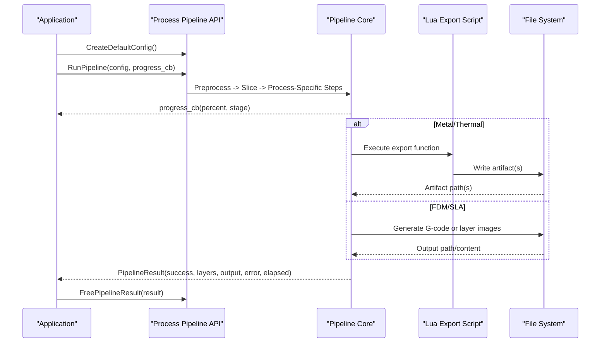

**Diagram sources**
- [fdm_pipeline.h:21-61](file://DllHsBaSlicer/fdm_pipeline.h#L21-L61)
- [sla_pipeline.h:21-56](file://DllHsBaSlicer/sla_pipeline.h#L21-L56)
- [slm_pipeline.h:21-56](file://DllHsBaSlicer/slm_pipeline.h#L21-L56)
- [sls_pipeline.h:21-56](file://DllHsBaSlicer/sls_pipeline.h#L21-L56)
- [tdp_pipeline.h:21-56](file://DllHsBaSlicer/tdp_pipeline.h#L21-L56)
- [waam_pipeline.h:21-57](file://DllHsBaSlicer/waam_pipeline.h#L21-L57)
- [pipeline_types.h:120-140](file://pipelinetypes/pipeline_types.h#L120-L140)
- [pipeline_types.h:225-245](file://pipelinetypes/pipeline_types.h#L225-L245)
- [pipeline_types.h:290-310](file://pipelinetypes/pipeline_types.h#L290-L310)
- [pipeline_types.h:381-401](file://pipelinetypes/pipeline_types.h#L381-L401)
- [pipeline_types.h:501-521](file://pipelinetypes/pipeline_types.h#L501-L521)
- [pipeline_types.h:605-625](file://pipelinetypes/pipeline_types.h#L605-L625)

## Detailed Component Analysis

### FDM Pipeline
- Purpose: Convert a CAD model into printable G-code using configurable fill patterns, support structures, and path generation tuned for fused deposition modeling.
- Key behaviors:
  - Supports multiple fill modes and densities, wall/top/bottom layer counts, and interface layers.
  - Provides support detection and generation with plannable patterns.
  - Emits G-code targeting Marlin, RepRap/RRF, or Klipper firmware profiles.
  - Offers spiral vase mode to generate a continuous outer wall helix.
  - Allows Lua-based support and infill customization.

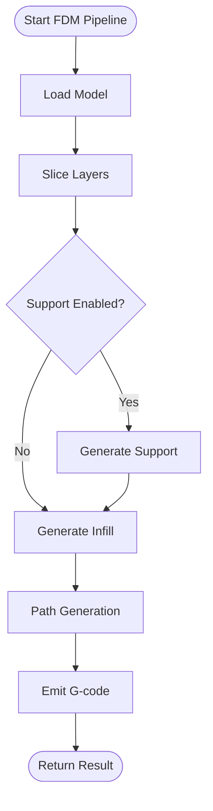

**Diagram sources**
- [fdm_pipeline.h:21-61](file://DllHsBaSlicer/fdm_pipeline.h#L21-L61)
- [pipeline_types.h:56-113](file://pipelinetypes/pipeline_types.h#L56-L113)

**Section sources**
- [fdm_pipeline.h:21-61](file://DllHsBaSlicer/fdm_pipeline.h#L21-L61)
- [pipeline_types.h:56-113](file://pipelinetypes/pipeline_types.h#L56-L113)

### SLA Pipeline
- Purpose: Produce layer images and support structures for stereolithography, optionally generating a zipped package.
- Key behaviors:
  - Configurable exposure and lift/retract kinematics.
  - Floor/raft generation with border and fill controls.
  - Support generation with sacrificial or cone patterns.
  - Lua hooks for support, floor, and export stages.
  - Image output formats include PNG, JPEG, and SVG.

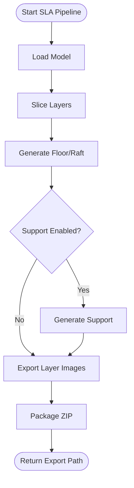

**Diagram sources**
- [sla_pipeline.h:21-56](file://DllHsBaSlicer/sla_pipeline.h#L21-L56)
- [pipeline_types.h:170-218](file://pipelinetypes/pipeline_types.h#L170-L218)

**Section sources**
- [sla_pipeline.h:21-56](file://DllHsBaSlicer/sla_pipeline.h#L21-L56)
- [pipeline_types.h:170-218](file://pipelinetypes/pipeline_types.h#L170-L218)

### SLS and SLM Pipelines
- Purpose: Powder-bed fusion processing paths where the powder bed provides support and thermal stability.
- Differences:
  - SLS focuses on polymer sintering parameters.
  - SLM adds metal-specific material, energy source, and shielding gas configuration.
- Both delegate final artifact generation to a required Lua export script.

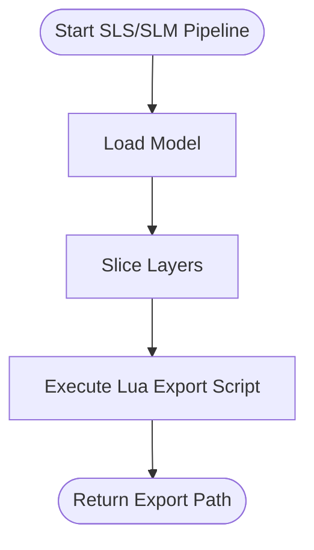

**Diagram sources**
- [sls_pipeline.h:21-56](file://DllHsBaSlicer/sls_pipeline.h#L21-L56)
- [slm_pipeline.h:21-56](file://DllHsBaSlicer/slm_pipeline.h#L21-L56)
- [pipeline_types.h:259-283](file://pipelinetypes/pipeline_types.h#L259-L283)
- [pipeline_types.h:359-376](file://pipelinetypes/pipeline_types.h#L359-L376)

**Section sources**
- [sls_pipeline.h:21-56](file://DllHsBaSlicer/sls_pipeline.h#L21-L56)
- [slm_pipeline.h:21-56](file://DllHsBaSlicer/slm_pipeline.h#L21-L56)
- [pipeline_types.h:259-283](file://pipelinetypes/pipeline_types.h#L259-L283)
- [pipeline_types.h:359-376](file://pipelinetypes/pipeline_types.h#L359-L376)

### TDP Pipeline
- Purpose: Binder jetting workflow producing binder outlines and curing/head parameters for each layer, delegated to a Lua export script.
- Key behaviors:
  - Multi-head printing and binder saturation control.
  - Optional spiral mode for continuous contour deposition.

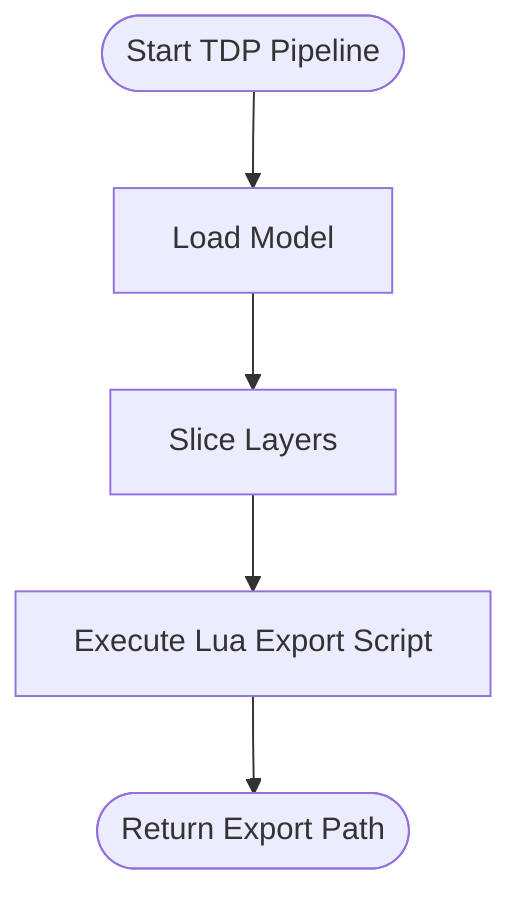

**Diagram sources**
- [tdp_pipeline.h:21-56](file://DllHsBaSlicer/tdp_pipeline.h#L21-L56)
- [pipeline_types.h:480-496](file://pipelinetypes/pipeline_types.h#L480-L496)

**Section sources**
- [tdp_pipeline.h:21-56](file://DllHsBaSlicer/tdp_pipeline.h#L21-L56)
- [pipeline_types.h:480-496](file://pipelinetypes/pipeline_types.h#L480-L496)

### WAAM Pipeline
- Purpose: Wire arc additive manufacturing producing robot language programs (ABB/KUKA/FANUC) instead of layer archives.
- Key behaviors:
  - Configurable welding process, protection method, shielding gas, and interpass temperature.
  - Optional Lua path generator for custom robot code.
  - Spiral mode to deposit outer wall as one continuous rising bead.

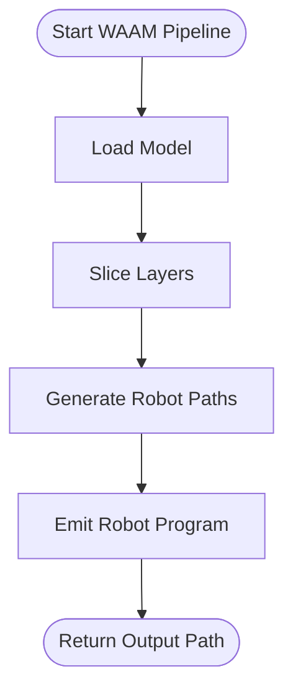

**Diagram sources**
- [waam_pipeline.h:21-57](file://DllHsBaSlicer/waam_pipeline.h#L21-L57)
- [pipeline_types.h:578-600](file://pipelinetypes/pipeline_types.h#L578-L600)

**Section sources**
- [waam_pipeline.h:21-57](file://DllHsBaSlicer/waam_pipeline.h#L21-L57)
- [pipeline_types.h:578-600](file://pipelinetypes/pipeline_types.h#L578-L600)

### Custom Lua Pipeline
- Purpose: Allow complete workflow customization through Lua scripting.
- Capabilities:
  - Define pipeline stages, data flow, and outputs entirely in Lua.
  - Receive model metadata, free-form JSON configuration, and default output path.
  - Use C++-exposed pipeline building blocks via a global Lua table.

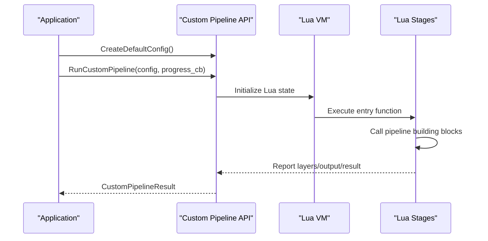

**Diagram sources**
- [pipeline_types.h:689-732](file://pipelinetypes/pipeline_types.h#L689-L732)

**Section sources**
- [pipeline_types.h:689-732](file://pipelinetypes/pipeline_types.h#L689-L732)

## Dependency Analysis
The following diagram shows how pipeline APIs depend on shared types and performance/configuration subsystems.

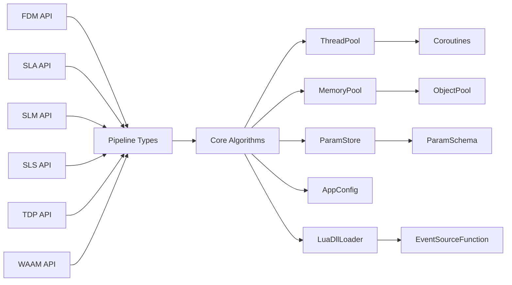

**Diagram sources**
- [fdm_pipeline.h:21-61](file://DllHsBaSlicer/fdm_pipeline.h#L21-L61)
- [sla_pipeline.h:21-56](file://DllHsBaSlicer/sla_pipeline.h#L21-L56)
- [slm_pipeline.h:21-56](file://DllHsBaSlicer/slm_pipeline.h#L21-L56)
- [sls_pipeline.h:21-56](file://DllHsBaSlicer/sls_pipeline.h#L21-L56)
- [tdp_pipeline.h:21-56](file://DllHsBaSlicer/tdp_pipeline.h#L21-L56)
- [waam_pipeline.h:21-57](file://DllHsBaSlicer/waam_pipeline.h#L21-L57)
- [pipeline_types.h:23-783](file://pipelinetypes/pipeline_types.h#L23-L783)
- [thread_pool.hpp:29-162](file://base/thread_pool.hpp#L29-L162)
- [coroutine.hpp:47-382](file://base/coroutine.hpp#L47-L382)
- [memory_pool.hpp:44-208](file://base/memory_pool.hpp#L44-L208)
- [object_pool.hpp:23-283](file://base/object_pool.hpp#L23-L283)
- [param_store.hpp:33-105](file://fileoperator/param_store.hpp#L33-L105)
- [param_schema.hpp:58-92](file://fileoperator/param_schema.hpp#L58-L92)
- [app_config.hpp:19-46](file://utils/app_config.hpp#L19-L46)
- [LuaDllLoader.hpp:27-79](file://utils/LuaDllLoader.hpp#L27-L79)
- [EventSourceFunction.hpp:18-41](file://LibHsBaSlicer/Extends/EventSourceFunction.hpp#L18-L41)

**Section sources**
- [pipeline_types.h:23-783](file://pipelinetypes/pipeline_types.h#L23-L783)
- [thread_pool.hpp:29-162](file://base/thread_pool.hpp#L29-L162)
- [coroutine.hpp:47-382](file://base/coroutine.hpp#L47-L382)
- [memory_pool.hpp:44-208](file://base/memory_pool.hpp#L44-L208)
- [object_pool.hpp:23-283](file://base/object_pool.hpp#L23-L283)
- [param_store.hpp:33-105](file://fileoperator/param_store.hpp#L33-L105)
- [param_schema.hpp:58-92](file://fileoperator/param_schema.hpp#L58-L92)
- [app_config.hpp:19-46](file://utils/app_config.hpp#L19-L46)
- [LuaDllLoader.hpp:27-79](file://utils/LuaDllLoader.hpp#L27-L79)
- [EventSourceFunction.hpp:18-41](file://LibHsBaSlicer/Extends/EventSourceFunction.hpp#L18-L41)

## Performance Considerations
HsBaSlicer provides several high-performance primitives designed for slicing workloads:

- Parallel Processing with Thread Pools
  - ThreadPool manages worker threads, task submission, pending/active task tracking, and WaitAll synchronization.
  - Integrates with C++20 coroutines via ThreadPoolExecutor when enabled.

- Coroutine-Based Asynchronous Operations
  - Task<T, Executor> provides structured concurrency with initial dispatch, final suspension, completion callbacks, chaining, catching exceptions, and finally hooks.
  - Supports both value-returning and void tasks, plus custom allocator variants.

- Memory Pooling Strategies
  - MemoryPool<T, PoolSize> offers fixed-size pool allocation with alignment guarantees and thread-safe bookkeeping.
  - StaticMemoryPool<T, PoolSize> provides a static shared pool with identical semantics.
  - NamedObjectPool<T, MaxSize> manages named shared objects with automatic inactive cleanup and capacity enforcement.

- SIMD Vectorization
  - The referenced files do not expose explicit SIMD vectorization APIs. If needed, consider integrating platform-specific intrinsics at algorithm boundaries (e.g., polygon fill or path optimization) while keeping the pipeline interfaces unchanged.

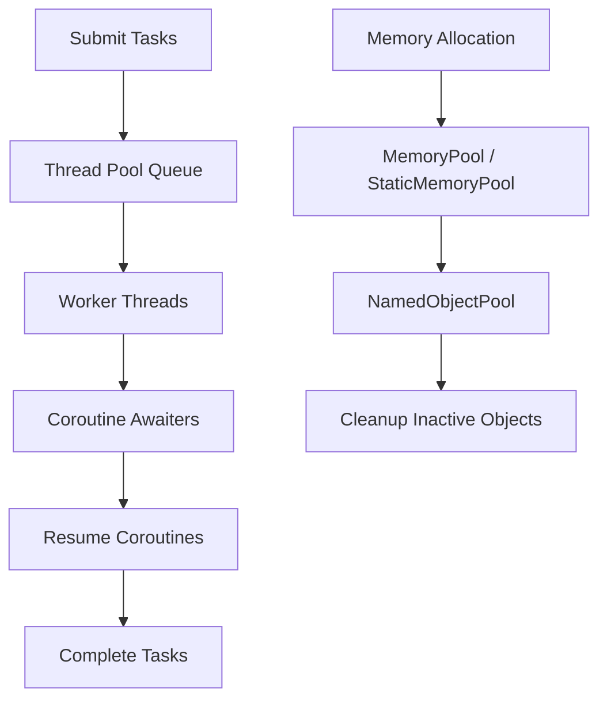

**Diagram sources**
- [thread_pool.hpp:29-162](file://base/thread_pool.hpp#L29-L162)
- [coroutine.hpp:47-382](file://base/coroutine.hpp#L47-L382)
- [memory_pool.hpp:44-208](file://base/memory_pool.hpp#L44-L208)
- [object_pool.hpp:23-283](file://base/object_pool.hpp#L23-L283)

**Section sources**
- [thread_pool.hpp:29-162](file://base/thread_pool.hpp#L29-L162)
- [coroutine.hpp:47-382](file://base/coroutine.hpp#L47-L382)
- [memory_pool.hpp:44-208](file://base/memory_pool.hpp#L44-L208)
- [object_pool.hpp:23-283](file://base/object_pool.hpp#L23-L283)

## Troubleshooting Guide
Common issues and strategies:

- Pipeline Execution Errors
  - Check result.success and result.error_message returned by pipeline calls.
  - For async runs, inspect the result delivered to the completion callback.
  - Ensure output paths and Lua script paths are valid before invoking pipelines.

- Lua Integration Problems
  - Validate Lua script paths and function names in pipeline configs.
  - Use DllLoader to diagnose symbol resolution errors when calling native functions from Lua.
  - Register event callbacks to trace zipper/database events during export.

- Configuration and Persistence Issues
  - Verify ParamStore schema initialization and backend selection.
  - Inspect last_error messages after Save/Load operations.
  - Confirm AppConfigSingletone settings for external tools like 7-Zip.

- Concurrency and Resource Leaks
  - Ensure ThreadPool is properly constructed and destroyed.
  - Avoid submitting tasks to stopped thread pools.
  - Release pipeline results using the provided free functions.

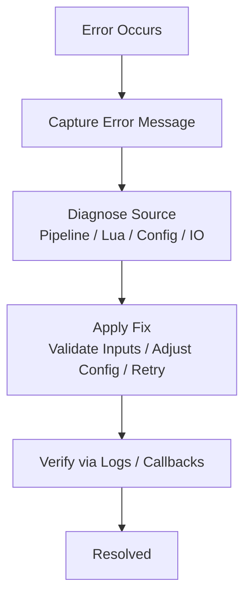

**Section sources**
- [fdm_pipeline.h:53-61](file://DllHsBaSlicer/fdm_pipeline.h#L53-L61)
- [sla_pipeline.h:49-56](file://DllHsBaSlicer/sla_pipeline.h#L49-L56)
- [slm_pipeline.h:52-56](file://DllHsBaSlicer/slm_pipeline.h#L52-L56)
- [sls_pipeline.h:49-56](file://DllHsBaSlicer/sls_pipeline.h#L49-L56)
- [tdp_pipeline.h:52-56](file://DllHsBaSlicer/tdp_pipeline.h#L52-L56)
- [waam_pipeline.h:53-57](file://DllHsBaSlicer/waam_pipeline.h#L53-L57)
- [param_store.hpp:81-87](file://fileoperator/param_store.hpp#L81-L87)
- [LuaDllLoader.hpp:160-244](file://utils/LuaDllLoader.hpp#L160-L244)
- [EventSourceFunction.hpp:18-41](file://LibHsBaSlicer/Extends/EventSourceFunction.hpp#L18-L41)

## Conclusion
HsBaSlicer’s advanced features provide a robust, extensible, and high-performance foundation for modern additive manufacturing workflows. The consistent pipeline API design, comprehensive process coverage, Lua-driven customization, strong concurrency primitives, and schema-backed configuration management enable production-grade integrations. By leveraging parallel processing, coroutine-based async operations, memory pooling, and event-driven callbacks, developers can build scalable slicer applications tailored to specific equipment and processes.

## Appendices

### Practical Examples and Integration Patterns
- Complex Workflows
  - Combine FDM support and infill Lua scripts with custom fill algorithms to optimize print quality and material usage.
  - Use SLA floor and support Lua scripts to tailor raft geometry and support density for resin characteristics.
  - For metal and thermal processes, implement Lua export scripts that generate machine-specific artifacts (e.g., database packages, toolpaths, or robot programs).

- Performance Tuning Scenarios
  - Tune ThreadPool size based on hardware concurrency and workload characteristics.
  - Prefer coroutine-based async pipelines to avoid blocking UI threads.
  - Use MemoryPool or StaticMemoryPool for hot loops involving frequent small allocations.
  - Employ NamedObjectPool for reusable intermediate objects across slices.

- Production Integration Patterns
  - Wrap pipeline calls in retry logic with exponential backoff for transient failures.
  - Stream progress updates to UI via progress callbacks.
  - Persist pipeline configurations using ParamStore with schema validation and migration hooks.
  - Externalize tool paths and environment settings via AppConfigSingletone.

[No sources needed since this section provides general guidance]