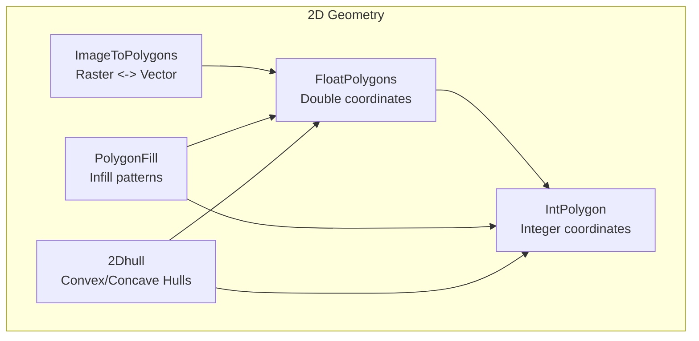
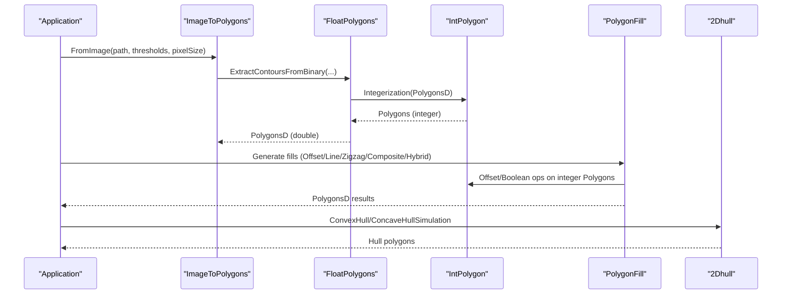
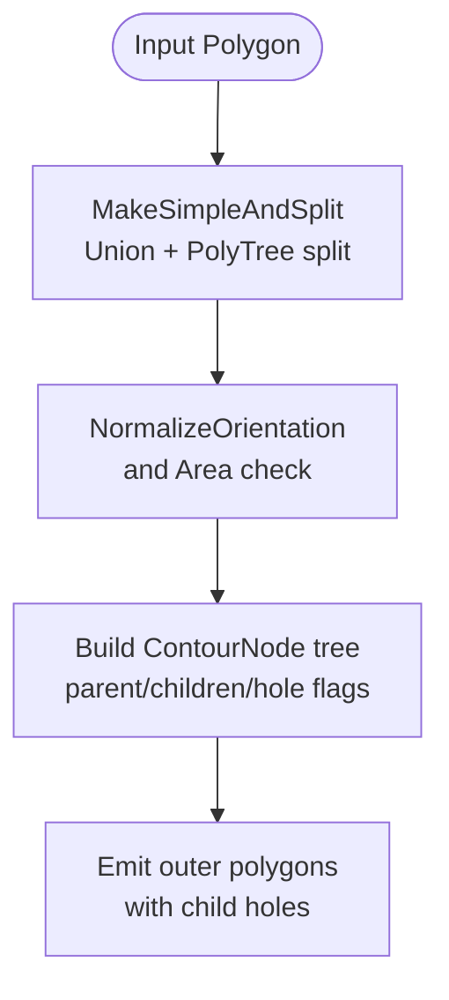
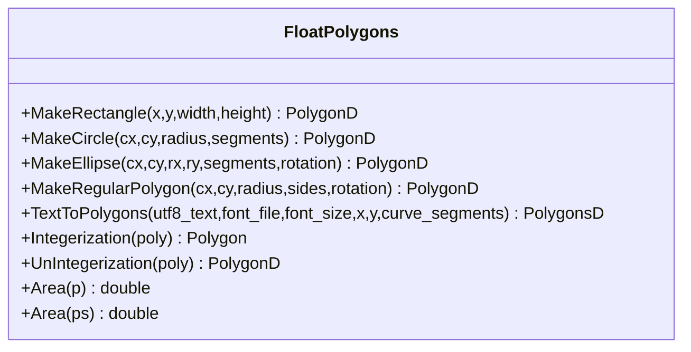
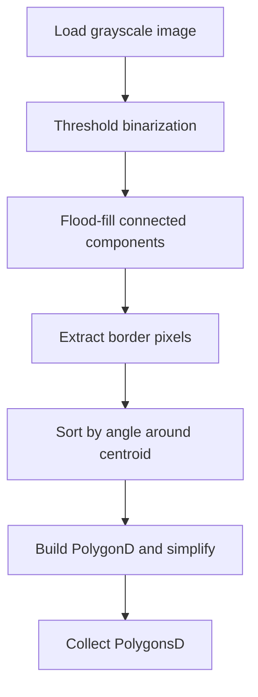
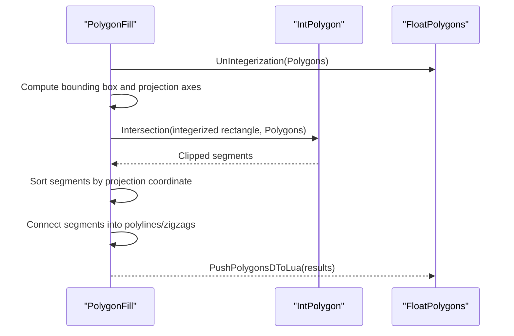
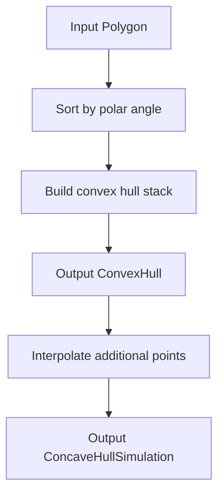
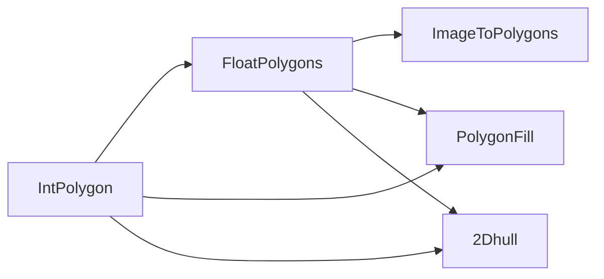

# 2D Polygon Processing and Operations

<cite>
**Referenced Files in This Document**
- [IntPolygon.hpp](file://2D/IntPolygon.hpp)
- [IntPolygon.cpp](file://2D/IntPolygon.cpp)
- [FloatPolygons.hpp](file://2D/FloatPolygons.hpp)
- [FloatPolygons.cpp](file://2D/FloatPolygons.cpp)
- [ImageToPolygons.hpp](file://2D/ImageToPolygons.hpp)
- [ImageToPolygons.cpp](file://2D/ImageToPolygons.cpp)
- [PolygonFill.hpp](file://2D/PolygonFill.hpp)
- [PolygonFill.cpp](file://2D/PolygonFill.cpp)
- [2Dhull.hpp](file://2D/2Dhull.hpp)
- [2Dhull.cpp](file://2D/2Dhull.cpp)
</cite>

## Table of Contents
1. [Introduction](#introduction)
2. [Project Structure](#project-structure)
3. [Core Components](#core-components)
4. [Architecture Overview](#architecture-overview)
5. [Detailed Component Analysis](#detailed-component-analysis)
6. [Dependency Analysis](#dependency-analysis)
7. [Performance Considerations](#performance-considerations)
8. [Troubleshooting Guide](#troubleshooting-guide)
9. [Conclusion](#conclusion)
10. [Appendices](#appendices)

## Introduction
This document explains the advanced 2D polygon processing capabilities built on Clipper2 integration within the repository. It focuses on:
- High-performance integer-coordinate operations via IntPolygon for critical-path calculations.
- Floating-point precision workflows via FloatPolygons.
- Polygon boolean operations (union, intersection, difference, XOR), offsetting, area computation, point-in-polygon tests, and normalization to simple polygons with hole detection and self-intersection resolution.
- Image-to-polygon conversion using thresholding and multi-threshold contour extraction, plus polygon-to-image rendering.
- Coordinate system transformations, scaling strategies, and precision management through integerization/un-integerization.
- Polygon manipulation workflows such as generating toolpaths from vector graphics, processing bitmap masks, and optimizing polygonal approximations.
- Performance optimization techniques for large polygon sets and memory-efficient processing strategies.

## Project Structure
The 2D geometry subsystem is organized into focused modules:
- IntPolygon: Integer-coordinate types and Clipper2-based boolean/offset/area operations.
- FloatPolygons: Double-precision types, shape/text generators, and integer/double conversions.
- ImageToPolygons: Raster-to-polygon thresholding and polygon-to-image rendering.
- PolygonFill: Infill pattern generators (offset, line, zigzag, composite, hybrid) and Lua-driven customization.
- 2Dhull: Convex and concave hull computations for both integer and double types.

**Diagram sources**
- [IntPolygon.hpp:14-26](file://2D/IntPolygon.hpp#L14-L26)
- [FloatPolygons.hpp:16-25](file://2D/FloatPolygons.hpp#L16-L25)
- [ImageToPolygons.hpp:20-29](file://2D/ImageToPolygons.hpp#L20-L29)
- [PolygonFill.hpp:16-28](file://2D/PolygonFill.hpp#L16-L28)
- [2Dhull.hpp:12-27](file://2D/2Dhull.hpp#L12-L27)

**Section sources**
- [IntPolygon.hpp:14-26](file://2D/IntPolygon.hpp#L14-L26)
- [FloatPolygons.hpp:16-25](file://2D/FloatPolygons.hpp#L16-L25)
- [ImageToPolygons.hpp:20-29](file://2D/ImageToPolygons.hpp#L20-L29)
- [PolygonFill.hpp:16-28](file://2D/PolygonFill.hpp#L16-L28)
- [2Dhull.hpp:12-27](file://2D/2Dhull.hpp#L12-L27)

## Core Components
- IntPolygon provides:
  - Types: Point2 (64-bit integer), Polygon (Path64), Polygons (Paths64).
  - Boolean ops: Union, Intersection, Difference, Xor for single polygons and polygon sets.
  - Offset: Inflate/deflate with join/end types.
  - Utilities: MakeSimple, NormalizeToSimplePolygons, PointInPolygons, Area, hashing.
- FloatPolygons provides:
  - Types: Point2D (double), PolygonD (PathD), PolygonsD (PathsD).
  - Boolean ops: Union, Intersection, Difference, Xor for single polygons and polygon sets.
  - Generators: Rectangle, Circle, Ellipse, RegularPolygon, TextToPolygons.
  - Conversion: Integerization/UnIntegerization between double and integer types.
- ImageToPolygons provides:
  - FromImage/FromImageMulti: Threshold-based raster-to-polygon conversion.
  - ToImage: Polygon-to-raster or SVG export.
  - LuaToImage/LuaToImageString: Custom image generation via Lua scripts.
- PolygonFill provides:
  - OffsetFill, LineFill, SimpleZigzagFill, ZigzagFill.
  - CompositeOffsetFill, HybridFill.
  - LuaCustomFill/LuaCustomFillString and registration functions.
- 2Dhull provides:
  - ConvexHull and ConcaveHullSimulation over integer and double types.

**Section sources**
- [IntPolygon.hpp:28-192](file://2D/IntPolygon.hpp#L28-L192)
- [FloatPolygons.hpp:27-221](file://2D/FloatPolygons.hpp#L27-L221)
- [ImageToPolygons.hpp:22-79](file://2D/ImageToPolygons.hpp#L22-L79)
- [PolygonFill.hpp:20-136](file://2D/PolygonFill.hpp#L20-L136)
- [2Dhull.hpp:14-72](file://2D/2Dhull.hpp#L14-L72)

## Architecture Overview
The architecture layers geometric primitives and algorithms:
- Data layer: IntPolygon (integer) and FloatPolygons (double) define coordinate systems and basic shapes.
- Conversion layer: Integerization/UnIntegerization bridges float and int domains.
- Algorithm layer: Clipper2-based boolean ops, offsets, area, and point-in-polygon; hull algorithms; fill generators.
- I/O layer: ImageToPolygons handles raster/vector conversions and Lua-driven pipelines.

**Diagram sources**
- [ImageToPolygons.cpp:87-174](file://2D/ImageToPolygons.cpp#L87-L174)
- [FloatPolygons.cpp:176-213](file://2D/FloatPolygons.cpp#L176-L213)
- [IntPolygon.cpp:28-77](file://2D/IntPolygon.cpp#L28-L77)
- [PolygonFill.cpp:422-473](file://2D/PolygonFill.cpp#L422-L473)
- [2Dhull.cpp:74-109](file://2D/2Dhull.cpp#L74-L109)

## Detailed Component Analysis

### IntPolygon: High-Performance Integer Coordinates
Key responsibilities:
- Boolean operations: Union, Intersection, Difference, Xor for single and set inputs.
- Offsetting: Inflate/deflate with configurable join/end types.
- Simplification and normalization: Remove collinear points, split self-intersections, normalize orientation, detect holes.
- Point-in-polygon: Even-odd and non-even-odd rules with robust handling.
- Area computation and hashing utilities.

Implementation highlights:
- Boolean ops delegate to Clipper2Lib functions.
- Offset uses Clipper2::ClipperOffset with path addition and execution.
- PointInPolygons converts non-even-odd inputs to even-odd via union before testing.
- NormalizeToSimplePolygons splits self-intersecting polygons and reconstructs parent-child relationships to identify holes.

**Diagram sources**
- [IntPolygon.cpp:265-278](file://2D/IntPolygon.cpp#L265-L278)
- [IntPolygon.cpp:329-404](file://2D/IntPolygon.cpp#L329-L404)

**Section sources**
- [IntPolygon.hpp:28-192](file://2D/IntPolygon.hpp#L28-L192)
- [IntPolygon.cpp:28-77](file://2D/IntPolygon.cpp#L28-L77)
- [IntPolygon.cpp:79-130](file://2D/IntPolygon.cpp#L79-L130)
- [IntPolygon.cpp:265-416](file://2D/IntPolygon.cpp#L265-L416)

### FloatPolygons: Precision Work and Shape Generation
Key responsibilities:
- Boolean operations and area computation for double-precision polygons.
- Shape generators: Rectangle, Circle, Ellipse, RegularPolygon.
- Text-to-polygon conversion using FreeType outlines.
- Integerization/UnIntegerization bridging double and integer domains.

Implementation highlights:
- Boolean ops delegate to Clipper2Lib functions.
- TextToPolygons iterates glyphs, decomposes outlines, and builds polygon contours with configurable curve segments.
- Integerization scales coordinates by a constant factor to preserve precision during integer-domain operations.

**Diagram sources**
- [FloatPolygons.hpp:137-221](file://2D/FloatPolygons.hpp#L137-L221)
- [FloatPolygons.cpp:314-407](file://2D/FloatPolygons.cpp#L314-L407)
- [FloatPolygons.cpp:176-213](file://2D/FloatPolygons.cpp#L176-L213)

**Section sources**
- [FloatPolygons.hpp:27-221](file://2D/FloatPolygons.hpp#L27-L221)
- [FloatPolygons.cpp:25-75](file://2D/FloatPolygons.cpp#L25-L75)
- [FloatPolygons.cpp:176-213](file://2D/FloatPolygons.cpp#L176-L213)
- [FloatPolygons.cpp:314-407](file://2D/FloatPolygons.cpp#L314-L407)

### ImageToPolygons: Raster-to-Polygon and Polygon-to-Image
Key responsibilities:
- Load grayscale images (OpenCV if available, otherwise fallback).
- Threshold binarization and contour extraction per threshold.
- Border tracing and angle sorting to build polygon vertices.
- Rendering polygons to raster images or SVG.
- Lua-driven image generation pipelines.

Algorithm overview:
- For each binary component, collect border pixels, compute centroid, sort by angle, convert to floating-point coordinates scaled by pixelSize, simplify, and add to result.

**Diagram sources**
- [ImageToPolygons.cpp:34-65](file://2D/ImageToPolygons.cpp#L34-L65)
- [ImageToPolygons.cpp:87-174](file://2D/ImageToPolygons.cpp#L87-L174)

**Section sources**
- [ImageToPolygons.hpp:22-79](file://2D/ImageToPolygons.hpp#L22-L79)
- [ImageToPolygons.cpp:87-174](file://2D/ImageToPolygons.cpp#L87-L174)
- [ImageToPolygons.cpp:282-415](file://2D/ImageToPolygons.cpp#L282-L415)
- [ImageToPolygons.cpp:417-546](file://2D/ImageToPolygons.cpp#L417-L546)

### PolygonFill: Infill Patterns and Toolpath Generation
Key responsibilities:
- Offset-based infill: Repeated inward offsets to generate concentric paths.
- Line fill: Parallel lines intersected with polygon bounds to produce segments.
- Zigzag fills: Connected zigzag paths across scanlines with inside/outside clamping.
- Composite/Hybrid fills: Combine offset borders with internal fill modes.
- Lua customization: Expose fill functions to Lua scripts.

Implementation highlights:
- LineFilling computes bounding box, projects corners, generates scanline rectangles, intersects with integerized polygons, and extracts segments along the fill direction.
- SimpleZigzagFill connects segment centers across adjacent rows, using binary search to clamp endpoints inside the polygon.
- ZigzagFill uses interval overlap and union-find to connect segments into continuous paths.

**Diagram sources**
- [PolygonFill.cpp:39-137](file://2D/PolygonFill.cpp#L39-L137)
- [PolygonFill.cpp:477-674](file://2D/PolygonFill.cpp#L477-L674)
- [PolygonFill.cpp:676-800](file://2D/PolygonFill.cpp#L676-L800)

**Section sources**
- [PolygonFill.hpp:20-136](file://2D/PolygonFill.hpp#L20-L136)
- [PolygonFill.cpp:422-473](file://2D/PolygonFill.cpp#L422-L473)
- [PolygonFill.cpp:477-674](file://2D/PolygonFill.cpp#L477-L674)
- [PolygonFill.cpp:676-800](file://2D/PolygonFill.cpp#L676-L800)

### 2Dhull: Convex and Concave Hulls
Key responsibilities:
- ConvexHull: Monotone chain algorithm for integer and double types.
- ConcaveHullSimulation: Interpolate additional points along convex edges to simulate concavity.

Implementation highlights:
- Sorting by polar angle relative to the lowest-leftmost point.
- Stack-based construction ensuring left turns only.
- Concave simulation interpolates evenly spaced points along each hull edge.

**Diagram sources**
- [2Dhull.cpp:74-109](file://2D/2Dhull.cpp#L74-L109)
- [2Dhull.cpp:43-73](file://2D/2Dhull.cpp#L43-L73)

**Section sources**
- [2Dhull.hpp:14-72](file://2D/2Dhull.hpp#L14-L72)
- [2Dhull.cpp:43-109](file://2D/2Dhull.cpp#L43-L109)
- [2Dhull.cpp:130-211](file://2D/2Dhull.cpp#L130-L211)

## Dependency Analysis
Component dependencies:
- FloatPolygons depends on IntPolygon for integerization/un-integerization.
- ImageToPolygons depends on FloatPolygons for polygon simplification and rendering.
- PolygonFill depends on both IntPolygon and FloatPolygons for boolean ops, offsets, and conversions.
- 2Dhull depends on both IntPolygon and FloatPolygons for hull computations.

**Diagram sources**
- [FloatPolygons.hpp:12](file://2D/FloatPolygons.hpp#L12)
- [ImageToPolygons.hpp:9](file://2D/ImageToPolygons.hpp#L9)
- [PolygonFill.hpp:9-10](file://2D/PolygonFill.hpp#L9-L10)
- [2Dhull.hpp:9-10](file://2D/2Dhull.hpp#L9-L10)

**Section sources**
- [FloatPolygons.hpp:12](file://2D/FloatPolygons.hpp#L12)
- [ImageToPolygons.hpp:9](file://2D/ImageToPolygons.hpp#L9)
- [PolygonFill.hpp:9-10](file://2D/PolygonFill.hpp#L9-L10)
- [2Dhull.hpp:9-10](file://2D/2Dhull.hpp#L9-L10)

## Performance Considerations
- Use integer-coordinate operations (IntPolygon) for critical-path calculations to avoid floating-point errors and leverage Clipper2’s optimized integer routines.
- Prefer batch operations on Polygons sets rather than iterating single polygons where possible.
- Simplify polygons (MakeSimple) before boolean operations to reduce vertex count and improve performance.
- Limit offset iterations and use appropriate join/end types to control complexity.
- For image-to-polygon conversion, choose thresholds carefully and consider multi-threshold outputs to reduce post-processing.
- When generating fills, tune spacing and line thickness to balance detail and computational cost.
- Memory efficiency: Reuse buffers, avoid unnecessary copies, and prefer move semantics when constructing results.

[No sources needed since this section provides general guidance]

## Troubleshooting Guide
Common issues and resolutions:
- Empty or invalid polygons: Ensure input has at least three vertices; filter out zero-area polygons during normalization.
- Self-intersections: Use MakeSimpleAndSplit and NormalizeToSimplePolygons to resolve and extract holes.
- Orientation problems: NormalizeOrientation ensures consistent winding order based on signed area.
- Lua script errors: Validate function names and return types; ensure polygon tables are correctly pushed/popped.
- Image loading failures: Check OpenCV availability and file paths; verify grayscale conversion.

**Section sources**
- [IntPolygon.cpp:329-404](file://2D/IntPolygon.cpp#L329-L404)
- [ImageToPolygons.cpp:417-546](file://2D/ImageToPolygons.cpp#L417-L546)

## Conclusion
The 2D polygon processing subsystem provides robust, high-performance tools for geometric operations, leveraging Clipper2 for boolean logic and offsets, while offering flexible workflows for raster-vector conversion, fill pattern generation, and hull computation. By combining integer precision for critical calculations with floating-point flexibility for modeling and text generation, the system supports a wide range of applications from toolpath generation to bitmap mask processing. Proper usage of simplification, normalization, and threshold tuning ensures reliable and efficient outcomes.

[No sources needed since this section summarizes without analyzing specific files]

## Appendices
- Coordinate System Transformations:
  - Integerization scales double coordinates by a fixed factor to maintain precision in integer domain.
  - UnIntegerization reverses scaling for output or visualization.
- Precision Management Strategies:
  - Use epsilon parameters in MakeSimple to control simplification tolerance.
  - Clamp endpoints using binary search to ensure segments lie within polygon boundaries.
- Example Workflows:
  - Generating toolpaths from vector graphics: Convert text/shapes to PolygonsD, integerize, apply fill patterns, and export as G-code or SVG.
  - Processing bitmap masks: Threshold images, extract contours, simplify polygons, and render back to images for verification.
  - Optimizing polygonal approximations: Adjust segment counts for circles/ellipses and use MakeSimple to reduce vertex density.

[No sources needed since this section provides general guidance]