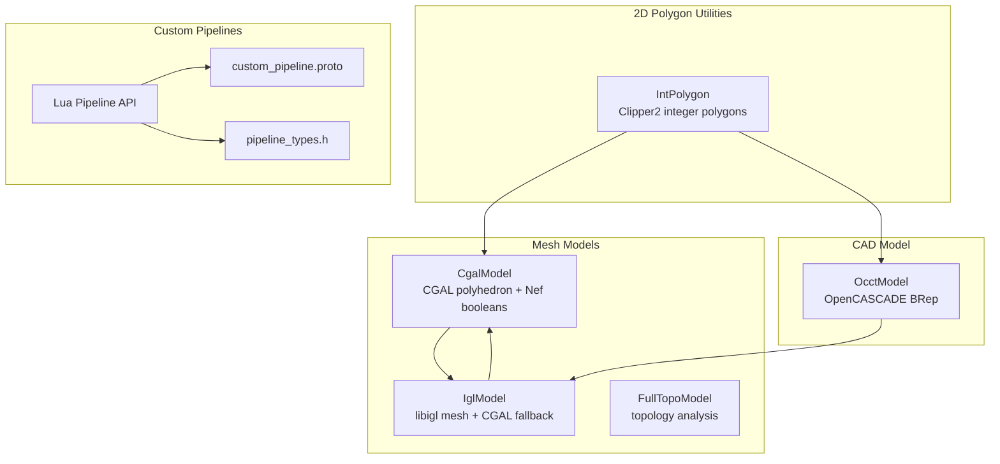
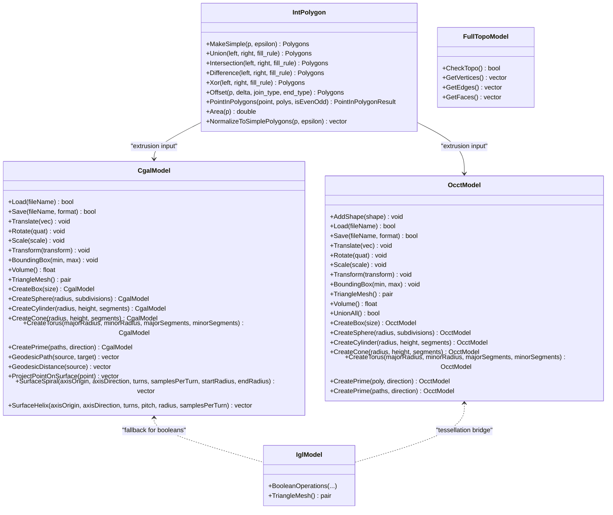
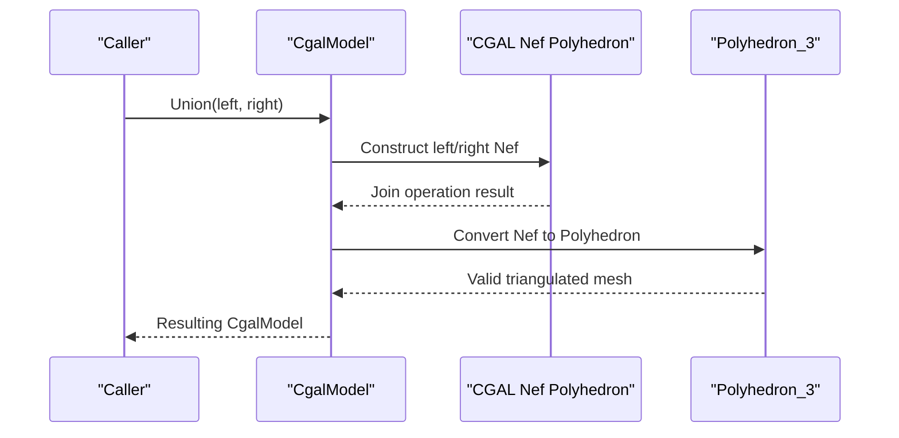
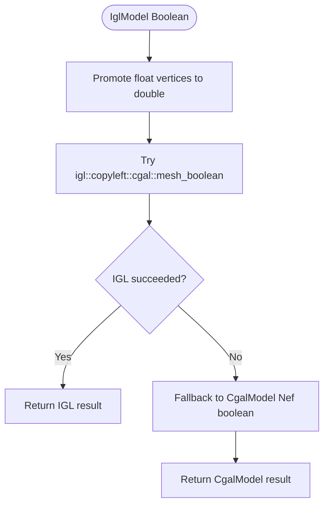
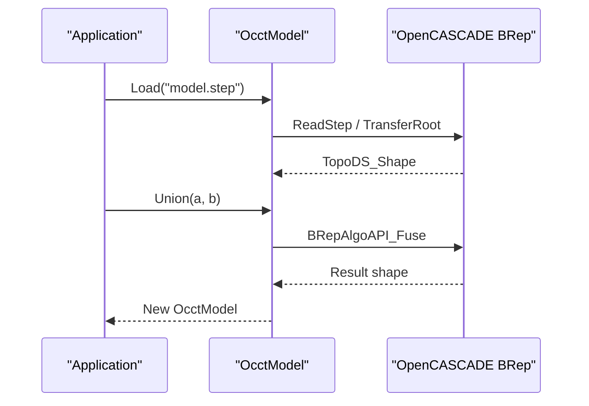
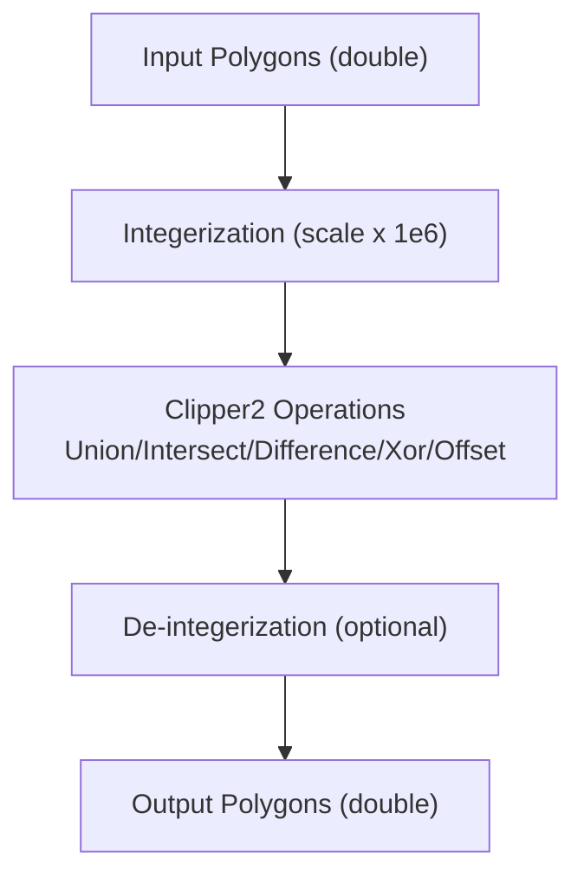
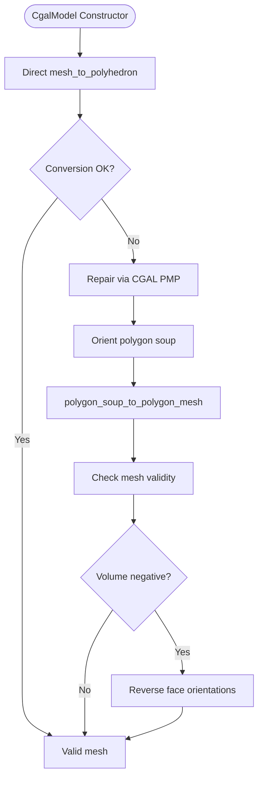
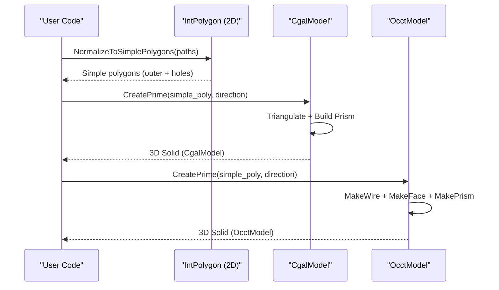
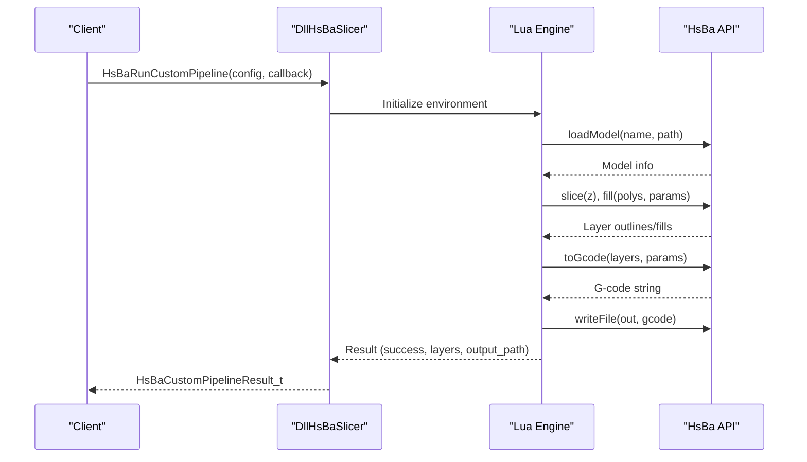
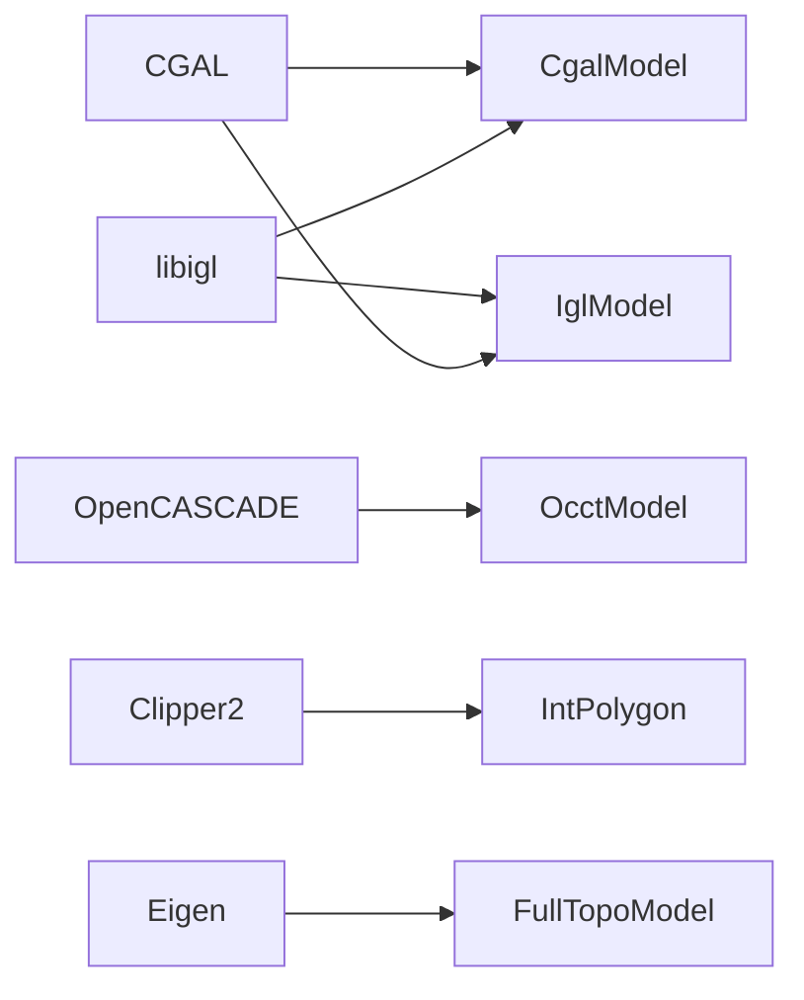

# Advanced Mesh Processing

<cite>
**Referenced Files in This Document**
- [CgalModel.hpp](file://meshmodel/CgalModel.hpp)
- [CgalModel.cpp](file://meshmodel/CgalModel.cpp)
- [OcctModel.hpp](file://cadmodel/OcctModel.hpp)
- [OcctModel.cpp](file://cadmodel/OcctModel.cpp)
- [IntPolygon.hpp](file://2D/IntPolygon.hpp)
- [IntPolygon.cpp](file://2D/IntPolygon.cpp)
- [FullTopoModel.hpp](file://meshmodel/FullTopoModel.hpp)
- [FullTopoModel.cpp](file://meshmodel/FullTopoModel.cpp)
- [IglModel.cpp](file://meshmodel/IglModel.cpp)
- [README.md](file://README.md)
- [memory_pool.md](file://docs/en/base/memory_pool.md)
- [object_pool.md](file://docs/en/base/object_pool.md)
- [lua_pipeline_api.md](file://docs/en/lua_pipeline_api.md)
- [custom_pipeline.proto](file://proto/custom_pipeline.proto)
- [pipeline_types.h](file://pipelinetypes/pipeline_types.h)
</cite>

## Table of Contents
1. [Introduction](#introduction)
2. [Project Structure](#project-structure)
3. [Core Components](#core-components)
4. [Architecture Overview](#architecture-overview)
5. [Detailed Component Analysis](#detailed-component-analysis)
6. [Dependency Analysis](#dependency-analysis)
7. [Performance Considerations](#performance-considerations)
8. [Troubleshooting Guide](#troubleshooting-guide)
9. [Conclusion](#conclusion)

## Introduction
This document explains HsBaSlicer’s advanced mesh processing capabilities with a focus on:
- Boolean operations and mesh repair using CGAL
- CAD model support via OpenCASCADE (OCCT), including precise geometry, NURBS-aware workflows, and thick-solid operations
- High-performance 2D polygon operations using IntPolygon (Clipper2)
- Topology analysis and validation through FullTopoModel
- Custom pipeline integration for building advanced processing workflows
- Performance optimization techniques and memory management strategies for large meshes and complex geometric operations

HsBaSlicer is a modular, cross-platform C++ framework for high-performance slicing pipelines, exposing both static and dynamic library interfaces and supporting custom Lua-driven workflows.

**Section sources**
- [README.md:21-38](file://README.md#L21-L38)

## Project Structure
The relevant modules for advanced mesh processing are organized as follows:
- meshmodel: CGAL-backed mesh model, IGL-based mesh model, and full topological model
- cadmodel: OCCT-based CAD model with BRep primitives and boolean/thick-solid operations
- 2D: Integer-coordinate polygon utilities based on Clipper2
- proto and pipelinetypes: Custom pipeline configuration and result types for Lua-driven workflows

**Diagram sources**
- [CgalModel.hpp:26-34](file://meshmodel/CgalModel.hpp#L26-L34)
- [OcctModel.hpp:22-30](file://cadmodel/OcctModel.hpp#L22-L30)
- [IntPolygon.hpp:14-26](file://2D/IntPolygon.hpp#L14-L26)
- [custom_pipeline.proto:5-18](file://proto/custom_pipeline.proto#L5-L18)
- [pipeline_types.h:698-726](file://pipelinetypes/pipeline_types.h#L698-L726)

**Section sources**
- [README.md:29-38](file://README.md#L29-L38)

## Core Components
- CgalModel: CGAL-backed polyhedral mesh model providing boolean operations (union, intersection, difference, xor), extrusion from 2D polygons, surface geodesic/helix/spiral computations, and robust mesh repair during construction.
- OcctModel: OpenCASCADE BRep CAD model providing file I/O (STEP/IGES/VRML/BRep), transforms, tessellation to triangle meshes, volume queries, boolean operations, and thick-solid operations.
- IntPolygon: Integer-coordinate polygon utilities (Clipper2) offering simplification, boolean operations, offsets, point-in-polygon tests, area computation, and normalization helpers.
- FullTopoModel: Topological model enabling topology checks and face/edge/vertex relationships for validation and analysis.
- IglModel: libigl-based mesh model with CGAL-backed boolean operations and fallback to CgalModel when needed.

Key responsibilities:
- Boolean operations across mesh and CAD models
- Mesh repair and orientation correction
- Extrusion from 2D polygons into 3D solids
- Topology validation and analysis
- Integration points for custom pipelines

**Section sources**
- [CgalModel.hpp:26-34](file://meshmodel/CgalModel.hpp#L26-L34)
- [OcctModel.hpp:22-30](file://cadmodel/OcctModel.hpp#L22-L30)
- [IntPolygon.hpp:14-26](file://2D/IntPolygon.hpp#L14-L26)
- [FullTopoModel.hpp:49-86](file://meshmodel/FullTopoModel.hpp#L49-L86)
- [IglModel.cpp:193-245](file://meshmodel/IglModel.cpp#L193-L245)

## Architecture Overview
The architecture integrates multiple backends:
- CGAL provides exact predicates and robust boolean operations via Nef polyhedra
- OCCT provides precise CAD modeling and BRep operations
- Clipper2 provides fast, exact 2D polygon operations
- libigl bridges mesh data structures and offers additional tools

**Diagram sources**
- [CgalModel.hpp:26-155](file://meshmodel/CgalModel.hpp#L26-L155)
- [OcctModel.hpp:22-124](file://cadmodel/OcctModel.hpp#L22-L124)
- [IntPolygon.hpp:14-212](file://2D/IntPolygon.hpp#L14-L212)
- [FullTopoModel.hpp:49-86](file://meshmodel/FullTopoModel.hpp#L49-L86)
- [IglModel.cpp:193-245](file://meshmodel/IglModel.cpp#L193-L245)

## Detailed Component Analysis

### CGAL Integration and Boolean Operations
CgalModel uses CGAL’s Nef polyhedra for robust boolean operations:
- Union, Intersection, Difference, Xor operate on Nef_Polyheron_3 representations
- Construction path includes mesh_to_polyhedron conversion with automatic repair via orient_polygon_soup and polygon_soup_to_polygon_mesh
- Face orientation is corrected by checking signed volume and reversing orientations if necessary

**Diagram sources**
- [CgalModel.cpp:238-276](file://meshmodel/CgalModel.cpp#L238-L276)
- [CgalModel.cpp:42-119](file://meshmodel/CgalModel.cpp#L42-L119)

**Section sources**
- [CgalModel.cpp:42-119](file://meshmodel/CgalModel.cpp#L42-L119)
- [CgalModel.cpp:238-276](file://meshmodel/CgalModel.cpp#L238-L276)

### IGL Boolean Operations with CGAL Fallback
IglModel exposes boolean operations that first attempt igl::copyleft::cgal::mesh_boolean with double precision promotion; if it fails or returns empty results, it falls back to CgalModel’s Nef-based boolean operations.

**Diagram sources**
- [IglModel.cpp:193-245](file://meshmodel/IglModel.cpp#L193-L245)

**Section sources**
- [IglModel.cpp:193-245](file://meshmodel/IglModel.cpp#L193-L245)

### OpenCASCADE CAD Model Support
OcctModel wraps TopoDS_Shape and provides:
- File I/O for STEP/IGES/VRML/BRep
- Transformations (translate, rotate, scale, affine transform)
- Tessellation to triangle meshes
- Volume computation
- Boolean operations (fuse, common, cut) and XOR via composition
- ThickSolid operations for shell generation

**Diagram sources**
- [OcctModel.cpp:76-92](file://cadmodel/OcctModel.cpp#L76-L92)
- [OcctModel.cpp:451-469](file://cadmodel/OcctModel.cpp#L451-L469)

**Section sources**
- [OcctModel.cpp:76-92](file://cadmodel/OcctModel.cpp#L76-L92)
- [OcctModel.cpp:451-469](file://cadmodel/OcctModel.cpp#L451-L469)

### IntPolygon Operations for High-Performance 2D Processing
IntPolygon leverages Clipper2 for exact integer-coordinate polygon operations:
- Simplification and splitting
- Boolean operations (union, intersection, difference, xor)
- Offsets (inflate/deflate)
- Point-in-polygon tests with even-odd and non-zero winding rules
- Area computation and normalization to simple polygons

**Diagram sources**
- [IntPolygon.cpp:19-77](file://2D/IntPolygon.cpp#L19-L77)
- [IntPolygon.cpp:123-130](file://2D/IntPolygon.cpp#L123-L130)

**Section sources**
- [IntPolygon.hpp:14-212](file://2D/IntPolygon.hpp#L14-L212)
- [IntPolygon.cpp:19-77](file://2D/IntPolygon.cpp#L19-L77)
- [IntPolygon.cpp:123-130](file://2D/IntPolygon.cpp#L123-L130)

### Mesh Validation and Repair Algorithms
CgalModel constructor attempts direct conversion and falls back to repair:
- Orient polygon soup consistently
- Merge duplicate vertices and build proper mesh
- Check validity and correct face orientation based on signed volume

FullTopoModel provides topology checks:
- Validates face vertex and edge references
- Computes per-face normals when requested

**Diagram sources**
- [CgalModel.cpp:42-119](file://meshmodel/CgalModel.cpp#L42-L119)

**Section sources**
- [CgalModel.cpp:42-119](file://meshmodel/CgalModel.cpp#L42-L119)
- [FullTopoModel.cpp:160-179](file://meshmodel/FullTopoModel.cpp#L160-L179)

### Extrusion from 2D Polygons to 3D Solids
Both CgalModel and OcctModel provide CreatePrime methods to extrude closed 2D polygons (with holes) into 3D solids:
- CgalModel uses Clipper2 triangulation and builds a prism via incremental builder
- OcctModel constructs wires and faces then extrudes using BRepPrimAPI_MakePrism

**Diagram sources**
- [CgalModel.cpp:625-733](file://meshmodel/CgalModel.cpp#L625-L733)
- [OcctModel.cpp:542-663](file://cadmodel/OcctModel.cpp#L542-L663)

**Section sources**
- [CgalModel.cpp:625-733](file://meshmodel/CgalModel.cpp#L625-L733)
- [OcctModel.cpp:542-663](file://cadmodel/OcctModel.cpp#L542-L663)

### Custom Mesh Processing Pipelines
HsBaSlicer supports fully Lua-driven custom pipelines:
- Configuration via custom_pipeline.proto and pipeline_types.h
- Entry function run_pipeline orchestrates model loading, slicing, filling, and output generation
- Progress callbacks and result reporting are supported

**Diagram sources**
- [custom_pipeline.proto:5-18](file://proto/custom_pipeline.proto#L5-L18)
- [pipeline_types.h:698-726](file://pipelinetypes/pipeline_types.h#L698-L726)
- [lua_pipeline_api.md:283-329](file://docs/en/lua_pipeline_api.md#L283-L329)

**Section sources**
- [custom_pipeline.proto:5-18](file://proto/custom_pipeline.proto#L5-L18)
- [pipeline_types.h:698-726](file://pipelinetypes/pipeline_types.h#L698-L726)
- [lua_pipeline_api.md:283-329](file://docs/en/lua_pipeline_api.md#L283-L329)

## Dependency Analysis
Key dependencies and relationships:
- CgalModel depends on CGAL for exact predicates, Nef polyhedra, and polygon mesh processing
- IglModel depends on libigl and CGAL for boolean operations
- OcctModel depends on OpenCASCADE for BRep operations and file I/O
- IntPolygon depends on Clipper2 for exact 2D polygon operations
- FullTopoModel depends on Eigen and IGL for normal computation and topology checks

**Diagram sources**
- [CgalModel.hpp:14-22](file://meshmodel/CgalModel.hpp#L14-L22)
- [IglModel.cpp:193-245](file://meshmodel/IglModel.cpp#L193-L245)
- [OcctModel.cpp:8-53](file://cadmodel/OcctModel.cpp#L8-L53)
- [IntPolygon.hpp:9-11](file://2D/IntPolygon.hpp#L9-L11)

**Section sources**
- [CgalModel.hpp:14-22](file://meshmodel/CgalModel.hpp#L14-L22)
- [IglModel.cpp:193-245](file://meshmodel/IglModel.cpp#L193-L245)
- [OcctModel.cpp:8-53](file://cadmodel/OcctModel.cpp#L8-L53)
- [IntPolygon.hpp:9-11](file://2D/IntPolygon.hpp#L9-L11)

## Performance Considerations
- Use CGAL’s exact predicates for robustness in boolean operations; prefer double precision inputs where possible to avoid silent failures in floating-point kernels
- For large meshes, leverage CgalModel’s repair pipeline to reduce preprocessing overhead
- Utilize IntPolygon’s integerization for exact 2D operations to avoid floating-point inaccuracies
- Employ memory pools and object pools to reduce allocation overhead in high-throughput scenarios
- Batch operations where possible (e.g., union all shapes in OCCT before tessellation)

Recommended practices:
- Pre-validate and normalize 2D polygons before extrusion
- Use Chunked processing for very large models
- Reuse computed AABB trees and spatial indexes where applicable
- Monitor memory usage and employ pool-based allocation for temporary objects

**Section sources**
- [memory_pool.md:232-303](file://docs/en/base/memory_pool.md#L232-L303)
- [object_pool.md:258-274](file://docs/en/base/object_pool.md#L258-L274)

## Troubleshooting Guide
Common issues and resolutions:
- Empty mesh after boolean operations: Ensure inputs are watertight and avoid coplanar faces; consider shifting inputs slightly to prevent degeneracy
- Negative volume or inverted normals: Use CgalModel’s repair pipeline which checks volume sign and reverses face orientations if needed
- Unsupported file formats: Verify model format compatibility (STL/OFF/OBJ/PLY for CGAL; STEP/IGES/VRML/BREP for OCCT)
- Lua pipeline errors: Validate configuration fields and ensure entry function exists; check progress callbacks and result handling

Debugging tips:
- Dump intermediate polygons to SVG using IntPolygon debug functions when available
- Inspect topology using FullTopoModel.CheckTopo() to identify incomplete manifolds
- Log error messages from CGAL and OCCT operations for detailed diagnostics

**Section sources**
- [CgalModel.cpp:42-119](file://meshmodel/CgalModel.cpp#L42-L119)
- [FullTopoModel.cpp:160-179](file://meshmodel/FullTopoModel.cpp#L160-L179)

## Conclusion
HsBaSlicer provides a comprehensive suite of advanced mesh processing capabilities:
- Robust boolean operations via CGAL and OCCT
- Precise CAD modeling with NURBS-aware workflows
- High-performance 2D polygon operations using Clipper2
- Topology validation and repair algorithms
- Flexible custom pipeline integration through Lua

By leveraging these components and following the recommended performance and memory management practices, users can build efficient and reliable processing pipelines for complex geometric operations.