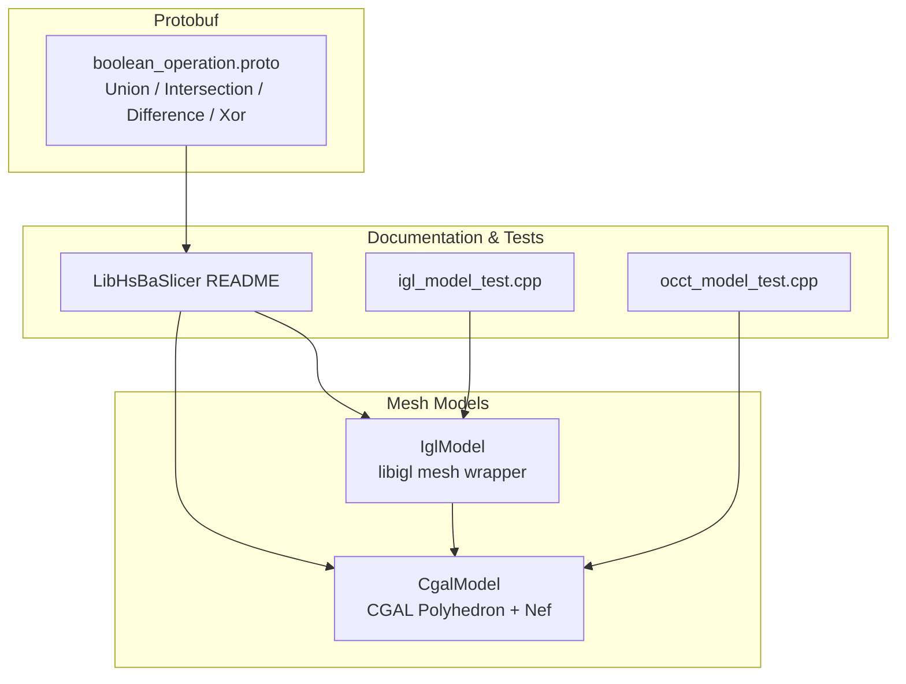
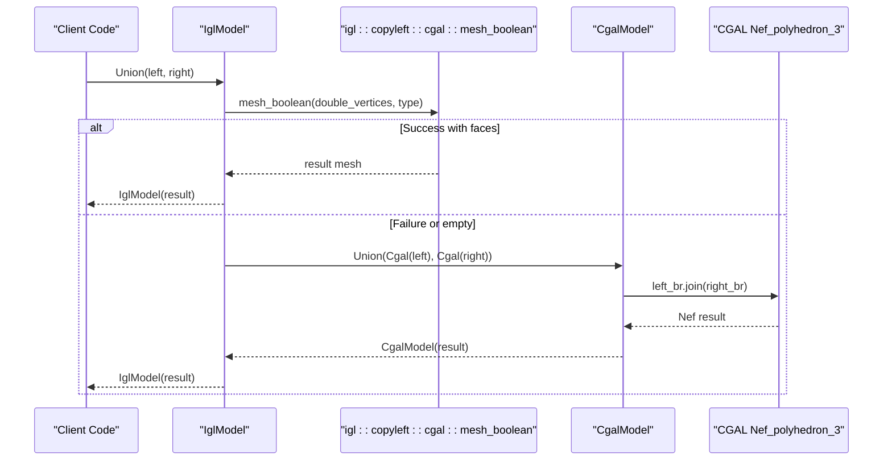
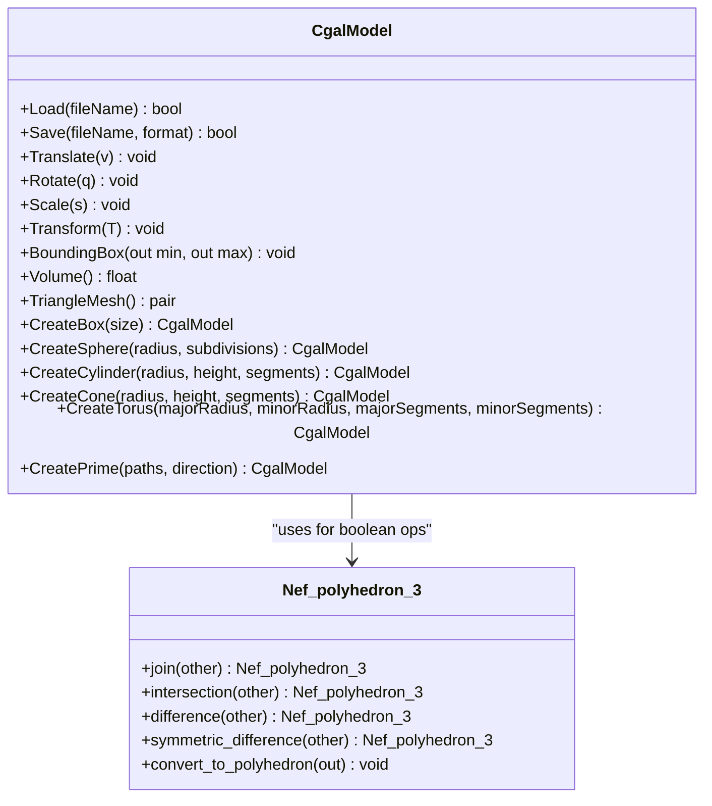
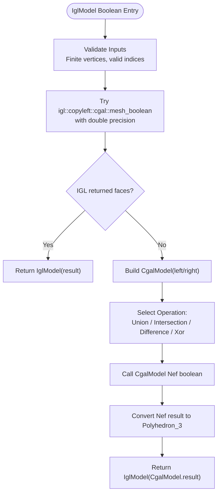
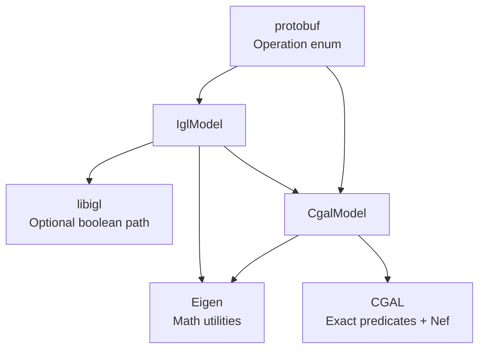

# Boolean Operations and Mesh Combinators

<cite>
**Referenced Files in This Document**
- [CgalModel.hpp](file://meshmodel/CgalModel.hpp)
- [CgalModel.cpp](file://meshmodel/CgalModel.cpp)
- [IglModel.cpp](file://meshmodel/IglModel.cpp)
- [boolean_operation.proto](file://proto/boolean_operation.proto)
- [README.md](file://docs/en/LibHsBaSlicer/README.md)
- [igl_model_test.cpp](file://tests/Models/igl_model_test.cpp)
- [occt_model_test.cpp](file://tests/Models/occt_model_test.cpp)
</cite>

## Table of Contents
1. [Introduction](#introduction)
2. [Project Structure](#project-structure)
3. [Core Components](#core-components)
4. [Architecture Overview](#architecture-overview)
5. [Detailed Component Analysis](#detailed-component-analysis)
6. [Dependency Analysis](#dependency-analysis)
7. [Performance Considerations](#performance-considerations)
8. [Troubleshooting Guide](#troubleshooting-guide)
9. [Conclusion](#conclusion)
10. [Appendices](#appendices)

## Introduction
This document explains how HsBaSlicer performs boolean operations on 3D meshes using CGAL’s Nef polyhedron implementation. It covers the four core combinators: Union, Intersection, Difference, and Xor. It also documents the underlying CGAL kernel, the fallback strategy from libigl to CGAL, error handling for invalid or non-manifold inputs, performance characteristics, memory usage patterns, and practical workflows such as hollowing objects, combining parts, and subtracting features.

The documentation is intended for both technical users who need to integrate these operations and non-technical users who want to understand what happens under the hood when combining mesh models.

## Project Structure
Boolean operations are primarily implemented in the mesh model layer:

- `CgalModel` provides a CGAL-backed polyhedral mesh with exact-predicates kernel support and exposes Nef-based boolean operators.
- `IglModel` provides a libigl-style mesh wrapper that attempts an IGL boolean operation first and falls back to `CgalModel` when needed.
- The protobuf definition enumerates supported boolean operation types for serialization and pipeline configuration.
- Documentation and tests demonstrate expected behavior and validation strategies.

**Diagram sources**
- [CgalModel.hpp:27-42](file://meshmodel/CgalModel.hpp#L27-L42)
- [CgalModel.cpp:238-276](file://meshmodel/CgalModel.cpp#L238-L276)
- [IglModel.cpp:195-245](file://meshmodel/IglModel.cpp#L195-L245)
- [boolean_operation.proto:5-11](file://proto/boolean_operation.proto#L5-L11)
- [README.md:336-378](file://docs/en/LibHsBaSlicer/README.md#L336-L378)

**Section sources**
- [CgalModel.hpp:27-42](file://meshmodel/CgalModel.hpp#L27-L42)
- [CgalModel.cpp:238-276](file://meshmodel/CgalModel.cpp#L238-L276)
- [IglModel.cpp:195-245](file://meshmodel/IglModel.cpp#L195-L245)
- [boolean_operation.proto:5-11](file://proto/boolean_operation.proto#L5-L11)
- [README.md:336-378](file://docs/en/LibHsBaSlicer/README.md#L336-L378)

## Core Components
- **CgalModel**: A CGAL-backed polyhedral mesh implementing the common `IModel` interface. It uses CGAL’s exact-predicates inexact-constructions kernel and supports Nef polyhedra for robust boolean operations. It also includes mesh loading/saving, transforms, bounding box, volume, triangulation helpers, and extrusion factories.
- **IglModel**: A libigl-style mesh wrapper that exposes Union, Intersection, Difference, and Xor. It tries `igl::copyleft::cgal::mesh_boolean` first (promoting float vertices to double), then falls back to `CgalModel`’s Nef-based boolean if the IGL path fails or returns empty results.
- **boolean_operation.proto**: Enumerates the boolean operation types used across the system: union, intersection, difference, xor, and unknown.

Key responsibilities:
- Provide reliable boolean operations on triangle meshes.
- Ensure consistent orientation and triangulation where necessary.
- Offer fallback paths to maintain robustness when primary algorithms fail.

**Section sources**
- [CgalModel.hpp:27-103](file://meshmodel/CgalModel.hpp#L27-L103)
- [CgalModel.cpp:42-118](file://meshmodel/CgalModel.cpp#L42-L118)
- [IglModel.cpp:195-245](file://meshmodel/IglModel.cpp#L195-L245)
- [boolean_operation.proto:5-11](file://proto/boolean_operation.proto#L5-L11)

## Architecture Overview
The boolean operation pipeline routes through two layers:

1. **High-level API**: Consumers call `Union`, `Intersection`, `Difference`, or `Xor` on either `IglModel` or `CgalModel`.
2. **Implementation layer**:
   - For `IglModel`: attempt IGL boolean with double precision; if it fails or yields no faces, fall back to `CgalModel` Nef boolean.
   - For `CgalModel`: convert input meshes to Nef polyhedra and apply CGAL set operations (`join`, `intersection`, `difference`, `symmetric_difference`).

**Diagram sources**
- [IglModel.cpp:195-245](file://meshmodel/IglModel.cpp#L195-L245)
- [CgalModel.cpp:238-246](file://meshmodel/CgalModel.cpp#L238-L246)

**Section sources**
- [IglModel.cpp:195-245](file://meshmodel/IglModel.cpp#L195-L245)
- [CgalModel.cpp:238-276](file://meshmodel/CgalModel.cpp#L238-L276)

## Detailed Component Analysis

### CgalModel Boolean Operators
`CgalModel` exposes four free functions that operate on CGAL polyhedra via Nef polyhedra:

- **Union**: Computes the join of two Nef polyhedra.
- **Intersection**: Computes the intersection of two Nef polyhedra.
- **Difference**: Computes the difference of two Nef polyhedra.
- **Xor**: Computes the symmetric difference of two Nef polyhedra.

Each operator converts the input `Polyhedron_3` into a `Nef_polyhedron_3`, applies the corresponding CGAL set operation, and converts the result back to a `Polyhedron_3`.

**Diagram sources**
- [CgalModel.hpp:27-42](file://meshmodel/CgalModel.hpp#L27-L42)
- [CgalModel.cpp:238-276](file://meshmodel/CgalModel.cpp#L238-L276)

**Section sources**
- [CgalModel.hpp:27-42](file://meshmodel/CgalModel.hpp#L27-L42)
- [CgalModel.cpp:238-276](file://meshmodel/CgalModel.cpp#L238-L276)

### IglModel Boolean Operators and Fallback Strategy
`IglModel` implements Union, Intersection, Difference, and Xor by delegating to a helper that:

1. Promotes float vertices to double to satisfy CGAL’s exact geometry kernel requirements.
2. Calls `igl::copyleft::cgal::mesh_boolean`.
3. If successful and non-empty, returns the resulting mesh.
4. Otherwise, constructs `CgalModel` instances and calls the Nef-based boolean operators.

**Diagram sources**
- [IglModel.cpp:195-245](file://meshmodel/IglModel.cpp#L195-L245)
- [CgalModel.cpp:238-276](file://meshmodel/CgalModel.cpp#L238-L276)

**Section sources**
- [IglModel.cpp:195-245](file://meshmodel/IglModel.cpp#L195-L245)
- [CgalModel.cpp:238-276](file://meshmodel/CgalModel.cpp#L238-L276)

### Underlying CGAL Algorithms and Kernel
- **Kernel**: `EpicKernel` is `CGAL::Exact_predicates_inexact_constructions_kernel`, providing exact geometric predicates while allowing inexact constructions. This improves robustness for boolean operations.
- **Nef Polyhedra**: Boolean operations are performed on `CGAL::Nef_polyhedron_3<EpicKernel>` using set operations (`join`, `intersection`, `difference`, `symmetric_difference`).
- **Polygon Mesh Processing**: Used for mesh repair, orientation correction, triangulation, and transformation. While the repository includes the header for corefinement, the current boolean implementations rely on Nef polyhedra rather than explicit Polygon Mesh Processing corefinement.

Important notes:
- Float vertices may cause inconsistent winding-number fields in IGL’s boolean path; promotion to double mitigates this.
- Nef-based operations are verified reliable in tests and serve as a robust fallback.

**Section sources**
- [CgalModel.hpp:37-42](file://meshmodel/CgalModel.hpp#L37-L42)
- [CgalModel.cpp:238-276](file://meshmodel/CgalModel.cpp#L238-L276)
- [IglModel.cpp:195-245](file://meshmodel/IglModel.cpp#L195-L245)

### Practical Examples and Workflows

#### Creating Hollowed Objects
A common workflow is to create a solid shell by combining an outer solid with an inner cavity using Difference. In HsBaSlicer, you can:

- Create an outer box or sphere using primitive factories.
- Create an inner shape representing the cavity.
- Apply Difference to subtract the inner shape from the outer solid.

Validation tips:
- Ensure both meshes are closed and consistently oriented.
- Avoid coplanar overlapping faces that can confuse boolean solvers.
- Use small offsets to avoid degenerate intersections.

#### Combining Parts
To merge multiple parts into a single object:

- Create each part as a separate mesh.
- Position them appropriately.
- Apply Union iteratively to combine all parts.

Tips:
- Prefer disjoint or slightly overlapping parts to reduce solver complexity.
- Check the resulting volume and bounding box to verify correctness.

#### Subtracting Features
To cut holes or slots from a solid:

- Create the base solid.
- Create the feature mesh (e.g., cylinder for a hole).
- Apply Difference to remove the feature.

Tips:
- Ensure the feature fully penetrates the solid for clean cuts.
- Avoid grazing contacts that can produce unstable results.

These workflows align with the documented advanced preprocessing capabilities and test cases demonstrating boolean operations on primitives.

**Section sources**
- [README.md:336-378](file://docs/en/LibHsBaSlicer/README.md#L336-L378)
- [igl_model_test.cpp:44-67](file://tests/Models/igl_model_test.cpp#L44-L67)
- [occt_model_test.cpp:34-48](file://tests/Models/occt_model_test.cpp#L34-L48)

## Dependency Analysis
The boolean operation stack depends on:

- **CGAL**: Exact predicates kernel and Nef polyhedra for robust set operations.
- **libigl**: Optional path for mesh boolean with fallback to CGAL.
- **Eigen**: Vector/matrix math used throughout.
- **Protobuf**: Enumerates boolean operation types for configuration and serialization.

**Diagram sources**
- [CgalModel.hpp:9-22](file://meshmodel/CgalModel.hpp#L9-L22)
- [IglModel.cpp:195-245](file://meshmodel/IglModel.cpp#L195-L245)
- [boolean_operation.proto:5-11](file://proto/boolean_operation.proto#L5-L11)

**Section sources**
- [CgalModel.hpp:9-22](file://meshmodel/CgalModel.hpp#L9-L22)
- [IglModel.cpp:195-245](file://meshmodel/IglModel.cpp#L195-L245)
- [boolean_operation.proto:5-11](file://proto/boolean_operation.proto#L5-L11)

## Performance Considerations
- **Complexity**: Nef-based boolean operations are computationally intensive. Complexity grows with the number of intersecting faces and topological complexity of the input meshes.
- **Precision**: Using exact predicates reduces numerical instability but increases CPU cost compared to floating-point-only kernels.
- **Fallback Path**: When IGL boolean fails or returns empty results, the Nef fallback adds overhead due to conversion to CGAL structures.
- **Memory Usage**: Nef polyhedra can consume significant memory for complex meshes. Large models may require careful subdivision or simplification before boolean operations.
- **Triangulation and Orientation**: Pre-triangulating faces and ensuring consistent orientation helps avoid extra repair steps during boolean operations.

Recommendations:
- Simplify meshes where possible before boolean operations.
- Avoid coplanar overlaps and grazing contacts.
- Use small offsets to prevent degenerate intersections.
- Monitor memory usage for large models and consider chunking or hierarchical operations.

[No sources needed since this section provides general guidance]

## Troubleshooting Guide

### Common Error Conditions
- **Empty mesh provided**: Constructor throws an error if vertex or face arrays are empty.
- **Conversion failure**: If direct conversion to CGAL polyhedron fails, repair attempts are made; otherwise, an error is thrown.
- **Unsupported build**: Without CGAL enabled, boolean operations throw a not-supported error.
- **Invalid arguments**: Some operations validate parameters and throw specific errors for invalid inputs.

### Non-Manifold and Invalid Geometries
- **Orientation issues**: Negative volume indicates reversed face orientation; the code corrects orientation by reversing face normals.
- **Duplicate vertices and polygon soup**: Repair routines orient and merge polygons to form a valid mesh.
- **Coplanar faces**: Can cause IGL boolean to return empty results; fallback to Nef boolean is used.

### Debugging Steps
1. Verify inputs are finite and well-formed.
2. Check mesh validity and orientation (volume sign).
3. Inspect whether IGL boolean succeeded; if not, confirm Nef fallback executed.
4. Reduce mesh complexity or adjust positioning to avoid degenerate intersections.
5. Review test cases for expected volumes and bounding boxes to validate outcomes.

**Section sources**
- [CgalModel.cpp:42-118](file://meshmodel/CgalModel.cpp#L42-L118)
- [IglModel.cpp:393-408](file://meshmodel/IglModel.cpp#L393-L408)
- [igl_model_test.cpp:44-67](file://tests/Models/igl_model_test.cpp#L44-L67)

## Conclusion
HsBaSlicer’s boolean operations on 3D meshes leverage CGAL’s Nef polyhedra for robust set operations, with a pragmatic fallback strategy from libigl to ensure reliability. The system emphasizes exact predicates, mesh repair, and consistent orientation to handle complex geometries. Users should prepare meshes carefully, avoid degenerate configurations, and monitor performance and memory usage when working with large or intricate models. The provided examples and tests illustrate typical workflows for hollowing, combining, and subtracting features.

[No sources needed since this section summarizes without analyzing specific files]

## Appendices

### API Summary
- **Union**: Combine two meshes into their spatial union.
- **Intersection**: Compute the spatial overlap between two meshes.
- **Difference**: Subtract one mesh from another.
- **Xor**: Compute the symmetric difference (union minus intersection).

Supported operation types are enumerated in the protobuf definition.

**Section sources**
- [boolean_operation.proto:5-11](file://proto/boolean_operation.proto#L5-L11)