# CAD Model Integration (OpenCASCADE)

<cite>
**Referenced Files in This Document**
- [OcctModel.hpp](file://cadmodel/OcctModel.hpp)
- [OcctModel.cpp](file://cadmodel/OcctModel.cpp)
- [OcctTypeAliases.hpp](file://cadmodel/OcctTypeAliases.hpp)
- [UserCustomCADModel.hpp](file://cadmodel/UserCustomCADModel.hpp)
- [UserCustomCADModel.cpp](file://cadmodel/UserCustomCADModel.cpp)
- [IModel.hpp](file://base/IModel.hpp)
- [ModelLoader.cpp](file://preprocess/ModelLoader.cpp)
- [model_preprocess.hpp](file://LibHsBaSlicer/Preprocess/model_preprocess.hpp)
- [user_custom_cad_model_test.cpp](file://tests/CADModel/user_custom_cad_model_test.cpp)
</cite>

## Table of Contents
1. [Introduction](#introduction)
2. [Project Structure](#project-structure)
3. [Core Components](#core-components)
4. [Architecture Overview](#architecture-overview)
5. [Detailed Component Analysis](#detailed-component-analysis)
6. [Dependency Analysis](#dependency-analysis)
7. [Performance Considerations](#performance-considerations)
8. [Troubleshooting Guide](#troubleshooting-guide)
9. [Conclusion](#conclusion)
10. [Appendices](#appendices)

## Introduction
This document explains how HsBaSlicer integrates OpenCASCADE CAD models through the `OcctModel` class and how it connects to mesh processing pipelines for slicing. It covers:

- Precise geometric modeling using OCCT B-rep shapes, including STEP/IGES/VRML/BRep import/export.
- High-precision transformations, boolean operations, thick-solid shell generation, and primitive/extrusion factories.
- Conversion between NURBS/B-rep representations and polygonal meshes for downstream slicing.
- Extensibility via `UserCustomCADModel`, which loads user-provided CAD libraries through a stable C ABI.
- Practical workflows such as importing STEP/IGES files, performing parametric modifications, and exporting high-quality meshes.
- Precision considerations, performance implications, and best practices for large CAD assemblies.

## Project Structure
The CAD integration is primarily implemented under `cadmodel/`, with cross-cutting interfaces in `base/` and usage points in preprocessing and library APIs.

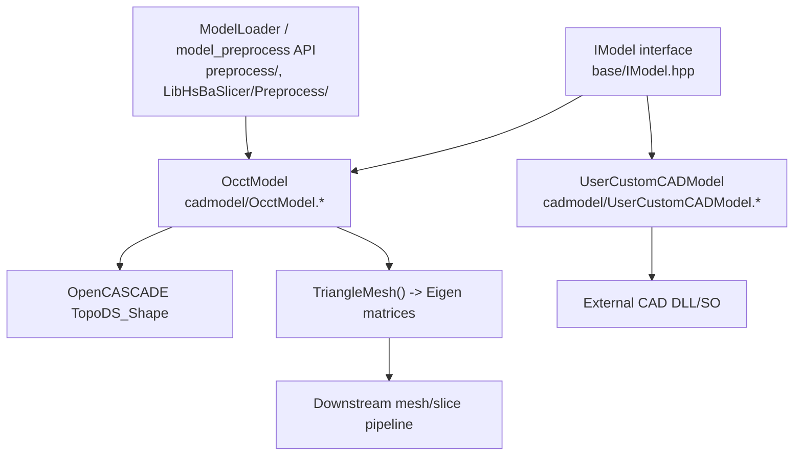

**Diagram sources**
- [IModel.hpp:110-139](file://base/IModel.hpp#L110-L139)
- [OcctModel.hpp:22-124](file://cadmodel/OcctModel.hpp#L22-L124)
- [UserCustomCADModel.hpp:75-121](file://cadmodel/UserCustomCADModel.hpp#L75-L121)
- [ModelLoader.cpp:172-190](file://preprocess/ModelLoader.cpp#L172-L190)

**Section sources**
- [OcctModel.hpp:22-124](file://cadmodel/OcctModel.hpp#L22-L124)
- [IModel.hpp:110-139](file://base/IModel.hpp#L110-L139)

## Core Components
- `IModel`: Abstract contract defining load/save, transforms, bounding box, volume, and triangle mesh access.
- `OcctModel`: OCCT-backed implementation providing precise B-rep geometry, file I/O, transforms, boolean operations, thick solids, primitives, and extrusions.
- `UserCustomCADModel`: Adapter that dynamically loads a user-supplied CAD DLL/SO and forwards all operations to the underlying custom model.
- `OcctTypeAliases`: Version-conditional type aliases ensuring compatibility across OCCT versions.

Key responsibilities:
- Maintain a `TopoDS_Shape` representing the CAD assembly or part.
- Provide conversion to polygonal meshes for slicing while preserving orientation and location information.
- Expose CAD-specific operations not available on generic mesh types.

**Section sources**
- [IModel.hpp:110-139](file://base/IModel.hpp#L110-L139)
- [OcctModel.hpp:22-124](file://cadmodel/OcctModel.hpp#L22-L124)
- [UserCustomCADModel.hpp:75-121](file://cadmodel/UserCustomCADModel.hpp#L75-L121)
- [OcctTypeAliases.hpp:22-42](file://cadmodel/OcctTypeAliases.hpp#L22-L42)

## Architecture Overview
The CAD layer sits above the mesh layer and exposes a uniform `IModel` interface. Consumers can work with either OCCT-based CAD models or mesh models interchangeably. When slicing requires polygons, `OcctModel::TriangleMesh()` converts the B-rep into an Eigen-based vertex/face representation.

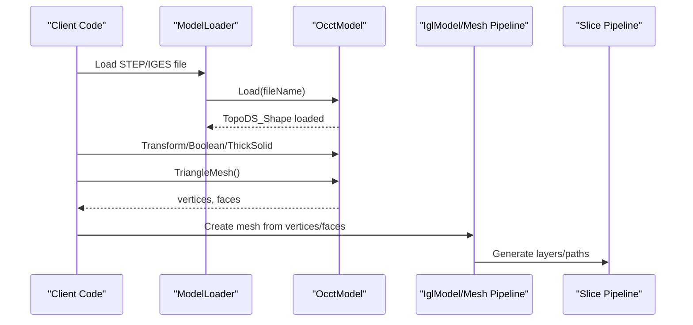

**Diagram sources**
- [ModelLoader.cpp:172-190](file://preprocess/ModelLoader.cpp#L172-L190)
- [OcctModel.cpp:213-271](file://cadmodel/OcctModel.cpp#L213-L271)
- [OcctModel.cpp:353-400](file://cadmodel/OcctModel.cpp#L353-L400)

## Detailed Component Analysis

### OcctModel: Precise B-rep Geometry and CAD Operations
`OcctModel` wraps an OCCT `TopoDS_Shape` and implements `IModel`. It supports:

- File I/O:
  - Import: STEP, IGES, VRML, BRep.
  - Export: STEP, IGES, VRML, BRep; mesh formats are supported by converting to a mesh first.
- Transforms:
  - Translation, rotation, scaling, and arbitrary affine/isometry/homogeneous transforms.
- Queries:
  - Axis-aligned bounding box computed from shape vertices.
  - Signed volume via OCCT properties.
  - Tessellation to triangle mesh.
- Boolean operations:
  - Union, intersection, difference, XOR.
- Shell/thickening:
  - Thick solid creation over the whole shape or selected faces.
- Primitives and extrusions:
  - Box, sphere, cylinder, cone, torus.
  - Extrude single or multiple closed polygons (outer contour plus holes).

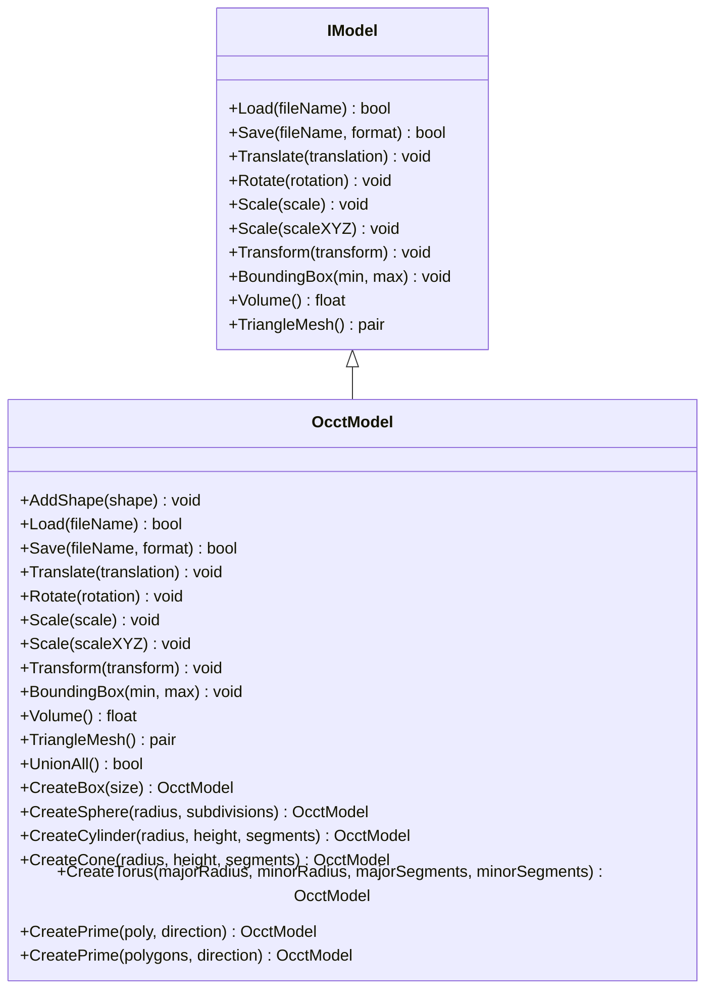

**Diagram sources**
- [IModel.hpp:110-139](file://base/IModel.hpp#L110-L139)
- [OcctModel.hpp:22-124](file://cadmodel/OcctModel.hpp#L22-L124)

#### File I/O and Format Handling
- `Load` determines the format from the extension and delegates to specialized readers.
- `Save` writes native CAD formats directly; for mesh formats, it tessellates the shape first and then saves via a mesh model.

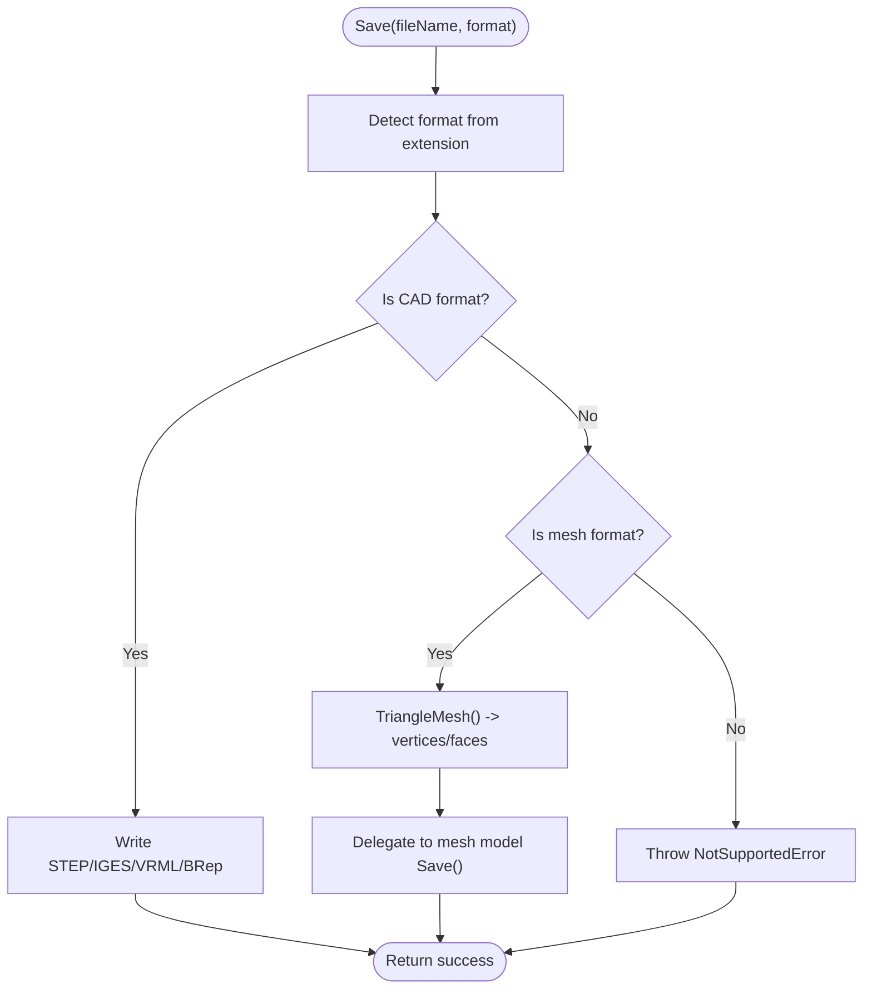

**Diagram sources**
- [OcctModel.cpp:238-271](file://cadmodel/OcctModel.cpp#L238-L271)

**Section sources**
- [OcctModel.cpp:76-147](file://cadmodel/OcctModel.cpp#L76-L147)
- [OcctModel.cpp:148-190](file://cadmodel/OcctModel.cpp#L148-L190)
- [OcctModel.cpp:213-271](file://cadmodel/OcctModel.cpp#L213-L271)

#### High-Precision Transforms
All transform methods convert Eigen matrices/quaternions/vectors into OCCT transformation objects and rebuild the shape. This preserves exact NURBS definitions rather than approximating during transform.

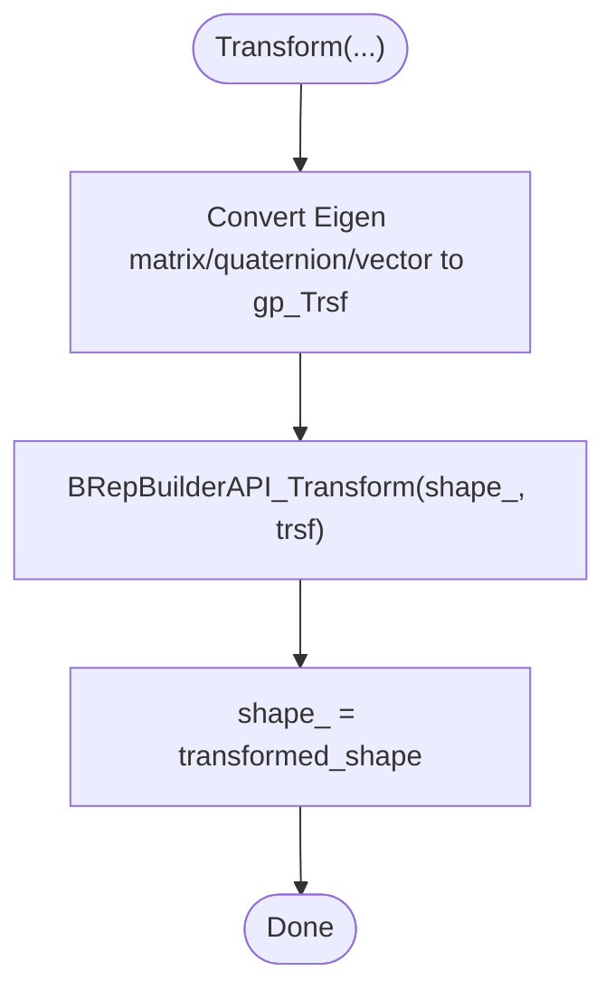

**Diagram sources**
- [OcctModel.cpp:272-329](file://cadmodel/OcctModel.cpp#L272-L329)

**Section sources**
- [OcctModel.cpp:272-329](file://cadmodel/OcctModel.cpp#L272-L329)

#### Bounding Box and Volume
- Bounding box iterates over vertices of the shape to compute min/max coordinates.
- Volume uses OCCT property computation for accurate signed volume.

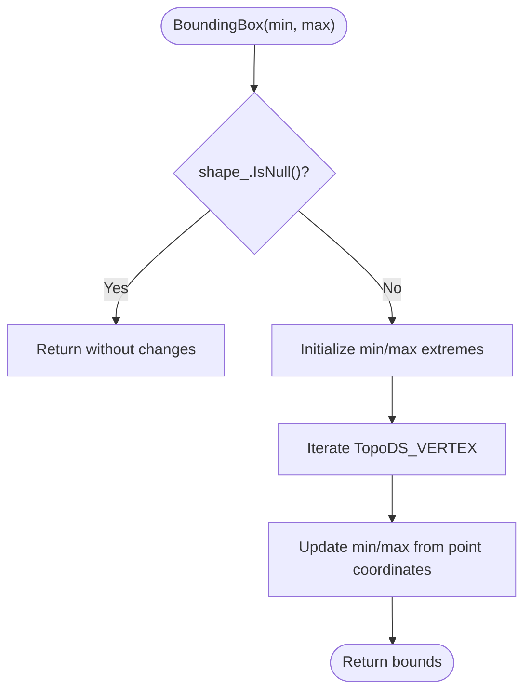

**Diagram sources**
- [OcctModel.cpp:331-351](file://cadmodel/OcctModel.cpp#L331-L351)

**Section sources**
- [OcctModel.cpp:331-351](file://cadmodel/OcctModel.cpp#L331-L351)
- [OcctModel.cpp:402-407](file://cadmodel/OcctModel.cpp#L402-L407)

#### Tessellation Strategy: NURBS to Polygonal Representation
`TriangleMesh()` walks each face, retrieves triangulation data, applies per-face location transforms, and collects vertices and indices. Face orientation is respected to preserve correct normals.

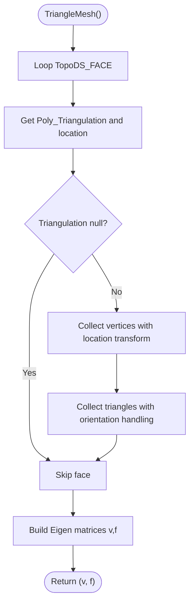

**Diagram sources**
- [OcctModel.cpp:353-400](file://cadmodel/OcctModel.cpp#L353-L400)

**Section sources**
- [OcctModel.cpp:353-400](file://cadmodel/OcctModel.cpp#L353-L400)

#### Boolean Operations and Thick Solids
- Boolean operations use OCCT algorithms for fuse, common, cut, and XOR composition.
- Thick solid supports full-shape thickening or selective face exclusion with tolerance checks.

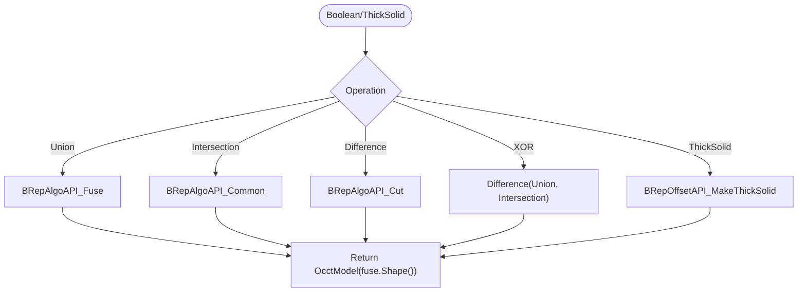

**Diagram sources**
- [OcctModel.cpp:451-540](file://cadmodel/OcctModel.cpp#L451-L540)

**Section sources**
- [OcctModel.cpp:451-540](file://cadmodel/OcctModel.cpp#L451-L540)

#### Primitives and Extrusions
- Primitive factories create standard OCCT shapes.
- Extrusion functions build closed wires and faces from 2D polygons, then extrude along a direction. Multi-path support allows outer contours and holes.

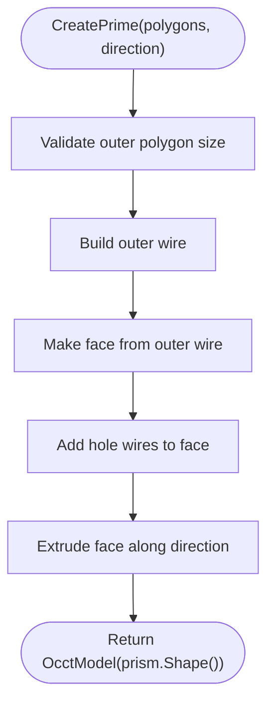

**Diagram sources**
- [OcctModel.cpp:542-663](file://cadmodel/OcctModel.cpp#L542-L663)

**Section sources**
- [OcctModel.cpp:422-449](file://cadmodel/OcctModel.cpp#L422-L449)
- [OcctModel.cpp:542-663](file://cadmodel/OcctModel.cpp#L542-L663)

### UserCustomCADModel: Extending CAD Functionality
`UserCustomCADModel` provides a dynamic plugin mechanism:

- Loads a user-provided DLL/SO exposing factory functions and operations via a stable C ABI.
- Forwards all `IModel` operations to the underlying custom model.
- Supports named boolean operations and thickness setting through exported function pointers.
- Uses a named object pool to cache loaded libraries.

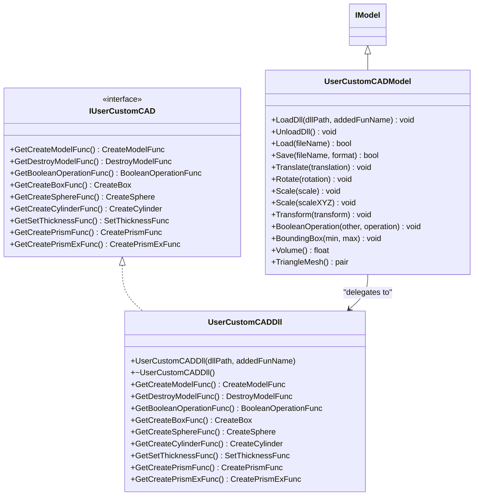

**Diagram sources**
- [UserCustomCADModel.hpp:20-73](file://cadmodel/UserCustomCADModel.hpp#L20-L73)
- [UserCustomCADModel.hpp:75-121](file://cadmodel/UserCustomCADModel.hpp#L75-L121)
- [IModel.hpp:110-139](file://base/IModel.hpp#L110-L139)

#### Dynamic Loading and ABI Contract
- The adapter resolves symbols like `<addedFunName>_create_model`, `_create_box`, etc., using Boost.DLL.
- Factory functions return raw `IModel*` pointers owned by the caller and must be destroyed via the provided destroy callback.
- Boolean operations are dispatched by name and require both models to originate from the same DLL.

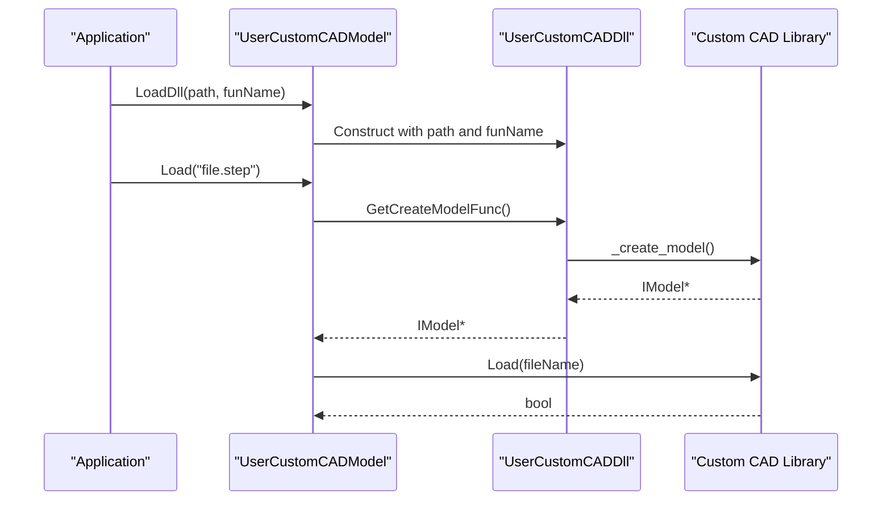

**Diagram sources**
- [UserCustomCADModel.cpp:31-44](file://cadmodel/UserCustomCADModel.cpp#L31-L44)
- [UserCustomCADModel.cpp:151-173](file://cadmodel/UserCustomCADModel.cpp#L151-L173)

**Section sources**
- [UserCustomCADModel.hpp:20-73](file://cadmodel/UserCustomCADModel.hpp#L20-L73)
- [UserCustomCADModel.cpp:24-115](file://cadmodel/UserCustomCADModel.cpp#L24-L115)
- [UserCustomCADModel.cpp:134-182](file://cadmodel/UserCustomCADModel.cpp#L134-L182)

### Interface Between CAD Models and Mesh Processing Pipelines
- `OcctModel::TriangleMesh()` produces Eigen matrices suitable for libigl-style mesh processing.
- `ModelLoader` exposes preprocessing operations such as `ThickSolidModel`, requiring an `OcctModel` source.
- For mesh formats, `OcctModel::Save` converts to a mesh first and delegates saving to a mesh model.

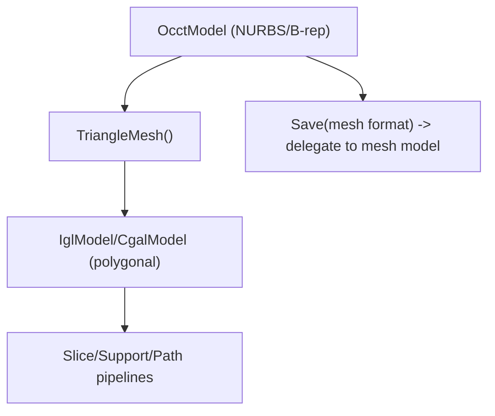

**Diagram sources**
- [OcctModel.cpp:257-266](file://cadmodel/OcctModel.cpp#L257-L266)
- [OcctModel.cpp:353-400](file://cadmodel/OcctModel.cpp#L353-L400)
- [ModelLoader.cpp:172-190](file://preprocess/ModelLoader.cpp#L172-L190)

**Section sources**
- [OcctModel.cpp:257-266](file://cadmodel/OcctModel.cpp#L257-L266)
- [ModelLoader.cpp:172-190](file://preprocess/ModelLoader.cpp#L172-L190)

## Dependency Analysis
- `OcctModel` depends on OCCT headers for B-rep operations, IO, and geometry utilities.
- `UserCustomCADModel` depends on Boost.DLL for dynamic loading and on `IModel` for the abstraction.
- `OcctTypeAliases` abstracts OCCT scalar types across versions.
- Preprocessing APIs depend on `OcctModel` for CAD-specific operations like thick solids.

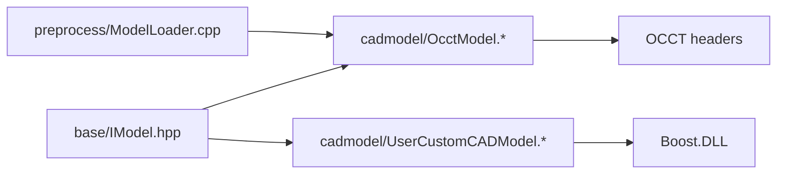

**Diagram sources**
- [OcctModel.cpp:8-59](file://cadmodel/OcctModel.cpp#L8-L59)
- [UserCustomCADModel.cpp:8-17](file://cadmodel/UserCustomCADModel.cpp#L8-L17)
- [OcctTypeAliases.hpp:9-13](file://cadmodel/OcctTypeAliases.hpp#L9-L13)
- [ModelLoader.cpp:172-190](file://preprocess/ModelLoader.cpp#L172-L190)

**Section sources**
- [OcctModel.cpp:8-59](file://cadmodel/OcctModel.cpp#L8-L59)
- [UserCustomCADModel.cpp:8-17](file://cadmodel/UserCustomCADModel.cpp#L8-L17)
- [OcctTypeAliases.hpp:9-13](file://cadmodel/OcctTypeAliases.hpp#L9-L13)
- [ModelLoader.cpp:172-190](file://preprocess/ModelLoader.cpp#L172-L190)

## Performance Considerations
- Tessellation cost: `TriangleMesh()` traverses all faces and builds vertex/face arrays. Large assemblies may produce large meshes; consider controlling tessellation density at the OCCT level if exposed by your workflow.
- Boolean operations: Complex boolean sequences can increase topology complexity and memory usage. Prefer simplifying assemblies before boolean operations when possible.
- Thick solids: Selective face exclusion involves distance computations and tolerance checks; ensure tolerances are appropriate for your model scale.
- Transformations: Applying transforms rebuilds the shape; batch transforms where feasible to reduce repeated recomputation.
- External DLLs: Loading and symbol resolution occur once per DLL path due to caching; avoid frequent reloads.

[No sources needed since this section provides general guidance]

## Troubleshooting Guide
Common issues and resolutions:

- Unsupported model format:
  - Ensure the file extension matches one of the supported formats (STEP, IGES, VRML, BREP, or mesh formats).
  - For mesh formats, `OcctModel::Save` will attempt tessellation; ensure the shape is valid.

- VRML read/write errors:
  - VRML reading/writing may throw wrapped IO errors; verify file integrity and permissions.

- Missing DLL entry points:
  - When using `UserCustomCADModel`, ensure the DLL exports the required symbols with the expected naming convention (`<addedFunName>_create_model`, etc.).
  - Verify that both models involved in a boolean operation come from the same DLL.

- Empty or invalid meshes:
  - If `TriangleMesh()` returns empty results, check whether faces have triangulations and whether the shape is non-null.

- Transformations on unloaded models:
  - `UserCustomCADModel` throws runtime errors if operations are invoked without a loaded model; call `LoadDll` and `Load` first.

**Section sources**
- [OcctModel.cpp:76-147](file://cadmodel/OcctModel.cpp#L76-L147)
- [OcctModel.cpp:148-190](file://cadmodel/OcctModel.cpp#L148-L190)
- [UserCustomCADModel.cpp:151-182](file://cadmodel/UserCustomCADModel.cpp#L151-L182)
- [user_custom_cad_model_test.cpp:45-70](file://tests/CADModel/user_custom_cad_model_test.cpp#L45-L70)
- [user_custom_cad_model_test.cpp:150-189](file://tests/CADModel/user_custom_cad_model_test.cpp#L150-L189)

## Conclusion
HsBaSlicer’s CAD integration centers on `OcctModel`, which provides precise B-rep modeling, robust file I/O, high-precision transforms, boolean operations, thick solids, and extrusions. It bridges CAD and mesh pipelines through controlled tessellation, enabling slicing workflows to operate on polygonal representations while retaining access to exact geometry when needed. `UserCustomCADModel` extends this capability by allowing external CAD libraries to plug in via a stable ABI, supporting custom primitives, thickness settings, and named boolean operations. For large assemblies, careful management of tessellation, boolean complexity, and transform batching is essential to maintain performance and precision.

[No sources needed since this section summarizes without analyzing specific files]

## Appendices

### Example Workflows

- Import STEP/IGES and export high-quality meshes:
  - Use `OcctModel::Load` to import STEP/IGES.
  - Apply transforms or boolean operations as needed.
  - Call `TriangleMesh()` to obtain vertices and faces for slicing.
  - Optionally save to mesh formats via `Save`.

- Parametric modifications:
  - Use primitive factories (`CreateBox`, `CreateSphere`, etc.) and extrusions (`CreatePrime`) to construct parametric geometry.
  - Combine shapes with boolean operations and thicken surfaces with `ThickSolid`.

- Extending with custom CAD libraries:
  - Implement a DLL exporting the required functions.
  - Load via `UserCustomCADModel::LoadDll` and perform operations through the adapter.

**Section sources**
- [OcctModel.cpp:213-271](file://cadmodel/OcctModel.cpp#L213-L271)
- [OcctModel.cpp:353-400](file://cadmodel/OcctModel.cpp#L353-L400)
- [OcctModel.cpp:422-663](file://cadmodel/OcctModel.cpp#L422-L663)
- [UserCustomCADModel.cpp:134-182](file://cadmodel/UserCustomCADModel.cpp#L134-L182)