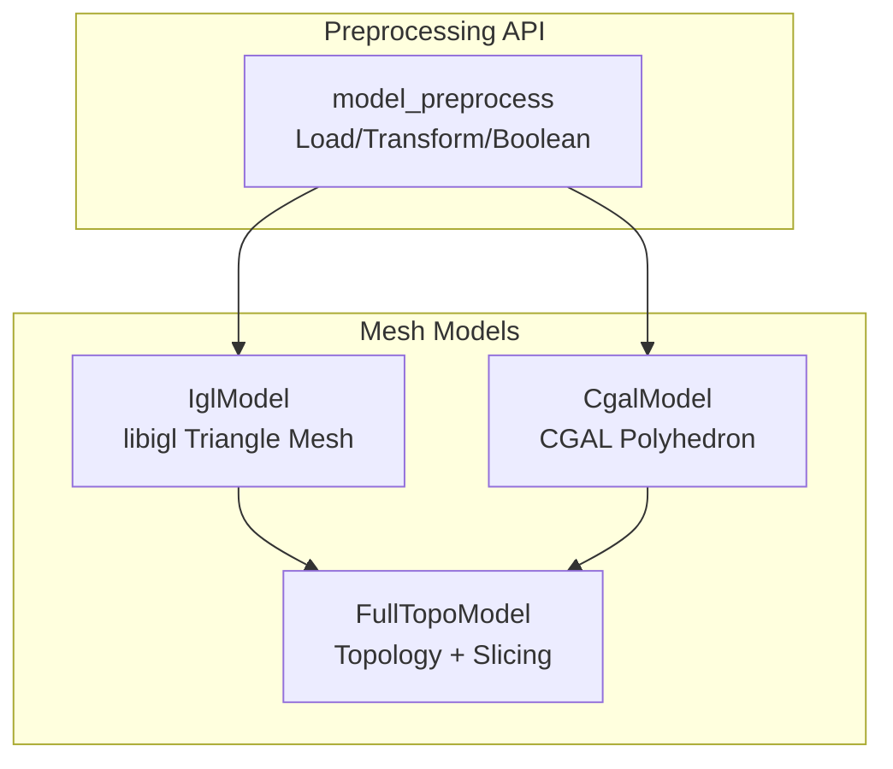
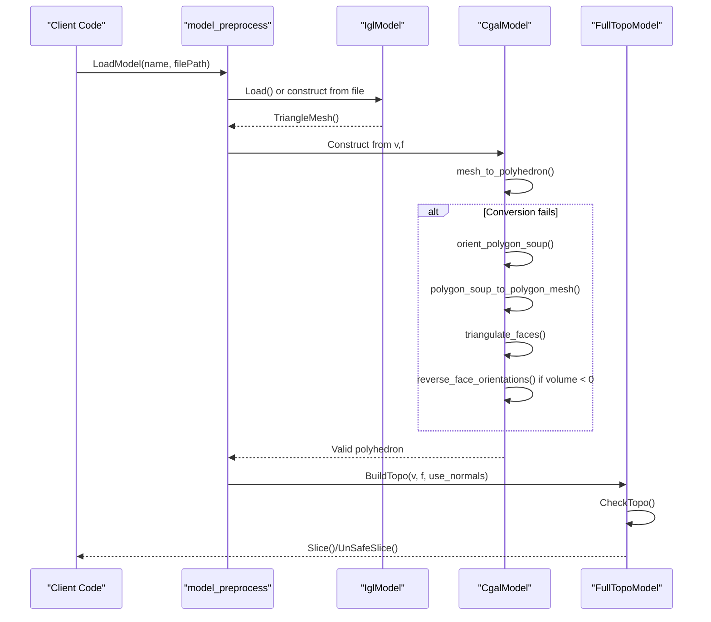
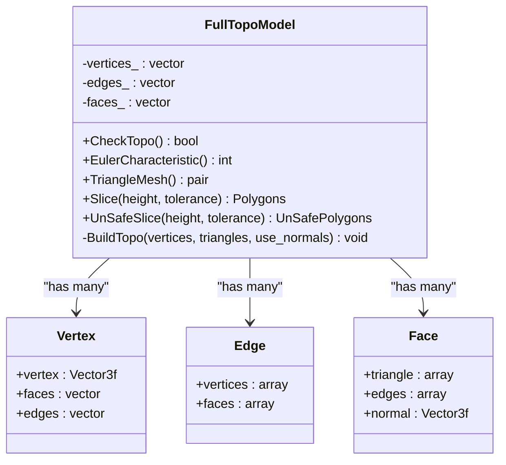
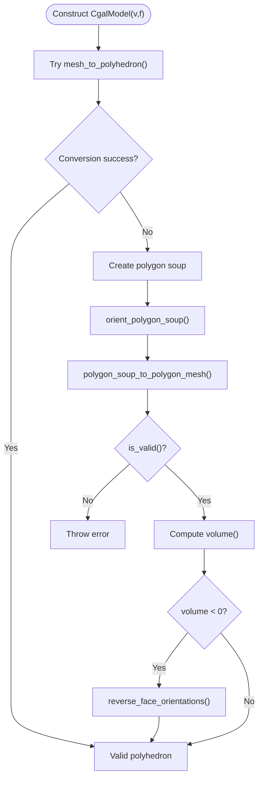
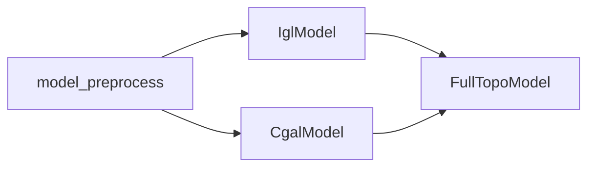

# Mesh Validation and Repair Algorithms

<cite>
**Referenced Files in This Document**   
- [FullTopoModel.hpp](file://meshmodel/FullTopoModel.hpp)
- [FullTopoModel.cpp](file://meshmodel/FullTopoModel.cpp)
- [CgalModel.hpp](file://meshmodel/CgalModel.hpp)
- [CgalModel.cpp](file://meshmodel/CgalModel.cpp)
- [IglModel.hpp](file://meshmodel/IglModel.hpp)
- [model_preprocess.hpp](file://LibHsBaSlicer/Preprocess/model_preprocess.hpp)
- [model_preprocess.cpp](file://LibHsBaSlicer/Preprocess/model_preprocess.cpp)
- [full_topo_model_test.cpp](file://tests/Models/full_topo_model_test.cpp)
</cite>

## Table of Contents
1. [Introduction](#introduction)
2. [Project Structure](#project-structure)
3. [Core Components](#core-components)
4. [Architecture Overview](#architecture-overview)
5. [Detailed Component Analysis](#detailed-component-analysis)
6. [Dependency Analysis](#dependency-analysis)
7. [Performance Considerations](#performance-considerations)
8. [Troubleshooting Guide](#troubleshooting-guide)
9. [Conclusion](#conclusion)

## Introduction
This document explains the mesh validation and repair algorithms used to prepare 3D models for slicing. It focuses on how the codebase detects and repairs common issues such as non-manifold edges, inverted normals, degenerate faces, duplicate vertices, and gaps. It also documents the automatic repair pipeline that processes problematic meshes through multiple validation stages, including edge healing, face reconstruction, and topology restoration. Diagnostic tools and preprocessing workflows are described, along with performance considerations for large-scale operations and strategies for preserving geometric accuracy during repairs.

## Project Structure
The mesh processing and validation logic is primarily implemented in the mesh model layer and exposed via a preprocessing API:

- Mesh model implementations:
  - FullTopoModel: topological reconstruction and slicing utilities
  - CgalModel: CGAL-backed polyhedral mesh with repair routines
  - IglModel: libigl-backed triangle mesh model
- Preprocessing API:
  - Model loading, transforms, and advanced boolean/thick-solid operations

**Diagram sources**
- [FullTopoModel.hpp:43-142](file://meshmodel/FullTopoModel.hpp#L43-L142)
- [CgalModel.hpp:26-155](file://meshmodel/CgalModel.hpp#L26-L155)
- [IglModel.hpp:18-121](file://meshmodel/IglModel.hpp#L18-L121)
- [model_preprocess.hpp:20-187](file://LibHsBaSlicer/Preprocess/model_preprocess.hpp#L20-L187)

**Section sources**
- [FullTopoModel.hpp:43-142](file://meshmodel/FullTopoModel.hpp#L43-L142)
- [CgalModel.hpp:26-155](file://meshmodel/CgalModel.hpp#L26-L155)
- [IglModel.hpp:18-121](file://meshmodel/IglModel.hpp#L18-L121)
- [model_preprocess.hpp:20-187](file://LibHsBaSlicer/Preprocess/model_preprocess.hpp#L20-L187)

## Core Components
- FullTopoModel: Rebuilds full topology (vertices, edges, faces) from a triangle soup and provides slicing methods. It includes topological completeness checks and Euler characteristic computation.
- CgalModel: Wraps a CGAL polyhedron; implements robust mesh repair during construction by orienting polygon soups, merging duplicate vertices, triangulating faces, and correcting orientation based on volume sign.
- IglModel: Provides basic triangle mesh operations, normal computation, and primitive creation.
- model_preprocess: Exposes high-level APIs for loading models, applying transforms, and performing boolean/thick-solid operations.

Key responsibilities:
- Detection: Topology validation, orientation checks, and volume sign analysis.
- Correction: Edge healing via adjacency reconstruction, face reconstruction via triangulation, duplicate vertex merging, and orientation flipping.
- Diagnostics: Topology completeness check, Euler characteristic, and per-face normals.

**Section sources**
- [FullTopoModel.hpp:43-142](file://meshmodel/FullTopoModel.hpp#L43-L142)
- [FullTopoModel.cpp:50-158](file://meshmodel/FullTopoModel.cpp#L50-L158)
- [CgalModel.cpp:42-119](file://meshmodel/CgalModel.cpp#L42-L119)
- [IglModel.hpp:18-121](file://meshmodel/IglModel.hpp#L18-L121)
- [model_preprocess.hpp:20-187](file://LibHsBaSlicer/Preprocess/model_preprocess.hpp#L20-L187)

## Architecture Overview
The automatic repair pipeline integrates multiple validation and repair stages:

**Diagram sources**
- [model_preprocess.cpp:54-57](file://LibHsBaSlicer/Preprocess/model_preprocess.cpp#L54-L57)
- [CgalModel.cpp:42-119](file://meshmodel/CgalModel.cpp#L42-L119)
- [FullTopoModel.cpp:27-48](file://meshmodel/FullTopoModel.cpp#L27-L48)
- [FullTopoModel.cpp:160-218](file://meshmodel/FullTopoModel.cpp#L160-L218)

## Detailed Component Analysis

### FullTopoModel: Topology Reconstruction and Validation
FullTopoModel reconstructs a fully connected topological graph from a triangle soup:

- Vertex/Edge/Face structures store indices and adjacency relationships.
- BuildTopo constructs:
  - Vertex list with positions
  - Edge list with vertex pairs and adjacent faces
  - Face list with triangle indices, edge indices, and optional normals
- CheckTopo validates:
  - All face references point to valid vertices and edges
  - All edge references point to valid vertices and faces
  - Coverage of all vertices and edges across faces and edges respectively
- EulerCharacteristic computes V - E + F to detect potential non-manifold conditions.

**Diagram sources**
- [FullTopoModel.hpp:53-142](file://meshmodel/FullTopoModel.hpp#L53-L142)
- [FullTopoModel.cpp:50-158](file://meshmodel/FullTopoModel.cpp#L50-L158)
- [FullTopoModel.cpp:160-218](file://meshmodel/FullTopoModel.cpp#L160-L218)

**Section sources**
- [FullTopoModel.hpp:43-142](file://meshmodel/FullTopoModel.hpp#L43-L142)
- [FullTopoModel.cpp:50-158](file://meshmodel/FullTopoModel.cpp#L50-L158)
- [FullTopoModel.cpp:160-218](file://meshmodel/FullTopoModel.cpp#L160-L218)

### CgalModel: Automatic Repair Pipeline
CgalModel implements an automatic repair pipeline when constructing from vertex/face data:

- Attempt direct conversion using mesh_to_polyhedron.
- If conversion fails:
  - Create a polygon soup from vertices and faces.
  - Orient the polygon soup consistently.
  - Merge duplicate vertices and build a proper mesh.
  - Triangulate faces to ensure triangular topology.
  - Check volume sign and reverse face orientations if needed.

**Diagram sources**
- [CgalModel.cpp:42-119](file://meshmodel/CgalModel.cpp#L42-L119)

**Section sources**
- [CgalModel.cpp:42-119](file://meshmodel/CgalModel.cpp#L42-L119)

### IglModel: Normal Computation and Primitives
IglModel supports:
- Loading/saving triangle meshes
- Affine transforms
- Bounding box and volume queries
- Computing per-face and per-vertex normals
- Creating primitives and extruding polygons into solids

These capabilities complement the repair pipeline by providing reliable geometry for downstream operations.

**Section sources**
- [IglModel.hpp:18-121](file://meshmodel/IglModel.hpp#L18-L121)

### Preprocessing API: High-Level Operations
The preprocessing API exposes:
- Model loading and transformation
- Advanced boolean operations (union, intersection, difference, xor)
- Thick-solid operations

All operations are guarded to translate third-party exceptions into project-specific errors.

**Section sources**
- [model_preprocess.hpp:20-187](file://LibHsBaSlicer/Preprocess/model_preprocess.hpp#L20-L187)
- [model_preprocess.cpp:36-51](file://LibHsBaSlicer/Preprocess/model_preprocess.cpp#L36-L51)
- [model_preprocess.cpp:54-57](file://LibHsBaSlicer/Preprocess/model_preprocess.cpp#L54-L57)

## Dependency Analysis
The components interact as follows:

- model_preprocess depends on IglModel and CgalModel for geometry operations.
- FullTopoModel depends on both IglModel and CgalModel outputs for topology reconstruction.

**Diagram sources**
- [model_preprocess.cpp:54-57](file://LibHsBaSlicer/Preprocess/model_preprocess.cpp#L54-L57)
- [CgalModel.cpp:42-119](file://meshmodel/CgalModel.cpp#L42-L119)
- [FullTopoModel.cpp:27-48](file://meshmodel/FullTopoModel.cpp#L27-L48)

**Section sources**
- [model_preprocess.cpp:54-57](file://LibHsBaSlicer/Preprocess/model_preprocess.cpp#L54-L57)
- [CgalModel.cpp:42-119](file://meshmodel/CgalModel.cpp#L42-L119)
- [FullTopoModel.cpp:27-48](file://meshmodel/FullTopoModel.cpp#L27-L48)

## Performance Considerations
- Topology reconstruction in FullTopoModel uses hash maps for edge lookup and adjacency building, which scales linearly with the number of faces but may be memory-intensive for very large meshes.
- CgalModel’s repair pipeline involves multiple passes over the mesh (orientation, mesh building, triangulation), which can be computationally expensive.
- Boolean operations and thick-solid operations rely on CGAL and may be heavy; consider batching and limiting scope where possible.
- Use integerization and grid hashing in slicing to reduce floating-point precision issues and improve performance.

[No sources needed since this section provides general guidance]

## Troubleshooting Guide
Common issues and diagnostics:

- Non-manifold edges:
  - Use FullTopoModel::CheckTopo() to validate topological completeness.
  - Inspect EulerCharacteristic() for anomalies indicating holes or non-manifold regions.
- Inverted normals:
  - CgalModel automatically reverses face orientations if volume is negative.
  - Verify volume sign after repair to ensure correct orientation.
- Degenerate faces:
  - Ensure triangulation is applied via triangulate_faces().
  - Validate face indices and edge references using CheckTopo().
- Duplicate vertices:
  - CgalModel merges duplicate vertices during polygon_soup_to_polygon_mesh().
  - Confirm mesh validity with is_valid().
- Gap filling:
  - Use boolean operations to combine overlapping parts or fill gaps.
  - Apply thick-solid operations to create shells and close openings.

Diagnostic steps:
1. Load model via model_preprocess::LoadModel().
2. Construct CgalModel and verify successful repair.
3. Build FullTopoModel and run CheckTopo().
4. Compute EulerCharacteristic() and inspect results.
5. Use Slice() or UnSafeSlice() to validate slicing behavior.

**Section sources**
- [FullTopoModel.cpp:160-218](file://meshmodel/FullTopoModel.cpp#L160-L218)
- [CgalModel.cpp:42-119](file://meshmodel/CgalModel.cpp#L42-L119)
- [full_topo_model_test.cpp:55-75](file://tests/Models/full_topo_model_test.cpp#L55-L75)

## Conclusion
The HsBaSlicer codebase provides a robust mesh validation and repair pipeline that addresses common issues in 3D models before slicing. The combination of FullTopoModel’s topological reconstruction, CgalModel’s automatic repair routines, and IglModel’s geometric utilities ensures reliable preprocessing. The preprocessing API offers high-level operations for model manipulation and boolean computations. By leveraging these tools, users can automate the repair of imported models, batch-process damaged meshes, and implement custom repair rules while maintaining geometric accuracy and performance.

[No sources needed since this section summarizes without analyzing specific files]